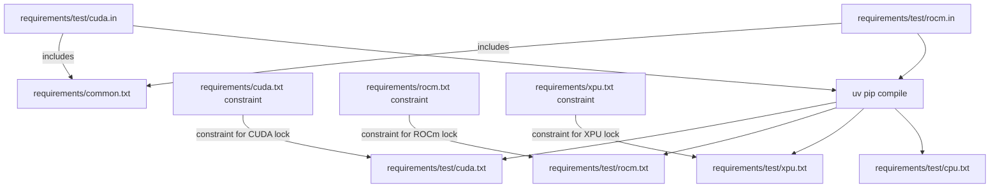
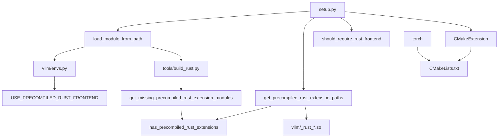
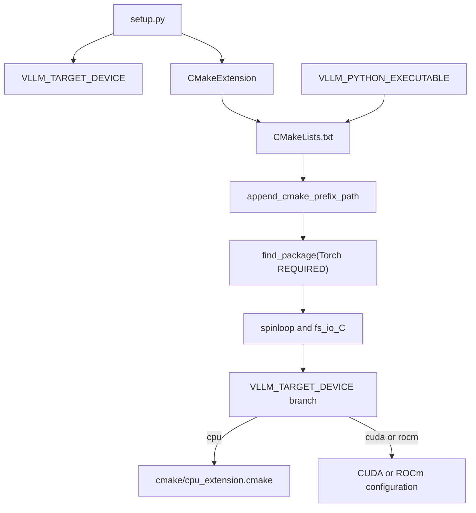

<!-- source: DeepWiki mcp.deepwiki.com · repo vllm-project/vllm · page 11.2 Dependency Management · fetched 2026-10-28 -->

# Dependency Management

Relevant source files

The following files were used as context for generating this wiki page:

- [.github/workflows/scripts/build.sh](.github/workflows/scripts/build.sh)
- [CMakeLists.txt](CMakeLists.txt)
- [cmake/external_projects/qutlass.cmake](cmake/external_projects/qutlass.cmake)
- [cmake/utils.cmake](cmake/utils.cmake)
- [csrc/activation_kernels.cu](csrc/activation_kernels.cu)
- [csrc/cpu/activation.cpp](csrc/cpu/activation.cpp)
- [csrc/cpu/activation_lut_bf16.cpp](csrc/cpu/activation_lut_bf16.cpp)
- [csrc/cpu/cpu_attn_vsx.hpp](csrc/cpu/cpu_attn_vsx.hpp)
- [csrc/cpu/cpu_tanhf_neon.hpp](csrc/cpu/cpu_tanhf_neon.hpp)
- [csrc/cpu/cpu_types.hpp](csrc/cpu/cpu_types.hpp)
- [csrc/cpu/cpu_types_arm.hpp](csrc/cpu/cpu_types_arm.hpp)
- [csrc/cpu/cpu_types_scalar.hpp](csrc/cpu/cpu_types_scalar.hpp)
- [csrc/cpu/cpu_types_vsx.hpp](csrc/cpu/cpu_types_vsx.hpp)
- [csrc/cpu/cpu_types_vxe.hpp](csrc/cpu/cpu_types_vxe.hpp)
- [csrc/cpu/dnnl_helper.cpp](csrc/cpu/dnnl_helper.cpp)
- [csrc/cpu/dnnl_helper.h](csrc/cpu/dnnl_helper.h)
- [csrc/cpu/dnnl_kernels.cpp](csrc/cpu/dnnl_kernels.cpp)
- [csrc/cpu/mla_decode.cpp](csrc/cpu/mla_decode.cpp)
- [csrc/cpu/pos_encoding.cpp](csrc/cpu/pos_encoding.cpp)
- [csrc/moe/moe_ops.h](csrc/moe/moe_ops.h)
- [csrc/moe/torch_bindings.cpp](csrc/moe/torch_bindings.cpp)
- [csrc/ops.h](csrc/ops.h)
- [csrc/torch_bindings.cpp](csrc/torch_bindings.cpp)
- [docker/Dockerfile.s390x](docker/Dockerfile.s390x)
- [docs/configuration/conserving_memory.md](docs/configuration/conserving_memory.md)
- [docs/getting_started/installation/cpu.md](docs/getting_started/installation/cpu.md)
- [docs/getting_started/installation/cpu.s390x.inc.md](docs/getting_started/installation/cpu.s390x.inc.md)
- [pyproject.toml](pyproject.toml)
- [requirements/build/cpu.txt](requirements/build/cpu.txt)
- [requirements/build/cuda.txt](requirements/build/cuda.txt)
- [requirements/common.txt](requirements/common.txt)
- [requirements/cpu.txt](requirements/cpu.txt)
- [requirements/rocm.txt](requirements/rocm.txt)
- [requirements/test/cpu.txt](requirements/test/cpu.txt)
- [requirements/test/cuda.in](requirements/test/cuda.in)
- [requirements/test/cuda.txt](requirements/test/cuda.txt)
- [requirements/test/nightly-torch.txt](requirements/test/nightly-torch.txt)
- [requirements/test/rocm.in](requirements/test/rocm.in)
- [requirements/test/rocm.txt](requirements/test/rocm.txt)
- [requirements/test/xpu.in](requirements/test/xpu.in)
- [requirements/test/xpu.txt](requirements/test/xpu.txt)
- [setup.py](setup.py)
- [tests/kernels/core/test_activation.py](tests/kernels/core/test_activation.py)
- [tests/kernels/core/test_cpu_activation.py](tests/kernels/core/test_cpu_activation.py)
- [tests/kernels/mhc/test_mhc_kernels.py](tests/kernels/mhc/test_mhc_kernels.py)
- [tests/kernels/test_onednn.py](tests/kernels/test_onednn.py)
- [tests/test_cmake_utils.py](tests/test_cmake_utils.py)
- [tests/test_zentorch_version_pin.py](tests/test_zentorch_version_pin.py)
- [vllm/_custom_ops.py](vllm/_custom_ops.py)
- [vllm/model_executor/layers/activation.py](vllm/model_executor/layers/activation.py)
- [vllm/model_executor/layers/quantization/utils/int8_utils.py](vllm/model_executor/layers/quantization/utils/int8_utils.py)
- [vllm/v1/attention/backends/mla/cpu_mla.py](vllm/v1/attention/backends/mla/cpu_mla.py)

## Purpose and scope

This page describes how vLLM declares runtime and test dependencies, checks PyTorch compatibility during native builds, detects precompiled Rust extensions, and connects Python packaging to CMake. The available build configuration shows the supported Python versions and expected CUDA/ROCm PyTorch versions; these must remain aligned with dependency declarations and platform build inputs. [CMakeLists.txt:46-49](), [CMakeLists.txt:62-81]()

Sources: [CMakeLists.txt:46-49](), [CMakeLists.txt:62-81]()

---

## Requirements Files Overview

The requirements tree separates shared runtime constraints from platform and test dependencies. `requirements/common.txt` contains broadly shared runtime dependencies, including Transformers, serving libraries, serialization, and multimodal support. The test inputs include the shared file and add test tools and feature-specific packages. [requirements/common.txt:1-59](), [requirements/test/cuda.in:1-47](), [requirements/test/rocm.in:1-44]()

The supplied test lock files are generated by `uv pip compile`. CUDA and ROCm lock generation uses the corresponding platform requirements as a constraint; the XPU lock also uses `requirements/xpu.txt` as a constraint. The CUDA lock command specifies a PyTorch backend, target platform, and Python version, while the ROCm command excludes PyTorch and related packages from the emitted lock output. [requirements/test/cuda.txt:1-2](), [requirements/test/rocm.txt:1-2](), [requirements/test/xpu.txt:1-2]()

| File | Role evidenced by the supplied files |
|---|---|
| `requirements/common.txt` | Shared runtime dependency constraints. [requirements/common.txt:1-59]() |
| `requirements/test/cuda.in` | CUDA test input; includes `common.txt`, test dependencies, and explicit PyTorch-related pins. [requirements/test/cuda.in:1-47]() |
| `requirements/test/rocm.in` | ROCm test input; includes `common.txt` and ROCm test extras. [requirements/test/rocm.in:1-44]() |
| `requirements/test/cuda.txt` | Generated CUDA test lock file. [requirements/test/cuda.txt:1-2]() |
| `requirements/test/rocm.txt` | Generated ROCm test lock file. [requirements/test/rocm.txt:1-2]() |
| `requirements/test/xpu.txt` | Generated XPU test lock file. [requirements/test/xpu.txt:1-2]() |
| `requirements/test/cpu.txt` | Generated CPU test lock file, compiled from the CUDA test input with a CPU PyTorch backend. [requirements/test/cpu.txt:1-2]() |

The supplied files do not show the full runtime platform requirement files, so their package contents and exact include relationships are not enumerated here.

Sources: [requirements/common.txt:1-59](), [requirements/test/cuda.in:1-47](), [requirements/test/rocm.in:1-44](), [requirements/test/cuda.txt:1-2](), [requirements/test/rocm.txt:1-2](), [requirements/test/xpu.txt:1-2](), [requirements/test/cpu.txt:1-2]()

---

## Requirements File Include Graph

The test `.in` files include the shared dependency set. `uv pip compile` turns those inputs into platform-oriented lock files, using constraints where specified. The graph distinguishes input files and lock-generation constraints; it does not imply that every platform has an available `.in` file in the supplied content. [requirements/test/cuda.in:1-1](), [requirements/test/rocm.in:1-1](), [requirements/test/cuda.txt:1-2](), [requirements/test/rocm.txt:1-2](), [requirements/test/xpu.txt:1-2](), [requirements/test/cpu.txt:1-2]()

**Diagram: Requirements inputs and generated locks**

Sources: [requirements/test/cuda.in:1-1](), [requirements/test/rocm.in:1-1](), [requirements/test/cuda.txt:1-2](), [requirements/test/rocm.txt:1-2](), [requirements/test/xpu.txt:1-2](), [requirements/test/cpu.txt:1-2]()

---

## Core Runtime Dependencies (`common.txt`)

`requirements/common.txt` defines shared constraints rather than a fully locked environment. Notable groups include:

- **Model and tokenizer ecosystem:** `transformers`, `huggingface_hub`, `tokenizers`, `sentencepiece`, and `safetensors`. [requirements/common.txt:4-13]()
- **Serving and API libraries:** FastAPI, Starlette, `aiohttp`, `openai`, and Pydantic. [requirements/common.txt:16-20]()
- **Structured output and schema support:** `lm-format-enforcer`, `llguidance`, `outlines_core`, `lark`, `xgrammar`, and `jsonschema`. [requirements/common.txt:25-33]()
- **Multimodal and media dependencies:** Pillow, `mistral_common[image]`, and `opencv-python-headless`. [requirements/common.txt:22-37]()
- **Serialization, communication, and observability:** `pyzmq`, `msgspec`, `cbor2`, and OpenTelemetry packages. [requirements/common.txt:34-35](), [requirements/common.txt:49-59]()
- **Build and compilation support:** `setuptools` and `ninja`. [requirements/common.txt:39-47]()

Several constraints include platform markers or upper bounds. For example, protobuf uses a platform-specific version rule for `s390x`, while `llguidance` and `xgrammar` restrict installation by machine architecture. [requirements/common.txt:14-15](), [requirements/common.txt:26-29]()

Sources: [requirements/common.txt:4-15](), [requirements/common.txt:16-37](), [requirements/common.txt:39-59]()

---

## Platform-Specific Dependencies and Test Inputs

### CUDA Test Dependencies

The supplied CUDA test input includes `common.txt`, test runners and utilities, multimodal test dependencies, evaluation packages, and explicit PyTorch-family pins. It pins `torch==2.14.0`, `torchaudio==2.11.0`, and `torchvision==0.29.0`; it also pins Transformers for this test environment. [requirements/test/cuda.in:1-2](), [requirements/test/cuda.in:31-44]()

The generated CUDA lock header records that compilation used `--torch-backend cu130`, a manylinux target, and Python 3.12, with `requirements/cuda.txt` as a constraint. The lock command is evidence of how that lock was generated; it is not, by itself, a description of every CUDA runtime dependency. [requirements/test/cuda.txt:1-2]()

### ROCm Test Dependencies

The ROCm test input shares the common dependency base and adds test and ROCm-relevant packages. It pins `ray` to `2.55.1`, specifies test packages such as `bitsandbytes` and `tilelang`, and includes a ROCm-specific extras section. [requirements/test/rocm.in:1-2](), [requirements/test/rocm.in:22-44](), [requirements/test/rocm.in:106-111]()

The generated ROCm lock command constrains against `requirements/rocm.txt` and excludes PyTorch and a number of CUDA-related packages from the emitted output. [requirements/test/rocm.txt:1-2]()

### XPU and CPU Test Locks

The supplied XPU lock is generated using `requirements/xpu.txt` as a constraint, with a manylinux target and Python 3.12. The CPU test lock is generated from the CUDA test input using the CPU PyTorch backend; its header does not show a platform requirements constraint. [requirements/test/xpu.txt:1-2](), [requirements/test/cpu.txt:1-2]()

The lock files are platform-specific snapshots: the supplied CUDA, ROCm, XPU, and CPU locks show differing resolved versions for some packages. Their generated headers identify the resolver inputs and target settings. [requirements/test/cuda.txt:1-2](), [requirements/test/rocm.txt:1-2](), [requirements/test/xpu.txt:1-2](), [requirements/test/cpu.txt:1-2]()

Sources: [requirements/test/cuda.in:1-2](), [requirements/test/cuda.in:31-44](), [requirements/test/cuda.txt:1-2](), [requirements/test/rocm.in:1-2](), [requirements/test/rocm.in:22-44](), [requirements/test/rocm.in:106-111](), [requirements/test/rocm.txt:1-2](), [requirements/test/xpu.txt:1-2](), [requirements/test/cpu.txt:1-2]()

---

## PyTorch Version Handling

PyTorch version requirements are represented in more than one part of the build configuration:

1. The CUDA test input explicitly pins PyTorch and its associated audio and vision packages. [requirements/test/cuda.in:31-33]()
2. `CMakeLists.txt` defines expected CUDA and ROCm Torch versions as `2.14.0`. Its comments state that a mismatch currently results in a warning rather than an error. [CMakeLists.txt:62-72]()
3. CMake detects `TORCH_NIGHTLY_BUILD` only when the environment variable `TORCH_NIGHTLY` is exactly `"1"`. In that case the supported-version check is treated as a nightly build check and does not emit the normal supported-version warning. [CMakeLists.txt:73-81]()

The CMake configuration derives the CUDA Torch version from `pyproject.toml` and requirements files, and the ROCm Torch version from `docker/Dockerfile.rocm`; the comments explicitly call for keeping these values consistent. [CMakeLists.txt:67-70]()

| Build input or setting | Behavior shown |
|---|---|
| `TORCH_SUPPORTED_VERSION_CUDA` | Expected CUDA Torch version: `2.14.0`. [CMakeLists.txt:71-72]() |
| `TORCH_SUPPORTED_VERSION_ROCM` | Expected ROCm Torch version: `2.14.0`. [CMakeLists.txt:71-72]() |
| `TORCH_NIGHTLY=1` | Marks the CMake build as nightly for the supported-version check. [CMakeLists.txt:73-81]() |
| Other `TORCH_NIGHTLY` values, including `0` | Do not satisfy the exact `"1"` test and therefore do not suppress the normal-build warning. [CMakeLists.txt:73-81]() |

CMake adds the selected Python installation’s Torch CMake prefix and then calls `find_package(Torch REQUIRED)`. This makes the Python environment’s installed Torch package part of native-extension configuration. [CMakeLists.txt:84-98](), [CMakeLists.txt:107-112]()

Sources: [requirements/test/cuda.in:31-33](), [CMakeLists.txt:62-81](), [CMakeLists.txt:84-98](), [CMakeLists.txt:107-112]()

---

## Precompiled Wheels and Rust Frontend Integration

### Precompiled Rust Extension Detection

`setup.py` identifies the Rust frontend artifact directory as `vllm/vllm-rs` and defines a filename pattern for Rust extension members under `vllm/`. It also discovers installed-style extension files by globbing `vllm/_rust_*.so`. [setup.py:49-52](), [setup.py:74-75]()

The setup script loads `vllm/envs.py` and `tools/build_rust.py` directly from their paths before the package is installed. It reads `VLLM_USE_PRECOMPILED` from the loaded environment module and uses that setting, or `VLLM_USE_PRECOMPILED_RUST`, to derive whether the precompiled Rust frontend is enabled. [setup.py:54-67]()

The Rust extension checks work from the expected module names supplied by `rust_build.rust_py_extension_module_names()`:

- `get_precompiled_rust_extension_paths()` lists matching `_rust_*.so` files. [setup.py:74-75]()
- `get_missing_precompiled_rust_extension_modules()` compares the present module basenames with the expected names. [setup.py:78-87]()
- `has_precompiled_rust_extensions()` returns false when no Rust extension modules are expected, or when one or more expected modules are missing. [setup.py:89-93]()

`should_require_rust_frontend()` interprets `VLLM_REQUIRE_RUST_FRONTEND` as enabled unless its lowercased value is empty or one of `0`, `false`, or `no`. The shown code defines this policy helper; it does not establish the later build-command behavior that consumes it. [setup.py:69-72]()

### Python Packaging and Native Build Entities

`setup.py` imports `build_rust` from `setuptools_rust`, imports `torch`, and defines `CMakeExtension`, a setuptools extension whose sources list is empty and whose `cmake_lists_dir` is stored as an absolute path. [setup.py:17-23](), [setup.py:202-206]()

`CMakeLists.txt` requires CMake 3.26 and C++20, CUDA 20, and HIP 20 language standards. It requires an explicitly supplied `VLLM_PYTHON_EXECUTABLE`, checks supported Python versions, adds the Torch CMake prefix path, and requires Torch via `find_package(Torch REQUIRED)`. [CMakeLists.txt:1-21](), [CMakeLists.txt:46-49](), [CMakeLists.txt:84-98](), [CMakeLists.txt:107-112]()

The CMake project sets `VLLM_TARGET_DEVICE` to CUDA by default, while `setup.py` reads the target device from `vllm.envs` and can infer a target from the installed Torch build on Linux when `VLLM_TARGET_DEVICE` is unset. [CMakeLists.txt:32-35](), [setup.py:54-67](), [setup.py:110-122]()

**Diagram: Python setup and build entities**

Sources: [setup.py:17-23](), [setup.py:49-93](), [setup.py:99-122](), [setup.py:202-206](), [CMakeLists.txt:1-21](), [CMakeLists.txt:32-35](), [CMakeLists.txt:84-112]()

### CMake Extension Targets and Installation

The CMake project defines pure-C++ `spinloop` and `fs_io_C` extension targets before the non-CUDA device branch. Both target the `vllm` package destination and use the CPython stable ABI at version 3.11. [CMakeLists.txt:134-164]()

For non-CUDA and non-ROCm targets, CMake includes `cmake/cpu_extension.cmake` when the selected device is `cpu`, then returns before the CUDA/ROCm build path. Other non-CUDA/non-ROCm targets return directly. [CMakeLists.txt:167-177]()

The CMake file documents that a direct CMake build must run its install step so shared objects land in the expected location; it also gives an example of building and installing the `_C` component. [CMakeLists.txt:3-13]()

**Diagram: Build configuration flow from `setup.py` to CMake**

Sources: [setup.py:61-67](), [setup.py:202-206](), [CMakeLists.txt:84-112](), [CMakeLists.txt:134-177]()

---

## Build-Time Device and Python Selection

On macOS, `setup.py` changes a non-CPU target to CPU. On Linux, when `VLLM_TARGET_DEVICE` is not set, it detects ROCm, XPU, or CUDA from `torch.version` and falls back to CPU if none of those backends is present. Unsupported operating systems cause a warning and set the target to `empty`. [setup.py:99-122]()

CMake requires callers to provide `VLLM_PYTHON_EXECUTABLE`. It searches supported Python versions in order, with the list currently declared as Python 3.11, 3.12, 3.13, and 3.14; the CMake comments require this list to stay synchronized with `setup.py`. [CMakeLists.txt:46-49](), [CMakeLists.txt:84-93]()

CMake’s top-level target defaults to `cuda`, but it can be overridden with `VLLM_TARGET_DEVICE`. The CPU branch is forwarded to `cmake/cpu_extension.cmake`; CUDA and ROCm continue through the GPU-specific configuration path. [CMakeLists.txt:32-35](), [CMakeLists.txt:167-177]()

Sources: [setup.py:99-122](), [CMakeLists.txt:32-35](), [CMakeLists.txt:46-49](), [CMakeLists.txt:84-93](), [CMakeLists.txt:167-177]()

---

## Summary

Dependency declarations are layered: `requirements/common.txt` supplies shared runtime constraints, test `.in` files add test-specific packages, and generated platform lock files record resolved environments and their compile settings. [requirements/common.txt:1-59](), [requirements/test/cuda.in:1-2](), [requirements/test/rocm.in:1-2](), [requirements/test/cuda.txt:1-2](), [requirements/test/rocm.txt:1-2](), [requirements/test/xpu.txt:1-2](), [requirements/test/cpu.txt:1-2]()

PyTorch compatibility is checked during CMake configuration against expected CUDA and ROCm versions, with an exact `TORCH_NIGHTLY=1` condition for nightly builds. The setup/build integration connects setuptools’ `CMakeExtension` to CMake, where Python and Torch are selected before extension configuration. Rust precompiled artifacts are checked against expected module names, while the setup file also exposes a setting to require the Rust frontend. [CMakeLists.txt:62-112](), [setup.py:49-93](), [setup.py:202-206]()

Sources: [requirements/common.txt:1-59](), [requirements/test/cuda.in:1-2](), [requirements/test/rocm.in:1-2](), [requirements/test/cuda.txt:1-2](), [requirements/test/rocm.txt:1-2](), [requirements/test/xpu.txt:1-2](), [requirements/test/cpu.txt:1-2](), [CMakeLists.txt:62-112](), [setup.py:49-93](), [setup.py:202-206]()

---

