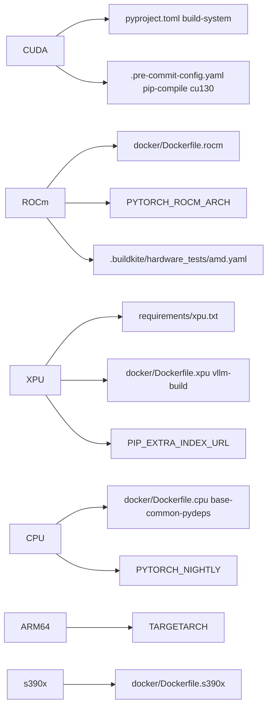
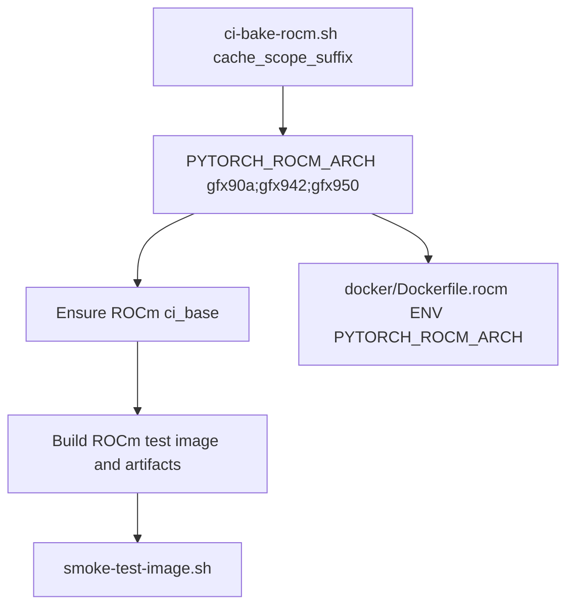
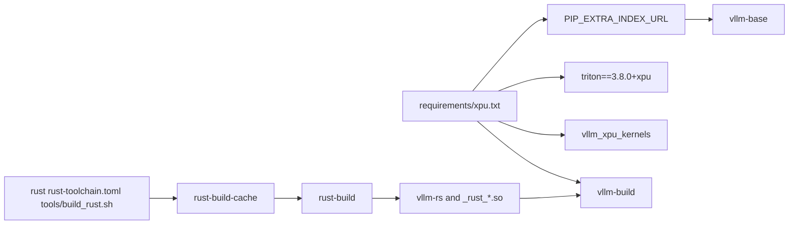
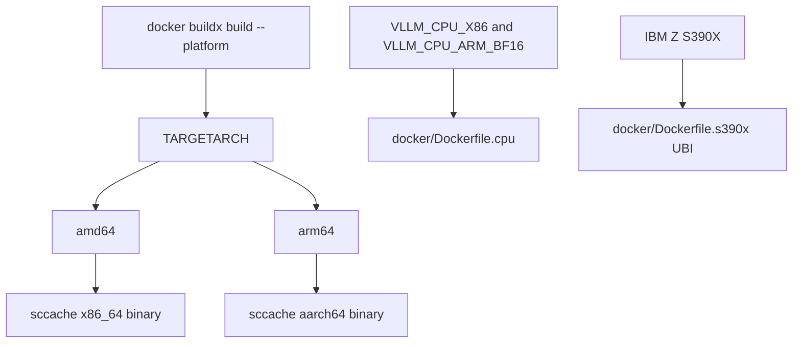
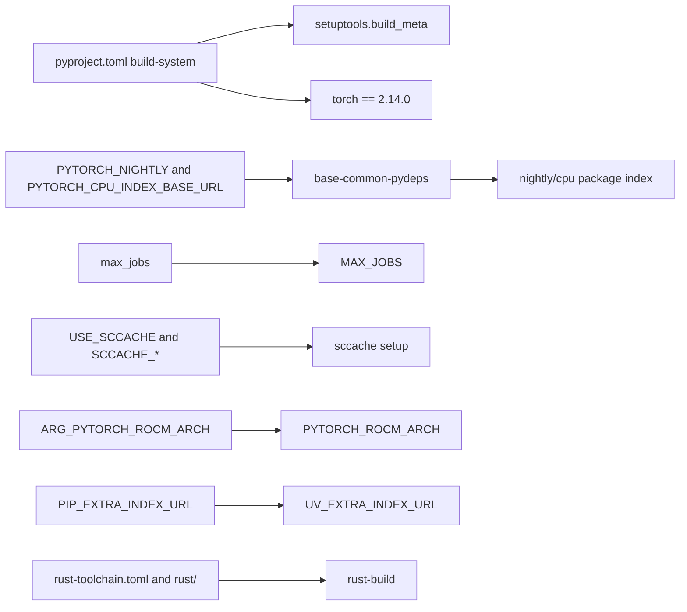

<!-- source: DeepWiki mcp.deepwiki.com · repo vllm-project/vllm · page 11.3 Build Variants and Configuration · fetched 2026-10-28 -->

# Build Variants and Configuration

Relevant source files

The following files were used as context for generating this wiki page:

- [.buildkite/hardware_tests/amd.yaml](.buildkite/hardware_tests/amd.yaml)
- [.buildkite/image_build/image_build.yaml](.buildkite/image_build/image_build.yaml)
- [.buildkite/scripts/ci-bake-rocm.sh](.buildkite/scripts/ci-bake-rocm.sh)
- [.buildkite/scripts/hardware_ci/run-amd-test.sh](.buildkite/scripts/hardware_ci/run-amd-test.sh)
- [.buildkite/scripts/rocm/build-ci-base.sh](.buildkite/scripts/rocm/build-ci-base.sh)
- [.buildkite/scripts/rocm/build-config.sh](.buildkite/scripts/rocm/build-config.sh)
- [.buildkite/scripts/rocm/build-test-image.sh](.buildkite/scripts/rocm/build-test-image.sh)
- [.buildkite/scripts/rocm/refresh-base-image.sh](.buildkite/scripts/rocm/refresh-base-image.sh)
- [.buildkite/scripts/rocm/smoke-test-image.sh](.buildkite/scripts/rocm/smoke-test-image.sh)
- [.buildkite/test_areas/docker.yaml](.buildkite/test_areas/docker.yaml)
- [.buildkite/test_areas/torch_abi.yaml](.buildkite/test_areas/torch_abi.yaml)
- [.dockerignore](.dockerignore)
- [.pre-commit-config.yaml](.pre-commit-config.yaml)
- [README.md](README.md)
- [csrc/cpu/cpu_attn_vsx.hpp](csrc/cpu/cpu_attn_vsx.hpp)
- [csrc/cpu/cpu_types.hpp](csrc/cpu/cpu_types.hpp)
- [csrc/cpu/cpu_types_arm.hpp](csrc/cpu/cpu_types_arm.hpp)
- [csrc/cpu/cpu_types_scalar.hpp](csrc/cpu/cpu_types_scalar.hpp)
- [csrc/cpu/cpu_types_vsx.hpp](csrc/cpu/cpu_types_vsx.hpp)
- [csrc/cpu/cpu_types_vxe.hpp](csrc/cpu/cpu_types_vxe.hpp)
- [csrc/cpu/dnnl_helper.cpp](csrc/cpu/dnnl_helper.cpp)
- [csrc/cpu/dnnl_helper.h](csrc/cpu/dnnl_helper.h)
- [csrc/cpu/dnnl_kernels.cpp](csrc/cpu/dnnl_kernels.cpp)
- [csrc/cpu/mla_decode.cpp](csrc/cpu/mla_decode.cpp)
- [csrc/cpu/pos_encoding.cpp](csrc/cpu/pos_encoding.cpp)
- [docker/Dockerfile.cpu](docker/Dockerfile.cpu)
- [docker/Dockerfile.ppc64le](docker/Dockerfile.ppc64le)
- [docker/Dockerfile.rocm](docker/Dockerfile.rocm)
- [docker/Dockerfile.rocm_gfx1250](docker/Dockerfile.rocm_gfx1250)
- [docker/Dockerfile.s390x](docker/Dockerfile.s390x)
- [docker/Dockerfile.xpu](docker/Dockerfile.xpu)
- [docker/build_vllm_ppc64le.sh](docker/build_vllm_ppc64le.sh)
- [docker/ci-rocm.hcl](docker/ci-rocm.hcl)
- [docker/docker-bake-rocm.hcl](docker/docker-bake-rocm.hcl)
- [docker/entrypoints/test_vllm_nonroot_entrypoint.sh](docker/entrypoints/test_vllm_nonroot_entrypoint.sh)
- [docker/entrypoints/vllm-nonroot-entrypoint.sh](docker/entrypoints/vllm-nonroot-entrypoint.sh)
- [docs/assets/models/pooling_models/cheat_sheet.svg](docs/assets/models/pooling_models/cheat_sheet.svg)
- [docs/assets/models/pooling_models/pooling_types.svg](docs/assets/models/pooling_models/pooling_types.svg)
- [docs/assets/models/pooling_models/score_types.svg](docs/assets/models/pooling_models/score_types.svg)
- [docs/benchmarking/README.md](docs/benchmarking/README.md)
- [docs/configuration/README.md](docs/configuration/README.md)
- [docs/configuration/conserving_memory.md](docs/configuration/conserving_memory.md)
- [docs/configuration/serve_args.md](docs/configuration/serve_args.md)
- [docs/deployment/docker.md](docs/deployment/docker.md)
- [docs/features/structured_outputs.md](docs/features/structured_outputs.md)
- [docs/getting_started/installation/README.md](docs/getting_started/installation/README.md)
- [docs/getting_started/installation/cpu.md](docs/getting_started/installation/cpu.md)
- [docs/getting_started/installation/cpu.s390x.inc.md](docs/getting_started/installation/cpu.s390x.inc.md)
- [docs/getting_started/installation/gpu.apple.inc.md](docs/getting_started/installation/gpu.apple.inc.md)
- [docs/getting_started/installation/gpu.md](docs/getting_started/installation/gpu.md)
- [docs/getting_started/installation/gpu.rocm.inc.md](docs/getting_started/installation/gpu.rocm.inc.md)
- [docs/getting_started/installation/gpu.xpu.inc.md](docs/getting_started/installation/gpu.xpu.inc.md)
- [docs/getting_started/quickstart.md](docs/getting_started/quickstart.md)
- [docs/models/generative_models.md](docs/models/generative_models.md)
- [docs/usage/troubleshooting.md](docs/usage/troubleshooting.md)
- [pyproject.toml](pyproject.toml)
- [requirements/build/cpu.txt](requirements/build/cpu.txt)
- [requirements/build/cuda.txt](requirements/build/cuda.txt)
- [requirements/cpu.txt](requirements/cpu.txt)
- [requirements/xpu.txt](requirements/xpu.txt)
- [tests/cuda/test_cuda_compatibility_path.py](tests/cuda/test_cuda_compatibility_path.py)
- [tests/evals/gsm8k/README.md](tests/evals/gsm8k/README.md)
- [tests/kernels/test_onednn.py](tests/kernels/test_onednn.py)
- [tests/standalone_tests/python_only_compile.sh](tests/standalone_tests/python_only_compile.sh)
- [tests/test_zentorch_version_pin.py](tests/test_zentorch_version_pin.py)
- [tests/tools/test_check_trust_remote_code.py](tests/tools/test_check_trust_remote_code.py)
- [tests/tools/test_docker_build_metadata_args.py](tests/tools/test_docker_build_metadata_args.py)
- [tools/check_repo.sh](tools/check_repo.sh)
- [tools/pre_commit/check_dockerignore_tracked.py](tools/pre_commit/check_dockerignore_tracked.py)
- [tools/pre_commit/check_trust_remote_code.py](tools/pre_commit/check_trust_remote_code.py)
- [vllm/v1/attention/backends/mla/cpu_mla.py](vllm/v1/attention/backends/mla/cpu_mla.py)

## Purpose and Scope

This page describes the build variants and configuration inputs evidenced in the provided build and installation files: CUDA, ROCm, XPU, and CPU; CPU nightly PyTorch builds; ARM64 and s390x targets; and selected Docker build options. It focuses on how build inputs select dependencies, target architectures, and build stages. [pyproject.toml:1-14](), [requirements/xpu.txt:1-23](), [docker/Dockerfile.cpu:1-18](), [docker/Dockerfile.rocm:1-17](), [docker/Dockerfile.xpu:1-4](), [docker/Dockerfile.s390x:1-10]()

Sources: [pyproject.toml:1-14](), [requirements/xpu.txt:1-23](), [docker/Dockerfile.cpu:1-18](), [docker/Dockerfile.rocm:1-17](), [docker/Dockerfile.xpu:1-4](), [docker/Dockerfile.s390x:1-10]()

---

## Build Variant Overview

The supplied files show separate dependency and image-build paths for XPU, CPU, and ROCm, plus a Python build-system configuration that pins PyTorch to `2.14.0`. The XPU requirements select XPU-specific indexes and packages; the CPU Dockerfile supports `linux/amd64` and `linux/arm64` and has a CPU-nightly option; and the ROCm Dockerfile accepts ROCm architecture configuration through `PYTORCH_ROCM_ARCH`. [pyproject.toml:1-14](), [requirements/xpu.txt:1-23](), [docker/Dockerfile.cpu:1-18](), [docker/Dockerfile.cpu:143-165](), [docker/Dockerfile.rocm:34-38]()

| Variant or target | Build inputs visible in the supplied files | Build-specific evidence |
|---|---|---|
| CUDA | The Python build-system requirements pin `torch == 2.14.0`; the supplied pre-commit configuration compiles CUDA test requirements with the `cu130` torch backend. [pyproject.toml:1-14](), [.pre-commit-config.yaml:42-55]() | The provided files do not include the CUDA Dockerfile or a complete CUDA build configuration. |
| ROCm | `PYTORCH_ROCM_ARCH` is passed into the ROCm image build environment. [docker/Dockerfile.rocm:34-38]() | ROCm CI sets architectures to `gfx90a;gfx942;gfx950` and builds a test image after preparing its base images. [.buildkite/hardware_tests/amd.yaml:30-80]() |
| XPU | `requirements/xpu.txt` selects the XPU wheel index, `triton==3.8.0+xpu`, and the PyTorch XPU index with `torch==2.14.0`. [requirements/xpu.txt:1-23]() | The XPU Dockerfile builds a separate Rust frontend stage and uses an XPU-specific Python package index. [docker/Dockerfile.xpu:1-4](), [docker/Dockerfile.xpu:42-50](), [docker/Dockerfile.xpu:121-130]() |
| CPU | The CPU Dockerfile supports `linux/amd64` and `linux/arm64` and accepts CPU-specific cross-compilation arguments. [docker/Dockerfile.cpu:1-18]() | `PYTORCH_NIGHTLY` switches the CPU image’s dependency installation to the PyTorch nightly CPU index. [docker/Dockerfile.cpu:143-165]() |
| s390x | The dedicated Dockerfile starts from a UBI 9 minimal image and configures a Python version and GCC toolset. [docker/Dockerfile.s390x:1-27]() | The provided CPU installation page lists IBM Z (S390X) as a CPU platform option. [docs/getting_started/installation/cpu.md:5-23]() |

### Build Inputs to Platform-Specific Artifacts

The diagram maps platform names and user-facing build concepts to identifiers present in the supplied files. It describes the inputs and artifacts shown there; it does not imply that the files contain a single automatic platform-detection function.

**Diagram: Platform choices mapped to build and dependency entities**

Sources: [pyproject.toml:1-14](), [.pre-commit-config.yaml:42-55](), [docker/Dockerfile.rocm:34-38](), [.buildkite/hardware_tests/amd.yaml:30-80](), [requirements/xpu.txt:1-23](), [docker/Dockerfile.xpu:42-50](), [docker/Dockerfile.xpu:121-130](), [docker/Dockerfile.cpu:1-18](), [docker/Dockerfile.cpu:143-165](), [docker/Dockerfile.s390x:1-10]()

---

## CUDA Build Variant

The `pyproject.toml` build-system requirements include `torch == 2.14.0`, along with CMake, Ninja, packaging, setuptools, setuptools-scm, setuptools-rust, wheel, and Jinja2. The comment in the file says these requirements should be mirrored in `requirements/build/cuda.txt`. [pyproject.toml:1-14]()

The supplied `.pre-commit-config.yaml` configures a CUDA test-requirements compilation hook with `--torch-backend cu130`, the `x86_64-manylinux_2_28` platform, and Python 3.12. This is evidence about the test dependency compilation configuration; it does not provide the complete CUDA wheel or Docker build pipeline. [.pre-commit-config.yaml:42-55]()

The available content does not include the CUDA requirements file or CUDA Dockerfile. Consequently, this page does not infer CUDA-specific library versions, image bases, or extension-build behavior not shown in the supplied files.

Sources: [pyproject.toml:1-14](), [.pre-commit-config.yaml:42-55]()

---

## ROCm Build Variant

### Architecture and Docker Inputs

The ROCm Dockerfile defines build arguments including `BASE_IMAGE`, `CI_BASE_IMAGE`, `REMOTE_VLLM`, `VLLM_REPO`, and `VLLM_BRANCH`. It also accepts `ARG_PYTORCH_ROCM_ARCH` and exports it as `PYTORCH_ROCM_ARCH`, falling back to an existing value if the argument is unset. [docker/Dockerfile.rocm:1-8](), [docker/Dockerfile.rocm:34-38]()

The Dockerfile’s `NIC_BACKEND` argument defaults to `all`; its comments describe `ainic`, `bnxt`, and `none` as explicit alternatives. It also defines `AINIC_VERSION` and `UBUNTU_CODENAME` inputs. These are image-build options, not a general description of ROCm runtime device selection. [docker/Dockerfile.rocm:9-23]()

### ROCm CI Architecture Selection

The AMD hardware CI configuration sets `PYTORCH_ROCM_ARCH` to `gfx90a;gfx942;gfx950` for both the `ci_base` and ROCm test-image builds. Its image flow refreshes a ROCm base, ensures `ci_base`, builds the test image, and smoke-tests that image before GPU test jobs run. [.buildkite/hardware_tests/amd.yaml:3-6](), [.buildkite/hardware_tests/amd.yaml:30-80]()

The CI wrapper records `PYTORCH_ROCM_ARCH` in its cache-scope suffix, so architecture selection participates in ROCm cache scoping. [.buildkite/scripts/ci-bake-rocm.sh:91-95]()

### ROCm Build Flow

**Diagram: ROCm CI architecture input mapped to image stages**

Sources: [docker/Dockerfile.rocm:34-38](), [.buildkite/hardware_tests/amd.yaml:3-6](), [.buildkite/hardware_tests/amd.yaml:30-80](), [.buildkite/scripts/ci-bake-rocm.sh:91-95]()

---

## XPU Build Variant (Intel GPU)

### Requirements and Package Indexes

`requirements/xpu.txt` includes common requirements, adds the `https://wheels.vllm.ai/xpu/` extra index, and pins `triton==3.8.0+xpu`. It also configures the PyTorch XPU index and pins `torch==2.14.0`; `torchaudio`, `torchvision`, and `torchcodec >= 0.14` are included as dependencies. The file additionally specifies `auto_round_lib==0.16.0` and `vllm_xpu_kernels==0.1.15.4`. [requirements/xpu.txt:1-23]()

The XPU installation documentation identifies Intel Data Center GPU and Intel ARC GPU as supported hardware and states that the referenced `vllm-xpu-kernels` wheel is Python 3.12-specific. [docs/getting_started/installation/gpu.xpu.inc.md:7-15]()

### Docker Build Stages and Configuration

`docker/Dockerfile.xpu` builds the Rust frontend in a dedicated `rust-build-cache` stage, then relinks the Rust artifacts in a `rust-build` stage using Git-derived version metadata. The Dockerfile comments explain that separating the Rust build keeps the toolchain out of the main image and allows the Rust build to run in parallel with `vllm-base`. [docker/Dockerfile.xpu:1-4](), [docker/Dockerfile.xpu:14-40]()

The `vllm-base` stage uses Ubuntu 24.04, accepts `PYTHON_VERSION` and `PIP_EXTRA_INDEX_URL`, installs Intel GPU runtime packages, and creates a Python virtual environment. It exports the package index through both `PIP_EXTRA_INDEX_URL` and `UV_EXTRA_INDEX_URL`. [docker/Dockerfile.xpu:42-50](), [docker/Dockerfile.xpu:73-86](), [docker/Dockerfile.xpu:107-125]()

The `vllm-build` stage installs XPU requirements, copies the source tree, and copies the prebuilt Rust shared objects and `vllm-rs` artifacts into the source tree. Its comments state that `setup.py` detects those artifacts and ships them as-is, skipping a local Rust build. [docker/Dockerfile.xpu:142-159]()

### XPU Package-to-Image Mapping

**Diagram: XPU dependencies and Rust artifacts mapped to Docker stages**

Sources: [requirements/xpu.txt:1-23](), [docker/Dockerfile.xpu:14-40](), [docker/Dockerfile.xpu:42-50](), [docker/Dockerfile.xpu:107-125](), [docker/Dockerfile.xpu:142-159]()

---

## CPU Build Variant

### CPU Docker Targets and Build Arguments

The CPU Dockerfile states that it builds images for `linux/amd64` (x86_64) and `linux/arm64` (aarch64). It documents three targets: `vllm-openai` for serving deployment, `vllm-test` for CI tests, and `vllm-dev` for development. Its listed build arguments include `PYTHON_VERSION`, `VLLM_CPU_X86`, and `VLLM_CPU_ARM_BF16`. [docker/Dockerfile.cpu:1-18]()

The shared `base-common` stage sets `MAX_JOBS`, installs compiler and build utilities, configures GCC and G++, and creates a virtual environment. The Dockerfile also defines `TARGETARCH` and uses it to select the architecture-specific sccache binary when sccache is enabled. [docker/Dockerfile.cpu:80-90](), [docker/Dockerfile.cpu:92-128](), [docker/Dockerfile.cpu:37-53]()

### CPU Nightly PyTorch Option

The CPU dependency stage defines `PYTORCH_NIGHTLY=0` by default and a configurable `PYTORCH_CPU_INDEX_BASE_URL`. When nightly mode is selected, the Dockerfile installs nightly CPU builds of `torch`, `torchaudio`, `torchvision`, and `torchcodec`, then invokes `tools/use_existing_torch.py --prefix` before installing the remaining CPU requirements. The file’s comments explain that this prevents the requirements installation from replacing the nightly torch with a release build. [docker/Dockerfile.cpu:143-165]()

The provided CPU installation documentation identifies `https://wheels.vllm.ai/nightly/cpu/` as the nightly wheel index and documents Python-only installation with `VLLM_USE_PRECOMPILED=1`, `VLLM_PRECOMPILED_WHEEL_VARIANT=cpu`, and `VLLM_TARGET_DEVICE=cpu`. [docs/getting_started/installation/cpu.md:57-60](), [docs/getting_started/installation/cpu.md:78-88]()

Sources: [docker/Dockerfile.cpu:1-18](), [docker/Dockerfile.cpu:37-53](), [docker/Dockerfile.cpu:80-128](), [docker/Dockerfile.cpu:143-165](), [docs/getting_started/installation/cpu.md:57-60](), [docs/getting_started/installation/cpu.md:78-88]()

---

## Nightly PyTorch Builds

The supplied CPU Dockerfile supports nightly PyTorch CPU dependencies through the `PYTORCH_NIGHTLY` build argument. Its default is `0`; when set to `1`, it installs prerelease packages from `${PYTORCH_CPU_INDEX_BASE_URL}/nightly/cpu`, invokes `tools/use_existing_torch.py --prefix`, and then installs `requirements/cpu.txt`. The release path remains the default when the argument is not enabled. [docker/Dockerfile.cpu:143-165]()

The CPU installation page describes the CPU nightly wheel index as `https://wheels.vllm.ai/nightly/cpu/`. [docs/getting_started/installation/cpu.md:57-60]()

The XPU installation page separately describes nightly vLLM wheels at `https://wheels.vllm.ai/nightly/xpu` and pairs that index with the PyTorch XPU index. This is an installation route for XPU wheels, distinct from the CPU Dockerfile’s `PYTORCH_NIGHTLY` build argument. [docs/getting_started/installation/gpu.xpu.inc.md:21-33]()

Sources: [docker/Dockerfile.cpu:143-165](), [docs/getting_started/installation/cpu.md:57-60](), [docs/getting_started/installation/gpu.xpu.inc.md:21-33]()

---

## ARM64 and S390x Targets

### ARM64 (aarch64)

The CPU Dockerfile explicitly supports `linux/arm64` and documents `docker buildx build --platform=linux/arm64` as the target-selection method. Its `TARGETARCH` value is used to choose the `aarch64` sccache binary when `USE_SCCACHE=1`. [docker/Dockerfile.cpu:1-8](), [docker/Dockerfile.cpu:37-53]()

The same Dockerfile lists `VLLM_CPU_ARM_BF16` as a build argument for cross-compilation. The supplied content does not show how that argument affects compiler flags or which CPU instructions are ultimately enabled. [docker/Dockerfile.cpu:15-18]()

### S390x

The dedicated `docker/Dockerfile.s390x` starts from `registry.access.redhat.com/ubi9/ubi-minimal`, with configurable `BASE_UBI_IMAGE_TAG` and `PYTHON_VERSION` arguments. It installs `gcc-toolset-14` and associated development packages, then sets the toolset paths in the build environment. [docker/Dockerfile.s390x:1-27]()

The CPU installation page lists IBM Z (S390X) as a CPU installation platform and includes it among the platform-specific requirements, wheel, source-build, and Docker-image sections. [docs/getting_started/installation/cpu.md:21-23](), [docs/getting_started/installation/cpu.md:31-49](), [docs/getting_started/installation/cpu.md:57-76](), [docs/getting_started/installation/cpu.md:90-106](), [docs/getting_started/installation/cpu.md:108-143]()

### Architecture Selection in the CPU Docker Build

**Diagram: Docker target architecture and CPU image configuration**

Sources: [docker/Dockerfile.cpu:1-18](), [docker/Dockerfile.cpu:37-53](), [docker/Dockerfile.s390x:1-27](), [docs/getting_started/installation/cpu.md:21-23]()

---

## Build-Time Configuration Options

### Python Build-System Requirements

The PEP 517 build-system configuration in `pyproject.toml` uses `setuptools.build_meta`. Its build requirements include CMake, Ninja, packaging, setuptools, setuptools-scm, setuptools-rust, PyTorch 2.14.0, wheel, and Jinja2. The project declares Python support from 3.11 up to, but not including, 3.15. [pyproject.toml:1-14](), [pyproject.toml:16-35]()

### Parallelism and Compiler Caching

The CPU Dockerfile defines `max_jobs=32` and exports it as `MAX_JOBS`. It sets `CC` and `CXX` to GCC 15 executables and sets `CMAKE_CXX_COMPILER_LAUNCHER=ccache`. [docker/Dockerfile.cpu:87-90](), [docker/Dockerfile.cpu:118-123]()

The ROCm Dockerfile accepts `max_jobs` and exports it as `MAX_JOBS`; its comments state that an empty value allows build steps to fall back to `$(nproc)`, while CI can override it. [docker/Dockerfile.rocm:69-74]()

Both the CPU and ROCm Dockerfiles support optional sccache configuration. The CPU Dockerfile selects an sccache binary for `amd64` or `arm64`, and defines cache environment variables. The ROCm Dockerfile accepts sccache download and S3-related arguments and conditionally installs or configures sccache when `USE_SCCACHE=1`. [docker/Dockerfile.cpu:37-53](), [docker/Dockerfile.cpu:107-123](), [docker/Dockerfile.rocm:25-32](), [docker/Dockerfile.rocm:76-107]()

### Repository Version and Rust Build Inputs

The ROCm Dockerfile has a version stage that installs Rust build requirements and obtains a version using `setuptools_scm`. Its comments distinguish local or remote Git metadata from archive metadata generated for canonical CI contexts. [docker/Dockerfile.rocm:129-139]()

The XPU Dockerfile separates Rust toolchain and Rust source inputs into dedicated build stages. It first builds with a stable cache version, then relinks using exact Git-derived package-version metadata. [docker/Dockerfile.xpu:1-4](), [docker/Dockerfile.xpu:14-40]()

Sources: [pyproject.toml:1-14](), [pyproject.toml:16-35](), [docker/Dockerfile.cpu:37-53](), [docker/Dockerfile.cpu:87-90](), [docker/Dockerfile.cpu:107-123](), [docker/Dockerfile.rocm:25-32](), [docker/Dockerfile.rocm:69-74](), [docker/Dockerfile.rocm:76-107](), [docker/Dockerfile.rocm:129-139](), [docker/Dockerfile.xpu:1-4](), [docker/Dockerfile.xpu:14-40]()

### Build Configuration Data Flow

**Diagram: Build-time settings mapped to build entities**

Sources: [pyproject.toml:1-14](), [docker/Dockerfile.cpu:143-165](), [docker/Dockerfile.cpu:87-90](), [docker/Dockerfile.cpu:107-123](), [docker/Dockerfile.rocm:34-38](), [docker/Dockerfile.xpu:107-125](), [docker/Dockerfile.xpu:14-40]()

---

## Summary

Build configuration is distributed across Python packaging metadata, platform-specific requirements, Docker build arguments, and CI settings. The supplied files document a CPU Docker build for amd64 and arm64, CPU nightly PyTorch installation, a dedicated s390x image, an XPU requirements and Rust-build path, and ROCm architecture configuration used by AMD CI. The Python build-system requirements pin PyTorch to 2.14.0. [pyproject.toml:1-14](), [docker/Dockerfile.cpu:1-18](), [docker/Dockerfile.cpu:143-165](), [docker/Dockerfile.s390x:1-27](), [requirements/xpu.txt:1-23](), [docker/Dockerfile.xpu:1-40](), [docker/Dockerfile.rocm:34-38](), [.buildkite/hardware_tests/amd.yaml:30-80]()

Sources: [pyproject.toml:1-14](), [docker/Dockerfile.cpu:1-18](), [docker/Dockerfile.cpu:143-165](), [docker/Dockerfile.s390x:1-27](), [requirements/xpu.txt:1-23](), [docker/Dockerfile.xpu:1-40](), [docker/Dockerfile.rocm:34-38](), [.buildkite/hardware_tests/amd.yaml:30-80]()

---

