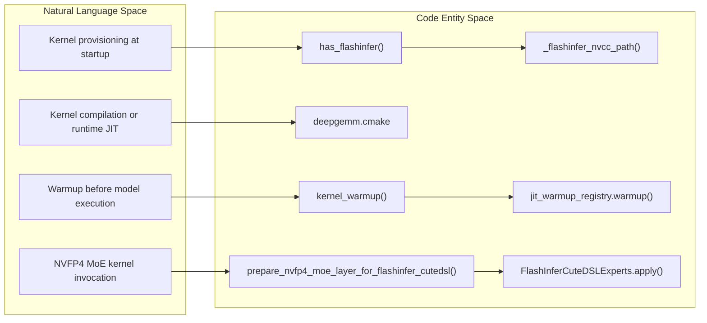
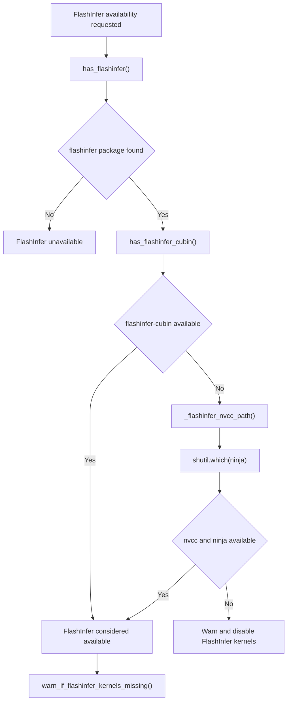
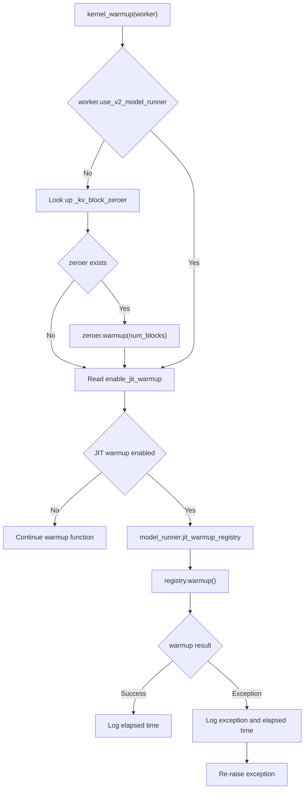
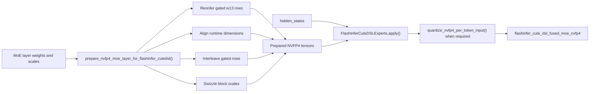

<!-- source: DeepWiki mcp.deepwiki.com · repo vllm-project/vllm · page 11.4 Runtime JIT Compilation · fetched 2026-10-28 -->

# Runtime JIT Compilation

Relevant source files

The following files were used as context for generating this wiki page:

- [.buildkite/check-torch-abi.py](.buildkite/check-torch-abi.py)
- [.buildkite/ci_config.yaml](.buildkite/ci_config.yaml)
- [.buildkite/scripts/hardware_ci/run-cpu-test-ppc64le.sh](.buildkite/scripts/hardware_ci/run-cpu-test-ppc64le.sh)
- [.buildkite/scripts/hardware_ci/run-hpu-test.sh](.buildkite/scripts/hardware_ci/run-hpu-test.sh)
- [.buildkite/scripts/install-kv-connectors.sh](.buildkite/scripts/install-kv-connectors.sh)
- [benchmarks/kernels/benchmark_dsv41_mega_attn.py](benchmarks/kernels/benchmark_dsv41_mega_attn.py)
- [cmake/external_projects/deepgemm.cmake](cmake/external_projects/deepgemm.cmake)
- [cmake/external_projects/flashkda.cmake](cmake/external_projects/flashkda.cmake)
- [csrc/flashkda_registration.cpp](csrc/flashkda_registration.cpp)
- [csrc/nvfp4_kv_cache_kernels.cu](csrc/nvfp4_kv_cache_kernels.cu)
- [requirements/kv_connectors.txt](requirements/kv_connectors.txt)
- [requirements/kv_connectors_cu12.txt](requirements/kv_connectors_cu12.txt)
- [tests/compile/correctness_e2e/test_attn_quant.py](tests/compile/correctness_e2e/test_attn_quant.py)
- [tests/distributed/test_eplb_quant_scale_consistency.py](tests/distributed/test_eplb_quant_scale_consistency.py)
- [tests/kernels/attention/test_cache.py](tests/kernels/attention/test_cache.py)
- [tests/kernels/attention/test_flashinfer_trtllm_attention.py](tests/kernels/attention/test_flashinfer_trtllm_attention.py)
- [tests/kernels/attention/test_use_trtllm_attention.py](tests/kernels/attention/test_use_trtllm_attention.py)
- [tests/kernels/moe/test_cutedsl_moe.py](tests/kernels/moe/test_cutedsl_moe.py)
- [tests/kernels/moe/test_flashinfer.py](tests/kernels/moe/test_flashinfer.py)
- [tests/kernels/moe/test_flashinfer_cutedsl_nvfp4_moe.py](tests/kernels/moe/test_flashinfer_cutedsl_nvfp4_moe.py)
- [tests/kernels/quantization/nvfp4_utils.py](tests/kernels/quantization/nvfp4_utils.py)
- [tests/kernels/test_dsv41_mega_attn_layouts.py](tests/kernels/test_dsv41_mega_attn_layouts.py)
- [tests/model_executor/test_flashinfer_autotune_warmup.py](tests/model_executor/test_flashinfer_autotune_warmup.py)
- [tests/quantization/test_trtllm_nvfp4_hidden_dim_padding.py](tests/quantization/test_trtllm_nvfp4_hidden_dim_padding.py)
- [tests/v1/attention/test_dspark_noncausal_sparse_mla.py](tests/v1/attention/test_dspark_noncausal_sparse_mla.py)
- [tests/v1/attention/test_flashinfer_dcp_spec_reorder.py](tests/v1/attention/test_flashinfer_dcp_spec_reorder.py)
- [tests/v1/attention/test_trtllm_attention_integration.py](tests/v1/attention/test_trtllm_attention_integration.py)
- [tests/v1/kv_connector/mooncake_integration/__init__.py](tests/v1/kv_connector/mooncake_integration/__init__.py)
- [tests/v1/kv_connector/mooncake_integration/test_mooncake_imports.py](tests/v1/kv_connector/mooncake_integration/test_mooncake_imports.py)
- [tests/v1/kv_connector/nixl_integration/test_nixl_imports.py](tests/v1/kv_connector/nixl_integration/test_nixl_imports.py)
- [tests/v1/spec_decode/test_eagle_step_kernel.py](tests/v1/spec_decode/test_eagle_step_kernel.py)
- [tests/v1/spec_decode/test_max_len.py](tests/v1/spec_decode/test_max_len.py)
- [tests/v1/worker/test_eagle3_aux_hidden_states_pp.py](tests/v1/worker/test_eagle3_aux_hidden_states_pp.py)
- [tests/v1/worker/test_gpu_extract_hidden_states_speculator.py](tests/v1/worker/test_gpu_extract_hidden_states_speculator.py)
- [tools/build_deepgemm_C.py](tools/build_deepgemm_C.py)
- [tools/check_wheel_deepgemm.py](tools/check_wheel_deepgemm.py)
- [tools/setup_deepgemm_pythons.sh](tools/setup_deepgemm_pythons.sh)
- [vllm/model_executor/layers/fused_moe/eep_reconfigure.py](vllm/model_executor/layers/fused_moe/eep_reconfigure.py)
- [vllm/model_executor/layers/fused_moe/experts/flashinfer_cutedsl_batched_moe.py](vllm/model_executor/layers/fused_moe/experts/flashinfer_cutedsl_batched_moe.py)
- [vllm/model_executor/layers/fused_moe/experts/flashinfer_cutedsl_moe.py](vllm/model_executor/layers/fused_moe/experts/flashinfer_cutedsl_moe.py)
- [vllm/model_executor/layers/fused_moe/fused_moe_modular_method.py](vllm/model_executor/layers/fused_moe/fused_moe_modular_method.py)
- [vllm/model_executor/layers/fused_moe/prepare_finalize/nixl_ep.py](vllm/model_executor/layers/fused_moe/prepare_finalize/nixl_ep.py)
- [vllm/model_executor/layers/quantization/utils/flashinfer_fp4_moe.py](vllm/model_executor/layers/quantization/utils/flashinfer_fp4_moe.py)
- [vllm/model_executor/layers/quantization/utils/flashinfer_utils.py](vllm/model_executor/layers/quantization/utils/flashinfer_utils.py)
- [vllm/model_executor/warmup/flashinfer_autotune_cache.py](vllm/model_executor/warmup/flashinfer_autotune_cache.py)
- [vllm/model_executor/warmup/flashinfer_sparse_mla_warmup.py](vllm/model_executor/warmup/flashinfer_sparse_mla_warmup.py)
- [vllm/model_executor/warmup/kernel_warmup.py](vllm/model_executor/warmup/kernel_warmup.py)
- [vllm/models/deepseek_v41/common/ops/fused_layout.py](vllm/models/deepseek_v41/common/ops/fused_layout.py)
- [vllm/models/deepseek_v41/compressor.py](vllm/models/deepseek_v41/compressor.py)
- [vllm/models/deepseek_v41/nvidia/flash_mla_mega_attn.py](vllm/models/deepseek_v41/nvidia/flash_mla_mega_attn.py)
- [vllm/models/deepseek_v41/nvidia/flashinfer_sparse.py](vllm/models/deepseek_v41/nvidia/flashinfer_sparse.py)
- [vllm/models/deepseek_v41/nvidia/flashmla.py](vllm/models/deepseek_v41/nvidia/flashmla.py)
- [vllm/models/deepseek_v41/sparse_mla.py](vllm/models/deepseek_v41/sparse_mla.py)
- [vllm/utils/flashinfer.py](vllm/utils/flashinfer.py)
- [vllm/v1/worker/gpu/spec_decode/__init__.py](vllm/v1/worker/gpu/spec_decode/__init__.py)
- [vllm/v1/worker/gpu/spec_decode/eagle/eagle3_utils.py](vllm/v1/worker/gpu/spec_decode/eagle/eagle3_utils.py)

## Purpose and Scope

This page describes the runtime kernel-compilation and warmup mechanisms evidenced in the supplied code: FlashInfer availability checks and kernel provisioning, DeepGEMM’s extension build integration and runtime-JIT constraint, and the worker-level warmup entry point. It also covers how vLLM prepares inputs and weights for the FlashInfer CuteDSL NVFP4 MoE path. The supplied code does not establish the implementation details of vLLM’s Triton compiler internals, so this page limits Triton coverage to the model-specific warmup functions imported by the warmup module. [vllm/utils/flashinfer.py:50-106](), [cmake/external_projects/deepgemm.cmake:94-105](), [vllm/model_executor/warmup/kernel_warmup.py:18-47](), [vllm/model_executor/warmup/kernel_warmup.py:164-193](), [vllm/model_executor/layers/fused_moe/experts/flashinfer_cutedsl_moe.py:34-40]()

Sources: [vllm/utils/flashinfer.py:50-106](), [cmake/external_projects/deepgemm.cmake:94-105](), [vllm/model_executor/warmup/kernel_warmup.py:18-47](), [vllm/model_executor/warmup/kernel_warmup.py:164-193](), [vllm/model_executor/layers/fused_moe/experts/flashinfer_cutedsl_moe.py:34-40]()

---

## Overview: Compilation, Provisioning, and Warmup

Runtime JIT work is not a single pipeline. The supplied code shows several related but distinct stages:

- FlashInfer’s wrapper checks whether FlashInfer is importable and whether its kernel prerequisites are available; its warning path describes startup-time downloading and compilation when matching precompiled kernels are absent. [vllm/utils/flashinfer.py:76-106](), [vllm/utils/flashinfer.py:123-154]()
- DeepGEMM’s CMake integration builds and installs a Python shim and ABI-limited extension, while explicitly noting that DeepGEMM’s CUDA kernels remain runtime-JIT compiled. [cmake/external_projects/deepgemm.cmake:94-105](), [cmake/external_projects/deepgemm.cmake:120-142]()
- `kernel_warmup` optionally invokes the model runner’s JIT warmup registry, and imports warmup functions for several model- and kernel-specific paths. [vllm/model_executor/warmup/kernel_warmup.py:18-47](), [vllm/model_executor/warmup/kernel_warmup.py:164-193]()
- FlashInfer’s CuteDSL NVFP4 MoE integration prepares tensors and invokes the functional API through a dedicated experts implementation. [vllm/model_executor/layers/fused_moe/experts/flashinfer_cutedsl_moe.py:34-40](), [vllm/model_executor/layers/quantization/utils/flashinfer_fp4_moe.py:109-190]()

### Natural-language concepts mapped to code entities

**Diagram: Runtime compilation and warmup entities**

Sources: [vllm/utils/flashinfer.py:61-106](), [cmake/external_projects/deepgemm.cmake:94-142](), [vllm/model_executor/warmup/kernel_warmup.py:164-193](), [vllm/model_executor/layers/fused_moe/experts/flashinfer_cutedsl_moe.py:152-190](), [vllm/model_executor/layers/quantization/utils/flashinfer_fp4_moe.py:109-190]()

---

## FlashInfer JIT and Kernel Provisioning

### Availability checks and prerequisites

vLLM directs its users to import FlashInfer through wrappers in `vllm.utils.flashinfer`, which isolate compatibility handling. [vllm/utils/flashinfer.py:3-6]() The `has_flashinfer()` check first looks for the `flashinfer` package without importing it, avoiding CUDA initialization as a side effect. [vllm/utils/flashinfer.py:87-94]()

If the `flashinfer-cubin` package is not available, `has_flashinfer()` requires both an `nvcc` executable and `ninja` on `PATH`. The NVCC lookup checks `CUDA_HOME`, then `CUDA_PATH`, then `PATH`, and finally uses `/usr/local/cuda` as the default CUDA location. [vllm/utils/flashinfer.py:58-73](), [vllm/utils/flashinfer.py:95-106]() The separate `has_flashinfer_cubin()` helper checks the environment indicator or whether the `flashinfer_cubin` module can be found. [vllm/utils/flashinfer.py:76-84]()

The default cubin repository is configured by `FLASHINFER_CUBINS_REPOSITORY`; the supplied code establishes the setting but does not show the full download implementation. [vllm/utils/flashinfer.py:50-56]() On CUDA devices with compute capability 90 or newer, `warn_if_flashinfer_kernels_missing()` compares installed FlashInfer-related package versions and warns if required precompiled-kernel packages are absent or do not match the installed `flashinfer-python` version. The warning describes startup-time downloading and compilation as a possible consequence. [vllm/utils/flashinfer.py:123-154]()

| Concern | Code entity | Behavior shown |
|---|---|---|
| Python package presence | `has_flashinfer()` | Checks for the package without importing it; rejects the JIT path if neither cubins nor the required toolchain are available. [vllm/utils/flashinfer.py:87-106]() |
| Cubin package presence | `has_flashinfer_cubin()` | Checks the environment indicator and module availability. [vllm/utils/flashinfer.py:76-84]() |
| NVCC discovery | `_flashinfer_nvcc_path()` | Searches configured CUDA paths, `PATH`, and the default CUDA directory. [vllm/utils/flashinfer.py:58-73]() |
| Precompiled package compatibility | `warn_if_flashinfer_kernels_missing()` | Warns about missing or version-mismatched packages on applicable CUDA hardware. [vllm/utils/flashinfer.py:123-154]() |
| CUDA-version capability | `has_flashinfer_jit_cache_wheels()` | Reports JIT-cache wheel availability based on the installed PyTorch CUDA version being at least 12.9. [vllm/utils/flashinfer.py:116-120]() |

### Natural-language concepts mapped to FlashInfer checks

**Diagram: FlashInfer prerequisite decision path**

Sources: [vllm/utils/flashinfer.py:61-106](), [vllm/utils/flashinfer.py:123-154]()

### FlashInfer API wrappers and backend checks

The utility module includes wrappers around FlashInfer APIs. For example, `flashinfer_bf16_mm()` imports `mm_bf16` and forwards the tensors, bias, PDL flag, output dtype, and selected backend. [vllm/utils/flashinfer.py:31-47]() Backend support checks first require CUDA and the BF16 GEMM API, then query the API’s backend-support function for the requested backend and compute capability; recognized import, runtime, and argument errors result in a `False` support result. [vllm/utils/flashinfer.py:157-190]()

For the FlashInfer CuteDSL NVFP4 MoE path, `FlashInferCuteDSLExperts` restricts quantization to NVFP4 and checks CUDA device-family and FlashInfer feature availability before selecting support for that implementation. [vllm/model_executor/layers/fused_moe/experts/flashinfer_cutedsl_moe.py:34-55](), [vllm/model_executor/layers/fused_moe/experts/flashinfer_cutedsl_moe.py:87-109]()

Sources: [vllm/utils/flashinfer.py:31-47](), [vllm/utils/flashinfer.py:157-190](), [vllm/model_executor/layers/fused_moe/experts/flashinfer_cutedsl_moe.py:34-55](), [vllm/model_executor/layers/fused_moe/experts/flashinfer_cutedsl_moe.py:87-109]()

---

## DeepGEMM Compilation

### Build-time extension integration

`cmake/external_projects/deepgemm.cmake` selects the DeepGEMM source from `DEEPGEMM_SRC_DIR` when set; otherwise it populates a pinned vLLM-project DeepGEMM source tree through CMake `FetchContent`. [cmake/external_projects/deepgemm.cmake:3-63]() The file derives supported DeepGEMM architecture targets from the CUDA compiler version and intersects those targets with the configured CUDA architectures. [cmake/external_projects/deepgemm.cmake:65-92]()

When compatible architectures are present, CMake delegates extension construction to `tools/build_deepgemm_C.py`, tracks relevant sources and headers as dependencies, and installs the resulting `_C.py` and `_C_extension*.so` files under `vllm/third_party/deep_gemm`. [cmake/external_projects/deepgemm.cmake:94-142]() It also installs selected Python package directories. [cmake/external_projects/deepgemm.cmake:144-169]()

### Runtime JIT boundary

The CMake integration explicitly records that DeepGEMM’s CUDA kernels are runtime-JIT compiled and identifies AOT compilation as a future direction intended to remove the vendored-header and CUDA-toolkit-at-runtime requirements. [cmake/external_projects/deepgemm.cmake:97-105]() This distinguishes building the Python/C++ extension during vLLM’s build from compiling DeepGEMM CUDA kernels at runtime.

| Stage | Mechanism | Evidence |
|---|---|---|
| Source selection | Local `DEEPGEMM_SRC_DIR` or pinned FetchContent source | [cmake/external_projects/deepgemm.cmake:3-63]() |
| Architecture selection | CUDA-version-dependent supported architecture list intersected with `CUDA_ARCHS` | [cmake/external_projects/deepgemm.cmake:65-92]() |
| Extension build | Custom CMake command runs `tools/build_deepgemm_C.py` | [cmake/external_projects/deepgemm.cmake:107-135]() |
| Package installation | Installs the shim, extension, and selected Python package files | [cmake/external_projects/deepgemm.cmake:137-169]() |
| CUDA kernel compilation | Runtime JIT remains required according to the integration notes | [cmake/external_projects/deepgemm.cmake:97-105]() |

Sources: [cmake/external_projects/deepgemm.cmake:3-63](), [cmake/external_projects/deepgemm.cmake:65-92](), [cmake/external_projects/deepgemm.cmake:94-169]()

---

## Triton Kernel JIT and Model-Specific Warmup

The shown warmup module imports model- and kernel-specific warmup functions, including `qwen_triton_warmup`, `qwen_vl_triton_warmup`, `mamba_triton_warmup`, `kimi_k3_triton_warmup`, and `qwen4_exp_qsa_triton_warmup`. It also imports warmup helpers for attention, DeepGEMM, CuteDSL, sparse MLA, and other specialized paths. [vllm/model_executor/warmup/kernel_warmup.py:18-47]()

These imports establish which warmup implementations are connected to the warmup subsystem, but the supplied excerpt does not show their individual invocation sites or the Triton compilation mechanics inside those functions. It therefore does not support claims about Triton’s cache layout, compilation keys, or a general-purpose Triton dispatch mechanism.

Sources: [vllm/model_executor/warmup/kernel_warmup.py:18-47]()

---

## Kernel and JIT Warmup Subsystem

### `kernel_warmup` entry point

`kernel_warmup(worker, process_local_only=False)` is the worker-level entry point shown for kernel warmup. It imports additional Minimax and Step5 warmup helpers when invoked. [vllm/model_executor/warmup/kernel_warmup.py:164-169]()

For the non-V2 model runner, it checks for `_kv_block_zeroer` and warms it using the number of KV-cache blocks. The comment explains that scheduler-provided `new_block_ids_to_zero` means a dummy run does not exercise that kernel. [vllm/model_executor/warmup/kernel_warmup.py:170-176]()

JIT warmup is gated by `worker.vllm_config.kernel_config.enable_jit_warmup`. When enabled, the function times the operation, obtains `worker.model_runner.jit_warmup_registry`, and calls `registry.warmup()`. Exceptions are logged with elapsed time and re-raised; successful completion is also logged with elapsed time. [vllm/model_executor/warmup/kernel_warmup.py:177-193]()

The excerpt establishes the registry call and its error handling, but does not expose the registry’s implementation or the complete remainder of `kernel_warmup`. [vllm/model_executor/warmup/kernel_warmup.py:177-193]()

**Diagram: Worker warmup path**

Sources: [vllm/model_executor/warmup/kernel_warmup.py:164-193]()

Sources: [vllm/model_executor/warmup/kernel_warmup.py:164-193]()

### FlashInfer autotuning warmup evidence

The supplied test for FlashInfer autotuning warmup verifies that token counts include configured deferred-MoE limits, are bounded by the scheduler’s maximum batched-token count, and are deduplicated. [tests/model_executor/test_flashinfer_autotune_warmup.py:64-90]() It also verifies that dummy runs use token buckets and invoke `autotune` with those buckets, including separate buckets for deferred finalization. [tests/model_executor/test_flashinfer_autotune_warmup.py:93-141]()

These tests document expected warmup behavior; they are not the implementation of the production warmup functions. The test also exercises lifecycle cases involving V1 and V2 runners, elastic expert parallelism, multiple nodes, HiSparse, and simulated warmup failures. [tests/model_executor/test_flashinfer_autotune_warmup.py:143-204]()

Sources: [tests/model_executor/test_flashinfer_autotune_warmup.py:64-90](), [tests/model_executor/test_flashinfer_autotune_warmup.py:93-141](), [tests/model_executor/test_flashinfer_autotune_warmup.py:143-204]()

---

## Runtime Kernel Preparation: FlashInfer CuteDSL NVFP4 MoE

Runtime kernel use may also require preparing model tensors in the layout expected by the selected implementation. In the NVFP4 CuteDSL MoE path, `prepare_nvfp4_moe_layer_for_flashinfer_cutedsl()` adjusts activation scales, reorders gated weights, pads the runtime weight representation for GEMM alignment, updates the MoE configuration’s padded dimensions, interleaves gated rows, and swizzles block scales. [vllm/model_executor/layers/quantization/utils/flashinfer_fp4_moe.py:109-190]()

`FlashInferCuteDSLExperts.apply()` selects or computes input quantization scales, adds the trailing scale dimension expected by the functional API, and passes prepared data to the FlashInfer implementation. [vllm/model_executor/layers/fused_moe/experts/flashinfer_cutedsl_moe.py:152-190]() Its class documentation states that the kernel handles routing, expert computation, and reduction internally, and that it supports expert parallelism natively. [vllm/model_executor/layers/fused_moe/experts/flashinfer_cutedsl_moe.py:34-40]()

This is runtime kernel **preparation and invocation**, not evidence that vLLM generates the underlying CuteDSL kernel source itself. [vllm/model_executor/layers/quantization/utils/flashinfer_fp4_moe.py:129-134](), [vllm/model_executor/layers/fused_moe/experts/flashinfer_cutedsl_moe.py:34-40]()

**Diagram: NVFP4 MoE preparation and dispatch**

Sources: [vllm/model_executor/layers/quantization/utils/flashinfer_fp4_moe.py:109-190](), [vllm/model_executor/layers/fused_moe/experts/flashinfer_cutedsl_moe.py:152-190]()

Sources: [vllm/model_executor/layers/quantization/utils/flashinfer_fp4_moe.py:109-190](), [vllm/model_executor/layers/fused_moe/experts/flashinfer_cutedsl_moe.py:152-190]()

---

## Scope Boundaries

The supplied files do not show vLLM’s Triton JIT implementation, a general compilation cache for runtime kernels, or the internals of `jit_warmup_registry`. Accordingly, this page does not attribute `torch.compile` graph compilation, piecewise compilation, compiled-artifact serialization, or specific Triton cache behavior to the runtime JIT paths described here. The concrete evidence available covers FlashInfer prerequisite checks, DeepGEMM build integration and its runtime-JIT note, warmup orchestration, warmup-related tests, and FlashInfer NVFP4 MoE tensor preparation. [vllm/utils/flashinfer.py:76-106](), [cmake/external_projects/deepgemm.cmake:94-105](), [vllm/model_executor/warmup/kernel_warmup.py:164-193](), [tests/model_executor/test_flashinfer_autotune_warmup.py:64-141](), [vllm/model_executor/layers/quantization/utils/flashinfer_fp4_moe.py:109-190]()

Sources: [vllm/utils/flashinfer.py:76-106](), [cmake/external_projects/deepgemm.cmake:94-105](), [vllm/model_executor/warmup/kernel_warmup.py:164-193](), [tests/model_executor/test_flashinfer_autotune_warmup.py:64-141](), [vllm/model_executor/layers/quantization/utils/flashinfer_fp4_moe.py:109-190]()

---

