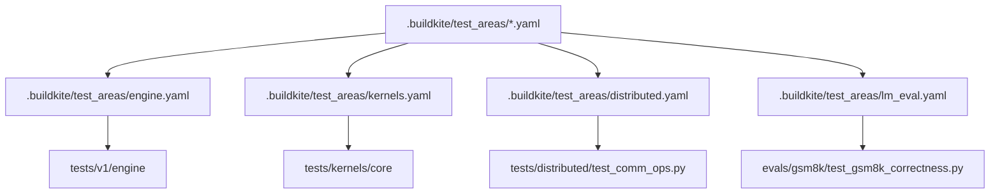
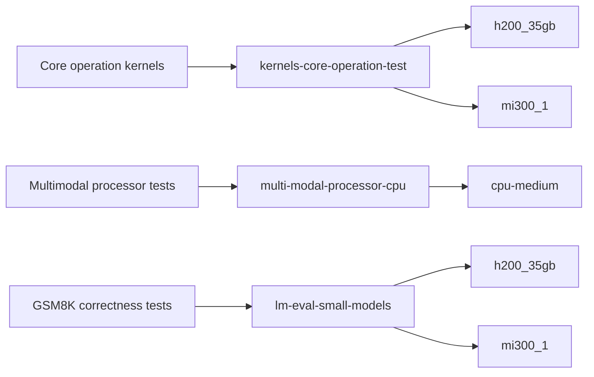
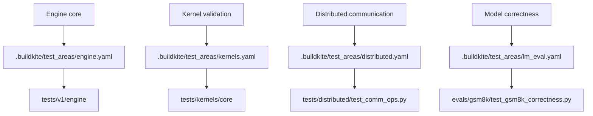

<!-- source: DeepWiki mcp.deepwiki.com · repo vllm-project/vllm · page 12 Testing and CI/CD · fetched 2026-10-28 -->

# Testing and CI/CD

Relevant source files

The following files were used as context for generating this wiki page:

- [.buildkite/test-amd.yaml](.buildkite/test-amd.yaml)
- [.buildkite/test_areas/basic_correctness.yaml](.buildkite/test_areas/basic_correctness.yaml)
- [.buildkite/test_areas/benchmarks.yaml](.buildkite/test_areas/benchmarks.yaml)
- [.buildkite/test_areas/disaggregated.yaml](.buildkite/test_areas/disaggregated.yaml)
- [.buildkite/test_areas/distributed.yaml](.buildkite/test_areas/distributed.yaml)
- [.buildkite/test_areas/engine.yaml](.buildkite/test_areas/engine.yaml)
- [.buildkite/test_areas/entrypoints.yaml](.buildkite/test_areas/entrypoints.yaml)
- [.buildkite/test_areas/expert_parallelism.yaml](.buildkite/test_areas/expert_parallelism.yaml)
- [.buildkite/test_areas/kernels.yaml](.buildkite/test_areas/kernels.yaml)
- [.buildkite/test_areas/lm_eval.yaml](.buildkite/test_areas/lm_eval.yaml)
- [.buildkite/test_areas/lora.yaml](.buildkite/test_areas/lora.yaml)
- [.buildkite/test_areas/misc.yaml](.buildkite/test_areas/misc.yaml)
- [.buildkite/test_areas/models_basic.yaml](.buildkite/test_areas/models_basic.yaml)
- [.buildkite/test_areas/models_distributed.yaml](.buildkite/test_areas/models_distributed.yaml)
- [.buildkite/test_areas/models_language.yaml](.buildkite/test_areas/models_language.yaml)
- [.buildkite/test_areas/models_multimodal.yaml](.buildkite/test_areas/models_multimodal.yaml)
- [.buildkite/test_areas/plugins.yaml](.buildkite/test_areas/plugins.yaml)
- [.buildkite/test_areas/pytorch.yaml](.buildkite/test_areas/pytorch.yaml)
- [.buildkite/test_areas/rust_frontend.yaml](.buildkite/test_areas/rust_frontend.yaml)
- [.buildkite/test_areas/spec_decode.yaml](.buildkite/test_areas/spec_decode.yaml)

## Purpose and Scope

This page summarizes vLLM’s test coverage, CI organization, hardware-aware execution, and correctness validation. Buildkite test-area configuration shows suites for engine behavior, kernels, distributed execution, models, API entrypoints, and evaluation; many jobs declare file dependencies and run after image-build steps. [.buildkite/test_areas/engine.yaml:1-29](), [.buildkite/test_areas/kernels.yaml:1-15](), [.buildkite/test_areas/distributed.yaml:1-20](), [.buildkite/test_areas/lm_eval.yaml:1-16]()

For detailed guidance, see:
- [Test Organization and Infrastructure](#12.1) — Test categories, fixtures, `VllmRunner` and `HfRunner`, and the model test registry.
- [Buildkite CI Pipelines](#12.2) — Pipeline structure, test areas, sharding, mirroring, and triggers.
- [Hardware-Specific Testing](#12.3) — Platform-specific jobs and hardware overrides.
- [Model Correctness Validation and Benchmarking](#12.4) — Evaluation suites, acceptance criteria, and benchmarking tools.
- [Developer Tooling and Governance](#12.5) — Static checks, GitHub workflows, ownership, automation, and contribution processes.

Sources: [.buildkite/test_areas/engine.yaml:1-29](), [.buildkite/test_areas/kernels.yaml:1-15](), [.buildkite/test_areas/distributed.yaml:1-20](), [.buildkite/test_areas/lm_eval.yaml:1-16]()

---

## Overview

CI test definitions are organized into area-specific files under `.buildkite/test_areas/`. The supplied configurations cover engine and V1 execution, core and specialized kernels, distributed communication and execution, language and multimodal models, API entrypoints, speculative decoding, and correctness evaluation. [.buildkite/test_areas/engine.yaml:1-29](), [.buildkite/test_areas/kernels.yaml:1-15](), [.buildkite/test_areas/distributed.yaml:1-20](), [.buildkite/test_areas/models_basic.yaml:1-19](), [.buildkite/test_areas/models_multimodal.yaml:1-15](), [.buildkite/test_areas/entrypoints.yaml:26-41](), [.buildkite/test_areas/spec_decode.yaml:5-26](), [.buildkite/test_areas/lm_eval.yaml:5-16]()

Jobs commonly pair a test command with a target device, timeout, and `source_file_dependencies`; some use automatic or explicit sharding. Many CUDA jobs also declare AMD mirrors, while separate jobs target CPU hardware. [.buildkite/test_areas/misc.yaml:5-39](), [.buildkite/test_areas/kernels.yaml:33-68](), [.buildkite/test_areas/models_multimodal.yaml:91-104]()

Sources: [.buildkite/test_areas/engine.yaml:1-29](), [.buildkite/test_areas/kernels.yaml:1-68](), [.buildkite/test_areas/models_basic.yaml:1-19](), [.buildkite/test_areas/models_multimodal.yaml:1-15](), [.buildkite/test_areas/entrypoints.yaml:26-41](), [.buildkite/test_areas/spec_decode.yaml:5-26]()

---

## CI Pipeline Architecture

Test-area files define groups of Buildkite steps and commonly depend on image-build jobs. File dependencies limit when a step is selected; `automatic_shard`, `parallelism`, and pytest shard arguments distribute some suites across jobs. [.buildkite/test_areas/misc.yaml:1-30](), [.buildkite/test_areas/kernels.yaml:33-68](), [.buildkite/test_areas/models_basic.yaml:29-42](), [.buildkite/test_areas/entrypoints.yaml:79-94]()

AMD mirrors make many suites available on ROCm devices, with platform-specific commands, dependencies, or resource settings where needed. The AMD test configuration documents additional options such as optional and soft-fail steps, hardware selectors, GPU and node counts, and parallel sharding. [.buildkite/test_areas/misc.yaml:28-39](), [.buildkite/test_areas/distributed.yaml:21-38](), [.buildkite/test-amd.yaml:8-27]()

**Diagram: Buildkite test definitions and execution targets**

Sources: [.buildkite/test_areas/engine.yaml:1-52](), [.buildkite/test_areas/kernels.yaml:1-44](), [.buildkite/test_areas/distributed.yaml:1-20](), [.buildkite/test_areas/lm_eval.yaml:1-16]()

---

## Test Areas and Step Configuration

The configured suites are grouped by the code or behavior they exercise. For example, engine jobs run engine and V1 engine tests; kernel jobs cover the vLLM IR and core operations; distributed jobs exercise communication and data-parallel behavior; and model and entrypoint groups include initialization, multimodal generation, and API integration. [.buildkite/test_areas/engine.yaml:5-52](), [.buildkite/test_areas/kernels.yaml:5-44](), [.buildkite/test_areas/distributed.yaml:5-19](), [.buildkite/test_areas/models_basic.yaml:5-19](), [.buildkite/test_areas/entrypoints.yaml:26-68]()

| Configuration | Role |
|---|---|
| `label`, `key` | Identify the step in the Buildkite configuration and UI. [.buildkite/test_areas/misc.yaml:5-9]() |
| `device`, `num_devices` | Select the hardware target and device count for a job. [.buildkite/test_areas/distributed.yaml:5-10]() |
| `timeout_in_minutes` | Set a job’s time limit. [.buildkite/test_areas/misc.yaml:7-9]() |
| `source_file_dependencies` | Associate a step with source and test paths used for change-based selection. [.buildkite/test_areas/misc.yaml:10-27]() |
| `automatic_shard`, `parallelism` | Configure test distribution across jobs. [.buildkite/test_areas/misc.yaml:5-9](), [.buildkite/test_areas/kernels.yaml:33-38]() |
| `commands` | Specify the shell commands and tests executed by the step. [.buildkite/test_areas/misc.yaml:28-30]() |
| `mirror` | Define a corresponding hardware-specific test configuration, including AMD mirrors. [.buildkite/test_areas/misc.yaml:31-39]() |

Sources: [.buildkite/test_areas/misc.yaml:5-39](), [.buildkite/test_areas/kernels.yaml:33-68](), [.buildkite/test_areas/distributed.yaml:5-20]()

---

## Hardware-Specific Testing Infrastructure

Hardware selection is part of test configuration: the supplied jobs include NVIDIA GPU device targets, AMD ROCm mirrors, and CPU jobs. Some suites use different commands, dependencies, sharding, or timeouts across hardware variants. [.buildkite/test_areas/misc.yaml:5-39](), [.buildkite/test_areas/kernels.yaml:33-68](), [.buildkite/test_areas/models_multimodal.yaml:91-104]()

The AMD test configuration describes hardware selectors, GPU and node-count options, and sharding controls. Individual test-area definitions illustrate ROCm-specific cases, including AMD mirrors for distributed communication and multimodal processing. [.buildkite/test-amd.yaml:8-27](), [.buildkite/test_areas/distributed.yaml:21-38](), [.buildkite/test_areas/models_multimodal.yaml:91-104]()

**Diagram: Hardware-aware test mapping**

Sources: [.buildkite/test_areas/kernels.yaml:33-68](), [.buildkite/test_areas/models_multimodal.yaml:91-104](), [.buildkite/test_areas/lm_eval.yaml:5-32]()

---

## Test Infrastructure Code Map

The CI configuration connects test-area names to concrete suites and paths. The examples below map natural-language test concerns to the identifiers used in the repository, making it easier to locate the relevant jobs and tests. [.buildkite/test_areas/engine.yaml:39-52](), [.buildkite/test_areas/kernels.yaml:5-15](), [.buildkite/test_areas/distributed.yaml:5-20](), [.buildkite/test_areas/lm_eval.yaml:5-16]()

**Diagram: Test areas mapped to code entities**

Sources: [.buildkite/test_areas/engine.yaml:39-52](), [.buildkite/test_areas/kernels.yaml:5-15](), [.buildkite/test_areas/distributed.yaml:5-20](), [.buildkite/test_areas/lm_eval.yaml:5-16]()

---

## Relationship to Other Subsystems

Testing is organized around the system areas it validates: engine and scheduling jobs cover engine execution and V1 end-to-end behavior; kernel jobs validate IR and low-level operations; distributed jobs test communication and parallel execution; and model/evaluation jobs exercise model behavior and correctness. [.buildkite/test_areas/engine.yaml:39-120](), [.buildkite/test_areas/kernels.yaml:5-44](), [.buildkite/test_areas/distributed.yaml:5-108](), [.buildkite/test_areas/models_language.yaml:5-40](), [.buildkite/test_areas/lm_eval.yaml:5-16]()

API and multimodal coverage complement those tests: entrypoint jobs exercise LLM and API integration, while multimodal jobs cover model generation and processing. See [Test Organization and Infrastructure](#12.1), [Buildkite CI Pipelines](#12.2), [Hardware-Specific Testing](#12.3), [Model Correctness Validation and Benchmarking](#12.4), and [Developer Tooling and Governance](#12.5) for details. [.buildkite/test_areas/entrypoints.yaml:54-94](), [.buildkite/test_areas/models_multimodal.yaml:5-15]()

Sources: [.buildkite/test_areas/engine.yaml:39-120](), [.buildkite/test_areas/kernels.yaml:5-44](), [.buildkite/test_areas/distributed.yaml:5-108](), [.buildkite/test_areas/models_language.yaml:5-40](), [.buildkite/test_areas/lm_eval.yaml:5-16](), [.buildkite/test_areas/entrypoints.yaml:54-94](), [.buildkite/test_areas/models_multimodal.yaml:5-15]()

---

