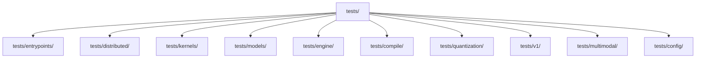
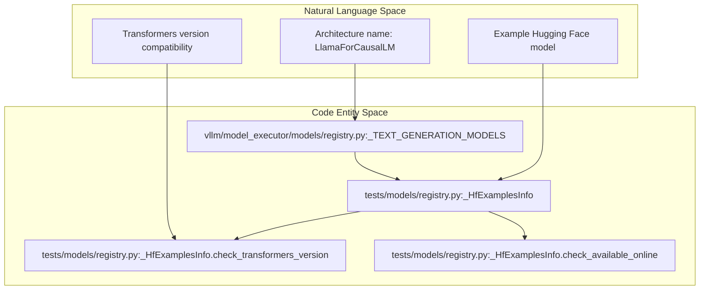
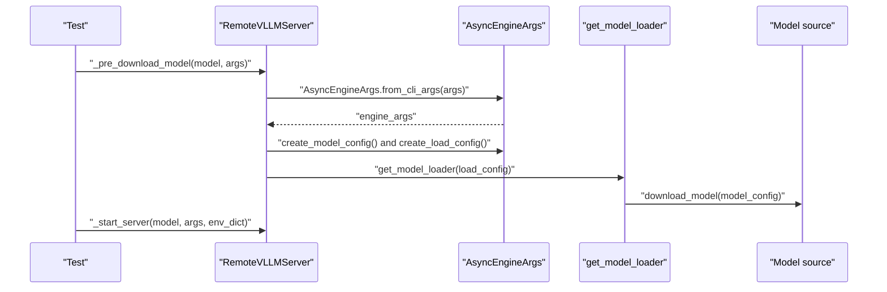
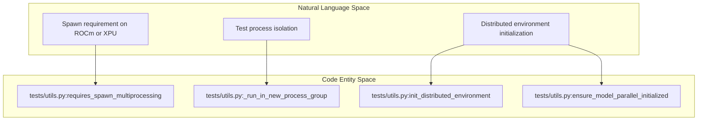
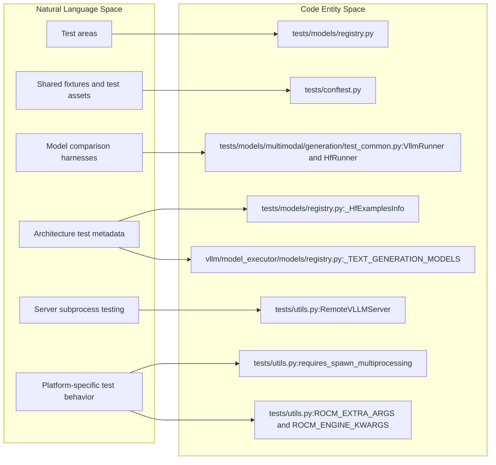

<!-- source: DeepWiki mcp.deepwiki.com · repo vllm-project/vllm · page 12.1 Test Organization and Infrastructure · fetched 2026-10-28 -->

# Test Organization and Infrastructure

Relevant source files

The following files were used as context for generating this wiki page:

- [docs/features/custom_logitsprocs.md](docs/features/custom_logitsprocs.md)
- [docs/models/supported_models.md](docs/models/supported_models.md)
- [examples/pooling/score/colbert_rerank_online.py](examples/pooling/score/colbert_rerank_online.py)
- [tests/config/test_model_arch_config.py](tests/config/test_model_arch_config.py)
- [tests/conftest.py](tests/conftest.py)
- [tests/engine/test_arg_utils.py](tests/engine/test_arg_utils.py)
- [tests/entrypoints/launchers/test_shutdown.py](tests/entrypoints/launchers/test_shutdown.py)
- [tests/entrypoints/unit_tests/test_remote_vllm_server.py](tests/entrypoints/unit_tests/test_remote_vllm_server.py)
- [tests/models/language/generation/test_hybrid.py](tests/models/language/generation/test_hybrid.py)
- [tests/models/language/pooling/test_colbert.py](tests/models/language/pooling/test_colbert.py)
- [tests/models/multimodal/generation/test_common.py](tests/models/multimodal/generation/test_common.py)
- [tests/models/multimodal/generation/vlm_utils/model_utils.py](tests/models/multimodal/generation/vlm_utils/model_utils.py)
- [tests/models/registry.py](tests/models/registry.py)
- [tests/test_config.py](tests/test_config.py)
- [tests/utils.py](tests/utils.py)
- [tests/utils_/test_spawn_decorator.py](tests/utils_/test_spawn_decorator.py)
- [tests/v1/logits_processors/test_custom_offline.py](tests/v1/logits_processors/test_custom_offline.py)
- [tests/v1/logits_processors/test_custom_online.py](tests/v1/logits_processors/test_custom_online.py)
- [tests/v1/logits_processors/utils.py](tests/v1/logits_processors/utils.py)
- [tests/v1/worker/test_gpu_bad_words.py](tests/v1/worker/test_gpu_bad_words.py)
- [tests/v1/worker/test_gpu_logits_processors.py](tests/v1/worker/test_gpu_logits_processors.py)
- [vllm/config/cache.py](vllm/config/cache.py)
- [vllm/config/model.py](vllm/config/model.py)
- [vllm/config/model_arch.py](vllm/config/model_arch.py)
- [vllm/config/parallel.py](vllm/config/parallel.py)
- [vllm/config/speculative.py](vllm/config/speculative.py)
- [vllm/config/vllm.py](vllm/config/vllm.py)
- [vllm/engine/arg_utils.py](vllm/engine/arg_utils.py)
- [vllm/model_executor/models/colbert.py](vllm/model_executor/models/colbert.py)
- [vllm/model_executor/models/config.py](vllm/model_executor/models/config.py)
- [vllm/model_executor/models/registry.py](vllm/model_executor/models/registry.py)
- [vllm/models/inkling/common/mm_preprocess.py](vllm/models/inkling/common/mm_preprocess.py)
- [vllm/transformers_utils/config.py](vllm/transformers_utils/config.py)
- [vllm/transformers_utils/configs/__init__.py](vllm/transformers_utils/configs/__init__.py)
- [vllm/transformers_utils/model_arch_config_convertor.py](vllm/transformers_utils/model_arch_config_convertor.py)
- [vllm/transformers_utils/processors/__init__.py](vllm/transformers_utils/processors/__init__.py)
- [vllm/v1/sample/logits_processor/state.py](vllm/v1/sample/logits_processor/state.py)
- [vllm/v1/spec_decode/llm_base_proposer.py](vllm/v1/spec_decode/llm_base_proposer.py)

## Purpose and Scope

This page describes how vLLM’s tests are organized, how shared pytest infrastructure supports tests, how `VllmRunner` and `HfRunner` are used for model comparisons, and how model-specific test settings are registered. It focuses on the test code and harnesses, not CI pipeline design or benchmark methodology. [tests/utils.py:89-104](), [tests/models/registry.py:16-120](), [tests/models/multimodal/generation/test_common.py:12-29]()

For CI pipeline structure, see [Buildkite CI Pipelines](12.2). For hardware-specific test execution, see [Hardware-Specific Testing](12.3). For correctness suites and benchmarking, see [Model Correctness Validation and Benchmarking](12.4).

Sources: [tests/utils.py:89-104](), [tests/models/registry.py:16-120](), [tests/models/multimodal/generation/test_common.py:12-29]()

---

## Test Directory Structure

Tests are grouped under `tests/` by component or test domain. The examples below illustrate the organization; the layout is not an exhaustive inventory. [tests/models/registry.py:1-14](), [tests/utils.py:36-61]()

### Top-Level Test Organization

**Diagram: Test directories and representative test areas**

Representative areas include:

- `tests/models/` for model-architecture and model-feature tests. Its registry module contains the test-side metadata used to select example Hugging Face models and specify test settings. [tests/models/registry.py:16-120]()
- `tests/entrypoints/` for entrypoint and server-related tests; shared utilities import CLI-serving components and provide server-process support. [tests/utils.py:41-47](), [tests/utils.py:184-218]()
- `tests/v1/` for V1 engine components; for example, the supplied test inventory includes tests for GPU workers and logits processors. [tests/v1/worker/test_gpu_logits_processors.py](), [tests/v1/logits_processors/test_custom_online.py]()
- `tests/config/` and `tests/test_config.py` for configuration behavior. The latter includes parametrized and platform-conditional configuration tests. [tests/test_config.py:62-95](), [tests/test_config.py:113-149]()

Sources: [tests/models/registry.py:16-120](), [tests/utils.py:41-47](), [tests/utils.py:184-218](), [tests/test_config.py:62-95](), [tests/test_config.py:113-149]()

### Representative Directory Breakdown

| Directory or file | Focus | Representative code pointers |
|---|---|---|
| `tests/models/` | Model-specific test metadata and model behavior | `_HfExamplesInfo` in `tests/models/registry.py` [tests/models/registry.py:16-120]() |
| `tests/entrypoints/` | Server and entrypoint tests | `RemoteVLLMServer` and serving-related imports in `tests/utils.py` [tests/utils.py:41-47](), [tests/utils.py:184-218]() |
| `tests/v1/` | V1 worker and logits-processor test areas | Example test modules are listed in the test inventory [tests/v1/worker/test_gpu_logits_processors.py](), [tests/v1/logits_processors/test_custom_online.py]() |
| `tests/config/` | Configuration test modules | `tests/test_config.py` exercises configuration validation and platform-specific behavior [tests/test_config.py:62-95](), [tests/test_config.py:113-149]() |
| `tests/utils.py` | Shared helpers, process utilities, server harness support | `RemoteVLLMServer`, `requires_spawn_multiprocessing`, and platform-specific test arguments [tests/utils.py:89-104](), [tests/utils.py:169-218]() |

Sources: [tests/models/registry.py:16-120](), [tests/utils.py:41-47](), [tests/utils.py:89-104](), [tests/utils.py:169-218](), [tests/test_config.py:62-95]()

---

## Model Test Registry System

The model test registry centralizes test metadata for architectures so model tests can use architecture-appropriate examples and settings. The test-side metadata type is `_HfExamplesInfo`; the production model registry separately maps Hugging Face architecture names to vLLM implementation modules and classes. [tests/models/registry.py:16-120](), [vllm/model_executor/models/registry.py:3-5](), [vllm/model_executor/models/registry.py:73-160]()

### Architecture Mapping and Test Metadata

`vllm/model_executor/models/registry.py` defines `_TEXT_GENERATION_MODELS`, which maps architecture names to implementation module/class pairs. The registry’s module documentation explicitly directs contributors to update `tests/models/registry.py` with example Hugging Face models when adding an architecture. [vllm/model_executor/models/registry.py:3-5](), [vllm/model_executor/models/registry.py:73-160]()

`tests/models/registry.py` defines the frozen dataclass `_HfExamplesInfo`. Its fields describe the default model and optional extras, tokenizer settings, speculative-decoding model and method, Transformers version bounds, input requirements, dtype, eager execution and prefix-caching settings, online availability, remote-code and HF overrides, sequence and batch limits, revision, and layer-count behavior. [tests/models/registry.py:16-120]()

| Field | Role |
|---|---|
| `default`, `extras` | Default and additional example models for an architecture. [tests/models/registry.py:16-22]() |
| `tokenizer`, `tokenizer_mode` | Tokenizer selection settings. [tests/models/registry.py:24-28]() |
| `speculative_model`, `speculative_method` | Speculative-decoding test model and method. [tests/models/registry.py:30-39]() |
| `min_transformers_version`, `max_transformers_version`, `transformers_version_reason` | Version constraints and reasons for vLLM- or HF-specific skips. [tests/models/registry.py:41-56]() |
| `require_embed_inputs`, `dtype`, `enforce_eager`, `enable_prefix_caching` | Input, dtype, execution-mode, and cache settings for tests. [tests/models/registry.py:58-80]() |
| `is_available_online`, `trust_remote_code`, `hf_overrides` | Online availability and model-loading requirements. [tests/models/registry.py:82-94]() |
| `max_model_len`, `max_num_batched_tokens`, `revision`, `max_num_seqs`, `use_original_num_layers` | Resource limits, revision selection, and test model sizing behavior. [tests/models/registry.py:96-120]() |

### Transformers Version and Availability Checks

`_HfExamplesInfo.check_transformers_version()` compares the installed Transformers version’s base version against configured minimum and maximum bounds. It can return without action, raise an error, skip via pytest, or return a message depending on its arguments and the version requirement. Version reasons distinguish constraints that apply to all vLLM tests (`"vllm"`) from constraints applying only to tests that use the HF runner (`"hf"`). [tests/models/registry.py:122-180]()

`check_available_online()` provides a separate check for models marked as unavailable online, with an error-or-skip policy. [tests/models/registry.py:182-191]()

**Diagram: Model registry bridges architecture names and test metadata**

Sources: [tests/models/registry.py:16-120](), [tests/models/registry.py:122-191](), [vllm/model_executor/models/registry.py:3-5](), [vllm/model_executor/models/registry.py:73-160]()

---

## Test Infrastructure and Conftest Fixtures

Shared pytest infrastructure is provided by `tests/conftest.py` and `tests/utils.py`. The supplied test utilities include platform detection, shared constants, multiprocessing helpers, model-loading imports, and a base class for managing vLLM server subprocesses. [tests/utils.py:36-61](), [tests/utils.py:89-104](), [tests/utils.py:169-218]()

### Test Harnesses: `VllmRunner` and `HfRunner`

`VllmRunner` and `HfRunner` are test harnesses used by model tests to run the vLLM and Hugging Face implementations, respectively. The multimodal generation test common module is a representative location for these harnesses. [tests/models/multimodal/generation/test_common.py:12-29]()

At a high level, model tests can use the vLLM runner to obtain vLLM results and the HF runner to obtain reference results, then compare behavior in the test. The exact model-loading arguments and comparison behavior vary by test; consult the relevant test module for those specifics. [tests/models/multimodal/generation/test_common.py:12-29]()

### Pytest Fixtures and Utilities

| Fixture or utility | Role | Source |
|---|---|---|
| `RemoteVLLMServer` | Base class for launching server subprocesses in tests; subclasses implement CLI-subcommand creation and server startup. [tests/utils.py:184-208]() | `tests/utils.py` |
| `requires_spawn_multiprocessing()` | Reports whether the current platform requires spawn rather than fork for test processes. [tests/utils.py:169-172]() | `tests/utils.py` |
| `ROCM_EXTRA_ARGS`, `ROCM_ENGINE_KWARGS` | Platform-specific test argument defaults for CLI and EngineArgs-style usage. [tests/utils.py:92-104]() | `tests/utils.py` |
| `IMAGE_ASSETS`, `VIDEO_ASSETS`, `AUDIO_ASSETS` | Shared multimodal test assets are defined in the conftest infrastructure. [tests/conftest.py:158-216]() | `tests/conftest.py` |
| `sample_json_schema` | A structured-output test fixture supplied through conftest. [tests/conftest.py:86-130]() | `tests/conftest.py` |

### Server Process Support

`RemoteVLLMServer` is an abstract base class whose subclasses provide `_create_cli_subcommand()` and `_start_server()`. Its shared implementation includes server lifecycle state and a `_pre_download_model()` path that uses `AsyncEngineArgs`, creates model and load configurations, obtains a model loader, and downloads the model before server startup. [tests/utils.py:184-218]()

**Diagram: Test server preparation and startup**

Sources: [tests/utils.py:184-218]()

### Fixture Lifecycle and Test Isolation

Pytest fixtures provide shared dependencies and setup to test functions; conftest-defined assets and schemas are examples of reusable test inputs. [tests/conftest.py:86-130](), [tests/conftest.py:158-216]()

For subprocess and multiprocessing isolation, `tests/utils.py` provides process-group support and a platform-aware spawn requirement helper. The utility reports that ROCm and XPU require spawn rather than fork. [tests/utils.py:169-182]()

Sources: [tests/conftest.py:86-130](), [tests/conftest.py:158-216](), [tests/utils.py:169-218]()

---

## V1 Engine and Distributed Testing

Tests that exercise distributed execution need to account for process topology and platform-specific process behavior. The shared test utility imports distributed initialization helpers, while the provided multiprocessing helper identifies ROCm and XPU as platforms requiring spawn. [tests/utils.py:36-41](), [tests/utils.py:169-172]()

### Distributed Test Setup

- `requires_spawn_multiprocessing()` returns whether spawn should be used instead of fork; its implementation checks whether the current platform is ROCm or XPU. [tests/utils.py:169-172]()
- `tests/utils.py` imports `init_distributed_environment` and `ensure_model_parallel_initialized`, which are available to shared test utilities. [tests/utils.py:36-41]()
- The provided files do not establish a `ParallelSetup` class or a single universal distributed-test topology; topology and setup should be read from the individual distributed test. [tests/utils.py:36-41]()

**Diagram: Distributed test concepts mapped to utility entities**

Sources: [tests/utils.py:36-41](), [tests/utils.py:169-182]()

---

## Hardware-Specific Testing Environment

The test utilities derive platform-specific behavior from `current_platform`. For ROCm, they define CLI arguments and EngineArgs-style keyword arguments that disable prefix caching and set `max_num_seqs` to 1. [tests/utils.py:48-49](), [tests/utils.py:92-104]()

The `_nvml()` context manager initializes and shuts down NVML on CUDA; on non-CUDA platforms, it is a no-op context manager. This utility should therefore be understood as a CUDA NVML wrapper, not as an AMD SMI abstraction. [tests/utils.py:63-88]()

`requires_spawn_multiprocessing()` returns true for ROCm and XPU platforms. [tests/utils.py:169-172]()

Sources: [tests/utils.py:48-49](), [tests/utils.py:63-104](), [tests/utils.py:169-172]()

---

## Summary Diagram: Test Infrastructure Connecting Concepts to Code Entities

Sources: [tests/conftest.py:86-130](), [tests/conftest.py:158-216](), [tests/models/multimodal/generation/test_common.py:12-29](), [tests/models/registry.py:16-191](), [vllm/model_executor/models/registry.py:3-5](), [vllm/model_executor/models/registry.py:73-160](), [tests/utils.py:92-104](), [tests/utils.py:169-218]()

---

