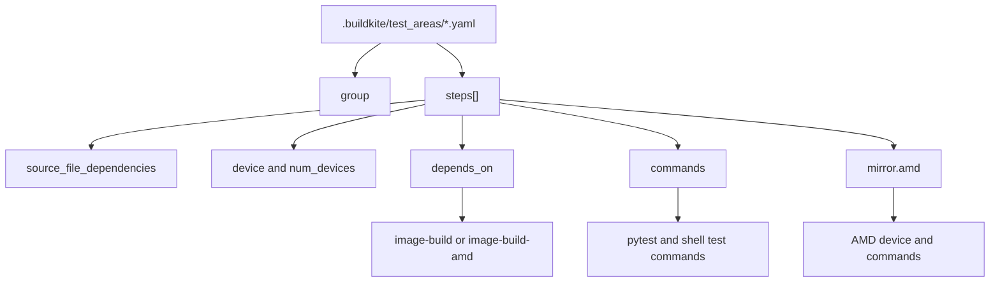
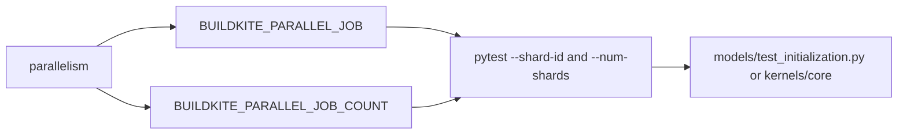
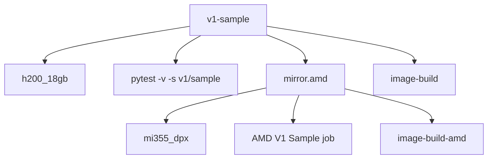
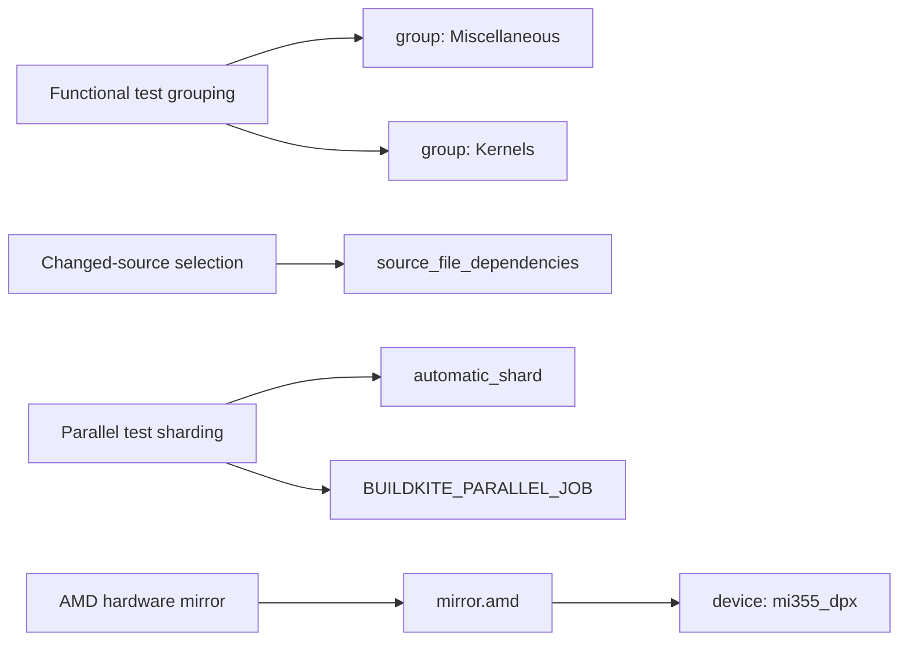
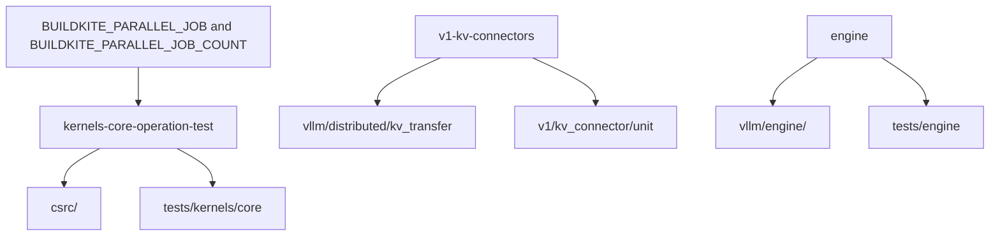

<!-- source: DeepWiki mcp.deepwiki.com · repo vllm-project/vllm · page 12.2 Buildkite CI Pipelines · fetched 2026-10-28 -->

# Buildkite CI Pipelines

Relevant source files

The following files were used as context for generating this wiki page:

- [.buildkite/test-amd.yaml](.buildkite/test-amd.yaml)
- [.buildkite/test_areas/basic_correctness.yaml](.buildkite/test_areas/basic_correctness.yaml)
- [.buildkite/test_areas/benchmarks.yaml](.buildkite/test_areas/benchmarks.yaml)
- [.buildkite/test_areas/disaggregated.yaml](.buildkite/test_areas/disaggregated.yaml)
- [.buildkite/test_areas/distributed.yaml](.buildkite/test_areas/distributed.yaml)
- [.buildkite/test_areas/engine.yaml](.buildkite/test_areas/engine.yaml)
- [.buildkite/test_areas/entrypoints.yaml](.buildkite/test_areas/entrypoints.yaml)
- [.buildkite/test_areas/expert_parallelism.yaml](.buildkite/test_areas/expert_parallelism.yaml)
- [.buildkite/test_areas/kernels.yaml](.buildkite/test_areas/kernels.yaml)
- [.buildkite/test_areas/lm_eval.yaml](.buildkite/test_areas/lm_eval.yaml)
- [.buildkite/test_areas/lora.yaml](.buildkite/test_areas/lora.yaml)
- [.buildkite/test_areas/misc.yaml](.buildkite/test_areas/misc.yaml)
- [.buildkite/test_areas/models_basic.yaml](.buildkite/test_areas/models_basic.yaml)
- [.buildkite/test_areas/models_distributed.yaml](.buildkite/test_areas/models_distributed.yaml)
- [.buildkite/test_areas/models_language.yaml](.buildkite/test_areas/models_language.yaml)
- [.buildkite/test_areas/models_multimodal.yaml](.buildkite/test_areas/models_multimodal.yaml)
- [.buildkite/test_areas/plugins.yaml](.buildkite/test_areas/plugins.yaml)
- [.buildkite/test_areas/pytorch.yaml](.buildkite/test_areas/pytorch.yaml)
- [.buildkite/test_areas/rust_frontend.yaml](.buildkite/test_areas/rust_frontend.yaml)
- [.buildkite/test_areas/spec_decode.yaml](.buildkite/test_areas/spec_decode.yaml)

## Purpose and scope

This page documents the Buildkite test configuration represented in the supplied `.buildkite` files: functional test-area groups, step settings, source-file triggers, sharding, AMD mirrors, and representative pipeline relationships. The provided files show configuration inputs and test commands; they do not show the external pipeline-generation implementation or the complete Buildkite upload/dispatch configuration. [`.buildkite/test-amd.yaml:1-27`]()

Sources: [`.buildkite/test-amd.yaml:1-27`]()

---

## Pipeline organization

The test-area files organize jobs as named groups with a `steps` list. The visible examples include `Miscellaneous`, `Kernels`, `Distributed`, `Engine`, `Entrypoints`, `LM Eval`, `Spec Decode`, and model-focused groups. Many groups declare a dependency on `image-build`; AMD mirror steps commonly depend on `image-build-amd`. [`.buildkite/test_areas/misc.yaml:1-4`](), [`.buildkite/test_areas/kernels.yaml:1-4`](), [`.buildkite/test_areas/distributed.yaml:1-4`](), [`.buildkite/test_areas/engine.yaml:1-4`](), [`.buildkite/test_areas/entrypoints.yaml:1-4`](), [`.buildkite/test_areas/lm_eval.yaml:1-4`](), [`.buildkite/test_areas/spec_decode.yaml:1-4`]()

A step combines a user-facing `label`, an optional stable `key`, hardware and resource selection, change-trigger paths, and one or more shell commands. For example, the `v1-sample` step runs sampling tests on `h200_18gb`, while `distributed-comm-ops` selects two L4 devices and runs distributed communication tests. [`.buildkite/test_areas/misc.yaml:5-30`](), [`.buildkite/test_areas/distributed.yaml:5-20`]()

### Buildkite configuration data flow

The diagram follows the relationship expressed in the shown YAML: test-area definitions declare groups and steps; steps declare dependencies, triggers, hardware and commands; commands invoke test suites or helper scripts. AMD settings may be placed under a step’s `mirror.amd` mapping. The files shown do not establish how these YAML inputs are loaded into Buildkite, so no generator or uploader is implied here. [`.buildkite/test_areas/misc.yaml:1-40`](), [`.buildkite/test_areas/kernels.yaml:1-32`](), [`.buildkite/test_areas/distributed.yaml:1-38`]()

**Diagram: Test-area configuration to job execution**

Sources: [`.buildkite/test_areas/misc.yaml:1-40`](), [`.buildkite/test_areas/kernels.yaml:1-32`](), [`.buildkite/test_areas/distributed.yaml:1-38`]()

---

## Test step configuration

### General test-area step fields

The test-area examples use these fields to express job behavior. Their exact interpretation by Buildkite infrastructure is not defined in the files shown; the table describes their configured roles and examples. [`.buildkite/test_areas/misc.yaml:5-40`](), [`.buildkite/test_areas/distributed.yaml:5-38`](), [`.buildkite/test_areas/kernels.yaml:33-68`]()

| Field | Configuration role | Example |
|---|---|---|
| `group` | Names the functional test group in a file. | `Distributed` [`.buildkite/test_areas/distributed.yaml:1-4`]() |
| `steps` | Holds the group’s step definitions. | `steps` in `misc.yaml` [`.buildkite/test_areas/misc.yaml:1-5`]() |
| `label` | Human-readable job label, often indicating hardware and suite. | `:nvidia: (L4) Distributed Comm Ops` [`.buildkite/test_areas/distributed.yaml:5-6`]() |
| `key` | Step identifier used in the configuration. | `distributed-comm-ops` [`.buildkite/test_areas/distributed.yaml:5-6`]() |
| `depends_on` | Declares an image-build or other configured dependency. | `image-build` and `image-build-amd` [`.buildkite/test_areas/distributed.yaml:1-4`](), [`.buildkite/test_areas/distributed.yaml:21-29`]() |
| `device` | Selects a configured device target. | `l4`, `h200_18gb`, `mi355_dpx` [`.buildkite/test_areas/distributed.yaml:5-10`](), [`.buildkite/test_areas/misc.yaml:5-9`](), [`.buildkite/test_areas/misc.yaml:31-40`]() |
| `num_devices` | Requests a device count for a job. | Two devices for distributed communication tests [`.buildkite/test_areas/distributed.yaml:5-16`]() |
| `timeout_in_minutes` | Sets a step timeout. | 25 minutes for `distributed-comm-ops` [`.buildkite/test_areas/distributed.yaml:5-8`]() |
| `working_dir` | Sets the command working directory. | `/vllm-workspace/tests` [`.buildkite/test_areas/distributed.yaml:5-16`]() |
| `source_file_dependencies` | Lists path prefixes associated with the step’s source changes. Some entries use `!` exclusions. | Distributed paths exclude `vllm/distributed/kv_transfer/` in selected jobs [`.buildkite/test_areas/distributed.yaml:11-14`]() |
| `commands` | Lists the shell commands run by the step. | Multiple `pytest` invocations [`.buildkite/test_areas/distributed.yaml:15-20`]() |
| `parallelism` | Sets a parallel job count in configurations that explicitly use it. | Three shards in the AMD kernel mirror [`.buildkite/test_areas/kernels.yaml:45-68`]() |
| `automatic_shard` | Marks a step for automatic sharding in the configuration. | V1 Sample and V1 KV Connectors [`.buildkite/test_areas/misc.yaml:5-8`](), [`.buildkite/test_areas/misc.yaml:147-152`]() |
| `mirror` | Supplies an alternate hardware configuration, shown here for AMD. | `mirror.amd` for V1 Sample [`.buildkite/test_areas/misc.yaml:28-40`]() |
| `optional` | Marks a job optional in examples, including nightly jobs. | Large-model LM Eval [`.buildkite/test_areas/lm_eval.yaml:106-118`]() |

A step can sequence several commands in one job. The Distributed Communication step runs separate tests for communication operations, CPU all-reduce, and shared-memory utilities; the V1 Logits + Oracle step also separates pytest invocations, with a comment explaining process isolation for those tests. [`.buildkite/test_areas/distributed.yaml:15-20`](), [`.buildkite/test_areas/misc.yaml:41-53`]()

Sources: [`.buildkite/test_areas/misc.yaml:5-53`](), [`.buildkite/test_areas/distributed.yaml:1-38`](), [`.buildkite/test_areas/kernels.yaml:33-68`](), [`.buildkite/test_areas/lm_eval.yaml:106-118`]()

### AMD-specific test configuration

`.buildkite/test-amd.yaml` documents an AMD-oriented schema whose content is fed into `test-template-amd.j2` to generate the final pipeline YAML. Its comments describe fields including `fast_check`, `fast_check_only`, `optional`, `soft_fail`, `command` or `commands`, `mirror_hardwares`, `dind`, `num_gpus`, `num_nodes`, `timeout_in_minutes`, `parallelism`, `working_dir`, and `source_file_dependencies`. [`.buildkite/test-amd.yaml:1-27`]()

The file documents `command` and `commands` as mutually exclusive choices. `parallelism` enables sharding using `BUILDKITE_PARALLEL_JOB` and `BUILDKITE_PARALLEL_JOB_COUNT`. `dind: false` selects direct execution in the AMD Kubernetes pod rather than the legacy Docker-in-Docker route; omitted or true uses the legacy route. The comments also specify that `num_gpus` defaults to one and currently supports overrides of two or four, and that `num_nodes` simulates a multi-node setup by launching containers on one host, with one command per simulated host. [`.buildkite/test-amd.yaml:14-27`]()

The AMD file’s authoring guidance recommends adding tests to an existing group where appropriate, placing short tests in an existing step, and considering a new step for tests taking over ten minutes. It notes that steps execute in parallel. [`.buildkite/test-amd.yaml:29-33`]()

Sources: [`.buildkite/test-amd.yaml:1-33`]()

---

## Test categorization and sharding

### Test-area layout

The supplied `test_areas` files group work by functional domain and execution profile. The examples below identify the groups and suites visible in the provided excerpts; they are not an exhaustive inventory of the repository’s test-area files. [`.buildkite/test_areas/misc.yaml:1-4`](), [`.buildkite/test_areas/kernels.yaml:1-4`](), [`.buildkite/test_areas/distributed.yaml:1-4`](), [`.buildkite/test_areas/engine.yaml:1-4`](), [`.buildkite/test_areas/entrypoints.yaml:1-4`](), [`.buildkite/test_areas/lm_eval.yaml:1-4`](), [`.buildkite/test_areas/spec_decode.yaml:1-4`](), [`.buildkite/test_areas/models_basic.yaml:1-4`](), [`.buildkite/test_areas/models_language.yaml:1-4`](), [`.buildkite/test_areas/models_multimodal.yaml:1-4`]()

| Group or area | Representative configured coverage |
|---|---|
| `Miscellaneous` | V1 sample, logits, core, executor/worker, KV offload, connectors, and metrics-related test groupings. [`.buildkite/test_areas/misc.yaml:1-10`](), [`.buildkite/test_areas/misc.yaml:41-98`](), [`.buildkite/test_areas/misc.yaml:128-167`]() |
| `Kernels` | vLLM IR and core operation kernels, with model-specific kernel jobs in the excerpt. [`.buildkite/test_areas/kernels.yaml:1-15`](), [`.buildkite/test_areas/kernels.yaml:33-44`](), [`.buildkite/test_areas/kernels.yaml:103-150`]() |
| `Distributed` | Communication operations, weight transfer, data parallelism, compile/RPC, and torchrun/shutdown tests. [`.buildkite/test_areas/distributed.yaml:1-20`](), [`.buildkite/test_areas/distributed.yaml:40-77`](), [`.buildkite/test_areas/distributed.yaml:79-108`](), [`.buildkite/test_areas/distributed.yaml:130-198`]() |
| `Engine` | Engine core, V1 engine, scheduling, and end-to-end core coverage. [`.buildkite/test_areas/engine.yaml:1-29`](), [`.buildkite/test_areas/engine.yaml:39-52`](), [`.buildkite/test_areas/engine.yaml:69-120`]() |
| `Entrypoints` | Entrypoint unit and integration tests, including API server and OpenAI API suites. [`.buildkite/test_areas/entrypoints.yaml:1-41`](), [`.buildkite/test_areas/entrypoints.yaml:54-94`](), [`.buildkite/test_areas/entrypoints.yaml:104-188`]() |
| `LM Eval` | GSM8K correctness, watermarking, and small- and large-model evaluations. [`.buildkite/test_areas/lm_eval.yaml:1-15`](), [`.buildkite/test_areas/lm_eval.yaml:55-69`](), [`.buildkite/test_areas/lm_eval.yaml:106-140`]() |
| `Spec Decode` | V1 speculative decoding, Eagle, and MTP test groups. [`.buildkite/test_areas/spec_decode.yaml:1-35`](), [`.buildkite/test_areas/spec_decode.yaml:37-73`](), [`.buildkite/test_areas/spec_decode.yaml:126-169`]() |
| `Models - Basic` | Initialization, registry, and other model tests. [`.buildkite/test_areas/models_basic.yaml:1-19`](), [`.buildkite/test_areas/models_basic.yaml:29-41`](), [`.buildkite/test_areas/models_basic.yaml:61-81`]() |
| `Models - Language` | Standard, slow, hybrid, and hardware-specific language model jobs. [`.buildkite/test_areas/models_language.yaml:1-40`](), [`.buildkite/test_areas/models_language.yaml:61-95`](), [`.buildkite/test_areas/models_language.yaml:97-135`]() |
| `Models - Multimodal` | Multimodal generation, processing, and accuracy-evaluation jobs. [`.buildkite/test_areas/models_multimodal.yaml:1-15`](), [`.buildkite/test_areas/models_multimodal.yaml:91-117`](), [`.buildkite/test_areas/models_multimodal.yaml:128-152`]() |

Sources: [`.buildkite/test_areas/misc.yaml:1-167`](), [`.buildkite/test_areas/kernels.yaml:1-150`](), [`.buildkite/test_areas/distributed.yaml:1-198`](), [`.buildkite/test_areas/engine.yaml:1-120`](), [`.buildkite/test_areas/entrypoints.yaml:1-188`](), [`.buildkite/test_areas/lm_eval.yaml:1-140`](), [`.buildkite/test_areas/spec_decode.yaml:1-169`](), [`.buildkite/test_areas/models_basic.yaml:1-81`](), [`.buildkite/test_areas/models_language.yaml:1-135`](), [`.buildkite/test_areas/models_multimodal.yaml:1-152`]()

### Test sharding and parallelism

The files show two sharding styles:

- `automatic_shard: true` marks steps such as `v1-sample`, `v1-kv-connectors`, and `entrypoints-integration-api-server` for automatic sharding in the configuration. [`.buildkite/test_areas/misc.yaml:5-8`](), [`.buildkite/test_areas/misc.yaml:147-152`](), [`.buildkite/test_areas/entrypoints.yaml:79-94`]()
- Explicit sharding sets `parallelism` and passes Buildkite’s parallel-job environment variables as pytest’s `--shard-id` and `--num-shards` arguments. The basic-model extra-initialization job sets `parallelism: 14`; the command uses `BUILDKITE_PARALLEL_JOB` as the shard ID and `BUILDKITE_PARALLEL_JOB_COUNT` as the shard count. [`.buildkite/test_areas/models_basic.yaml:29-42`]()
- The multimodal CPU processor job sets `parallelism: 4` and passes the same variables to its pytest invocation. [`.buildkite/test_areas/models_multimodal.yaml:91-104`]()
- The AMD core-kernel mirror sets `parallelism: 3` and explicitly passes those variables to pytest. [`.buildkite/test_areas/kernels.yaml:45-68`]()

The AMD schema comments explicitly describe `parallelism` as enabling sharding using the two Buildkite variables. [`.buildkite/test-amd.yaml:24-25`]()

**Diagram: Explicit shard configuration and pytest arguments**

Sources: [`.buildkite/test-amd.yaml:24-25`](), [`.buildkite/test_areas/models_basic.yaml:29-42`](), [`.buildkite/test_areas/kernels.yaml:45-68`]()

Sources: [`.buildkite/test-amd.yaml:24-25`](), [`.buildkite/test_areas/models_basic.yaml:29-42`](), [`.buildkite/test_areas/models_multimodal.yaml:91-104`](), [`.buildkite/test_areas/kernels.yaml:45-68`]()

---

## Hardware mirroring

A test-area step can declare `mirror.amd` to describe an AMD counterpart. Mirror entries may override the label, device, timeout, working directory, dependencies, source-file dependencies, commands, environment, and sharding settings. The shown examples commonly set `dind: false` and depend on `image-build-amd`. [`.buildkite/test_areas/misc.yaml:28-40`](), [`.buildkite/test_areas/kernels.yaml:16-32`](), [`.buildkite/test_areas/distributed.yaml:21-38`]()

Mirrors are not necessarily exact copies. For example, the Distributed Communication AMD mirror omits the NVIDIA command for `distributed/test_cpu_all_reduce.py`; the AMD kernel mirror specifies its own command list and source dependencies; and the LM Eval AMD mirror can use ROCm-specific configuration paths and commands. [`.buildkite/test_areas/distributed.yaml:15-38`](), [`.buildkite/test_areas/kernels.yaml:45-68`](), [`.buildkite/test_areas/lm_eval.yaml:5-32`]()

A mirror can also override whether a job is optional. In the disaggregated NixlConnector examples, the NVIDIA four-GPU jobs are marked optional, while their AMD mirrors explicitly set `optional: false`; the comments state that the AMD versions should run on PRs even when the corresponding L4 step is nightly-only. [`.buildkite/test_areas/disaggregated.yaml:5-36`]()

**Diagram: A configured NVIDIA step and its AMD mirror**

Sources: [`.buildkite/test_areas/misc.yaml:1-40`]()

Sources: [`.buildkite/test_areas/misc.yaml:1-40`](), [`.buildkite/test_areas/disaggregated.yaml:5-36`]()

---

## CI-specific environment variables and commands

CI steps set environment variables or prefix commands when a test requires particular process or hardware behavior. These are job-level configuration choices, not a catalog of all vLLM environment variables. [`.buildkite/test_areas/misc.yaml:28-30`](), [`.buildkite/test_areas/distributed.yaml:99-108`](), [`.buildkite/test_areas/distributed.yaml:193-198`](), [`.buildkite/test_areas/lm_eval.yaml:106-118`]()

| Variable or command setting | Use shown in the configuration |
|---|---|
| `VLLM_WORKER_MULTIPROC_METHOD=spawn` | Set before V1 sample, core, and related tests; also set in several entrypoint and AMD jobs. [`.buildkite/test_areas/misc.yaml:28-30`](), [`.buildkite/test_areas/entrypoints.yaml:64-68`]() |
| `NCCL_CUMEM_HOST_ENABLE=0` | Set before selected distributed tests; the YAML comments associate the setting with an NCCL issue. [`.buildkite/test_areas/distributed.yaml:99-108`]() |
| `VLLM_TEST_SAME_HOST=1` | Set for `torchrun` same-node distributed tests. [`.buildkite/test_areas/distributed.yaml:193-198`]() |
| `VLLM_USE_DEEP_GEMM=0` | Set in the H100 large-model LM Eval job; the comment says Triton was found faster than DeepGEMM for H100. [`.buildkite/test_areas/lm_eval.yaml:106-118`]() |
| `ATTENTION_BACKEND=TRITON_ATTN` | Set for an AMD NixlConnector accuracy sweep. [`.buildkite/test_areas/disaggregated.yaml:20-37`]() |
| `DP_EP=1` | Set for a distributed NixlConnector accuracy sweep. [`.buildkite/test_areas/disaggregated.yaml:112-142`]() |

Sources: [`.buildkite/test_areas/misc.yaml:28-30`](), [`.buildkite/test_areas/entrypoints.yaml:64-68`](), [`.buildkite/test_areas/distributed.yaml:99-108`](), [`.buildkite/test_areas/distributed.yaml:193-198`](), [`.buildkite/test_areas/lm_eval.yaml:106-118`](), [`.buildkite/test_areas/disaggregated.yaml:20-37`](), [`.buildkite/test_areas/disaggregated.yaml:112-142`]()

---

## Pipeline structure recap

These examples connect group, step key, hardware, resource allocation, and representative test commands. [`.buildkite/test_areas/distributed.yaml:1-20`](), [`.buildkite/test_areas/kernels.yaml:33-68`](), [`.buildkite/test_areas/misc.yaml:5-30`](), [`.buildkite/test_areas/lm_eval.yaml:5-15`](), [`.buildkite/test_areas/engine.yaml:5-29`](), [`.buildkite/test_areas/entrypoints.yaml:54-68`]()

| Group | Step key or label | Hardware and execution shape | Representative work |
|---|---|---|---|
| Distributed | `distributed-comm-ops` | L4, two devices | Communication operations and shared-memory tests. [`.buildkite/test_areas/distributed.yaml:5-20`]() |
| Kernels | `kernels-core-operation-test` | H200 MIG 35GB; automatic sharding | Core operation kernel tests. [`.buildkite/test_areas/kernels.yaml:33-44`]() |
| Miscellaneous | `v1-sample` | H200 MIG 18GB; automatic sharding | V1 sample tests, with an AMD mirror. [`.buildkite/test_areas/misc.yaml:5-40`]() |
| LM Eval | `lm-eval-small-models` | H200 MIG 35GB; automatic sharding | GSM8K correctness with a small-model config list. [`.buildkite/test_areas/lm_eval.yaml:5-15`]() |
| Engine | `engine` | H200 MIG 18GB | Engine, sequence, config, logging, port, and JIT-monitor tests. [`.buildkite/test_areas/engine.yaml:5-29`]() |
| Entrypoints | `entrypoints-integration-llm` | H200 MIG 35GB; automatic sharding | LLM integration tests, with selected tests run separately. [`.buildkite/test_areas/entrypoints.yaml:54-68`]() |

Sources: [`.buildkite/test_areas/distributed.yaml:1-20`](), [`.buildkite/test_areas/kernels.yaml:33-68`](), [`.buildkite/test_areas/misc.yaml:5-40`](), [`.buildkite/test_areas/lm_eval.yaml:5-15`](), [`.buildkite/test_areas/engine.yaml:5-29`](), [`.buildkite/test_areas/entrypoints.yaml:54-68`]()

---

## Relating natural-language concepts to Buildkite code entities

### Mapping pipeline concepts to configuration entities

This mapping ties concepts such as functional grouping, change-based selection, sharding, and hardware mirroring to names used in the configuration files. The diagram’s identifiers are searchable configuration entities, not claims about unshown pipeline-generation code. [`.buildkite/test_areas/misc.yaml:1-40`](), [`.buildkite/test_areas/kernels.yaml:33-68`](), [`.buildkite/test-amd.yaml:4-27`]()

**Diagram: Pipeline concepts to configuration names**

Sources: [`.buildkite/test_areas/misc.yaml:1-40`](), [`.buildkite/test_areas/kernels.yaml:33-68`](), [`.buildkite/test-amd.yaml:4-27`]()

### Mapping CI jobs to test targets

The following relationships connect named Buildkite steps to the test paths and implementation areas they select. For example, `kernels-core-operation-test` targets kernel tests with `csrc/` dependencies, while `v1-kv-connectors` runs connector unit suites and has an AMD mirror. [`.buildkite/test_areas/kernels.yaml:33-68`](), [`.buildkite/test_areas/misc.yaml:147-167`](), [`.buildkite/test_areas/engine.yaml:5-29`]()

**Diagram: Buildkite job identifiers to code and test paths**

Sources: [`.buildkite/test_areas/kernels.yaml:33-68`](), [`.buildkite/test_areas/misc.yaml:147-167`](), [`.buildkite/test_areas/engine.yaml:5-29`]()

---

## References

The following source ranges support this page’s descriptions of the visible Buildkite configuration. [`.buildkite/test-amd.yaml:1-33`](), [`.buildkite/test_areas/misc.yaml:1-213`](), [`.buildkite/test_areas/kernels.yaml:1-192`](), [`.buildkite/test_areas/distributed.yaml:1-198`](), [`.buildkite/test_areas/lm_eval.yaml:1-207`](), [`.buildkite/test_areas/models_basic.yaml:1-171`](), [`.buildkite/test_areas/entrypoints.yaml:1-200`](), [`.buildkite/test_areas/spec_decode.yaml:1-214`](), [`.buildkite/test_areas/models_multimodal.yaml:1-190`](), [`.buildkite/test_areas/models_language.yaml:1-149`](), [`.buildkite/test_areas/engine.yaml:1-210`](), [`.buildkite/test_areas/disaggregated.yaml:1-168`]()

Sources: [`.buildkite/test-amd.yaml:1-33`](), [`.buildkite/test_areas/misc.yaml:1-213`](), [`.buildkite/test_areas/kernels.yaml:1-192`](), [`.buildkite/test_areas/distributed.yaml:1-198`](), [`.buildkite/test_areas/lm_eval.yaml:1-207`](), [`.buildkite/test_areas/models_basic.yaml:1-171`](), [`.buildkite/test_areas/entrypoints.yaml:1-200`](), [`.buildkite/test_areas/spec_decode.yaml:1-214`](), [`.buildkite/test_areas/models_multimodal.yaml:1-190`](), [`.buildkite/test_areas/models_language.yaml:1-149`](), [`.buildkite/test_areas/engine.yaml:1-210`](), [`.buildkite/test_areas/disaggregated.yaml:1-168`]()

---

