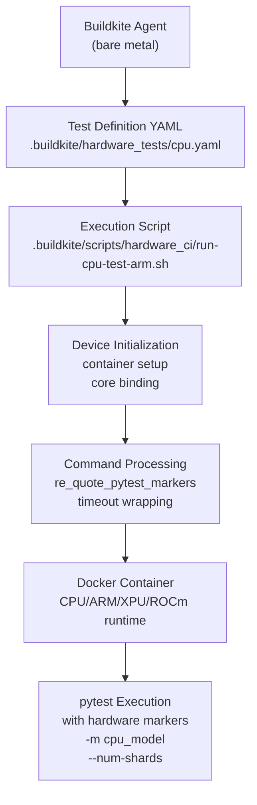
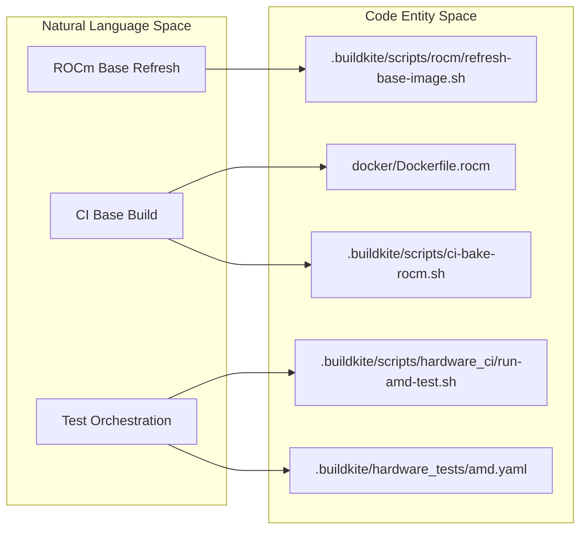
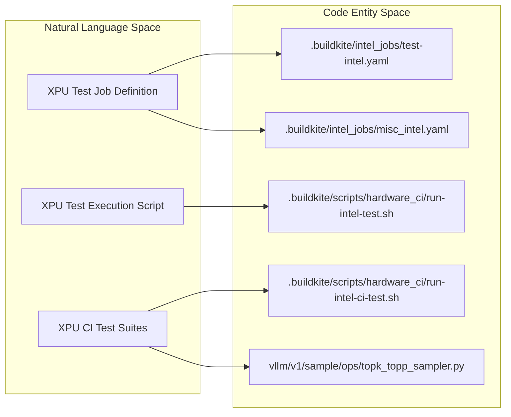

<!-- source: DeepWiki mcp.deepwiki.com · repo vllm-project/vllm · page 12.3 Hardware-Specific Testing · fetched 2026-10-28 -->

# Hardware-Specific Testing

Relevant source files

The following files were used as context for generating this wiki page:

- [.buildkite/ci_config_rocm.yaml](.buildkite/ci_config_rocm.yaml)
- [.buildkite/hardware_tests/amd.yaml](.buildkite/hardware_tests/amd.yaml)
- [.buildkite/hardware_tests/ascend_npu.yaml](.buildkite/hardware_tests/ascend_npu.yaml)
- [.buildkite/hardware_tests/cpu.yaml](.buildkite/hardware_tests/cpu.yaml)
- [.buildkite/hardware_tests/intel_xpu_ci/test-intel.yaml](.buildkite/hardware_tests/intel_xpu_ci/test-intel.yaml)
- [.buildkite/intel_jobs/basic_correctness_intel.yaml](.buildkite/intel_jobs/basic_correctness_intel.yaml)
- [.buildkite/intel_jobs/benchmarks_intel.yaml](.buildkite/intel_jobs/benchmarks_intel.yaml)
- [.buildkite/intel_jobs/engine_intel.yaml](.buildkite/intel_jobs/engine_intel.yaml)
- [.buildkite/intel_jobs/entrypoints_intel.yaml](.buildkite/intel_jobs/entrypoints_intel.yaml)
- [.buildkite/intel_jobs/expert_parallelism_intel.yaml](.buildkite/intel_jobs/expert_parallelism_intel.yaml)
- [.buildkite/intel_jobs/kernels_intel.yaml](.buildkite/intel_jobs/kernels_intel.yaml)
- [.buildkite/intel_jobs/lm_eval_intel.yaml](.buildkite/intel_jobs/lm_eval_intel.yaml)
- [.buildkite/intel_jobs/lora_intel.yaml](.buildkite/intel_jobs/lora_intel.yaml)
- [.buildkite/intel_jobs/misc_intel.yaml](.buildkite/intel_jobs/misc_intel.yaml)
- [.buildkite/intel_jobs/model_executor_intel.yaml](.buildkite/intel_jobs/model_executor_intel.yaml)
- [.buildkite/intel_jobs/models_distributed_intel.yaml](.buildkite/intel_jobs/models_distributed_intel.yaml)
- [.buildkite/intel_jobs/models_multimodal_intel.yaml](.buildkite/intel_jobs/models_multimodal_intel.yaml)
- [.buildkite/intel_jobs/samplers_intel.yaml](.buildkite/intel_jobs/samplers_intel.yaml)
- [.buildkite/intel_jobs/test-intel.yaml](.buildkite/intel_jobs/test-intel.yaml)
- [.buildkite/lm-eval-harness/configs/NVIDIA-Nemotron-3-Nano-30B-A3B-FP8-xpu.yaml](.buildkite/lm-eval-harness/configs/NVIDIA-Nemotron-3-Nano-30B-A3B-FP8-xpu.yaml)
- [.buildkite/lm-eval-harness/configs/models-large-xpu-fp8.txt](.buildkite/lm-eval-harness/configs/models-large-xpu-fp8.txt)
- [.buildkite/scripts/ci-bake-rocm.sh](.buildkite/scripts/ci-bake-rocm.sh)
- [.buildkite/scripts/hardware_ci/run-amd-test.sh](.buildkite/scripts/hardware_ci/run-amd-test.sh)
- [.buildkite/scripts/hardware_ci/run-cpu-distributed-smoke-test.sh](.buildkite/scripts/hardware_ci/run-cpu-distributed-smoke-test.sh)
- [.buildkite/scripts/hardware_ci/run-cpu-test-arm.sh](.buildkite/scripts/hardware_ci/run-cpu-test-arm.sh)
- [.buildkite/scripts/hardware_ci/run-intel-ci-test.sh](.buildkite/scripts/hardware_ci/run-intel-ci-test.sh)
- [.buildkite/scripts/hardware_ci/run-npu-test.sh](.buildkite/scripts/hardware_ci/run-npu-test.sh)
- [.buildkite/scripts/rocm/build-ci-base.sh](.buildkite/scripts/rocm/build-ci-base.sh)
- [.buildkite/scripts/rocm/build-config.sh](.buildkite/scripts/rocm/build-config.sh)
- [.buildkite/scripts/rocm/build-test-image.sh](.buildkite/scripts/rocm/build-test-image.sh)
- [.buildkite/scripts/rocm/refresh-base-image.sh](.buildkite/scripts/rocm/refresh-base-image.sh)
- [.buildkite/scripts/rocm/smoke-test-image.sh](.buildkite/scripts/rocm/smoke-test-image.sh)
- [.buildkite/test_areas/docker.yaml](.buildkite/test_areas/docker.yaml)
- [.buildkite/test_areas/torch_abi.yaml](.buildkite/test_areas/torch_abi.yaml)
- [.dockerignore](.dockerignore)
- [.pre-commit-config.yaml](.pre-commit-config.yaml)
- [csrc/cpu/sgl-kernels/conv.cpp](csrc/cpu/sgl-kernels/conv.cpp)
- [csrc/cpu/sgl-kernels/fla.cpp](csrc/cpu/sgl-kernels/fla.cpp)
- [csrc/cpu/sgl-kernels/gemm.cpp](csrc/cpu/sgl-kernels/gemm.cpp)
- [csrc/cpu/utils.cpp](csrc/cpu/utils.cpp)
- [docker/Dockerfile.ppc64le](docker/Dockerfile.ppc64le)
- [docker/Dockerfile.rocm](docker/Dockerfile.rocm)
- [docker/Dockerfile.rocm_gfx1250](docker/Dockerfile.rocm_gfx1250)
- [docker/build_vllm_ppc64le.sh](docker/build_vllm_ppc64le.sh)
- [docker/ci-rocm.hcl](docker/ci-rocm.hcl)
- [docker/docker-bake-rocm.hcl](docker/docker-bake-rocm.hcl)
- [docs/features/quantization/llm_compressor/fp8.md](docs/features/quantization/llm_compressor/fp8.md)
- [tests/evals/gsm8k/README.md](tests/evals/gsm8k/README.md)
- [tests/kernels/mamba/cpu/test_cpu_gdn_ops.py](tests/kernels/mamba/cpu/test_cpu_gdn_ops.py)
- [tests/kernels/mamba/test_cpu_short_conv.py](tests/kernels/mamba/test_cpu_short_conv.py)
- [tests/platforms/test_cpu.py](tests/platforms/test_cpu.py)
- [tests/standalone_tests/python_only_compile.sh](tests/standalone_tests/python_only_compile.sh)
- [tests/tools/test_check_trust_remote_code.py](tests/tools/test_check_trust_remote_code.py)
- [tests/tools/test_docker_build_metadata_args.py](tests/tools/test_docker_build_metadata_args.py)
- [tests/utils_/test_cpu_resource_utils.py](tests/utils_/test_cpu_resource_utils.py)
- [tests/v1/attention/test_mamba_metadata_builder.py](tests/v1/attention/test_mamba_metadata_builder.py)
- [tests/v1/e2e/test_cpu_linear_attn_chunked_prefix.py](tests/v1/e2e/test_cpu_linear_attn_chunked_prefix.py)
- [tests/v1/worker/test_cpu_worker_kv_budget.py](tests/v1/worker/test_cpu_worker_kv_budget.py)
- [tools/check_repo.sh](tools/check_repo.sh)
- [tools/pre_commit/check_dockerignore_tracked.py](tools/pre_commit/check_dockerignore_tracked.py)
- [tools/pre_commit/check_trust_remote_code.py](tools/pre_commit/check_trust_remote_code.py)
- [vllm/model_executor/layers/mamba/ops/cpu/gdn_attention.py](vllm/model_executor/layers/mamba/ops/cpu/gdn_attention.py)
- [vllm/platforms/cpu.py](vllm/platforms/cpu.py)
- [vllm/platforms/cuda.py](vllm/platforms/cuda.py)
- [vllm/platforms/interface.py](vllm/platforms/interface.py)
- [vllm/platforms/rocm.py](vllm/platforms/rocm.py)
- [vllm/platforms/xpu.py](vllm/platforms/xpu.py)
- [vllm/utils/cpu_resource_utils.py](vllm/utils/cpu_resource_utils.py)
- [vllm/utils/ompmultiprocessing.py](vllm/utils/ompmultiprocessing.py)
- [vllm/v1/worker/cpu_worker.py](vllm/v1/worker/cpu_worker.py)

This page documents vLLM's hardware-specific CI test infrastructure, including execution scripts, test definitions, command processing, and platform-specific test overrides for AMD/ROCm, Intel XPU, and CPU hardware.

For general test organization and directory structure, see [12.1 Test Organization and Infrastructure](). For Buildkite CI pipeline structure and the modular `test_areas/` YAML system, see [12.2 Buildkite CI Pipelines](). For platform implementations, see [10.2 CUDA Platform](), [10.3 ROCm Platform](), and [10.4 XPU, CPU, and TPU Platforms]().

---

## Overview

vLLM's test suite runs on multiple hardware platforms, with dedicated infrastructure for platform-specific testing. Each platform utilizes:

1.  **Execution Script**: Shell scripts (e.g., `run-amd-test.sh`, `run-intel-test.sh`, `run-cpu-test-arm.sh`) that orchestrate Docker containers, device state management, and test invocation.
2.  **Test Definition YAML**: Declares test steps, hardware requirements (e.g., `intel_gpu`, `arm_cpu`), and source file dependencies to trigger CI runs only on relevant changes.
3.  **Command Processors**: Logic within execution scripts to rewrite `pytest` commands, handle timeouts, and correctly re-quote pytest markers.
4.  **Hardware Overrides**: CI-level pipeline configurations that execute platform-appropriate test suites when underlying files or platforms’ implementations changes.

**Diagram: Hardware-Specific Test Infrastructure**

Sources:
[.buildkite/hardware_tests/cpu.yaml:1-54](),
[.buildkite/scripts/hardware_ci/run-cpu-test-arm.sh:1-34]()

---

## AMD/ROCm Testing Infrastructure

AMD/ROCm tests run inside Docker containers built per commit, executed on bare-metal Buildkite agents. The configuration is primarily declared in [.buildkite/hardware_tests/amd.yaml]().

### Build Pipeline and Base Images

- **Base Refresh:** The ROCm CI pipeline starts by refreshing ROCm base images via `.buildkite/scripts/rocm/refresh-base-image.sh` [/.buildkite/scripts/rocm/refresh-base-image.sh:1-30]().
- **CI Base Construction:** Core dependencies and the ROCm environment are built using `.buildkite/scripts/ci-bake-rocm.sh` with [docker/Dockerfile.rocm:1-35]() as the build definition.
- **Test Image Baking:** Test images are baked and verified through build wrappers and smoke test suites [/.buildkite/scripts/ci-bake-rocm.sh:1-50]().

### Test Execution and Diagnostics

The script `.buildkite/scripts/hardware_ci/run-amd-test.sh` orchestrates AMD test runs with these responsibilities:

- Read environment variables, including `VLLM_TEST_COMMANDS` or positional shell commands [.buildkite/scripts/hardware_ci/run-amd-test.sh:27-33]().
- Handle multi-node detection by parsing commands containing bracketed execution tokens or inspecting `NUM_NODES` [.buildkite/scripts/hardware_ci/run-amd-test.sh:9-16]().
- Clear internal CI orchestration environment variables before running tests to avoid leaking state [.buildkite/scripts/hardware_ci/run-amd-test.sh:101-130]().
- Enforce strict test timeouts to ensure hangs terminate gracefully [.buildkite/scripts/hardware_ci/run-amd-test.sh:47]().
- Capture diagnostic data conditionally on failure, including GPU memory events and logs [.buildkite/scripts/hardware_ci/run-amd-test.sh:51-64]().

**Diagram: AMD ROCm CI Flow to Code Entities**

Sources:
[.buildkite/hardware_tests/amd.yaml:1-88](),
[.buildkite/scripts/hardware_ci/run-amd-test.sh:1-179](),
[.buildkite/scripts/ci-bake-rocm.sh:1-40](),
[docker/Dockerfile.rocm:1-35]()

---

## Intel XPU Testing

Intel XPU testing is managed via `.buildkite/intel_jobs/`, orchestrated through [.buildkite/scripts/hardware_ci/run-intel-test.sh]() and utilizing test suites defined in [.buildkite/scripts/hardware_ci/run-intel-ci-test.sh]().

### Environment and Configuration

- Test YAMLs such as [.buildkite/intel_jobs/test-intel.yaml]() declare specialized test steps for Intel XPU hardware, requiring devices tagged `intel_gpu` [.buildkite/intel_jobs/test-intel.yaml:1-27]().
- Supports testing of XPU-specific linear backends for FP8 and low-precision formats with command flags like `--linear-backend xpu` [.buildkite/intel_jobs/test-intel.yaml:70-78]().
- Validates Expert Parallelism (EP) for MoE models (`PowerMoE-3b`) and runs LoRA adapter tests [.buildkite/intel_jobs/test-intel.yaml:46-47]().
- Runtime environment exports disable compile cache on Triton XPU backends to avoid unstable caching behavior [.buildkite/scripts/hardware_ci/run-intel-test.sh:21-23]().

### XPU Test Suites

- **Example Tests:** Offline inference tests with variations in block size, eager execution, CUDA graph mode, distributed backends, attention backends, and quantization modes [.buildkite/intel_jobs/test-intel.yaml:35-50]().
- **V1 Core & Quantization:** Runs tests across v1 core modules, engine, sample (`vllm/v1/sample/ops/topk_topp_sampler.py`), worker, structured output, as well as quantization correctness [.buildkite/intel_jobs/test-intel.yaml:99-108]().
- **LoRA Integration:** Validates dynamic LoRA loading/unloading, Punica kernels, and multi-GPU LoRA models [.buildkite/intel_jobs/lora_intel.yaml:1-20]().
- **Disaggregated Serving:** Executes multi-device prefill and decode accuracy tests with various tensor parallel sizes [.buildkite/intel_jobs/misc_intel.yaml:197-223]().

**Diagram: Intel XPU Test Architecture to Code Entities**

Sources:
[.buildkite/intel_jobs/test-intel.yaml:1-125](),
[.buildkite/intel_jobs/misc_intel.yaml:1-222](),
[.buildkite/intel_jobs/lora_intel.yaml:1-20](),
[.buildkite/scripts/hardware_ci/run-intel-test.sh:1-30](),
[.buildkite/scripts/hardware_ci/run-intel-ci-test.sh:1-76](),
[vllm/v1/sample/ops/topk_topp_sampler.py:1-42]()

---

## CPU Testing (x86 & Arm)

CPU tests cover both x86 and Arm hardware, ensuring functionality on machines without GPUs or specialized accelerators.

### CPU (x86) Infrastructure

- Kernel tests verify CPU-specific implementations such as attention kernels, fused MoE, quantization kernels, and Mamba models [.buildkite/hardware_tests/cpu.yaml:4-61]().
- Tests are marked with `cpu_model` to run selectively on CPU hardware [.buildkite/hardware_tests/cpu.yaml:123-138]().
- Distributed smoke tests cover pipeline parallelism and data parallelism via dedicated scripts [.buildkite/hardware_tests/cpu.yaml:162-167]().

### Arm CPU Infrastructure

- The Arm testing shard is scripted in [.buildkite/scripts/hardware_ci/run-cpu-test-arm.sh](), performing containerized test runs partitioned into shards:
  - **Shard 0:** Core kernel tests like `test_onednn.py`, CPU attention, and fused MoE.
  - **Shard 1:** Model inference and embedding tests like `offline_inference/generate.py` and `test_whisper.py`.
  - **Shard 2:** End-to-end HTTP server and benchmarking tests using `vllm serve` and `vllm bench serve`.

Sources:
[.buildkite/hardware_tests/cpu.yaml:1-167](),
[.buildkite/scripts/hardware_ci/run-cpu-test-arm.sh:1-118]()

---

## TPU Testing

While vLLM's platform abstraction layer includes `PlatformEnum.TPU` [vllm/platforms/interface.py:77](), and `vllm.platforms.tpu` is a recognized module, the provided file contents do not contain explicit CI job definitions or execution scripts for TPU testing. Therefore, specific details on TPU testing infrastructure are not available in this documentation.

Sources:
[vllm/platforms/interface.py:77]()

---

## Hardware Mirroring and Overrides

vLLM leverages CI configurations and test execution scripts to adapt testing for hardware platform differences.

- **Command Re-quoting:** The XPU test script (`run-intel-test.sh`) includes `re_quote_pytest_markers()` logic to restore nested quoting for pytest marker expressions after shell processing, avoiding parsing errors [.buildkite/scripts/hardware_ci/run-intel-test.sh:132-214]().
- **Multiprocessing Methods:** CPUs and ROCm backends explicitly set `VLLM_WORKER_MULTIPROC_METHOD=spawn` to circumvent Python multiprocessing issues on those platforms [.buildkite/intel_jobs/misc_intel.yaml:61]().
- **Source Dependencies:** CI hardware jobs specify exhaustive source directories such as platform-specific files (`vllm/platforms/xpu.py`, `csrc/cpu/`) to trigger rebuilds and tests only when relevant code paths or platform implementations change [.buildkite/hardware_tests/cpu.yaml:10-18]().
- **Platform-Specific Kernel Imports:** Each platform (`CUDA`, `ROCM`, `XPU`) conditionally imports its custom kernels. For example, `ROCM` imports `vllm._rocm_C` [vllm/platforms/rocm.py:67-69]() and `XPU` imports `vllm_xpu_kernels._xpu_C` [vllm/platforms/xpu.py:11-13](). This ensures that only relevant kernels are loaded for the specific hardware.
- **Device Control Environment Variables:** Each platform defines its specific environment variable for controlling device visibility. For instance, `ROCM` uses `HIP_VISIBLE_DEVICES` and `CUDA_VISIBLE_DEVICES` [vllm/platforms/rocm.py:141-157](), while `XPU` uses `ZE_AFFINITY_MASK` [vllm/platforms/xpu.py:111](). The `Platform` interface provides a `device_control_env_var` attribute for this purpose [vllm/platforms/interface.py:159-161]().

Sources:
[.buildkite/hardware_tests/amd.yaml:28](),
[.buildkite/intel_jobs/misc_intel.yaml:33](),
[.buildkite/scripts/hardware_ci/run-intel-test.sh:132-214](),
[.buildkite/hardware_tests/cpu.yaml:10-18](),
[vllm/platforms/rocm.py:67-69](),
[vllm/platforms/rocm.py:141-157](),
[vllm/platforms/xpu.py:11-13](),
[vllm/platforms/xpu.py:111](),
[vllm/platforms/interface.py:159-161]()

---

# Summary Diagram: Hardware-Specific Test Infrastructure Cross-Reference

```mermaid
flowchart TD
    subgraph NaturalLanguage["Natural Language"]
        AMD["AMD ROCm Testing"]
        XPU["Intel XPU Testing"]
        CPU["CPU Testing"]
        HWOverrides["CI Hardware Overrides"]
    end

    subgraph CodeEntities["Codebase"]
        AMDYaml[".buildkite/hardware_tests/amd.yaml"]
        AMDScript[".buildkite/scripts/hardware_ci/run-amd-test.sh"]
        AMDBaseBuild["docker/Dockerfile.rocm & .buildkite/scripts/ci-bake-rocm.sh"]
        AMDKernels["vllm/_rocm_C"]

        XPUYaml[".buildkite/intel_jobs/test-intel.yaml & misc_intel.yaml"]
        XPUExec[".buildkite/scripts/hardware_ci/run-intel-test.sh"]
        XPUCI[".buildkite/scripts/hardware_ci/run-intel-ci-test.sh"]
        TopkSampler["vllm/v1/sample/ops/topk_topp_sampler.py"]
        XPUKernels["vllm_xpu_kernels/_xpu_C"]
        XPUEnvVar["ZE_AFFINITY_MASK"]

        CPUYaml[".buildkite/hardware_tests/cpu.yaml"]
        CPUArmScript[".buildkite/scripts/hardware_ci/run-cpu-test-arm.sh"]
        CPUSrc["vllm/platforms/cpu.py, csrc/cpu/"]
        CPUWorker["vllm/v1/worker/cpu_worker.py"]

        OverrideScripts[".buildkite/scripts/hardware_ci/run-intel-test.sh (re_quote functions)"]
        OverrideDeps["platform-specific files & directories for triggers"]
        OverrideMultiprocessing["VLLM_WORKER_MULTIPROC_METHOD=spawn"]
    end

    AMD --> AMDYaml
    AMD --> AMDScript
    AMDYaml --> AMDBaseBuild
    AMDScript --> AMDBaseBuild
    AMD --> AMDKernels

    XPU --> XPUYaml
    XPU --> XPUExec
    XPUYaml --> XPUCI
    XPUCI --> TopkSampler
    XPUExec --> OverrideScripts
    XPU --> XPUKernels
    XPU --> XPUEnvVar

    CPU --> CPUYaml
    CPU --> CPUArmScript
    CPUYaml --> CPUSrc
    CPU --> CPUWorker

    HWOverrides --> OverrideScripts
    HWOverrides --> OverrideDeps
    HWOverrides --> OverrideMultiprocessing
    HWOverrides --> AMDKernels
    HWOverrides --> XPUKernels
    HWOverrides --> XPUEnvVar
```

Sources: Comprehensive cross-referencing from all above-cited files and scripts.

---

# Notes on Additional Hardware-Specific Testing

- While TPU testing is implied in platform support, no explicit TPU test steps or orchestration scripts currently exist within the provided files. TPU testing is thus currently not detailed in this page.
- Hardware-specific overrides directly influence environment variables such as `VLLM_WORKER_MULTIPROC_METHOD` and platform-specific environment controls (e.g., `ZE_AFFINITY_MASK` for XPU), optimizing execution correctness and performance.

---

This technical overview captures the main aspects and implementations of hardware-specific testing employed by the vLLM project, centralizing the insights into AMD ROCm, Intel XPU, and CPU testing workflows within the CI infrastructure.

---

