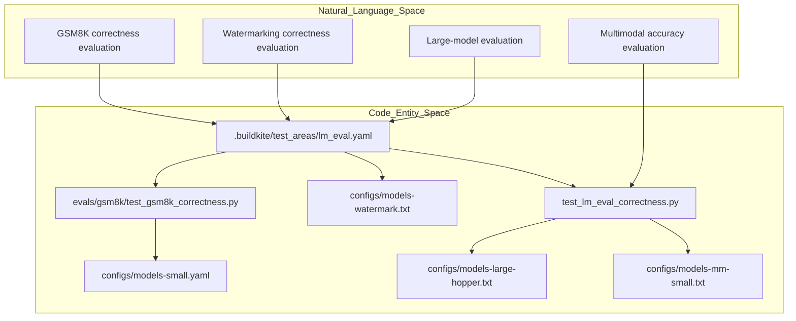
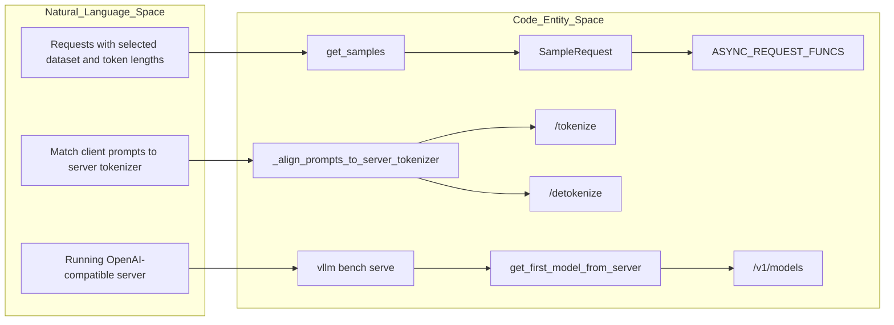

<!-- source: DeepWiki mcp.deepwiki.com · repo vllm-project/vllm · page 12.4 Model Correctness Validation and Benchmarking · fetched 2026-10-28 -->

# Model Correctness Validation and Benchmarking

Relevant source files

The following files were used as context for generating this wiki page:

- [.buildkite/test-amd.yaml](.buildkite/test-amd.yaml)
- [.buildkite/test_areas/basic_correctness.yaml](.buildkite/test_areas/basic_correctness.yaml)
- [.buildkite/test_areas/benchmarks.yaml](.buildkite/test_areas/benchmarks.yaml)
- [.buildkite/test_areas/disaggregated.yaml](.buildkite/test_areas/disaggregated.yaml)
- [.buildkite/test_areas/distributed.yaml](.buildkite/test_areas/distributed.yaml)
- [.buildkite/test_areas/engine.yaml](.buildkite/test_areas/engine.yaml)
- [.buildkite/test_areas/entrypoints.yaml](.buildkite/test_areas/entrypoints.yaml)
- [.buildkite/test_areas/expert_parallelism.yaml](.buildkite/test_areas/expert_parallelism.yaml)
- [.buildkite/test_areas/kernels.yaml](.buildkite/test_areas/kernels.yaml)
- [.buildkite/test_areas/lm_eval.yaml](.buildkite/test_areas/lm_eval.yaml)
- [.buildkite/test_areas/lora.yaml](.buildkite/test_areas/lora.yaml)
- [.buildkite/test_areas/misc.yaml](.buildkite/test_areas/misc.yaml)
- [.buildkite/test_areas/models_basic.yaml](.buildkite/test_areas/models_basic.yaml)
- [.buildkite/test_areas/models_distributed.yaml](.buildkite/test_areas/models_distributed.yaml)
- [.buildkite/test_areas/models_language.yaml](.buildkite/test_areas/models_language.yaml)
- [.buildkite/test_areas/models_multimodal.yaml](.buildkite/test_areas/models_multimodal.yaml)
- [.buildkite/test_areas/plugins.yaml](.buildkite/test_areas/plugins.yaml)
- [.buildkite/test_areas/pytorch.yaml](.buildkite/test_areas/pytorch.yaml)
- [.buildkite/test_areas/rust_frontend.yaml](.buildkite/test_areas/rust_frontend.yaml)
- [.buildkite/test_areas/spec_decode.yaml](.buildkite/test_areas/spec_decode.yaml)
- [benchmarks/backend_request_func.py](benchmarks/backend_request_func.py)
- [docs/assets/benchmarking/latency-metrics-speculative-decoding-dark.svg](docs/assets/benchmarking/latency-metrics-speculative-decoding-dark.svg)
- [docs/assets/benchmarking/latency-metrics-speculative-decoding-light.svg](docs/assets/benchmarking/latency-metrics-speculative-decoding-light.svg)
- [docs/benchmarking/cli.md](docs/benchmarking/cli.md)
- [tests/benchmarks/test_audio_dataset.py](tests/benchmarks/test_audio_dataset.py)
- [tests/benchmarks/test_custom_dataset_seed.py](tests/benchmarks/test_custom_dataset_seed.py)
- [tests/benchmarks/test_custom_image_dataset.py](tests/benchmarks/test_custom_image_dataset.py)
- [tests/benchmarks/test_endpoint_request_func_timing.py](tests/benchmarks/test_endpoint_request_func_timing.py)
- [tests/benchmarks/test_random_dataset.py](tests/benchmarks/test_random_dataset.py)
- [tests/benchmarks/test_random_multimodal_dataset_video.py](tests/benchmarks/test_random_multimodal_dataset_video.py)
- [tests/benchmarks/test_serve_cli.py](tests/benchmarks/test_serve_cli.py)
- [tests/benchmarks/test_skip_tokenizer_init.py](tests/benchmarks/test_skip_tokenizer_init.py)
- [vllm/benchmarks/datasets/__init__.py](vllm/benchmarks/datasets/__init__.py)
- [vllm/benchmarks/datasets/create_txt_slices_dataset.py](vllm/benchmarks/datasets/create_txt_slices_dataset.py)
- [vllm/benchmarks/datasets/datasets.py](vllm/benchmarks/datasets/datasets.py)
- [vllm/benchmarks/lib/endpoint_request_func.py](vllm/benchmarks/lib/endpoint_request_func.py)
- [vllm/benchmarks/serve.py](vllm/benchmarks/serve.py)
- [vllm/transformers_utils/processors/moondream3.py](vllm/transformers_utils/processors/moondream3.py)

## Purpose and scope

This page describes the correctness checks and benchmark entry points visible in the supplied codebase excerpts. It covers the Buildkite `LM Eval` jobs, GSM8K-based checks, model and engine correctness jobs, and the online serving benchmark implemented in `vllm/benchmarks/serve.py`. The shown CI configuration does not define a universal numeric accuracy threshold; it specifies test commands, model configuration lists, hardware, and job policies instead. [.buildkite/test_areas/lm_eval.yaml:1-32](), [vllm/benchmarks/serve.py:3-19]()

Sources: [.buildkite/test_areas/lm_eval.yaml:1-32](), [vllm/benchmarks/serve.py:3-19]()

---

## 1. Correctness Validation Suites: `lm_eval` and GSM8K

### Purpose

The Buildkite `LM Eval` group runs GSM8K correctness tests using model lists selected for different hardware and execution setups. The standard small-model job invokes `evals/gsm8k/test_gsm8k_correctness.py` with `configs/models-small.yaml`; separate jobs cover watermarking, larger models, Blackwell, and distributed configurations. These are CI entry points, not a specification of a single pass-rate threshold. [.buildkite/test_areas/lm_eval.yaml:1-15](), [.buildkite/test_areas/lm_eval.yaml:55-69](), [.buildkite/test_areas/lm_eval.yaml:106-118](), [.buildkite/test_areas/lm_eval.yaml:142-190]()

Sources: [.buildkite/test_areas/lm_eval.yaml:1-15](), [.buildkite/test_areas/lm_eval.yaml:55-69](), [.buildkite/test_areas/lm_eval.yaml:106-118](), [.buildkite/test_areas/lm_eval.yaml:142-190]()

### GSM8K and model-list execution

The small-model job runs `pytest -s -v evals/gsm8k/test_gsm8k_correctness.py --config-list-file=configs/models-small.yaml`. It is configured for automatic sharding and has an AMD MI300 mirror. The test’s model selection is supplied through a config-list file rather than encoded in the Buildkite command itself. [.buildkite/test_areas/lm_eval.yaml:5-32]()

Watermarking uses the same GSM8K test entry point with `configs/models-watermark.txt`; its CI dependency paths include watermarking configuration, sampling parameters, watermarking implementation, and GPU worker code. [.buildkite/test_areas/lm_eval.yaml:55-91]()

Large-model jobs use the harness working directory and `test_lm_eval_correctness.py`. The H100 nightly job uses a four-device configuration list and `--tp-size=4`; the AMD mirror uses its ROCm-specific list and the same tensor-parallel size. The shown job sets `VLLM_USE_DEEP_GEMM=0`. [.buildkite/test_areas/lm_eval.yaml:106-140]()

Distributed small-model evaluation is also configured: the B200 job uses two devices and `configs/models-small-tp.yaml`; its AMD mirror uses two devices as well. [.buildkite/test_areas/lm_eval.yaml:179-207]()

### Related accuracy coverage

The multimodal CI group has a separate small-model accuracy-evaluation job. It runs `test_lm_eval_correctness.py` with `configs/models-mm-small.txt` and `--tp-size=1`, with an AMD mirror. This is distinct from the GSM8K command shown in the `LM Eval` group. [.buildkite/test_areas/models_multimodal.yaml:128-152]()

Sources: [.buildkite/test_areas/lm_eval.yaml:5-32](), [.buildkite/test_areas/lm_eval.yaml:55-91](), [.buildkite/test_areas/lm_eval.yaml:106-140](), [.buildkite/test_areas/lm_eval.yaml:179-207](), [.buildkite/test_areas/models_multimodal.yaml:128-152]()

### Natural-language evaluation mapped to code entities

This diagram maps the evaluation goals and CI concepts to the concrete test commands and configuration entities shown in the repository excerpts. [.buildkite/test_areas/lm_eval.yaml:5-32](), [.buildkite/test_areas/lm_eval.yaml:106-118](), [.buildkite/test_areas/models_multimodal.yaml:128-152]()

**Diagram: Evaluation intent to CI and test entities**

Sources: [.buildkite/test_areas/lm_eval.yaml:5-32](), [.buildkite/test_areas/lm_eval.yaml:55-69](), [.buildkite/test_areas/lm_eval.yaml:106-118](), [.buildkite/test_areas/models_multimodal.yaml:128-152]()

---

## 2. Acceptance Criteria for Model Correctness

### CI acceptance and thresholds

The shown CI definitions express acceptance operationally: the configured pytest command must complete successfully for the job to pass, subject to job policies such as `optional`, sharding, and hardware mirrors. They do not specify a universal GSM8K score, numerical tolerance, or minimum pass rate in the supplied excerpts. [.buildkite/test_areas/lm_eval.yaml:5-15](), [.buildkite/test_areas/lm_eval.yaml:106-118](), [.buildkite/test_areas/lm_eval.yaml:142-152]()

| Validation area | What the supplied CI configuration establishes | Entrypoint or configuration |
|---|---|---|
| GSM8K small-model evaluation | Runs the GSM8K correctness pytest with a small-model config list. | `evals/gsm8k/test_gsm8k_correctness.py`, `configs/models-small.yaml` [.buildkite/test_areas/lm_eval.yaml:5-15]() |
| Watermarking | Runs the GSM8K correctness pytest with a watermark-specific config list. | `configs/models-watermark.txt` [.buildkite/test_areas/lm_eval.yaml:55-69]() |
| Large-model evaluation | Runs the harness test with a large-model list and tensor parallel size 4. | `test_lm_eval_correctness.py`, `configs/models-large-hopper.txt` [.buildkite/test_areas/lm_eval.yaml:106-118]() |
| Multimodal accuracy | Runs the harness test with a multimodal model list and tensor parallel size 1. | `test_lm_eval_correctness.py`, `configs/models-mm-small.txt` [.buildkite/test_areas/models_multimodal.yaml:128-138]() |
| Model initialization | Runs a small initialization subset and beam-construction tests. | `models/test_initialization.py`, `models/test_beam_construction.py` [.buildkite/test_areas/models_basic.yaml:5-19]() |
| Scheduling accuracy | Runs a dedicated asynchronous scheduling accuracy test. | `v1/e2e/general/test_async_scheduling_accuracy.py` [.buildkite/test_areas/engine.yaml:91-99]() |

The initialization job’s commands demonstrate coverage of initialization and beam construction; they do not define output-parity tolerances. [.buildkite/test_areas/models_basic.yaml:5-19]() The engine CI configuration separately identifies asynchronous scheduling accuracy as an explicit test job. [.buildkite/test_areas/engine.yaml:91-99]()

Sources: [.buildkite/test_areas/lm_eval.yaml:5-15](), [.buildkite/test_areas/lm_eval.yaml:55-69](), [.buildkite/test_areas/lm_eval.yaml:106-118](), [.buildkite/test_areas/models_multimodal.yaml:128-138](), [.buildkite/test_areas/models_basic.yaml:5-19](), [.buildkite/test_areas/engine.yaml:91-99]()

### Model, engine, and platform coverage

Correctness checks are not limited to the GSM8K group. The language-model CI group runs standard model tests marked `core_model` while excluding `slow_test`, and has a separate job for the slow subset. [.buildkite/test_areas/models_language.yaml:5-40]() The basic-model group also runs initialization tests and a set of model/backend integration tests. [.buildkite/test_areas/models_basic.yaml:5-19](), [.buildkite/test_areas/models_basic.yaml:61-81]()

The `LM Eval` jobs include NVIDIA and AMD variants. Some jobs are nightly or optional, and large-model evaluation is configured with multiple devices and tensor parallelism. These are CI scheduling and coverage choices, not different correctness definitions. [.buildkite/test_areas/lm_eval.yaml:5-32](), [.buildkite/test_areas/lm_eval.yaml:106-140](), [.buildkite/test_areas/lm_eval.yaml:142-190]()

Sources: [.buildkite/test_areas/models_language.yaml:5-40](), [.buildkite/test_areas/models_basic.yaml:5-19](), [.buildkite/test_areas/models_basic.yaml:61-81](), [.buildkite/test_areas/lm_eval.yaml:5-32](), [.buildkite/test_areas/lm_eval.yaml:106-140](), [.buildkite/test_areas/lm_eval.yaml:142-190]()

---

## 3. Benchmarking Tools Overview

### 3.1 Online serving benchmark: `vllm bench serve`

`vllm/benchmarks/serve.py` documents an online benchmark workflow: start a vLLM OpenAI API server, then run `vllm bench serve` as a client. Its documented arguments include backend, result label, model, dataset name, input and output lengths, request rate, and prompt count. The module imports dataset sampling, endpoint request functions, endpoint readiness checks, and result-format utilities. [vllm/benchmarks/serve.py:3-19](), [vllm/benchmarks/serve.py:41-63]()

The client can discover a model from the server’s `/v1/models` endpoint through `get_first_model_from_server()`. Its request uses the returned model ID and root metadata. [vllm/benchmarks/serve.py:170-187]()

For string prompts, `_align_prompts_to_server_tokenizer()` probes the server’s `/tokenize` and `/detokenize` routes. It compares the server-tokenized length of a prompt with the expected prompt length, and, when needed, attempts to reconstruct prompts with the requested token count. Connection, HTTP, and other probe failures cause the function to warn and retain the original requests. [vllm/benchmarks/serve.py:81-91](), [vllm/benchmarks/serve.py:95-167]()

The helper limits concurrent tokenize/detokenize operations with an `asyncio.Semaphore(64)`. Per-request correction failures are handled by retaining the corresponding original request. [vllm/benchmarks/serve.py:95-121](), [vllm/benchmarks/serve.py:153-167]()

Sources: [vllm/benchmarks/serve.py:3-19](), [vllm/benchmarks/serve.py:41-63](), [vllm/benchmarks/serve.py:81-91](), [vllm/benchmarks/serve.py:95-167](), [vllm/benchmarks/serve.py:170-187]()

### 3.2 Throughput, latency, sweep, and attention benchmarks

The supplied excerpts identify additional benchmark-related file names, including `vllm/benchmarks/lib/endpoint_request_func.py`, `vllm/benchmarks/datasets/datasets.py`, and `.buildkite/test_areas/benchmarks.yaml`, but do not include their implementations or line ranges. Consequently, this page does not attribute specific throughput or latency formulas, sweep behavior, or attention benchmark commands to those files. The available serving-benchmark excerpt establishes the CLI’s workload inputs and supporting request/dataset interfaces, but not the detailed metric aggregation or sweep implementation. [vllm/benchmarks/serve.py:3-19](), [vllm/benchmarks/serve.py:41-63]()

Sources: [vllm/benchmarks/serve.py:3-19](), [vllm/benchmarks/serve.py:41-63]()

### Serving benchmark: natural-language workflow mapped to code entities

This diagram connects the user-facing task—benchmarking an online model endpoint—with the concrete symbols and paths visible in `serve.py`. [vllm/benchmarks/serve.py:3-19](), [vllm/benchmarks/serve.py:41-63](), [vllm/benchmarks/serve.py:81-187]()

**Diagram: Online serving workload to benchmark implementation**

Sources: [vllm/benchmarks/serve.py:3-19](), [vllm/benchmarks/serve.py:41-53](), [vllm/benchmarks/serve.py:81-167](), [vllm/benchmarks/serve.py:170-187]()

---

## 4. Benchmark Dataset Architecture

The shown `serve.py` imports `SampleRequest`, `add_dataset_parser`, and `get_samples` from `vllm.benchmarks.datasets`; the module’s CLI documentation also exposes dataset selection and general input/output length arguments. The provided contents do not show the dataset classes or sampling implementations, so specific dataset formats and sampling behavior cannot be established from these excerpts. [vllm/benchmarks/serve.py:9-18](), [vllm/benchmarks/serve.py:45-45]()

| Visible entity | Role established by the excerpt |
|---|---|
| `SampleRequest` | Request type imported by the serving benchmark and used during tokenizer alignment. [vllm/benchmarks/serve.py:45-45](), [vllm/benchmarks/serve.py:81-86]() |
| `get_samples` | Dataset sampling function imported by the serving benchmark. [vllm/benchmarks/serve.py:45-45]() |
| `add_dataset_parser` | Dataset parser helper imported by the serving benchmark. [vllm/benchmarks/serve.py:45-45]() |
| `--dataset-name` | Documented CLI argument for selecting the benchmark dataset; the documented default is `random`. [vllm/benchmarks/serve.py:9-18]() |
| `--input-len`, `--output-len` | Documented general length arguments that map to dataset-specific arguments. [vllm/benchmarks/serve.py:14-16]() |

Sources: [vllm/benchmarks/serve.py:9-18](), [vllm/benchmarks/serve.py:45-45](), [vllm/benchmarks/serve.py:81-86]()

---

## 5. Sweep Tooling and Attention Benchmarks

The supplied excerpts do not show the implementation of sweep tooling or attention-specific benchmark drivers. They do show CI tests for core operation kernels, vLLM IR, and specialized DeepSeek V4 kernels; those commands are kernel test jobs and should not be mistaken for benchmark measurements. [.buildkite/test_areas/kernels.yaml:5-15](), [.buildkite/test_areas/kernels.yaml:33-44](), [.buildkite/test_areas/kernels.yaml:103-114]()

| CI target | Shown command or scope | What can be concluded from the excerpt |
|---|---|---|
| vLLM IR | Runs `tests/ir` and `tests/kernels/ir`. [.buildkite/test_areas/kernels.yaml:5-15]() | A test job for IR and kernel-IR paths. |
| Core operation kernels | Runs pytest under `kernels/core` and selected kernel test files. [.buildkite/test_areas/kernels.yaml:33-44]() | A kernel correctness/test job. |
| DeepSeek V4 kernels | Runs selected fused-kernel tests and `test_top_k_per_row.py`. [.buildkite/test_areas/kernels.yaml:103-114]() | A model-specific kernel test job. |

The excerpts do not establish benchmark metrics, performance acceptance thresholds, or sweep parameters for these kernel jobs. [.buildkite/test_areas/kernels.yaml:5-15](), [.buildkite/test_areas/kernels.yaml:33-44](), [.buildkite/test_areas/kernels.yaml:103-114]()

Sources: [.buildkite/test_areas/kernels.yaml:5-15](), [.buildkite/test_areas/kernels.yaml:33-44](), [.buildkite/test_areas/kernels.yaml:103-114]()

---

## 6. Batch Invariance and Determinism Validation

The supplied excerpts do not show the determinism or batch-invariance test implementation, nor do they establish that `VLLM_BATCH_INVARIANT=1` is used by a particular CI job. Therefore, no specific deterministic execution guarantee or test acceptance rule is asserted here.

The available CI configuration does provide a concrete accuracy-oriented engine test: `v1/e2e/general/test_async_scheduling_accuracy.py`, run as a dedicated job with NVIDIA and AMD configurations. This establishes scheduling-accuracy coverage, but it does not by itself establish batch invariance or bitwise reproducibility. [.buildkite/test_areas/engine.yaml:91-109]()

Sources: [.buildkite/test_areas/engine.yaml:91-109]()

---

## 7. Model Comparison Framework

The supplied excerpts establish model initialization tests, language-model test commands, and evaluation harness invocations. They do not show `HfRunner`, `VllmRunner`, comparison tolerances, or the implementation that compares reference outputs with vLLM outputs. Those details are therefore not specified here. [.buildkite/test_areas/models_basic.yaml:5-19](), [.buildkite/test_areas/models_language.yaml:5-16](), [.buildkite/test_areas/lm_eval.yaml:5-15]()

The shown validation entry points cover distinct concerns: initialization and beam construction in the basic-model group, `core_model` language tests, and GSM8K correctness evaluation through its dedicated pytest command. These jobs provide test coverage, but the supplied CI excerpts alone do not define a shared numerical-parity criterion. [.buildkite/test_areas/models_basic.yaml:5-19](), [.buildkite/test_areas/models_language.yaml:5-16](), [.buildkite/test_areas/lm_eval.yaml:5-15]()

Sources: [.buildkite/test_areas/models_basic.yaml:5-19](), [.buildkite/test_areas/models_language.yaml:5-16](), [.buildkite/test_areas/lm_eval.yaml:5-15]()

---

