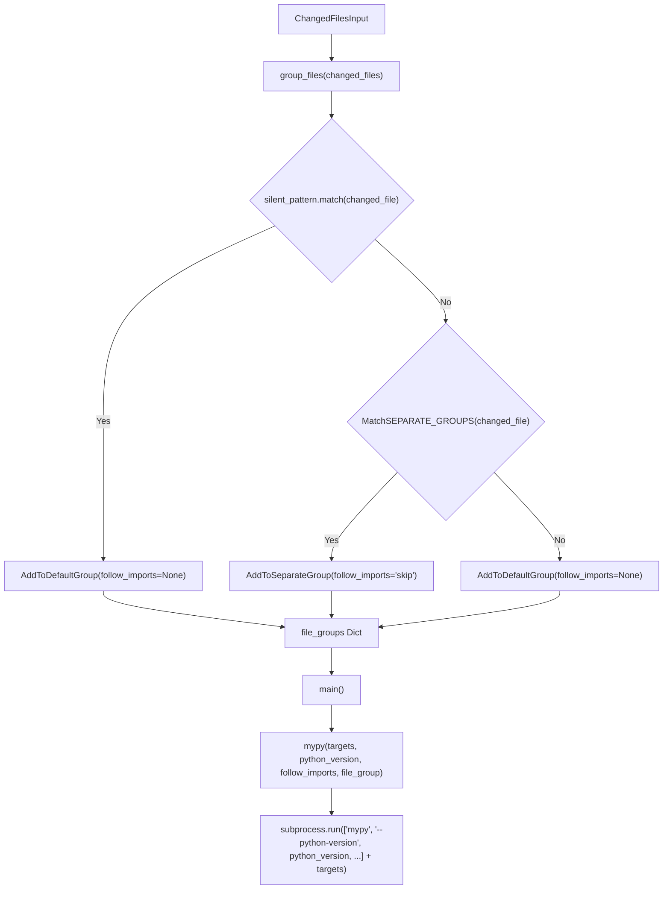
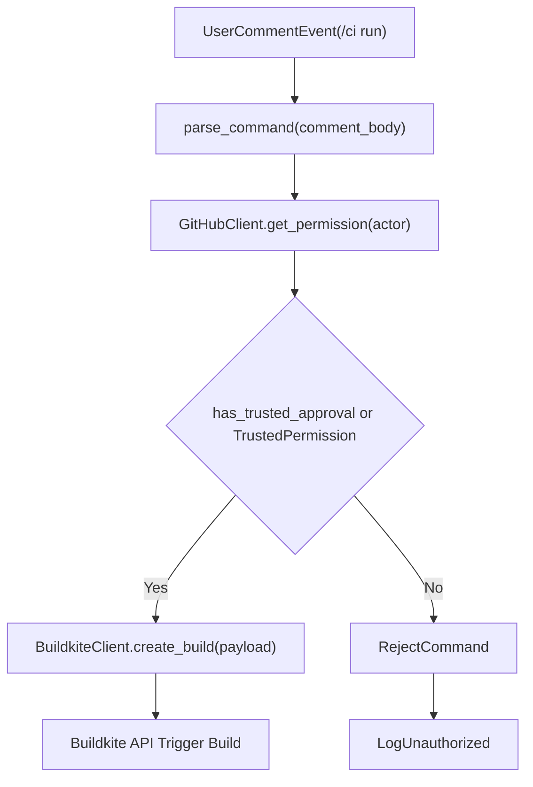

<!-- source: DeepWiki mcp.deepwiki.com · repo vllm-project/vllm · page 12.5 Developer Tooling and Governance · fetched 2026-10-28 -->

# Developer Tooling and Governance

<details>
<summary>Relevant source files</summary>

The following files were used as context for generating this wiki page:

- [.agents/skills/pr-checklist/SKILL.md](.agents/skills/pr-checklist/SKILL.md)
- [.github/CODEOWNERS](.github/CODEOWNERS)
- [.github/PULL_REQUEST_TEMPLATE.md](.github/PULL_REQUEST_TEMPLATE.md)
- [.github/actionlint.yaml](.github/actionlint.yaml)
- [.github/mergify.yml](.github/mergify.yml)
- [.github/workflows/add_label_automerge.yml](.github/workflows/add_label_automerge.yml)
- [.github/workflows/buf.yml](.github/workflows/buf.yml)
- [.github/workflows/issue_autolabel.yml](.github/workflows/issue_autolabel.yml)
- [.github/workflows/macos-smoke-test.yml](.github/workflows/macos-smoke-test.yml)
- [.github/workflows/new_pr_bot.yml](.github/workflows/new_pr_bot.yml)
- [.github/workflows/notify-ci-authorized.yml](.github/workflows/notify-ci-authorized.yml)
- [.github/workflows/pr-title.yml](.github/workflows/pr-title.yml)
- [.github/workflows/pre-commit.yml](.github/workflows/pre-commit.yml)
- [.github/workflows/proto-crate.yml](.github/workflows/proto-crate.yml)
- [.github/workflows/record-ci-approval.yml](.github/workflows/record-ci-approval.yml)
- [.github/workflows/run-ci-command.yml](.github/workflows/run-ci-command.yml)
- [.github/workflows/scripts/run_ci_command.py](.github/workflows/scripts/run_ci_command.py)
- [.github/workflows/scripts/test_run_ci_command.py](.github/workflows/scripts/test_run_ci_command.py)
- [.gitignore](.gitignore)
- [AGENTS.md](AGENTS.md)
- [SECURITY.md](SECURITY.md)
- [docs/community/reviewers.md](docs/community/reviewers.md)
- [docs/contributing/README.md](docs/contributing/README.md)
- [docs/contributing/model/basic.md](docs/contributing/model/basic.md)
- [docs/contributing/model/multimodal.md](docs/contributing/model/multimodal.md)
- [docs/contributing/vulnerability_management.md](docs/contributing/vulnerability_management.md)
- [docs/governance/committers.md](docs/governance/committers.md)
- [docs/governance/process.md](docs/governance/process.md)
- [requirements/lint.txt](requirements/lint.txt)
- [rust/AGENTS.md](rust/AGENTS.md)
- [rust/proto/Cargo.toml](rust/proto/Cargo.toml)
- [rust/proto/README.md](rust/proto/README.md)
- [rust/proto/buf.yaml](rust/proto/buf.yaml)
- [rust/proto/build.rs](rust/proto/build.rs)
- [rust/proto/src/lib.rs](rust/proto/src/lib.rs)
- [tests/AGENTS.md](tests/AGENTS.md)
- [tests/model_executor/test_gemma_hidden_act.py](tests/model_executor/test_gemma_hidden_act.py)
- [tests/v1/spec_decode/test_dflash_causality.py](tests/v1/spec_decode/test_dflash_causality.py)
- [tools/pre_commit/mypy.py](tools/pre_commit/mypy.py)
- [vllm/model_executor/layers/fused_moe/hpc_moe.py](vllm/model_executor/layers/fused_moe/hpc_moe.py)
- [vllm/model_executor/layers/hpc/__init__.py](vllm/model_executor/layers/hpc/__init__.py)
- [vllm/model_executor/layers/hpc/hpc_ihc.py](vllm/model_executor/layers/hpc/hpc_ihc.py)
- [vllm/model_executor/layers/hpc/hpc_module.py](vllm/model_executor/layers/hpc/hpc_module.py)
- [vllm/model_executor/layers/hpc/rope_norm.py](vllm/model_executor/layers/hpc/rope_norm.py)
- [vllm/model_executor/models/cohere2_moe.py](vllm/model_executor/models/cohere2_moe.py)
- [vllm/model_executor/models/cohere_eagle.py](vllm/model_executor/models/cohere_eagle.py)
- [vllm/model_executor/models/commandr.py](vllm/model_executor/models/commandr.py)
- [vllm/model_executor/models/gemma3.py](vllm/model_executor/models/gemma3.py)
- [vllm/model_executor/models/glm4.py](vllm/model_executor/models/glm4.py)
- [vllm/model_executor/models/hy_v3.py](vllm/model_executor/models/hy_v3.py)
- [vllm/model_executor/models/hy_v3_mtp.py](vllm/model_executor/models/hy_v3_mtp.py)
- [vllm/model_executor/models/hyperclovax.py](vllm/model_executor/models/hyperclovax.py)
- [vllm/model_executor/models/jamba.py](vllm/model_executor/models/jamba.py)
- [vllm/model_executor/models/jina.py](vllm/model_executor/models/jina.py)
- [vllm/model_executor/models/mimo.py](vllm/model_executor/models/mimo.py)
- [vllm/model_executor/models/qwen2.py](vllm/model_executor/models/qwen2.py)
- [vllm/v1/attention/backends/hpc_attn.py](vllm/v1/attention/backends/hpc_attn.py)

</details>


This page documents the developer tooling, automated checks, review assignments, agent instructions, and governance processes within the vLLM project. It covers pre-commit hooks, `mypy` static type checking, GitHub Actions workflows, Mergify automation, the `CODEOWNERS` file, agent skills (`.agents/`, `.claude/`), and the contribution and governance model.

---

## Pre-commit Hooks

vLLM utilizes `pre-commit` hooks configured in `.pre-commit-config.yaml` to maintain code quality, formatting, and consistency across the codebase before code is committed or pushed [.pre-commit-config.yaml:1-318]().

### Configuration and Hooks

The pre-commit configuration defines a set of repositories and hooks that check Python files, C++/CUDA sources, Markdown docs, shell scripts, and GitHub Actions workflows [.pre-commit-config.yaml:9-165](). In addition to standard linters, vLLM includes local custom hooks implemented under `tools/pre_commit/` [.pre-commit-config.yaml:165-182]().

**Key Pre-commit Hooks:**

| Hook ID | Tool / Source | Purpose |
| :--- | :--- | :--- |
| `ruff-check` & `ruff-format` | Astral Ruff [.pre-commit-config.yaml:9-14]() | Python linting and auto-formatting |
| `typos` | Crate-CI typos [.pre-commit-config.yaml:15-19]() | Fast spell checking in code and docs |
| `clang-format` | Mirrors clang-format [.pre-commit-config.yaml:20-26]() | C++ and CUDA source formatting |
| `markdownlint-cli2` | DavidAnson markdownlint-cli2 [.pre-commit-config.yaml:27-32]() | Markdown documentation linting (using `tools/pre_commit/.markdownlint.yaml`) [docs/contributing/README.md:93-96]() |
| `actionlint` | rhysd actionlint [.pre-commit-config.yaml:33-36]() | GitHub Actions workflow validation |
| `shellcheck` | shellcheck-py [.pre-commit-config.yaml:37-41]() | Shell script analysis (using `tools/pre_commit/.shellcheckrc`) [docs/contributing/README.md:93-95]() |
| `check-label-rules` | Local python script [.pre-commit-config.yaml:172-178]() | Validates that Mergify label rules match real files |
| `check-agent-files` | Local python script [.pre-commit-config.yaml:179-182]() | Validates agent instruction files and skills |

Developers install and run pre-commit locally via:
```bash
uv pip install pre-commit>=4.5.1
pre-commit install
pre-commit run --all-files
```

Sources:
- [.pre-commit-config.yaml:1-318]()
- [docs/contributing/README.md:82-105]()

---

## Mypy Tooling

Static type checking via `mypy` is integrated into developer workflows and pre-commit checks. Because checking the entire repository at once can be prone to import errors and slow down iteration, vLLM uses an intelligent wrapper script `tools/pre_commit/mypy.py` [tools/pre_commit/mypy.py:3-17]().

### Implementation and Data Flow

The `tools/pre_commit/mypy.py` script divides changed files into distinct groups (`SILENT_GROUPS` and `SEPARATE_GROUPS`) to control import-following behaviors (`follow_imports="silent"` vs `follow_imports="skip"`) [tools/pre_commit/mypy.py:30-110]().



*Figure 1: Mypy file grouping and execution flow in `tools/pre_commit/mypy.py`.*

Sources:
- [tools/pre_commit/mypy.py:1-185]()
- [.pre-commit-config.yaml:180-313]()

---

## GitHub Actions Workflows and CI Automation

vLLM relies on GitHub Actions workflows for continuous integration, issue triage, and build orchestration.

### Key Workflows

- **`pre-commit.yml`**: Runs pre-commit checks on pull requests. It includes a `pre-run-check` job that validates PR authorship or ready labels (`ready`, `ready-run-all-tests`, `verified`) before running resource-intensive hooks [.github/workflows/pre-commit.yml:18-46]().
- **`issue_autolabel.yml`**: Automatically analyzes issue titles and bodies using keywords, substrings, and regular expressions via `actions/github-script` to assign triage labels (`rocm`, `cpu`, `deepseek`, `quantization`, etc.) [.github/workflows/issue_autolabel.yml:1-108]().
- **`macos-smoke-test.yml`**: Performs daily smoke testing on macOS Apple Silicon runners.
- **`run-ci-command.yml`**: Authorizes and runs CI commands from PR comments. This workflow uses `run_ci_command.py` to handle the logic [.github/workflows/run-ci-command.yml:1-54]().

### CI Command Automation (`run_ci_command.py`)

Authorized maintainers can trigger Buildkite CI pipelines using PR comment commands (such as `/ci run`). The automation is managed by `.github/workflows/scripts/run_ci_command.py`.



*Figure 2: CI command authorization and dispatch flow in `.github/workflows/scripts/run_ci_command.py`.*

Sources:
- [.github/workflows/pre-commit.yml:1-62]()
- [.github/workflows/issue_autolabel.yml:1-108]()
- [.github/workflows/scripts/run_ci_command.py:1-208]()
- [.github/workflows/run-ci-command.yml:1-54]()

---

## Mergify Automation

Pull request automation is governed by `.github/mergify.yml` [.github/mergify.yml:1-787]().

### Key Rules

- **Documentation Labeling**: Automatically applies the `documentation` label and comments ReadTheDocs preview links on PRs modifying `docs/`, `examples/`, or `mkdocs.yaml` [.github/mergify.yml:2-16]().
- **Pre-commit Failure Notifications**: Comments helpful instructions on PRs when the `pre-commit` check fails [.github/mergify.yml:17-41]().
- **Component Labeling**: Automatically applies component and model labels (e.g., `ci/build`, `cohere`, `deepseek`, `frontend`, `pooling`, `rust`, `llama`, `multi-modality`, `mistral`, `new-model`, `performance`) based on modified file paths or PR titles [.github/mergify.yml:53-228]().

Sources:
- [.github/mergify.yml:1-238]()

---

## CODEOWNERS

Review responsibilities and automatic reviewer requests are defined in `.github/CODEOWNERS` [.github/CODEOWNERS:1-242]().

### Structure and Subsystem Mapping

Each entry maps repository paths to responsible committers and domain experts [.github/CODEOWNERS:1-162]():
- `/vllm/compilation`: `@zou3519`, `@youkaichao`, `@ProExpertProg`, `@BoyuanFeng` [.github/CODEOWNERS:5]()
- `/vllm/distributed/kv_transfer`: `@NickLucche`, `@ApostaC`, `@orozery`, `@xuechendi`, `@ivanium`, `@wzhao18` [.github/CODEOWNERS:7]()
- `/vllm/lora`: `@jeejeelee` [.github/CODEOWNERS:9]()
- `/vllm/model_executor/layers/attention`: `@LucasWilkinson`, `@MatthewBonanni` [.github/CODEOWNERS:10]()
- `/vllm/config`: `@WoosukKwon`, `@youkaichao`, `@robertgshaw2-redhat`, `@mgoin`, `@tlrmchlsmth`, `@houseroad`, `@yewentao256`, `@ProExpertProg` [.github/CODEOWNERS:29]()
- `/rust/`: `@BugenZhao`, `@njhill` [.github/CODEOWNERS:76]()

Sources:
- [.github/CODEOWNERS:1-145]()

---

## Agent Instructions and Skills (`AGENTS.md`, `.agents/`, `.claude/`)

vLLM enforces strict guidelines for AI-assisted contributions via `AGENTS.md` and auxiliary instruction directories (`.agents/`, `.claude/`) [AGENTS.md:1-156]().

### Contribution Policy for Agents

- **Duplicate Work Checks**: AI agents and automated contributors must verify open issues and PRs before submitting work [AGENTS.md:8-20]().
- **No Low-Value Busywork**: Trivial, one-off cleanups without substantive changes are prohibited [AGENTS.md:21-23]().
- **Human Accountability**: Pure code-agent PRs are disallowed. A human submitter must review every changed line, execute test suites, and provide required verification details in the PR description [AGENTS.md:25-35]().
- **Required Skills**: Agents must execute the `pr-checklist` skill (`.agents/skills/pr-checklist/SKILL.md`) before requesting review [AGENTS.md:37]().

Sources:
- [AGENTS.md:1-156]()
- [.agents/skills/pr-checklist/SKILL.md:1-86]()

---

## Contribution and Governance Process

The vLLM contribution and governance model is detailed in community documentation and committer records [docs/contributing/README.md:1-178](), [docs/governance/committers.md:1-201]().

### Governance Roles

- **Committers**: Individuals with write access responsible for reviewing, approving, and merging pull requests across core areas [docs/governance/committers.md:1-5]().
- **Area Owners**: Designated domain experts who act as primary reviewers for specific subsystems (Engine Core, KV Cache Manager, Quantization, Attention, Distributed Execution, Platform Integration) [docs/governance/committers.md:94-108]().

Sources:
- [docs/contributing/README.md:1-166]()
- [docs/governance/committers.md:1-108]()

---

