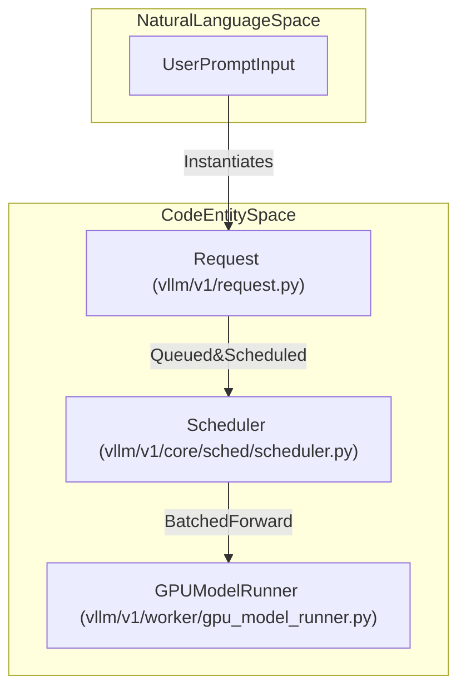
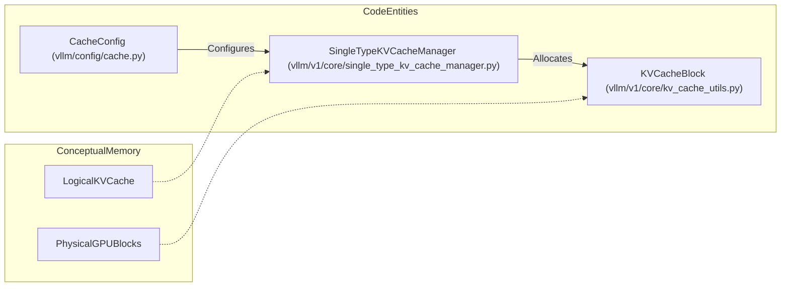

<!-- source: DeepWiki mcp.deepwiki.com · repo vllm-project/vllm · page 13 Glossary · fetched 2026-10-28 -->

# Glossary

Relevant source files

The following files were used as context for generating this wiki page:

- [cmake/external_projects/triton_kernels.cmake](cmake/external_projects/triton_kernels.cmake)
- [docs/features/automatic_prefix_caching.md](docs/features/automatic_prefix_caching.md)
- [docs/features/speculative_decoding/dynamic_speculative_decoding.md](docs/features/speculative_decoding/dynamic_speculative_decoding.md)
- [docs/models/supported_models.md](docs/models/supported_models.md)
- [tests/config/test_config_utils.py](tests/config/test_config_utils.py)
- [tests/config/test_model_arch_config.py](tests/config/test_model_arch_config.py)
- [tests/engine/test_arg_utils.py](tests/engine/test_arg_utils.py)
- [tests/kernels/attention/test_deepgemm_attention.py](tests/kernels/attention/test_deepgemm_attention.py)
- [tests/kernels/attention/test_kimi_k3_mla_fused_epilogue.py](tests/kernels/attention/test_kimi_k3_mla_fused_epilogue.py)
- [tests/kernels/attention/test_kimi_k3_mla_key_concat_kv_cache.py](tests/kernels/attention/test_kimi_k3_mla_key_concat_kv_cache.py)
- [tests/kernels/attention/test_triton_decode_attention.py](tests/kernels/attention/test_triton_decode_attention.py)
- [tests/kernels/moe/test_gpt_oss_triton_kernels.py](tests/kernels/moe/test_gpt_oss_triton_kernels.py)
- [tests/kernels/moe/test_ocp_mx_moe.py](tests/kernels/moe/test_ocp_mx_moe.py)
- [tests/kernels/quantization/test_mxfp4_triton_ep.py](tests/kernels/quantization/test_mxfp4_triton_ep.py)
- [tests/models/kimi_k3/test_mla_prefill_context.py](tests/models/kimi_k3/test_mla_prefill_context.py)
- [tests/models/multimodal/generation/test_common.py](tests/models/multimodal/generation/test_common.py)
- [tests/models/multimodal/generation/vlm_utils/model_utils.py](tests/models/multimodal/generation/vlm_utils/model_utils.py)
- [tests/models/quantization/test_gpt_oss.py](tests/models/quantization/test_gpt_oss.py)
- [tests/models/quantization/test_mimo_v2_w4a16_routing.py](tests/models/quantization/test_mimo_v2_w4a16_routing.py)
- [tests/models/registry.py](tests/models/registry.py)
- [tests/quantization/test_gfx950_moe.py](tests/quantization/test_gfx950_moe.py)
- [tests/quantization/test_modelopt.py](tests/quantization/test_modelopt.py)
- [tests/test_config.py](tests/test_config.py)
- [tests/v1/attention/test_flashmla_nope_sm90_backend_selection.py](tests/v1/attention/test_flashmla_nope_sm90_backend_selection.py)
- [tests/v1/attention/test_indexer_deepseek_v4_slot_mapping.py](tests/v1/attention/test_indexer_deepseek_v4_slot_mapping.py)
- [tests/v1/attention/test_indexer_native_next_n.py](tests/v1/attention/test_indexer_native_next_n.py)
- [tests/v1/attention/test_mla_backends.py](tests/v1/attention/test_mla_backends.py)
- [tests/v1/attention/test_sparse_mla_backends.py](tests/v1/attention/test_sparse_mla_backends.py)
- [tests/v1/core/prefix_cache/test_mamba_eagle_resume_checkpoint.py](tests/v1/core/prefix_cache/test_mamba_eagle_resume_checkpoint.py)
- [tests/v1/core/prefix_cache/test_partial_prefix_cache_hits.py](tests/v1/core/prefix_cache/test_partial_prefix_cache_hits.py)
- [tests/v1/core/test_async_scheduler.py](tests/v1/core/test_async_scheduler.py)
- [tests/v1/core/test_contiguous_kv_packing.py](tests/v1/core/test_contiguous_kv_packing.py)
- [tests/v1/core/test_deferred_block_free.py](tests/v1/core/test_deferred_block_free.py)
- [tests/v1/core/test_kv_cache_utils.py](tests/v1/core/test_kv_cache_utils.py)
- [tests/v1/core/test_mamba_align_chunk_split.py](tests/v1/core/test_mamba_align_chunk_split.py)
- [tests/v1/core/test_prefix_caching.py](tests/v1/core/test_prefix_caching.py)
- [tests/v1/core/test_scheduler.py](tests/v1/core/test_scheduler.py)
- [tests/v1/core/test_single_type_kv_cache_manager.py](tests/v1/core/test_single_type_kv_cache_manager.py)
- [tests/v1/core/utils.py](tests/v1/core/utils.py)
- [tests/v1/e2e/general/test_pooling_chunked_prefill.py](tests/v1/e2e/general/test_pooling_chunked_prefill.py)
- [tests/v1/spec_decode/test_dynamic_sd.py](tests/v1/spec_decode/test_dynamic_sd.py)
- [tests/v1/spec_decode/test_ngram.py](tests/v1/spec_decode/test_ngram.py)
- [vllm/config/attention.py](vllm/config/attention.py)
- [vllm/config/cache.py](vllm/config/cache.py)
- [vllm/config/model.py](vllm/config/model.py)
- [vllm/config/model_arch.py](vllm/config/model_arch.py)
- [vllm/config/parallel.py](vllm/config/parallel.py)
- [vllm/config/scheduler.py](vllm/config/scheduler.py)
- [vllm/config/speculative.py](vllm/config/speculative.py)
- [vllm/config/utils.py](vllm/config/utils.py)
- [vllm/config/vllm.py](vllm/config/vllm.py)
- [vllm/engine/arg_utils.py](vllm/engine/arg_utils.py)
- [vllm/model_executor/layers/attention/mla_attention.py](vllm/model_executor/layers/attention/mla_attention.py)
- [vllm/model_executor/layers/attention/sparse_mla_attention.py](vllm/model_executor/layers/attention/sparse_mla_attention.py)
- [vllm/model_executor/layers/fused_moe/config.py](vllm/model_executor/layers/fused_moe/config.py)
- [vllm/model_executor/layers/fused_moe/experts/aiter_mxfp4_w4a16_moe.py](vllm/model_executor/layers/fused_moe/experts/aiter_mxfp4_w4a16_moe.py)
- [vllm/model_executor/layers/fused_moe/experts/aiter_mxfp4_w4a8_moe.py](vllm/model_executor/layers/fused_moe/experts/aiter_mxfp4_w4a8_moe.py)
- [vllm/model_executor/layers/fused_moe/experts/gpt_oss_triton_kernels_moe.py](vllm/model_executor/layers/fused_moe/experts/gpt_oss_triton_kernels_moe.py)
- [vllm/model_executor/layers/fused_moe/experts/rocm_aiter_moe.py](vllm/model_executor/layers/fused_moe/experts/rocm_aiter_moe.py)
- [vllm/model_executor/layers/fused_moe/experts/xpu_moe.py](vllm/model_executor/layers/fused_moe/experts/xpu_moe.py)
- [vllm/model_executor/layers/fused_moe/layer.py](vllm/model_executor/layers/fused_moe/layer.py)
- [vllm/model_executor/layers/fused_moe/oracle/fp8.py](vllm/model_executor/layers/fused_moe/oracle/fp8.py)
- [vllm/model_executor/layers/fused_moe/oracle/mxfp4.py](vllm/model_executor/layers/fused_moe/oracle/mxfp4.py)
- [vllm/model_executor/layers/fused_moe/oracle/nvfp4.py](vllm/model_executor/layers/fused_moe/oracle/nvfp4.py)
- [vllm/model_executor/layers/fused_moe/topk_weight_and_reduce.py](vllm/model_executor/layers/fused_moe/topk_weight_and_reduce.py)
- [vllm/model_executor/layers/quantization/fp8.py](vllm/model_executor/layers/quantization/fp8.py)
- [vllm/model_executor/layers/quantization/modelopt.py](vllm/model_executor/layers/quantization/modelopt.py)
- [vllm/model_executor/layers/quantization/mxfp4.py](vllm/model_executor/layers/quantization/mxfp4.py)
- [vllm/model_executor/layers/quantization/quark/quark_moe.py](vllm/model_executor/layers/quantization/quark/quark_moe.py)
- [vllm/model_executor/layers/quantization/utils/mxfp4_utils.py](vllm/model_executor/layers/quantization/utils/mxfp4_utils.py)
- [vllm/model_executor/layers/sparse_attn_indexer.py](vllm/model_executor/layers/sparse_attn_indexer.py)
- [vllm/model_executor/models/config.py](vllm/model_executor/models/config.py)
- [vllm/model_executor/models/registry.py](vllm/model_executor/models/registry.py)
- [vllm/models/hy_v4/nvidia/flashmla_sparse.py](vllm/models/hy_v4/nvidia/flashmla_sparse.py)
- [vllm/models/inkling/common/mm_preprocess.py](vllm/models/inkling/common/mm_preprocess.py)
- [vllm/models/kimi_k3/nvidia/mla.py](vllm/models/kimi_k3/nvidia/mla.py)
- [vllm/models/kimi_k3/nvidia/ops/fused_mla_key_concat_kv_cache.py](vllm/models/kimi_k3/nvidia/ops/fused_mla_key_concat_kv_cache.py)
- [vllm/transformers_utils/config.py](vllm/transformers_utils/config.py)
- [vllm/transformers_utils/configs/__init__.py](vllm/transformers_utils/configs/__init__.py)
- [vllm/transformers_utils/model_arch_config_convertor.py](vllm/transformers_utils/model_arch_config_convertor.py)
- [vllm/transformers_utils/processors/__init__.py](vllm/transformers_utils/processors/__init__.py)
- [vllm/utils/deep_gemm.py](vllm/utils/deep_gemm.py)
- [vllm/v1/attention/backends/mla/cutlass_mla.py](vllm/v1/attention/backends/mla/cutlass_mla.py)
- [vllm/v1/attention/backends/mla/flashattn_mla.py](vllm/v1/attention/backends/mla/flashattn_mla.py)
- [vllm/v1/attention/backends/mla/flashattn_mla_sparse.py](vllm/v1/attention/backends/mla/flashattn_mla_sparse.py)
- [vllm/v1/attention/backends/mla/flashinfer_mla.py](vllm/v1/attention/backends/mla/flashinfer_mla.py)
- [vllm/v1/attention/backends/mla/flashinfer_mla_sparse.py](vllm/v1/attention/backends/mla/flashinfer_mla_sparse.py)
- [vllm/v1/attention/backends/mla/flashmla.py](vllm/v1/attention/backends/mla/flashmla.py)
- [vllm/v1/attention/backends/mla/flashmla_sparse.py](vllm/v1/attention/backends/mla/flashmla_sparse.py)
- [vllm/v1/attention/backends/mla/indexer.py](vllm/v1/attention/backends/mla/indexer.py)
- [vllm/v1/attention/backends/mla/tokenspeed_mla.py](vllm/v1/attention/backends/mla/tokenspeed_mla.py)
- [vllm/v1/attention/backends/mla/triton_mla.py](vllm/v1/attention/backends/mla/triton_mla.py)
- [vllm/v1/attention/ops/metadata.py](vllm/v1/attention/ops/metadata.py)
- [vllm/v1/attention/ops/triton_decode_attention.py](vllm/v1/attention/ops/triton_decode_attention.py)
- [vllm/v1/core/kv_cache_coordinator.py](vllm/v1/core/kv_cache_coordinator.py)
- [vllm/v1/core/kv_cache_manager.py](vllm/v1/core/kv_cache_manager.py)
- [vllm/v1/core/kv_cache_utils.py](vllm/v1/core/kv_cache_utils.py)
- [vllm/v1/core/sched/scheduler.py](vllm/v1/core/sched/scheduler.py)
- [vllm/v1/core/single_type_kv_cache_manager.py](vllm/v1/core/single_type_kv_cache_manager.py)
- [vllm/v1/kv_cache_interface.py](vllm/v1/kv_cache_interface.py)
- [vllm/v1/spec_decode/llm_base_proposer.py](vllm/v1/spec_decode/llm_base_proposer.py)

This wiki page defines codebase-specific terms, jargon, abbreviations, and domain concepts essential for onboarding engineers working on vLLM. It bridges high-level architectural concepts with concrete code entities, files, and classes across the repository.

---

## A

### Attention Backend
The specific implementation of the attention mechanism (e.g., FlashAttention, FlashInfer, Triton, or custom ROCm AITER/MLA kernels). vLLM selects an attention backend based on hardware platform, model architecture, and optimization configuration.

- **Implementation**: Managed via the `AttentionBackend` and metadata builders such as `CommonAttentionMetadata` [vllm/v1/worker/gpu_model_runner.py:124-131]().
- **Registry**: Backends are selected through the `AttentionBackendEnum` mapping [vllm/config/model.py:55]().
- **Integration**: Dispatches underlying hardware-accelerated attention operations during model execution.

Sources: [vllm/config/model.py:55](), [vllm/v1/worker/gpu_model_runner.py:124-131]()

---

## B

### BlockPool
The physical memory manager responsible for allocating, recycling, and tracking fixed-size Key-Value (KV) cache blocks across devices (GPU, CPU offload tiers, or disk).

- **Implementation**: Backed by `BlockPool` and specialized managers like `SingleTypeKVCacheManager` [vllm/v1/core/single_type_kv_cache_manager.py:11-48]().
- **Block Representation**: Individual memory segments are tracked via `KVCacheBlock` instances holding block IDs and reference counts [vllm/v1/core/kv_cache_utils.py:175-182]().

Sources: [vllm/v1/core/single_type_kv_cache_manager.py:11-48](), [vllm/v1/core/kv_cache_utils.py:175-182]()

---

## C

### CompilationConfig
Configuration structure governing PyTorch's `torch.compile` (Dynamo + Inductor) pipeline, operator fusion passes, and CUDA graph capture scopes.

- **Definition**: Defined in `CompilationConfig` [vllm/config/vllm.py:33]().
- **Optimization Levels**: Controlled via `OptimizationLevel` (ranging from `O0` for no compilation/instant startup to `O2`/`O3` for full piecewise and complete CUDA graph capture) [vllm/config/vllm.py:124-137]().

Sources: [vllm/config/vllm.py:33](), [vllm/config/vllm.py:124-137]()

### CUDA Graph
An optimization technique that records sequences of CUDA kernel launches on the host and replays them with minimal CPU overhead during token decoding.

- **Modes**: Governed by `CUDAGraphMode` supporting `NONE`, `PIECEWISE`, and `FULL` execution semantics [vllm/config/compilation.py:53-61]().
- **Manager**: Coordinated via `CudaGraphManager` handling batch execution descriptors, memory pools, and multi-Lora dispatch trees [vllm/v1/worker/gpu/cudagraph_utils.py:66-81](), [vllm/v1/worker/gpu/cudagraph_utils.py:145-175]().

Sources: [vllm/config/compilation.py:53-61](), [vllm/v1/worker/gpu/cudagraph_utils.py:66-81](), [vllm/v1/worker/gpu/cudagraph_utils.py:145-175]()

---

## D

### DSpark
A speculative decoding method specifically designed for Qwen3-Omni models. It utilizes a standalone draft checkpoint with a particular architecture (`Qwen3OmniDSparkModel`) and requires `num_speculative_tokens` to match the `block_size` trained into the draft model.

- **Validation**: `_validate_qwen3_omni_dspark` [vllm/config/speculative.py:146-150]() ensures the target model is a Qwen3-Omni variant and the draft model adheres to the DSpark contract, including matching `block_size` and `num_speculative_tokens`.
- **Configuration**: `SpeculativeConfig` [vllm/config/speculative.py:81-82]() defines `DSparkModelTypes` and `SpeculativeMethod` to enable this feature.

Sources: [vllm/config/speculative.py:81-82](), [vllm/config/speculative.py:146-150]()

---

## E

### EngineCore
The core asynchronous execution orchestrator in vLLM's V1 engine architecture. It manages request queues, scheduling rounds, block allocation, and coordinates model runners.

- **Scheduler Integration**: Works tightly with `Scheduler` to admit, schedule, and preempt requests [vllm/v1/core/sched/scheduler.py:84-100]().
- **Request Lifecycle**: Processes request state transitions from waiting to running and finished.

Sources: [vllm/v1/core/sched/scheduler.py:84-100]()

### EPLB (Expert Placement Load Balancing)
A specialized load-balancing subsystem for Mixture-of-Experts (MoE) models that redistributes experts across data-parallel ranks to prevent computational hot-spotting.

- **Controller**: Managed via `EPLBController` and state structures within worker execution loops [vllm/v1/worker/gpu/model_runner.py:114]().

Sources: [vllm/v1/worker/gpu/model_runner.py:114]()

---

## F

### FusedMoE
An optimized implementation of Mixture-of-Experts layers that fuses the router dispatch logic and expert GEMM operations into high-performance custom kernels.

- **Integration**: Invoked via model definition layers and configuration options [vllm/config/vllm.py:39]().

Sources: [vllm/config/vllm.py:39]()

---

## K

### KV Cache Manager
The subsystem coordinating KV cache layout, allocation strategies, prefix caching hashing, and block tables.

- **Manager**: Implemented through `KVCacheManager` and `SingleTypeKVCacheManager` [vllm/v1/core/single_type_kv_cache_manager.py:48-52]().
- **Utilities**: Employs block hash indexing via `BlockHash` and `KVCacheBlock` metadata [vllm/v1/core/kv_cache_utils.py:58-62](), [vllm/v1/core/kv_cache_utils.py:175-182]().

Sources: [vllm/v1/core/single_type_kv_cache_manager.py:48-52](), [vllm/v1/core/kv_cache_utils.py:58-62](), [vllm/v1/core/kv_cache_utils.py:175-182]()

---

## M

### MLA (Multi-Latent Attention)
An attention architecture used in models like DeepSeek-V3/V4 that compresses Key-Value representations into lower-dimensional latent vectors to drastically reduce memory footprint and bandwidth during prefill and decode.

- **Implementation**: Common components are defined in `mla_attention.py` [vllm/model_executor/layers/attention/mla_attention.py:1-172]().
- **Metadata & Backends**: Supported by specialized attention metadata builders and flashinfer/sparse MLA backends [vllm/v1/worker/gpu_model_runner.py:133-136]().

Sources: [vllm/model_executor/layers/attention/mla_attention.py:1-172](), [vllm/v1/worker/gpu_model_runner.py:133-136]()

### ModelConfig
The core configuration container specifying model weights, tokenizer settings, runner types, and architecture flags.

- **Definition**: Encapsulated by `ModelConfig` [vllm/config/model.py:150-155]().
- **Model Registry**: `_TEXT_GENERATION_MODELS` [vllm/model_executor/models/registry.py:73-75]() maps Hugging Face model architecture names to their vLLM implementations.
- **Transformers Backend**: Allows using models implemented in Hugging Face Transformers directly, configurable via `model_impl="transformers"` [docs/models/supported_models.md:43-46]().

Sources: [vllm/config/model.py:150-155](), [vllm/model_executor/models/registry.py:73-75](), [docs/models/supported_models.md:43-46]()

---

## O

### OptimizationLevel
An enumeration defining different levels of optimization applied to the vLLM engine, primarily affecting compilation and CUDA graph usage.

- **Levels**:
    - `O0`: No optimization, immediate startup [vllm/config/vllm.py:131-132]().
    - `O1`: Quick optimizations, Dynamo+Inductor compilation, piecewise CUDA graphs [vllm/config/vllm.py:134-135]().
    - `O2`: Full optimizations, includes `O1` plus full and piecewise CUDA graphs [vllm/config/vllm.py:137-138]().
    - `O3`: Currently same as `O2` [vllm/config/vllm.py:140]().
- **Definition**: `OptimizationLevel` [vllm/config/vllm.py:128-141]().

Sources: [vllm/config/vllm.py:128-141]()

---

## P

### PerformanceMode
A literal type defining high-level performance profiles for the vLLM engine.

- **Modes**:
    - `"balanced"`: A general-purpose mode.
    - `"interactivity"`: Prioritizes low latency for interactive use cases.
    - `"throughput"`: Optimizes for maximum token generation rate.
- **Definition**: `PerformanceMode` [vllm/config/vllm.py:143]().

Sources: [vllm/config/vllm.py:143]()

---

## S

### Scheduler
The core component responsible for managing the lifecycle of requests, allocating KV cache blocks, and determining which requests run in each iteration.

- **Initialization**: `Scheduler` [vllm/v1/core/sched/scheduler.py:84-100]() is initialized with various configuration objects like `VllmConfig`, `KVCacheConfig`, and `StructuredOutputManager`.
- **Request Queues**: Manages `waiting`, `running`, and `swapped` request queues [vllm/v1/core/sched/scheduler.py:50-54]().
- **Scheduling Logic**: Implements policies for preemption, token budget management, and handling multimodal inputs [vllm/v1/core/sched/scheduler.py:128-141]().

Sources: [vllm/v1/core/sched/scheduler.py:50-54](), [vllm/v1/core/sched/scheduler.py:84-100](), [vllm/v1/core/sched/scheduler.py:128-141]()

### Speculative Decoding
A technique to accelerate LLM inference by using a smaller, faster draft model to predict a sequence of tokens, which are then verified by the larger target model.

- **Configuration**: `SpeculativeConfig` [vllm/config/vllm.py:53]() defines parameters such as the method (`ngram`, `draft_model`, `dspark`, `eagle`, etc.), number of speculative tokens, and rejection sampling strategy.
- **Methods**: Various methods are supported, including `MTPModelTypes`, `NgramGPUTypes`, `DFlashModelTypes`, `DSparkModelTypes`, and `EagleModelTypes` [vllm/config/speculative.py:38-73]().
- **Adaptive Verification**: Can be enabled to dynamically adjust verification strategies [tests/test_config.py:98-106]().

Sources: [vllm/config/vllm.py:53](), [vllm/config/speculative.py:38-73](), [tests/test_config.py:98-106]()

---

## Diagrams: Mapping Concepts to Code

### Request Pipeline Mapping
Bridging the natural language prompt input to its concrete code entity lifecycle across the scheduler and GPU runner.

Sources: [vllm/v1/core/sched/scheduler.py:84-100](), [vllm/v1/worker/gpu_model_runner.py:124-135]()

---

### KV Cache Architecture
Relating logical caching concepts to the physical block pool and management classes.

Sources: [vllm/config/cache.py:1](), [vllm/v1/core/single_type_kv_cache_manager.py:48-52](), [vllm/v1/core/kv_cache_utils.py:175-182]()

---

## Technical Terms Table

| Term | Definition | Code Pointer |
|---|---|---|
| **TP (Tensor Parallelism)** | Sharding weights across multiple devices horizontally. | `ParallelConfig` [vllm/config/vllm.py:49]() |
| **PP (Pipeline Parallelism)** | Partitioning layers sequentially across devices. | `ParallelConfig` [vllm/config/vllm.py:49]() |
| **VllmConfig** | Root configuration object unifying all sub-configs. | `VllmConfig` [vllm/config/vllm.py:36]() |
| **CompilationMode** | Strategy for `torch.compile` integration (`NONE`, `VLLM_COMPILE`, etc.). | `CompilationMode` [vllm/config/compilation.py:37-51]() |
| **CUDAGraphMode** | Granularity of CUDA graph capture (`NONE`, `PIECEWISE`, `FULL`). | `CUDAGraphMode` [vllm/config/compilation.py:53-61]() |
| **Scheduler** | Core token scheduler managing admission and batches. | `Scheduler` [vllm/v1/core/sched/scheduler.py:84-100]() |
| **GPUModelRunner** | Coordinates execution pipeline, attention, and sampling on GPU. | `GPUModelRunner` [vllm/v1/worker/gpu_model_runner.py:124-135]() |

Sources: [vllm/config/vllm.py:36](), [vllm/config/vllm.py:49](), [vllm/config/compilation.py:37-61](), [vllm/v1/core/sched/scheduler.py:84-100](), [vllm/v1/worker/gpu_model_runner.py:124-135]()