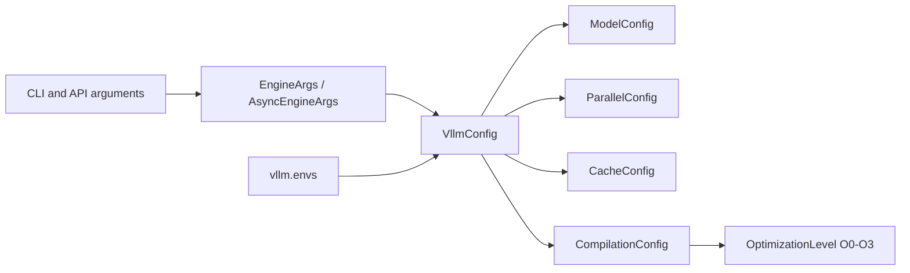
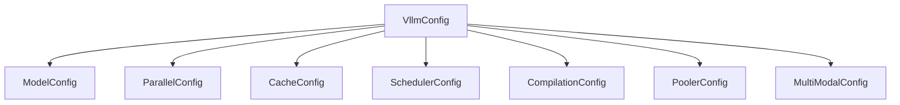

<!-- source: DeepWiki mcp.deepwiki.com · repo vllm-project/vllm · page 2 Configuration and Initialization · fetched 2026-10-28 -->

# Configuration and Initialization

Relevant source files

The following files were used as context for generating this wiki page:

- [docs/models/supported_models.md](docs/models/supported_models.md)
- [tests/config/test_model_arch_config.py](tests/config/test_model_arch_config.py)
- [tests/engine/test_arg_utils.py](tests/engine/test_arg_utils.py)
- [tests/models/multimodal/generation/test_common.py](tests/models/multimodal/generation/test_common.py)
- [tests/models/multimodal/generation/vlm_utils/model_utils.py](tests/models/multimodal/generation/vlm_utils/model_utils.py)
- [tests/models/registry.py](tests/models/registry.py)
- [tests/test_config.py](tests/test_config.py)
- [vllm/config/cache.py](vllm/config/cache.py)
- [vllm/config/model.py](vllm/config/model.py)
- [vllm/config/model_arch.py](vllm/config/model_arch.py)
- [vllm/config/parallel.py](vllm/config/parallel.py)
- [vllm/config/speculative.py](vllm/config/speculative.py)
- [vllm/config/vllm.py](vllm/config/vllm.py)
- [vllm/engine/arg_utils.py](vllm/engine/arg_utils.py)
- [vllm/model_executor/models/config.py](vllm/model_executor/models/config.py)
- [vllm/model_executor/models/registry.py](vllm/model_executor/models/registry.py)
- [vllm/models/inkling/common/mm_preprocess.py](vllm/models/inkling/common/mm_preprocess.py)
- [vllm/transformers_utils/config.py](vllm/transformers_utils/config.py)
- [vllm/transformers_utils/configs/__init__.py](vllm/transformers_utils/configs/__init__.py)
- [vllm/transformers_utils/model_arch_config_convertor.py](vllm/transformers_utils/model_arch_config_convertor.py)
- [vllm/transformers_utils/processors/__init__.py](vllm/transformers_utils/processors/__init__.py)
- [vllm/v1/spec_decode/llm_base_proposer.py](vllm/v1/spec_decode/llm_base_proposer.py)

## Purpose and Scope

This page gives a high-level map of vLLM’s configuration system: how inputs relate to the root `VllmConfig`, how configuration is divided among specialized objects, and where compilation and environment settings fit. It is a parent page; detailed option references and behavior belong in the child pages.

- [Argument Parsing and EngineArgs](#2.1) — `EngineArgs`, `AsyncEngineArgs`, CLI parsing, and conversion to configuration objects.
- [VllmConfig and Specialized Configuration Objects](#2.2) — The configuration hierarchy and relationships among its specialized objects.
- [Environment Variables System](#2.3) — `VLLM_*` variables and their effects.
- [Compilation Configuration and Optimization Levels](#2.4) — `CompilationConfig`, optimization levels, compilation, CUDA graphs, fusion, and the vLLM IR op framework.

Sources: [vllm/config/vllm.py:30-57](), [vllm/engine/arg_utils.py:36-72]()

---

## Configuration Architecture Overview

Configuration is organized around `VllmConfig` and specialized configuration types. The root configuration module imports types for areas including model, parallel execution, cache, scheduling, compilation, and device selection. `EngineArgs`-related parsing code imports these types, providing the connection between user-facing arguments and the configuration schema. For details about parsing and assembly, see [Argument Parsing and EngineArgs](#2.1) and [VllmConfig and Specialized Configuration Objects](#2.2).

Environment settings are also read through `vllm.envs`; the root configuration module uses this module in configuration-dependent logic. Compilation choices are represented by `CompilationConfig`, while `OptimizationLevel` names the O0–O3 optimization levels. See [Environment Variables System](#2.3) and [Compilation Configuration and Optimization Levels](#2.4) for details.

Sources: [vllm/config/vllm.py:23-57](), [vllm/config/vllm.py:128-143](), [vllm/engine/arg_utils.py:36-72]()

**Diagram: Configuration concepts and code entities**

Sources: [vllm/engine/arg_utils.py:36-72](), [vllm/config/vllm.py:23-57](), [vllm/config/vllm.py:128-143](), [vllm/config/model.py:150-165](), [vllm/config/parallel.py:136-149](), [vllm/config/cache.py:178-186]()

---

## 2.1 Argument Parsing and EngineArgs

`vllm/engine/arg_utils.py` imports the configuration types used by the argument layer, including `ModelConfig`, `ParallelConfig`, `CompilationConfig`, and `VllmConfig`. This places argument handling at the boundary between user inputs and the typed configuration system. The parsing and conversion details are covered in [Argument Parsing and EngineArgs](#2.1).

Sources: [vllm/engine/arg_utils.py:36-72]()

---

## 2.2 VllmConfig and Specialized Configuration Objects

The configuration system uses specialized objects for distinct concerns. For example, `ModelConfig` represents model settings, `ParallelConfig` represents distributed-execution settings, and `CacheConfig` represents KV-cache settings. The root configuration module imports these alongside `SchedulerConfig`, `CompilationConfig`, and other configuration types. See [VllmConfig and Specialized Configuration Objects](#2.2) for the hierarchy and relationships.

| Configuration type | Configuration area |
|---|---|
| `ModelConfig` | Model identity and model-related settings |
| `ParallelConfig` | Distributed-execution settings |
| `CacheConfig` | KV-cache settings |
| `SchedulerConfig` | Scheduling settings |
| `CompilationConfig` | Compilation settings |
| `PoolerConfig` | Pooling settings |
| `MultiModalConfig` | Multimodal settings |

Sources: [vllm/config/vllm.py:30-57](), [vllm/config/model.py:150-165](), [vllm/config/parallel.py:136-149](), [vllm/config/cache.py:178-186](), [vllm/engine/arg_utils.py:36-72]()

**Diagram: Configuration types and their code entities**

Sources: [vllm/config/vllm.py:30-57](), [vllm/config/model.py:150-165](), [vllm/config/parallel.py:136-149](), [vllm/config/cache.py:178-186](), [vllm/engine/arg_utils.py:36-72]()

---

## 2.3 Environment Variables System

The configuration code imports `vllm.envs` and consults it in runtime-dependent decisions. For example, `VLLM_BATCH_INVARIANT` is checked when deciding whether to enable an all-reduce/RMSNorm fusion path. This page does not enumerate variables; see [Environment Variables System](#2.3) for the reference and behavior details.

Sources: [vllm/config/vllm.py:23-24](), [vllm/config/vllm.py:175-190]()

---

## 2.4 Compilation Configuration and Optimization Levels

`CompilationConfig` is one of the specialized configuration types. The root configuration module defines `OptimizationLevel` with four values: O0 disables compilation and CUDA graphs; O1 enables quick optimizations; O2 adds full and piecewise CUDA graphs; O3 is currently described as equivalent to O2. The compilation child page covers the associated mechanisms and options in detail.

Sources: [vllm/config/vllm.py:30-34](), [vllm/config/vllm.py:128-141]()

---

This overview maps the major configuration areas to their code entities. For implementation details, continue to the child pages on argument parsing, configuration objects, environment variables, and compilation. Sources: [vllm/config/vllm.py:23-57](), [vllm/engine/arg_utils.py:36-72]()

---

