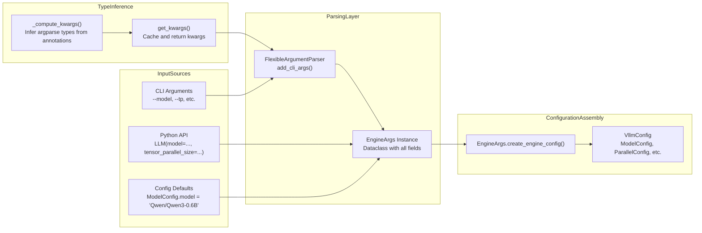
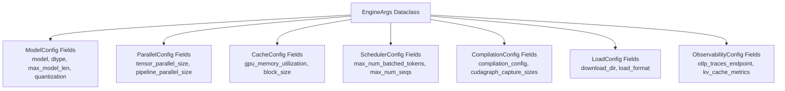
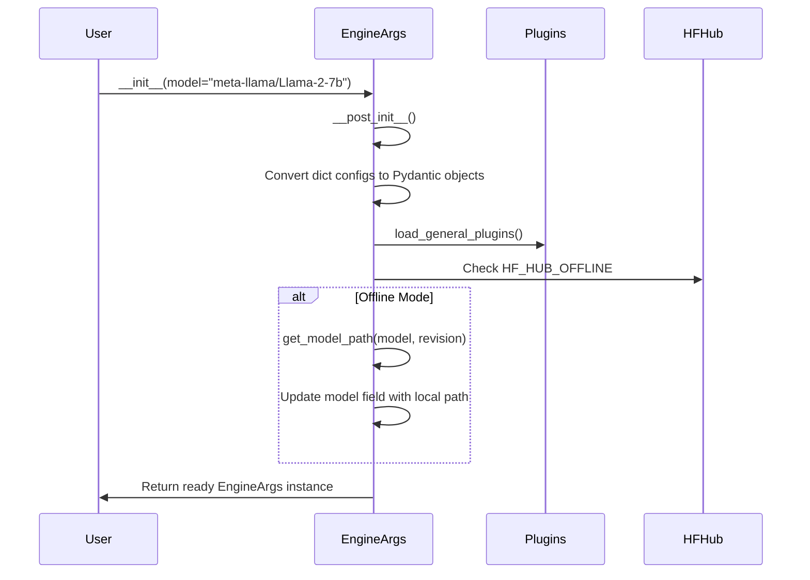
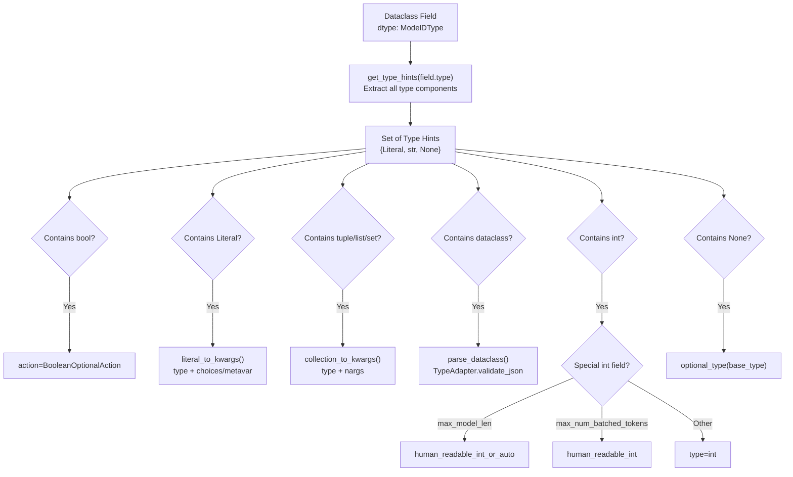
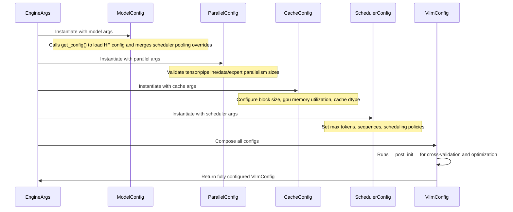
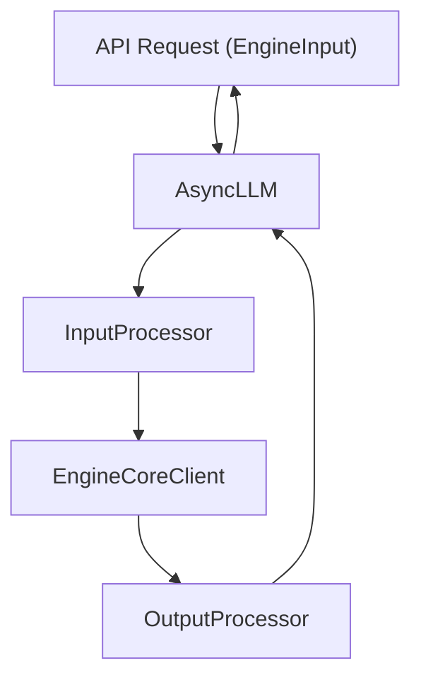

<!-- source: DeepWiki mcp.deepwiki.com · repo vllm-project/vllm · page 2.1 Argument Parsing and EngineArgs · fetched 2026-10-28 -->

# Argument Parsing and EngineArgs

Relevant source files

The following files were used as context for generating this wiki page:

- [docs/models/supported_models.md](docs/models/supported_models.md)
- [tests/config/test_model_arch_config.py](tests/config/test_model_arch_config.py)
- [tests/engine/test_arg_utils.py](tests/engine/test_arg_utils.py)
- [tests/models/multimodal/generation/test_common.py](tests/models/multimodal/generation/test_common.py)
- [tests/models/multimodal/generation/vlm_utils/model_utils.py](tests/models/multimodal/generation/vlm_utils/model_utils.py)
- [tests/models/registry.py](tests/models/registry.py)
- [tests/test_config.py](tests/test_config.py)
- [vllm/config/cache.py](vllm/config/cache.py)
- [vllm/config/model.py](vllm/config/model.py)
- [vllm/config/model_arch.py](vllm/config/model_arch.py)
- [vllm/config/parallel.py](vllm/config/parallel.py)
- [vllm/config/speculative.py](vllm/config/speculative.py)
- [vllm/config/vllm.py](vllm/config/vllm.py)
- [vllm/engine/arg_utils.py](vllm/engine/arg_utils.py)
- [vllm/model_executor/models/config.py](vllm/model_executor/models/config.py)
- [vllm/model_executor/models/registry.py](vllm/model_executor/models/registry.py)
- [vllm/models/inkling/common/mm_preprocess.py](vllm/models/inkling/common/mm_preprocess.py)
- [vllm/transformers_utils/config.py](vllm/transformers_utils/config.py)
- [vllm/transformers_utils/configs/__init__.py](vllm/transformers_utils/configs/__init__.py)
- [vllm/transformers_utils/model_arch_config_convertor.py](vllm/transformers_utils/model_arch_config_convertor.py)
- [vllm/transformers_utils/processors/__init__.py](vllm/transformers_utils/processors/__init__.py)
- [vllm/v1/spec_decode/llm_base_proposer.py](vllm/v1/spec_decode/llm_base_proposer.py)

## Purpose and Scope

This page details the argument parsing and configuration assembly system used in vLLM, emphasizing the `EngineArgs` dataclass and related mechanisms. It covers how command-line and Python API inputs are parsed, validated, and transformed into internal configuration dataclasses culminating in the unified `VllmConfig` used by the engine.

Key components include:

- The `EngineArgs` dataclass and its asynchronous extension `AsyncEngineArgs`.
- CLI argument parsing with automatic type inference and registration.
- Conversion from parsed arguments to configuration objects (`ModelConfig`, `SchedulerConfig`, etc.).
- Integration with the asynchronous serving API through `AsyncLLM`.

For related configuration details, see the pages on [VllmConfig and Specialized Configuration Objects](2.2) and [Environment Variables System](2.3).

Sources: `[vllm/engine/arg_utils.py:360-1467]()`, `[vllm/config/vllm.py:121-160]()`

---

## System Overview

The argument parsing system in vLLM forms a bridge from user inputs—either via CLI or direct Python API usage—towards the internal configuration driving the engine. Its key components are:

1.  **Input sources**: Arguments may come from CLI flags, Python API calls, or default values.
2.  **Parsing layer**: `FlexibleArgumentParser` handles CLI input, invoking `EngineArgs` to materialize configuration objects.
3.  **Type inference**: The system infers appropriate argument types, supported choices, and defaults from annotations on dataclasses.
4.  **Configuration assembly**: Using the parsed inputs, `EngineArgs.create_engine_config()` assembles specialized objects (`ModelConfig`, `ParallelConfig`, etc.) and returns the comprehensive `VllmConfig`.

This pipeline ensures robust, user-friendly configuration handling with layered validation and extensibility.

### Argument Parsing Pipeline Diagram

Sources: `[vllm/engine/arg_utils.py:360-615]()`, `[vllm/utils/argparse_utils.py:113-200]()`, `[vllm/config/vllm.py:121-160]()`

---

## EngineArgs Dataclass

The core of the argument parsing framework is the `EngineArgs` dataclass. It is a comprehensive container aggregating all user-configurable parameters spanning multiple configuration categories.

### Characteristics

| Aspect | Details |
| :----- | :------ |
| Location | `vllm/engine/arg_utils.py:362-615` |
| Type | Python dataclass |
| Field count | ~150 fields covering model, parallelism, cache, scheduler, observability, compilation, and more |
| Initialization behavior | Post-init converts dict fields to Pydantic configuration objects, loads plugins, and resolves offline models |

### Field Organization and Mapping

The fields in `EngineArgs` correspond closely to specialized configuration dataclasses. This gives a clear mapping from CLI or API argument spaces to the internal configuration domain:

Each field or group of fields corresponds to a logical config object, which `EngineArgs` helps instantiate.

Sources: `[vllm/engine/arg_utils.py:362-615]()`, `[vllm/config/model.py:124-183]()`, `[vllm/config/cache.py:44-130]()`

---

## Post-Initialization Processing in EngineArgs

The `__post_init__()` method of `EngineArgs` performs several important tasks upon instantiation:

1.  **Conversion of dictionary fields into validated Pydantic configuration objects:**

    To allow flexible JSON-like or dict input for nested configuration fields from CLI or API, `__post_init__()` uses pydantic's `TypeAdapter` to validate and convert dicts into proper config instances. This ensures consistency even when the user provides JSON strings or dicts at the CLI.

2.  **Plugin loading:**

    General plugins are loaded by calling `load_general_plugins()`, which may add or modify config-related behavior dynamically.

3.  **Offline model path resolution:**

    When the environment variable `HF_HUB_OFFLINE=1` is set, `__post_init__()` calls `get_model_path()` to translate remote model ids into local cached paths. This helps with offline deployment and reproducibility by ensuring that model identifiers point to local files.

### `__post_init__()` Workflow Diagram

Sources: `[vllm/engine/arg_utils.py:618-658]()`, `[vllm/transformers_utils/repo_utils.py:113-115]()`

---

## CLI Argument Registration

The static method `EngineArgs.add_cli_args()` enables the seamless integration of all vLLM engine arguments into the CLI parser (`FlexibleArgumentParser`).

### Grouped Arguments for Clarity

Arguments are grouped logically matching configuration domains. Each group helps users discover related options easily.

```mermaid
graph TD
    Parser["FlexibleArgumentParser"]
    
    Parser --> ModelGroup["ModelConfig Group<br/>--model, --dtype, --quantization<br/>--max-model-len, --tokenizer"]
    Parser --> LoadGroup["LoadConfig Group<br/>--load-format, --download-dir"]
    Parser --> AttentionGroup["AttentionConfig Group<br/>--attention-backend"]
    Parser --> StructuredOutputsGroup["StructuredOutputsConfig Group<br/>--reasoning-parser"]
    Parser --> ParallelGroup["ParallelConfig Group<br/>--tp, --pp, --dp<br/>--distributed-executor-backend"]
    Parser --> SchedulerGroup["SchedulerConfig Group<br/>--max-num-batched-tokens<br/>--max-num-seqs, --policy"]
    Parser --> CacheGroup["CacheConfig Group<br/>--gpu-memory-utilization<br/>--block-size, --kv-cache-dtype"]
    Parser --> MultiModalGroup["MultiModalConfig Group<br/>--limit-mm-per-prompt<br/>--mm-processor-kwargs"]
    Parser --> LoRAGroup["LoRAConfig Group<br/>--enable-lora, --max-loras<br/>--max-lora-rank"]
    Parser --> CompilationGroup["CompilationConfig Group<br/>--compilation-config<br/>JSON or -cc.key=value"]
    Parser --> ObservabilityGroup["ObservabilityConfig Group<br/>--otlp-traces-endpoint<br/>--kv-cache-metrics"]
```

### Special Argument Handling

Several CLI args have custom parsing or semantics beyond automatic inference:

| Argument | Special Handling | Location |
| :------- | :--------------- | :------- |
| `--hf-token` | Accepts bool or str; supports flag (const=True) variant | `[vllm/engine/arg_utils.py:723-730]()` |
| `--max-model-len` | Parsed with `human_readable_int_or_auto()` to accept integers or "auto" | `[vllm/utils/argparse_utils.py:129-131]()` |
| `--compilation-config` | Accepts JSON string or shorthand `-cc.key=value` parsed into dict | `[vllm/engine/arg_utils.py:1128-1136]()` |
| `--data-parallel-*` args | Support for external load balancer mode's distributed executor configuration | `[vllm/engine/arg_utils.py:851-897]()` |

Sources: `[vllm/engine/arg_utils.py:660-1162]()`

---

## Type Inference and Argument Generation

To automate CLI argument definitions, the system infers argument types and options from Python type annotations in `EngineArgs` and related configs.

This mechanism enables consistent argument typing, choices, optional types, and complex structures.

### Annotation to Argument Parsing Logic Diagram

### Common Type Annotation to CLI Argument Mapping

| Python Type Annotation | Argparse Configuration | Example CLI Argument |
| :--------------------- | :--------------------- | :------------------- |
| `bool` | `action=BooleanOptionalAction` | `--enable-lora / --no-enable-lora` |
| `Literal["a", "b"]` | `type=str`, `choices=["a", "b"]` | `--policy fcfs/priority` |
| `Literal[...] \| str` | `type=str`, `metavar=[...]` (accepts literals or custom) | flexible options with documented choices |
| `list[int]` | `type=int`, `nargs="+"` | `--cudagraph-capture-sizes 1 2 4` |
| `tuple[int, int]` | `type=int`, `nargs=2` | fixed-length multi-value options |
| `int \| None` | custom `optional_type(int)` parser | accepts integer or "None" string |

Sources: `[vllm/engine/arg_utils.py:132-346]()`

---

## Configuration Object Creation with create_engine_config()

A critical utility in `EngineArgs` is `create_engine_config()`, which from the parsed and stored fields produces a complete `VllmConfig` instance. This method merges user inputs, applies model-specific overrides, performs validation, and returns a ready-to-use configuration object.

### Configuration Assembly Sequence

### Highlights

-   **ModelConfig construction** includes loading HuggingFace model config via `get_config()` and performing pooling task detection to adjust scheduler defaults `[vllm/engine/arg_utils.py:1164-1225]()`.

-   **CacheConfig** is constructed with attention to KV cache block sizes and GPU memory utilization thresholds, utilizing helper methods to interpret layout names into enum values `[vllm/engine/arg_utils.py:1232-1250]()`.

-   **ParallelConfig** verifies consistency of parallelism sizes (tensor, pipeline, data, expert) with error checking for invalid combinations.

Sources: `[vllm/engine/arg_utils.py:1164-1413]()`, `[vllm/config/vllm.py:121-160]()`, `[vllm/config/model.py:124-183]()`

---

## AsyncEngineArgs and Serving APIs

For asynchronous and online serving scenarios, `AsyncEngineArgs` extends `EngineArgs` to include asynchronous-specific arguments such as worker counts, multiprocessing method, and RPC settings.

-   The `AsyncEngineArgs` dataclass includes fields for API worker management and supports configuration for multi-process serving. `[vllm/engine/arg_utils.py:1416-1436]()`

-   When environment variable `VLLM_WORKER_MULTIPROC_METHOD` equals `"forkserver"`, the API server pre-imports the `vllm.v1.engine.async_llm` module during forkserver startup. This speeds up spawning of worker processes by doing expensive imports once at the forkserver level. `[vllm/env_override.py:157-160]()`

### AsyncLLM Data Flow in Serving

`AsyncLLM` is the primary async interface to the V1 engine. It uses the `InputProcessor` to transform client inputs into engine requests and communicates with the engine backend via `EngineCoreClient`.

Sources: `[vllm/engine/arg_utils.py:1416-1436]()`, `[vllm/env_override.py:157-160]()`, `[vllm/v1/engine/async_llm.py:72-180]()`, `[vllm/v1/engine/input_processor.py:38-90]()`

---

## Architecture-Specific Overrides for ModelConfig

Some model architectures require special adjustments to `ModelConfig` or related flags that influence engine behavior. These overrides are applied during argument parsing or config assembly.

Examples include:

| Architecture | Override Description | Source |
| :----------- | :------------------- | :----- |
| `DeepseekV32ForCausalLM` | Forces `cache_dtype="auto"` if `bfloat16` is requested to avoid unsupported dtypes. | `[vllm/model_executor/models/config.py:73-86]()` |
| `GlmMoeDsaForCausalLM` | Sets `comm_backend="a2a"` and enables `q_replicate` for model parallelism | `[vllm/model_executor/models/config.py:89-116]()` |
| `UnlimitedOCRForCausalLM` | Auto-selects high-efficiency FA4 backend or falls back to Triton; disables prefix caching for correctness | `[vllm/model_executor/models/config.py:160-175]()` |
| `Qwen3OmniMoeForConditionalGeneration` | Requires a standalone DSpark draft checkpoint with specific architecture and block size matching `num_speculative_tokens`. | `[vllm/config/speculative.py:149-183]()` |

These architecture-specific rules ensure compatibility and performance optimizations for specialized model variants.

Sources: `[vllm/config/model.py:1-2659]()`, `[vllm/config/speculative.py:149-183]()`, `[vllm/model_executor/models/config.py:73-175]()`

---

## Summary Table: Key Classes and Functions

| Symbol | Type | Purpose | Location |
| :----- | :--- | :------ | :------- |
| `EngineArgs` | `dataclass` | Aggregates all engine arguments | `[vllm/engine/arg_utils.py:362-615]()` |
| `AsyncEngineArgs` | `dataclass` | Async-specific engine argument extension | `[vllm/engine/arg_utils.py:1416-1436]()` |
| `add_cli_args()` | static method | Register all CLI arguments | `[vllm/engine/arg_utils.py:660-1162]()` |
| `create_engine_config()` | method | Produce a validated `VllmConfig` from args | `[vllm/engine/arg_utils.py:1164-1413]()` |
| `AsyncLLM` | class | Async interface for V1 engine | `[vllm/v1/engine/async_llm.py:72-180]()` |
| `VllmConfig` | class | Final assembled engine configuration | `[vllm/config/vllm.py:121-160]()` |
| `FlexibleArgumentParser` | class | Extended `argparse.ArgumentParser` supporting flexible parsing | `[vllm/utils/argparse_utils.py:113-200]()` |

Sources: `[vllm/engine/arg_utils.py:1-1467]()`, `[vllm/config/vllm.py:1-160]()`, `[vllm/v1/engine/async_llm.py:1-180]()`

---

This completes the detailed technical overview of vLLM's argument parsing system, centered on the `EngineArgs` dataclass, CLI interface, and configuration object assembly.

---

