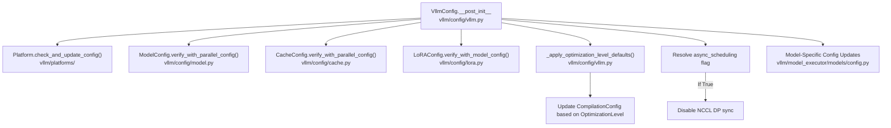

<!-- source: DeepWiki mcp.deepwiki.com · repo vllm-project/vllm · page 2.2 VllmConfig and Specialized Configuration Objects · fetched 2026-10-28 -->

# VllmConfig and Specialized Configuration Objects

Relevant source files

The following files were used as context for generating this wiki page:

- [docs/models/supported_models.md](docs/models/supported_models.md)
- [tests/config/test_model_arch_config.py](tests/config/test_model_arch_config.py)
- [tests/config/test_multimodal_config.py](tests/config/test_multimodal_config.py)
- [tests/engine/test_arg_utils.py](tests/engine/test_arg_utils.py)
- [tests/models/multimodal/generation/test_common.py](tests/models/multimodal/generation/test_common.py)
- [tests/models/multimodal/generation/vlm_utils/model_utils.py](tests/models/multimodal/generation/vlm_utils/model_utils.py)
- [tests/models/multimodal/processing/test_mllama4.py](tests/models/multimodal/processing/test_mllama4.py)
- [tests/models/registry.py](tests/models/registry.py)
- [tests/models/utils.py](tests/models/utils.py)
- [tests/multimodal/test_cache.py](tests/multimodal/test_cache.py)
- [tests/multimodal/test_hasher.py](tests/multimodal/test_hasher.py)
- [tests/multimodal/test_inputs.py](tests/multimodal/test_inputs.py)
- [tests/multimodal/test_utils.py](tests/multimodal/test_utils.py)
- [tests/test_config.py](tests/test_config.py)
- [tests/v1/core/test_encoder_cache_manager.py](tests/v1/core/test_encoder_cache_manager.py)
- [tests/v1/core/test_output.py](tests/v1/core/test_output.py)
- [tests/v1/worker/test_gpu_model_runner_mm_gather.py](tests/v1/worker/test_gpu_model_runner_mm_gather.py)
- [vllm/config/cache.py](vllm/config/cache.py)
- [vllm/config/ec_manager_config.py](vllm/config/ec_manager_config.py)
- [vllm/config/model.py](vllm/config/model.py)
- [vllm/config/model_arch.py](vllm/config/model_arch.py)
- [vllm/config/multimodal.py](vllm/config/multimodal.py)
- [vllm/config/parallel.py](vllm/config/parallel.py)
- [vllm/config/speculative.py](vllm/config/speculative.py)
- [vllm/config/vllm.py](vllm/config/vllm.py)
- [vllm/engine/arg_utils.py](vllm/engine/arg_utils.py)
- [vllm/model_executor/models/config.py](vllm/model_executor/models/config.py)
- [vllm/model_executor/models/registry.py](vllm/model_executor/models/registry.py)
- [vllm/models/inkling/common/mm_preprocess.py](vllm/models/inkling/common/mm_preprocess.py)
- [vllm/multimodal/hasher.py](vllm/multimodal/hasher.py)
- [vllm/multimodal/inputs.py](vllm/multimodal/inputs.py)
- [vllm/multimodal/utils.py](vllm/multimodal/utils.py)
- [vllm/transformers_utils/config.py](vllm/transformers_utils/config.py)
- [vllm/transformers_utils/configs/__init__.py](vllm/transformers_utils/configs/__init__.py)
- [vllm/transformers_utils/model_arch_config_convertor.py](vllm/transformers_utils/model_arch_config_convertor.py)
- [vllm/transformers_utils/processors/__init__.py](vllm/transformers_utils/processors/__init__.py)
- [vllm/v1/core/encoder_cache_manager.py](vllm/v1/core/encoder_cache_manager.py)
- [vllm/v1/core/sched/output.py](vllm/v1/core/sched/output.py)
- [vllm/v1/spec_decode/llm_base_proposer.py](vllm/v1/spec_decode/llm_base_proposer.py)

## Purpose and Scope

This page documents the configuration architecture of vLLM, centered around the `VllmConfig` root object and its specialized sub-configurations. It covers the structure, key fields, and validation logic of `ModelConfig`, `ParallelConfig`, `CacheConfig`, `SchedulerConfig`, `PoolerConfig`, `MultiModalConfig`, and other specialized objects located in `vllm/config/`.

For the CLI/YAML argument parsing pipeline that constructs these objects, see [2.1. Argument Parsing and EngineArgs](). For environment variables that supplement configuration, see [2.3. Environment Variables System](). For `CompilationConfig` and `torch.compile` integration, see [2.4. Compilation Configuration and Optimization Levels]().

Sources: [vllm/config/vllm.py:1-54](), [vllm/engine/arg_utils.py:36-69]()

---

## Package Layout

All configuration classes are defined within the `vllm/config/` directory and re-exported through `vllm/config/__init__.py`. vLLM uses a custom `@config` decorator (defined in `vllm/config/utils.py`) that applies Pydantic validation to Python dataclasses, allowing for strict type checking and range validation (e.g., `ge`, `le`).

| File | Primary Class(es) |
|---|---|
| `vllm/config/vllm.py` | `VllmConfig`, `OptimizationLevel`, `PerformanceMode` |
| `vllm/config/model.py` | `ModelConfig` |
| `vllm/config/cache.py` | `CacheConfig` |
| `vllm/config/parallel.py` | `ParallelConfig`, `EPLBConfig` |
| `vllm/config/scheduler.py` | `SchedulerConfig` |
| `vllm/config/pooler.py` | `PoolerConfig` |
| `vllm/config/multimodal.py` | `MultiModalConfig` |
| `vllm/config/compilation.py` | `CompilationConfig`, `PassConfig`, `CompilationMode`, `CUDAGraphMode` |
| `vllm/config/attention.py` | `AttentionConfig` |
| `vllm/config/load.py` | `LoadConfig` |
| `vllm/config/lora.py` | `LoRAConfig` |
| `vllm/config/speculative.py` | `SpeculativeConfig` |
| `vllm/config/kernel.py` | `KernelConfig` |
| `vllm/config/kv_events.py` | `KVEventsConfig` |

Sources: [vllm/config/vllm.py:30-53](), [vllm/config/utils.py:52-52]()

---

## VllmConfig — Root Container

`VllmConfig` is the central configuration object passed throughout the engine, workers, and execution pipeline. It aggregates all specialized configuration objects as typed fields.

### VllmConfig Composition — Mapping Concepts to Code Entities

```mermaid
graph TD
    VC["VllmConfig<br/>vllm/config/vllm.py"]

    VC --> MC["ModelConfig<br/>vllm/config/model.py"]
    VC --> CC["CacheConfig<br/>vllm/config/cache.py"]
    VC --> PC["ParallelConfig<br/>vllm/config/parallel.py"]
    VC --> SC["SchedulerConfig<br/>vllm/config/scheduler.py"]
    VC --> AC["AttentionConfig<br/>vllm/config/attention.py"]
    VC --> CPC["CompilationConfig<br/>vllm/config/compilation.py"]
    VC --> LC["LoadConfig<br/>vllm/config/load.py"]
    VC --> KC["KernelConfig<br/>vllm/config/kernel.py"]
    VC --> DC["DeviceConfig<br/>vllm/config/device.py"]
    VC --> PLC["PoolerConfig<br/>vllm/config/pooler.py"]
    VC --> MMC["MultiModalConfig<br/>vllm/config/multimodal.py"]

    VC -.-> LRC["LoRAConfig<br/>vllm/config/lora.py"]
    VC -.-> SPC["SpeculativeConfig<br/>vllm/config/speculative.py"]
    VC -.-> KVTC["KVTransferConfig<br/>vllm/config/kv_transfer.py"]
    VC -.-> SOC["StructuredOutputsConfig<br/>vllm/config/structured_outputs.py"]
    VC -.-> KVE["KVEventsConfig<br/>vllm/config/kv_events.py"]
    VC -.-> OFC["OffloadConfig<br/>vllm/config/offload.py"]
    VC -.-> OBC["ObservabilityConfig<br/>vllm/config/observability.py"]
    VC -.-> PFC["ProfilerConfig<br/>vllm/config/profiler.py"]
    VC -.-> REC["ReasoningConfig<br/>vllm/config/reasoning.py"]
    VC -.-> WTC["WeightTransferConfig<br/>vllm/config/weight_transfer.py"]
    VC -.-> ECT["ECTransferConfig<br/>vllm/config/ec_transfer.py"]
```

Sources: [vllm/config/vllm.py:246-329]()

### Key Fields on VllmConfig

| Field | Type | Default | Description |
|---|---|---|---|
| `model_config` | `ModelConfig` | *required* | Model identity and tokenizer settings, architecture info. |
| `cache_config` | `CacheConfig` | `CacheConfig()` | KV cache block allocation and memory limits. |
| `parallel_config` | `ParallelConfig` | `ParallelConfig()` | Distributed execution topology and parallelism parameters. |
| `scheduler_config` | `SchedulerConfig` | factory | Scheduling policies, batching and token budget settings. |
| `pooler_config` | `PoolerConfig` | `None` | Configuration for pooling, embeddings, classification tasks. |
| `multimodal_config`| `MultiModalConfig` | `None` | Multi-modal encoder limits, caching, and IPC. |
| `compilation_config`| `CompilationConfig` | `CompilationConfig()` | `torch.compile` modes, CUDA graph modes, and custom passes. |
| `optimization_level`| `OptimizationLevel` | `O2` | Preset convenience for compilation and CUDA graph behavior. |
| `performance_mode` | `PerformanceMode` | `"balanced"` | Latency vs throughput trade-off strategies. |
| `seed` | `int | None` | `None` | Optional random seed to ensure deterministic runs. |

Sources: [vllm/config/vllm.py:246-329](), [vllm/config/vllm.py:130-142]()

---

## Specialized Configuration Objects

### ModelConfig

`ModelConfig` manages all model-specific metadata, including model identity, architecture detection, tokenizer mode, dtype, and runner type. 

Key considerations:
- The `model` field identifies the HF model repo or local directory.
- `tokenizer_mode` controls tokenizer backend selection (e.g., "auto", "hf", "slow", "mistral", "deepseek_v32", "kimi_k3", "cohere").
- Torch device dtype (`dtype`) can be "auto" or explicit types like `float16`.
- `max_model_len` is lazily derived from Hugging Face config if unset.
- Supports specialized runners, e.g., `generate`, `pooling`, or `draft`.
- Supports trusting remote code (e.g., transformers auto model code).

`ModelConfig` also interfaces with model architecture-specific logic to adjust config during initialization.

| Field | Type | Default | Description |
|---|---|---|---|
| `model` | `str` | `"Qwen/Qwen3-0.6B"` | HF repo ID or local path for model. |
| `tokenizer_mode` | `TokenizerMode` | `"auto"` | Tokenizer backend mode (e.g., HF fast, mistral, deepseek...). |
| `dtype` | `ModelDType` | `"auto"` | Weight and activation dtype. |
| `max_model_len` | `int | None` | Maximum model context length, auto-derived if None. |
| `runner` | `RunnerOption` | `"auto"` | Runner type, e.g., `"generate"`, `"pooling"`, `"draft"`. |
| `trust_remote_code` | `bool` | `False` | Allow loading custom code from HF repos. |

Sources: [vllm/config/model.py:124-186](), [vllm/transformers_utils/config.py:34-44](), [vllm/config/model.py:144-164]()

---

### CacheConfig

`CacheConfig` controls key-value (KV) cache organization and memory utilization.

Highlights:
- `block_size` sets the token granularity block size (default often 16).
- Memory utilization fraction for GPU KV cache.
- Cache dtype options include FP16, FP8, NVFP4, INT8 per-token-head.
- Prefix caching (shared prompt segments) can be enabled.
- Support for specialized cache modes (e.g., Mamba caching).

| Field | Type | Default | Description |
|---|---|---|---|
| `block_size` | `int` | *varies* | Token block size for KV caching (usually 16). |
| `gpu_memory_utilization` | `float` | `0.92` | Fraction of GPU memory reserved for KV cache. |
| `cache_dtype` | `CacheDType` | `"auto"` | Data type of KV cache tensors. |
| `enable_prefix_caching` | `bool` | `True` | Enables prompt prefix caching. |
| `mamba_cache_mode` | `MambaCacheMode` | `"none"` | Mode for Mamba-style cached kernels. |

Sources: [vllm/config/cache.py:44-143]()

---

### ParallelConfig

`ParallelConfig` describes the parallelism topology for distributed execution.

Supports:
- Pipeline Parallelism (PP)
- Tensor Parallelism (TP)
- Data Parallelism (DP)
- Expert Parallelism (EP)

Configures group sizes, network parameters, backends, and specialized load balancing.

| Field | Type | Default | Description |
|---|---|---|---|
| `pipeline_parallel_size` | `int` | `1` | Number of pipeline stages. |
| `tensor_parallel_size` | `int` | `1` | Number of tensor parallel shards per stage. |
| `data_parallel_size` | `int` | `1` | Number of data parallel replicas. |
| `enable_expert_parallel` | `bool` | `False` | Enable sharded MoE experts across ranks. |
| `all2all_backend` | `All2AllBackend` | `"allgather_reducescatter"` | Backend for all-to-all comms. |
| `eplb_config` | `EPLBConfig` | Factory | Expert parallel load balancing parameters. |

Sources: [vllm/config/parallel.py:119-175]()

---

### SchedulerConfig

`SchedulerConfig` controls batching, token budgets, and scheduling policies.

Main settings:
- Maximum concurrent requests (`max_num_seqs`)
- Maximum batched tokens per iteration (`max_num_batched_tokens`)
- Chunked prefill support to split large prompts
- Scheduling policy (e.g., "fcfs" or "priority")

| Field | Type | Default | Description |
|---|---|---|---|
| `max_num_batched_tokens` | `int` | `2048` | Max tokens per scheduling iteration. |
| `max_num_seqs` | `int` | `128` | Max concurrent sequences in batch. |
| `enable_chunked_prefill` | `bool` | `True` | Enable splitting large prompts into chunks. |
| `policy` | `SchedulerPolicy` | `"fcfs"` | Scheduling policy (first come first served or priority). |

Sources: [vllm/config/scheduler.py:26-155]()

---

### PoolerConfig

`PoolerConfig` manages pooling model settings.

Includes:
- Pooling type selection: embedding or classification
- Whether pooling is sequence-wise or token-wise
- Classification head and score types
- Batch sizing for pooling workload

It configures the pooling runner and is linked with the `ModelConfig` when running embeddings or classification tasks.

Sources: [vllm/config/pooler.py:1-50](), [vllm/config/model.py:24-24]()

---

### MultiModalConfig

`MultiModalConfig` configures multi-modal model input and encoder limits.

Features:
- Limits for vision (images/videos) and audio encoder processing
- Settings on cache types for multi-modal encoders (`mm_cache_type`)
- Tensor IPC flags and devices for multimodal processor stages
- Controls if chunked multi-modal input is disabled (platform-specific)

This config is crucial for supporting vision-language, audio, and multi-media inputs in vLLM.

Sources: [vllm/config/multimodal.py:1-60](), [vllm/config/model.py:16-23]()

---

## CompilationConfig and PassConfig

The `CompilationConfig` controls the `torch.compile` backend and CUDA graph capture modes, influencing performance optimizations.

### Important Enums and Classes:

- `CompilationMode` - Enum controlling compilation strategies:

  | Mode | Description |
  |---|---|
  | `NONE` | No compilation, fully eager. |
  | `STOCK_TORCH_COMPILE` | Standard `torch.compile` pipeline. |
  | `DYNAMO_TRACE_ONCE` | Single trace with Dynamo to avoid recompilation. |
  | `VLLM_COMPILE` | Custom Inductor backend with caching and shape specialization. |

- `CUDAGraphMode` - Enum controlling CUDA graph mode:

  | Mode | Description |
  |---|---|
  | `NONE` | No CUDA graph capture. |
  | `PIECEWISE` | Piecewise CUDA graphs. |
  | `FULL` | Full CUDA graph capture. |
  | `FULL_DECODE_ONLY` | Full CUDA graph for decode, none for prefill. |
  | `FULL_AND_PIECEWISE` | Full CUDA graph for decode, piecewise for prefill. |

- `PassConfig` - Flags for custom Inductor passes, e.g., fusing RMSNorm and quant ops, sequence parallelism, async allreduce fusion, and ROCm-specific fusions.

Sources: [vllm/config/compilation.py:37-149](), [vllm/config/compilation.py:65-68]()

---

## VllmConfig Initialization and Validation

The `VllmConfig` class contains a comprehensive `__post_init__` method acting as a central validation and cross-configuration consistency check.

### Cross-Entity Validation and Data Flow

Key validation points include:
- Platform-specific constraints and updates.
- Validation of model configuration given parallelism setup.
- Cache configuration adjustments.
- LoRA config verification, if applicable.
- Applying presets and fusion settings based on selected optimization level.
- Adjusting synchronization and NCCL behavior if async scheduling is enabled.
- Applying architecture-specific config updates via a registry of model-specific callbacks.

Sources: [vllm/config/vllm.py:652-780]()

---

### Model-Specific Configuration Updates

The `_apply_model_specific_config_updates` method applies architecture-specific logic to augment or tweak config.

- It iterates over registered model config verifiers that handle distinct architectures.
- Allows cross-cutting modifications like disabling chunked multi-modal input for specific platforms/models.
- Ensures compatibility flags and hints propagate appropriately.

This mechanism helps maintain consistent and validated configuration for numerous supported model families.

Sources: [vllm/config/vllm.py:760-766](), [vllm/model_executor/models/config.py:18-41]()

---

### Optimization Level Presets

`OptimizationLevel` is an `IntEnum` controlling preset optimizations for compilation and CUDA graph usage.

| Level | Description | Typical CUDA Graph Mode | Fusion Passes Enabled |
|---|---|---|---|
| `O0` | No optimization. no compilation, no cudagraphs, no other optimization, just starting up immediately | `NONE` | All fusions disabled |
| `O1` | Quick optimizations. Dynamo+Inductor compilation and Piecewise cudagraphs | `PIECEWISE` | Norm and activation fusion enabled |
| `O2` | Full optimizations. -O1 as well as Full and Piecewise cudagraphs. | `FULL_AND_PIECEWISE` | All fusion passes including allreduce enabled |
| `O3` | Currently the same as -O2s. | `FULL_AND_PIECEWISE` | All fusion passes |

Applying these presets sets appropriate fields in `CompilationConfig.PassConfig` and `CUDAGraphMode` automatically.

Sources: [vllm/config/vllm.py:130-142](), [vllm/config/vllm.py:206-240]()

---

### Configuration Hashing

`VllmConfig` provides a `compute_hash()` method to create a unique hash fingerprint of the configuration state for caching compiled artifacts.

- Excludes ephemeral or runtime-only fields (like `seed` or `served_model_name`) which do not affect model execution or compilation.
- Uses `get_hash_factors` utility to collect relevant serializable aspects recursively.
- The hash supports caching of compiled code (e.g., Triton kernels, CUDA graphs, JIT cache).

This method ensures fast and safe reuse of compiled components across runs with identical configurations.

Sources: [vllm/config/vllm.py:330-432](), [vllm/config/utils.py:18-19]()

---

# Summary

The `VllmConfig` and its specialized sub-configs form the core configuration framework for vLLM, organizing model parameters, distributed parallelism, caching strategies, scheduling policies, multi-modal support, and compilation settings. The design emphasizes strong validation, ease of extension for new model architectures, and performance tuning presets. Understanding these objects and their relationships is essential for users and developers configuring and extending vLLM deployments and engines.

---

# References

- `VllmConfig` and related configs: [vllm/config/vllm.py:100-329]()
- `ModelConfig`: [vllm/config/model.py:124-186]()
- `ParallelConfig`: [vllm/config/parallel.py:119-175]()
- `CacheConfig`: [vllm/config/cache.py:44-143]()
- `SchedulerConfig`: [vllm/config/scheduler.py:26-155]()
- `PoolerConfig`: [vllm/config/pooler.py:1-50]()
- `MultiModalConfig`: [vllm/config/multimodal.py:1-60]()
- `CompilationConfig` and `PassConfig`: [vllm/config/compilation.py:37-149]()
- Model-specific verification: [vllm/model_executor/models/config.py:18-41]()

---

