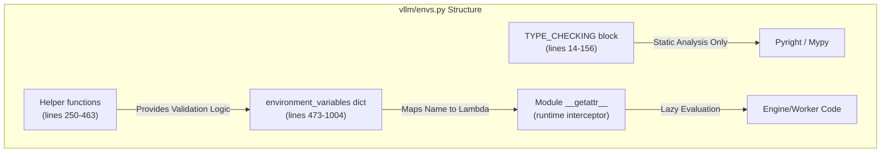
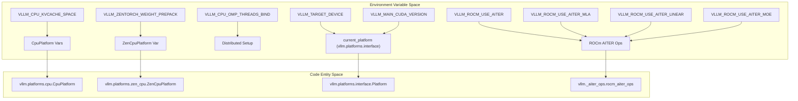
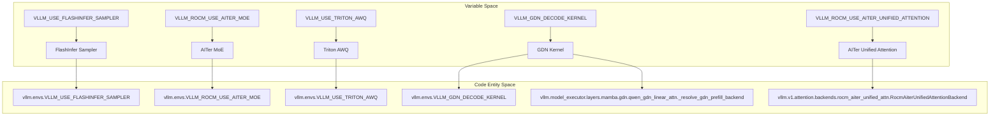
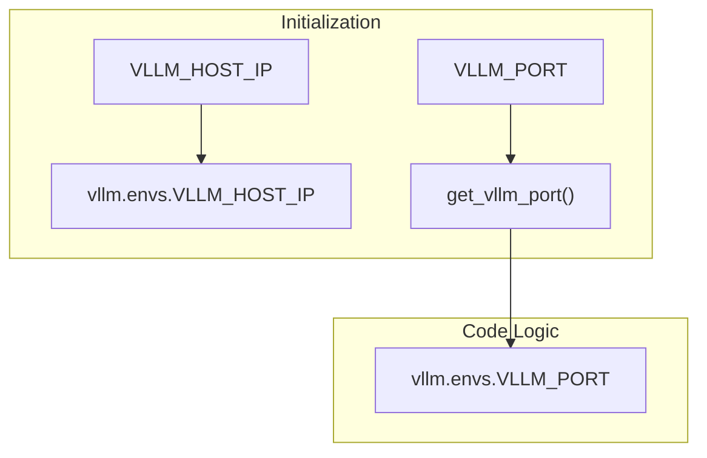
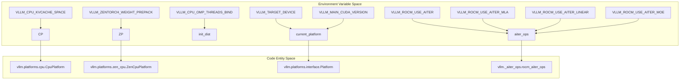
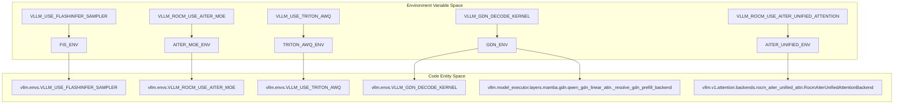

<!-- source: DeepWiki mcp.deepwiki.com · repo vllm-project/vllm · page 2.3 Environment Variables System · fetched 2026-10-28 -->

# Environment Variables System

<details>
<summary>Relevant source files</summary>

The following files were used as context for generating this wiki page:

- [csrc/core/scalar_type.hpp](csrc/core/scalar_type.hpp)
- [tests/kernels/quantization/test_mxfp4_kernel_selection.py](tests/kernels/quantization/test_mxfp4_kernel_selection.py)
- [tests/kernels/quantization/test_mxfp6_kernel_selection.py](tests/kernels/quantization/test_mxfp6_kernel_selection.py)
- [tests/kernels/quantization/test_rocm_fp8.py](tests/kernels/quantization/test_rocm_fp8.py)
- [tests/kernels/quantization/test_rocm_mxfp4.py](tests/kernels/quantization/test_rocm_mxfp4.py)
- [vllm/_aiter_ops.py](vllm/_aiter_ops.py)
- [vllm/envs.py](vllm/envs.py)
- [vllm/model_executor/kernels/linear/mxfp4/aiter.py](vllm/model_executor/kernels/linear/mxfp4/aiter.py)
- [vllm/model_executor/kernels/linear/mxfp4/base.py](vllm/model_executor/kernels/linear/mxfp4/base.py)
- [vllm/model_executor/kernels/linear/mxfp4/emulation.py](vllm/model_executor/kernels/linear/mxfp4/emulation.py)
- [vllm/model_executor/kernels/linear/mxfp4/flashinfer.py](vllm/model_executor/kernels/linear/mxfp4/flashinfer.py)
- [vllm/model_executor/kernels/linear/mxfp4/marlin.py](vllm/model_executor/kernels/linear/mxfp4/marlin.py)
- [vllm/model_executor/kernels/linear/mxfp4/xpu.py](vllm/model_executor/kernels/linear/mxfp4/xpu.py)
- [vllm/model_executor/kernels/linear/mxfp6/base.py](vllm/model_executor/kernels/linear/mxfp6/base.py)
- [vllm/model_executor/kernels/linear/mxfp6/emulation.py](vllm/model_executor/kernels/linear/mxfp6/emulation.py)
- [vllm/model_executor/layers/quantization/compressed_tensors/schemes/compressed_tensors_w4a4_mxfp4.py](vllm/model_executor/layers/quantization/compressed_tensors/schemes/compressed_tensors_w4a4_mxfp4.py)

</details>


This page documents `vllm/envs.py`, vLLM's centralized environment variable registry [vllm/envs.py:1-13](). It covers the module's structure, the access mechanism, helper utilities, and a detailed technical reference of `VLLM_*` variables. For information on how these variables feed into strongly-typed configuration objects at engine startup, see [VllmConfig and Specialized Configuration Objects](2.2). For compilation-specific settings, see [Compilation Configuration and Optimization Levels](2.4).

---

## Overview

`vllm/envs.py` serves as the single authoritative source for all environment variable definitions in vLLM. Instead of direct `os.environ.get(...)` calls scattered throughout the codebase, all environment variables are declared in one module with explicit types, default values, validation, and occasionally runtime logic. The variables are accessed through a module-level `__getattr__` proxy that evaluates a callable from the `environment_variables` dictionary upon each access. This ensures that any changes to the environment at runtime are captured immediately without requiring import-time fixes.

Typical usage pattern:

```python
import vllm.envs as envs

# Lazy-evaluated access
if envs.VLLM_ROCM_USE_AITER:
    ...

timeout = envs.VLLM_ENGINE_ITERATION_TIMEOUT_S
```

This lazy evaluation pattern means no environment values are cached globally unless caching is explicitly enabled (e.g., for performance reasons).

Sources: [vllm/envs.py:1-13]()

---

## Module Structure

The module has three main structural layers that cooperate to provide a flexible, typed environment variable access system:



- **TYPE_CHECKING Block**: Within a `if TYPE_CHECKING:` block in lines 14-156, all environment variables are declared as typed Python variables with default values. This block is **not executed at runtime** but improves IDE/editor static analysis and type checking support.

- **Helper Functions**: A rich set of helper functions (lines 250-463) perform parsing, validation, and normalization of environment variable input such as converting strings to bool/int, validating against enumerations, parsing lists, etc.

- **`environment_variables` Dict**: The dictionary starting around line 473 maps variable names (e.g. `"VLLM_TARGET_DEVICE"`) to callables (usually lambdas) that read `os.environ`, apply the helper functions, and return typed/validated values.

- **Module `__getattr__`**: This intercepts attribute access on `vllm.envs` and delegates lookup to the `environment_variables` dictionary, invoking the lambda for lazy evaluation.

Sources: [vllm/envs.py:14-156](), [vllm/envs.py:250-463](), [vllm/envs.py:473-1014]()

---

## Helper Utilities

The module defines utilities to reduce code duplication and ensure consistent environment variable parsing:

| Function | Lines | Purpose |
|----------|----------------|------------------------------------------------------------|
| `maybe_convert_int(s)` | 264-267 | Converts string to int or returns None if input is None. |
| `maybe_convert_bool(s)` | 270-273 | Converts string like `"0"`, `"1"`, `"true"`, `"false"` to Python bool. |
| `env_with_choices(env_var, choices, default)` | 298-340 | Reads an env var string and validates it against allowed string choices. |
| `env_list_with_choices(env_var, choices, default)` | 343-395 | Reads a comma-separated string list from env var and validates each item. |
| `get_vllm_port()` | 416-442 | Returns the `VLLM_PORT` as an integer port, with special detection for Kubernetes service URLs causing common misconfigurations. |

These helpers allow concise, robust environment variable parsing within the `environment_variables` dictionary.

Sources: [vllm/envs.py:250-463]()

---

## Platform-Specific Overrides

Several environment variables play critical roles in the platform abstraction and optimization layers of vLLM. These variables influence platform detection, kernel dispatch, and backend usage.



### CPU Backend Variables

- `VLLM_CPU_KVCACHE_SPACE` determines KV cache size for the CPU backend if not explicitly configured elsewhere [vllm/envs.py:53]().
- `VLLM_CPU_OMP_THREADS_BIND` controls thread binding strategy for CPU OpenMP threads [vllm/envs.py:54]().
- `VLLM_ZENTORCH_WEIGHT_PREPACK` (default: `True`) controls weight prepacking in AMD Zen-specific CPU backend acceleration [vllm/envs.py:58]().

These variables are read by the `CpuPlatform` class and CPU worker initialization logic to tune memory and threading behavior for CPU execution [vllm/platforms/cpu.py:98-175]().

### ROCm and AITER

- `VLLM_ROCM_USE_AITER` is the master ON/OFF flag for ROCm AITER kernel usage [vllm/envs.py:137]().
- Sub-flags `VLLM_ROCM_USE_AITER_MOE`, `VLLM_ROCM_USE_AITER_MLA`, `VLLM_ROCM_USE_AITER_LINEAR` enable AITER support for MoE, MLA, and linear attention kernels respectively. Most default to `True` [vllm/envs.py:137-147]().
- `VLLM_ROCM_USE_AITER_CUSTOM_AR` (default: `True`) enables AITER custom all-reduce [vllm/envs.py:138]().
- `VLLM_ROCM_USE_AITER_LINEAR_HIPBMM` (default: `False`) enables AITER linear HIPBMM [vllm/envs.py:140]().
- `VLLM_ROCM_AITER_MOE_DISPATCH_POLICY` (default: `0`) sets the dispatch policy for AITER MoE [vllm/envs.py:142]().
- `VLLM_ROCM_USE_AITER_MOE_A4W4_DSV4` (default: `None`) enables AITER MoE A4W4 DSV4 [vllm/envs.py:143]().
- `VLLM_ROCM_USE_AITER_MOE_SITUV2` (default: `"auto"`) sets the SITUV2 policy for AITER MoE [vllm/envs.py:144]().
- `VLLM_ROCM_USE_AITER_RMSNORM` (default: `True`) enables AITER RMSNorm [vllm/envs.py:145]().
- `VLLM_ROCM_AITER_MLA_ASM_PADDING` (default: `"auto"`) sets ASM padding for AITER MLA [vllm/envs.py:147]().
- `VLLM_ROCM_AITER_MLA_DCP_VERIFY` (default: `"auto"`) sets DCP verify for AITER MLA [vllm/envs.py:148]().
- `VLLM_ROCM_USE_AITER_MHA` (default: `True`) enables AITER MHA [vllm/envs.py:149]().
- `VLLM_ROCM_USE_AITER_TRITON_SPARSE_MLA` (default: `False`) enables AITER Triton sparse MLA [vllm/envs.py:150]().
- `VLLM_ROCM_USE_AITER_TRITON_ROPE` (default: `False`) enables AITER Triton RoPE [vllm/envs.py:151]().
- `VLLM_ROCM_USE_AITER_FP8BMM` (default: `False`) enables AITER FP8 BMM [vllm/envs.py:152]().
- `VLLM_ROCM_USE_AITER_FP4BMM` (default: `False`) enables AITER FP4 BMM [vllm/envs.py:153]().
- `VLLM_ROCM_USE_AITER_UNIFIED_ATTENTION` (default: `False`) enables AITER unified attention [vllm/envs.py:154]().
- `VLLM_ROCM_USE_AITER_FUSION_SHARED_EXPERTS` (default: `False`) enables AITER fusion shared experts [vllm/envs.py:155]().
- `VLLM_ROCM_USE_AITER_TRITON_GEMM` (default: `True`) enables AITER Triton GEMM [vllm/envs.py:156]().

The ROCm AITER ops module (`vllm._aiter_ops`) inspects these flags to decide whether to promote HIP runtime symbols globally and to control usage of specialized JIT-compiled kernels [vllm/_aiter_ops.py:194-199](). AITer usage is limited to AMD ROCm platforms supporting CDNA 3+ architecture; this is checked in `is_aiter_found_and_supported()` [vllm/_aiter_ops.py:202-204]().

Sources: [vllm/envs.py:53-58, 137-156](), [vllm/_aiter_ops.py:194-199, 202-204](), [vllm/platforms/rocm.py:15-19]()

---

## Quantization and Kernel Dispatch

The environment system controls enabling and selection of quantized and optimized kernel backends, directly influencing performance and precision trade-offs.



- `VLLM_USE_FLASHINFER_SAMPLER` (default: `True`) controls whether FlashInfer is used as the sampling backend [vllm/envs.py:51]().
- `VLLM_USE_TRITON_AWQ` enables Triton AWQ quantization kernels [vllm/envs.py:123]().
- `VLLM_ROCM_USE_AITER_MOE` toggles MoE kernels from AITER on ROCm [vllm/envs.py:141]().
- `VLLM_GDN_DECODE_KERNEL` selects `"cuda"` or `"triton"` for Qwen GDN linear attention decoding [vllm/envs.py:131]().
- `VLLM_ROCM_USE_AITER_UNIFIED_ATTENTION` enables a specialized unified attention backend on ROCm [vllm/envs.py:154]().
- `VLLM_MXFP4_EMULATION_DEQUANT_AT_LOAD` (default: `False`) controls whether MXFP4 weights are dequantized at load time for emulation [vllm/envs.py:134](). This is used by `EmulationMxfp4LinearKernel` [vllm/model_executor/kernels/linear/mxfp4/emulation.py:104]().
- `VLLM_MXFP8_EMULATION_DEQUANT_AT_LOAD` (default: `True`) controls whether MXFP8 weights are dequantized at load time for emulation [vllm/envs.py:135]().

These environment flags are critical in the kernel selection logic of the model executor and attention backend modules, influencing which CUDA/ROCm kernels are loaded and executed during inference.

Sources: [vllm/envs.py:51-156](), [vllm/model_executor/kernels/linear/mxfp4/emulation.py:104]()

---

## Variable Reference by Category

### Quantization and Kernels

| Variable | Type | Default | Purpose |
|---|---|---|---|
| `VLLM_USE_FLASHINFER_SAMPLER` | bool | True | Enable/disable FlashInfer as sampler backend. |
| `VLLM_USE_TRITON_AWQ` | bool | False | Use Triton-based AWQ quantization kernels. |
| `VLLM_TRITON_FORCE_FIRST_CONFIG` | bool | False | Force Triton to use first autotune config for AWQ kernels. |
| `VLLM_GDN_DECODE_KERNEL` | str | `"cuda"` | Choose between `"cuda"` or `"triton"` for GDN decoding. |
| `VLLM_MXFP8_EMULATION_DEQUANT_AT_LOAD` | bool | True | Dequantize MXFP8 weights at load for emulation. |
| `VLLM_MXFP4_EMULATION_DEQUANT_AT_LOAD` | bool | False | Dequantize MXFP4 weights at load for emulation. |
| `VLLM_ROCM_USE_AITER` | bool | False | Enable AITER kernels on ROCm platform. |
| `VLLM_ROCM_USE_AITER_CUSTOM_AR` | bool | True | Enable AITER custom all-reduce on ROCm. |
| `VLLM_ROCM_USE_AITER_LINEAR` | bool | True | Enable AITER linear kernels on ROCm. |
| `VLLM_ROCM_USE_AITER_LINEAR_HIPBMM` | bool | False | Enable AITER linear HIPBMM on ROCm. |
| `VLLM_ROCM_USE_AITER_MOE` | bool | True | Enable AITER MoE kernels on ROCm platform. |
| `VLLM_ROCM_AITER_MOE_DISPATCH_POLICY` | int | 0 | Set dispatch policy for AITER MoE. |
| `VLLM_ROCM_USE_AITER_MOE_A4W4_DSV4` | bool | None | Enable AITER MoE A4W4 DSV4. |
| `VLLM_ROCM_USE_AITER_MOE_SITUV2` | Literal | `"auto"` | Set SITUV2 policy for AITER MoE. |
| `VLLM_ROCM_USE_AITER_RMSNORM` | bool | True | Enable AITER RMSNorm on ROCm. |
| `VLLM_ROCM_USE_AITER_MLA` | bool | True | Enable AITER Multi-Latent Attention kernels on ROCm. |
| `VLLM_ROCM_AITER_MLA_ASM_PADDING` | Literal | `"auto"` | Set ASM padding for AITER MLA. |
| `VLLM_ROCM_AITER_MLA_DCP_VERIFY` | Literal | `"auto"` | Set DCP verify for AITER MLA. |
| `VLLM_ROCM_USE_AITER_MHA` | bool | True | Enable AITER MHA on ROCm. |
| `VLLM_ROCM_USE_AITER_TRITON_SPARSE_MLA` | bool | False | Enable AITER Triton sparse MLA on ROCm. |
| `VLLM_ROCM_USE_AITER_TRITON_ROPE` | bool | False | Enable AITER Triton RoPE on ROCm. |
| `VLLM_ROCM_USE_AITER_FP8BMM` | bool | False | Enable AITER FP8 BMM on ROCm. |
| `VLLM_ROCM_USE_AITER_FP4BMM` | bool | False | Enable AITER FP4 BMM on ROCm. |
| `VLLM_ROCM_USE_AITER_UNIFIED_ATTENTION` | bool | False | Enable AITER unified attention on ROCm. |
| `VLLM_ROCM_USE_AITER_FUSION_SHARED_EXPERTS` | bool | False | Enable AITER fusion shared experts on ROCm. |
| `VLLM_ROCM_USE_AITER_TRITON_GEMM` | bool | True | Enable AITER Triton GEMM on ROCm. |

Sources: [vllm/envs.py:51-156]()

### Distributed and Execution

| Variable | Type | Default | Purpose |
|---|---|---|---|
| `VLLM_WORKER_MULTIPROC_METHOD` | string | `"fork"` | Process start method: `"fork"` or `"spawn"`. |
| `VLLM_ENGINE_READY_TIMEOUT_S` | int | 600 | Timeout in seconds waiting for engine readiness after start. |
| `VLLM_CHAT_TEMPLATE_RENDER_TIMEOUT` | float | 30.0 | Timeout for chat template rendering. |
| `VLLM_DISABLE_PYNCCL` | bool | False | Disable PyTorch NCCL wrappers in favor of custom NCCL. |
| `VLLM_SKIP_P2P_CHECK` | bool | False | Skip peer-to-peer GPU accessibility checks. |
| `VLLM_USE_RAY_COMPILED_DAG_CHANNEL_TYPE` | Literal | `"auto"` | Channel type for Ray compiled DAG. |
| `VLLM_USE_RAY_COMPILED_DAG_OVERLAP_COMM` | bool | False | Overlap communication in Ray compiled DAG. |
| `VLLM_USE_RAY_WRAPPED_PP_COMM` | bool | True | Use Ray wrapped PP communication. |
| `VLLM_XPU_PP_MICROBATCH` | bool | True | Enable XPU PP microbatch. |
| `VLLM_USE_RAY_V2_EXECUTOR_BACKEND` | bool | False | Use Ray V2 executor backend. |
| `VLLM_DISTRIBUTED_USE_SPLIT_GROUP` | bool | False | Use split group for distributed execution. |
| `VLLM_XLA_USE_SPMD` | bool | False | Use SPMD for XLA. |
| `VLLM_KEEP_ALIVE_ON_ENGINE_DEATH` | bool | False | Keep alive on engine death. |
| `VLLM_HTTP_TIMEOUT_KEEP_ALIVE` | int | 5 | HTTP keep-alive timeout in seconds. |
| `VLLM_MAX_N_SEQUENCES` | int | 16384 | Maximum number of sequences. |
| `VLLM_MAX_COMPLETION_PROMPTS` | int | 1024 | Maximum number of completion prompts. |
| `VLLM_MAX_STOP_STRINGS` | int | 4 | Maximum number of stop strings. |
| `VLLM_MAX_NUM_BAD_WORDS` | int | 128 | Maximum number of bad words. |
| `VLLM_MAX_BAD_WORDS_TOTAL_TOKENS` | int | 1024 | Maximum total tokens for bad words. |
| `VLLM_PLUGINS` | list[str] | None | List of plugins to load. |
| `VLLM_ALLOW_RUNTIME_LORA_UPDATING` | bool | False | Allow runtime LoRA updating. |
| `VLLM_DISABLED_KERNELS` | list[str] | [] | List of disabled kernels. |
| `VLLM_USE_HW_AGNOSTIC` | bool | False | Use hardware agnostic mode. |
| `VLLM_ENABLE_FLA_PACKED_RECURRENT_DECODE` | bool | True | Enable FLA packed recurrent decode. |
| `VLLM_USE_OINK_OPS` | bool | False | Use OINK ops. |

Sources: [vllm/envs.py:27-136]()

### Logging and Debugging

| Variable | Type | Default | Purpose |
|---|---|---|---|
| `VLLM_CONFIGURE_LOGGING` | bool | True | Enable/disable vLLM's default logging configuration. |
| `VLLM_LOGGING_LEVEL` | string | `"INFO"` | Log severity level used by vLLM loggers. |
| `VLLM_LOGGING_PREFIX` | string | `""` | Prefix for log messages. |
| `VLLM_LOGGING_STREAM` | string | `"ext://sys.stdout"` | Stream for logging output. |
| `VLLM_LOGGING_CONFIG_PATH` | string | None | Path to a custom logging configuration file. |
| `VLLM_LOGGING_COLOR` | string | `"auto"` | Enable/disable colored logging output. |
| `NO_COLOR` | bool | False | Standard environment variable to disable colored output. |
| `FORCE_COLOR` | bool | False | Standard environment variable to force colored output. |
| `VLLM_DEBUG_LOG_API_SERVER_RESPONSE` | bool | False | Dump full API server response bodies to logs. |
| `VLLM_LOG_STATS_INTERVAL` | float | 10.0 | Interval in seconds to log engine runtime stats. |
| `VLLM_TRACE_FUNCTION` | int | 0 | Enable function tracing. |
| `VLLM_GPU_SYNC_CHECK` | string | None | Enable GPU synchronization error checking ("warn", "error"). |
| `VERBOSE` | bool | False | Enable verbose output. |

Sources: [vllm/envs.py:29-109]()

### Network and Port Resolution



The `VLLM_HOST_IP` and `VLLM_PORT` variables define network endpoint access for API serving or client connection setup. `get_vllm_port()` parses the `VLLM_PORT` environment variable in a robust manner.

### Kubernetes Service Discovery Issue

The `get_vllm_port()` function explicitly detects if `VLLM_PORT` contains a URL scheme (e.g. `"tcp://..."`) which happens in Kubernetes when a service named `vllm` unintentionally replaces the `VLLM_PORT` env var with a URL string. This triggers a clear `ValueError` with an explanation directing users to rename the service to avoid clashing environment variables [vllm/envs.py:416-442]().

Sources: [vllm/envs.py:15-16](), [vllm/envs.py:416-442]()

### Caching and Assets

| Variable | Type | Default | Purpose |
|---|---|---|---|
| `VLLM_CACHE_ROOT` | str | `~/.cache/vllm` | Root directory for vLLM caches. |
| `VLLM_CONFIG_ROOT` | str | `~/.config/vllm` | Root directory for vLLM configurations. |
| `VLLM_ASSETS_CACHE` | str | `VLLM_CACHE_ROOT/assets` | Cache directory for assets. |
| `VLLM_ASSETS_CACHE_MODEL_CLEAN` | bool | False | Clean model assets cache. |
| `VLLM_MEDIA_CACHE` | str | `""` | Cache directory for media files. |
| `VLLM_MEDIA_CACHE_MAX_SIZE_MB` | int | 5120 | Maximum size of media cache in MB. |
| `VLLM_MEDIA_CACHE_TTL_HOURS` | float | 24 | Time-to-live for media cache entries in hours. |
| `VLLM_LORA_RESOLVER_CACHE_DIR` | str | None | Cache directory for LoRA resolver. |
| `VLLM_XLA_CACHE_PATH` | str | `VLLM_CACHE_ROOT/xla_cache` | Cache path for XLA. |

Sources: [vllm/envs.py:34-78]()

### Media Fetching

| Variable | Type | Default | Purpose |
|---|---|---|---|
| `VLLM_IMAGE_FETCH_TIMEOUT` | int | 5 | Timeout for fetching images in seconds. |
| `VLLM_VIDEO_FETCH_TIMEOUT` | int | 30 | Timeout for fetching videos in seconds. |
| `VLLM_AUDIO_FETCH_TIMEOUT` | int | 10 | Timeout for fetching audio in seconds. |
| `VLLM_MEDIA_FETCH_MAX_RETRIES` | int | 3 | Maximum retries for media fetching. |
| `VLLM_MAX_MEDIA_DOWNLOAD_SIZE_MB` | int | 256 | Maximum media download size in MB. |
| `VLLM_MEDIA_URL_ALLOW_REDIRECTS` | bool | True | Allow URL redirects for media fetching. |
| `VLLM_MEDIA_LOADING_THREAD_COUNT` | int | 8 | Number of threads for media loading. |
| `VLLM_MAX_AUDIO_CLIP_FILESIZE_MB` | int | 25 | Maximum audio clip file size in MB. |
| `VLLM_MAX_AUDIO_DECODE_DURATION_S` | int | 600 | Maximum audio decode duration in seconds. |
| `VLLM_MAX_AUDIO_DECODE_BYTES` | int | 268435456 | Maximum audio decode bytes. |
| `VLLM_MAX_AUDIO_PREPROCESS_WORKERS` | int | `max(1, min(os.cpu_count() or 1, 2))` | Maximum audio preprocess workers. |
| `VLLM_MAX_EMBED_DECODE_BYTES` | int | 2147483648 | Maximum embed decode bytes. |
| `VLLM_MAX_IMAGE_PIXELS` | int | 178956970 | Maximum image pixels. |
| `VLLM_VIDEO_LOADER_BACKEND` | str | `"opencv"` | Video loader backend. |
| `VLLM_MEDIA_CONNECTOR` | str | `"http"` | Media connector type. |

Sources: [vllm/envs.py:73-90]()

### Compilation and Build

| Variable | Type | Default | Purpose |
|---|---|---|---|
| `MAX_JOBS` | str | None | Maximum number of parallel jobs for compilation. |
| `NVCC_THREADS` | str | None | Number of threads for NVCC. |
| `VLLM_USE_PRECOMPILED` | bool | False | Use precompiled binaries. |
| `VLLM_USE_PRECOMPILED_RUST` | bool | False | Use precompiled Rust binaries. |
| `VLLM_SKIP_PRECOMPILED_VERSION_SUFFIX` | bool | False | Skip version suffix for precompiled binaries. |
| `VLLM_DOCKER_BUILD_CONTEXT` | bool | False | Indicate if building within a Docker context. |
| `VLLM_BUILD_COMMIT` | str | `"unknown"` | Git commit hash of the build. |
| `VLLM_BUILD_PIPELINE` | str | `"local"` | Build pipeline identifier. |
| `VLLM_BUILD_URL` | str | `""` | URL of the build. |
| `VLLM_IMAGE_TAG` | str | `""` | Docker image tag. |
| `CMAKE_BUILD_TYPE` | Literal | None | CMake build type (`"Debug"`, `"Release"`, `"RelWithDebInfo"`). |
| `VLLM_USE_AOT_COMPILE` | bool | False | Use AOT compilation. |
| `VLLM_USE_BYTECODE_HOOK` | bool | True | Use bytecode hook. |
| `VLLM_FORCE_AOT_LOAD` | bool | False | Force AOT load. |
| `VLLM_USE_MEGA_AOT_ARTIFACT` | bool | False | Use mega AOT artifact. |

Sources: [vllm/envs.py:95-123]()

### Other

| Variable | Type | Default | Purpose |
|---|---|---|---|
| `VLLM_HOST_IP` | str | `""` | Host IP address. |
| `VLLM_PORT` | int | None | Port number. |
| `VLLM_RPC_BASE_PATH` | str | `tempfile.gettempdir()` | Base path for RPC. |
| `VLLM_USE_MODELSCOPE` | bool | False | Use ModelScope. |
| `VLLM_USE_FASTOKENS` | bool | False | Use FastTokens. |
| `VLLM_RINGBUFFER_WARNING_INTERVAL` | int | 60 | Ring buffer warning interval. |
| `VLLM_NCCL_SO_PATH` | str | None | Path to NCCL shared library. |
| `LD_LIBRARY_PATH` | str | None | LD_LIBRARY_PATH environment variable. |
| `VLLM_ROCM_SLEEP_MEM_CHUNK_SIZE` | int | 256 | ROCm sleep memory chunk size. |
| `LOCAL_RANK` | int | 0 | Local rank for distributed training. |
| `CUDA_VISIBLE_DEVICES` | str | None | CUDA_VISIBLE_DEVICES environment variable. |
| `VLLM_API_KEY` | str | None | API key. |
| `S3_ACCESS_KEY_ID` | str | None | S3 access key ID. |
| `S3_SECRET_ACCESS_KEY` | str | None | S3 secret access key. |
| `S3_ENDPOINT_URL` | str | None | S3 endpoint URL. |
| `VLLM_MODEL_REDIRECT_PATH` | str | None | Model redirect path. |
| `VLLM_USAGE_STATS_SERVER` | str | `"https://stats.vllm.ai"` | Usage statistics server URL. |
| `VLLM_NO_USAGE_STATS` | bool | False | Disable usage statistics. |
| `VLLM_DO_NOT_TRACK` | bool | False | Do not track usage. |
| `VLLM_USAGE_SOURCE` | str | `"production"` | Usage source. |
| `VLLM_PP_LAYER_PARTITION` | str | None | PP layer partition. |
| `VLLM_CPU_NUM_OF_RESERVED_CPU` | int | None | Number of reserved CPUs for CPU backend. |
| `VLLM_CPU_CI_ENV` | bool | False | CPU CI environment. |
| `VLLM_CPU_ATTN_SPLIT_KV` | bool | True | CPU attention split KV. |
| `VLLM_CPU_INT4_W4A8` | bool | True | CPU INT4 W4A8. |
| `VLLM_SPARSE_INDEXER_MAX_LOGITS_MB` | int | 512 | Sparse indexer max logits MB. |
| `VLLM_ADAPTIVE_VERIFICATION_PROFILE_CONTEXT_LEN` | int | 8192 | Adaptive verification profile context length. |
| `VLLM_TARGET_DEVICE` | str | `"cuda"` | Target device for execution. |
| `VLLM_MAIN_CUDA_VERSION` | str | `"13.0"` | Main CUDA version. |
| `VLLM_FLOAT32_MATMUL_PRECISION` | Literal | `"highest"` | Float32 matmul precision. |
| `VLLM_BATCH_INVARIANT` | bool | False | Enable batch invariant mode. |
| `VLLM_TRITON_USE_TD` | bool | None | Use Triton TD. |
| `VLLM_ALLOW_LONG_MAX_MODEL_LEN` | bool | False | Allow long max model length. |
| `VLLM_LORA_RESOLVER_HF_REPO_LIST` | str | None | Hugging Face repository list for LoRA resolver. |

Sources: [vllm/envs.py:14-119]()

---

# Summary

The **Environment Variables System** implemented in `vllm/envs.py` provides a strongly typed, lazily evaluated, single-source-of-truth mechanism for variables prefixed with `VLLM_` that control system behavior. This design supports runtime introspection, robustness, and clear mapping between natural language environment variable names and technical implementations in the codebase.

Two diagrams in particular link natural variable names to key code entities that consume them:

1. **Platform Environment Logic Flow**



2. **Kernel Backend Selection Entity Association**



Understanding and correctly setting these environment variables is crucial for customizing runtime behaviors such as device selection, memory allocation policies, kernel dispatch, logging verbosity, distributed execution, and more. The centralized module design in `vllm/envs.py` ensures consistency, ease of discovery, and strong typing across the extensive and multi-platform vLLM codebase.

Sources:
[vllm/envs.py:1-156, 250-463, 473-1014](),
[vllm/_aiter_ops.py:194-199, 202-204](),
[vllm/platforms/interface.py:134-197](),
[vllm/platforms/cpu.py:98-175](),
[vllm/platforms/rocm.py:15-148]()

---

