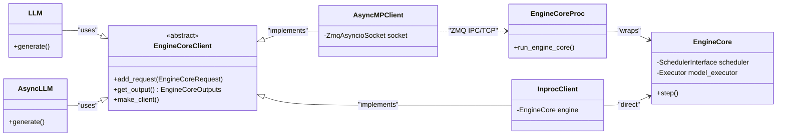

<!-- source: DeepWiki mcp.deepwiki.com · repo vllm-project/vllm · page 3 Engine Architecture · fetched 2026-10-28 -->

# Engine Architecture

Relevant source files

The following files were used as context for generating this wiki page:

- [tests/entrypoints/launchers/api_server/test_api_server_process_manager.py](tests/entrypoints/launchers/api_server/test_api_server_process_manager.py)
- [tests/entrypoints/serve/utils/test_api_utils.py](tests/entrypoints/serve/utils/test_api_utils.py)
- [tests/v1/distributed/test_async_llm_dp.py](tests/v1/distributed/test_async_llm_dp.py)
- [tests/v1/engine/test_core_engine_actor_manager.py](tests/v1/engine/test_core_engine_actor_manager.py)
- [tests/v1/engine/test_dp_world_group_port.py](tests/v1/engine/test_dp_world_group_port.py)
- [tests/v1/engine/test_engine_core.py](tests/v1/engine/test_engine_core.py)
- [tests/v1/engine/test_engine_core_client.py](tests/v1/engine/test_engine_core_client.py)
- [tests/v1/engine/test_startup_watch_processes.py](tests/v1/engine/test_startup_watch_processes.py)
- [vllm/engine/protocol.py](vllm/engine/protocol.py)
- [vllm/entrypoints/cli/serve.py](vllm/entrypoints/cli/serve.py)
- [vllm/entrypoints/llm.py](vllm/entrypoints/llm.py)
- [vllm/entrypoints/serve/utils/api_utils.py](vllm/entrypoints/serve/utils/api_utils.py)
- [vllm/v1/core/sched/interface.py](vllm/v1/core/sched/interface.py)
- [vllm/v1/engine/__init__.py](vllm/v1/engine/__init__.py)
- [vllm/v1/engine/async_llm.py](vllm/v1/engine/async_llm.py)
- [vllm/v1/engine/coordinator.py](vllm/v1/engine/coordinator.py)
- [vllm/v1/engine/core.py](vllm/v1/engine/core.py)
- [vllm/v1/engine/core_client.py](vllm/v1/engine/core_client.py)
- [vllm/v1/engine/llm_engine.py](vllm/v1/engine/llm_engine.py)
- [vllm/v1/engine/utils.py](vllm/v1/engine/utils.py)
- [vllm/v1/utils.py](vllm/v1/utils.py)

This page provides a high-level overview of the core engine components in the vLLM v1 inference engine. It describes central abstractions such as the `EngineCore` that runs the inner model execution loop, various client API layers, the request lifecycle and scheduling mechanism, KV cache management including prefix caching, input and output processing logic, and observability features. Each subsection introduces key concepts and their interactions, linking to child pages for detailed technical documentation.

Sources: [vllm/v1/engine/core.py:105-170](), [vllm/v1/engine/core_client.py:78-87]()

---

## 3.1. EngineCore and Client APIs

The `EngineCore` component is the core inference engine that manages model execution and scheduling. It encapsulates the scheduler, resource allocation, and model runner orchestration [vllm/v1/engine/core.py:141-187](). It runs in a dedicated process (`EngineCoreProc`) when multiprocessing is enabled [vllm/v1/engine/core_client.py:55]().

Client-facing APIs (`LLM` for synchronous offline inference and `AsyncLLM` for asynchronous online serving) communicate with the engine core through an abstract client interface called `EngineCoreClient` [vllm/v1/engine/core_client.py:80-87](). Depending on deployment scenario, this client can be implemented as an in-process direct call (`InprocClient`) or an asynchronous multiprocess client (`AsyncMPClient`, `SyncMPClient`) using ZeroMQ (ZMQ) for IPC [vllm/v1/engine/core_client.py:117-134](). The `AsyncLLM` class, for instance, uses `EngineCoreClient` to interact with the underlying engine [vllm/v1/engine/async_llm.py:93-96]().

The engine core handles requests asynchronously and streams outputs back to clients. It interacts with other subsystems such as KV cache managers and schedulers (covered later) to efficiently multiplex multiple inference requests.

Sources: [vllm/v1/engine/core.py:141-187](), [vllm/v1/engine/core_client.py:80-87](), [vllm/v1/engine/core_client.py:117-134](), [vllm/v1/engine/async_llm.py:93-96](), [vllm/v1/engine/core_client.py:55]()

---

## 3.2. Request Lifecycle and State Management

Incoming requests, originating as raw prompts or tokenized inputs, are converted by the `InputProcessor` into `EngineCoreRequest` objects compatible with the engine core [vllm/v1/engine/async_llm.py:169-170](). An `EngineCoreRequest` encapsulates all necessary information for processing, including prompt token IDs, sampling parameters, and multimodal features [vllm/v1/engine/__init__.py:115-163]().

Each request is tracked via a `Request` object that maintains dynamic execution state, including request status transitions (waiting, running, finished), token generation progress, and prefill chunking [vllm/v1/engine/__init__.py:103-104](). This enables granular control and monitoring over the lifecycle of individual requests within the engine.

The engine core schedules these requests according to global concurrency and token budget limits, efficiently multiplexing them through shared GPU resources.

For a comprehensive understanding of the request processing pipeline and state transitions, refer to the child page on [Request Lifecycle and State Management](#3.2).

Sources: [vllm/v1/engine/__init__.py:115-163](), [vllm/v1/engine/async_llm.py:169-170](), [vllm/v1/engine/__init__.py:103-104]()

---

## 3.3. Scheduler and Resource Allocation

The `Scheduler` governs request scheduling and resource allocation according to configurable policies. It maintains separate waiting and running queues, applies constraints such as maximum concurrently running sequences and token budgets, and supports chunked prefill for efficient prompt handling [vllm/v1/engine/core.py:168-177](). The `SchedulerInterface` defines the contract for scheduling operations [vllm/v1/core/sched/interface.py:1-10]().

It outputs detailed scheduling decisions (`SchedulerOutput`) indicating which requests and tokens to process in a given iteration [vllm/v1/utils.py:35-36](). This output guides the worker group in executing model forward passes.

The scheduler integrates with connectors for KV cache transfer (e.g., for disaggregated serving) and handles preemption scenarios to maximize GPU utilization.

Both synchronous and asynchronous scheduler implementations exist to support different execution models.

For full technical details, see [Scheduler and Resource Allocation](#3.3).

Sources: [vllm/v1/engine/core.py:168-177](), [vllm/v1/utils.py:35-36](), [vllm/v1/core/sched/interface.py:1-10]()

---

## 3.4. KV Cache Management and Prefix Caching

The KV cache subsystem manages intermediate key-value cache blocks that store hidden states for efficient autoregressive decoding. `KVCacheManager` and `SingleTypeKVCacheManager` allocate and recycle these blocks in coordination with a `BlockPool`, tracking references per request and block usage [vllm/v1/core/kv_cache_utils.py:50-59](). The `KVCacheConfig` defines the configuration for the KV cache [vllm/v1/kv_cache_interface.py:1-10]().

Prefix caching hashes token content blocks (`BlockHash`) to enable reuse of cached key-value states across requests sharing common prefix tokens, drastically reducing latency on repeated prompt patterns [vllm/v1/core/kv_cache_utils.py:50-56](). Blocks are identified with combined hash and group ID keys for efficient lookup.

Additionally, KV event publishing facilitates observability and sync with distributed connectors managing remote KV cache offloading or sharing. The `KVEventsConfig` specifies how KV events are published [vllm/config/kv_events.py:1-10]().

For an in-depth explanation, see [KV Cache Management and Prefix Caching](#3.4).

Sources: [vllm/v1/core/kv_cache_utils.py:50-56](), [vllm/v1/core/kv_cache_utils.py:50-59](), [vllm/v1/kv_cache_interface.py:1-10](), [vllm/config/kv_events.py:1-10]()

---

## 3.5. Input and Output Processing

`InputProcessor` handles prompt tokenization, validation, and multimodal feature extraction to prepare `EngineCoreRequest` objects for the engine [vllm/v1/engine/async_llm.py:169-170](). It supports complex prompt types, LoRA adapters, and configuration-based parameter normalization.

On the output side, `OutputProcessor` converts raw model outputs into user-facing formats (`RequestOutput`), including streaming token generation, detokenization, logprob calculation, and structured output handling. It supports multiple rendering backends and manages output chunking and partial results streaming [vllm/v1/engine/async_llm.py:160-162](), [vllm/v1/engine/llm_engine.py:103-109](). The `BaseRenderer` abstract class defines the interface for rendering outputs [vllm/renderers/__init__.py:1-10]().

This subsystem provides the interface boundary where raw engine internals meet application-level results.

See [Input and Output Processing](#3.5) for more details.

Sources: [vllm/v1/engine/async_llm.py:169-170](), [vllm/v1/engine/async_llm.py:160-162](), [vllm/v1/engine/llm_engine.py:103-109](), [vllm/renderers/__init__.py:1-10]()

---

## 3.6. Metrics and Observability

The engine integrates comprehensive metrics and tracing for monitoring inference performance and reliability. Components such as `StatLoggerManager` and plugins collect iteration statistics, scheduler metrics, and KV cache usage snapshots [vllm/v1/engine/async_llm.py:146-157](), [vllm/v1/engine/llm_engine.py:126-135]().

OpenTelemetry tracing is initialized conditionally to capture detailed spans during inference and streaming [vllm/v1/engine/async_llm.py:149-152](). These observability features support Prometheus export, runtime diagnostics, and performance tuning.

For detailed instrumentation infrastructure, see [Metrics and Observability](#3.6).

Sources: [vllm/v1/engine/async_llm.py:146-157](), [vllm/v1/engine/llm_engine.py:126-135](), [vllm/v1/engine/async_llm.py:149-152]()

---

This parent page links to child pages that provide technical deep dives into each core subsystem mentioned here, enabling contributors and advanced users to explore the engine internals on-demand.

---

