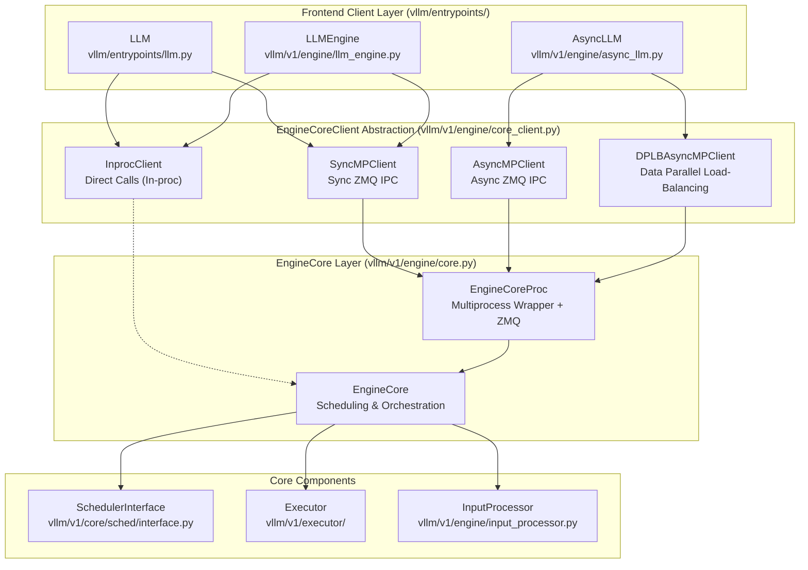
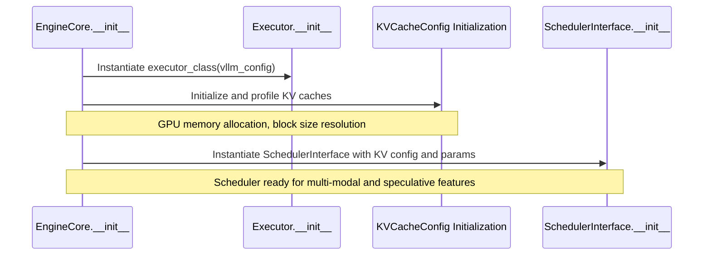
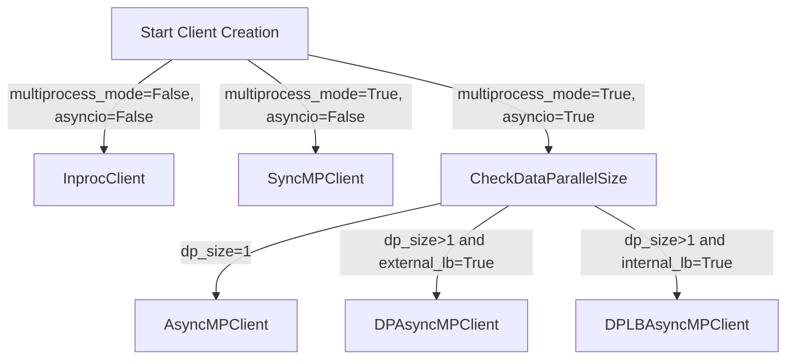
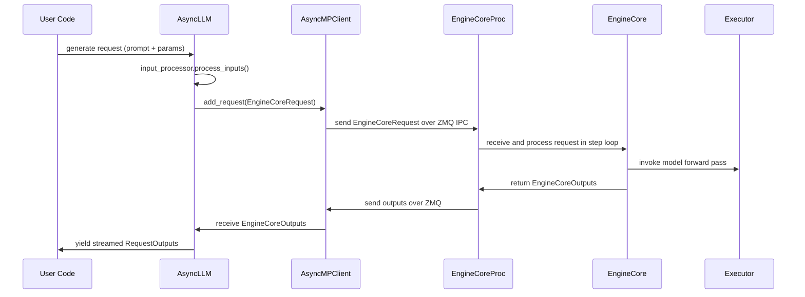
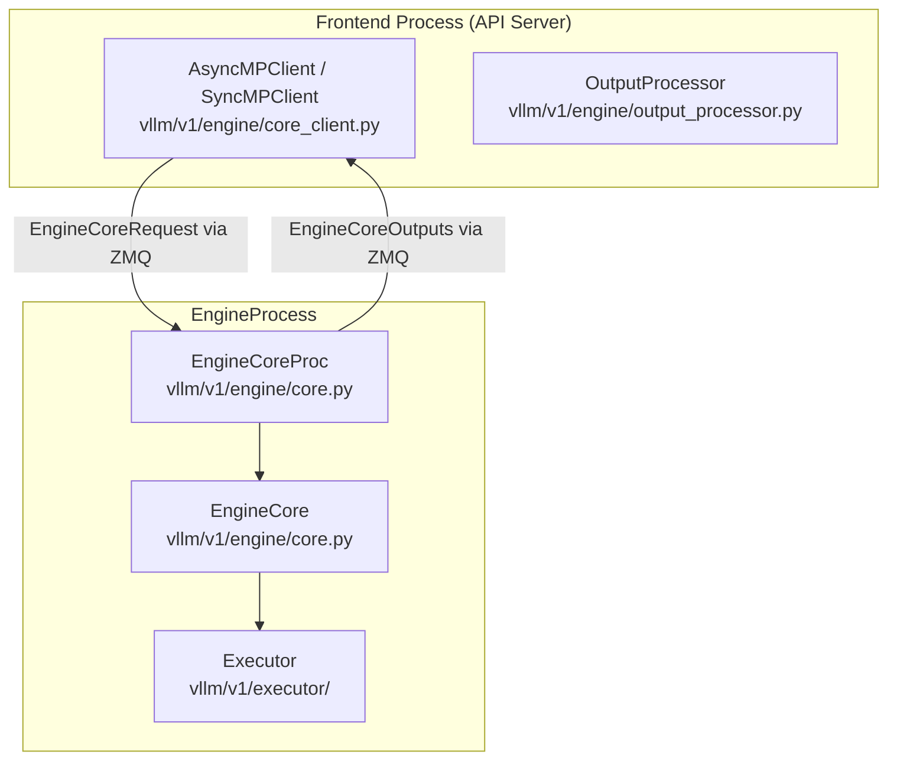
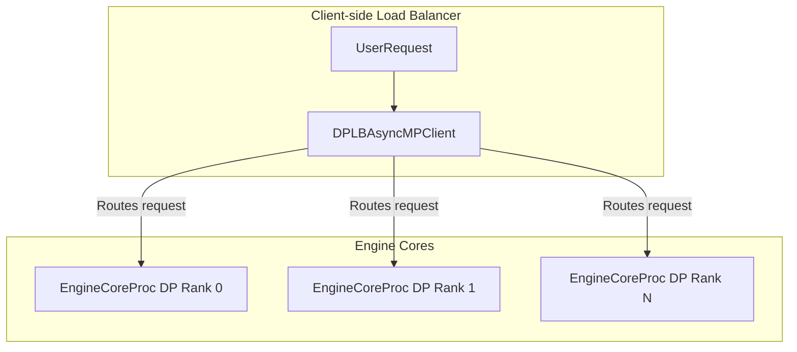

<!-- source: DeepWiki mcp.deepwiki.com · repo vllm-project/vllm · page 3.1 EngineCore and Client APIs · fetched 2026-10-28 -->

# EngineCore and Client APIs

Relevant source files

The following files were used as context for generating this wiki page:

- [tests/entrypoints/launchers/api_server/test_api_server_process_manager.py](tests/entrypoints/launchers/api_server/test_api_server_process_manager.py)
- [tests/entrypoints/serve/utils/test_api_utils.py](tests/entrypoints/serve/utils/test_api_utils.py)
- [tests/v1/distributed/test_async_llm_dp.py](tests/v1/distributed/test_async_llm_dp.py)
- [tests/v1/engine/test_core_engine_actor_manager.py](tests/v1/engine/test_core_engine_actor_manager.py)
- [tests/v1/engine/test_dp_world_group_port.py](tests/v1/engine/test_dp_world_group_port.py)
- [tests/v1/engine/test_engine_core.py](tests/v1/engine/test_engine_core.py)
- [tests/v1/engine/test_engine_core_client.py](tests/v1/engine/test_engine_core_client.py)
- [tests/v1/engine/test_startup_watch_processes.py](tests/v1/engine/test_startup_watch_processes.py)
- [vllm/engine/protocol.py](vllm/engine/protocol.py)
- [vllm/entrypoints/cli/serve.py](vllm/entrypoints/cli/serve.py)
- [vllm/entrypoints/llm.py](vllm/entrypoints/llm.py)
- [vllm/entrypoints/serve/utils/api_utils.py](vllm/entrypoints/serve/utils/api_utils.py)
- [vllm/v1/core/sched/interface.py](vllm/v1/core/sched/interface.py)
- [vllm/v1/engine/__init__.py](vllm/v1/engine/__init__.py)
- [vllm/v1/engine/async_llm.py](vllm/v1/engine/async_llm.py)
- [vllm/v1/engine/coordinator.py](vllm/v1/engine/coordinator.py)
- [vllm/v1/engine/core.py](vllm/v1/engine/core.py)
- [vllm/v1/engine/core_client.py](vllm/v1/engine/core_client.py)
- [vllm/v1/engine/llm_engine.py](vllm/v1/engine/llm_engine.py)
- [vllm/v1/engine/utils.py](vllm/v1/engine/utils.py)
- [vllm/v1/utils.py](vllm/v1/utils.py)

## Purpose and Scope

This document explains the design and implementation of **EngineCore** and the **EngineCoreClient** abstraction, which are foundational to vLLM's V1 engine. The `EngineCore` is the central execution engine responsible for scheduling requests, managing KV cache, invoking the model executor, and producing outputs. The `EngineCoreClient` interface abstracts various IPC strategies enabling the engine core to run either embedded in-process or as a separate background process communicating over ZeroMQ or multiprocessing queues.

This page also describes the synchronous and asynchronous LLM interfaces (`LLM` and `AsyncLLM`), which act as user-facing clients built atop the `EngineCoreClient` layer. Key IPC mechanisms and process management strategies underlying these layers are detailed.

For extensive information on configuration, scheduling, and execution pipelines, refer to related child pages.

Sources: [vllm/v1/engine/core.py:105-184](), [vllm/v1/engine/core_client.py:79-166](), [vllm/v1/engine/async_llm.py:77-168](), [vllm/v1/engine/llm_engine.py:48-117]()

---

## Architecture Overview

The architecture separates concerns into a **Frontend Client Layer** and the **EngineCore Layer**, connected via the `EngineCoreClient` abstraction.

**Explanation:**

- The **Frontend Client Layer** provides user-facing APIs: `LLM` (synchronous), `AsyncLLM` (async), and `LLMEngine` (legacy sync).
- `EngineCoreClient` abstracts how the frontend communicates with the core engine:
  - `InprocClient`: direct in-process calls for debugging and simple cases.
  - `SyncMPClient`: synchronous IPC using ZeroMQ for multiprocessing.
  - `AsyncMPClient`: asynchronous IPC with asyncio + ZeroMQ for API servers.
  - `DPLBAsyncMPClient`: supports data parallel load balancing across multiple engines.
- The **EngineCore Layer** runs in one or more processes:
  - `EngineCoreProc` wraps `EngineCore` in a subprocess with ZMQ communication hooks.
  - `EngineCore` manages request scheduling, model invocation, output generation.
- Core components include the `SchedulerInterface` for scheduling, `Executor` for model execution, and `InputProcessor` for request preprocessing.

Sources: [vllm/v1/engine/core.py:105-184](), [vllm/v1/engine/core_client.py:79-166](), [vllm/v1/engine/async_llm.py:77-168](), [vllm/v1/engine/llm_engine.py:48-117](), [vllm/v1/engine/input_processor.py:35-76]()

---

## EngineCore: Core Scheduling and Execution

### Overview

`EngineCore` is the main orchestrator of vLLM V1 engine’s inner loop. It is responsible for:

- Managing request queues, priorities, and concurrency.
- Coordinating with the `SchedulerInterface` to select and batch requests for model execution.
- Invoking forward passes on the configured `Executor` (model runner).
- Managing the KV cache (key-value memory cache for transformer layers).
- Aggregating outputs and producing `EngineCoreOutputs` for the frontend.
- Supporting advanced features like speculative decoding and multimodal processing.

### Class and Key Components

| Component | Role | Reference |
| :------------------------ | :---------------------------------------------------------------- | :-------------------------------------------- |
| **EngineCore** | Scheduling, batching, execution loop of inference requests | `vllm/v1/engine/core.py:105-184` |
| **Executor** | Executes efficient model forward passes (multi-GPU capable) | `vllm/v1/executor/` |
| **Scheduler** | Manages request queues, priorities, block allocations | `vllm/v1/core/sched/interface.py` |
| **StructuredOutputManager** | Manages structured output tasks and formatting | [vllm/v1/engine/core.py:154]() |
| **MultiModalReceiverCache** | Manages multimodal feature caching for models supporting it | [vllm/v1/engine/core.py:34-37]() |

### Initialization Flow

The constructor of `EngineCore` performs several critical setup steps:

1. Loads general plugins required at engine and scheduler level [vllm/v1/engine/core.py:124-126]().
2. Instantiates the configured `Executor` class responsible for forward passes [vllm/v1/engine/core.py:141]().
3. Profiles GPU memory and initializes KV cache configurations [vllm/v1/engine/core.py:152]().
4. Instantiates the `Scheduler` with relevant configurations and KV cache layouts [vllm/v1/engine/core.py:169-177]().
5. Sets up structured output and multi-modal caching managers [vllm/v1/engine/core.py:154]().
6. Configures speculative decoding flags and prepares the executor for advanced aggregation if enabled [vllm/v1/engine/core.py:178-186]().

Sources: [vllm/v1/engine/core.py:105-184]()

### Execution Loop

`EngineCore` exposes core step functions such as `step()` that encapsulate:

- Running the scheduler to select a batch of requests.
- Preparing input batches and gathering necessary KV cache blocks.
- Invoking the model executor to perform forward passes.
- Collecting outputs, including generated tokens, pooling embeddings, and handling request finishes.
- Returning `EngineCoreOutputs` to the frontend client.

This loop supports multiplexing and batch-aware scheduling, speculative decoding, and efficient resource utilization.

Sources: [vllm/v1/engine/core.py:438-586]()

---

## EngineCoreClient Abstraction

### Purpose and Interface

`EngineCoreClient` is an abstract base class specifying a unified interface for clients to communicate with the `EngineCore`. It shields frontend components from the details of the engine’s execution context—whether in-process or in separate background processes—and abstracts concurrency and IPC mechanisms.

Key abstract methods include:

- `add_request(request: EngineCoreRequest)`: Submits a request to the engine [vllm/v1/engine/core_client.py:181-183]().
- `get_output() -> EngineCoreOutputs`: Retrieves outputs emitted by the engine core [vllm/v1/engine/core_client.py:175-177]().
- `shutdown(timeout: float | None)`: Gracefully shuts down the client and engine [vllm/v1/engine/core_client.py:172-173]().
- Profiling hooks, reset functions for multimodal and prefix caches [vllm/v1/engine/core_client.py:184-200]().
- Sleep and wake-up controls for engine lifecycle management.

### Client Variants and Deployment Strategies

| Client Class | Concurrency Model | Typical Usage | Reference |
| :------------------------ | :--------------------------------------------- | :-------------------------------- | :----------------------------------- |
| **InprocClient** | In-process direct method calls | Legacy or debugging synchronous use | [vllm/v1/engine/core_client.py:133]() |
| **SyncMPClient** | Multiprocessing + synchronous ZMQ-based IPC | Sync batch serving | [vllm/v1/engine/core_client.py:126-131]() |
| **AsyncMPClient** | Multiprocessing + asyncio + async ZMQ IPC | Async FastAPI serving | [vllm/v1/engine/core_client.py:163-166]() |
| **DPLBAsyncMPClient** | Multiprocessing + asyncio + DP load balancing | Multi-GPU data parallel serving | [vllm/v1/engine/core_client.py:159-162]() |

The `EngineCoreClient.make_client()` static factory method selects and returns an appropriate client instance based on multiprocessing and asyncio mode flags as well as the data parallel size and load balancing configuration [vllm/v1/engine/core_client.py:95-133]().

### Client Instantiation Logic

### Client Communication with EngineCore

- `InprocClient` calls `EngineCore` methods synchronously within the same process.
- Multiprocess clients communicate with the `EngineCoreProc` subprocess via ZeroMQ sockets, sending serialized requests and receiving outputs.

Sources: [vllm/v1/engine/core_client.py:79-166]()

---

## LLM and AsyncLLM Interfaces

### LLM (`vllm/entrypoints/llm.py`)

The `LLM` class provides a synchronous user-facing interface for text generation and pooling. It manages:

- Tokenization and detokenization.
- Conversion between user requests and engine-compatible `EngineCoreRequest`s.
- Request submission and output retrieval via `EngineCoreClient`.
- Supports both in-process and synchronous multi-process deployments.

Sources: [vllm/entrypoints/llm.py:63-73]()

### AsyncLLM (`vllm/v1/engine/async_llm.py`)

`AsyncLLM` is an asynchronous wrapper around the engine with streaming generation support. Features include:

- Instantiating an async multiprocessing client (`AsyncMPClient`) that talks over ZMQ [vllm/v1/engine/async_llm.py:169-170]().
- Using `InputProcessor` to convert from higher-level prompt and sampling parameters into `EngineCoreRequest` [vllm/v1/engine/async_llm.py:161]().
- Using `OutputProcessor` to parse and yield streamable generation outputs to users [vllm/v1/engine/async_llm.py:172-175]().
- Integration with OpenTelemetry tracing, usage logging, and multimodal registry [vllm/v1/engine/async_llm.py:140-143]().
- Admission control and request queuing for overload protection [vllm/v1/engine/async_llm.py:163-168]().

Sources: [vllm/v1/engine/async_llm.py:77-168](), [vllm/v1/engine/core_client.py:133-166](), [vllm/v1/engine/input_processor.py:30-60](), [vllm/v1/engine/output_processor.py]()

---

## IPC Mechanisms and Process Management

### ZeroMQ (ZMQ) Communication

For multiprocessing setups, ZeroMQ is the primary communication layer between frontend clients and engine core processes:

- Frontend serializes `EngineCoreRequest` objects with `msgspec` and pushes them to EngineCore via ZMQ request sockets [vllm/v1/engine/core_client.py:18-20]().
- EngineCore emits `EngineCoreOutputs` responses asynchronously over ZMQ response sockets back to frontend clients [vllm/v1/engine/core_client.py:43-44]().
- ZMQ sockets use IPC or TCP endpoints depending on configuration [vllm/v1/engine/utils.py:162-164]().

`EngineCoreProc` encapsulates the engine core execution in a dedicated process bridging the IPC.

### Process Management

The class `CoreEngineProcManager` manages creation, monitoring, and lifecycle of engine core processes [vllm/v1/engine/utils.py:57-61](). It handles:

- Starting engine core subprocesses with proper multiprocessing context [vllm/v1/engine/utils.py:61]().
- Handshake address setup for ZMQ communication [vllm/v1/engine/utils.py:133-142]().
- Graceful shutdown sequences to drain inflight requests [vllm/v1/engine/utils.py:47-67]().
- Handling asynchronous readiness notifications and failures.

Sources: [vllm/v1/engine/core_client.py:42-69](), [vllm/v1/engine/utils.py:144-191](), [vllm/v1/engine/core.py:105-184]()

---

## Data Parallel Coordination and Scaling

When data parallelism is enabled (`data_parallel_size > 1`), the vLLM engine supports multiple engine core instances serving requests cooperatively:

- `DPCoordinator` orchestrates request waves and concurrency across DP ranks [vllm/v1/engine/coordinator.py]().
- `DPLBAsyncMPClient` provides client-side load balancing and request routing across multiple engine core processes [vllm/v1/engine/core_client.py:159-162]().
- Affinity and sticky routing ensure session-level consistency for late interaction and embedding queries [vllm/v1/pool/late_interaction.py:67-68]().
- Internal or external load balancing modes are supported, configurable via `ParallelConfig` [vllm/config/parallel.py]().

Sources: [vllm/v1/engine/core_client.py:51-60, 159-162](), [vllm/v1/pool/late_interaction.py:67-68]()

---

## Key Data Structures

### EngineCoreRequest

`EngineCoreRequest` is a `msgspec.Struct` representing requests from frontend clients to the engine core. It enables efficient serialization with msgpack.

| Field | Type | Description |
| :------------------------ | :------------------------------------ | :---------------------------------------------------- |
| `request_id` | `str` | Unique engine-internal request identifier |
| `prompt_token_ids` | `list[int] \| None` | Tokenized prompt or None if using prompt_embeds |
| `mm_features` | `list[MultiModalFeatureSpec] \| None` | Multimodal input features |
| `sampling_params` | `SamplingParams \| None` | Sampling/generation parameters for this request |
| `pooling_params` | `PoolingParams \| None` | Pooling or embedding task parameters |
| `arrival_time` | `float` | Timestamp request arrived |
| `lora_request` | `LoRARequest \| None` | Optional LoRA adapter request |
| `cache_salt` | `str \| None` | Optional cache salt for cache key variability |
| `data_parallel_rank` | `int \| None` | DP rank for affinity |
| `prompt_embeds` | `torch.Tensor \| None` | Optional prompt embeddings instead of tokens |
| `prompt_is_token_ids` | `list[bool] \| None` | Per-position mask indicating token vs embed |
| `client_index` | `int` | Client index for scaled frontends |
| `current_wave` | `int` | DP wave sequencing metadata |
| `priority` | `int` | Priority for request scheduling |
| `trace_headers` | `Mapping[str,str] \| None` | Distributed trace propagation headers |
| `resumable` | `bool` | Whether the request supports resuming |
| `external_req_id` | `str \| None` | User-provided alternative ID for request correlation |
| `reasoning_ended` | `bool \| None` | Reasoning state indication |
| `reasoning_parser_kwargs` | `dict[str, Any] \| None` | Parsing behavior configurations for reasoning |
| `abort_immediately` | `bool` | Mark to abort immediately on admission |
| `session_id` | `str \| None` | Session identifier for affinity |
| `kv_hints` | `KvHintsEnvelope \| None` | Optional hints for KV cache prefill optimizations |

This unified request format facilitates heterogeneous task support including text generation, pooling tasks, and multimodal prompts.

Sources: [vllm/v1/engine/__init__.py:109-170]()

### EngineCoreOutputs

`EngineCoreOutputs` encapsulate the aggregated output data produced by the engine in response to requests.

This includes:
- Newly generated token IDs per request iteration.
- Finish reasons indicating why generation stopped.
- Pooling outputs such as embeddings or classification results.
- Utility outputs for auxiliary engine operations.

`FinishReason` is an enum representing completion causes: stop tokens, length limit reached, abort, errors, or hallucination detection [vllm/v1/engine/__init__.py:47-70]().

Sources: [vllm/v1/engine/__init__.py:47-213]()

---

## Summary

This section covered:

- **EngineCore**: The inner loop that schedules, manages KV cache, and performs model inference.
- **EngineCoreClient**: The abstraction layer enabling flexible deployment as in-process or multiprocess clients communicating over ZeroMQ.
- **User APIs (LLM and AsyncLLM)**: Provide synchronous and asynchronous interfaces built atop EngineCoreClient with streaming, multimodal, and tracing support.
- **IPC and Process Management**: Use of ZMQ sockets, multiprocessing, and process lifecycle management for robust engine orchestration.
- **Data Parallel Coordination**: Client-side load balancing, wave synchronization, and DP affinity mechanisms.
- **Key Data Structures**: Efficiently serialized messages representing requests and outputs.

This architecture forms the scalable and modular foundation of vLLM V1 engine's core serving capabilities.

---

Sources:
- [vllm/v1/engine/core.py:105-184]()
- [vllm/v1/engine/core_client.py:79-166]()
- [vllm/v1/engine/async_llm.py:77-168]()
- [vllm/v1/engine/llm_engine.py:48-117]()
- [vllm/v1/engine/input_processor.py:30-76]()
- [vllm/v1/engine/__init__.py:109-170]()
- [vllm/v1/engine/utils.py:144-191]()

---

