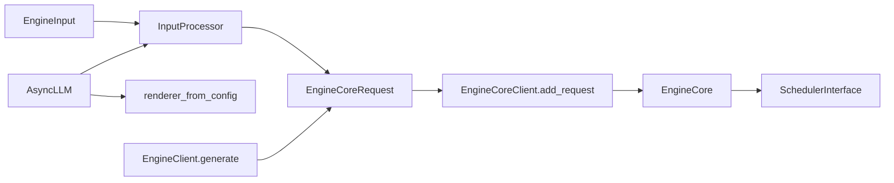
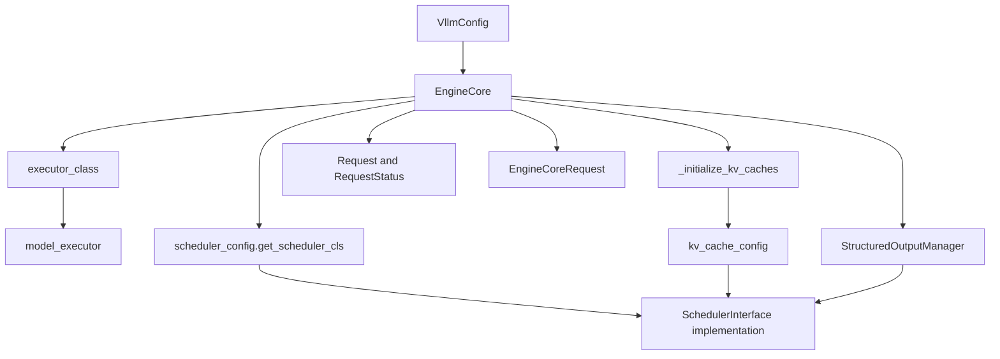
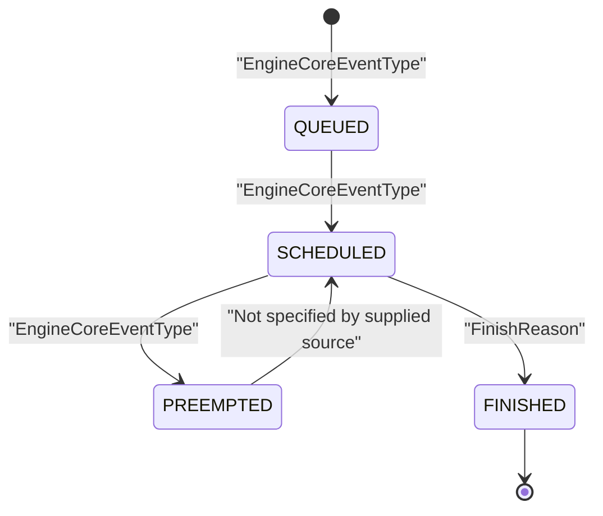

<!-- source: DeepWiki mcp.deepwiki.com · repo vllm-project/vllm · page 3.2 Request Lifecycle and State Management · fetched 2026-10-28 -->

# Request Lifecycle and State Management

Relevant source files

The following files were used as context for generating this wiki page:

- [rust/src/chat/src/renderer/deepseek_v32/tests.rs](rust/src/chat/src/renderer/deepseek_v32/tests.rs)
- [rust/src/chat/src/renderer/deepseek_v4/tests.rs](rust/src/chat/src/renderer/deepseek_v4/tests.rs)
- [rust/src/chat/src/renderer/selection.rs](rust/src/chat/src/renderer/selection.rs)
- [rust/src/chat/src/renderer/test_utils.rs](rust/src/chat/src/renderer/test_utils.rs)
- [tests/entrypoints/launchers/api_server/test_api_server_process_manager.py](tests/entrypoints/launchers/api_server/test_api_server_process_manager.py)
- [tests/entrypoints/serve/utils/test_api_utils.py](tests/entrypoints/serve/utils/test_api_utils.py)
- [tests/test_request_input_bounds.py](tests/test_request_input_bounds.py)
- [tests/tokenizers_/fixtures/deepseek_v4/test_input_5.json](tests/tokenizers_/fixtures/deepseek_v4/test_input_5.json)
- [tests/tokenizers_/fixtures/deepseek_v4/test_output_1.txt](tests/tokenizers_/fixtures/deepseek_v4/test_output_1.txt)
- [tests/tokenizers_/fixtures/deepseek_v4/test_output_5.txt](tests/tokenizers_/fixtures/deepseek_v4/test_output_5.txt)
- [tests/tokenizers_/test_deepseek_v4.py](tests/tokenizers_/test_deepseek_v4.py)
- [tests/tokenizers_/test_hf.py](tests/tokenizers_/test_hf.py)
- [tests/v1/distributed/test_async_llm_dp.py](tests/v1/distributed/test_async_llm_dp.py)
- [tests/v1/engine/test_core_engine_actor_manager.py](tests/v1/engine/test_core_engine_actor_manager.py)
- [tests/v1/engine/test_dp_world_group_port.py](tests/v1/engine/test_dp_world_group_port.py)
- [tests/v1/engine/test_engine_core.py](tests/v1/engine/test_engine_core.py)
- [tests/v1/engine/test_engine_core_client.py](tests/v1/engine/test_engine_core_client.py)
- [tests/v1/engine/test_startup_watch_processes.py](tests/v1/engine/test_startup_watch_processes.py)
- [vllm/engine/protocol.py](vllm/engine/protocol.py)
- [vllm/entrypoints/cli/serve.py](vllm/entrypoints/cli/serve.py)
- [vllm/entrypoints/llm.py](vllm/entrypoints/llm.py)
- [vllm/entrypoints/serve/utils/api_utils.py](vllm/entrypoints/serve/utils/api_utils.py)
- [vllm/renderers/deepseek_v4.py](vllm/renderers/deepseek_v4.py)
- [vllm/tokenizers/deepseek_v32.py](vllm/tokenizers/deepseek_v32.py)
- [vllm/tokenizers/deepseek_v32_encoding.py](vllm/tokenizers/deepseek_v32_encoding.py)
- [vllm/tokenizers/deepseek_v4.py](vllm/tokenizers/deepseek_v4.py)
- [vllm/tokenizers/deepseek_v4_encoding.py](vllm/tokenizers/deepseek_v4_encoding.py)
- [vllm/tokenizers/hf.py](vllm/tokenizers/hf.py)
- [vllm/v1/core/sched/interface.py](vllm/v1/core/sched/interface.py)
- [vllm/v1/engine/__init__.py](vllm/v1/engine/__init__.py)
- [vllm/v1/engine/async_llm.py](vllm/v1/engine/async_llm.py)
- [vllm/v1/engine/coordinator.py](vllm/v1/engine/coordinator.py)
- [vllm/v1/engine/core.py](vllm/v1/engine/core.py)
- [vllm/v1/engine/core_client.py](vllm/v1/engine/core_client.py)
- [vllm/v1/engine/input_processor.py](vllm/v1/engine/input_processor.py)
- [vllm/v1/engine/llm_engine.py](vllm/v1/engine/llm_engine.py)
- [vllm/v1/engine/utils.py](vllm/v1/engine/utils.py)
- [vllm/v1/utils.py](vllm/v1/utils.py)

## Purpose and Scope

This page describes how requests are represented and routed through the vLLM V1 engine, from frontend input processing to engine-core submission and output handling. It focuses on the `EngineCoreRequest` transport object, the visible `EngineCore` setup, the `InputProcessor` boundary, and the client interfaces. The supplied source excerpts do not include the `Request` definition, scheduler implementation, or output-processor implementation; consequently, this page does not assert their internal fields or state-transition behavior.

Sources: [vllm/v1/engine/__init__.py:113-173](), [vllm/v1/engine/core.py:117-184](), [vllm/v1/engine/input_processor.py:41-84](), [vllm/v1/engine/core_client.py:83-105]()

## Request Representation

### `EngineCoreRequest`

`EngineCoreRequest` is a `msgspec.Struct` used to pass request data to the engine core. Its required fields include the request ID, prompt token IDs, multimodal feature specifications, generation or pooling parameters, arrival time, LoRA request, cache salt, and optional data-parallel rank. Optional fields cover prompt embeddings, mixed token-ID/embedding positions, client routing, request wave and priority, tracing headers, resumability, external request ID, reasoning-parser data, immediate-abort handling, session ID, and KV hints. [vllm/v1/engine/__init__.py:113-165]()

The `params` property returns `sampling_params` when present; otherwise, it asserts that `pooling_params` is present and returns that. Thus, the transport representation supports generation and pooling requests through one request type, while keeping the parameter fields distinct. [vllm/v1/engine/__init__.py:167-173]()

`EngineCoreRequest` is configured with `array_like=True`, `omit_defaults=True`, and `gc=False`. These are part of the struct declaration; the supplied excerpts do not specify further serialization or performance implications. [vllm/v1/engine/__init__.py:113-118]()

| Field group | Fields | Role documented by the source |
|---|---|---|
| Identity and timing | `request_id`, `external_req_id`, `arrival_time` | Request identity, caller-provided identity, and arrival timestamp. [vllm/v1/engine/__init__.py:119-125](), [vllm/v1/engine/__init__.py:149-153]() |
| Prompt | `prompt_token_ids`, `mm_features`, `prompt_embeds`, `prompt_is_token_ids` | Token, multimodal, embedding, and mixed-mode prompt representation. [vllm/v1/engine/__init__.py:119-121](), [vllm/v1/engine/__init__.py:128-134]() |
| Task parameters | `sampling_params`, `pooling_params` | Generation or pooling request parameters; `params` selects the populated variant. [vllm/v1/engine/__init__.py:122-123](), [vllm/v1/engine/__init__.py:167-173]() |
| Routing and scheduling metadata | `client_index`, `current_wave`, `priority`, `data_parallel_rank` | Client routing, data-parallel wave/rank association, and priority. [vllm/v1/engine/__init__.py:127-128](), [vllm/v1/engine/__init__.py:136-144]() |
| Optional execution context | `lora_request`, `cache_salt`, `trace_headers`, `resumable`, `session_id`, `kv_hints` | Adapter, cache, tracing, resumability, session, and KV-related metadata. [vllm/v1/engine/__init__.py:124-147](), [vllm/v1/engine/__init__.py:164-165]() |
| Special handling | `abort_immediately`, `reasoning_ended`, `reasoning_parser_kwargs` | Immediate-abort cleanup and reasoning-parser state. [vllm/v1/engine/__init__.py:155-162]() |

Sources: [vllm/v1/engine/__init__.py:113-173]()

### `Request` and the Engine-Core Boundary

`EngineCore` imports both `Request` and `RequestStatus` from `vllm.v1.request`, establishing those types as engine-core dependencies. The provided source excerpt does not include their definitions or the code that constructs a `Request` from an `EngineCoreRequest`; therefore, the detailed internal request fields and conversion behavior cannot be specified from the available content. [vllm/v1/engine/core.py:101-104]()

The distinction supported by the available code is that `EngineCoreRequest` is the typed request data object exchanged at the engine boundary, while `Request` and `RequestStatus` are separately named core-side types. [vllm/v1/engine/__init__.py:113-173](), [vllm/v1/engine/core.py:101-104]()

Sources: [vllm/v1/engine/__init__.py:113-173](), [vllm/v1/engine/core.py:101-104]()

## Request Lifecycle Pipeline

### Frontend Input Processing

`AsyncLLM` creates a renderer from configuration and constructs an `InputProcessor` with that renderer. The source comments identify the processor’s role as converting `EngineInput` to `EngineCoreRequest`. [vllm/v1/engine/async_llm.py:167-171]()

`InputProcessor` stores relevant configuration, initializes a renderer if one was not provided, and exposes `process_inputs_async` by wrapping `process_inputs` in the renderer’s executor. The comments explain that raw-prompt preprocessing, including tokenization and multimodal processing, is blocking, so async callers run it on the renderer thread pool to keep the event loop responsive. [vllm/v1/engine/input_processor.py:41-84]()

The processor also validates request parameters against the supported tasks. For sampling parameters, it checks for generation-capable tasks and invokes `SamplingParams.verify` with model, speculative-decoding, structured-output, and tokenizer context. [vllm/v1/engine/input_processor.py:138-162]()

### Client and Engine-Core Handoff

The `EngineClient` protocol defines `generate` and `encode` operations and accepts request inputs, request IDs, parameters, and optional metadata such as LoRA, tracing headers, priority, data-parallel rank, session ID, and KV hints. [vllm/engine/protocol.py:43-49](), [vllm/engine/protocol.py:93-130]()

`EngineCoreClient` is an abstraction for pushing requests to and pulling outputs from `EngineCore`. Its factory selects an in-process client, a synchronous multiprocess client, or an asynchronous multiprocess client according to the multiprocessing and asyncio mode flags. Asyncio without multiprocessing is rejected. [vllm/v1/engine/core_client.py:83-91](), [vllm/v1/engine/core_client.py:97-136]()

The client interface exposes `add_request(EngineCoreRequest)` and `get_output()`. These define the request-submission and output-retrieval boundary; the supplied excerpts do not show the concrete serialization/send and receive implementations. [vllm/v1/engine/core_client.py:175-185]()

### Code-Entity Map: Frontend to Engine Core

This diagram maps the named request-processing concepts to the code entities visible in the provided source excerpts. The arrows represent the documented component roles and interfaces, not an assertion about unshown call sites.

Sources: [vllm/v1/engine/async_llm.py:167-171](), [vllm/v1/engine/input_processor.py:41-84](), [vllm/engine/protocol.py:93-130](), [vllm/v1/engine/core_client.py:83-105](), [vllm/v1/engine/core_client.py:175-185](), [vllm/v1/engine/core.py:65-66](), [vllm/v1/engine/core.py:162-184]()

## Engine-Core Initialization and Processing Boundary

`EngineCore` is documented as the inner loop of the engine. Its initializer creates the model executor, initializes KV caches, creates a `StructuredOutputManager`, resolves the scheduler class from `scheduler_config`, computes cache block sizes, and instantiates the scheduler through the `SchedulerInterface` type. [vllm/v1/engine/core.py:117-127](), [vllm/v1/engine/core.py:145-160](), [vllm/v1/engine/core.py:162-184]()

This shows the core’s principal runtime dependencies: executor, KV-cache configuration, structured-output manager, scheduler configuration, and scheduler. The supplied excerpt ends during initialization and does not show the engine iteration loop, request admission method, model execution call, or scheduler update path. [vllm/v1/engine/core.py:145-188]()

### Code-Entity Map: Engine Setup

Sources: [vllm/v1/engine/core.py:101-104](), [vllm/v1/engine/core.py:117-127](), [vllm/v1/engine/core.py:145-160](), [vllm/v1/engine/core.py:162-184]()

## State Management

### Request Status and Engine Events

`EngineCore` imports `RequestStatus` alongside `Request`, but the provided source content does not include the enum members, transition rules, or the scheduler code that changes request status. Accordingly, this page does not enumerate a request state machine or attribute particular transitions to specific causes. [vllm/v1/engine/core.py:101-104]()

The available engine-level event types are distinct from `RequestStatus`: `EngineCoreEventType` defines `QUEUED`, `SCHEDULED`, and `PREEMPTED`, and `EngineCoreEvent` stores an event type with a monotonic timestamp. The source notes that these timestamps are intended for calculating intervals between engine-core events and should not be compared with timestamps from other processes. [vllm/v1/engine/__init__.py:176-193]()

`FinishReason` is a separate enum defining `STOP`, `LENGTH`, `ABORT`, `ERROR`, and `REPETITION`. Its string representation maps each integer value to the corresponding externally meaningful finish-reason string. These finish reasons describe completion outcomes, not the full internal request-state machine. [vllm/v1/engine/__init__.py:35-37](), [vllm/v1/engine/__init__.py:49-70]()

### Event and Completion Concepts

| Concept | Values or fields | Meaning established by the source |
|---|---|---|
| Engine-core event | `QUEUED`, `SCHEDULED`, `PREEMPTED` | Timestamped event types associated with a request. [vllm/v1/engine/__init__.py:176-193]() |
| Event timestamp | `timestamp` | Monotonic timestamp used to calculate intervals between engine-core events. [vllm/v1/engine/__init__.py:184-193]() |
| Finish reason | `STOP`, `LENGTH`, `ABORT`, `ERROR`, `REPETITION` | Completion outcome values and their string representation. [vllm/v1/engine/__init__.py:35-37](), [vllm/v1/engine/__init__.py:49-70]() |
| Pause mode | `abort`, `wait`, `keep` | Engine pause behavior: abort in-flight requests, wait for completion, or retain requests for later resumption. [vllm/v1/engine/__init__.py:29-33]() |

Sources: [vllm/v1/engine/__init__.py:29-70](), [vllm/v1/engine/__init__.py:176-193](), [vllm/v1/engine/core.py:101-104]()

### Engine Event Sequence

The following diagram shows the event names declared by the code. It is not a complete request state machine: the provided source does not specify event-emission call sites, transition guards, or the relationship between these events and `RequestStatus`.

Sources: [vllm/v1/engine/__init__.py:49-70](), [vllm/v1/engine/__init__.py:176-193]()

## Request Submission and Client Routing

`EngineCoreRequest.client_index` identifies the frontend client associated with the request; the field comment says it is used to ensure the request’s outputs are sent back to the same client when scaling out the frontend. `current_wave` identifies the expected data-parallel request wave and documents the race condition it is intended to cover. [vllm/v1/engine/__init__.py:136-143]()

`EngineCoreClient.make_client` selects a client implementation based on execution mode. For multiprocess asyncio mode it uses `make_async_mp_client`; for multiprocess synchronous mode it creates `SyncMPClient`; otherwise it creates `InprocClient`. The async multiprocess factory further selects data-parallel client variants when `data_parallel_size > 1`. [vllm/v1/engine/core_client.py:97-136](), [vllm/v1/engine/core_client.py:138-173]()

The API-facing `EngineClient` also defines `abort`, `check_admission`, and request-generation interfaces. The protocol describes admission checks as a way to reject overload before a streaming response starts, and `abort` accepts one request ID or an iterable of IDs. [vllm/engine/protocol.py:75-91](), [vllm/engine/protocol.py:132-141]()

Sources: [vllm/v1/engine/__init__.py:136-143](), [vllm/v1/engine/core_client.py:97-136](), [vllm/v1/engine/core_client.py:138-173](), [vllm/engine/protocol.py:75-91](), [vllm/engine/protocol.py:132-141]()

## Output and Completion Boundary

The core-client interface exposes `get_output()` returning `EngineCoreOutputs`, while the engine request module imports `EngineCoreOutput` and `EngineCoreOutputs` as engine output types. The supplied excerpts do not show how engine output records are constructed, transmitted, or converted into user-facing output objects. [vllm/v1/engine/core_client.py:175-185](), [vllm/v1/engine/core.py:68-82]()

`AsyncLLM` imports `OutputProcessor`, `RequestOutputCollector`, and `StreamingInputOutputCollector`; `LLMEngine` constructs an `OutputProcessor` using the renderer tokenizer, configured stream interval, logging flag, and tracing state. The detailed output-processing behavior is outside the supplied excerpts. [vllm/v1/engine/async_llm.py:60-65](), [vllm/v1/engine/llm_engine.py:98-109]()

Sources: [vllm/v1/engine/core_client.py:175-185](), [vllm/v1/engine/core.py:68-82](), [vllm/v1/engine/async_llm.py:60-65](), [vllm/v1/engine/llm_engine.py:98-109]()

## Implementation Notes and Boundaries

- `InputProcessor` is the frontend conversion boundary: it is responsible for converting engine inputs into `EngineCoreRequest` objects, and its async wrapper runs blocking preprocessing on the renderer executor. [vllm/v1/engine/async_llm.py:167-171](), [vllm/v1/engine/input_processor.py:79-84]()
- `EngineCoreRequest` carries both model-input data and routing/context metadata; its `params` property provides a unified accessor for generation or pooling parameters. [vllm/v1/engine/__init__.py:119-173]()
- `EngineCoreClient` abstracts the transport arrangement and exposes request submission and output retrieval. The chosen implementation depends on multiprocessing and asyncio mode. [vllm/v1/engine/core_client.py:83-105](), [vllm/v1/engine/core_client.py:120-136](), [vllm/v1/engine/core_client.py:175-185]()
- The available excerpts establish that `EngineCore` owns the executor, KV-cache initialization, structured-output manager, and scheduler setup, but do not expose the per-iteration request lifecycle or the internal `Request` state transitions. [vllm/v1/engine/core.py:145-184](), [vllm/v1/engine/core.py:101-104]()

Sources: [vllm/v1/engine/__init__.py:113-193](), [vllm/v1/engine/input_processor.py:41-84](), [vllm/v1/engine/core_client.py:83-105](), [vllm/v1/engine/core.py:101-104](), [vllm/v1/engine/core.py:145-184]()

# End of 3.2 Request Lifecycle and State Management

---

