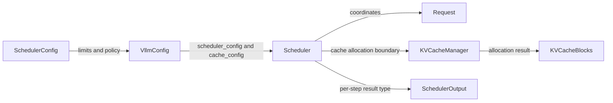
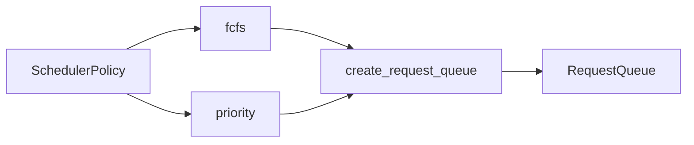
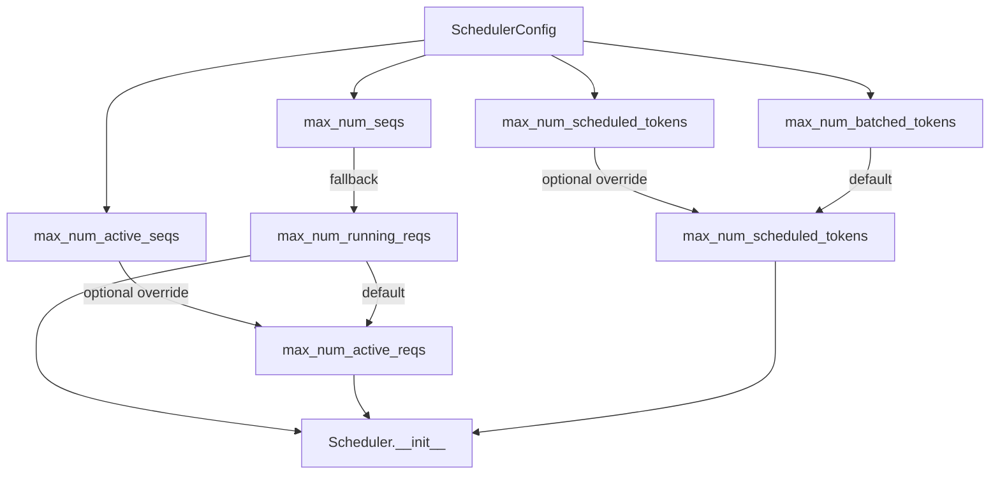
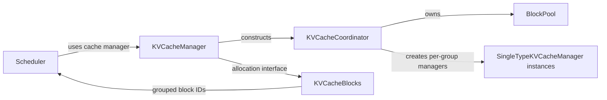
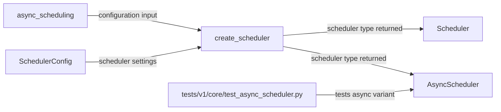

<!-- source: DeepWiki mcp.deepwiki.com · repo vllm-project/vllm · page 3.3 Scheduler and Resource Allocation · fetched 2026-10-28 -->

# Scheduler and Resource Allocation

Relevant source files

The following files were used as context for generating this wiki page:

- [docs/features/automatic_prefix_caching.md](docs/features/automatic_prefix_caching.md)
- [docs/features/speculative_decoding/dynamic_speculative_decoding.md](docs/features/speculative_decoding/dynamic_speculative_decoding.md)
- [tests/config/test_config_utils.py](tests/config/test_config_utils.py)
- [tests/v1/core/prefix_cache/test_mamba_eagle_resume_checkpoint.py](tests/v1/core/prefix_cache/test_mamba_eagle_resume_checkpoint.py)
- [tests/v1/core/prefix_cache/test_partial_prefix_cache_hits.py](tests/v1/core/prefix_cache/test_partial_prefix_cache_hits.py)
- [tests/v1/core/test_async_scheduler.py](tests/v1/core/test_async_scheduler.py)
- [tests/v1/core/test_contiguous_kv_packing.py](tests/v1/core/test_contiguous_kv_packing.py)
- [tests/v1/core/test_deferred_block_free.py](tests/v1/core/test_deferred_block_free.py)
- [tests/v1/core/test_kv_cache_utils.py](tests/v1/core/test_kv_cache_utils.py)
- [tests/v1/core/test_mamba_align_chunk_split.py](tests/v1/core/test_mamba_align_chunk_split.py)
- [tests/v1/core/test_prefix_caching.py](tests/v1/core/test_prefix_caching.py)
- [tests/v1/core/test_scheduler.py](tests/v1/core/test_scheduler.py)
- [tests/v1/core/test_single_type_kv_cache_manager.py](tests/v1/core/test_single_type_kv_cache_manager.py)
- [tests/v1/core/utils.py](tests/v1/core/utils.py)
- [tests/v1/e2e/general/test_pooling_chunked_prefill.py](tests/v1/e2e/general/test_pooling_chunked_prefill.py)
- [tests/v1/spec_decode/test_dynamic_sd.py](tests/v1/spec_decode/test_dynamic_sd.py)
- [tests/v1/spec_decode/test_ngram.py](tests/v1/spec_decode/test_ngram.py)
- [vllm/config/scheduler.py](vllm/config/scheduler.py)
- [vllm/config/utils.py](vllm/config/utils.py)
- [vllm/v1/core/kv_cache_coordinator.py](vllm/v1/core/kv_cache_coordinator.py)
- [vllm/v1/core/kv_cache_manager.py](vllm/v1/core/kv_cache_manager.py)
- [vllm/v1/core/kv_cache_utils.py](vllm/v1/core/kv_cache_utils.py)
- [vllm/v1/core/sched/scheduler.py](vllm/v1/core/sched/scheduler.py)
- [vllm/v1/core/single_type_kv_cache_manager.py](vllm/v1/core/single_type_kv_cache_manager.py)
- [vllm/v1/kv_cache_interface.py](vllm/v1/kv_cache_interface.py)

## Purpose and Scope

This page describes the vLLM V1 scheduler’s configuration and its resource-allocation boundaries: request admission limits, per-iteration token budgets, KV-cache management, and the async scheduler variant. The available source excerpts show the `Scheduler` constructor and configuration fields, but not the scheduler’s full scheduling loop or the `AsyncScheduler` implementation. Accordingly, this page distinguishes documented configuration and interfaces from implementation details that cannot be established from the provided excerpts. [vllm/v1/core/sched/scheduler.py:84-159]()[vllm/config/scheduler.py:20-90]()

Sources: [vllm/v1/core/sched/scheduler.py:84-159](), [vllm/config/scheduler.py:20-90]()

---

## Scheduler Architecture Overview

`Scheduler` implements `SchedulerInterface`. Its constructor accepts the engine configuration, KV-cache configuration, structured-output manager, block-size parameters, multimodal registry, and options for finished-request tracking and statistics. It retains scheduler, cache, LoRA, model, parallelism, and observability configuration needed to coordinate scheduling. [vllm/v1/core/sched/scheduler.py:84-115]()

At initialization, the scheduler derives three distinct limits:

- `max_num_running_reqs` comes from `SchedulerConfig.max_num_seqs`.
- `max_num_active_reqs` comes from `max_num_active_seqs`, falling back to `max_num_running_reqs`.
- `max_num_scheduled_tokens` comes from `max_num_scheduled_tokens`, falling back to `max_num_batched_tokens`. [vllm/v1/core/sched/scheduler.py:128-141]()

These limits serve different purposes: `max_num_seqs` sizes model-runner capacity and is also the default admission limit; `max_num_active_seqs` can reduce the number of admitted `RUNNING` requests without reducing runner capacity; and the token limits constrain work issued per iteration. [vllm/config/scheduler.py:48-77]()

### Scheduler and Resource-Allocation Entities

Sources: [vllm/config/scheduler.py:24-77](), [vllm/v1/core/sched/scheduler.py:84-141](), [vllm/v1/core/sched/output.py:42-49](), [vllm/v1/core/kv_cache_manager.py:34-54]()

### Natural-Language Concepts Mapped to Code Entities

| Concept | Code entity | Role |
|---|---|---|
| Scheduler implementation | `Scheduler` | Implements `SchedulerInterface` and receives engine/cache configuration. [vllm/v1/core/sched/scheduler.py:84-103]() |
| Per-iteration token ceiling | `max_num_scheduled_tokens` | Scheduler limit, with a fallback to `max_num_batched_tokens`. [vllm/v1/core/sched/scheduler.py:137-141]() |
| Runner sequence capacity | `max_num_seqs` / `max_num_running_reqs` | Configured sequence capacity and its scheduler-side value. [vllm/config/scheduler.py:62-77]()[vllm/v1/core/sched/scheduler.py:128-136]() |
| Active-request admission limit | `max_num_active_seqs` / `max_num_active_reqs` | Optional admission cap, defaulting to runner sequence capacity. [vllm/config/scheduler.py:69-77]()[vllm/v1/core/sched/scheduler.py:130-136]() |
| KV block allocation result | `KVCacheBlocks` | Interface object that keeps the scheduler independent of the manager’s internal block representation. [vllm/v1/core/kv_cache_manager.py:34-54]() |
| Per-step scheduling result | `SchedulerOutput` | Output type imported and used by the scheduler subsystem. [vllm/v1/core/sched/scheduler.py:42-49]() |

Sources: [vllm/config/scheduler.py:48-77](), [vllm/v1/core/sched/scheduler.py:84-141](), [vllm/v1/core/kv_cache_manager.py:34-54](), [vllm/v1/core/sched/scheduler.py:42-49]()

---

## Request Queuing System

The scheduler imports `RequestQueue`, `SchedulingPolicy`, and `create_request_queue` from `request_queue.py`. The supplied scheduler excerpt does not include the initialization or manipulation of these queue objects, so queue ordering and transitions are not detailed here. [vllm/v1/core/sched/scheduler.py:50-54]()

The configuration defines the available policy names as `fcfs` and `priority`. These are configuration-level choices; the supplied excerpts do not show the queue implementation or the exact ordering behavior for either policy. [vllm/config/scheduler.py:20-21]()

### Policy Names and Queue Interface

Sources: [vllm/config/scheduler.py:20-21](), [vllm/v1/core/sched/scheduler.py:50-54]()

---

## Scheduling Algorithm Detail

The scheduler’s `schedule()` method is not present in the supplied implementation excerpt. Therefore, this section documents the configured scheduling constraints and the types exposed at the scheduler boundary rather than asserting the order of scheduling phases or specific scheduling-loop behavior. The scheduler module imports `SchedulerOutput` and `Request`, and its constructor derives the request and token limits described above. [vllm/v1/core/sched/scheduler.py:42-49]()[vllm/v1/core/sched/scheduler.py:73-79]()[vllm/v1/core/sched/scheduler.py:128-141]()

### Configuration That Bounds Scheduling

| Configuration | Meaning documented by its definition |
|---|---|
| `max_num_batched_tokens` | Maximum number of tokens processable in one iteration. [vllm/config/scheduler.py:48-53]() |
| `max_num_scheduled_tokens` | Maximum number of tokens the scheduler may issue in one iteration; defaults to `max_num_batched_tokens`. [vllm/config/scheduler.py:55-60]() |
| `max_num_seqs` | Maximum number of sequences processed in one iteration; also sizes runner capacity. [vllm/config/scheduler.py:62-77]() |
| `max_num_active_seqs` | Optional maximum number of requests admitted into `RUNNING`; must not exceed `max_num_seqs`. [vllm/config/scheduler.py:69-77]() |
| `enable_chunked_prefill` | Enables prefill requests to be chunked according to remaining `max_num_batched_tokens`. [vllm/config/scheduler.py:134-140]() |
| `long_prefill_token_threshold` | For chunked prefill, identifies long prompts and caps their prefill chunk; zero disables the cap. [vllm/config/scheduler.py:79-84]() |
| `long_prefill_token_threshold_adaptive` | Floors the effective threshold at a fair share of the token budget when the threshold is nonzero. [vllm/config/scheduler.py:86-90]() |

### Configuration-to-Scheduler Data Flow

Sources: [vllm/config/scheduler.py:48-77](), [vllm/v1/core/sched/scheduler.py:128-141]()

---

## Resource Constraints and Budgets

The scheduler combines request-count and token-count limits with KV-cache and multimodal resource management. It stores `kv_cache_config`, model and parallel configuration, and initializes its KV-cache metrics collector only when KV-cache metrics are enabled. It also records the configured maximum model length. [vllm/v1/core/sched/scheduler.py:96-115]()[vllm/v1/core/sched/scheduler.py:145-149]()

The scheduler’s sampled-token reservation is model-dependent: `num_sampled_tokens_per_step` is zero for pooling and diffusion models and one otherwise. The source comment explains that pooling and diffusion do not append a sampled token after prefill, so they do not reserve that context slot while scheduling. [vllm/v1/core/sched/scheduler.py:150-159]()

`SchedulerConfig` also defines multimodal encoder-related budget fields. The configuration describes `max_num_encoder_input_tokens` as a V1 multimodal encoder compute budget and `encoder_cache_size` as a multimodal encoder cache size; the supplied excerpt states these are not currently configurable. [vllm/config/scheduler.py:142-156]()

Sources: [vllm/v1/core/sched/scheduler.py:96-115](), [vllm/v1/core/sched/scheduler.py:145-159](), [vllm/config/scheduler.py:142-156]()

---

## KV Cache Slot Allocation

`KVCacheManager` is the boundary between the scheduler and KV-cache allocation. Its `KVCacheBlocks` result type represents allocated blocks grouped by KV-cache group, and its documentation identifies this object as the interface that hides the manager’s internal data structures from the scheduler. [vllm/v1/core/kv_cache_manager.py:34-54]()

The scheduler module imports `KVCacheManager` and `KVCacheBlocks`, and the manager constructs a KV-cache coordinator from the cache configuration and parameters including model length, in-flight token capacity, cache enablement, and scheduler/hash block sizes. [vllm/v1/core/sched/scheduler.py:34-40]()[vllm/v1/core/kv_cache_manager.py:131-180]()

`KVCacheCoordinator` creates a `BlockPool` and per-group `SingleTypeKVCacheManager` instances. The latter tracks blocks allocated to requests and uses a block pool for allocation and cache handling. [vllm/v1/core/kv_cache_coordinator.py:89-125]()[vllm/v1/core/kv_cache_coordinator.py:157-167]()[vllm/v1/core/single_type_kv_cache_manager.py:49-52]()[vllm/v1/core/single_type_kv_cache_manager.py:69-126]()

### KV Cache Allocation Boundary

Sources: [vllm/v1/core/sched/scheduler.py:34-40](), [vllm/v1/core/kv_cache_manager.py:34-54](), [vllm/v1/core/kv_cache_manager.py:131-180](), [vllm/v1/core/kv_cache_coordinator.py:89-125](), [vllm/v1/core/kv_cache_coordinator.py:157-167](), [vllm/v1/core/single_type_kv_cache_manager.py:49-52](), [vllm/v1/core/single_type_kv_cache_manager.py:69-126]()

---

## Preemption Strategy

The supplied excerpt does not include the scheduler’s preemption implementation, so it does not establish which request is selected, when a request is requeued, or the exact cache-release sequence. Those details should be documented from the relevant scheduler implementation rather than inferred from configuration.

The available cache-manager interface does establish that `KVCacheBlocks` is the allocation-result abstraction; it does not, in the shown lines, specify preemption behavior. [vllm/v1/core/kv_cache_manager.py:34-54]()

Sources: [vllm/v1/core/kv_cache_manager.py:34-54]()

---

## Special Scheduling Cases

### Chunked Prefill

`enable_chunked_prefill` controls whether prefill requests can be chunked according to the remaining `max_num_batched_tokens` budget. `long_prefill_token_threshold` identifies long prompts for chunk limiting; zero disables the cap, and the documented cap is not applied when the request is the only one in the batch. [vllm/config/scheduler.py:79-84]()[vllm/config/scheduler.py:134-140]()

When `long_prefill_token_threshold_adaptive` is enabled, the effective threshold is floored at a fair share of the token budget across queued and running requests. This option applies only when the threshold is nonzero. [vllm/config/scheduler.py:86-90]()

### Mamba Block Alignment

The supplied scheduler excerpt imports Mamba cache specifications and Mamba prefill-checkpoint helpers, but it does not show the scheduler’s chunk-alignment implementation. The exact alignment procedure is therefore outside the evidence available for this page. [vllm/v1/core/sched/scheduler.py:57-62]()

### Speculative-Decoding Token Reservation

The scheduler constructor derives `num_sampled_tokens_per_step` based on the model runner type and diffusion setting. The supplied lines do not show the broader speculative-decoding scheduling path or how draft tokens affect per-request allocation. [vllm/v1/core/sched/scheduler.py:150-159]()

### Distributed KV Transfer

The scheduler imports KV-connector interfaces, connector factories, and connector metadata types. This establishes that the scheduler module integrates with KV-transfer components, but the supplied excerpt does not show connector call sites or transfer scheduling behavior. [vllm/v1/core/sched/scheduler.py:13-28]()

Sources: [vllm/config/scheduler.py:79-90](), [vllm/config/scheduler.py:134-140](), [vllm/v1/core/sched/scheduler.py:13-28](), [vllm/v1/core/sched/scheduler.py:57-62](), [vllm/v1/core/sched/scheduler.py:150-159]()

---

## AsyncScheduler

The available sources establish that `AsyncScheduler` is a distinct scheduler class and that `SchedulerConfig` includes an `async_scheduling` option. The test utility imports both `AsyncScheduler` and `Scheduler`, and its scheduler factory accepts an `async_scheduling` argument. The provided excerpts do not include the implementation of `AsyncScheduler` or the factory’s selection logic, so its in-flight batch behavior and synchronization details cannot be stated here. [tests/v1/core/utils.py:31-32]()[tests/v1/core/utils.py:58-92]()

### Async Scheduling: Configuration and Code Entities

Sources: [tests/v1/core/utils.py:31-32](), [tests/v1/core/utils.py:58-92](), [tests/v1/core/test_async_scheduler.py:1-1]()

Sources: [tests/v1/core/utils.py:31-32](), [tests/v1/core/utils.py:58-92](), [tests/v1/core/test_async_scheduler.py:1-1]()

---

## Summary

The documented scheduler interface is governed by independent sequence-admission and token-budget limits. `max_num_seqs` sets runner capacity and the default active-request limit; `max_num_active_seqs` can lower admission independently; and `max_num_scheduled_tokens` defaults to the per-iteration `max_num_batched_tokens` limit. [vllm/config/scheduler.py:48-77]()[vllm/v1/core/sched/scheduler.py:128-141]()

KV-cache allocation is mediated through `KVCacheManager` and its `KVCacheBlocks` result abstraction, with a coordinator and per-cache-group managers underneath. The async variant is identifiable in the test utilities, but its operational semantics are not present in the supplied implementation excerpts. [vllm/v1/core/kv_cache_manager.py:34-54]()[vllm/v1/core/kv_cache_manager.py:131-180]()[vllm/v1/core/kv_cache_coordinator.py:89-125]()[tests/v1/core/utils.py:31-32]()

Sources: [vllm/config/scheduler.py:48-90](), [vllm/v1/core/sched/scheduler.py:128-159](), [vllm/v1/core/kv_cache_manager.py:34-54](), [vllm/v1/core/kv_cache_manager.py:131-180](), [vllm/v1/core/kv_cache_coordinator.py:89-125](), [tests/v1/core/utils.py:31-32]()

---

