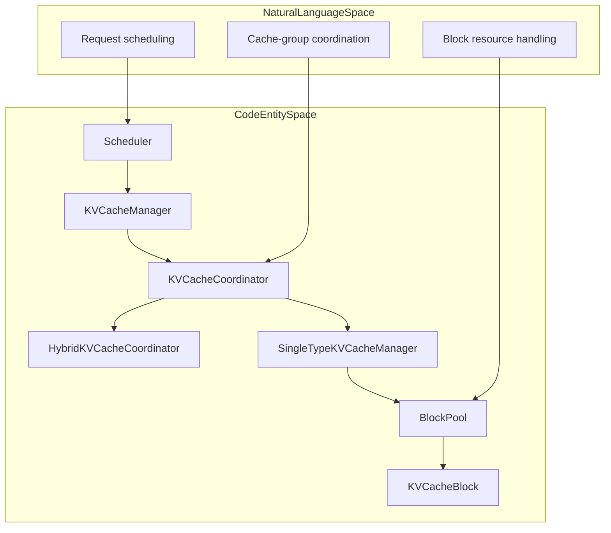
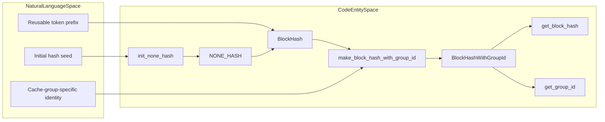
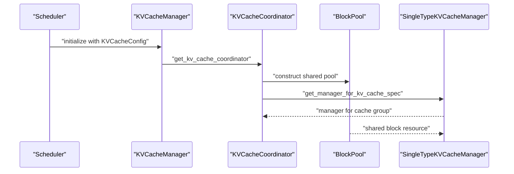
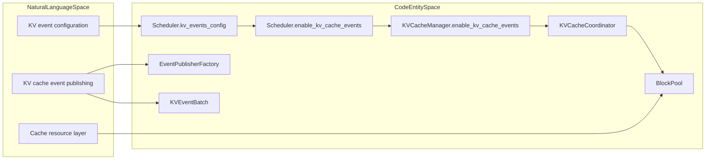

<!-- source: DeepWiki mcp.deepwiki.com · repo vllm-project/vllm · page 3.4 KV Cache Management and Prefix Caching · fetched 2026-10-28 -->

# KV Cache Management and Prefix Caching

Relevant source files

The following files were used as context for generating this wiki page:

- [docs/features/automatic_prefix_caching.md](docs/features/automatic_prefix_caching.md)
- [docs/features/speculative_decoding/dynamic_speculative_decoding.md](docs/features/speculative_decoding/dynamic_speculative_decoding.md)
- [tests/config/test_config_utils.py](tests/config/test_config_utils.py)
- [tests/v1/core/prefix_cache/test_mamba_eagle_resume_checkpoint.py](tests/v1/core/prefix_cache/test_mamba_eagle_resume_checkpoint.py)
- [tests/v1/core/prefix_cache/test_partial_prefix_cache_hits.py](tests/v1/core/prefix_cache/test_partial_prefix_cache_hits.py)
- [tests/v1/core/test_async_scheduler.py](tests/v1/core/test_async_scheduler.py)
- [tests/v1/core/test_contiguous_kv_packing.py](tests/v1/core/test_contiguous_kv_packing.py)
- [tests/v1/core/test_deferred_block_free.py](tests/v1/core/test_deferred_block_free.py)
- [tests/v1/core/test_kv_cache_utils.py](tests/v1/core/test_kv_cache_utils.py)
- [tests/v1/core/test_mamba_align_chunk_split.py](tests/v1/core/test_mamba_align_chunk_split.py)
- [tests/v1/core/test_prefix_caching.py](tests/v1/core/test_prefix_caching.py)
- [tests/v1/core/test_scheduler.py](tests/v1/core/test_scheduler.py)
- [tests/v1/core/test_single_type_kv_cache_manager.py](tests/v1/core/test_single_type_kv_cache_manager.py)
- [tests/v1/core/utils.py](tests/v1/core/utils.py)
- [tests/v1/e2e/general/test_pooling_chunked_prefill.py](tests/v1/e2e/general/test_pooling_chunked_prefill.py)
- [tests/v1/spec_decode/test_dynamic_sd.py](tests/v1/spec_decode/test_dynamic_sd.py)
- [tests/v1/spec_decode/test_ngram.py](tests/v1/spec_decode/test_ngram.py)
- [vllm/config/scheduler.py](vllm/config/scheduler.py)
- [vllm/config/utils.py](vllm/config/utils.py)
- [vllm/v1/core/kv_cache_coordinator.py](vllm/v1/core/kv_cache_coordinator.py)
- [vllm/v1/core/kv_cache_manager.py](vllm/v1/core/kv_cache_manager.py)
- [vllm/v1/core/kv_cache_utils.py](vllm/v1/core/kv_cache_utils.py)
- [vllm/v1/core/sched/scheduler.py](vllm/v1/core/sched/scheduler.py)
- [vllm/v1/core/single_type_kv_cache_manager.py](vllm/v1/core/single_type_kv_cache_manager.py)
- [vllm/v1/kv_cache_interface.py](vllm/v1/kv_cache_interface.py)

## Purpose and Scope

This section describes the V1 KV cache subsystem: how `KVCacheManager` connects the scheduler to cache coordination, how cache groups and block metadata are represented, how prefix hashes support cache lookup, and where KV cache event publishing fits into scheduler initialization. The available source excerpts expose the main types and setup paths, but not the implementations of `BlockPool`’s allocation and event-emission methods; those details are therefore not inferred here. [vllm/v1/core/kv_cache_manager.py:34-54](), [vllm/v1/core/kv_cache_manager.py:131-180](), [vllm/v1/core/kv_cache_coordinator.py:89-125](), [vllm/v1/core/kv_cache_utils.py:44-79](), [vllm/v1/core/sched/scheduler.py:20-27]()

Sources: [vllm/v1/core/kv_cache_manager.py:34-54](), [vllm/v1/core/kv_cache_manager.py:131-180](), [vllm/v1/core/kv_cache_coordinator.py:89-125](), [vllm/v1/core/kv_cache_utils.py:44-79](), [vllm/v1/core/sched/scheduler.py:20-27]()

---

## Core Concepts

### Blocks and Block Size

`KVCacheBlock` is the block-level metadata type. Its block ID identifies a block, `ref_cnt` records references, and its optional hash fields represent cached prefix metadata. The hash is associated with a full cached block; `_block_hash_num_tokens` records the prefix-token boundary represented by that hash and also allows partial entries to end inside a cache block. [vllm/v1/core/kv_cache_utils.py:161-179]()

A `KVCacheBlocks` value is the allocation result exposed by `KVCacheManager`. Its outer tuple is indexed by KV cache group, and each inner sequence contains that group’s blocks. The grouping avoids assuming that all cache groups always have the same number of blocks. [vllm/v1/core/kv_cache_manager.py:34-54]()

Cache-group block sizes and scheduler granularity are related but distinct. `SingleTypeKVCacheManager` receives both a `scheduler_block_size` and a cache specification; its actual `block_size` is derived from the specification and, where applicable, decode context parallelism. The coordinator validates that the scheduler block size is divisible by the hash block size and every group’s block size. [vllm/v1/core/single_type_kv_cache_manager.py:69-110](), [vllm/v1/core/kv_cache_coordinator.py:109-116]()

| Entity | Role |
|---|---|
| `KVCacheBlock` | Block ID, reference count, optional hash key, and hashed-token boundary. [vllm/v1/core/kv_cache_utils.py:161-179]() |
| `KVCacheBlocks` | Group-indexed allocation result returned across the manager/scheduler boundary. [vllm/v1/core/kv_cache_manager.py:34-54]() |
| `scheduler_block_size` | Scheduling alignment shared across cache groups; validated against group and hash block sizes. [vllm/v1/core/kv_cache_coordinator.py:109-116]() |
| `hash_block_size` | Hashing granularity passed to `BlockPool` by the coordinator. [vllm/v1/core/kv_cache_coordinator.py:119-125]() |

Sources: [vllm/v1/core/kv_cache_utils.py:161-179](), [vllm/v1/core/kv_cache_manager.py:34-54](), [vllm/v1/core/single_type_kv_cache_manager.py:69-110](), [vllm/v1/core/kv_cache_coordinator.py:109-125]()

---

### Automatic Prefix Caching (APC) Overview

Prefix caching identifies reusable KV state by hashing blocks of request content. `BlockHash` is a distinct type for a block hash; `BlockHashWithGroupId` is a compact key that combines a hash with a cache-group ID. The group ID is encoded as four big-endian bytes appended to the hash, and helper functions recover either component. [vllm/v1/core/kv_cache_utils.py:44-79]()

The coordinator constructs a `BlockPool` with the configured number of GPU blocks, caching flag, hash block size, event-enable flag, and optional metrics collector. It then creates one `SingleTypeKVCacheManager` for each cache group, passing the shared pool and group-specific settings. [vllm/v1/core/kv_cache_coordinator.py:119-125](), [vllm/v1/core/kv_cache_coordinator.py:157-167]()

This establishes the design boundary: the coordinator and per-type managers organize requests and groups, while the shared pool is the common block-resource dependency. The excerpts supplied here do not include the pool’s lookup or allocation method bodies, so APC lookup order and eviction details are not specified in this page. [vllm/v1/core/kv_cache_coordinator.py:119-125](), [vllm/v1/core/kv_cache_coordinator.py:157-167]()

Sources: [vllm/v1/core/kv_cache_utils.py:44-79](), [vllm/v1/core/kv_cache_coordinator.py:119-125](), [vllm/v1/core/kv_cache_coordinator.py:157-167]()

---

### Block Hashing and Seed Initialization

The `NONE_HASH` value is the initial hash seed for the first block in a prefix sequence. `init_none_hash` resolves the seed and hashes it using the selected hash function. [vllm/v1/core/kv_cache_utils.py:90-108](), [vllm/v1/core/kv_cache_utils.py:117-130](), [vllm/v1/core/kv_cache_utils.py:146-159]()

Seed selection follows these rules:

- If `PYTHONHASHSEED` is set, `resolve_none_hash_seed` uses that value. [vllm/v1/core/kv_cache_utils.py:117-130]()
- Otherwise, cryptographic hash functions use the fixed default seed, `"vllm-none-hash"`, to make hashes reproducible across processes. [vllm/v1/core/kv_cache_utils.py:90-108](), [vllm/v1/core/kv_cache_utils.py:117-130]()
- The listed non-cryptographic functions, `xxhash` and `xxhash_cbor`, use a random per-process seed unless `PYTHONHASHSEED` is set. The initializer warns that this makes hashes non-reproducible across processes by default. [vllm/v1/core/kv_cache_utils.py:110-111](), [vllm/v1/core/kv_cache_utils.py:146-158]()

The hash utilities also provide `maybe_convert_block_hash`, which can represent a hash as an integer when `VLLM_KV_EVENTS_USE_INT_BLOCK_HASHES` is enabled. [vllm/v1/core/kv_cache_utils.py:82-86]()

Sources: [vllm/v1/core/kv_cache_utils.py:82-111](), [vllm/v1/core/kv_cache_utils.py:117-159]()

---

## Architecture Overview: Mapping System Roles to Code Entities

### Diagram: Request Scheduling to Cache Management Entities

This diagram maps the subsystem roles to code entities. `Scheduler` creates and uses `KVCacheManager`; the manager obtains a coordinator through `get_kv_cache_coordinator`; the coordinator constructs a shared `BlockPool` and per-group managers. The available excerpt defines `HybridKVCacheCoordinator` as an imported coordinator option, while the coordinator base shows pool and per-type-manager construction. [vllm/v1/core/sched/scheduler.py:34-40](), [vllm/v1/core/kv_cache_manager.py:12-15](), [vllm/v1/core/kv_cache_manager.py:167-180](), [vllm/v1/core/kv_cache_coordinator.py:89-125](), [vllm/v1/core/kv_cache_coordinator.py:157-167]()

Sources: [vllm/v1/core/sched/scheduler.py:34-40](), [vllm/v1/core/kv_cache_manager.py:12-15](), [vllm/v1/core/kv_cache_manager.py:167-180](), [vllm/v1/core/kv_cache_coordinator.py:89-125](), [vllm/v1/core/kv_cache_coordinator.py:157-167]()

### Diagram: Prefix Hash Concepts to Cache-Key Entities

`BlockHashWithGroupId` represents a block hash plus a cache-group ID. `make_block_hash_with_group_id` creates that key, while `get_block_hash` and `get_group_id` extract its components. `init_none_hash` initializes the root hash value used for a prefix block sequence. [vllm/v1/core/kv_cache_utils.py:44-79](), [vllm/v1/core/kv_cache_utils.py:90-108](), [vllm/v1/core/kv_cache_utils.py:146-159]()

Sources: [vllm/v1/core/kv_cache_utils.py:44-79](), [vllm/v1/core/kv_cache_utils.py:90-108](), [vllm/v1/core/kv_cache_utils.py:146-159]()

---

## Key Components

### KVCacheManager and KVCacheBlocks

`KVCacheManager` is initialized with a `KVCacheConfig`, model length, scheduler and hash block sizes, caching and event flags, optional context-parallel sizes, optional metrics, and other cache settings. It stores the principal cache flags and creates its coordinator through `get_kv_cache_coordinator`. [vllm/v1/core/kv_cache_manager.py:131-180]()

`KVCacheBlocks` is the interface between the manager and scheduler. Its `get_block_ids` method converts the group-indexed block objects into group-indexed integer IDs; callers may select groups and optionally receive `None` when all selected groups are empty. It also exposes helpers for finding unhashed block IDs and creating an empty result. [vllm/v1/core/kv_cache_manager.py:34-54](), [vllm/v1/core/kv_cache_manager.py:81-128]()

The manager creates `PrefixCacheStats` when `log_stats` is enabled and passes the optional metrics collector to the coordinator. [vllm/v1/core/kv_cache_manager.py:157-180]()

Sources: [vllm/v1/core/kv_cache_manager.py:34-54](), [vllm/v1/core/kv_cache_manager.py:81-128](), [vllm/v1/core/kv_cache_manager.py:131-180]()

---

### KVCacheCoordinator and SingleTypeKVCacheManager

`KVCacheCoordinator` coordinates cache groups and owns the shared `BlockPool`. Its constructor validates scheduling/hash/group block-size alignment, creates the pool, determines relevant EAGLE group IDs, and builds a tuple of per-group managers using `get_manager_for_kv_cache_spec`. [vllm/v1/core/kv_cache_coordinator.py:89-125](), [vllm/v1/core/kv_cache_coordinator.py:127-167]()

`SingleTypeKVCacheManager` is the abstract base for managing one KV cache/attention type. Its initializer receives the cache specification, shared pool, caching flag, group ID, scheduler block size, and optional parallelism and allocation settings. It keeps request-to-block mappings and tracks cached-block counts for running requests. [vllm/v1/core/single_type_kv_cache_manager.py:49-55](), [vllm/v1/core/single_type_kv_cache_manager.py:69-80](), [vllm/v1/core/single_type_kv_cache_manager.py:102-135]()

The base manager also declares bookkeeping for partial-hit requests and pending CoW copies. The supplied excerpt establishes these state fields, but does not show the methods that schedule or execute the copies. [vllm/v1/core/single_type_kv_cache_manager.py:145-148]()

Sources: [vllm/v1/core/kv_cache_coordinator.py:89-167](), [vllm/v1/core/single_type_kv_cache_manager.py:49-55](), [vllm/v1/core/single_type_kv_cache_manager.py:69-80](), [vllm/v1/core/single_type_kv_cache_manager.py:102-148]()

---

### BlockPool and BlockHashToBlockMap

The coordinator instantiates `BlockPool` with the total GPU block count and cache-related options. Per-type managers receive that pool, making it the shared resource passed across cache groups. [vllm/v1/core/kv_cache_coordinator.py:119-125](), [vllm/v1/core/kv_cache_coordinator.py:157-167]()

`BlockHashToBlockMap` is referenced by the prefix-caching tests as a type associated with `BlockPool`. The supplied excerpts do not include its implementation, so this page does not assert its eviction policy, complexity, or internal map behavior. [tests/v1/core/test_prefix_caching.py:41-53]()

Sources: [vllm/v1/core/kv_cache_coordinator.py:119-125](), [vllm/v1/core/kv_cache_coordinator.py:157-167](), [tests/v1/core/test_prefix_caching.py:41-53]()

---

## Block Allocation Flow and Strategies

### Block Allocation Process Overview

The exposed setup path starts at scheduler initialization: `Scheduler` imports and constructs `KVCacheManager`, which creates a coordinator; the coordinator creates a shared pool and group-specific managers. The excerpts provided do not show the `allocate_slots` call path or the implementations that determine allocation success, so the diagram below describes construction and dependency flow rather than a per-request allocation transaction. [vllm/v1/core/sched/scheduler.py:34-40](), [vllm/v1/core/kv_cache_manager.py:131-180](), [vllm/v1/core/kv_cache_coordinator.py:119-125](), [vllm/v1/core/kv_cache_coordinator.py:157-167]()

**Diagram: Cache Manager Construction and Shared Pool Wiring**

The coordinator’s constructor receives cache configuration and alignment settings, constructs the `BlockPool`, and then creates one manager per cache group. `KVCacheManager` obtains the coordinator and retains it as its coordination boundary. [vllm/v1/core/kv_cache_manager.py:167-180](), [vllm/v1/core/kv_cache_coordinator.py:94-125](), [vllm/v1/core/kv_cache_coordinator.py:157-167]()

Sources: [vllm/v1/core/kv_cache_manager.py:167-180](), [vllm/v1/core/kv_cache_coordinator.py:94-125](), [vllm/v1/core/kv_cache_coordinator.py:157-167]()

### Group-Specific Allocation Configuration

Allocation behavior is parameterized per `SingleTypeKVCacheManager`. Its initializer records the cache specification, group ID, scheduler block size, and effective block size. The optional `max_admission_blocks_per_request` is documented for recycling-aware specifications such as sliding-window and chunked-local attention; the default of `None` is described as appropriate for full-attention-style specifications that retain every block until request completion. [vllm/v1/core/single_type_kv_cache_manager.py:69-110]()

For cache groups using DCP-sharded specifications, the manager derives its effective block size by multiplying the spec block size by the decode context parallel world size; otherwise it uses a world size of one for that calculation. [vllm/v1/core/single_type_kv_cache_manager.py:102-110]()

The coordinator also validates prefix-cache retention settings. Retention sparsifies sliding-window and Mamba checkpoints, while full-attention and chunked-local groups cache densely and ignore the setting. When a nonzero retention interval is used, it must be nonnegative and divisible by `scheduler_block_size`. [vllm/v1/core/kv_cache_coordinator.py:33-62]()

Sources: [vllm/v1/core/single_type_kv_cache_manager.py:69-110](), [vllm/v1/core/kv_cache_coordinator.py:33-62]()

---

### Partial Prefix Hits and Copy-on-Write (CoW)

`SingleTypeKVCacheManager` keeps `_partial_hit_reqs` and `_pending_cow_copies` fields for partial-hit copy-on-write bookkeeping. The source describes these as populated by fine-grained managers, including full attention and Mamba “align” configurations. [vllm/v1/core/single_type_kv_cache_manager.py:145-148]()

The available excerpt does not show the methods that populate the fields, perform copies, or update block ownership. Consequently, the safe conclusion from the shown code is that the manager has explicit state for partial-hit CoW; copy timing and execution details require the corresponding method implementations. [vllm/v1/core/single_type_kv_cache_manager.py:145-148]()

Sources: [vllm/v1/core/single_type_kv_cache_manager.py:145-148]()

---

## KV Event Publishing and Distributed Synchronization

### Scheduler and Coordinator Event Configuration

`Scheduler` imports `EventPublisherFactory` and `KVEventBatch`, stores `kv_events_config`, and enables its `enable_kv_cache_events` flag only when a configuration exists and that setting is enabled. [vllm/v1/core/sched/scheduler.py:20-21](), [vllm/v1/core/sched/scheduler.py:96-103](), [vllm/v1/core/sched/scheduler.py:146-149]()

The scheduler also imports `BlockStored`, `KVCacheEvent`, and the coordinator module imports event-related types indirectly through cache configuration and initialization. In the shown coordinator constructor, the event-enable flag is passed into `BlockPool`; the supplied excerpts do not show event creation, publisher invocation, batching, or delivery behavior. [vllm/v1/core/kv_cache_manager.py:9-10](), [vllm/v1/core/kv_cache_coordinator.py:94-125]()

**Diagram: Event Configuration Path to Cache Pool**

The diagram captures the visible wiring only: scheduler configuration determines the scheduler’s event-enabled flag, and the coordinator receives an event-enable argument when constructing `BlockPool`. `EventPublisherFactory` and `KVEventBatch` are imported by the scheduler, but their use is outside the supplied excerpt. [vllm/v1/core/sched/scheduler.py:20-21](), [vllm/v1/core/sched/scheduler.py:96-103](), [vllm/v1/core/sched/scheduler.py:146-149](), [vllm/v1/core/kv_cache_coordinator.py:119-125]()

Sources: [vllm/v1/core/sched/scheduler.py:20-21](), [vllm/v1/core/sched/scheduler.py:96-103](), [vllm/v1/core/sched/scheduler.py:146-149](), [vllm/v1/core/kv_cache_coordinator.py:119-125]()

---

## Summary

- `KVCacheManager` is the scheduler-facing manager and creates a coordinator from the cache configuration and runtime cache settings. [vllm/v1/core/kv_cache_manager.py:131-180]()
- `KVCacheCoordinator` constructs a shared `BlockPool` and creates type-specific managers for cache groups. [vllm/v1/core/kv_cache_coordinator.py:119-125](), [vllm/v1/core/kv_cache_coordinator.py:157-167]()
- `KVCacheBlocks` exposes allocations in group-indexed form, while `KVCacheBlock` carries block identity, reference-count, and hash metadata. [vllm/v1/core/kv_cache_manager.py:34-54](), [vllm/v1/core/kv_cache_utils.py:161-179]()
- Prefix identity uses `BlockHash` and group-qualified `BlockHashWithGroupId` keys; `init_none_hash` controls the root seed and its reproducibility. [vllm/v1/core/kv_cache_utils.py:44-79](), [vllm/v1/core/kv_cache_utils.py:90-108](), [vllm/v1/core/kv_cache_utils.py:146-159]()
- Scheduler event configuration is passed through cache initialization to `BlockPool`; event emission and publication internals are not shown in the supplied excerpts. [vllm/v1/core/sched/scheduler.py:146-149](), [vllm/v1/core/kv_cache_coordinator.py:119-125]()

Sources: [vllm/v1/core/kv_cache_manager.py:34-54](), [vllm/v1/core/kv_cache_manager.py:131-180](), [vllm/v1/core/kv_cache_coordinator.py:119-125](), [vllm/v1/core/kv_cache_coordinator.py:157-167](), [vllm/v1/core/kv_cache_utils.py:44-79](), [vllm/v1/core/kv_cache_utils.py:90-108](), [vllm/v1/core/kv_cache_utils.py:146-179](), [vllm/v1/core/sched/scheduler.py:146-149]()

---

## References for Further Exploration

- Scheduler integration: [3.3 Scheduler and Resource Allocation](3.3).
- GPU execution and block-table consumption: [4.1 GPUModelRunner](4.1).
- KV transfer and disaggregated serving: [9.4 KV Cache Transfer and Disaggregated Serving](9.4).

Sources: [vllm/v1/core/sched/scheduler.py:34-40](), [vllm/v1/core/kv_cache_manager.py:131-180]()

---

