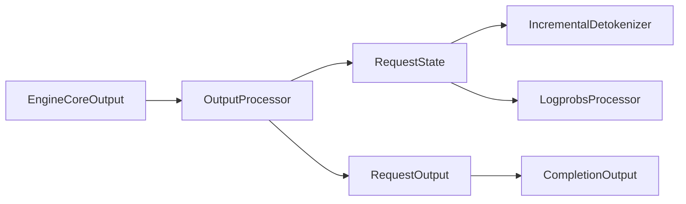
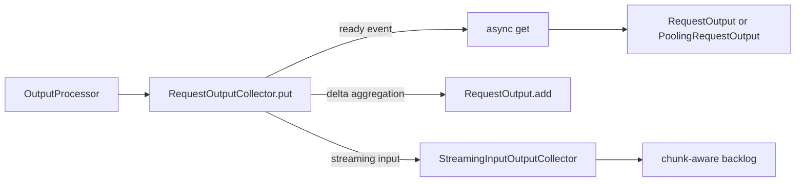
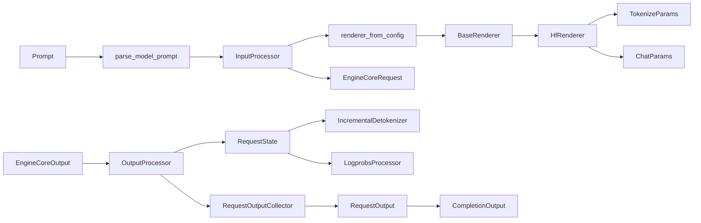

<!-- source: DeepWiki mcp.deepwiki.com · repo vllm-project/vllm · page 3.5 Input and Output Processing · fetched 2026-10-28 -->

# Input and Output Processing

Relevant source files

The following files were used as context for generating this wiki page:

- [rust/src/chat/src/renderer/deepseek_v32/tests.rs](rust/src/chat/src/renderer/deepseek_v32/tests.rs)
- [rust/src/chat/src/renderer/deepseek_v4/tests.rs](rust/src/chat/src/renderer/deepseek_v4/tests.rs)
- [rust/src/chat/src/renderer/selection.rs](rust/src/chat/src/renderer/selection.rs)
- [rust/src/chat/src/renderer/test_utils.rs](rust/src/chat/src/renderer/test_utils.rs)
- [tests/detokenizer/test_check_stop_strings.py](tests/detokenizer/test_check_stop_strings.py)
- [tests/detokenizer/test_min_tokens.py](tests/detokenizer/test_min_tokens.py)
- [tests/detokenizer/test_stop_string_while_stop_model_terminates.py](tests/detokenizer/test_stop_string_while_stop_model_terminates.py)
- [tests/distributed/aux_output_connector/test_store.py](tests/distributed/aux_output_connector/test_store.py)
- [tests/distributed/test_pipeline_parallel.py](tests/distributed/test_pipeline_parallel.py)
- [tests/entrypoints/openai/test_render_token_offsets.py](tests/entrypoints/openai/test_render_token_offsets.py)
- [tests/models/multimodal/generation/vlm_utils/core.py](tests/models/multimodal/generation/vlm_utils/core.py)
- [tests/models/test_initialization.py](tests/models/test_initialization.py)
- [tests/models/test_qwen3_5_mtp_config.py](tests/models/test_qwen3_5_mtp_config.py)
- [tests/models/test_registry.py](tests/models/test_registry.py)
- [tests/multimodal/test_registry.py](tests/multimodal/test_registry.py)
- [tests/renderers/test_completions.py](tests/renderers/test_completions.py)
- [tests/renderers/test_hf.py](tests/renderers/test_hf.py)
- [tests/renderers/test_mistral.py](tests/renderers/test_mistral.py)
- [tests/renderers/test_multimodal_hashes.py](tests/renderers/test_multimodal_hashes.py)
- [tests/renderers/test_process_multi_modal_uuids.py](tests/renderers/test_process_multi_modal_uuids.py)
- [tests/renderers/test_token_offsets.py](tests/renderers/test_token_offsets.py)
- [tests/renderers/test_warmup.py](tests/renderers/test_warmup.py)
- [tests/test_request_input_bounds.py](tests/test_request_input_bounds.py)
- [tests/tokenizers_/fixtures/deepseek_v4/test_input_5.json](tests/tokenizers_/fixtures/deepseek_v4/test_input_5.json)
- [tests/tokenizers_/fixtures/deepseek_v4/test_output_1.txt](tests/tokenizers_/fixtures/deepseek_v4/test_output_1.txt)
- [tests/tokenizers_/fixtures/deepseek_v4/test_output_5.txt](tests/tokenizers_/fixtures/deepseek_v4/test_output_5.txt)
- [tests/tokenizers_/test_deepseek_v4.py](tests/tokenizers_/test_deepseek_v4.py)
- [tests/tokenizers_/test_hf.py](tests/tokenizers_/test_hf.py)
- [tests/v1/core/test_prefix_replay.py](tests/v1/core/test_prefix_replay.py)
- [tests/v1/engine/test_output_processor.py](tests/v1/engine/test_output_processor.py)
- [tests/v1/test_outputs.py](tests/v1/test_outputs.py)
- [vllm/distributed/aux_output_connector/connector.py](vllm/distributed/aux_output_connector/connector.py)
- [vllm/distributed/aux_output_connector/store.py](vllm/distributed/aux_output_connector/store.py)
- [vllm/inputs/engine.py](vllm/inputs/engine.py)
- [vllm/inputs/llm.py](vllm/inputs/llm.py)
- [vllm/multimodal/registry.py](vllm/multimodal/registry.py)
- [vllm/outputs.py](vllm/outputs.py)
- [vllm/renderers/base.py](vllm/renderers/base.py)
- [vllm/renderers/deepseek_v32.py](vllm/renderers/deepseek_v32.py)
- [vllm/renderers/deepseek_v4.py](vllm/renderers/deepseek_v4.py)
- [vllm/renderers/hf.py](vllm/renderers/hf.py)
- [vllm/renderers/mistral.py](vllm/renderers/mistral.py)
- [vllm/renderers/params.py](vllm/renderers/params.py)
- [vllm/renderers/registry.py](vllm/renderers/registry.py)
- [vllm/renderers/terratorch.py](vllm/renderers/terratorch.py)
- [vllm/tokenizers/deepseek_v32.py](vllm/tokenizers/deepseek_v32.py)
- [vllm/tokenizers/deepseek_v32_encoding.py](vllm/tokenizers/deepseek_v32_encoding.py)
- [vllm/tokenizers/deepseek_v4.py](vllm/tokenizers/deepseek_v4.py)
- [vllm/tokenizers/deepseek_v4_encoding.py](vllm/tokenizers/deepseek_v4_encoding.py)
- [vllm/tokenizers/hf.py](vllm/tokenizers/hf.py)
- [vllm/v1/engine/detokenizer.py](vllm/v1/engine/detokenizer.py)
- [vllm/v1/engine/input_processor.py](vllm/v1/engine/input_processor.py)
- [vllm/v1/engine/output_processor.py](vllm/v1/engine/output_processor.py)
- [vllm/v1/outputs.py](vllm/v1/outputs.py)
- [vllm/v1/worker/gpu/async_utils.py](vllm/v1/worker/gpu/async_utils.py)
- [vllm/v1/worker/gpu/sample/output.py](vllm/v1/worker/gpu/sample/output.py)
- [vllm/v1/worker/gpu/spec_decode/utils.py](vllm/v1/worker/gpu/spec_decode/utils.py)

## Purpose and Scope

This page describes how vLLM prepares requests for the engine and turns engine outputs into user-facing results. It covers the `InputProcessor`, renderer configuration and prompt handling, per-request output state, logprob data representation, and asynchronous collection of streamed responses. [vllm/v1/engine/input_processor.py:41-84](), [vllm/v1/engine/output_processor.py:53-93]()

The input path connects prompt parsing and rendering to `EngineCoreRequest` construction; the output path processes engine outputs into completion or pooling results and makes those results available to consuming tasks. [vllm/v1/engine/input_processor.py:12-36](), [vllm/v1/engine/output_processor.py:14-44]()

Sources: [vllm/v1/engine/input_processor.py:12-84](), [vllm/v1/engine/output_processor.py:14-93]()

---

## Input Rendering and Multimodal Preprocessing

Input processing turns user prompts into engine-facing representations. `InputProcessor` owns the active renderer and model-related configuration, while the renderer handles prompt operations such as tokenization and multimodal preprocessing. [vllm/v1/engine/input_processor.py:41-84](), [vllm/renderers/base.py:106-172]()

### `InputProcessor`

`InputProcessor` is initialized with a `VllmConfig`, an optional `BaseRenderer`, and a multimodal registry. It retains configuration objects used during admission and validation, including model, cache, LoRA, scheduler, speculative decoding, structured outputs, observability, and diffusion configuration. [vllm/v1/engine/input_processor.py:41-66]()

If no renderer is supplied, `InputProcessor` obtains one through `renderer_from_config`. It exposes the renderer’s tokenizer and provides `process_inputs_async`, an asynchronous wrapper around input processing that uses the renderer’s executor so blocking preprocessing does not run directly on the caller’s event loop. [vllm/v1/engine/input_processor.py:66-92]()

For models that support multimodal inputs, initialization creates a `MultiModalBudget` using the configured multimodal registry. It records the encoder cache size and whether prompt-length checks should be skipped, then resets the budget’s cache. [vllm/v1/engine/input_processor.py:68-78]()

Before processing a request, parameter validation distinguishes generation parameters from pooling parameters. For generation, it checks that the model supports a generation task and calls `SamplingParams.verify` with model, speculative decoding, structured output, and tokenizer context. [vllm/v1/engine/input_processor.py:138-162]()

`InputProcessor` also builds a validator for custom logits-processor parameters. The selected validator depends on whether the V2 model runner is enabled; for the V2 pooling runner with no configured custom processors, it uses a no-op validator. [vllm/v1/engine/input_processor.py:93-113]()

### Renderer Classes and Configuration

`BaseRenderer` is the abstract renderer base. It stores the vLLM and model configuration, API process rank, and tokenizer; it also manages cleanup resources and executor-backed operations. [vllm/renderers/base.py:106-119]()

The base renderer uses a configurable thread pool for blocking tokenizer work and a separate single-worker executor for multimodal processing. It wraps tokenization, decoding, multimodal processing, cache clearing, and prompt-embedding loading in asynchronous helpers. [vllm/renderers/base.py:140-172]()

`HfRenderer` implements Hugging Face-oriented rendering. It imports chat utilities for loading templates and parsing messages, and multimodal processing utilities for locating and replacing prompt placeholders. [vllm/renderers/hf.py:15-55]()

`ChatParams` controls chat formatting and multimodal preparation options. Its fields include the chat template, content format, template kwargs, media I/O kwargs, multimodal processor kwargs, tool choice, and response format. `with_defaults` combines request values with defaults, and `get_apply_chat_template_kwargs` builds the arguments for applying a tokenizer chat template. [vllm/renderers/params.py:79-142]()

`TokenizeParams` configures tokenization limits and transformations. Its documented fields include total and output token limits, padding and truncation controls, truncation side, lowercasing, special-token behavior, optional character-offset return, and whether the prompt must retain its original text for later detokenization. [vllm/renderers/params.py:144-200]()

### Multimodal Prompt Embedding Handling

`HfRenderer` registers the prompt-embedding placeholder as a tokenizer special token and caches its token ID in a weak-key dictionary keyed by tokenizer object. It checks that the placeholder encodes to exactly one token before caching the ID. [vllm/renderers/hf.py:80-128]()

For each prompt-embedding tensor, `_build_prompt_embeds_updates` creates a `PromptReplacement` that expands one placeholder token into a span whose length matches the tensor’s first dimension. `_expand_prompt_embeds_placeholders` applies those replacements to the token IDs. [vllm/renderers/hf.py:131-163]()

`_build_prompt_embeds_positions` finds the expanded placeholder spans and checks that the number of spans matches the number of embedding tensors. The subsequent helper `_build_mixed_prompt_embeds` is declared to build a prompt-embedding tensor and an `is_token_ids` mask aligned with token IDs. [vllm/renderers/hf.py:166-196]()

### Input Data Flow

**Diagram: Prompt admission from user input to engine request**

The diagram maps user-facing prompt concepts to the code entities visible in the input processor and renderer imports. `InputProcessor` creates or accepts a renderer, and the input-processing module imports both `parse_model_prompt` and `EngineCoreRequest`. [vllm/v1/engine/input_processor.py:26-36](), [vllm/v1/engine/input_processor.py:41-84]()

Sources: [vllm/v1/engine/input_processor.py:26-113](), [vllm/renderers/base.py:106-172](), [vllm/renderers/hf.py:15-55](), [vllm/renderers/hf.py:80-196](), [vllm/renderers/params.py:79-200]()

---

## Output Processing and Detokenization

The output-processing subsystem maintains request-local state and converts engine results into public response objects. The output processor module imports `IncrementalDetokenizer` and `LogprobsProcessor`, and its request state holds references to both when supplied. [vllm/v1/engine/output_processor.py:32-44](), [vllm/v1/engine/output_processor.py:183-197]()

### `RequestState`

`RequestState` is initialized with request identifiers, parallel-sampling metadata, LoRA information, output kind, prompt data, a logprobs processor, a detokenizer, and a token limit parameter. These fields provide request-local context for producing outputs. [vllm/v1/engine/output_processor.py:183-197]()

### Incremental Detokenization

`OutputProcessor` uses `IncrementalDetokenizer` as a per-request output component, and output-processing tests exercise incremental decoding over successive engine outputs for both delta and final-only output kinds. [vllm/v1/engine/output_processor.py:32-35](), [tests/v1/engine/test_output_processor.py:124-179]()

The tests also verify that delta output can have no newly emitted text while accumulated logprob data exists; in that case the completion’s logprobs are empty for the current delta. [tests/v1/engine/test_output_processor.py:56-78]()

### Public Output Objects

`CompletionOutput` represents one completion sequence. Its fields include generated text and token IDs, cumulative logprob, optional per-token logprobs, finish and stop reasons, LoRA information, sampling masks, speculative-decoding metrics, and weight-version spans. [vllm/outputs.py:58-101]()

`RequestOutput` represents the request-level result and carries prompt information, prompt logprobs, one or more completion outputs, a finished flag, and optional metrics and cache or transfer metadata. [vllm/outputs.py:137-181]()

`RequestError` represents a request-level error that does not mark the engine unhealthy. Its `to_exception` method maps validation errors, retryable errors, and other generation errors to their respective exception types. [vllm/outputs.py:22-35]()

### Engine Output to Request Output

**Diagram: Engine output processing and response construction**

`OutputProcessor`’s module imports the engine output types, `IncrementalDetokenizer`, and `LogprobsProcessor`; `RequestState` accepts the detokenizer and logprobs processor as constructor inputs. The public completion and request output types are defined in `vllm/outputs.py`. [vllm/v1/engine/output_processor.py:14-44](), [vllm/v1/engine/output_processor.py:183-197](), [vllm/outputs.py:58-101](), [vllm/outputs.py:137-181]()

Sources: [vllm/v1/engine/output_processor.py:14-44](), [vllm/v1/engine/output_processor.py:183-197](), [tests/v1/engine/test_output_processor.py:56-78](), [tests/v1/engine/test_output_processor.py:124-179](), [vllm/outputs.py:22-35](), [vllm/outputs.py:58-101](), [vllm/outputs.py:137-181]()

---

## Logprobs Processing and Representation

The output path uses `LogprobsProcessor` as request-local state, while the worker-to-engine output structures represent logprobs as tensors or NumPy arrays before they are converted into public response data. [vllm/v1/engine/output_processor.py:32-35](), [vllm/v1/engine/output_processor.py:183-197]()

`LogprobsTensors` carries token IDs, logprob values, selected token ranks, and optional generated-token boundaries. Its conversion methods can copy the data to CPU non-blockingly and produce a `LogprobsLists` representation. [vllm/v1/outputs.py:89-128]()

`LogprobsLists` stores the corresponding arrays and can slice the flattened data for one request and a requested number of positions. The optional cumulative generated-token boundaries support requests whose generated-token counts differ. [vllm/v1/outputs.py:34-57]()

The GPU async-output wrapper copies sampler logprob tensors to CPU non-blockingly when present. It also copies prompt logprobs and prompt token-ID logprobs from the model-runner output. [vllm/v1/worker/gpu/async_utils.py:115-161]()

At the public output layer, `CompletionOutput.logprobs` carries optional sample logprobs, while `RequestOutput.prompt_logprobs` carries optional prompt logprobs. [vllm/outputs.py:58-92](), [vllm/outputs.py:137-152]()

### Logprobs Data Flow

**Diagram: Worker logprob data to public completion output**

`AsyncOutput` copies `SamplerOutput.logprobs_tensors` to CPU when present. `LogprobsTensors` supplies conversion to `LogprobsLists`, and the output processor imports `LogprobsProcessor` for request-local processing. [vllm/v1/worker/gpu/async_utils.py:115-145](), [vllm/v1/outputs.py:89-128](), [vllm/v1/engine/output_processor.py:32-35](), [vllm/outputs.py:58-92]()

Sources: [vllm/v1/engine/output_processor.py:32-35](), [vllm/v1/engine/output_processor.py:183-197](), [vllm/v1/outputs.py:34-57](), [vllm/v1/outputs.py:89-128](), [vllm/v1/worker/gpu/async_utils.py:115-161](), [vllm/outputs.py:58-92](), [vllm/outputs.py:137-152]()

---

## Streaming Response Generation

`RequestOutputCollector` buffers outputs for an individual request and hands them to an asyncio consumer. Its `put` operation is non-blocking; `get` waits for an output, clears the stored value, and raises it if the stored value is an exception. [vllm/v1/engine/output_processor.py:53-93]()

For delta output, the collector enables aggregation. When a producer gets ahead of the consumer, successive `RequestOutput` instances are merged using `RequestOutput.add`, with the aggregation behavior selected by the output kind. Pooling outputs replace the stored pooling output. [vllm/v1/engine/output_processor.py:61-84]()

`StreamingInputOutputCollector` specializes collection for streaming-input requests. It maintains a backlog and avoids merging across input-chunk boundaries, identified by a completion finishing while the overall request remains unfinished. [vllm/v1/engine/output_processor.py:116-160]()

Collectors can cancel an associated input-stream task when closed; their finalizer also schedules cancellation if the collector is discarded while a task remains attached. [vllm/v1/engine/output_processor.py:105-113]()

### Streaming Data Flow

**Diagram: Per-request output buffering and async consumption**

The collector exposes non-blocking `put`, waiting and non-blocking retrieval methods, and a readiness event. Its streaming-input subclass uses a backlog to retain outputs across chunk boundaries. [vllm/v1/engine/output_processor.py:53-103](), [vllm/v1/engine/output_processor.py:116-160]()

Sources: [vllm/v1/engine/output_processor.py:53-113](), [vllm/v1/engine/output_processor.py:116-160]()

---

## Input and Output Processing: Code Entity Map

This diagram bridges user-facing language—prompts, generated text, and streaming responses—to the concrete classes and functions that appear in the code. [vllm/v1/engine/input_processor.py:26-84](), [vllm/renderers/base.py:106-172](), [vllm/v1/engine/output_processor.py:32-44](), [vllm/v1/engine/output_processor.py:53-93]()

**Diagram: Natural-language concepts mapped to code entities**

`InputProcessor` imports the prompt parser, renderer factory, and `EngineCoreRequest`; renderer classes and parameter objects are defined in the renderer modules. The output processor imports engine output types and output-processing helpers, while `RequestOutput` and `CompletionOutput` are public result types. [vllm/v1/engine/input_processor.py:26-36](), [vllm/v1/engine/input_processor.py:41-84](), [vllm/renderers/base.py:106-172](), [vllm/renderers/hf.py:42-55](), [vllm/renderers/params.py:79-200](), [vllm/v1/engine/output_processor.py:14-44](), [vllm/v1/engine/output_processor.py:53-93](), [vllm/outputs.py:58-101](), [vllm/outputs.py:137-181]()

Sources: [vllm/v1/engine/input_processor.py:26-84](), [vllm/renderers/base.py:106-172](), [vllm/renderers/hf.py:42-55](), [vllm/renderers/params.py:79-200](), [vllm/v1/engine/output_processor.py:14-93](), [vllm/outputs.py:58-101](), [vllm/outputs.py:137-181]()

---

## Summary

`InputProcessor` binds configuration, validation, multimodal budgeting, and a renderer into the request-preparation path. Renderers provide tokenization and multimodal processing support, with `HfRenderer` handling chat utilities and prompt-embedding placeholder expansion. [vllm/v1/engine/input_processor.py:41-113](), [vllm/renderers/base.py:106-172](), [vllm/renderers/hf.py:42-55](), [vllm/renderers/hf.py:105-196]()

On output, request-local state connects incremental detokenization and logprob processing to completion results. `RequestOutputCollector` provides asynchronous buffering, with delta aggregation and a chunk-aware variant for streaming-input requests. [vllm/v1/engine/output_processor.py:32-44](), [vllm/v1/engine/output_processor.py:53-160](), [vllm/outputs.py:58-101](), [vllm/outputs.py:137-181]()

Sources: [vllm/v1/engine/input_processor.py:41-113](), [vllm/renderers/base.py:106-172](), [vllm/renderers/hf.py:42-55](), [vllm/renderers/hf.py:105-196](), [vllm/v1/engine/output_processor.py:32-160](), [vllm/outputs.py:58-101](), [vllm/outputs.py:137-181]()

---

