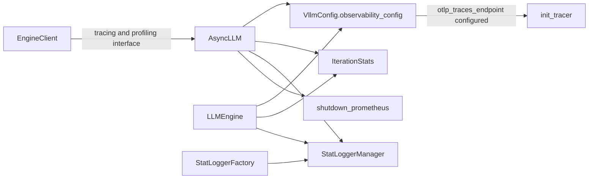
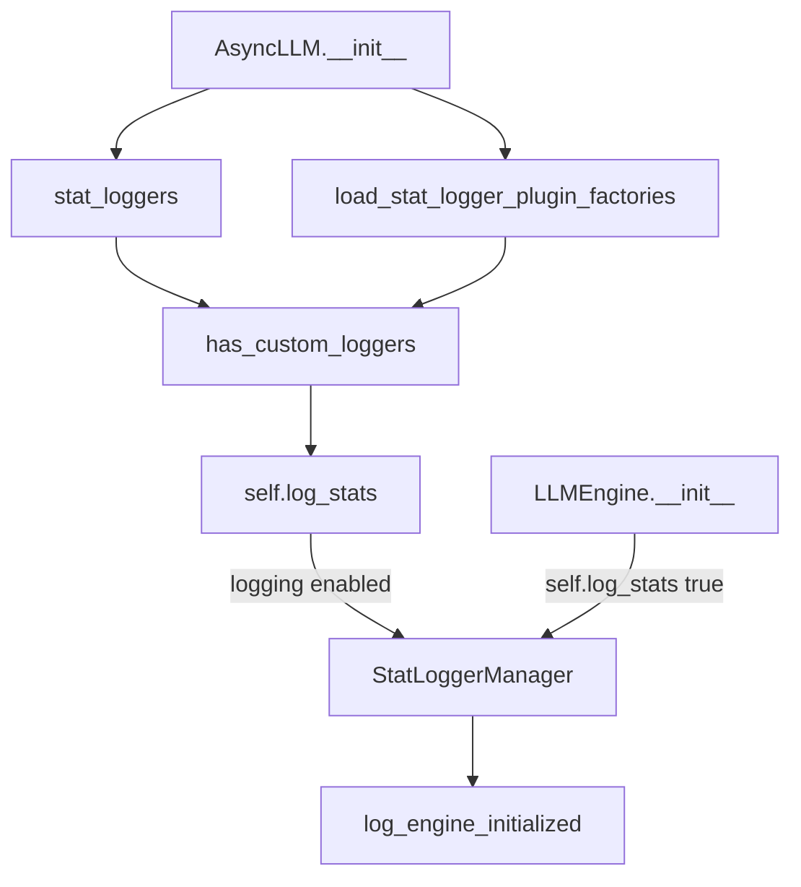
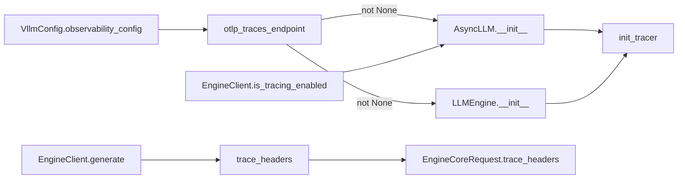
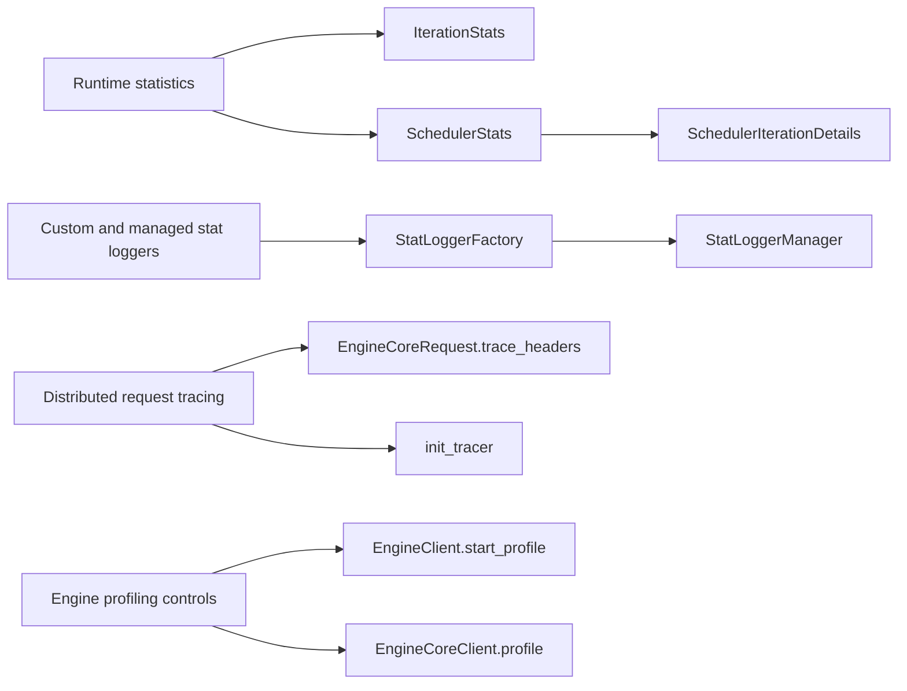

<!-- source: DeepWiki mcp.deepwiki.com · repo vllm-project/vllm · page 3.6 Metrics and Observability · fetched 2026-10-28 -->

# Metrics and Observability

Relevant source files

The following files were used as context for generating this wiki page:

- [docs/design/endpoint_plugins.md](docs/design/endpoint_plugins.md)
- [docs/mkdocs/gen_files/generate_argparse.py](docs/mkdocs/gen_files/generate_argparse.py)
- [examples/features/openai_batch/README.md](examples/features/openai_batch/README.md)
- [tests/entrypoints/cohere/test_registry_and_args.py](tests/entrypoints/cohere/test_registry_and_args.py)
- [tests/entrypoints/launchers/api_server/test_api_server_process_manager.py](tests/entrypoints/launchers/api_server/test_api_server_process_manager.py)
- [tests/entrypoints/launchers/render/__init__.py](tests/entrypoints/launchers/render/__init__.py)
- [tests/entrypoints/launchers/render/test_app_state.py](tests/entrypoints/launchers/render/test_app_state.py)
- [tests/entrypoints/launchers/test_balanced_accepts.py](tests/entrypoints/launchers/test_balanced_accepts.py)
- [tests/entrypoints/launchers/test_run_batch.py](tests/entrypoints/launchers/test_run_batch.py)
- [tests/entrypoints/openai/test_render_parity.py](tests/entrypoints/openai/test_render_parity.py)
- [tests/entrypoints/serve/utils/test_api_utils.py](tests/entrypoints/serve/utils/test_api_utils.py)
- [tests/plugins/vllm_add_dummy_endpoint_plugin/setup.py](tests/plugins/vllm_add_dummy_endpoint_plugin/setup.py)
- [tests/plugins/vllm_add_dummy_endpoint_plugin/vllm_add_dummy_endpoint_plugin/__init__.py](tests/plugins/vllm_add_dummy_endpoint_plugin/vllm_add_dummy_endpoint_plugin/__init__.py)
- [tests/plugins_tests/test_endpoint_plugins.py](tests/plugins_tests/test_endpoint_plugins.py)
- [tests/v1/distributed/test_async_llm_dp.py](tests/v1/distributed/test_async_llm_dp.py)
- [tests/v1/engine/test_core_engine_actor_manager.py](tests/v1/engine/test_core_engine_actor_manager.py)
- [tests/v1/engine/test_dp_world_group_port.py](tests/v1/engine/test_dp_world_group_port.py)
- [tests/v1/engine/test_engine_core.py](tests/v1/engine/test_engine_core.py)
- [tests/v1/engine/test_engine_core_client.py](tests/v1/engine/test_engine_core_client.py)
- [tests/v1/engine/test_startup_watch_processes.py](tests/v1/engine/test_startup_watch_processes.py)
- [vllm/engine/protocol.py](vllm/engine/protocol.py)
- [vllm/entrypoints/cli/benchmark/main.py](vllm/entrypoints/cli/benchmark/main.py)
- [vllm/entrypoints/cli/launch.py](vllm/entrypoints/cli/launch.py)
- [vllm/entrypoints/cli/main.py](vllm/entrypoints/cli/main.py)
- [vllm/entrypoints/cli/run_batch.py](vllm/entrypoints/cli/run_batch.py)
- [vllm/entrypoints/cli/serve.py](vllm/entrypoints/cli/serve.py)
- [vllm/entrypoints/launchers/api_server/app_state.py](vllm/entrypoints/launchers/api_server/app_state.py)
- [vllm/entrypoints/launchers/api_server/entry.py](vllm/entrypoints/launchers/api_server/entry.py)
- [vllm/entrypoints/launchers/app.py](vllm/entrypoints/launchers/app.py)
- [vllm/entrypoints/launchers/launcher.py](vllm/entrypoints/launchers/launcher.py)
- [vllm/entrypoints/launchers/render/app_state.py](vllm/entrypoints/launchers/render/app_state.py)
- [vllm/entrypoints/launchers/render/entry.py](vllm/entrypoints/launchers/render/entry.py)
- [vllm/entrypoints/launchers/run_batch.py](vllm/entrypoints/launchers/run_batch.py)
- [vllm/entrypoints/llm.py](vllm/entrypoints/llm.py)
- [vllm/entrypoints/openai/api_server.py](vllm/entrypoints/openai/api_server.py)
- [vllm/entrypoints/serve/utils/api_utils.py](vllm/entrypoints/serve/utils/api_utils.py)
- [vllm/plugins/__init__.py](vllm/plugins/__init__.py)
- [vllm/plugins/endpoint_plugins/__init__.py](vllm/plugins/endpoint_plugins/__init__.py)
- [vllm/plugins/endpoint_plugins/interface.py](vllm/plugins/endpoint_plugins/interface.py)
- [vllm/v1/core/sched/interface.py](vllm/v1/core/sched/interface.py)
- [vllm/v1/engine/__init__.py](vllm/v1/engine/__init__.py)
- [vllm/v1/engine/async_llm.py](vllm/v1/engine/async_llm.py)
- [vllm/v1/engine/coordinator.py](vllm/v1/engine/coordinator.py)
- [vllm/v1/engine/core.py](vllm/v1/engine/core.py)
- [vllm/v1/engine/core_client.py](vllm/v1/engine/core_client.py)
- [vllm/v1/engine/llm_engine.py](vllm/v1/engine/llm_engine.py)
- [vllm/v1/engine/utils.py](vllm/v1/engine/utils.py)
- [vllm/v1/utils.py](vllm/v1/utils.py)

## Purpose and scope

This page describes the observability interfaces visible in the provided code: engine statistics and logger initialization, tracing setup, profiling interfaces, and the Prometheus lifecycle hooks. It focuses on how the engine-facing code connects to those interfaces; details of individual metric definitions and exporter implementations are not included in the supplied file contents. [vllm/v1/engine/async_llm.py:70-76](), [vllm/v1/engine/llm_engine.py:43-46]()

Sources: [vllm/v1/engine/async_llm.py:70-76](), [vllm/v1/engine/llm_engine.py:43-46]()

---

## Architecture Overview

The engine-facing observability path has two distinct parts:

- **Statistics:** `AsyncLLM` and `LLMEngine` reference `IterationStats` and initialize a `StatLoggerManager` when logging is enabled. The async engine also enables logging when custom logger factories are present, even if `log_stats=False`. [vllm/v1/engine/async_llm.py:155-165](), [vllm/v1/engine/llm_engine.py:126-134]()
- **Tracing and profiling:** Both engine wrappers initialize a tracer when `observability_config.otlp_traces_endpoint` is set. The engine client protocol exposes tracing status and profiling operations. [vllm/v1/engine/async_llm.py:147-151](), [vllm/v1/engine/llm_engine.py:71-75](), [vllm/engine/protocol.py:157-180]()

The sources provided do not show the metric definitions, logger implementations, scrape route, or the engine-step code that creates and forwards each statistics object. The diagram therefore depicts the observable connections supported by the supplied code, rather than an exhaustive metrics data path.

**Diagram: Engine observability entry points**

Sources: [vllm/v1/engine/async_llm.py:45-76](), [vllm/v1/engine/async_llm.py:147-165](), [vllm/v1/engine/llm_engine.py:34-46](), [vllm/v1/engine/llm_engine.py:71-75](), [vllm/v1/engine/llm_engine.py:126-134](), [vllm/engine/protocol.py:157-180]()

---

## StatLoggerManager Initialization

`AsyncLLM` accepts `stat_loggers`, combines them with factories returned by `load_stat_logger_plugin_factories()`, and enables stats logging when either `log_stats` is true or at least one custom factory is found. If custom loggers exist while `log_stats=False`, it logs that custom logging is enabled without default stat loggers. [vllm/v1/engine/async_llm.py:96-110](), [vllm/v1/engine/async_llm.py:155-165]()

`LLMEngine` accepts optional `stat_loggers` and creates a `StatLoggerManager` when `self.log_stats` is true. It passes the config, custom loggers, default-logger setting, and aggregation setting to the manager, then calls `log_engine_initialized()`. The supplied excerpt does not show the manager’s internal logger selection or record/log scheduling. [vllm/v1/engine/llm_engine.py:57-67](), [vllm/v1/engine/llm_engine.py:126-134]()

| Engine-facing symbol | Role shown in the supplied code |
|---|---|
| `StatLoggerFactory` | Type used for custom logger factories accepted by the engine wrappers. [vllm/v1/engine/async_llm.py:70-73](), [vllm/v1/engine/llm_engine.py:43-45]() |
| `load_stat_logger_plugin_factories()` | Supplies additional factories in `AsyncLLM`. [vllm/v1/engine/async_llm.py:155-157]() |
| `StatLoggerManager` | Manager initialized by `LLMEngine` when stats logging is enabled. [vllm/v1/engine/llm_engine.py:126-134]() |
| `log_engine_initialized()` | Initialization notification issued by `LLMEngine` to the manager. [vllm/v1/engine/llm_engine.py:126-134]() |

**Diagram: Logger factory path from engine setup to manager**

Sources: [vllm/v1/engine/async_llm.py:96-110](), [vllm/v1/engine/async_llm.py:155-165](), [vllm/v1/engine/llm_engine.py:57-67](), [vllm/v1/engine/llm_engine.py:126-134]()

---

## Statistics Interfaces

`IterationStats` is imported by both `AsyncLLM` and `LLMEngine`. `EngineCore` imports `SchedulerIterationDetails` and `SchedulerStats`. The supplied excerpts establish these statistics types as engine-facing dependencies, but do not include their definitions or show how fields are populated, aggregated, or exported. [vllm/v1/engine/async_llm.py:70-76](), [vllm/v1/engine/llm_engine.py:43-46](), [vllm/v1/engine/core.py:101-106]()

| Symbol | Where it appears in the supplied code | What can be established |
|---|---|---|
| `IterationStats` | Imported in `AsyncLLM` and `LLMEngine`. | Used as a metrics statistics type at the engine-wrapper layer. [vllm/v1/engine/async_llm.py:70-76](), [vllm/v1/engine/llm_engine.py:43-46]() |
| `SchedulerStats` | Imported by `EngineCore` and the engine message module. | Used as a scheduler statistics type in the engine code. [vllm/v1/engine/core.py:101-106](), [vllm/v1/engine/__init__.py:21-25]() |
| `SchedulerIterationDetails` | Imported by `EngineCore`. | A scheduler iteration-details type referenced by the core. [vllm/v1/engine/core.py:101-106]() |

The available files do not substantiate specific field lists, metric names, latency formulas, collection intervals, or reset behavior. Those details should be documented from the definitions and call sites in the metrics and output-processing modules.

Sources: [vllm/v1/engine/async_llm.py:70-76](), [vllm/v1/engine/llm_engine.py:43-46](), [vllm/v1/engine/core.py:101-106](), [vllm/v1/engine/__init__.py:21-25]()

---

## Logger Interfaces and Plugin Factories

The async engine imports `StatLoggerFactory`, `StatLoggerManager`, and `load_stat_logger_plugin_factories()` from `vllm.v1.metrics.loggers`. It merges the explicit factories with the plugin-provided factories before deciding whether logging should be enabled. [vllm/v1/engine/async_llm.py:70-73](), [vllm/v1/engine/async_llm.py:155-165]()

The legacy `LLMEngine` wrapper accepts a list of custom logger factories and passes it to `StatLoggerManager`. The excerpt does not show the logger base class, plugin discovery mechanism, validation rules, or individual logger implementations. [vllm/v1/engine/llm_engine.py:57-67](), [vllm/v1/engine/llm_engine.py:126-134]()

Sources: [vllm/v1/engine/async_llm.py:70-73](), [vllm/v1/engine/async_llm.py:155-165](), [vllm/v1/engine/llm_engine.py:57-67](), [vllm/v1/engine/llm_engine.py:126-134]()

---

## Prometheus Lifecycle and Monitoring Interfaces

The supplied `AsyncLLM` excerpt imports `shutdown_prometheus` from `vllm.v1.metrics.prometheus`; the excerpt does not show its call site or the Prometheus server and metric registration implementation. [vllm/v1/engine/async_llm.py:70-76]()

The `serve` CLI imports `setup_multiprocess_prometheus`, establishing a separate multiprocess setup hook in the serving entry point. The provided lines do not show where it is called or what address, registry, or metric aggregation behavior it configures. [vllm/entrypoints/cli/serve.py:27-34]()

| Symbol | Source location | Supported conclusion |
|---|---|---|
| `shutdown_prometheus` | Imported by `AsyncLLM`. | The async engine module has a Prometheus shutdown hook available. [vllm/v1/engine/async_llm.py:70-76]() |
| `setup_multiprocess_prometheus` | Imported by the `serve` CLI. | The serving CLI has a multiprocess Prometheus setup hook available. [vllm/entrypoints/cli/serve.py:27-34]() |

No Prometheus route or endpoint path can be confirmed from the supplied code excerpts. In particular, these excerpts do not establish a `/metrics` route, metric names, types, labels, or scrape configuration.

Sources: [vllm/v1/engine/async_llm.py:70-76](), [vllm/entrypoints/cli/serve.py:27-34]()

---

## Tracing

Both engine wrappers read `vllm_config.observability_config.otlp_traces_endpoint` and call `init_tracer("vllm.llm_engine", tracing_endpoint)` when that endpoint is not `None`. `AsyncLLM` also imports `log_tracing_disabled_warning`; its use is not shown in the supplied lines. [vllm/v1/engine/async_llm.py:45-52](), [vllm/v1/engine/async_llm.py:143-151](), [vllm/v1/engine/llm_engine.py:34-35](), [vllm/v1/engine/llm_engine.py:68-75]()

`EngineCoreRequest` carries optional `trace_headers`, and the `EngineClient.generate()` protocol accepts optional trace headers. This establishes a request-level tracing context field and an engine-client API parameter, but the supplied excerpts do not show how headers are propagated into spans. [vllm/v1/engine/__init__.py:113-147](), [vllm/engine/protocol.py:93-115]()

`EngineClient` also defines `is_tracing_enabled()`, making tracing status part of the client protocol. The implementation is not included in the supplied protocol excerpt. [vllm/engine/protocol.py:157-161]()

**Diagram: Tracing configuration and request context**

Sources: [vllm/v1/engine/async_llm.py:143-151](), [vllm/v1/engine/llm_engine.py:68-75](), [vllm/v1/engine/__init__.py:113-147](), [vllm/engine/protocol.py:93-115](), [vllm/engine/protocol.py:157-161]()

---

## Profiling Interfaces

The `EngineClient` protocol exposes `start_profile()` and `stop_profile()`. `start_profile()` accepts an optional profile prefix and per-session overrides for delay and maximum iterations. [vllm/engine/protocol.py:168-181]()

`AsyncLLM` imports `TorchProfilerWrapper` and `create_frontend_profiler`, and accepts an optional profiler wrapper in its initializer. `EngineCoreClient` also exposes a `profile()` method with start/stop, prefix, delay, and iteration-bound parameters. The supplied excerpts show these interfaces, not the profiler implementation or the data format and destination of generated profiles. [vllm/v1/engine/async_llm.py:43-46](), [vllm/v1/engine/async_llm.py:96-110](), [vllm/v1/engine/core_client.py:187-194]()

Sources: [vllm/engine/protocol.py:168-181](), [vllm/v1/engine/async_llm.py:43-46](), [vllm/v1/engine/async_llm.py:96-110](), [vllm/v1/engine/core_client.py:187-194]()

---

## Monitoring Interfaces and Data Flow

The engine-facing monitoring surface consists of the statistics types imported by engine components, logger factories accepted by engine wrappers, tracing configuration and request headers, and profile controls exposed through the client protocol. The provided code does not show an HTTP metrics route or a complete runtime flow from scheduler iteration through stats recording to an external backend. [vllm/v1/engine/core.py:101-106](), [vllm/v1/engine/async_llm.py:70-76](), [vllm/v1/engine/async_llm.py:155-165](), [vllm/engine/protocol.py:157-181]()

**Diagram: Natural-language monitoring concepts mapped to code entities**

Sources: [vllm/v1/engine/async_llm.py:70-76](), [vllm/v1/engine/async_llm.py:147-165](), [vllm/v1/engine/core.py:101-106](), [vllm/v1/engine/__init__.py:113-147](), [vllm/v1/engine/llm_engine.py:43-46](), [vllm/engine/protocol.py:157-181](), [vllm/v1/engine/core_client.py:187-194]()

---

## Summary

The supplied code establishes the engine-facing observability hooks: statistics types are imported by engine components; logger factories and `StatLoggerManager` are wired into engine initialization; a configured OTLP trace endpoint triggers `init_tracer`; request trace headers are represented in the request and client APIs; and profiling is exposed through engine-client methods. [vllm/v1/engine/core.py:101-106](), [vllm/v1/engine/async_llm.py:143-165](), [vllm/v1/engine/llm_engine.py:71-75](), [vllm/v1/engine/__init__.py:113-147](), [vllm/engine/protocol.py:157-181]()

Metric schemas, logger implementations, Prometheus registration and routes, latency calculations, and KV-event publishing behavior require source definitions not included in the supplied file contents and are therefore not specified here.

Sources: [vllm/v1/engine/core.py:101-106](), [vllm/v1/engine/async_llm.py:143-165](), [vllm/v1/engine/llm_engine.py:71-75](), [vllm/v1/engine/__init__.py:113-147](), [vllm/engine/protocol.py:157-181]()

---

