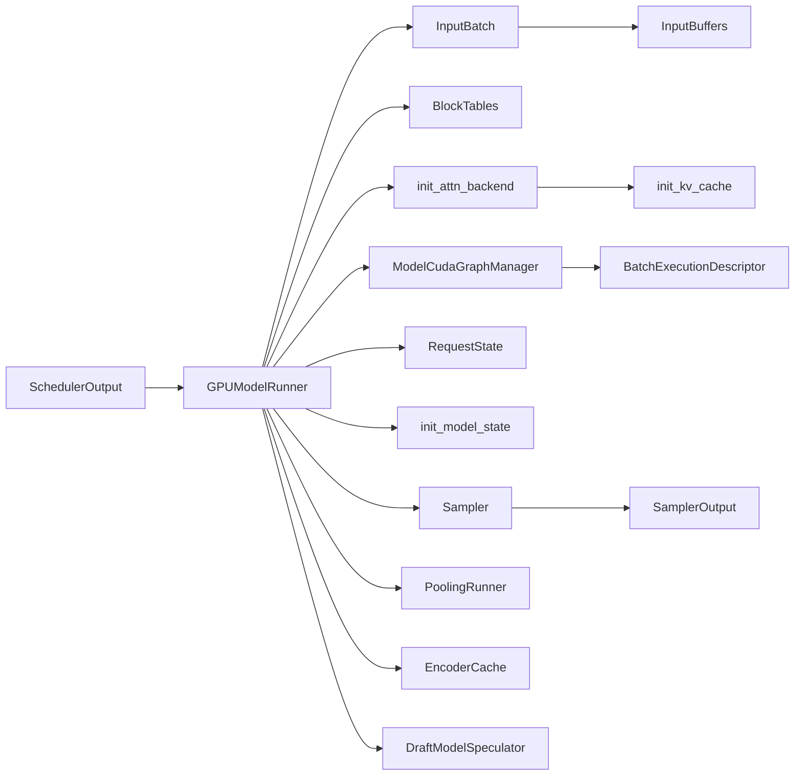
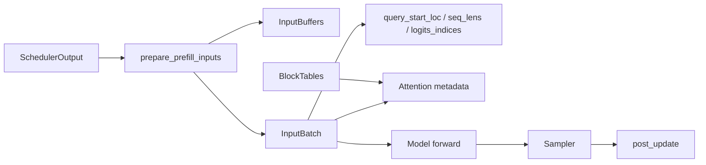
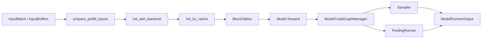
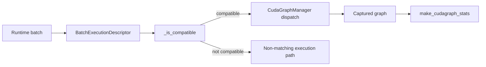

<!-- source: DeepWiki mcp.deepwiki.com · repo vllm-project/vllm · page 4.1 GPUModelRunner · fetched 2026-10-28 -->

# GPUModelRunner

Relevant source files

The following files were used as context for generating this wiki page:

- [examples/rl/rlhf_http_ipc_no_vllm.py](examples/rl/rlhf_http_ipc_no_vllm.py)
- [examples/rl/rlhf_http_nccl_no_vllm.py](examples/rl/rlhf_http_nccl_no_vllm.py)
- [tests/distributed/test_shm_broadcast.py](tests/distributed/test_shm_broadcast.py)
- [tests/kernels/core/test_uva.py](tests/kernels/core/test_uva.py)
- [tests/lora/test_gemma4_tp.py](tests/lora/test_gemma4_tp.py)
- [tests/model_executor/test_mamba_triton_warmup.py](tests/model_executor/test_mamba_triton_warmup.py)
- [tests/model_executor/test_qwen_triton_warmup.py](tests/model_executor/test_qwen_triton_warmup.py)
- [tests/model_executor/test_qwen_vl_triton_warmup.py](tests/model_executor/test_qwen_vl_triton_warmup.py)
- [tests/utils_/test_torch_utils.py](tests/utils_/test_torch_utils.py)
- [tests/v1/cudagraph/test_cudagraph_manager.py](tests/v1/cudagraph/test_cudagraph_manager.py)
- [tests/v1/executor/test_multiproc_executor_timeout.py](tests/v1/executor/test_multiproc_executor_timeout.py)
- [tests/v1/spec_decode/test_dynamic_sd_cug.py](tests/v1/spec_decode/test_dynamic_sd_cug.py)
- [tests/v1/spec_decode/test_eagle_draft_attn_metadata.py](tests/v1/spec_decode/test_eagle_draft_attn_metadata.py)
- [tests/v1/worker/test_gpu_batch_ordering.py](tests/v1/worker/test_gpu_batch_ordering.py)
- [tests/v1/worker/test_gpu_block_table.py](tests/v1/worker/test_gpu_block_table.py)
- [tests/v1/worker/test_gpu_model_runner.py](tests/v1/worker/test_gpu_model_runner.py)
- [tests/v1/worker/test_gpu_model_runner_v2.py](tests/v1/worker/test_gpu_model_runner_v2.py)
- [tests/v1/worker/test_gpu_model_runner_v2_cudagraph_profiling.py](tests/v1/worker/test_gpu_model_runner_v2_cudagraph_profiling.py)
- [tests/v1/worker/test_gpu_model_runner_v2_eplb.py](tests/v1/worker/test_gpu_model_runner_v2_eplb.py)
- [tests/v1/worker/test_gpu_pcp_manager.py](tests/v1/worker/test_gpu_pcp_manager.py)
- [tests/v1/worker/test_gpu_ubatch_slicing.py](tests/v1/worker/test_gpu_ubatch_slicing.py)
- [tests/v1/worker/test_gpu_warmup_blocks.py](tests/v1/worker/test_gpu_warmup_blocks.py)
- [tests/v1/worker/test_kv_block_zeroer.py](tests/v1/worker/test_kv_block_zeroer.py)
- [tests/v1/worker/test_mixed_warmup_gate.py](tests/v1/worker/test_mixed_warmup_gate.py)
- [tests/v1/worker/test_workspace.py](tests/v1/worker/test_workspace.py)
- [tools/pre_commit/check_forbidden_imports.py](tools/pre_commit/check_forbidden_imports.py)
- [vllm/distributed/device_communicators/shm_broadcast.py](vllm/distributed/device_communicators/shm_broadcast.py)
- [vllm/distributed/device_communicators/shm_tensor_arena.py](vllm/distributed/device_communicators/shm_tensor_arena.py)
- [vllm/model_executor/models/diffusion_gemma.py](vllm/model_executor/models/diffusion_gemma.py)
- [vllm/model_executor/warmup/mamba_triton_warmup.py](vllm/model_executor/warmup/mamba_triton_warmup.py)
- [vllm/model_executor/warmup/qwen_triton_warmup.py](vllm/model_executor/warmup/qwen_triton_warmup.py)
- [vllm/model_executor/warmup/qwen_vl_triton_warmup.py](vllm/model_executor/warmup/qwen_vl_triton_warmup.py)
- [vllm/third_party/flash_linear_attention/ops/layernorm_guard.py](vllm/third_party/flash_linear_attention/ops/layernorm_guard.py)
- [vllm/utils/torch_utils.py](vllm/utils/torch_utils.py)
- [vllm/v1/attention/ops/pcp.py](vllm/v1/attention/ops/pcp.py)
- [vllm/v1/worker/cp_utils.py](vllm/v1/worker/cp_utils.py)
- [vllm/v1/worker/cpu/__init__.py](vllm/v1/worker/cpu/__init__.py)
- [vllm/v1/worker/cpu/buffer_utils.py](vllm/v1/worker/cpu/buffer_utils.py)
- [vllm/v1/worker/cpu/model_runner.py](vllm/v1/worker/cpu/model_runner.py)
- [vllm/v1/worker/gpu/attn_utils.py](vllm/v1/worker/gpu/attn_utils.py)
- [vllm/v1/worker/gpu/block_table.py](vllm/v1/worker/gpu/block_table.py)
- [vllm/v1/worker/gpu/buffer_utils.py](vllm/v1/worker/gpu/buffer_utils.py)
- [vllm/v1/worker/gpu/cp_utils.py](vllm/v1/worker/gpu/cp_utils.py)
- [vllm/v1/worker/gpu/cudagraph_utils.py](vllm/v1/worker/gpu/cudagraph_utils.py)
- [vllm/v1/worker/gpu/dp_utils.py](vllm/v1/worker/gpu/dp_utils.py)
- [vllm/v1/worker/gpu/eplb_utils.py](vllm/v1/worker/gpu/eplb_utils.py)
- [vllm/v1/worker/gpu/input_batch.py](vllm/v1/worker/gpu/input_batch.py)
- [vllm/v1/worker/gpu/mm/lora.py](vllm/v1/worker/gpu/mm/lora.py)
- [vllm/v1/worker/gpu/model_runner.py](vllm/v1/worker/gpu/model_runner.py)
- [vllm/v1/worker/gpu/model_states/__init__.py](vllm/v1/worker/gpu/model_states/__init__.py)
- [vllm/v1/worker/gpu/model_states/default.py](vllm/v1/worker/gpu/model_states/default.py)
- [vllm/v1/worker/gpu/model_states/encoder_decoder.py](vllm/v1/worker/gpu/model_states/encoder_decoder.py)
- [vllm/v1/worker/gpu/model_states/encoder_only.py](vllm/v1/worker/gpu/model_states/encoder_only.py)
- [vllm/v1/worker/gpu/model_states/interface.py](vllm/v1/worker/gpu/model_states/interface.py)
- [vllm/v1/worker/gpu/pcp_manager.py](vllm/v1/worker/gpu/pcp_manager.py)
- [vllm/v1/worker/gpu/spec_decode/dflash/cudagraph.py](vllm/v1/worker/gpu/spec_decode/dflash/cudagraph.py)
- [vllm/v1/worker/gpu/spec_decode/dflash/speculator.py](vllm/v1/worker/gpu/spec_decode/dflash/speculator.py)
- [vllm/v1/worker/gpu/spec_decode/eagle/speculator.py](vllm/v1/worker/gpu/spec_decode/eagle/speculator.py)
- [vllm/v1/worker/gpu/spec_decode/extract_hidden_states.py](vllm/v1/worker/gpu/spec_decode/extract_hidden_states.py)
- [vllm/v1/worker/gpu/spec_decode/multi_module_mtp/speculator.py](vllm/v1/worker/gpu/spec_decode/multi_module_mtp/speculator.py)
- [vllm/v1/worker/gpu/spec_decode/speculator.py](vllm/v1/worker/gpu/spec_decode/speculator.py)
- [vllm/v1/worker/gpu/spec_decode/standalone_ar/speculator.py](vllm/v1/worker/gpu/spec_decode/standalone_ar/speculator.py)
- [vllm/v1/worker/gpu/spec_decode/target_dependent_ar/speculator.py](vllm/v1/worker/gpu/spec_decode/target_dependent_ar/speculator.py)
- [vllm/v1/worker/gpu/states.py](vllm/v1/worker/gpu/states.py)
- [vllm/v1/worker/gpu/ubatch_utils.py](vllm/v1/worker/gpu/ubatch_utils.py)
- [vllm/v1/worker/gpu/warmup.py](vllm/v1/worker/gpu/warmup.py)
- [vllm/v1/worker/gpu_model_runner.py](vllm/v1/worker/gpu_model_runner.py)
- [vllm/v1/worker/utils.py](vllm/v1/worker/utils.py)

## Purpose and Scope

`GPUModelRunner` coordinates GPU-side model execution: preparing batches, invoking model-forward and attention infrastructure, managing KV-cache-related state, and routing outputs into sampling or pooling paths. The V1 GPU runner imports dedicated components for these responsibilities, including `InputBatch`, `BlockTables`, `Sampler`, `PoolingRunner`, model-state initialization, and CUDA-graph management. [vllm/v1/worker/gpu/model_runner.py:98-155]()

This page covers the stable runner and Model Runner V2, their execution-state interfaces, batch and block-table data flow, CUDA-graph descriptors, and sampling, pooling, multimodal, and speculative-decoding components. The provided file contents include only the opening portion of `model_runner.py`; they do not include the stable runner’s implementation or the V2 runner’s method bodies. Accordingly, details below are limited to behavior evidenced in the supplied source excerpts. [vllm/v1/worker/gpu/model_runner.py:1-17]()

Sources: [vllm/v1/worker/gpu/model_runner.py:1-17](), [vllm/v1/worker/gpu/model_runner.py:98-155]()

## Architecture and Core Components

The V2 runner is `vllm/v1/worker/gpu/model_runner.py`. Its module-level style guide says the runner is shared across text and multimodal, generative and embedding, public and private models; it directs model-specific behavior to model-specific files and emphasizes keeping this shared path minimal. [vllm/v1/worker/gpu/model_runner.py:3-17]()

The imports expose the principal subsystems coordinated by the runner: batch preparation and request state, attention and KV cache setup, CUDA graphs, sampling, pooling, multimodal encoder caching, pipeline parallel handling, and speculative decoding. These imports establish the component boundaries, but do not by themselves establish every runtime call sequence. [vllm/v1/worker/gpu/model_runner.py:98-177]()

### Key responsibilities and component map

| Concern | Code entities | Evidence |
|---|---|---|
| Batch inputs | `InputBuffers`, `InputBatch`, `prepare_prefill_inputs`, `combine_sampled_and_draft_tokens` | [vllm/v1/worker/gpu/model_runner.py:120-130](), [vllm/v1/worker/gpu/input_batch.py:19-35](), [vllm/v1/worker/gpu/input_batch.py:38-124]() |
| Attention and KV cache | `init_attn_backend`, `init_kv_cache`, `get_kv_cache_spec`, `BlockTables` | [vllm/v1/worker/gpu/model_runner.py:98-105](), [vllm/v1/worker/gpu/attn_utils.py:139-156]() |
| CUDA graphs | `ModelCudaGraphManager`, `BatchExecutionDescriptor`, `CudaGraphManager` | [vllm/v1/worker/gpu/model_runner.py:108-115](), [vllm/v1/worker/gpu/cudagraph_utils.py:70-86](), [vllm/v1/worker/gpu/cudagraph_utils.py:150-175]() |
| Per-request state | `RequestState`, `init_model_state`, `ModelState` | [vllm/v1/worker/gpu/model_runner.py:144-145](), [vllm/v1/worker/gpu/model_runner.py:177-177](), [vllm/v1/worker/gpu/cudagraph_utils.py:53-54]() |
| Generation sampling | `Sampler`, `SamplerOutput`, `PromptLogprobsWorker` | [vllm/v1/worker/gpu/model_runner.py:147-155]() |
| Pooling | `PoolingRunner`, `AsyncPoolingOutput` | [vllm/v1/worker/gpu/model_runner.py:93-96](), [vllm/v1/worker/gpu/model_runner.py:144-145]() |
| Multimodal | `EncoderCache`, `MultiModalBudget`, `MULTIMODAL_REGISTRY` | [vllm/v1/worker/gpu/model_runner.py:62-65](), [vllm/v1/worker/gpu/model_runner.py:142-143]() |
| Speculative decoding | `DraftModelSpeculator`, `RejectionSampler`, `AdaptiveVerificationManager` | [vllm/v1/worker/gpu/model_runner.py:157-172]() |

Sources: [vllm/v1/worker/gpu/model_runner.py:62-65](), [vllm/v1/worker/gpu/model_runner.py:98-177](), [vllm/v1/worker/gpu/input_batch.py:19-124](), [vllm/v1/worker/gpu/attn_utils.py:139-156](), [vllm/v1/worker/gpu/cudagraph_utils.py:70-86](), [vllm/v1/worker/gpu/cudagraph_utils.py:150-175]()

### Natural-language responsibilities to code entities

The diagram associates the execution concepts with symbols and files present in the supplied source. Arrows indicate component relationships suggested by the imports and type references, not a complete method-call trace. [vllm/v1/worker/gpu/model_runner.py:98-177]()

**Diagram: V2 GPU execution responsibilities and code entities**

Sources: [vllm/v1/worker/gpu/model_runner.py:98-177](), [vllm/v1/worker/gpu/cudagraph_utils.py:70-86]()

### Stable runner and Model Runner V2

The supplied source identifies `vllm/v1/worker/gpu/model_runner.py` as the shared V2 implementation and documents the design constraint that common runner code should remain minimal, with model-specific behavior elsewhere. [vllm/v1/worker/gpu/model_runner.py:3-17]()

The stable runner path, `vllm/v1/worker/gpu_model_runner.py`, appears in the supplied test imports, which also import `GPUModelRunner` from that module. The implementation file itself could not be read in the supplied content, so this page does not infer its methods, internal architecture, or parity with V2. [tests/v1/worker/test_gpu_model_runner.py:13-14](), [tests/v1/worker/test_gpu_model_runner.py:70-75]()

Sources: [vllm/v1/worker/gpu/model_runner.py:3-17](), [tests/v1/worker/test_gpu_model_runner.py:13-14](), [tests/v1/worker/test_gpu_model_runner.py:70-75]()

## Request Lifecycle and State Management

`InputBuffers` holds preallocated device tensors for token IDs, positions, padding flags, query-start offsets, sequence lengths, and decode-context-parallel local sequence lengths. `InputBatch` describes a particular batch, including request mappings, scheduled token counts, padding, logits indices, prefill state, and associated input tensors. [vllm/v1/worker/gpu/input_batch.py:19-35](), [vllm/v1/worker/gpu/input_batch.py:38-124]()

The module imports `prepare_prefill_inputs`, `prepare_pos_seq_lens`, and `post_update` helpers alongside `InputBatch` and `InputBuffers`. This shows that input preparation and post-update work are delegated to helpers; the supplied excerpt does not show the runner’s call sites for these functions. [vllm/v1/worker/gpu/model_runner.py:120-130]()

`InputBatch.make_dummy` constructs dummy batch data using the provided `InputBuffers`, calculates a per-request token split, and populates sequence-length and query-start-location buffers. Its documented purpose and visible implementation establish its role in building dummy inputs, including padding-related setup. [vllm/v1/worker/gpu/input_batch.py:126-172]()

### State transformation

**Diagram: Scheduler-facing batch data to GPU batch structures**

The diagram summarizes named entities in the runner’s imports and input-batch definitions. The supplied excerpts do not show the call sites connecting every arrow, so those arrows represent the conceptual data flow rather than a verified call graph. [vllm/v1/worker/gpu/model_runner.py:98-130](), [vllm/v1/worker/gpu/input_batch.py:19-35](), [vllm/v1/worker/gpu/input_batch.py:38-124]()

Sources: [vllm/v1/worker/gpu/model_runner.py:120-130](), [vllm/v1/worker/gpu/input_batch.py:19-35](), [vllm/v1/worker/gpu/input_batch.py:38](), [vllm/v1/worker/gpu/input_batch.py:126-172]()

### Request state and model state

The V2 runner imports `RequestState` and `init_model_state`; the CUDA-graph utility module imports the `ModelState` interface. The supplied excerpts identify these as runner/model-state abstractions, but do not include their definitions or the runner’s initialization and update logic. [vllm/v1/worker/gpu/model_runner.py:144-145](), [vllm/v1/worker/gpu/model_runner.py:177-177](), [vllm/v1/worker/gpu/cudagraph_utils.py:53-54]()

The runner also imports `PPHandler`, `DPSyncState`, and helpers for decode-context-parallel local sequence lengths, indicating that parallel execution support is represented through dedicated components rather than only through the batch tensors. Exact scheduling and synchronization behavior is not shown in the supplied excerpt. [vllm/v1/worker/gpu/model_runner.py:107-117](), [vllm/v1/worker/gpu/model_runner.py:146-146]()

Sources: [vllm/v1/worker/gpu/model_runner.py:107-117](), [vllm/v1/worker/gpu/model_runner.py:144-146](), [vllm/v1/worker/gpu/model_runner.py:177-177](), [vllm/v1/worker/gpu/cudagraph_utils.py:53-54]()

## Model Execution Pipeline

The runner imports the helpers and components that form the GPU execution path: attention-backend and KV-cache initialization, batch preparation, block tables, model-state initialization, graph dispatch, and sampling. The available excerpt does not show the central forward method, so the sequence below distinguishes evidenced component roles from inferred ordering. [vllm/v1/worker/gpu/model_runner.py:98-155]()

1. **Prepare batch inputs.** `InputBuffers` and `InputBatch` represent prepared inputs, and the runner imports helpers such as `prepare_prefill_inputs` and `prepare_pos_seq_lens`. [vllm/v1/worker/gpu/model_runner.py:120-130](), [vllm/v1/worker/gpu/input_batch.py:19-35](), [vllm/v1/worker/gpu/input_batch.py:38-124]()
2. **Prepare attention and KV cache.** The runner imports `init_attn_backend`, `init_kv_cache`, `get_kv_cache_spec`, and `build_slot_mappings_by_layer`. `get_kv_cache_spec` inspects attention layers, excludes KV-sharing layers and layers without a cache spec, and returns the resulting per-layer specifications. [vllm/v1/worker/gpu/model_runner.py:98-105](), [vllm/v1/worker/gpu/attn_utils.py:139-156]()
3. **Run model work under a graph execution policy.** `BatchExecutionDescriptor` describes a batch shape and CUDA-graph mode; the runner imports the graph manager and graph-dispatch helpers. [vllm/v1/worker/gpu/model_runner.py:108-117](), [vllm/v1/worker/gpu/cudagraph_utils.py:70-86]()
4. **Sample or produce task-specific output.** The runner imports `Sampler`, `SamplerOutput`, and `PoolingRunner`, giving it components for generation and pooling output paths. The supplied excerpt does not show how these paths are selected or invoked. [vllm/v1/worker/gpu/model_runner.py:147-155]()

**Diagram: Named GPU execution pipeline**

This diagram connects code entities imported by the runner and data structures defined in the provided excerpts. The model-forward and output-routing call sites are not included in the supplied source excerpt. [vllm/v1/worker/gpu/model_runner.py:98-155](), [vllm/v1/worker/gpu/attn_utils.py:139-156](), [vllm/v1/worker/gpu/input_batch.py:19-35]()

Sources: [vllm/v1/worker/gpu/model_runner.py:98-155](), [vllm/v1/worker/gpu/attn_utils.py:139-156](), [vllm/v1/worker/gpu/input_batch.py:19-35]()

## KV Cache and Block Tables

The V2 runner imports `BlockTables`, attention utilities for KV-cache specification and initialization, and the shared `KVCacheConfig` and KV-cache specification types. These components connect the runner’s batch execution to the cache structures used by attention. [vllm/v1/worker/gpu/model_runner.py:73-78](), [vllm/v1/worker/gpu/model_runner.py:98-105]()

`get_kv_cache_spec` obtains attention layers from the configuration, skips layers that share another layer’s cache, skips layers that do not need a cache, customizes attention specs for the backend, marks draft-layer specs, and optionally resolves HiSparse specs. [vllm/v1/worker/gpu/attn_utils.py:139-156]()

The runner imports `build_slot_mappings_by_layer` and `BlockTables`, which are used in the broader attention/cache integration. Their detailed mapping and allocation algorithms are not shown in the supplied file excerpts. [vllm/v1/worker/gpu/model_runner.py:98-105](), [vllm/v1/worker/gpu/model_runner.py:105-105]()

`KVBlockZeroer` is a separate utility that precomputes cache-segment addresses after allocation and exposes `zero_block_ids` for clearing newly allocated blocks. Its Triton kernel processes block, segment, and chunk indices, and its constructor limits processing to attention specs. [vllm/v1/worker/utils.py:59-102](), [vllm/v1/worker/utils.py:105-139]()

Sources: [vllm/v1/worker/gpu/model_runner.py:73-78](), [vllm/v1/worker/gpu/model_runner.py:98-105](), [vllm/v1/worker/gpu/attn_utils.py:139-156](), [vllm/v1/worker/utils.py:59-102](), [vllm/v1/worker/utils.py:105-139]()

## CUDA Graph Management

The runner imports `BatchExecutionDescriptor`, `ModelCudaGraphManager`, `make_cudagraph_stats`, and graph-memory profiling helpers from `cudagraph_utils.py`. [vllm/v1/worker/gpu/model_runner.py:108-115]()

`BatchExecutionDescriptor` records the graph mode, token count, optional request count, optional uniform token count and maximum query length, active LoRA count, and microbatch count. The descriptor is used to describe batch shape and graph mode for matching capture and runtime shapes. [vllm/v1/worker/gpu/cudagraph_utils.py:70-86]()

The graph utility’s `_is_compatible` predicate accepts a descriptor only when its constraints are met: the captured token capacity is sufficient; request count, if constrained, is sufficient; LoRA and microbatch counts match; and any specified uniform-token-count and maximum-query-length conditions hold. [vllm/v1/worker/gpu/cudagraph_utils.py:111-138]()

`CudaGraphManager` stores configuration, device, maximum request count, compilation configuration, graph mode, decode query length, and related capture options. Its constructor notes that DBO supports only full CUDA graphs. [vllm/v1/worker/gpu/cudagraph_utils.py:150-175]()

| Descriptor field | Meaning evidenced by source |
|---|---|
| `cg_mode` | CUDA-graph mode for the descriptor. [vllm/v1/worker/gpu/cudagraph_utils.py:70-76]() |
| `num_tokens` | Captured token capacity compared against runtime token count. [vllm/v1/worker/gpu/cudagraph_utils.py:71-78](), [vllm/v1/worker/gpu/cudagraph_utils.py:125-138]() |
| `num_reqs` | Optional request-padding constraint; `None` means no request padding is needed. [vllm/v1/worker/gpu/cudagraph_utils.py:75-78]() |
| `uniform_token_count` | Optional uniform-token-count compatibility condition. [vllm/v1/worker/gpu/cudagraph_utils.py:78-79](), [vllm/v1/worker/gpu/cudagraph_utils.py:125-138]() |
| `max_query_len` | Optional upper bound on per-request query length. [vllm/v1/worker/gpu/cudagraph_utils.py:79-82]() |
| `num_active_loras` | Must match the runtime active LoRA count. [vllm/v1/worker/gpu/cudagraph_utils.py:83-83](), [vllm/v1/worker/gpu/cudagraph_utils.py:125-138]() |
| `num_ubatches` | Microbatch count; the compatibility predicate requires an exact match. [vllm/v1/worker/gpu/cudagraph_utils.py:84-86](), [vllm/v1/worker/gpu/cudagraph_utils.py:125-138]() |

**Diagram: CUDA-graph batch matching**

The compatibility predicate and descriptor are defined in `cudagraph_utils.py`; the runner imports the graph manager and graph-stat helper. The provided excerpt does not show the complete dispatch implementation, so the diagram does not specify fallback details. [vllm/v1/worker/gpu/cudagraph_utils.py:70-96](), [vllm/v1/worker/gpu/cudagraph_utils.py:111-138](), [vllm/v1/worker/gpu/model_runner.py:108-115]()

Sources: [vllm/v1/worker/gpu/model_runner.py:108-115](), [vllm/v1/worker/gpu/cudagraph_utils.py:70-96](), [vllm/v1/worker/gpu/cudagraph_utils.py:111-138](), [vllm/v1/worker/gpu/cudagraph_utils.py:150-175]()

## Sampling, Pooling, and Multimodal Subcomponents

### Sampling and generation

The runner imports `Sampler`, `SamplerOutput`, and `PromptLogprobsWorker`, as well as custom-logits-processor construction and watermarking helpers. It also imports `RejectionSampler` and speculative-decoding helpers. The provided excerpt identifies these integration points but does not show the sampling call sequence or parameter-handling implementation. [vllm/v1/worker/gpu/model_runner.py:79-89](), [vllm/v1/worker/gpu/model_runner.py:147-172]()

Sources: [vllm/v1/worker/gpu/model_runner.py:79-89](), [vllm/v1/worker/gpu/model_runner.py:147-172]()

### Pooling

The runner imports `PoolingRunner` and asynchronous pooling output types, establishing a dedicated pooling path alongside generation-related components. The pooling runner’s implementation and invocation conditions are not included in the supplied excerpts. [vllm/v1/worker/gpu/model_runner.py:93-96](), [vllm/v1/worker/gpu/model_runner.py:144-145]()

Sources: [vllm/v1/worker/gpu/model_runner.py:93-96](), [vllm/v1/worker/gpu/model_runner.py:144-145]()

### Multimodal execution

The runner imports `MULTIMODAL_REGISTRY`, `MultiModalBudget`, `EncoderCache`, and multimodal LoRA helpers. This identifies multimodal registry, encoder-cache, budget, and adapter integration points within the shared runner module. [vllm/v1/worker/gpu/model_runner.py:62-65](), [vllm/v1/worker/gpu/model_runner.py:142-143]()

The supplied excerpt does not include the encoder-cache implementation or the runner’s multimodal forward call sites. Therefore, cache policy, encoder execution, and multimodal input-to-model flow are not described here. [vllm/v1/worker/gpu/model_runner.py:142-143]()

Sources: [vllm/v1/worker/gpu/model_runner.py:62-65](), [vllm/v1/worker/gpu/model_runner.py:142-143]()

## Speculative Decoding

The runner imports `init_speculator`, `DraftModelSpeculator`, `RejectionSampler`, draft-token helpers, and `AdaptiveVerificationManager` utilities. This gives the runner access to speculative proposal and verification components, but the supplied runner excerpt does not show how these are called during a step. [vllm/v1/worker/gpu/model_runner.py:157-177]()

`BaseSpeculator.propose` accepts the input batch, attention metadata and slot mappings, target hidden states, optional auxiliary hidden states, sampled and rejected-token counts, and sampling-related tensors. `DraftModelSpeculator` initializes its speculative configuration and reusable input buffers, including draft-token storage. [vllm/v1/worker/gpu/spec_decode/speculator.py:61-103](), [vllm/v1/worker/gpu/spec_decode/speculator.py:106-167]()

`DFlashSpeculator` is a specialized draft-model speculator. Its constructor sets up query and sampling buffers and explicitly marks multimodal inputs as unsupported. Its CUDA-graph manager initialization checks whether full graph capture is requested and supported by the draft attention backend. [vllm/v1/worker/gpu/spec_decode/dflash/speculator.py:38-69](), [vllm/v1/worker/gpu/spec_decode/dflash/speculator.py:110-156]()

`EagleSpeculator.load_draft_model` delegates draft-model loading to `load_eagle_model`. [vllm/v1/worker/gpu/spec_decode/eagle/speculator.py:12-18]()

Sources: [vllm/v1/worker/gpu/model_runner.py:157-177](), [vllm/v1/worker/gpu/spec_decode/speculator.py:61-103](), [vllm/v1/worker/gpu/spec_decode/speculator.py:106-167](), [vllm/v1/worker/gpu/spec_decode/dflash/speculator.py:38-69](), [vllm/v1/worker/gpu/spec_decode/dflash/speculator.py:110-156](), [vllm/v1/worker/gpu/spec_decode/eagle/speculator.py:12-18]()

## Summary

The V2 `GPUModelRunner` module is explicitly designed as a shared, minimal coordination layer, importing specialized helpers and managers for input batching, attention and KV cache, CUDA graphs, model state, sampling, pooling, multimodal work, and speculative decoding. [vllm/v1/worker/gpu/model_runner.py:3-17](), [vllm/v1/worker/gpu/model_runner.py:98-177]()

The provided source excerpts document key data structures and helper behavior, especially `InputBatch`, KV-cache specification discovery, and CUDA-graph compatibility. They do not expose the runner’s central forward-pass method or the stable runner implementation; those execution details cannot be established from the supplied content. [vllm/v1/worker/gpu/input_batch.py:19-35](), [vllm/v1/worker/gpu/input_batch.py:38-124](), [vllm/v1/worker/gpu/attn_utils.py:139-156](), [vllm/v1/worker/gpu/cudagraph_utils.py:111-138](), [tests/v1/worker/test_gpu_model_runner.py:13-14]()

Sources: [vllm/v1/worker/gpu/model_runner.py:3-17](), [vllm/v1/worker/gpu/model_runner.py:98-177](), [vllm/v1/worker/gpu/input_batch.py:19-35](), [vllm/v1/worker/gpu/input_batch.py:38-124](), [vllm/v1/worker/gpu/attn_utils.py:139-156](), [vllm/v1/worker/gpu/cudagraph_utils.py:111-138](), [tests/v1/worker/test_gpu_model_runner.py:13-14]()

---

