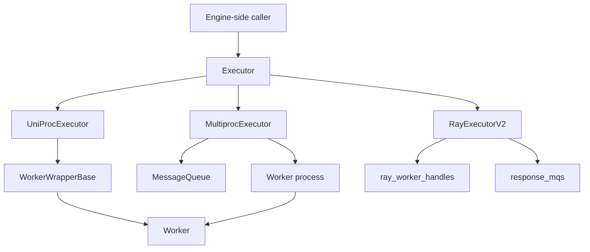
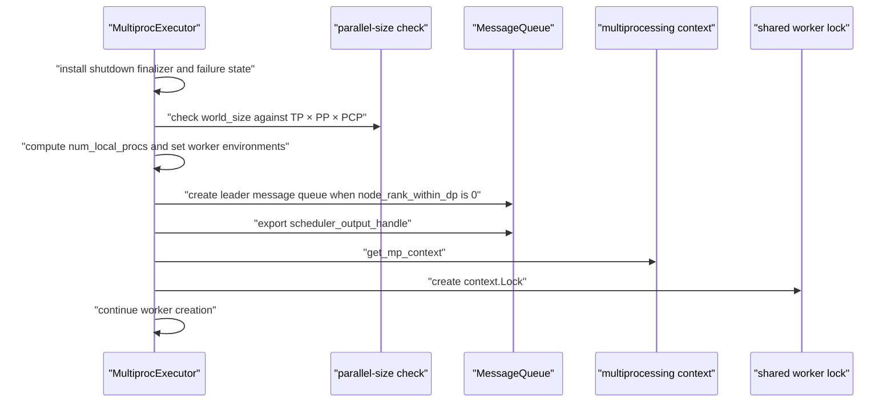
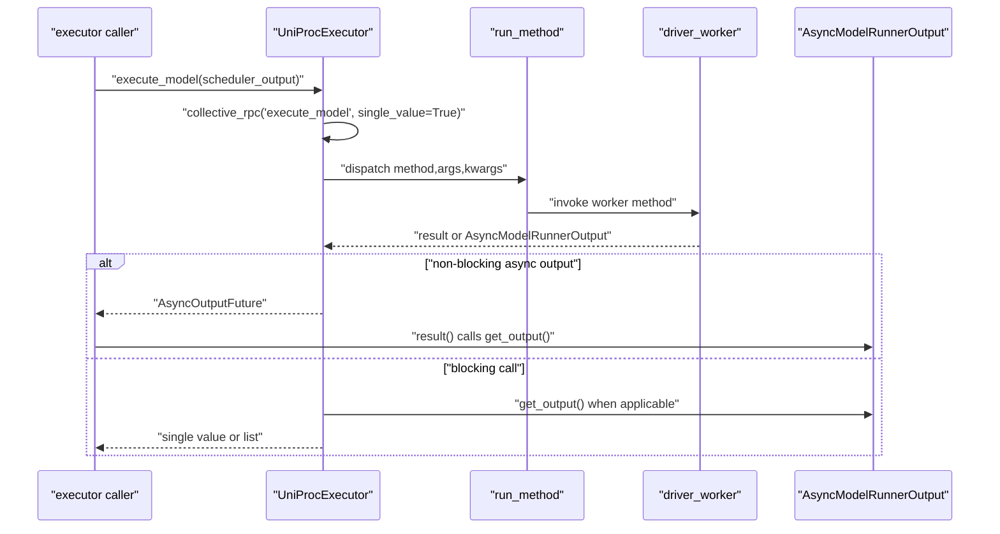
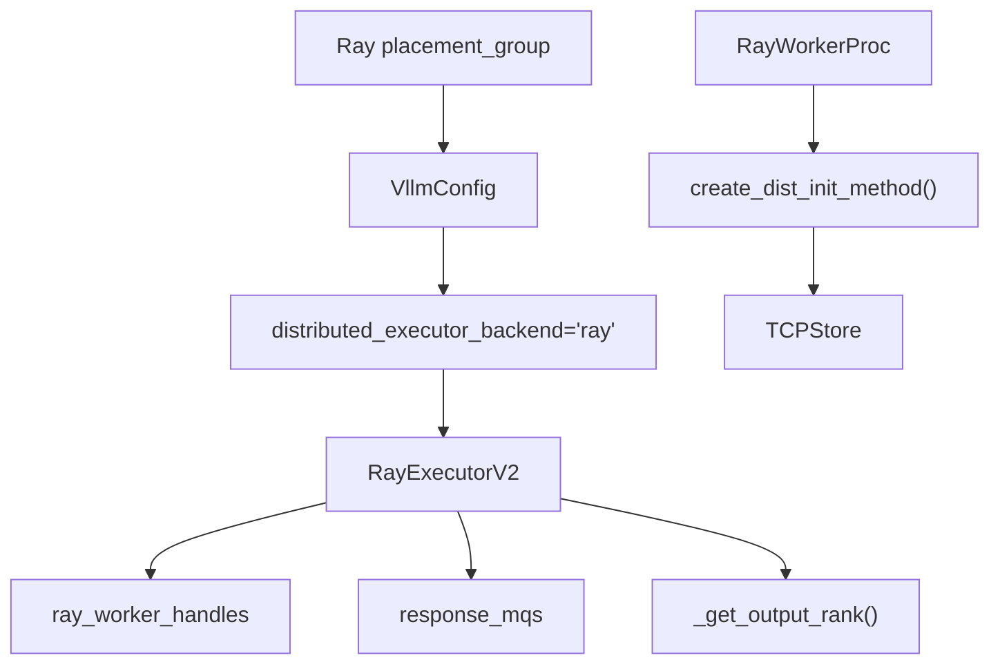
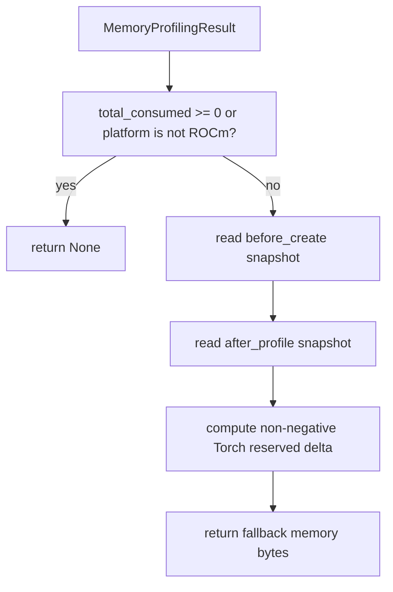

<!-- source: DeepWiki mcp.deepwiki.com · repo vllm-project/vllm · page 4.2 Worker and Executor Architecture · fetched 2026-10-28 -->

# Worker and Executor Architecture

Relevant source files

The following files were used as context for generating this wiki page:

- [csrc/cumem_allocator.cpp](csrc/cumem_allocator.cpp)
- [docs/features/sleep_mode.md](docs/features/sleep_mode.md)
- [examples/features/sharded_state/save_sharded_state_offline.py](examples/features/sharded_state/save_sharded_state_offline.py)
- [tests/basic_correctness/memory/cumem/test_cumem.py](tests/basic_correctness/memory/cumem/test_cumem.py)
- [tests/basic_correctness/memory/sleep_mode/test_sleep_mode.py](tests/basic_correctness/memory/sleep_mode/test_sleep_mode.py)
- [tests/distributed/test_multiproc_executor.py](tests/distributed/test_multiproc_executor.py)
- [tests/distributed/test_ray_v2_executor.py](tests/distributed/test_ray_v2_executor.py)
- [tests/model_executor/model_loader/runai_streamer_loader/conftest.py](tests/model_executor/model_loader/runai_streamer_loader/conftest.py)
- [tests/model_executor/model_loader/tensorizer_loader/conftest.py](tests/model_executor/model_loader/tensorizer_loader/conftest.py)
- [tests/model_executor/model_loader/test_sharded_state_loader.py](tests/model_executor/model_loader/test_sharded_state_loader.py)
- [tests/models/language/generation/test_gdn_sleep_wake.py](tests/models/language/generation/test_gdn_sleep_wake.py)
- [tests/test_ray_env_utils.py](tests/test_ray_env_utils.py)
- [tests/utils_/test_network_utils.py](tests/utils_/test_network_utils.py)
- [tests/utils_/test_ray_utils.py](tests/utils_/test_ray_utils.py)
- [tests/v1/executor/test_multiproc_executor.py](tests/v1/executor/test_multiproc_executor.py)
- [tests/v1/worker/test_gpu_worker.py](tests/v1/worker/test_gpu_worker.py)
- [tests/v1/worker/test_gpu_worker_weight_transfer.py](tests/v1/worker/test_gpu_worker_weight_transfer.py)
- [tests/v1/worker/test_sleep_mode_backend.py](tests/v1/worker/test_sleep_mode_backend.py)
- [vllm/device_allocator/__init__.py](vllm/device_allocator/__init__.py)
- [vllm/device_allocator/cumem.py](vllm/device_allocator/cumem.py)
- [vllm/device_allocator/sleep_mode_backend.py](vllm/device_allocator/sleep_mode_backend.py)
- [vllm/device_allocator/xpumem.py](vllm/device_allocator/xpumem.py)
- [vllm/model_executor/model_loader/sharded_state_loader.py](vllm/model_executor/model_loader/sharded_state_loader.py)
- [vllm/utils/network_utils.py](vllm/utils/network_utils.py)
- [vllm/v1/executor/multiproc_executor.py](vllm/v1/executor/multiproc_executor.py)
- [vllm/v1/executor/ray_env_utils.py](vllm/v1/executor/ray_env_utils.py)
- [vllm/v1/executor/ray_executor_v2.py](vllm/v1/executor/ray_executor_v2.py)
- [vllm/v1/executor/uniproc_executor.py](vllm/v1/executor/uniproc_executor.py)
- [vllm/v1/worker/gpu_worker.py](vllm/v1/worker/gpu_worker.py)
- [vllm/v1/worker/lora_model_runner_mixin.py](vllm/v1/worker/lora_model_runner_mixin.py)
- [vllm/v1/worker/startup_plan.py](vllm/v1/worker/startup_plan.py)

## Purpose and Scope

This page describes how vLLM’s v1 executors coordinate worker initialization and execution, and how the GPU `Worker` participates in device setup and memory profiling. It covers `UniProcExecutor` and the visible initialization path for `MultiprocExecutor`; Ray coverage is limited to what the supplied `RayExecutorV2` integration tests establish. [vllm/v1/executor/uniproc_executor.py:51-75](), [vllm/v1/executor/multiproc_executor.py:111-177](), [tests/distributed/test_ray_v2_executor.py:4-7]()

Sources: [vllm/v1/executor/uniproc_executor.py:51-75](), [vllm/v1/executor/multiproc_executor.py:111-177](), [tests/distributed/test_ray_v2_executor.py:4-7]()

---

## Architecture Overview

An executor is the coordination point between engine-side work and worker-side execution. The code shown defines `UniProcExecutor` and `MultiprocExecutor` as `Executor` subclasses. `UniProcExecutor` owns a `WorkerWrapperBase` in-process; `MultiprocExecutor` sets up process-related state and message-queue infrastructure before creating workers. [vllm/v1/executor/uniproc_executor.py:23-27](), [vllm/v1/executor/uniproc_executor.py:51-75](), [vllm/v1/executor/multiproc_executor.py:111-177]()

### Executor and worker entities

This diagram maps execution-topology terms to the concrete entities visible in the supplied files. [vllm/v1/executor/uniproc_executor.py:23-27](), [vllm/v1/executor/uniproc_executor.py:51-75](), [vllm/v1/executor/multiproc_executor.py:31-33](), [vllm/v1/executor/multiproc_executor.py:70-73](), [vllm/v1/worker/gpu_worker.py:105-111]()

**Executor topology and code entities**

Sources: [vllm/v1/executor/uniproc_executor.py:23-27](), [vllm/v1/executor/uniproc_executor.py:51-75](), [vllm/v1/executor/multiproc_executor.py:31-33](), [vllm/v1/executor/multiproc_executor.py:70-73](), [tests/distributed/test_ray_v2_executor.py:80-103]()

### GPU worker responsibilities

The visible `gpu_worker.py` declarations show `Worker` inheriting from `WorkerBase` and importing the configuration, distributed-state, model-loader, platform, memory-profiling, and model-runner components used by its implementation. The supplied excerpt does not include the method bodies that perform device setup or profiling, so those details are described only where directly supported below. [vllm/v1/worker/gpu_worker.py:18-32](), [vllm/v1/worker/gpu_worker.py:69-96](), [vllm/v1/worker/gpu_worker.py:105-111](), [vllm/v1/worker/gpu_worker.py:157-162]()

Sources: [vllm/v1/worker/gpu_worker.py:18-32](), [vllm/v1/worker/gpu_worker.py:69-96](), [vllm/v1/worker/gpu_worker.py:105-111](), [vllm/v1/worker/gpu_worker.py:157-162]()

---

## Executor Coordination

### `UniProcExecutor`

`UniProcExecutor` initializes one `WorkerWrapperBase` with RPC rank 0. It derives a distributed initialization method and local rank, builds the worker initialization arguments, configures the worker network device, then invokes `init_worker()` and `init_device()`. It loads the model directly, or uses `elastic_ep_execute("load_model")` when `VLLM_ELASTIC_EP_SCALE_UP_LAUNCH` is enabled, and updates the block size for the backend afterward. [vllm/v1/executor/uniproc_executor.py:51-75]()

For distributed initialization, `_distributed_args()` chooses a TCP initialization method when `aiter_requires_tcp_store()` is true; otherwise it uses a file-store method. It obtains the local rank from the device configuration, defaulting to zero if the device string does not specify an index. [vllm/v1/executor/uniproc_executor.py:77-88](), [vllm/utils/network_utils.py:149-165]()

`collective_rpc()` calls the requested method on the local wrapper through `run_method()`. In blocking mode it unwraps `AsyncModelRunnerOutput` if returned and packages results according to `single_value`. In non-blocking mode it returns an `AsyncOutputFuture` for asynchronous model output, or a completed future for an ordinary result; exceptions are stored on the future. [vllm/v1/executor/uniproc_executor.py:32-48](), [vllm/v1/executor/uniproc_executor.py:90-117]()

`execute_model()` invokes `collective_rpc("execute_model", ...)` with the scheduler output and requests a single value. In non-blocking mode it immediately calls `result()` when the future is already complete, surfacing an exception early. `sample_tokens()` and `take_draft_token_ids()` are also dispatched through `collective_rpc()`. [vllm/v1/executor/uniproc_executor.py:119-145]()

Sources: [vllm/v1/executor/uniproc_executor.py:32-48](), [vllm/v1/executor/uniproc_executor.py:51-88](), [vllm/v1/executor/uniproc_executor.py:90-145](), [vllm/utils/network_utils.py:149-165]()

### `MultiprocExecutor`

`MultiprocExecutor._init_executor()` installs a finalizer that calls `shutdown()`, initializes failure-tracking state, and checks that the world size equals the product of tensor-, pipeline-, and prefill-context-parallel sizes. It computes the number of local processes using `local_world_size` and `data_parallel_size_local`, then configures multiprocessing worker environments. [vllm/v1/executor/multiproc_executor.py:111-137]()

The executor selects a distributed initialization method based on whether AITER requires a TCP store. On the data-parallel leader node, it creates a `MessageQueue` sized with world and local-world sizes, configured chunk size, connection IP, and shared-memory tensor-arena setting, then exports a handle for the scheduler-output path. It obtains a multiprocessing context and creates a shared worker lock before proceeding with worker creation. [vllm/v1/executor/multiproc_executor.py:138-177]()

The available excerpt ends during process setup. It does not show the complete worker-spawn, readiness, RPC, output aggregation, or shutdown flows; those details are therefore not inferred here. [vllm/v1/executor/multiproc_executor.py:172-182]()

**Multiprocess initialization: visible coordination path**

Sources: [vllm/v1/executor/multiproc_executor.py:118-177]()

### Uniproc execution data flow

This diagram connects scheduler-facing executor methods to the concrete local wrapper dispatch path. It is limited to calls shown in `uniproc_executor.py`. [vllm/v1/executor/uniproc_executor.py:90-145]()

**`UniProcExecutor` RPC and execution path**

Sources: [vllm/v1/executor/uniproc_executor.py:32-48](), [vllm/v1/executor/uniproc_executor.py:90-132]()

---

## Ray Executors

### `RayExecutorV2`

The supplied integration tests establish that `RayExecutorV2` is created from a `VllmConfig` configured with `distributed_executor_backend="ray"`. The tests check its `world_size`, `ray_worker_handles`, `response_mqs`, output rank, health state, and worker ranks. When pipeline parallelism is greater than one, they also check `max_concurrent_batches` against pipeline size and the configured async-scheduling/model-runner condition. [tests/distributed/test_ray_v2_executor.py:32-53](), [tests/distributed/test_ray_v2_executor.py:80-107]()

The tests exercise tensor- and pipeline-parallel combinations, and can supply an external Ray placement group. They also test that the rank-0 worker’s distributed initialization method uses a TCPStore port that remains held, and that colocated rank-0 stores receive distinct ports. These are test-established behaviors, not a complete description of the Ray executor implementation. [tests/distributed/test_ray_v2_executor.py:61-77](), [tests/distributed/test_ray_v2_executor.py:109-159](), [tests/distributed/test_ray_v2_executor.py:161-191]()

### Ray v1

The provided Ray v1 executor source could not be read, so this page does not characterize its implementation or compare its internals with `RayExecutorV2`. The supplied tests specifically identify `RayExecutorV2` as their subject. [tests/distributed/test_ray_v2_executor.py:4-7]()

**Ray v2 test-visible entities**

Sources: [tests/distributed/test_ray_v2_executor.py:24-53](), [tests/distributed/test_ray_v2_executor.py:61-77](), [tests/distributed/test_ray_v2_executor.py:80-103](), [tests/distributed/test_ray_v2_executor.py:109-159]()

---

## GPU Worker Initialization and Device Management

The `gpu_worker.py` excerpt identifies `WorkerBase` as the base class imported for the GPU worker and `WorkerSentinel` as a worker-monitoring component. It also imports the distributed initialization and model-parallel initialization helpers, platform abstraction, model loader, workspace manager, and both GPU model-runner implementations. The excerpt does not expose the `Worker` class body or its initialization methods, so the exact call order and device-selection behavior cannot be established from the supplied lines. [vllm/v1/worker/gpu_worker.py:27-32](), [vllm/v1/worker/gpu_worker.py:69-76](), [vllm/v1/worker/gpu_worker.py:105-116](), [vllm/v1/worker/gpu_worker.py:157-162]()

At the executor boundary, the uniprocess path supplies `local_rank`, global `rank`, distributed initialization method, driver-worker status, and a shared lock to `init_worker()`, then calls `init_device()` before model loading. [vllm/v1/executor/uniproc_executor.py:54-69]()

Sources: [vllm/v1/worker/gpu_worker.py:27-32](), [vllm/v1/worker/gpu_worker.py:69-76](), [vllm/v1/worker/gpu_worker.py:105-116](), [vllm/v1/worker/gpu_worker.py:157-162](), [vllm/v1/executor/uniproc_executor.py:54-75]()

---

## Memory Profiling and KV Cache Sizing

The GPU worker module imports `MemoryProfilingResult`, `MemorySnapshot`, and `memory_profiling`, as well as the `KVCacheConfig` and `KVCacheSpec` types. The supplied excerpt includes a ROCm fallback function, `maybe_rocm_profiling_fallback()`, that returns no override unless the measured total consumption is negative on ROCm. In that exceptional case it computes a non-negative process-local Torch-reserved-memory delta, logs the profiling discrepancy, and returns that value as a fallback sizing basis. [vllm/v1/worker/gpu_worker.py:89-98](), [vllm/v1/worker/gpu_worker.py:130-155]()

This fallback addresses a measurement where free device memory increases during profiling. Its docstring explains that Torch-reserved memory is process-local and is used as a lower bound rather than refusing startup in this ROCm case. The function itself does not show the full profiling sequence or how the resulting value is ultimately applied to the KV cache. [vllm/v1/worker/gpu_worker.py:130-155]()

**ROCm profiling fallback decision**

Sources: [vllm/v1/worker/gpu_worker.py:130-155]()

---

## Allocator and Sleep-Mode Context

`CuMemAllocator` is documented as a singleton managing a CUDA tensor memory pool that can offload or discard tagged allocations during sleep. Its documented `sleep` behavior offloads tensors with the selected tag to CPU memory and discards other pool tensors; `wake_up` reloads previously offloaded tensors, while other tensors have empty memory (zeroed on ROCm). The allocator requires a singleton because its C extension stores callbacks globally. [vllm/device_allocator/cumem.py:88-109]()

`get_instance()` checks that the allocator is available, lazily constructs the singleton, and registers shutdown cleanup with `atexit`. `use_memory_pool_with_allocator()` creates a pluggable allocator and memory pool, enters PyTorch’s `use_mem_pool()` context, and yields both objects. [vllm/device_allocator/cumem.py:64-85](), [vllm/device_allocator/cumem.py:115-127]()

The integration tests exercise `LLM.sleep()` and `LLM.wake_up()` across sleep levels and tags, and compare generated text before and after waking. These tests establish the tested API behavior, not the full worker-side sleep implementation. [tests/basic_correctness/memory/sleep_mode/test_sleep_mode.py:36-64](), [tests/basic_correctness/memory/sleep_mode/test_sleep_mode.py:83-112]()

Sources: [vllm/device_allocator/cumem.py:64-109](), [vllm/device_allocator/cumem.py:115-127](), [tests/basic_correctness/memory/sleep_mode/test_sleep_mode.py:36-64](), [tests/basic_correctness/memory/sleep_mode/test_sleep_mode.py:83-112]()

---

## Weight Transfer Delegation

The GPU worker weight-transfer tests describe the worker as delegating transport and update operations to a configured weight-transfer engine while tracking whether an update session is active. The tests exercise `start_weight_update()`, `update_weights()`, and `finish_weight_update()`, including rank-local payload selection and rejection of shutdown during an active update. [tests/v1/worker/test_gpu_worker_weight_transfer.py:3-8](), [tests/v1/worker/test_gpu_worker_weight_transfer.py:127-145](), [tests/v1/worker/test_gpu_worker_weight_transfer.py:147-195]()

The tests also verify that `reload_weights()` runs with the worker’s current `VllmConfig`, and that finishing an update resets the engine’s update target and the model runner’s LoRA state. These details describe the tested contract; the supplied worker implementation excerpt does not include the corresponding method bodies. [tests/v1/worker/test_gpu_worker_weight_transfer.py:82-90](), [tests/v1/worker/test_gpu_worker_weight_transfer.py:127-145]()

Sources: [tests/v1/worker/test_gpu_worker_weight_transfer.py:3-8](), [tests/v1/worker/test_gpu_worker_weight_transfer.py:82-90](), [tests/v1/worker/test_gpu_worker_weight_transfer.py:127-195]()

---

## Summary

`UniProcExecutor` initializes and dispatches to one local `WorkerWrapperBase`, with synchronous or future-based result handling. `MultiprocExecutor` validates parallel world-size consistency, establishes local process configuration, and creates leader message-queue state before worker creation. [vllm/v1/executor/uniproc_executor.py:51-75](), [vllm/v1/executor/uniproc_executor.py:90-132](), [vllm/v1/executor/multiproc_executor.py:118-177]()

The available GPU worker excerpt establishes its dependencies on distributed setup, model loading, platform handling, memory profiling, and model-runner components, and shows a ROCm-specific memory-profiling fallback. Ray v2 behavior documented here is limited to its integration-test-visible interface and scenarios. [vllm/v1/worker/gpu_worker.py:27-32](), [vllm/v1/worker/gpu_worker.py:69-96](), [vllm/v1/worker/gpu_worker.py:130-155](), [tests/distributed/test_ray_v2_executor.py:80-103]()

Sources: [vllm/v1/executor/uniproc_executor.py:51-75](), [vllm/v1/executor/uniproc_executor.py:90-132](), [vllm/v1/executor/multiproc_executor.py:118-177](), [vllm/v1/worker/gpu_worker.py:27-32](), [vllm/v1/worker/gpu_worker.py:69-96](), [vllm/v1/worker/gpu_worker.py:130-155](), [tests/distributed/test_ray_v2_executor.py:80-103]()

---

