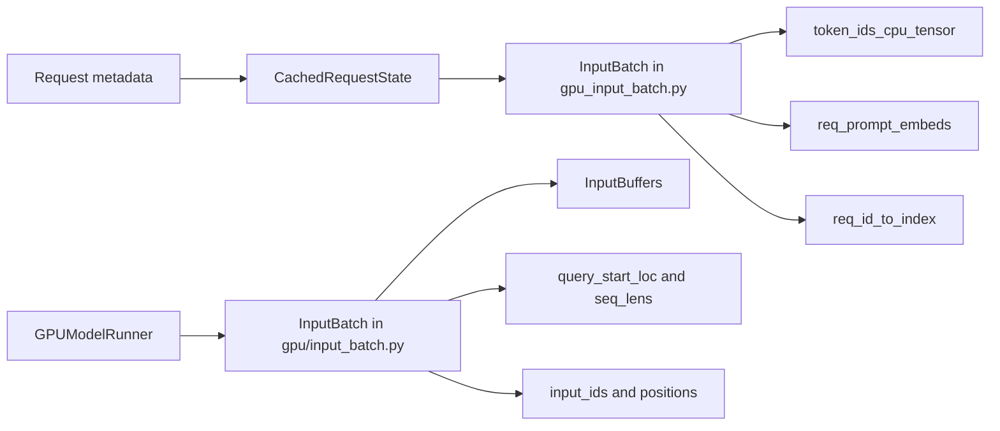
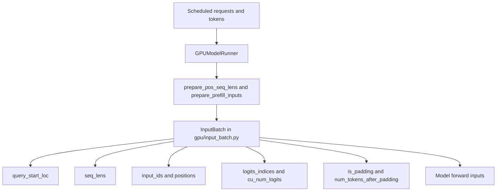
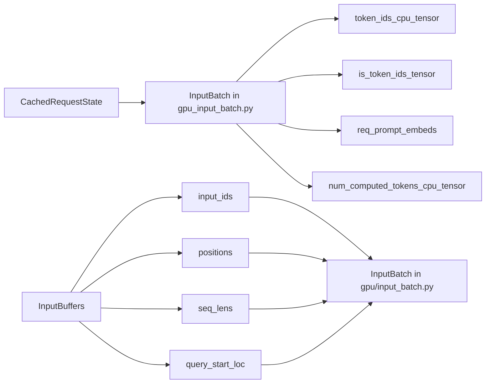

<!-- source: DeepWiki mcp.deepwiki.com · repo vllm-project/vllm · page 4.3 InputBatch and Request State Management · fetched 2026-10-28 -->

# InputBatch and Request State Management

Relevant source files

The following files were used as context for generating this wiki page:

- [docs/features/reasoning_outputs.md](docs/features/reasoning_outputs.md)
- [tests/entrypoints/openai/chat_completion/test_completion_with_function_calling.py](tests/entrypoints/openai/chat_completion/test_completion_with_function_calling.py)
- [tests/entrypoints/openai/chat_completion/test_thinking_token_budget.py](tests/entrypoints/openai/chat_completion/test_thinking_token_budget.py)
- [tests/entrypoints/openai/test_tool_choice_content_none.py](tests/entrypoints/openai/test_tool_choice_content_none.py)
- [tests/parser/__init__.py](tests/parser/__init__.py)
- [tests/parser/engine/test_nemotron_v3.py](tests/parser/engine/test_nemotron_v3.py)
- [tests/parser/test_include_reasoning.py](tests/parser/test_include_reasoning.py)
- [tests/parser/test_parse.py](tests/parser/test_parse.py)
- [tests/parser/test_streaming.py](tests/parser/test_streaming.py)
- [tests/v1/cudagraph/test_cudagraph_manager.py](tests/v1/cudagraph/test_cudagraph_manager.py)
- [tests/v1/logits_processors/test_correctness.py](tests/v1/logits_processors/test_correctness.py)
- [tests/v1/logits_processors/test_loader.py](tests/v1/logits_processors/test_loader.py)
- [tests/v1/sample/test_batched_count_greater_than.py](tests/v1/sample/test_batched_count_greater_than.py)
- [tests/v1/sample/test_thinking_budget_state.py](tests/v1/sample/test_thinking_budget_state.py)
- [tests/v1/sample/utils.py](tests/v1/sample/utils.py)
- [tests/v1/spec_decode/test_dynamic_sd_cug.py](tests/v1/spec_decode/test_dynamic_sd_cug.py)
- [tests/v1/spec_decode/test_eagle_draft_attn_metadata.py](tests/v1/spec_decode/test_eagle_draft_attn_metadata.py)
- [tests/v1/worker/test_gpu_batch_ordering.py](tests/v1/worker/test_gpu_batch_ordering.py)
- [tests/v1/worker/test_gpu_input_batch.py](tests/v1/worker/test_gpu_input_batch.py)
- [tests/v1/worker/test_gpu_model_runner_v2.py](tests/v1/worker/test_gpu_model_runner_v2.py)
- [tests/v1/worker/test_gpu_model_runner_v2_cudagraph_profiling.py](tests/v1/worker/test_gpu_model_runner_v2_cudagraph_profiling.py)
- [tests/v1/worker/test_gpu_model_runner_v2_eplb.py](tests/v1/worker/test_gpu_model_runner_v2_eplb.py)
- [tests/v1/worker/test_gpu_pcp_manager.py](tests/v1/worker/test_gpu_pcp_manager.py)
- [tests/v1/worker/test_gpu_ubatch_slicing.py](tests/v1/worker/test_gpu_ubatch_slicing.py)
- [tests/v1/worker/test_workspace.py](tests/v1/worker/test_workspace.py)
- [vllm/config/reasoning.py](vllm/config/reasoning.py)
- [vllm/model_executor/layers/pooler/common.py](vllm/model_executor/layers/pooler/common.py)
- [vllm/model_executor/models/diffusion_gemma.py](vllm/model_executor/models/diffusion_gemma.py)
- [vllm/v1/attention/ops/pcp.py](vllm/v1/attention/ops/pcp.py)
- [vllm/v1/sample/logits_processor/__init__.py](vllm/v1/sample/logits_processor/__init__.py)
- [vllm/v1/sample/logits_processor/builtin.py](vllm/v1/sample/logits_processor/builtin.py)
- [vllm/v1/sample/metadata.py](vllm/v1/sample/metadata.py)
- [vllm/v1/sample/ops/logprobs.py](vllm/v1/sample/ops/logprobs.py)
- [vllm/v1/sample/sampler.py](vllm/v1/sample/sampler.py)
- [vllm/v1/sample/thinking_budget_state.py](vllm/v1/sample/thinking_budget_state.py)
- [vllm/v1/worker/cp_utils.py](vllm/v1/worker/cp_utils.py)
- [vllm/v1/worker/dp_utils.py](vllm/v1/worker/dp_utils.py)
- [vllm/v1/worker/gpu/attn_utils.py](vllm/v1/worker/gpu/attn_utils.py)
- [vllm/v1/worker/gpu/cp_utils.py](vllm/v1/worker/gpu/cp_utils.py)
- [vllm/v1/worker/gpu/cudagraph_utils.py](vllm/v1/worker/gpu/cudagraph_utils.py)
- [vllm/v1/worker/gpu/dp_utils.py](vllm/v1/worker/gpu/dp_utils.py)
- [vllm/v1/worker/gpu/eplb_utils.py](vllm/v1/worker/gpu/eplb_utils.py)
- [vllm/v1/worker/gpu/input_batch.py](vllm/v1/worker/gpu/input_batch.py)
- [vllm/v1/worker/gpu/model_runner.py](vllm/v1/worker/gpu/model_runner.py)
- [vllm/v1/worker/gpu/model_states/__init__.py](vllm/v1/worker/gpu/model_states/__init__.py)
- [vllm/v1/worker/gpu/model_states/default.py](vllm/v1/worker/gpu/model_states/default.py)
- [vllm/v1/worker/gpu/model_states/encoder_decoder.py](vllm/v1/worker/gpu/model_states/encoder_decoder.py)
- [vllm/v1/worker/gpu/model_states/encoder_only.py](vllm/v1/worker/gpu/model_states/encoder_only.py)
- [vllm/v1/worker/gpu/model_states/interface.py](vllm/v1/worker/gpu/model_states/interface.py)
- [vllm/v1/worker/gpu/pcp_manager.py](vllm/v1/worker/gpu/pcp_manager.py)
- [vllm/v1/worker/gpu/spec_decode/dflash/cudagraph.py](vllm/v1/worker/gpu/spec_decode/dflash/cudagraph.py)
- [vllm/v1/worker/gpu/spec_decode/dflash/speculator.py](vllm/v1/worker/gpu/spec_decode/dflash/speculator.py)
- [vllm/v1/worker/gpu/spec_decode/eagle/speculator.py](vllm/v1/worker/gpu/spec_decode/eagle/speculator.py)
- [vllm/v1/worker/gpu/spec_decode/extract_hidden_states.py](vllm/v1/worker/gpu/spec_decode/extract_hidden_states.py)
- [vllm/v1/worker/gpu/spec_decode/multi_module_mtp/speculator.py](vllm/v1/worker/gpu/spec_decode/multi_module_mtp/speculator.py)
- [vllm/v1/worker/gpu/spec_decode/speculator.py](vllm/v1/worker/gpu/spec_decode/speculator.py)
- [vllm/v1/worker/gpu/spec_decode/standalone_ar/speculator.py](vllm/v1/worker/gpu/spec_decode/standalone_ar/speculator.py)
- [vllm/v1/worker/gpu/spec_decode/target_dependent_ar/speculator.py](vllm/v1/worker/gpu/spec_decode/target_dependent_ar/speculator.py)
- [vllm/v1/worker/gpu/states.py](vllm/v1/worker/gpu/states.py)
- [vllm/v1/worker/gpu/ubatch_utils.py](vllm/v1/worker/gpu/ubatch_utils.py)
- [vllm/v1/worker/gpu_input_batch.py](vllm/v1/worker/gpu_input_batch.py)

## Purpose and scope

This page explains the request and batch data structures used by the V1 GPU worker, how per-request state relates to the batch prepared for execution, and how KV block-table and execution-shape concerns fit into that flow. The primary focus is `CachedRequestState` and `InputBatch` in `vllm/v1/worker/gpu_input_batch.py`; the distinct GPU-runner batch representation in `vllm/v1/worker/gpu/input_batch.py` is also covered where its fields are visible. [vllm/v1/worker/gpu_input_batch.py:34-90](), [vllm/v1/worker/gpu/input_batch.py:19-124]()

Sources: [vllm/v1/worker/gpu_input_batch.py:34-90](), [vllm/v1/worker/gpu/input_batch.py:19-124]()

## Core data structures

### `CachedRequestState`

`CachedRequestState` stores persistent metadata for an individual request. Its fields include request identity, prompt and output token data, multimodal features, sampling and pooling parameters, KV block IDs, computed-token progress, and optional request-specific state such as prompt embeddings, LoRA metadata, and prompt-logprob accumulation. [vllm/v1/worker/gpu_input_batch.py:34-63]()

On initialization, `__post_init__` derives `num_prompt_tokens` from the available prompt token IDs or prompt embeddings. If pooling parameters are present, it initializes `pooling_states`. The `num_tokens` property returns prompt length plus output-token count. `get_token_id` reads from prompt IDs or generated output IDs; if a requested prompt position was supplied only as embeddings, it raises an error because that token ID is unknown. [vllm/v1/worker/gpu_input_batch.py:65-87]()

| Field or helper | Role |
|---|---|
| `req_id` | Request identifier. [vllm/v1/worker/gpu_input_batch.py:34-36]() |
| `prompt_token_ids`, `prompt_embeds`, `mm_features` | Prompt content and multimodal input metadata. Prompt content can be represented by token IDs or embeddings. [vllm/v1/worker/gpu_input_batch.py:36-47]() |
| `output_token_ids`, `num_computed_tokens` | Generated output history and computed-token progress. [vllm/v1/worker/gpu_input_batch.py:42-44]() |
| `block_ids` | Per-group KV block IDs, represented as a tuple of integer lists. [vllm/v1/worker/gpu_input_batch.py:42-44]() |
| `sampling_params`, `generator` | Sampling configuration and optional PyTorch generator. [vllm/v1/worker/gpu_input_batch.py:38-40]() |
| `mrope_positions`, `mrope_position_delta` | Optional request-level positional state. [vllm/v1/worker/gpu_input_batch.py:46-47]() |
| `lora_request`, `in_progress_prompt_logprobs_cpu` | Optional adapter state and accumulated prompt-logprob chunks. [vllm/v1/worker/gpu_input_batch.py:49-52]() |
| `prompt_is_token_ids`, `prev_num_draft_len` | Mixed token/embedding prompt mask and speculative-decoding-related state. [vllm/v1/worker/gpu_input_batch.py:54-59]() |
| `pooling_params`, `pooling_states` | Optional pooling configuration and runtime state. [vllm/v1/worker/gpu_input_batch.py:61-63]() |
| `num_prompt_tokens`, `num_tokens`, `get_token_id` | Derived prompt length, total request length, and token lookup helpers. [vllm/v1/worker/gpu_input_batch.py:65-87]() |

Sources: [vllm/v1/worker/gpu_input_batch.py:34-87]()

### `InputBatch`: request-oriented batch storage

The `InputBatch` in `vllm/v1/worker/gpu_input_batch.py` is a long-lived, capacity-bounded container for request-indexed state. It is initialized with limits such as `max_num_reqs`, `max_model_len`, and `max_num_batched_tokens`, as well as device, vocabulary, KV block-size, and optional feature configuration. It maintains request IDs and an ID-to-index map. [vllm/v1/worker/gpu_input_batch.py:90-125]()

The visible initialization code creates CPU-side storage for token IDs and token-versus-embedding flags, a dictionary for prompt embeddings keyed by request index, and arrays/tensors for token counts and computed-token counts. The token and mask tensors are CPU-resident; prompt embeddings are stored per request rather than in one maximum-sized prompt-embedding allocation. [vllm/v1/worker/gpu_input_batch.py:127-169]()

| Storage | Shape or mapping | Purpose |
|---|---|---|
| `_req_ids`, `req_id_to_index` | Request-indexed list and ID-to-index dictionary. [vllm/v1/worker/gpu_input_batch.py:124-125]() | Associate request IDs with batch slots. |
| `token_ids_cpu_tensor`, `is_token_ids_tensor` | `(max_num_reqs, max_model_len)`. [vllm/v1/worker/gpu_input_batch.py:131-144]() | Store CPU token values and identify positions represented by token IDs. |
| `req_prompt_embeds` | `req_index -> tensor`. [vllm/v1/worker/gpu_input_batch.py:145-148]() | Keep prompt embeddings on a per-request basis. |
| `num_tokens_no_spec`, `num_prompt_tokens`, `num_computed_tokens_cpu` | Per-request arrays backed by CPU tensors. [vllm/v1/worker/gpu_input_batch.py:149-169]() | Track request token counts and computed-token progress. |

Sources: [vllm/v1/worker/gpu_input_batch.py:90-169]()

### `InputBatch`: GPU execution-step representation

`vllm/v1/worker/gpu/input_batch.py` defines another `InputBatch` with a different role: it describes a particular execution batch. It contains the scheduled request IDs and counts, maps batch positions to request-state indices, tracks scheduled tokens and token totals, and carries per-step sequence and query metadata. Its fields also include token inputs, positions, padding flags, logits indices, and flags for structured-output and prefill/decode handling. [vllm/v1/worker/gpu/input_batch.py:38-124]()

`InputBuffers` owns reusable device buffers for token IDs, positions, padding flags, query-start locations, sequence lengths, and DCP-local sequence lengths. `InputBatch.make_dummy` constructs a dummy batch using those buffers; the visible implementation creates synthetic request IDs and sets up a token distribution and sequence/query metadata for the requested dummy shape. [vllm/v1/worker/gpu/input_batch.py:19-35](), [vllm/v1/worker/gpu/input_batch.py:126-172]()

This distinction matters when reading call sites: `GPUModelRunner` imports `InputBatch`, `InputBuffers`, and batch-preparation helpers from `vllm.v1.worker.gpu.input_batch`, while the `CachedRequestState` definition and request-oriented `InputBatch` are in `vllm.v1.worker.gpu_input_batch`. [vllm/v1/worker/gpu/model_runner.py:120-130](), [vllm/v1/worker/gpu_input_batch.py:34-90]()

Sources: [vllm/v1/worker/gpu/input_batch.py:19-35](), [vllm/v1/worker/gpu/input_batch.py:38-124](), [vllm/v1/worker/gpu/input_batch.py:126-172](), [vllm/v1/worker/gpu/model_runner.py:120-130]()

### From request state to execution batch

The following diagram links the request-level concepts to the code entities that represent them. It shows the two `InputBatch` definitions separately to avoid treating request storage and per-step execution metadata as the same object. [vllm/v1/worker/gpu_input_batch.py:34-90](), [vllm/v1/worker/gpu_input_batch.py:90-169](), [vllm/v1/worker/gpu/input_batch.py:38-124](), [vllm/v1/worker/gpu/model_runner.py:120-130]()

**Diagram: Request state and GPU execution batch code entities**

Sources: [vllm/v1/worker/gpu_input_batch.py:34-90](), [vllm/v1/worker/gpu_input_batch.py:90-169](), [vllm/v1/worker/gpu/input_batch.py:19-124](), [vllm/v1/worker/gpu/model_runner.py:120-130]()

## Block tables and KV-cache indexing

### Block-table relationship to request and batch state

The request-oriented `CachedRequestState.block_ids` records KV block IDs as a tuple of lists, with the tuple structure allowing multiple KV cache groups. [vllm/v1/worker/gpu_input_batch.py:42-44]() The GPU execution code imports `BlockTables` from `vllm.v1.worker.gpu.block_table`, and attention utilities expose `build_slot_mappings_by_layer`, which is imported by the model runner and used in the attention utility layer. [vllm/v1/worker/gpu/model_runner.py:98-105](), [vllm/v1/worker/gpu/attn_utils.py:98-104]()

The provided code excerpt does not include the implementation of `BlockTables` or the block-table update methods. Therefore, this page limits the description to the visible interfaces and relationships: request state carries block IDs, the runner has a `BlockTables` dependency, and attention preparation has a slot-mapping construction utility. [vllm/v1/worker/gpu_input_batch.py:42-44](), [vllm/v1/worker/gpu/model_runner.py:98-105](), [vllm/v1/worker/gpu/attn_utils.py:98-104]()

Sources: [vllm/v1/worker/gpu_input_batch.py:42-44](), [vllm/v1/worker/gpu/model_runner.py:98-105](), [vllm/v1/worker/gpu/attn_utils.py:98-104]()

### Block tables in context/parallel execution

`PCPManager` describes a flow in which the runner keeps the global scheduled batch while the manager rewrites a per-step `InputBatch` into rank-local rows, retaining a global-batch view for restoration before sampling and postprocessing. It can attach `BlockTables`; when tables are present, it creates local table tensors corresponding to the input block tables and allocates global and gathered slot-mapping buffers per KV-cache group. [vllm/v1/worker/gpu/pcp_manager.py:38-45](), [vllm/v1/worker/gpu/pcp_manager.py:94-139]()

This shows why block tables and batch indexing must be considered together: the per-step request layout may be transformed for local execution, while the block-table and slot-mapping data must be available in compatible global or local shapes. The excerpt documents the allocated structures, but not the later operations that populate or consume them. [vllm/v1/worker/gpu/pcp_manager.py:69-76](), [vllm/v1/worker/gpu/pcp_manager.py:94-139]()

Sources: [vllm/v1/worker/gpu/pcp_manager.py:38-45](), [vllm/v1/worker/gpu/pcp_manager.py:69-76](), [vllm/v1/worker/gpu/pcp_manager.py:94-139]()

## GPUModelRunner and batched execution state

`GPUModelRunner` imports the execution-step `InputBatch` and `InputBuffers` together with helpers for token combination, index mapping, post-update processing, position/sequence-length preparation, prefill preparation, and dummy context setup. This import boundary identifies the runner’s batch-preparation dependencies; the provided excerpt does not show the corresponding call sites or the full request-update lifecycle. [vllm/v1/worker/gpu/model_runner.py:120-130]()

The execution-step batch carries both host-side scheduling facts and device tensors needed for a forward pass. Its fields distinguish scheduled-token counts and total token counts from padded counts, and include `query_start_loc`, `seq_lens`, token positions, padding markers, and logits-selection metadata. [vllm/v1/worker/gpu/input_batch.py:38-99]()

**Diagram: Scheduled-batch concepts mapped to execution code**

Sources: [vllm/v1/worker/gpu/model_runner.py:120-130](), [vllm/v1/worker/gpu/input_batch.py:38-99]()

### Batch shape and CUDA graph descriptors

`BatchExecutionDescriptor` records execution shape and CUDA graph mode, including token count, optional request count, optional uniform token count, optional maximum query length, active LoRA count, and microbatch count. Its documentation describes matching runtime shapes to captured graph shapes. [vllm/v1/worker/gpu/cudagraph_utils.py:70-86]()

The compatibility check allows a descriptor to match only when its configured shape constraints accommodate the runtime request/token counts and other tracked dimensions. For example, it checks token count, request count when constrained, active LoRA count, microbatch count, and optional query-length and uniform-token-count conditions. [vllm/v1/worker/gpu/cudagraph_utils.py:111-138]()

`InputBatch.make_dummy` supplies synthetic batch metadata for a requested number of requests and tokens, distributing tokens across dummy requests and populating sequence lengths and query-start locations. The method’s documented intent includes dummy execution shapes used in graph-related paths; it also accepts `max_query_len` and a padding flag. [vllm/v1/worker/gpu/input_batch.py:126-172]()

Sources: [vllm/v1/worker/gpu/cudagraph_utils.py:70-86](), [vllm/v1/worker/gpu/cudagraph_utils.py:111-138](), [vllm/v1/worker/gpu/input_batch.py:126-172]()

### Model-specific request state

`ModelState` provides hooks for adding and removing request-specific model state, applying staged writes, initializing KV cache, preprocessing state before a forward pass, and postprocessing state. Its `preprocess_state` hook is documented as running on real batches before the forward pass, after block tables are gathered. [vllm/v1/worker/gpu/model_states/interface.py:121-173]()

`DefaultModelState` implements request handling for optional RoPE and prompt-embedding state. On request addition it initializes prefill positions when RoPE state exists and adds prompt-embedding state when enabled; on removal it forwards the removal to prompt-embedding state. During input preparation it reads the execution batch’s unpadded token IDs and can prepare embeddings from model token embeddings or multimodal embeddings. [vllm/v1/worker/gpu/model_states/default.py:67-92](), [vllm/v1/worker/gpu/model_states/default.py:100-133]()

Sources: [vllm/v1/worker/gpu/model_states/interface.py:121-173](), [vllm/v1/worker/gpu/model_states/default.py:67-92](), [vllm/v1/worker/gpu/model_states/default.py:100-133]()

## CPU and device buffer organization

`InputBuffers` allocates device-resident reusable tensors for token IDs, positions, padding flags, query-start locations, sequence lengths, and DCP-local sequence lengths. The corresponding `InputBatch` stores views or references to the active portions of those buffers alongside batch counts and CPU-side NumPy metadata. [vllm/v1/worker/gpu/input_batch.py:19-35](), [vllm/v1/worker/gpu/input_batch.py:65-99]()

The request-oriented `InputBatch` has a different storage pattern: token IDs and mixed-input flags are CPU tensors with NumPy views, while per-request prompt embeddings are held in a dictionary. Some count tensors are allocated with `PIN_MEMORY`; the token-ID and mixed-input tensors shown in the excerpt explicitly use `pin_memory=False`. [vllm/v1/worker/gpu_input_batch.py:127-169]()

**Diagram: Separate storage layers**

Sources: [vllm/v1/worker/gpu_input_batch.py:127-169](), [vllm/v1/worker/gpu/input_batch.py:19-35](), [vllm/v1/worker/gpu/input_batch.py:65-99]()

## Prompt tokens, embeddings, and multimodal inputs

The request-level representation supports prompt token IDs, prompt embeddings, and multimodal feature specifications. `CachedRequestState` calculates prompt length from token IDs or embeddings; `get_token_id` can return token IDs only when those IDs exist for the requested prompt position. [vllm/v1/worker/gpu_input_batch.py:36-47](), [vllm/v1/worker/gpu_input_batch.py:65-87]()

The request-oriented `InputBatch` stores token-ID values and a per-position boolean mask indicating whether prompt positions are token IDs, while keeping prompt-embedding tensors in `req_prompt_embeds`. The default model state prepares the execution batch’s inputs using unpadded token IDs; for multimodal models it executes scheduled encoder inputs and gathers multimodal embeddings before producing model embeddings. [vllm/v1/worker/gpu_input_batch.py:131-148](), [vllm/v1/worker/gpu/model_states/default.py:100-133]()

Sources: [vllm/v1/worker/gpu_input_batch.py:36-47](), [vllm/v1/worker/gpu_input_batch.py:65-87](), [vllm/v1/worker/gpu_input_batch.py:131-148](), [vllm/v1/worker/gpu/model_states/default.py:100-133]()

## Reasoning and speculative-decoding state

The request-oriented `InputBatch` can initialize a thinking-budget state holder when a `ReasoningConfig` is supplied, and tracks request IDs associated with thinking-token budgets. The visible constructor also accepts a speculative-token count, which is passed when creating that state holder. [vllm/v1/worker/gpu_input_batch.py:90-116]()

Speculative-decoding interfaces consume the GPU execution batch directly: `BaseSpeculator.propose` accepts an `InputBatch` together with attention metadata, slot mappings, hidden states, sampled/rejected counts, and other drafting inputs. `DraftModelSpeculator` allocates its own `InputBuffers` using the configured maximum request and token capacities. [vllm/v1/worker/gpu/spec_decode/speculator.py:61-103](), [vllm/v1/worker/gpu/spec_decode/speculator.py:106-154]()

Sources: [vllm/v1/worker/gpu_input_batch.py:90-116](), [vllm/v1/worker/gpu/spec_decode/speculator.py:61-103](), [vllm/v1/worker/gpu/spec_decode/speculator.py:106-154]()

## Summary

`CachedRequestState` represents persistent per-request information, including prompt and output content, block IDs, token progress, and optional model features. The request-oriented `InputBatch` stores request-indexed CPU metadata and prompt embeddings; the GPU execution-step `InputBatch` represents scheduled rows, token inputs, sequence metadata, logits indices, and padding state. These are distinct classes in distinct modules, and the GPU runner imports the execution-step form. [vllm/v1/worker/gpu_input_batch.py:34-90](), [vllm/v1/worker/gpu_input_batch.py:90-169](), [vllm/v1/worker/gpu/input_batch.py:38-124](), [vllm/v1/worker/gpu/model_runner.py:120-130]()

`BlockTables` and slot-mapping utilities connect request block assignments to attention execution. `PCPManager` additionally maintains local block-table and slot-mapping buffers for context-parallel batch transformations. CUDA graph shape matching uses `BatchExecutionDescriptor` to represent the runtime dimensions relevant to replay compatibility. [vllm/v1/worker/gpu_input_batch.py:42-44](), [vllm/v1/worker/gpu/model_runner.py:98-105](), [vllm/v1/worker/gpu/pcp_manager.py:94-139](), [vllm/v1/worker/gpu/cudagraph_utils.py:70-86]()

Sources: [vllm/v1/worker/gpu_input_batch.py:34-90](), [vllm/v1/worker/gpu_input_batch.py:90-169](), [vllm/v1/worker/gpu/input_batch.py:38-124](), [vllm/v1/worker/gpu/model_runner.py:98-130](), [vllm/v1/worker/gpu/pcp_manager.py:94-139](), [vllm/v1/worker/gpu/cudagraph_utils.py:70-86]()

---

