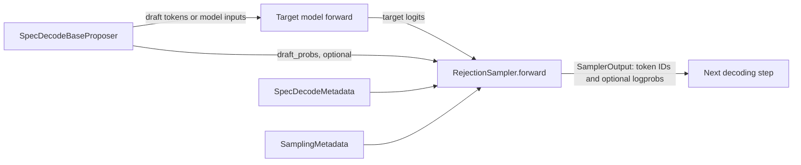
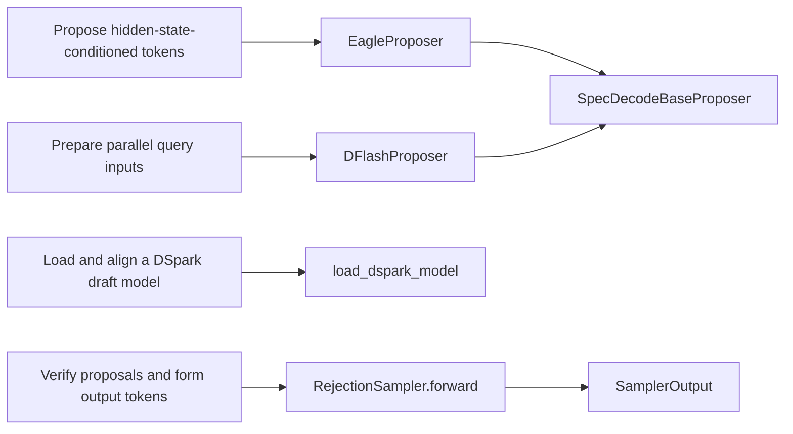
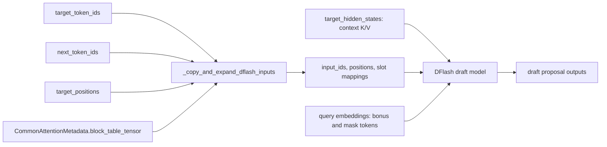
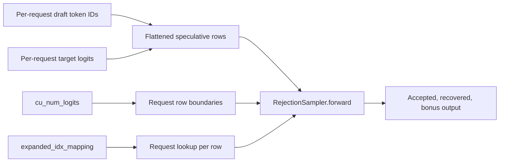
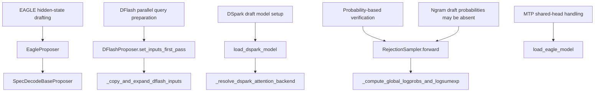

<!-- source: DeepWiki mcp.deepwiki.com · repo vllm-project/vllm · page 4.5 Speculative Decoding · fetched 2026-10-28 -->

# Speculative Decoding

Relevant source files

The following files were used as context for generating this wiki page:

- [csrc/cpu/spec_decode_utils.cpp](csrc/cpu/spec_decode_utils.cpp)
- [docs/features/quantization/quantized_kvcache.md](docs/features/quantization/quantized_kvcache.md)
- [docs/features/speculative_decoding/fly.md](docs/features/speculative_decoding/fly.md)
- [tests/compile/fullgraph/test_basic_correctness.py](tests/compile/fullgraph/test_basic_correctness.py)
- [tests/compile/fullgraph/test_full_graph.py](tests/compile/fullgraph/test_full_graph.py)
- [tests/compile/test_wrapper.py](tests/compile/test_wrapper.py)
- [tests/distributed/test_eplb_spec_decode.py](tests/distributed/test_eplb_spec_decode.py)
- [tests/entrypoints/llm/test_struct_output_generate.py](tests/entrypoints/llm/test_struct_output_generate.py)
- [tests/entrypoints/openai/chat_completion/test_include_reasoning.py](tests/entrypoints/openai/chat_completion/test_include_reasoning.py)
- [tests/entrypoints/openai/completion/test_completion.py](tests/entrypoints/openai/completion/test_completion.py)
- [tests/model_executor/test_triton_dispatcher.py](tests/model_executor/test_triton_dispatcher.py)
- [tests/v1/core/test_kv_cache_planning.py](tests/v1/core/test_kv_cache_planning.py)
- [tests/v1/sample/test_rejection_sampler.py](tests/v1/sample/test_rejection_sampler.py)
- [tests/v1/spec_decode/test_draft_attention_backend_override.py](tests/v1/spec_decode/test_draft_attention_backend_override.py)
- [tests/v1/spec_decode/test_draft_moe_backend_override.py](tests/v1/spec_decode/test_draft_moe_backend_override.py)
- [tests/v1/spec_decode/test_eagle.py](tests/v1/spec_decode/test_eagle.py)
- [tests/v1/spec_decode/test_mtp.py](tests/v1/spec_decode/test_mtp.py)
- [tests/v1/spec_decode/test_rejection_sampler_utils.py](tests/v1/spec_decode/test_rejection_sampler_utils.py)
- [tests/v1/structured_output/test_backend_xgrammar_lark.py](tests/v1/structured_output/test_backend_xgrammar_lark.py)
- [tests/v1/worker/test_dspark_utils.py](tests/v1/worker/test_dspark_utils.py)
- [tests/v1/worker/test_gpu_gumbel_sample.py](tests/v1/worker/test_gpu_gumbel_sample.py)
- [tests/v1/worker/test_gpu_rejection_sampler_chunking.py](tests/v1/worker/test_gpu_rejection_sampler_chunking.py)
- [vllm/model_executor/models/qwen3_dflash.py](vllm/model_executor/models/qwen3_dflash.py)
- [vllm/models/deepseek_v4/common/eplb_util.py](vllm/models/deepseek_v4/common/eplb_util.py)
- [vllm/triton_utils/dispatcher.py](vllm/triton_utils/dispatcher.py)
- [vllm/utils/cpu_triton_utils.py](vllm/utils/cpu_triton_utils.py)
- [vllm/v1/core/kv_cache_planning.py](vllm/v1/core/kv_cache_planning.py)
- [vllm/v1/sample/rejection_sampler.py](vllm/v1/sample/rejection_sampler.py)
- [vllm/v1/spec_decode/dflash.py](vllm/v1/spec_decode/dflash.py)
- [vllm/v1/spec_decode/draft_model.py](vllm/v1/spec_decode/draft_model.py)
- [vllm/v1/spec_decode/eagle.py](vllm/v1/spec_decode/eagle.py)
- [vllm/v1/spec_decode/fly.py](vllm/v1/spec_decode/fly.py)
- [vllm/v1/spec_decode/utils.py](vllm/v1/spec_decode/utils.py)
- [vllm/v1/worker/cpu/shm.py](vllm/v1/worker/cpu/shm.py)
- [vllm/v1/worker/cpu_model_runner.py](vllm/v1/worker/cpu_model_runner.py)
- [vllm/v1/worker/gpu/sample/gumbel.py](vllm/v1/worker/gpu/sample/gumbel.py)
- [vllm/v1/worker/gpu/spec_decode/dflash/utils.py](vllm/v1/worker/gpu/spec_decode/dflash/utils.py)
- [vllm/v1/worker/gpu/spec_decode/dspark/utils.py](vllm/v1/worker/gpu/spec_decode/dspark/utils.py)
- [vllm/v1/worker/gpu/spec_decode/eagle/utils.py](vllm/v1/worker/gpu/spec_decode/eagle/utils.py)
- [vllm/v1/worker/gpu/spec_decode/rejection_sampler.py](vllm/v1/worker/gpu/spec_decode/rejection_sampler.py)
- [vllm/v1/worker/gpu/spec_decode/rejection_sampler_utils.py](vllm/v1/worker/gpu/spec_decode/rejection_sampler_utils.py)

## Purpose and Scope

Speculative decoding lets a target model verify token proposals made by a drafter, so a decoding step can produce more than one output token when proposals are accepted. This page describes the proposer and verifier roles, the methods identifiable in the provided code, token and probability data passed to verification, rejection-sampling concepts, and the acceptance signals exposed by the implementation. [vllm/v1/spec_decode/eagle.py:7-22](), [vllm/v1/spec_decode/dflash.py:23-37](), [vllm/v1/sample/rejection_sampler.py:50-70]()

The provided source excerpts support detailed descriptions of the common proposer base class, EAGLE and DFlash proposers, EAGLE/DSpark model loading, and sampling internals. They identify ngram, draft-model, EAGLE, DFlash, MTP, and other method names in configuration-oriented tests, but do not include the implementation bodies for ngram, suffix decoding, DSpark proposal execution, or MTP proposal execution. Those methods are therefore identified below without inferring unshown internals. [tests/v1/spec_decode/test_eagle.py:50-72](), [tests/v1/spec_decode/test_eagle.py:81-120](), [vllm/v1/worker/gpu/spec_decode/dspark/utils.py:72-151]()

Sources: [vllm/v1/spec_decode/eagle.py:7-22](), [vllm/v1/spec_decode/dflash.py:23-37](), [vllm/v1/sample/rejection_sampler.py:50-70](), [tests/v1/spec_decode/test_eagle.py:50-120](), [vllm/v1/worker/gpu/spec_decode/dspark/utils.py:72-151]()

---

## Architecture Overview

A proposer prepares draft tokens or draft-model inputs; the target model supplies logits; and `RejectionSampler` combines target logits, optional draft probabilities, speculative metadata, and sampling metadata to produce final output token IDs. `draft_probs` may be absent for ngram speculation, while target logits are flattened across requests. [vllm/v1/sample/rejection_sampler.py:125-156]()

The shown code establishes two proposer-specific paths:

- `EagleProposer` passes hidden states to its model through `SpecDecodeBaseProposer`. [vllm/v1/spec_decode/eagle.py:10-22]()
- `DFlashProposer` also passes hidden states, and constructs first-pass inputs that distinguish target hidden-state context from query embeddings for bonus and mask tokens. [vllm/v1/spec_decode/dflash.py:23-37](), [vllm/v1/spec_decode/dflash.py:112-127]()

### Speculative Decoding Data Flow

**Diagram: proposer inputs, target verification, and sampled output**

`RejectionSampler.forward` takes `SpecDecodeMetadata`, optional `draft_probs`, target `logits`, and `SamplingMetadata`, and returns `SamplerOutput`. The output type is documented as containing final token IDs and logprobs when requested. [vllm/v1/sample/rejection_sampler.py:125-156]()

Sources: [vllm/v1/spec_decode/llm_base_proposer.py:7-50](), [vllm/v1/sample/rejection_sampler.py:23-36](), [vllm/v1/sample/rejection_sampler.py:125-156]()

### Natural-Language Roles Mapped to Code Entities

**Diagram: speculative decoding roles and the code entities that implement them**

`EagleProposer` and `DFlashProposer` subclass `SpecDecodeBaseProposer`. `load_dspark_model` constructs a draft model, and `RejectionSampler.forward` is the sampling entry point for verification. [vllm/v1/spec_decode/eagle.py:7-22](), [vllm/v1/spec_decode/dflash.py:13-37](), [vllm/v1/worker/gpu/spec_decode/dspark/utils.py:72-122](), [vllm/v1/sample/rejection_sampler.py:125-156]()

Sources: [vllm/v1/spec_decode/eagle.py:7-22](), [vllm/v1/spec_decode/dflash.py:13-37](), [vllm/v1/worker/gpu/spec_decode/dspark/utils.py:72-122](), [vllm/v1/sample/rejection_sampler.py:125-156]()

---

## Speculative Methods

The methods named in the supplied tests include `eagle`, `eagle3`, `draft_model`, and `dflash`; the test also configures proposer construction with `parallel_drafting`, rejection-sampling choices, and draft-sampling choices. The broader method list in the page scope includes ngram, DSpark, Medusa/MTP, and suffix decoding. [tests/v1/spec_decode/test_eagle.py:50-57](), [tests/v1/spec_decode/test_eagle.py:81-90]()

| Method or family | Code-backed description |
|---|---|
| `ngram` | `RejectionSampler.forward` allows `draft_probs=None` for ngram speculative decoding. The supplied excerpts do not show the ngram proposal algorithm. [vllm/v1/sample/rejection_sampler.py:125-140]() |
| `draft_model` | The tests construct a `DraftModelProposer` for this method. The supplied excerpts do not show its proposal loop. [tests/v1/spec_decode/test_eagle.py:32-35](), [tests/v1/spec_decode/test_eagle.py:114-120]() |
| `eagle` / `eagle3` | `EagleProposer` passes hidden states to the base proposer. The model loader can share target embeddings and the LM head with the drafter when the relevant sharing rules permit it. [vllm/v1/spec_decode/eagle.py:10-22](), [vllm/v1/worker/gpu/spec_decode/eagle/utils.py:18-35](), [vllm/v1/worker/gpu/spec_decode/eagle/utils.py:45-78](), [vllm/v1/worker/gpu/spec_decode/eagle/utils.py:80-130]() |
| `dflash` | `DFlashProposer` passes hidden states, prepares separate context and query buffers, and forms query positions for bonus and mask tokens. Its model configuration resolves causality and attention settings. [vllm/v1/spec_decode/dflash.py:23-88](), [vllm/v1/spec_decode/dflash.py:112-177]() |
| `dspark` | `load_dspark_model` resolves an attention backend, adjusts draft parallelism and cache configuration, loads the draft, and may share embeddings and the LM head. The excerpt does not show DSpark token proposal execution. [vllm/v1/worker/gpu/spec_decode/dspark/utils.py:16-33](), [vllm/v1/worker/gpu/spec_decode/dspark/utils.py:36-69](), [vllm/v1/worker/gpu/spec_decode/dspark/utils.py:72-151]() |
| Medusa / MTP | The supplied excerpts do not include a Medusa proposer implementation. EAGLE model-loading helpers contain explicit handling for per-layer MTP shared heads and a shared `topk_indices_buffer`. [vllm/v1/worker/gpu/spec_decode/eagle/utils.py:121-145]() |
| Suffix decoding | The supplied excerpts do not include suffix proposer or lookup implementation details. |

Sources: [vllm/v1/sample/rejection_sampler.py:125-140](), [tests/v1/spec_decode/test_eagle.py:32-35](), [tests/v1/spec_decode/test_eagle.py:50-57](), [tests/v1/spec_decode/test_eagle.py:114-120](), [vllm/v1/spec_decode/eagle.py:10-22](), [vllm/v1/spec_decode/dflash.py:23-88](), [vllm/v1/spec_decode/dflash.py:112-177](), [vllm/v1/worker/gpu/spec_decode/dspark/utils.py:16-151](), [vllm/v1/worker/gpu/spec_decode/eagle/utils.py:121-145]()

### EAGLE and Shared Model Components

`EagleProposer.__init__` delegates to `SpecDecodeBaseProposer` with `pass_hidden_states_to_model=True`. This is the key proposer-level distinction visible in the provided EAGLE implementation. [vllm/v1/spec_decode/eagle.py:10-22]()

`load_eagle_model` applies draft overrides, obtains a pipeline-parallel-safe draft load configuration, and constructs the draft model under the `eagle_head` model tag. It then resolves target and draft inner models and attempts to share target components. [vllm/v1/worker/gpu/spec_decode/eagle/utils.py:80-105]()

`maybe_share_target_embed` can replace the draft embedding with the target embedding. It accounts for missing pipeline-parallel layers and LoRA-wrapped target embeddings; it avoids sharing when a draft declares an incompatible independent embedding. The LM-head path similarly uses `_should_share`, with an optional quantized copy when draft LM-head quantization is configured. [vllm/v1/worker/gpu/spec_decode/eagle/utils.py:18-35](), [vllm/v1/worker/gpu/spec_decode/eagle/utils.py:45-78](), [vllm/v1/worker/gpu/spec_decode/eagle/utils.py:107-134]()

The loader also redirects MTP per-layer `shared_head.head` references to the selected draft head and, when present, points draft modules’ `topk_indices_buffer` references at the target buffer. [vllm/v1/worker/gpu/spec_decode/eagle/utils.py:121-145]()

Sources: [vllm/v1/spec_decode/eagle.py:10-22](), [vllm/v1/worker/gpu/spec_decode/eagle/utils.py:18-35](), [vllm/v1/worker/gpu/spec_decode/eagle/utils.py:45-78](), [vllm/v1/worker/gpu/spec_decode/eagle/utils.py:80-105](), [vllm/v1/worker/gpu/spec_decode/eagle/utils.py:107-145]()

### DFlash Input Preparation

`DFlashProposer` requires a `SpeculativeConfig` whose method is `dflash`, initializes the base proposer with hidden-state passing enabled, and reserves query capacity based on batch size and speculative-token count. It maintains distinct context and query slot-mapping buffers; the source comments explain that separate context buffers keep query-buffer addresses stable for CUDA graphs. [vllm/v1/spec_decode/dflash.py:23-68]()

On the first pass, DFlash treats target hidden states as context K/V and query embeddings as Q. It records the number of context tokens and hidden states, allocates token-index output, then invokes `_copy_and_expand_dflash_inputs` to prepare input IDs, positions, slot mappings, and token indices using the block table and query-start locations. [vllm/v1/spec_decode/dflash.py:112-177]()

The DFlash model implementation resolves whether attention is causal from explicit `is_causal`, `dflash_config.causal`, or layer types. Mixed sliding/full attention requires the V2 model runner in the shown configuration path. [vllm/model_executor/models/qwen3_dflash.py:86-105](), [vllm/model_executor/models/qwen3_dflash.py:120-160]()

**Diagram: DFlash first-pass data preparation**

The first-pass method passes target token and position data, target hidden states, block-table metadata, and query metadata into the DFlash input-preparation flow. [vllm/v1/spec_decode/dflash.py:112-177]()

Sources: [vllm/v1/spec_decode/dflash.py:23-88](), [vllm/v1/spec_decode/dflash.py:112-177](), [vllm/model_executor/models/qwen3_dflash.py:86-105](), [vllm/model_executor/models/qwen3_dflash.py:120-160]()

### DSpark Draft Loading

`load_dspark_model` builds a draft-specific `VllmConfig`. It sets draft parallelism, chooses the attention backend, resolves non-causal attention needs, optionally applies the configured KV-cache dtype, and uses a pipeline-parallel-safe draft load configuration. It separately applies a draft quantization configuration before calling `get_model` under the `dspark_head` model tag. [vllm/v1/worker/gpu/spec_decode/dspark/utils.py:72-122]()

For DeepSeek-V4 and DeepSeek-V4.1 draft models, `_resolve_dspark_attention_backend` uses the target backend when no draft backend override is set. `_get_dspark_parallel_config` enables draft EPLB only when the draft architecture supports it; otherwise it disables EPLB for the draft while preserving the target configuration. [vllm/v1/worker/gpu/spec_decode/dspark/utils.py:16-33](), [vllm/v1/worker/gpu/spec_decode/dspark/utils.py:36-69]()

After loading, the helper may share the target embedding when the draft vocabulary fits, and shares the target LM head only when the draft output vocabulary matches the target vocabulary and the model’s sharing conditions allow it. [vllm/v1/worker/gpu/spec_decode/dspark/utils.py:124-151]()

Sources: [vllm/v1/worker/gpu/spec_decode/dspark/utils.py:16-69](), [vllm/v1/worker/gpu/spec_decode/dspark/utils.py:72-122](), [vllm/v1/worker/gpu/spec_decode/dspark/utils.py:124-151]()

---

## Rejection Sampling and Verification

`RejectionSampler` is a PyTorch module that combines a `Sampler`, speculative configuration, and sampling metadata. Its documentation distinguishes accepted tokens, recovered tokens, and bonus tokens; the final output consists of accepted, recovered, and bonus tokens. [vllm/v1/sample/rejection_sampler.py:50-70]()

`forward` receives:

- `SpecDecodeMetadata`, including target-logit and bonus-logit indices. [vllm/v1/sample/rejection_sampler.py:125-160]()
- Optional `draft_probs`, shaped `[num_tokens, vocab_size]`; these can be absent for ngram speculation. [vllm/v1/sample/rejection_sampler.py:125-140]()
- Target logits, shaped `[num_tokens + batch_size, vocab_size]`, with request rows flattened. [vllm/v1/sample/rejection_sampler.py:141-150]()
- `SamplingMetadata`, which carries sampling parameters such as temperature, top-k, and top-p. [vllm/v1/sample/rejection_sampler.py:147-150]()

The sampler enforces `metadata.max_spec_len <= MAX_SPEC_LEN`, where `MAX_SPEC_LEN` is defined as 128. [vllm/v1/sample/rejection_sampler.py:43-47](), [vllm/v1/sample/rejection_sampler.py:157-160]()

### Accepted, Recovered, and Bonus Tokens

| Term | Meaning in the implementation |
|---|---|
| Accepted | A draft token accepted based on the relationship between raw draft and target probabilities. [vllm/v1/sample/rejection_sampler.py:51-56]() |
| Recovered | A token sampled from an adjusted distribution derived from draft and target probabilities. [vllm/v1/sample/rejection_sampler.py:56-58]() |
| Bonus | A target-sampled token appended if all proposed tokens are accepted. The sampler receives bonus tokens rather than sampling them internally, which permits separate sampling behavior such as top-k/top-p for those tokens. [vllm/v1/sample/rejection_sampler.py:59-66]() |
| Output | The concatenation of accepted, recovered, and bonus tokens. [vllm/v1/sample/rejection_sampler.py:67-70]() |

The provided comments use the phrase “accepted based on the relationship” between probabilities; they do not define a simple comparison of target probability being greater than draft probability. The actual verification should therefore be understood as a probability-based rejection-sampling procedure, not as that simplified rule. [vllm/v1/sample/rejection_sampler.py:50-70]()

Sources: [vllm/v1/sample/rejection_sampler.py:43-70](), [vllm/v1/sample/rejection_sampler.py:125-160]()

### Probability Normalization and Residual Mass

The GPU rejection-sampler utility computes log-sum-exp values from per-block maxima and exponent sums. `_compute_global_logsumexp` combines local statistics into a global normalizer, while `_compute_global_logprobs_and_logsumexp` forms target and draft log probabilities. [vllm/v1/worker/gpu/spec_decode/rejection_sampler_utils.py:26-50](), [vllm/v1/worker/gpu/spec_decode/rejection_sampler_utils.py:124-195]()

When draft logits are present, the residual-mass helper sums local residual-mass partials. For a one-hot draft, it uses the closed form `prefix_joint_ratio * (1 - M_b(draft_token))`, where `M_b` is the normalized target probability for the draft token. [vllm/v1/worker/gpu/spec_decode/rejection_sampler_utils.py:53-97]()

These functions are Triton JIT kernels/utilities. The shown excerpt does not include the later kernel body that invokes all rejection-sampling stages, so this page does not infer further control flow from the utility functions alone. [vllm/v1/worker/gpu/spec_decode/rejection_sampler_utils.py:15-23](), [vllm/v1/worker/gpu/spec_decode/rejection_sampler_utils.py:53-97]()

Sources: [vllm/v1/worker/gpu/spec_decode/rejection_sampler_utils.py:15-23](), [vllm/v1/worker/gpu/spec_decode/rejection_sampler_utils.py:26-50](), [vllm/v1/worker/gpu/spec_decode/rejection_sampler_utils.py:53-97](), [vllm/v1/worker/gpu/spec_decode/rejection_sampler_utils.py:124-195]()

### Randomness and Gumbel Sampling

The GPU sampling utilities provide temperature scaling and Gumbel-max helpers. `apply_temperature` launches `_temperature_kernel`, which divides logits by the per-request temperature except for temperature values 0 and 1. `spec_step_seed` mixes a speculative-step index into the request seed. [vllm/v1/worker/gpu/sample/gumbel.py:21-62](), [vllm/v1/worker/gpu/sample/gumbel.py:65-76]()

`gumbel_noised_argmax` computes an argmax under Gumbel-max sampling, or a plain argmax at temperature zero. Its documentation describes `keys` as indexing noise so a token receives the same noise wherever it appears, while `pos` and `seed` position the draw in the request stream. Draft noise uses a separate salt from target noise. [vllm/v1/worker/gpu/sample/gumbel.py:14-18](), [vllm/v1/worker/gpu/sample/gumbel.py:170-199]()

The rejection-sampler constructor can select FLy verification, synthetic acceptance rates, and fp64 Gumbel sampling. FLy verification is rejected on CPU in the shown constructor. [vllm/v1/sample/rejection_sampler.py:72-115]()

Sources: [vllm/v1/worker/gpu/sample/gumbel.py:14-18](), [vllm/v1/worker/gpu/sample/gumbel.py:21-76](), [vllm/v1/worker/gpu/sample/gumbel.py:170-199](), [vllm/v1/sample/rejection_sampler.py:72-115]()

---

## Draft Token Management

`RejectionSampler.forward` consumes flattened target logits and speculative metadata that identifies target-logit and bonus-logit rows. Draft probabilities are aligned with speculative-token rows when provided; ngram mode may omit them. [vllm/v1/sample/rejection_sampler.py:125-160]()

A test helper illustrates the layout used for sampler tests: each trial has `K + 1` logit rows for `K` speculative steps plus an additional row; draft tokens are stored with a leading position, while the sampled draft-token IDs occupy the remaining positions. The helper also constructs cumulative request boundaries, request mappings, and per-request temperature and seed tensors. [tests/v1/spec_decode/test_rejection_sampler_utils.py:31-92]()

The proposer test covers next-token preparation after verification: `-1` marks rejected or unavailable sampled positions in the GPU representation, and the CPU representation removes those markers. The test also accounts for requests whose sampling is skipped or whose results are explicitly discarded. This is test evidence for next-token preparation semantics, not a complete description of the production proposer implementation. [tests/v1/spec_decode/test_eagle.py:125-130](), [tests/v1/spec_decode/test_eagle.py:153-183]()

**Diagram: request-aligned speculative sampling data**

The test input builder creates flattened rows, cumulative request offsets, an expanded request-index mapping, and draft-token IDs before calling the rejection-sampling utility. [tests/v1/spec_decode/test_rejection_sampler_utils.py:47-92]()

Sources: [vllm/v1/sample/rejection_sampler.py:125-160](), [tests/v1/spec_decode/test_rejection_sampler_utils.py:31-92](), [tests/v1/spec_decode/test_eagle.py:125-183]()

---

## Acceptance Metrics and Verification Modes

`RejectionSampler` supports a synthetic mode configured from `synthetic_acceptance_rates`. It converts unconditional acceptance rates to conditional rates with `unconditional_to_conditional_rates` and stores the result as a device tensor. [vllm/v1/sample/rejection_sampler.py:102-115]()

The same constructor recognizes the `"fly"` rejection-sampling method and stores its window size, entropy threshold, and entropy top-k settings. It also registers warmup for rejection kernels and recovered-token sampling. [vllm/v1/sample/rejection_sampler.py:80-93](), [vllm/v1/sample/rejection_sampler.py:116-123]()

FLy-related tests exercise entropy and lookahead conditions. The test cases cover full and short speculative windows, masked tokens, consecutive rejections, placeholder draft tokens, and bonus-only requests; they assert the number of sampled tokens and selected output properties for configured top-k values. [tests/v1/spec_decode/test_rejection_sampler_utils.py:98-153]()

These excerpts establish verification controls and test assertions, but do not show the complete production metric-export path or define a general acceptance-rate aggregation interface. Do not interpret synthetic acceptance configuration as a measured runtime acceptance metric. [vllm/v1/sample/rejection_sampler.py:102-123](), [tests/v1/spec_decode/test_rejection_sampler_utils.py:98-153]()

Sources: [vllm/v1/sample/rejection_sampler.py:80-123](), [vllm/v1/spec_decode/utils.py:1-40](), [tests/v1/spec_decode/test_rejection_sampler_utils.py:98-153]()

---

## CPU Support

`CPUModelRunner` subclasses `GPUModelRunner` and its source notes that speculative decoding is supported on CPU with C++ native implementations. It loads the drafter when the runner has one and initializes EAGLE auxiliary hidden-state outputs. [vllm/v1/worker/cpu_model_runner.py:18-19](), [vllm/v1/worker/cpu_model_runner.py:23-36](), [vllm/v1/worker/cpu_model_runner.py:61-79]()

During KV-cache initialization, the CPU runner logs whether the EAGLE drafter or a draft-model KV cache was initialized. The shown code separately rejects FLy verification on CPU in `RejectionSampler`. [vllm/v1/worker/cpu_model_runner.py:93-109](), [vllm/v1/sample/rejection_sampler.py:86-94]()

Sources: [vllm/v1/worker/cpu_model_runner.py:18-36](), [vllm/v1/worker/cpu_model_runner.py:61-79](), [vllm/v1/worker/cpu_model_runner.py:93-109](), [vllm/v1/sample/rejection_sampler.py:86-94]()

---

## Natural-Language Methods Mapped to Code Entities

**Diagram: method names and searchable implementation symbols**

The diagram associates method-level concepts with entities defined or called in the supplied excerpts. The ngram relationship is limited to the documented ability to omit `draft_probs`; the MTP relationship is limited to model-loading references to MTP layer heads and shared buffers. [vllm/v1/spec_decode/eagle.py:7-22](), [vllm/v1/spec_decode/dflash.py:112-177](), [vllm/v1/worker/gpu/spec_decode/dspark/utils.py:16-33](), [vllm/v1/worker/gpu/spec_decode/dspark/utils.py:72-122](), [vllm/v1/sample/rejection_sampler.py:125-140](), [vllm/v1/worker/gpu/spec_decode/rejection_sampler_utils.py:124-195](), [vllm/v1/worker/gpu/spec_decode/eagle/utils.py:121-145]()

Sources: [vllm/v1/spec_decode/eagle.py:7-22](), [vllm/v1/spec_decode/dflash.py:112-177](), [vllm/v1/worker/gpu/spec_decode/dspark/utils.py:16-33](), [vllm/v1/worker/gpu/spec_decode/dspark/utils.py:72-122](), [vllm/v1/sample/rejection_sampler.py:125-140](), [vllm/v1/worker/gpu/spec_decode/rejection_sampler_utils.py:124-195](), [vllm/v1/worker/gpu/spec_decode/eagle/utils.py:121-145]()

---

## Summary

The supplied implementation shows speculative decoding as a proposer-to-verifier pipeline: proposers provide speculative inputs or draft distributions, and `RejectionSampler` combines those with target logits and sampling metadata to form output tokens. The sampler distinguishes accepted, recovered, and bonus tokens; its GPU helpers calculate normalized probabilities and residual mass, while Gumbel utilities provide request- and step-aware sampling randomness. [vllm/v1/sample/rejection_sampler.py:50-70](), [vllm/v1/sample/rejection_sampler.py:125-156](), [vllm/v1/worker/gpu/spec_decode/rejection_sampler_utils.py:26-50](), [vllm/v1/worker/gpu/sample/gumbel.py:170-199]()

The visible proposer implementations establish hidden-state-conditioned EAGLE and DFlash paths, and the model-loading helpers show component sharing for EAGLE/MTP and backend/configuration preparation for DSpark. The provided excerpts name ngram, draft-model, and other methods, but do not expose enough implementation to document their complete proposal algorithms or runtime acceptance-metric export. [vllm/v1/spec_decode/eagle.py:10-22](), [vllm/v1/spec_decode/dflash.py:23-37](), [vllm/v1/worker/gpu/spec_decode/eagle/utils.py:80-145](), [vllm/v1/worker/gpu/spec_decode/dspark/utils.py:72-151](), [tests/v1/spec_decode/test_eagle.py:50-72]()

Sources: [vllm/v1/sample/rejection_sampler.py:50-70](), [vllm/v1/sample/rejection_sampler.py:125-156](), [vllm/v1/worker/gpu/spec_decode/rejection_sampler_utils.py:26-50](), [vllm/v1/worker/gpu/sample/gumbel.py:170-199](), [vllm/v1/spec_decode/eagle.py:10-22](), [vllm/v1/spec_decode/dflash.py:23-37](), [vllm/v1/worker/gpu/spec_decode/eagle/utils.py:80-145](), [vllm/v1/worker/gpu/spec_decode/dspark/utils.py:72-151](), [tests/v1/spec_decode/test_eagle.py:50-72]()

---

