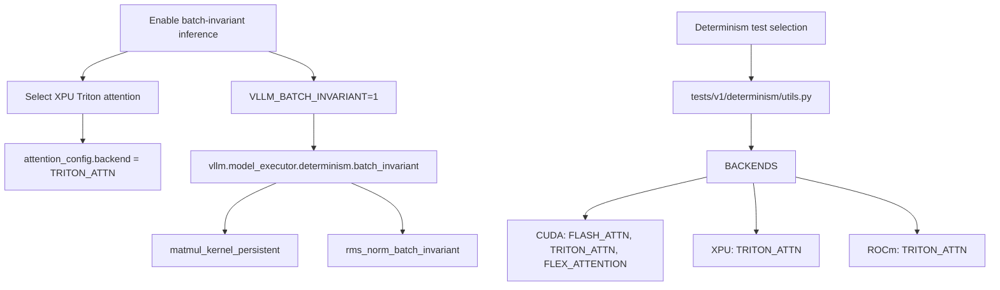
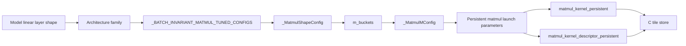
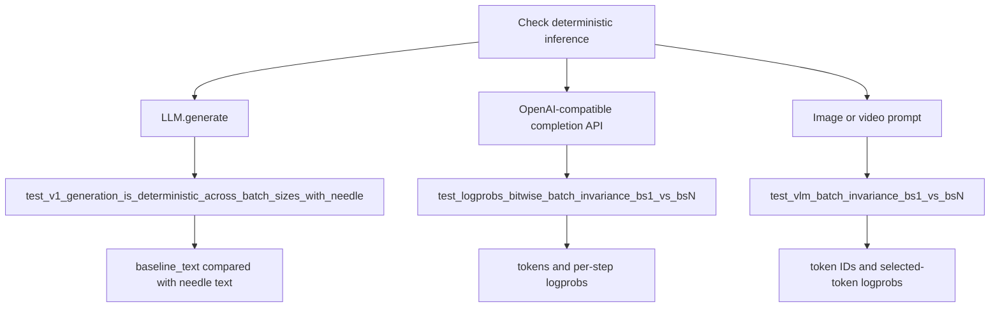

<!-- source: DeepWiki mcp.deepwiki.com · repo vllm-project/vllm · page 4.6 Determinism and Batch Invariance · fetched 2026-10-28 -->

# Determinism and Batch Invariance

Relevant source files

The following files were used as context for generating this wiki page:

- [docs/features/batch_invariance.md](docs/features/batch_invariance.md)
- [tests/v1/determinism/test_batch_invariance.py](tests/v1/determinism/test_batch_invariance.py)
- [tests/v1/determinism/test_batch_invariance_vlm.py](tests/v1/determinism/test_batch_invariance_vlm.py)
- [tests/v1/determinism/test_lora_shrink_batch_invariant.py](tests/v1/determinism/test_lora_shrink_batch_invariant.py)
- [tests/v1/determinism/test_matmul_batch_invariant.py](tests/v1/determinism/test_matmul_batch_invariant.py)
- [tests/v1/determinism/test_nvfp4_batch_invariant.py](tests/v1/determinism/test_nvfp4_batch_invariant.py)
- [tests/v1/determinism/test_online_batch_invariance.py](tests/v1/determinism/test_online_batch_invariance.py)
- [tests/v1/determinism/test_rms_norm_batch_invariant.py](tests/v1/determinism/test_rms_norm_batch_invariant.py)
- [tests/v1/determinism/utils.py](tests/v1/determinism/utils.py)
- [vllm/lora/ops/triton_ops/kernel_utils.py](vllm/lora/ops/triton_ops/kernel_utils.py)
- [vllm/model_executor/determinism/__init__.py](vllm/model_executor/determinism/__init__.py)
- [vllm/model_executor/determinism/batch_invariant.py](vllm/model_executor/determinism/batch_invariant.py)
- [vllm/model_executor/determinism/batch_invariant_configs.py](vllm/model_executor/determinism/batch_invariant_configs.py)

## Purpose and scope

This page describes vLLM’s batch-invariance mode, the deterministic execution measures documented for it, the visible Triton kernel implementation and tuned matmul configuration structures, and the determinism tests shown in `tests/v1/determinism/`. Batch invariance aims to make a request’s output independent of the batch size and request order. It is currently documented as beta. [docs/features/batch_invariance.md:3-7]()

Sources: `docs/features/batch_invariance.md:3-7`()

---

## 1. Motivation and core concepts

Batch invariance addresses numerical differences that can arise when inference runs with different batch sizes or request order. The feature is intended to support framework and model debugging, reproducible reinforcement-learning rollouts, and large-scale inference validation. [docs/features/batch_invariance.md:9-16]()

The feature’s stated goal is deterministic model output across batch sizes and request order. Tests in this area check several levels of that goal: generated text or token IDs, per-step log probabilities, and individual kernel outputs. [docs/features/batch_invariance.md:7]()[tests/v1/determinism/test_batch_invariance.py:32-45]()[tests/v1/determinism/test_matmul_batch_invariant.py:3-7]()

Sources: `docs/features/batch_invariance.md:7-16`, `tests/v1/determinism/test_batch_invariance.py:32-45`, `tests/v1/determinism/test_matmul_batch_invariant.py:3-7`

---

## 2. Enabling and hardware prerequisites

### Hardware and attention backend requirements

The feature documentation lists NVIDIA GPUs with compute capability 8.0 or higher, AMD Instinct GPUs in the `gfx90a`, `gfx942`, and `gfx950` families, and Intel XPUs with Triton support. On XPU, the documented requirement is to select the Triton attention backend, `TRITON_ATTN`. [docs/features/batch_invariance.md:18-29]()

The determinism test utility independently builds an available-backend list: CUDA devices with capability 8.0 or higher use `FLASH_ATTN`, `TRITON_ATTN`, and `FLEX_ATTENTION`; XPU with Triton and ROCm with Triton use `TRITON_ATTN`. It marks tests as skipped when no supported device is available. [tests/v1/determinism/utils.py:24-41]()[tests/v1/determinism/utils.py:64-82]()

### Activation

Set `VLLM_BATCH_INVARIANT=1` to enable batch invariance. The feature documentation gives both server-mode and offline-inference examples. For seeded generation, the examples also set a sampling seed, such as `seed=42`. [docs/features/batch_invariance.md:45-50]()[docs/features/batch_invariance.md:53-82]()[docs/features/batch_invariance.md:84-120]()

### Execution behavior documented for the mode

The feature documentation lists these execution changes when batch invariance is enabled:

| Area | Documented behavior |
|---|---|
| Kernels | Use deterministic implementations for attention and other operations, aiming for consistent numerical behavior across batch sizes. [docs/features/batch_invariance.md:152-156]() |
| Tensor-parallel all-reduce | Keep custom all-reduce enabled with a fixed reduction order; pin the one-stage kernel and reduce large inputs in fixed-size chunks. Disable FlashInfer, AITER, and QuickReduce all-reduce. [docs/features/batch_invariance.md:157]() |
| CUDA matmul and graphs | On CUDA devices with tuned matmul entries for the model’s bf16 unquantized forward linear layers (Ada, Hopper, Blackwell), run without `torch.compile` using breakable CUDA graphs so tile configurations follow runtime batch size. `VLLM_USE_BREAKABLE_CUDAGRAPH=0` opts out. [docs/features/batch_invariance.md:158-159]() |
| LoRA shrink | Divide the shrink reduction into eight fixed K chunks and sum them in a fixed order rather than using atomics. [docs/features/batch_invariance.md:160]() |

The documentation warns that tensor-parallel batch invariance is not supported for all-reduces whose size is not a multiple of 16 bytes. Such tensors can switch between NCCL and custom all-reduce depending on batch size; the documentation gives hidden sizes not divisible by 8 in fp16/bf16 as an example. [docs/features/batch_invariance.md:162-163]()

### Natural-language-to-code map: enablement and test backend selection

**Diagram: User-facing settings mapped to implementation and test entities**

Sources: `docs/features/batch_invariance.md:26-50`, `docs/features/batch_invariance.md:152-160`, `vllm/model_executor/determinism/batch_invariant.py:38-49`, `tests/v1/determinism/utils.py:24-41`, `tests/v1/determinism/utils.py:64-82`

Sources: `docs/features/batch_invariance.md:18-50`, `docs/features/batch_invariance.md:152-163`, `tests/v1/determinism/utils.py:24-41`, `tests/v1/determinism/utils.py:64-82`

---

## 3. Batch-invariant kernel implementation

The supplied implementation excerpt from `vllm/model_executor/determinism/batch_invariant.py` shows Triton persistent matmul kernels and their tile scheduling. The excerpt also imports tuned matmul configuration helpers, platform and device utilities, and Triton. [vllm/model_executor/determinism/batch_invariant.py:3-22]()

### Persistent matmul kernels

`matmul_kernel_persistent` assigns program IDs to tiles and iterates over tile IDs with a stride of `NUM_SMS`. For each output tile, it iterates through K tiles in order, accumulates with `tl.dot`, optionally adds bias, converts to the output element type, and stores the result. [vllm/model_executor/determinism/batch_invariant.py:48-137]()

`matmul_kernel_descriptor_persistent` is a tensor-descriptor-based persistent matmul. Its documented input convention is a transposed B matrix with shape `[N, K]` and K-contiguous row-major layout; it creates descriptors for A, B, and C. The file describes this kernel as using 2D block I/O and notes a performance benefit on Intel XPU. [vllm/model_executor/determinism/batch_invariant.py:140-190]()

The helper `_compute_pid` maps a tile ID to M and N program IDs using grouped tile scheduling. Both visible persistent kernels use it to determine tile coordinates. [vllm/model_executor/determinism/batch_invariant.py:38-45]()[vllm/model_executor/determinism/batch_invariant.py:80-88]()[vllm/model_executor/determinism/batch_invariant.py:121-124]()

### Tuned configuration data structures

`batch_invariant_configs.py` defines `_MatmulMConfig` with `block_m`, `block_n`, `num_warps`, and `num_stages`, and `_MatmulShapeConfig` with `block_k` and `m_buckets`. `_BATCH_INVARIANT_MATMUL_TUNED_CONFIGS` stores configuration data by architecture family and matrix shape; the shown entries include Ada and Hopper. [vllm/model_executor/determinism/batch_invariant_configs.py:11-25]()[vllm/model_executor/determinism/batch_invariant_configs.py:26-103]()

| Entity | Role |
|---|---|
| `_MatmulMConfig` | Holds tile dimensions and launch parameters. [vllm/model_executor/determinism/batch_invariant_configs.py:11-16]() |
| `_MatmulShapeConfig` | Holds the K tile size and M-bucket configurations. [vllm/model_executor/determinism/batch_invariant_configs.py:18-21]() |
| `_BATCH_INVARIANT_MATMUL_TUNED_CONFIGS` | Maps architecture family and matrix shape to tuned shape configuration. [vllm/model_executor/determinism/batch_invariant_configs.py:23-25]() |

### Natural-language-to-code map: matmul configuration and kernel path

**Diagram: Tuned shape configuration mapped to persistent kernel entities**

Sources: `vllm/model_executor/determinism/batch_invariant_configs.py:11-25`, `vllm/model_executor/determinism/batch_invariant_configs.py:26-103`, `vllm/model_executor/determinism/batch_invariant.py:38-49`, `vllm/model_executor/determinism/batch_invariant.py:80-137`, `vllm/model_executor/determinism/batch_invariant.py:140-190`

Sources: `vllm/model_executor/determinism/batch_invariant.py:3-22`, `vllm/model_executor/determinism/batch_invariant.py:38-196`, `vllm/model_executor/determinism/batch_invariant_configs.py:11-103`

---

## 4. Determinism test suite

The determinism tests cover generation, kernel correctness and invariance, online serving, multimodal inputs, and LoRA shrink. The shared `utils.py` selects available attention backends and provides device-based skip markers. [tests/v1/determinism/utils.py:24-82]()

### Test coverage

| Test module | What the shown test code checks |
|---|---|
| `test_batch_invariance.py` | Runs a “needle” prompt alone to establish a baseline, then inserts it at a random position in mixed prompt batches and fails if its generated text differs. It parameterizes attention backend and RMSNorm implementation. [tests/v1/determinism/test_batch_invariance.py:24-45]()[tests/v1/determinism/test_batch_invariance.py:57-95]()[tests/v1/determinism/test_batch_invariance.py:99-153]() |
| `test_matmul_batch_invariant.py` | Compares `matmul_batch_invariant` with `torch.matmul` across shapes and dtypes, checks identical output for an item run alone or in a batch, and tests tuned M buckets. [tests/v1/determinism/test_matmul_batch_invariant.py:27-85]()[tests/v1/determinism/test_matmul_batch_invariant.py:88-135]() |
| `test_rms_norm_batch_invariant.py` | Compares `rms_norm_batch_invariant` with a PyTorch RMSNorm reference across batch sizes, hidden sizes, dtypes, epsilon values, and seeds. It also tests fused residual-add RMSNorm batch invariance. [tests/v1/determinism/test_rms_norm_batch_invariant.py:17-76]()[tests/v1/determinism/test_rms_norm_batch_invariant.py:79-171]() |
| `test_batch_invariance_vlm.py` | Generates image or video inputs, compares single-request and batched token IDs and selected-token log probabilities, and exercises eager and default execution configurations. [tests/v1/determinism/test_batch_invariance_vlm.py:17-55]()[tests/v1/determinism/test_batch_invariance_vlm.py:58-108]()[tests/v1/determinism/test_batch_invariance_vlm.py:110-138]() |
| `test_online_batch_invariance.py` | Sends OpenAI-compatible completion requests one at a time and as a batch, then compares returned tokens and per-step log probabilities. [tests/v1/determinism/test_online_batch_invariance.py:25-62]()[tests/v1/determinism/test_online_batch_invariance.py:65-134]() |
| `test_nvfp4_batch_invariant.py` | Compares baseline and mixed-batch NVFP4 generation, including token IDs, text, and selected-token log probabilities. [tests/v1/determinism/test_nvfp4_batch_invariant.py:26-44]()[tests/v1/determinism/test_nvfp4_batch_invariant.py:47-104]() |
| `test_lora_shrink_batch_invariant.py` | Checks LoRA shrink against a reference and verifies that a target row’s result is unchanged across several batch sizes. [tests/v1/determinism/test_lora_shrink_batch_invariant.py:27-39]()[tests/v1/determinism/test_lora_shrink_batch_invariant.py:42-99]() |

The needle generation test obtains its random seed and runtime limits from environment variables, including `VLLM_TEST_SEED`, `VLLM_NEEDLE_TRIALS`, and `VLLM_NEEDLE_BATCH_SIZE`; it uses a fixed `SamplingParams` seed for generation. [tests/v1/determinism/test_batch_invariance.py:57-95]()

### What the tests assert

The tests use different comparison strengths appropriate to the target:

- The needle test compares generated text between the baseline and mixed-batch run. [tests/v1/determinism/test_batch_invariance.py:110-153]()
- The matmul test uses `torch.equal` for the selected item’s output across batch compositions. [tests/v1/determinism/test_matmul_batch_invariant.py:88-109]()
- The VLM test compares token IDs and uses `torch.equal` for selected-token log-probability tensors. [tests/v1/determinism/test_batch_invariance_vlm.py:58-89]()
- The online test checks token equality and compares each per-step log probability, reporting a bitwise mismatch if values differ. [tests/v1/determinism/test_online_batch_invariance.py:105-133]()
- The RMSNorm tests include both numerical comparison against an independent reference and exact equality between single and batched fused residual-path results. [tests/v1/determinism/test_rms_norm_batch_invariant.py:17-76]()[tests/v1/determinism/test_rms_norm_batch_invariant.py:121-171]()

### Natural-language-to-code map: end-to-end test paths

**Diagram: User-facing inference scenarios mapped to determinism test entities**

Sources: `tests/v1/determinism/test_batch_invariance.py:32-45`, `tests/v1/determinism/test_batch_invariance.py:99-153`, `tests/v1/determinism/test_online_batch_invariance.py:65-134`, `tests/v1/determinism/test_batch_invariance_vlm.py:58-89`, `tests/v1/determinism/test_batch_invariance_vlm.py:92-108`

Sources: `tests/v1/determinism/utils.py:24-82`, `tests/v1/determinism/test_batch_invariance.py:24-153`, `tests/v1/determinism/test_matmul_batch_invariant.py:27-135`, `tests/v1/determinism/test_rms_norm_batch_invariant.py:17-171`, `tests/v1/determinism/test_batch_invariance_vlm.py:17-139`, `tests/v1/determinism/test_online_batch_invariance.py:25-169`, `tests/v1/determinism/test_nvfp4_batch_invariant.py:26-104`, `tests/v1/determinism/test_lora_shrink_batch_invariant.py:27-100`

---

## 5. Operational notes and limitations

Batch invariance is marked beta in the feature documentation. The tested-model list includes dense, MoE, vision-language, and sliding-window-attention examples; the documentation notes that other models may work but are not necessarily explicitly validated. [docs/features/batch_invariance.md:3-5]()[docs/features/batch_invariance.md:122-148]()

For tensor parallelism, observe the documented all-reduce size limitation before relying on batch invariance: a size not divisible by 16 bytes can result in different all-reduce paths as batch size changes. [docs/features/batch_invariance.md:162-163]()

For test diagnosis, the shared test utilities expose `TEST_MODEL` (overridable with `VLLM_TEST_MODEL`) and determine the available backend set from device type and Triton availability. [tests/v1/determinism/utils.py:24-41]()[tests/v1/determinism/utils.py:43-67]()

Sources: `docs/features/batch_invariance.md:3-5`, `docs/features/batch_invariance.md:122-148`, `docs/features/batch_invariance.md:162-163`, `tests/v1/determinism/utils.py:24-67`

---

