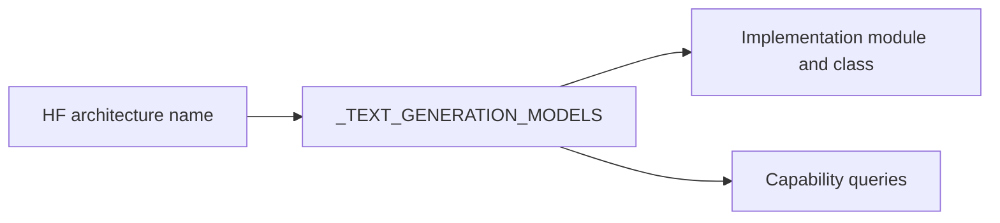
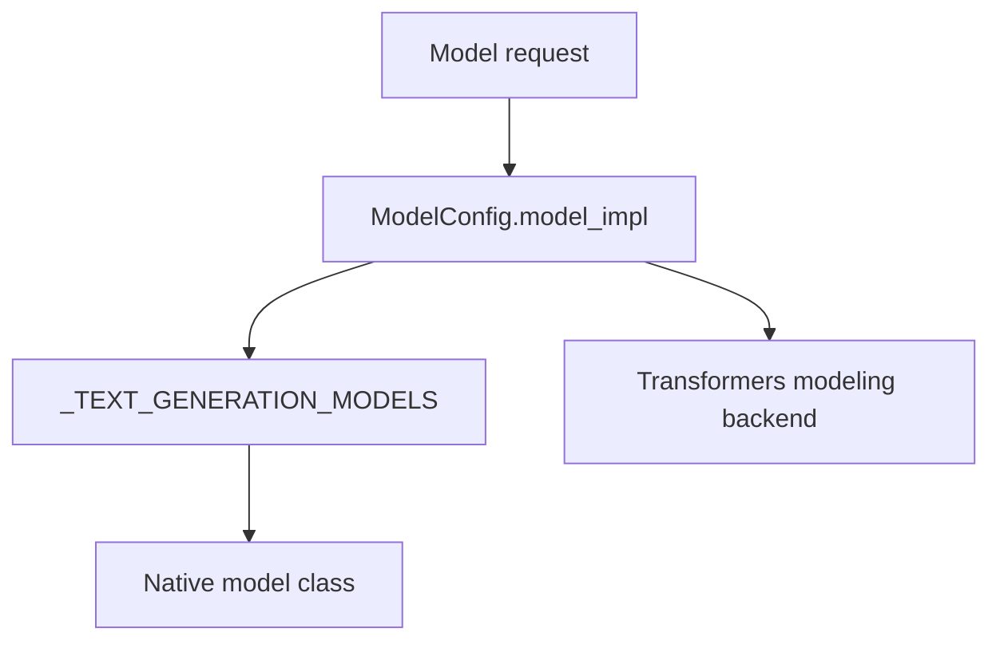
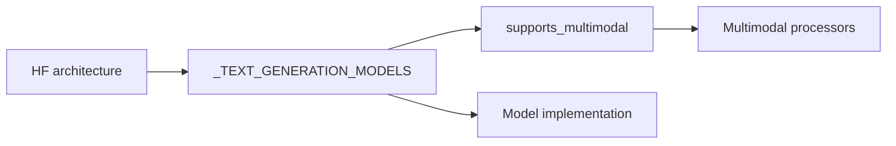
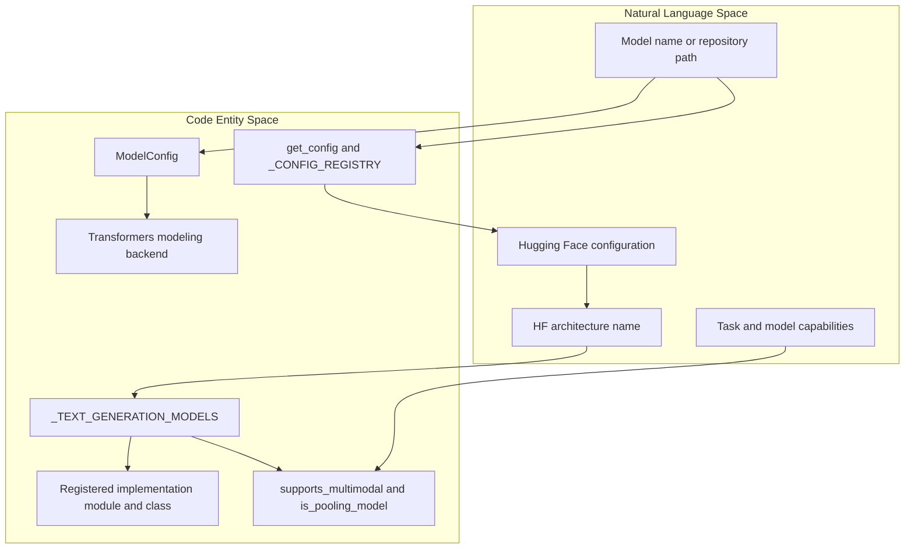

<!-- source: DeepWiki mcp.deepwiki.com · repo vllm-project/vllm · page 5 Model Support and Registration · fetched 2026-10-28 -->

# Model Support and Registration

Relevant source files

The following files were used as context for generating this wiki page:

- [docs/models/supported_models.md](docs/models/supported_models.md)
- [tests/config/test_model_arch_config.py](tests/config/test_model_arch_config.py)
- [tests/engine/test_arg_utils.py](tests/engine/test_arg_utils.py)
- [tests/models/multimodal/generation/test_common.py](tests/models/multimodal/generation/test_common.py)
- [tests/models/multimodal/generation/vlm_utils/model_utils.py](tests/models/multimodal/generation/vlm_utils/model_utils.py)
- [tests/models/registry.py](tests/models/registry.py)
- [tests/test_config.py](tests/test_config.py)
- [vllm/config/cache.py](vllm/config/cache.py)
- [vllm/config/model.py](vllm/config/model.py)
- [vllm/config/model_arch.py](vllm/config/model_arch.py)
- [vllm/config/parallel.py](vllm/config/parallel.py)
- [vllm/config/speculative.py](vllm/config/speculative.py)
- [vllm/config/vllm.py](vllm/config/vllm.py)
- [vllm/engine/arg_utils.py](vllm/engine/arg_utils.py)
- [vllm/model_executor/models/config.py](vllm/model_executor/models/config.py)
- [vllm/model_executor/models/registry.py](vllm/model_executor/models/registry.py)
- [vllm/models/inkling/common/mm_preprocess.py](vllm/models/inkling/common/mm_preprocess.py)
- [vllm/transformers_utils/config.py](vllm/transformers_utils/config.py)
- [vllm/transformers_utils/configs/__init__.py](vllm/transformers_utils/configs/__init__.py)
- [vllm/transformers_utils/model_arch_config_convertor.py](vllm/transformers_utils/model_arch_config_convertor.py)
- [vllm/transformers_utils/processors/__init__.py](vllm/transformers_utils/processors/__init__.py)
- [vllm/v1/spec_decode/llm_base_proposer.py](vllm/v1/spec_decode/llm_base_proposer.py)

## Purpose and Scope

This page gives a high-level view of how vLLM connects a model identifier and its Hugging Face configuration to a model implementation, runtime configuration, and supported task. It also introduces the main model-support areas without detailing their internal mechanisms. For details, see the child pages listed below. [vllm/config/model.py:150-168]() [vllm/model_executor/models/registry.py:46-69]()

**Sources:** [vllm/config/model.py:150-168]() [vllm/model_executor/models/registry.py:46-69]()

## Model Registry Architecture

The model registry maps Hugging Face architecture names to implementation modules and classes. The registry also imports capability queries for tasks and properties such as pooling, multimodal support, pipeline parallelism, and LoRA support. [vllm/model_executor/models/registry.py:46-69]() [vllm/model_executor/models/registry.py:73-100]()

`ModelConfig` holds the model identifier, runner and conversion choices, tokenizer settings, and the `model_impl` selection (`auto`, `vllm`, `transformers`, or `terratorch`). Together, model configuration and registry lookup connect the requested model to the appropriate implementation path. [vllm/config/model.py:89-109]() [vllm/config/model.py:150-179]()

For details, see [Model Registry and Architecture Detection](#5.1).

**Diagram: Architecture name to registered implementation**

Sources: [vllm/model_executor/models/registry.py:46-69]() [vllm/model_executor/models/registry.py:73-100]()

**Sources:** [vllm/model_executor/models/registry.py:46-100]() [vllm/config/model.py:89-109]() [vllm/config/model.py:150-179]()

## Configuration Loading and Weight Loading

Configuration loading bridges model repository data and vLLM’s internal model settings. `vllm/transformers_utils/config.py` uses Hugging Face configuration utilities and maintains a model-type-to-config-class registry; it also defines aliases for Hugging Face fields that use different names across architectures. [vllm/transformers_utils/config.py:13-50]() [vllm/transformers_utils/config.py:56-90]() [vllm/transformers_utils/config.py:112-167]()

`ModelConfig` incorporates the loaded Hugging Face configuration and related model properties. Architecture-specific conversion and validation connect those properties to the runtime configuration. Weight-loading strategies and checkpoint-specific behavior are covered in the child page. [vllm/config/model.py:31-53]() [vllm/config/model.py:150-168]() [vllm/model_executor/models/config.py:18-25]()

For details, see [Configuration Loading and Weight Loading](#5.2).

**Sources:** [vllm/transformers_utils/config.py:13-50]() [vllm/transformers_utils/config.py:56-90]() [vllm/transformers_utils/config.py:112-167]() [vllm/config/model.py:31-53]() [vllm/model_executor/models/config.py:18-25]()

## Model Implementation Backends

vLLM supports native implementations and a Transformers modeling backend. The supported-models documentation describes native implementations under `vllm/model_executor/models/` and the Transformers backend as an option for model implementations available through Transformers. [docs/models/supported_models.md:8-24]()

The registry supplies architecture-to-implementation mappings, while `ModelConfig.model_impl` represents the implementation choice. The supported-models documentation also describes the Transformers backend as covering several model and attention types; its compatibility requirements and backend-specific details belong in the child page. [vllm/model_executor/models/registry.py:73-100]() [vllm/config/model.py:107-109]() [docs/models/supported_models.md:16-26]()

For details, see [Transformers Modeling Backend](#5.3).

**Diagram: Model implementation choices in code**

Sources: [vllm/config/model.py:107-109]() [vllm/model_executor/models/registry.py:73-100]() [docs/models/supported_models.md:8-24]()

**Sources:** [vllm/config/model.py:107-109]() [vllm/model_executor/models/registry.py:73-100]() [docs/models/supported_models.md:8-26]()

## Multimodal Model Support and Data Processing

The model registry exposes multimodal capability queries alongside other model interfaces. Model configuration also includes multimodal configuration types, and the supported-models documentation identifies vision-language and audio-language models as supported categories for the Transformers backend. [vllm/model_executor/models/registry.py:46-69]() [vllm/config/model.py:16-23]() [docs/models/supported_models.md:20-24]()

Model-family implementations and input processing are separate but related parts of support: the model implementation consumes modality-specific inputs, while processing components prepare those inputs for execution. Details on supported families and data-processing flows are in the child pages. [vllm/model_executor/models/registry.py:46-69]() [docs/models/supported_models.md:20-24]()

For details, see [Multimodal Model Support](#5.4) and [Multimodal Data Processing](#5.5).

**Diagram: Multimodal capability from model lookup to processing**

Sources: [vllm/model_executor/models/registry.py:46-69]() [vllm/model_executor/models/registry.py:73-100]()

**Sources:** [vllm/model_executor/models/registry.py:46-69]() [docs/models/supported_models.md:20-24]() [vllm/config/model.py:16-23]()

## Vendor Model Implementations, Hybrid Models, and Pooling

The registry includes mappings to model implementations in both the general model tree and `vllm/models/`. The configuration layer also defines pooling-related configuration types, while the registry exposes pooling and hybrid capability queries. These paths let vLLM support model families and tasks beyond conventional text generation. [vllm/model_executor/models/registry.py:46-69]() [vllm/model_executor/models/registry.py:73-100]() [vllm/config/model.py:24-26]()

The child pages cover vendor- and hardware-specific implementations, hybrid and linear-attention models, and pooling, embedding, and classification support. [vllm/model_executor/models/registry.py:46-69]() [vllm/config/model.py:24-26]()

For details, see [Vendor Model Implementations (vllm/models)](#5.6), [Hybrid and Linear-Attention Models](#5.7), and [Pooling, Embedding and Classification Models](#5.8).

**Sources:** [vllm/model_executor/models/registry.py:46-69]() [vllm/model_executor/models/registry.py:73-100]() [vllm/config/model.py:24-26]()

## Summary Diagram: Natural Language Space to Code Entity Space

Sources: [vllm/config/model.py:150-179]() [vllm/transformers_utils/config.py:112-167]() [vllm/model_executor/models/registry.py:46-69]() [vllm/model_executor/models/registry.py:73-100]() [docs/models/supported_models.md:16-24]()

The diagram summarizes the relationship between model identifiers, configuration lookup, registry dispatch, and capability queries. For the detailed behavior of each area, follow the child-page links below. [vllm/config/model.py:150-179]() [vllm/transformers_utils/config.py:112-167]() [vllm/model_executor/models/registry.py:46-100]()

**Sources:** [vllm/config/model.py:150-179]() [vllm/transformers_utils/config.py:112-167]() [vllm/model_executor/models/registry.py:46-100]()

## Child Pages

- [Model Registry and Architecture Detection](#5.1)
- [Configuration Loading and Weight Loading](#5.2)
- [Transformers Modeling Backend](#5.3)
- [Multimodal Model Support](#5.4)
- [Multimodal Data Processing](#5.5)
- [Vendor Model Implementations (vllm/models)](#5.6)
- [Hybrid and Linear-Attention Models](#5.7)
- [Pooling, Embedding and Classification Models](#5.8)

**Sources:** [vllm/model_executor/models/registry.py:46-69]() [vllm/config/model.py:150-179]() [docs/models/supported_models.md:8-24]()

---

