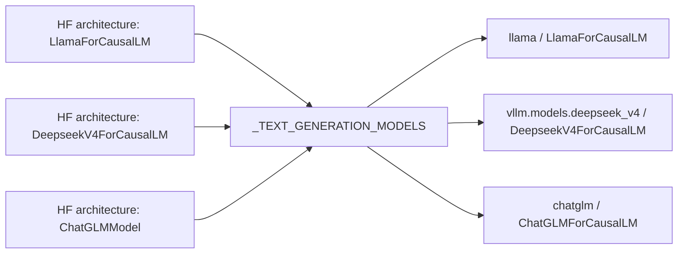
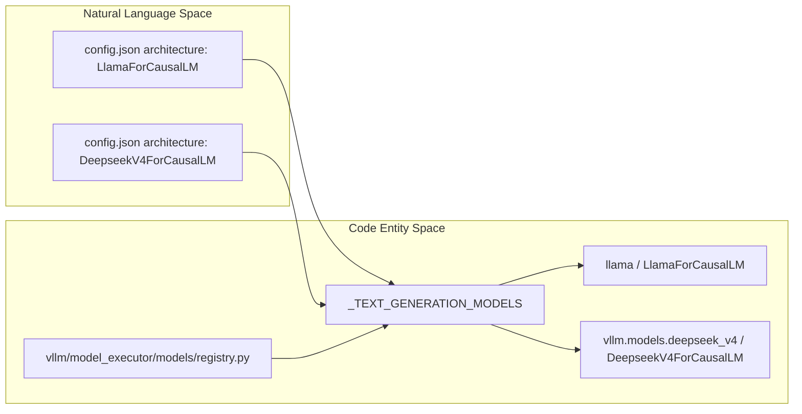
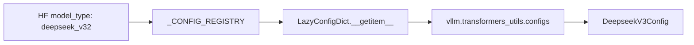
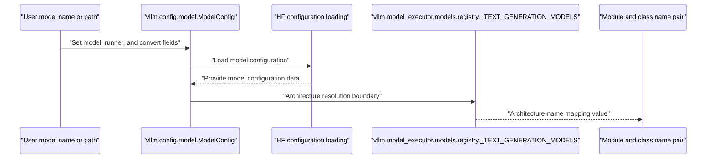
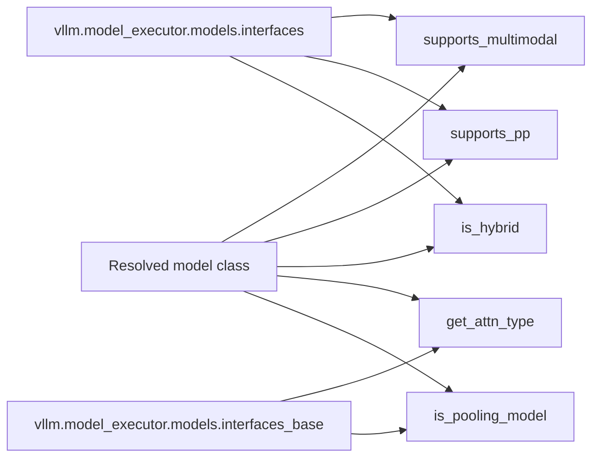

<!-- source: DeepWiki mcp.deepwiki.com · repo vllm-project/vllm · page 5.1 Model Registry and Architecture Detection · fetched 2026-10-28 -->

# Model Registry and Architecture Detection

Relevant source files

The following files were used as context for generating this wiki page:

- [docs/models/supported_models.md](docs/models/supported_models.md)
- [tests/config/test_model_arch_config.py](tests/config/test_model_arch_config.py)
- [tests/distributed/test_pipeline_parallel.py](tests/distributed/test_pipeline_parallel.py)
- [tests/engine/test_arg_utils.py](tests/engine/test_arg_utils.py)
- [tests/entrypoints/openai/test_render_token_offsets.py](tests/entrypoints/openai/test_render_token_offsets.py)
- [tests/models/multimodal/generation/test_common.py](tests/models/multimodal/generation/test_common.py)
- [tests/models/multimodal/generation/vlm_utils/core.py](tests/models/multimodal/generation/vlm_utils/core.py)
- [tests/models/multimodal/generation/vlm_utils/model_utils.py](tests/models/multimodal/generation/vlm_utils/model_utils.py)
- [tests/models/registry.py](tests/models/registry.py)
- [tests/models/test_initialization.py](tests/models/test_initialization.py)
- [tests/models/test_qwen3_5_mtp_config.py](tests/models/test_qwen3_5_mtp_config.py)
- [tests/models/test_registry.py](tests/models/test_registry.py)
- [tests/multimodal/test_registry.py](tests/multimodal/test_registry.py)
- [tests/renderers/test_completions.py](tests/renderers/test_completions.py)
- [tests/renderers/test_hf.py](tests/renderers/test_hf.py)
- [tests/renderers/test_mistral.py](tests/renderers/test_mistral.py)
- [tests/renderers/test_multimodal_hashes.py](tests/renderers/test_multimodal_hashes.py)
- [tests/renderers/test_process_multi_modal_uuids.py](tests/renderers/test_process_multi_modal_uuids.py)
- [tests/renderers/test_token_offsets.py](tests/renderers/test_token_offsets.py)
- [tests/renderers/test_warmup.py](tests/renderers/test_warmup.py)
- [tests/test_config.py](tests/test_config.py)
- [vllm/config/cache.py](vllm/config/cache.py)
- [vllm/config/model.py](vllm/config/model.py)
- [vllm/config/model_arch.py](vllm/config/model_arch.py)
- [vllm/config/parallel.py](vllm/config/parallel.py)
- [vllm/config/speculative.py](vllm/config/speculative.py)
- [vllm/config/vllm.py](vllm/config/vllm.py)
- [vllm/engine/arg_utils.py](vllm/engine/arg_utils.py)
- [vllm/inputs/engine.py](vllm/inputs/engine.py)
- [vllm/inputs/llm.py](vllm/inputs/llm.py)
- [vllm/model_executor/models/config.py](vllm/model_executor/models/config.py)
- [vllm/model_executor/models/registry.py](vllm/model_executor/models/registry.py)
- [vllm/models/inkling/common/mm_preprocess.py](vllm/models/inkling/common/mm_preprocess.py)
- [vllm/multimodal/registry.py](vllm/multimodal/registry.py)
- [vllm/renderers/base.py](vllm/renderers/base.py)
- [vllm/renderers/deepseek_v32.py](vllm/renderers/deepseek_v32.py)
- [vllm/renderers/hf.py](vllm/renderers/hf.py)
- [vllm/renderers/mistral.py](vllm/renderers/mistral.py)
- [vllm/renderers/params.py](vllm/renderers/params.py)
- [vllm/renderers/registry.py](vllm/renderers/registry.py)
- [vllm/renderers/terratorch.py](vllm/renderers/terratorch.py)
- [vllm/transformers_utils/config.py](vllm/transformers_utils/config.py)
- [vllm/transformers_utils/configs/__init__.py](vllm/transformers_utils/configs/__init__.py)
- [vllm/transformers_utils/model_arch_config_convertor.py](vllm/transformers_utils/model_arch_config_convertor.py)
- [vllm/transformers_utils/processors/__init__.py](vllm/transformers_utils/processors/__init__.py)
- [vllm/v1/spec_decode/llm_base_proposer.py](vllm/v1/spec_decode/llm_base_proposer.py)

## Purpose and scope

This page explains how vLLM associates Hugging Face (HF) architecture names with model implementation entries, how model configuration and architecture-specific configuration registries fit into that process, and which capability-query interfaces are exposed by the model registry. The implementation references below are limited to the code excerpts available here. [vllm/model_executor/models/registry.py:46-69]() [vllm/config/model.py:13-15]()

Sources: [vllm/model_executor/models/registry.py:46-69]() [vllm/config/model.py:13-15]()

---

## Architecture registry overview

The model registry is defined in `vllm/model_executor/models/registry.py`. Its `_TEXT_GENERATION_MODELS` mapping uses HF architecture identifiers as keys and pairs each key with a module name and a vLLM implementation class name. For example, `DeepseekV4ForCausalLM` maps to `vllm.models.deepseek_v4` and `DeepseekV4ForCausalLM`; `LlamaForCausalLM` maps to `llama` and `LlamaForCausalLM`. [vllm/model_executor/models/registry.py:73-100]() [vllm/model_executor/models/registry.py:145-155]()

The registry module also imports capability helpers from `interfaces.py` and `interfaces_base.py`. Those imports show the kinds of questions the registry’s surrounding code can ask about a model, including multimodal support, pipeline parallel support, attention type, pooling-model status, and text-generation-model status. [vllm/model_executor/models/registry.py:46-69]()

| Registry element | What the available code establishes |
|---|---|
| `_TEXT_GENERATION_MODELS` | Maps architecture-name strings to module and class-name pairs. [vllm/model_executor/models/registry.py:73-100]() |
| `supports_multimodal`, `supports_pp`, `is_hybrid`, and related helpers | Imported from `interfaces.py` for model capability checks. [vllm/model_executor/models/registry.py:46-60]() |
| `get_attn_type`, `is_pooling_model`, `is_text_generation_model`, and pooling defaults | Imported from `interfaces_base.py`. [vllm/model_executor/models/registry.py:62-69]() |

**Example architecture mappings**

| HF architecture identifier | Module entry | Class entry |
|---|---|---|
| `LlamaForCausalLM` | `llama` | `LlamaForCausalLM` |
| `DeepseekV4ForCausalLM` | `vllm.models.deepseek_v4` | `DeepseekV4ForCausalLM` |
| `ChatGLMModel` | `chatglm` | `ChatGLMForCausalLM` |

These entries are declared in `_TEXT_GENERATION_MODELS`. [vllm/model_executor/models/registry.py:83-100]() [vllm/model_executor/models/registry.py:152-155]()

### HF architecture names mapped to implementation entries

This diagram connects the HF-facing architecture identifier to the registry entry and the module/class pair recorded in code. The mapping values are registry entries; this diagram does not assert any behavior beyond those declarations. [vllm/model_executor/models/registry.py:73-100]() [vllm/model_executor/models/registry.py:152-155]()

**Diagram: Architecture identifiers to registry entries**

Sources: [vllm/model_executor/models/registry.py:73-100]() [vllm/model_executor/models/registry.py:152-155]()

---

## Natural Language Space to Code Entity Space: Registry Lookup

An HF architecture name such as `DeepseekV4ForCausalLM` is the human-readable identifier used as a registry key. The registry associates it with the code-level module and implementation class names `vllm.models.deepseek_v4` and `DeepseekV4ForCausalLM`. Likewise, `LlamaForCausalLM` is associated with `llama` and `LlamaForCausalLM`. [vllm/model_executor/models/registry.py:92-100]() [vllm/model_executor/models/registry.py:152-155]()

The available excerpt shows these mappings declared in `_TEXT_GENERATION_MODELS`; it does not include the lookup function or its call sites. [vllm/model_executor/models/registry.py:73-100]()

**Diagram: HF identifiers and registry symbols**

Sources: [vllm/model_executor/models/registry.py:73-100]() [vllm/model_executor/models/registry.py:152-155]()

---

## Configuration loading and custom config registry

`vllm/transformers_utils/config.py` defines a lazy configuration-class mapping, `_CONFIG_REGISTRY`, keyed by model-type strings. `LazyConfigDict.__getitem__` returns an already stored class directly; when the stored value is a string, it imports `vllm.transformers_utils.configs` and resolves the named class from that module. [vllm/transformers_utils/config.py:112-122]()

The shown registry includes entries such as `deepseek_v32`, `kimi_k3`, `hy_v4`, `step5`, and `deepseek_v41`. These are model-type-to-config-class mappings, separate from the architecture-name-to-model-class mappings in `vllm.model_executor.models.registry`. [vllm/transformers_utils/config.py:122-167]() [vllm/model_executor/models/registry.py:73-100]()

`ModelConfig` imports `MODEL_ARCH_CONFIG_CONVERTORS` and `ModelArchConfigConvertorBase`, establishing a connection to architecture-config conversion. The available excerpt does not show the conversion call path, so it is not possible here to specify when or how a particular convertor is selected. [vllm/config/model.py:47-50]()

| Configuration symbol | Role established by the excerpt |
|---|---|
| `LazyConfigDict` | Resolves string values lazily to classes in `vllm.transformers_utils.configs`. [vllm/transformers_utils/config.py:112-120]() |
| `_CONFIG_REGISTRY` | Maps model-type strings to config class names or classes. [vllm/transformers_utils/config.py:122-167]() |
| `MODEL_ARCH_CONFIG_CONVERTORS` | Imported by `ModelConfig` from `model_arch_config_convertor`; its use is not shown in the excerpt. [vllm/config/model.py:47-50]() |
| `ModelConfig` | Declared as the model configuration object. [vllm/config/model.py:150-165]() |

**Diagram: Model type to config-class registry**

The `deepseek_v32` to `DeepseekV3Config` association is present in `_CONFIG_REGISTRY`; `LazyConfigDict` resolves string-valued entries through the config module. [vllm/transformers_utils/config.py:112-120]() [vllm/transformers_utils/config.py:122-143]()

Sources: [vllm/transformers_utils/config.py:112-167]() [vllm/config/model.py:47-50]() [vllm/config/model.py:150-165]()

---

## Architecture detection and model configuration

`ModelConfig` declares model-related fields including `model`, `runner`, `convert`, and `tokenizer_mode`. The `runner` field is described as the model runner type, with `auto` as its default; `convert` describes conversion using adapters, including adapting a text-generation model for pooling tasks. [vllm/config/model.py:150-179]()

The model registry imports both task/model classification helpers (`is_pooling_model`, `is_text_generation_model`) and capability helpers (for example, `supports_multimodal` and `supports_pp`). The excerpts establish the available interfaces but do not show the complete architecture-detection sequence or the function that selects a class from the registry. [vllm/model_executor/models/registry.py:46-69]()

**Diagram: Configuration and registry entities**

The `ModelConfig` fields and registry mapping values are shown in the cited excerpts. The diagram’s arrows indicate conceptual relationships between those code entities; the available excerpts do not provide the call sites needed to document the precise runtime sequence. [vllm/config/model.py:150-179]() [vllm/model_executor/models/registry.py:73-100]()

Sources: [vllm/config/model.py:150-179]() [vllm/model_executor/models/registry.py:46-69]() [vllm/model_executor/models/registry.py:73-100]()

---

## Model capability queries and interfaces

The registry module imports named capability helpers from `vllm.model_executor.models.interfaces` and `interfaces_base`. These helpers form the visible interface for querying model properties in the registry’s surrounding code. [vllm/model_executor/models/registry.py:46-69]()

| Query symbol | Meaning indicated by its name |
|---|---|
| `supports_multimodal` | Multimodal support query. [vllm/model_executor/models/registry.py:46-60]() |
| `supports_multimodal_encoder_tp_data` | Multimodal encoder tensor-parallel data support query. [vllm/model_executor/models/registry.py:46-60]() |
| `supports_multimodal_raw_input_only` | Query for multimodal raw-input-only support. [vllm/model_executor/models/registry.py:46-60]() |
| `supports_pp` | Pipeline-parallel support query. [vllm/model_executor/models/registry.py:46-60]() |
| `supports_lora` | LoRA support query. [vllm/model_executor/models/registry.py:46-60]() |
| `is_hybrid`, `is_attention_free`, `has_inner_state` | Model-structure or execution-property queries. [vllm/model_executor/models/registry.py:46-60]() |
| `get_attn_type` | Returns or determines an attention-type classification. [vllm/model_executor/models/registry.py:62-69]() |
| `is_pooling_model`, `is_text_generation_model` | Model/task classification queries. [vllm/model_executor/models/registry.py:62-69]() |
| `get_default_seq_pooling_type`, `get_default_tok_pooling_type`, `get_score_type` | Pooling and score-related query helpers. [vllm/model_executor/models/registry.py:62-69]() |

The function imports establish the names and their organization, but their implementations and exact return semantics are not included in the available excerpts. [vllm/model_executor/models/registry.py:46-69]()

**Diagram: Capability-query names to code modules**

Sources: [vllm/model_executor/models/registry.py:46-69]()

---

## Speculative model architecture checks

`vllm/config/speculative.py` declares literal types for speculative methods and model-type families, including `MTPModelTypes`, `DFlashModelTypes`, `DSparkModelTypes`, and `EagleModelTypes`. These types describe accepted configuration labels; they are not the general architecture-to-implementation mapping in `vllm/model_executor/models/registry.py`. [vllm/config/speculative.py:38-83]() [vllm/model_executor/models/registry.py:73-100]()

The `_validate_qwen3_omni_dspark` function validates a Qwen3-Omni DSpark draft-checkpoint contract. It checks that the target is a recognized Qwen3-Omni target, requires the draft architecture `Qwen3OmniDSparkModel`, validates a positive integer block size, and requires `num_speculative_tokens` to equal that block size. [vllm/config/speculative.py:86-102]() [vllm/config/speculative.py:146-181]()

| Symbol | Purpose shown in the excerpt |
|---|---|
| `MTPModelTypes` | Literal set of MTP model-type labels. [vllm/config/speculative.py:38-67]() |
| `DFlashModelTypes` | Literal type containing `dflash`. [vllm/config/speculative.py:68-73]() |
| `DSparkModelTypes` | Literal type containing `dspark`. [vllm/config/speculative.py:68-73]() |
| `_validate_qwen3_omni_dspark` | Validates architecture and configuration requirements for the Qwen3-Omni DSpark draft model. [vllm/config/speculative.py:146-181]() |

Sources: [vllm/config/speculative.py:38-102]() [vllm/config/speculative.py:146-181]()

---

## Test model registry and validation metadata

`tests/models/registry.py` defines `_HfExamplesInfo`, a frozen dataclass for per-architecture test metadata. Its fields include a default test model, optional extra models, tokenizer settings, speculative-model settings, Transformers version bounds, input requirements, dtype, eager-execution settings, prefix-caching settings, remote-code trust, model-length and batch limits, and revision information. [tests/models/registry.py:16-120]()

The class also defines checks for Transformers-version compatibility and online model availability. Version checks can return without action, raise an error, or skip a pytest test depending on the selected policy; availability checks use the `is_available_online` field. [tests/models/registry.py:122-180]() [tests/models/registry.py:182-191]()

The main registry’s module docstring explicitly asks maintainers adding an architecture to update `tests/models/registry.py` with example HF models. [vllm/model_executor/models/registry.py:3-5]()

Sources: [tests/models/registry.py:16-120]() [tests/models/registry.py:122-191]() [vllm/model_executor/models/registry.py:3-5]()

---

## Summary

- `_TEXT_GENERATION_MODELS` maps architecture-name strings to module and class-name pairs. [vllm/model_executor/models/registry.py:73-100]()
- `_CONFIG_REGISTRY` maps model-type strings to configuration classes, resolving string entries lazily through `vllm.transformers_utils.configs`. [vllm/transformers_utils/config.py:112-167]()
- `ModelConfig` exposes model, runner, conversion, and tokenizer configuration fields, and imports architecture-config convertor symbols. [vllm/config/model.py:47-50]() [vllm/config/model.py:150-179]()
- The registry module imports capability-query helpers for multimodal, parallelism, model-structure, attention, and pooling properties. [vllm/model_executor/models/registry.py:46-69]()
- Speculative configuration includes architecture-specific validation for Qwen3-Omni DSpark. [vllm/config/speculative.py:146-181]()
- The test model registry stores example-model and compatibility metadata, and the main registry directs architecture additions to update it. [tests/models/registry.py:16-120]() [vllm/model_executor/models/registry.py:3-5]()

Sources: [vllm/model_executor/models/registry.py:3-5]() [vllm/model_executor/models/registry.py:46-100]() [vllm/transformers_utils/config.py:112-167]() [vllm/config/model.py:47-50]() [vllm/config/model.py:150-179]() [vllm/config/speculative.py:146-181]() [tests/models/registry.py:16-120]()

---

