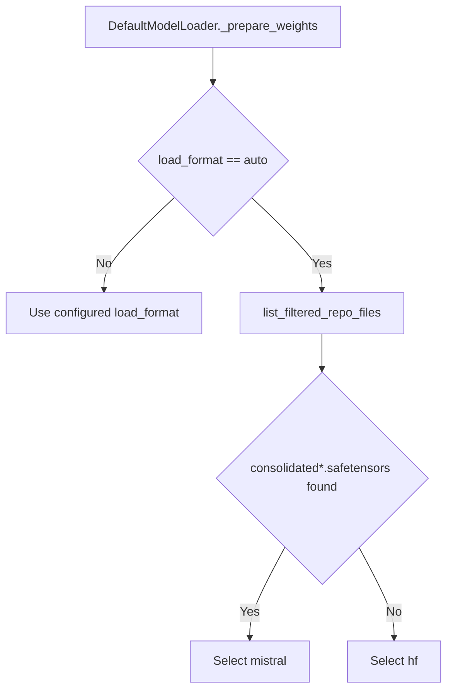
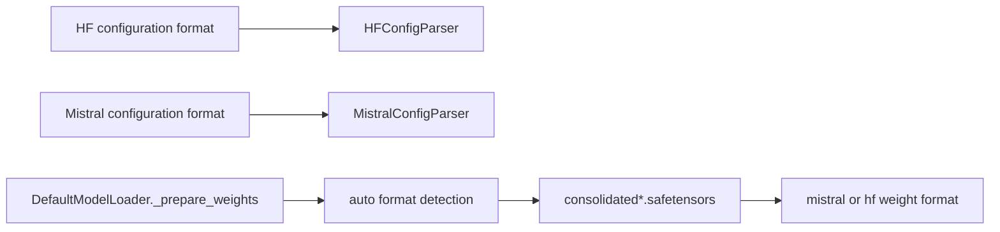
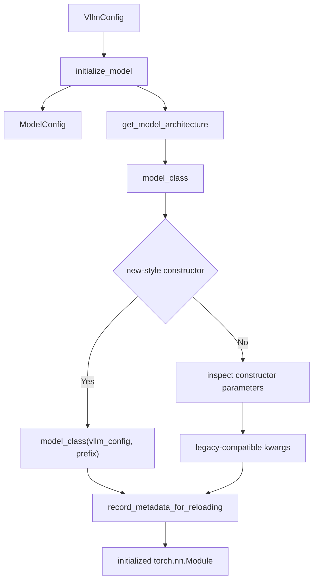
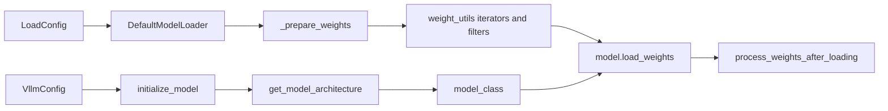
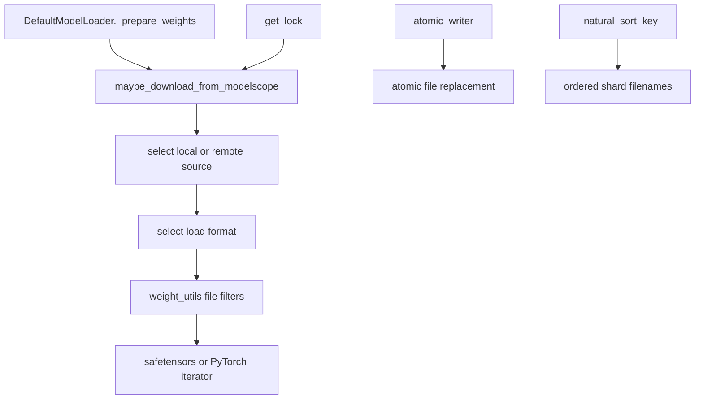
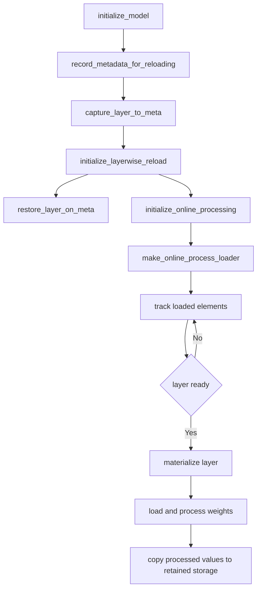
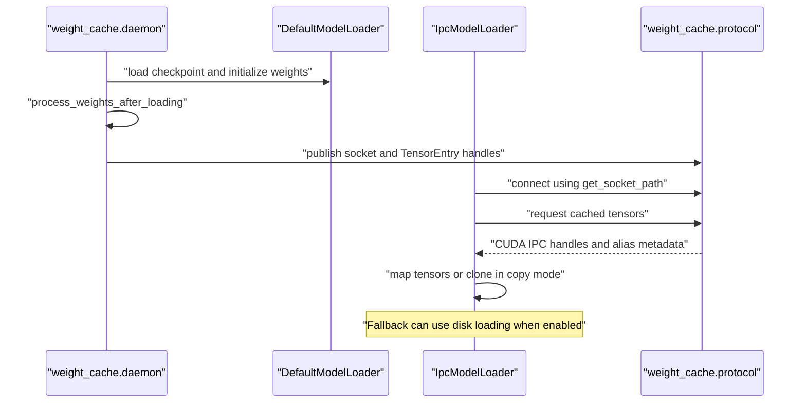
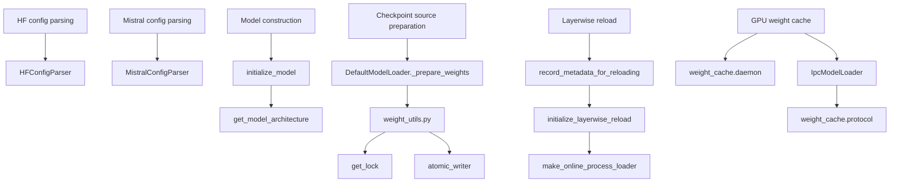

<!-- source: DeepWiki mcp.deepwiki.com · repo vllm-project/vllm · page 5.2 Configuration Loading and Weight Loading · fetched 2026-10-28 -->

# Configuration Loading and Weight Loading

Relevant source files

The following files were used as context for generating this wiki page:

- [.buildkite/test_areas/model_executor.yaml](.buildkite/test_areas/model_executor.yaml)
- [docs/design/shm_tensor_arena.md](docs/design/shm_tensor_arena.md)
- [docs/features/mooncake_ec_connector_usage.md](docs/features/mooncake_ec_connector_usage.md)
- [docs/features/preload.md](docs/features/preload.md)
- [examples/disaggregated/disaggregated_encoder/README.md](examples/disaggregated/disaggregated_encoder/README.md)
- [examples/disaggregated/disaggregated_encoder/disagg_1e1p1d_example.sh](examples/disaggregated/disaggregated_encoder/disagg_1e1p1d_example.sh)
- [examples/disaggregated/disaggregated_encoder/disagg_1e1pd_example.sh](examples/disaggregated/disaggregated_encoder/disagg_1e1pd_example.sh)
- [examples/rl/rlhf_async_new_apis.py](examples/rl/rlhf_async_new_apis.py)
- [examples/rl/rlhf_nccl_fsdp_ep.py](examples/rl/rlhf_nccl_fsdp_ep.py)
- [tests/model_executor/model_loader/instanttensor_loader/test_weight_utils.py](tests/model_executor/model_loader/instanttensor_loader/test_weight_utils.py)
- [tests/model_executor/model_loader/test_ep_weight_filter.py](tests/model_executor/model_loader/test_ep_weight_filter.py)
- [tests/model_executor/model_loader/test_gpt_oss_weight_loading.py](tests/model_executor/model_loader/test_gpt_oss_weight_loading.py)
- [tests/model_executor/model_loader/test_mm_encoder_only_weight_filter.py](tests/model_executor/model_loader/test_mm_encoder_only_weight_filter.py)
- [tests/model_executor/model_loader/test_registry.py](tests/model_executor/model_loader/test_registry.py)
- [tests/model_executor/model_loader/test_reload.py](tests/model_executor/model_loader/test_reload.py)
- [tests/model_executor/model_loader/test_weight_cache.py](tests/model_executor/model_loader/test_weight_cache.py)
- [tests/model_executor/test_weight_utils.py](tests/model_executor/test_weight_utils.py)
- [tests/utils_/test_argparse_utils.py](tests/utils_/test_argparse_utils.py)
- [tests/v1/e2e/general/test_sharded_sampling.py](tests/v1/e2e/general/test_sharded_sampling.py)
- [tests/v1/e2e/spec_decode/test_sharded_sampling.py](tests/v1/e2e/spec_decode/test_sharded_sampling.py)
- [vllm/config/load.py](vllm/config/load.py)
- [vllm/entrypoints/cli/preload.py](vllm/entrypoints/cli/preload.py)
- [vllm/model_executor/layers/fused_moe/expert_map_manager.py](vllm/model_executor/layers/fused_moe/expert_map_manager.py)
- [vllm/model_executor/layers/quantization/base_config.py](vllm/model_executor/layers/quantization/base_config.py)
- [vllm/model_executor/model_loader/__init__.py](vllm/model_executor/model_loader/__init__.py)
- [vllm/model_executor/model_loader/default_loader.py](vllm/model_executor/model_loader/default_loader.py)
- [vllm/model_executor/model_loader/dummy_loader.py](vllm/model_executor/model_loader/dummy_loader.py)
- [vllm/model_executor/model_loader/ep_weight_filter.py](vllm/model_executor/model_loader/ep_weight_filter.py)
- [vllm/model_executor/model_loader/reload/__init__.py](vllm/model_executor/model_loader/reload/__init__.py)
- [vllm/model_executor/model_loader/reload/layerwise.py](vllm/model_executor/model_loader/reload/layerwise.py)
- [vllm/model_executor/model_loader/reload/meta.py](vllm/model_executor/model_loader/reload/meta.py)
- [vllm/model_executor/model_loader/reload/types.py](vllm/model_executor/model_loader/reload/types.py)
- [vllm/model_executor/model_loader/reload/utils.py](vllm/model_executor/model_loader/reload/utils.py)
- [vllm/model_executor/model_loader/utils.py](vllm/model_executor/model_loader/utils.py)
- [vllm/model_executor/model_loader/weight_cache/__init__.py](vllm/model_executor/model_loader/weight_cache/__init__.py)
- [vllm/model_executor/model_loader/weight_cache/daemon.py](vllm/model_executor/model_loader/weight_cache/daemon.py)
- [vllm/model_executor/model_loader/weight_cache/ipc_loader.py](vllm/model_executor/model_loader/weight_cache/ipc_loader.py)
- [vllm/model_executor/model_loader/weight_cache/protocol.py](vllm/model_executor/model_loader/weight_cache/protocol.py)
- [vllm/model_executor/model_loader/weight_cache/utils.py](vllm/model_executor/model_loader/weight_cache/utils.py)
- [vllm/model_executor/model_loader/weight_utils.py](vllm/model_executor/model_loader/weight_utils.py)
- [vllm/model_executor/models/gpt_oss.py](vllm/model_executor/models/gpt_oss.py)
- [vllm/utils/argparse_utils.py](vllm/utils/argparse_utils.py)

## Purpose and scope

This page describes the path from model configuration and checkpoint selection to model initialization, weight loading, post-load processing, layerwise reload, and optional IPC weight caching. It focuses on the parser and loader entities that connect model configuration to runtime tensors. [vllm/model_executor/model_loader/default_loader.py:55-183]()

Sources: [vllm/model_executor/model_loader/default_loader.py:55-183]()

---

## Configuration Format Support

The loader supports automatic selection between Hugging Face and Mistral weight formats. In `DefaultModelLoader._prepare_weights`, `load_format="auto"` checks for `consolidated*.safetensors` and selects `"mistral"` when those files are found; otherwise it selects `"hf"`. This is weight-format selection, not a complete description of configuration-parser selection. [vllm/model_executor/model_loader/default_loader.py:147-183]()

| Format | Role described by the available implementation |
|---|---|
| `auto` | Selects Mistral weight format when `consolidated*.safetensors` files are present; otherwise selects HF format. [vllm/model_executor/model_loader/default_loader.py:168-183]() |
| `hf` | A loader format handled by the default loader’s checkpoint preparation and weight iteration paths. [vllm/model_executor/model_loader/default_loader.py:147-183]() |
| `mistral` | A loader format selected by the `auto` check for repositories containing consolidated safetensors files. [vllm/model_executor/model_loader/default_loader.py:168-183]() |

### Configuration Format Detection Flow

The available loader code establishes automatic **weight-format** detection. The configuration parser classes `HFConfigParser` and `MistralConfigParser` belong to the broader configuration-loading path; their implementation details are not present in the supplied file excerpts, so this diagram does not infer their internal parsing behavior. [vllm/model_executor/model_loader/default_loader.py:147-183]()

**Diagram: Automatic weight-format selection**

Sources: [vllm/model_executor/model_loader/default_loader.py:147-183]()

---

## Configuration Parser Architecture

`HFConfigParser` and `MistralConfigParser` are the named parser entities associated with the HF and Mistral configuration formats. The supplied excerpts do not include their definitions, parser registry, or factory, so this section limits itself to their role at the format boundary rather than asserting specific parsing steps. [vllm/config/load.py:30-60]()

The loader excerpt does establish that Mistral is a recognized weight format and that `auto` selects it based on checkpoint files. That selection should not be conflated with the parser implementation or assumed to describe every configuration-loading path. [vllm/model_executor/model_loader/default_loader.py:168-183]()

**Diagram: Format names and implementation entities**

Sources: [vllm/config/load.py:30-60](), [vllm/model_executor/model_loader/default_loader.py:147-183]()

---

## HuggingFace Configuration Loading

`HFConfigParser` is the named parser for Hugging Face configuration. The supplied excerpts do not show its definition or call sites, so details such as its exact Transformers APIs, override handling, and custom-config lookup are not specified here. [vllm/config/load.py:30-60]()

The loader-side connection is visible in `DefaultModelLoader`: the class prepares model weight sources and selects a weight format, while configuration and model construction are handled through the model configuration and initialization interfaces. [vllm/model_executor/model_loader/default_loader.py:55-58](), [vllm/model_executor/model_loader/utils.py:73-103]()

Sources: [vllm/config/load.py:30-60](), [vllm/model_executor/model_loader/default_loader.py:55-58](), [vllm/model_executor/model_loader/utils.py:73-103]()

---

## Mistral Configuration Loading

`MistralConfigParser` is the named parser associated with Mistral-native configuration. The supplied excerpts do not include its implementation, so this page does not claim how it reads or adapts a particular configuration file. [vllm/config/load.py:30-60]()

The available loader implementation confirms a related checkpoint convention: when automatic weight-format selection is active, the presence of `consolidated*.safetensors` leads `DefaultModelLoader._prepare_weights` to choose `"mistral"`. [vllm/model_executor/model_loader/default_loader.py:168-183]()

Sources: [vllm/config/load.py:30-60](), [vllm/model_executor/model_loader/default_loader.py:168-183]()

---

## Model Architecture Configuration Conversion

Model construction is coordinated by `initialize_model`. It takes a `VllmConfig`, obtains the `ModelConfig` if one was not explicitly supplied, and obtains the model class through `get_model_architecture` if no class was supplied. It then applies expert substitution and configures quantization when a quantization config is present. [vllm/model_executor/model_loader/utils.py:73-95]()

For new-style model classes, `initialize_model` enters the current vLLM configuration context and calls the model class with `vllm_config` and `prefix`; it records reload metadata before returning. The compatibility path inspects the constructor signature and supplies recognized arguments such as `config`, `cache_config`, and `quant_config`. [vllm/model_executor/model_loader/utils.py:96-136]()

`GPTOSS` illustrates a model implementation consuming Hugging Face configuration values directly: `OAIAttention` reads head dimensions, attention-head counts, hidden size, and rotary parameters from `GptOssConfig`, then constructs parallel linear and attention layers. [vllm/model_executor/models/gpt_oss.py:92-163]()

**Diagram: Configuration-to-model construction**

Sources: [vllm/model_executor/model_loader/utils.py:73-136](), [vllm/model_executor/models/gpt_oss.py:92-163]()

---

## Model Loaders and Initialization

`DefaultModelLoader` extends `BaseModelLoader` and handles multiple checkpoint sources and formats. Its `Source` dataclass records a model identifier or path, revision, optional subfolder and prefix, and file-selection options. The loader validates extra configuration and supports options for multithreaded loading and weight tracking. [vllm/model_executor/model_loader/default_loader.py:21-25](), [vllm/model_executor/model_loader/default_loader.py:55-145]()

`_prepare_weights` resolves an optional ModelScope download, determines whether the source is local, and selects a weight format. The module imports iterators for safetensors, PyTorch checkpoints, NumPy cache, and other supported loading paths, as well as helpers for filtering checkpoint files. [vllm/model_executor/model_loader/default_loader.py:25-42](), [vllm/model_executor/model_loader/default_loader.py:147-183]()

`initialize_model` is the shared model-construction path shown in the supplied implementation. `process_weights_after_loading` subsequently reties word embeddings when applicable and applies per-module quantization processing, with a guard against quantization methods that do not support already-processed weights. [vllm/model_executor/model_loader/utils.py:73-103](), [vllm/model_executor/model_loader/utils.py:139-167]()

**Diagram: Loader and initialization entity map**

Sources: [vllm/model_executor/model_loader/default_loader.py:21-42](), [vllm/model_executor/model_loader/default_loader.py:55-58](), [vllm/model_executor/model_loader/default_loader.py:147-183](), [vllm/model_executor/model_loader/utils.py:73-103](), [vllm/model_executor/model_loader/utils.py:139-167]()

---

## Weight Loading Subsystem (`weight_utils.py`)

`weight_utils.py` provides utilities for downloading and initializing model weights. The shown code includes shared file-lock creation, atomic file replacement, natural sorting for numbered checkpoint shards, and optional ModelScope downloading. [vllm/model_executor/model_loader/weight_utils.py:1-3](), [vllm/model_executor/model_loader/weight_utils.py:74-106](), [vllm/model_executor/model_loader/weight_utils.py:109-149](), [vllm/model_executor/model_loader/weight_utils.py:152-193]()

| Utility | Behavior |
|---|---|
| `get_lock` | Creates a `filelock.FileLock` using a hashed model name, allowing processes to coordinate around a shared lock file. [vllm/model_executor/model_loader/weight_utils.py:96-106]() |
| `atomic_writer` | Writes to a temporary file in the target directory and replaces the destination only after the write succeeds. [vllm/model_executor/model_loader/weight_utils.py:109-149]() |
| `_natural_sort_key` | Splits numeric filename components so shard names sort naturally. [vllm/model_executor/model_loader/weight_utils.py:152-158]() |
| `maybe_download_from_modelscope` | When `VLLM_USE_MODELSCOPE` is enabled, downloads under a lock and returns the resulting model path; otherwise returns `None`. [vllm/model_executor/model_loader/weight_utils.py:161-193]() |

The default loader imports weight iterators and file-selection helpers from this module, including safetensors and PyTorch iterators, duplicate-shard filtering, and checkpoint filtering. [vllm/model_executor/model_loader/default_loader.py:25-42]()

**Diagram: Checkpoint preparation and utility flow**

Sources: [vllm/model_executor/model_loader/default_loader.py:25-42](), [vllm/model_executor/model_loader/default_loader.py:147-183](), [vllm/model_executor/model_loader/weight_utils.py:96-106](), [vllm/model_executor/model_loader/weight_utils.py:109-149](), [vllm/model_executor/model_loader/weight_utils.py:152-193]()

---

## Layerwise Weight Reloading

Layerwise reload records model tensor metadata, restores layer tensors to the meta device, and wraps parameter weight loaders so that loading and processing can occur incrementally. `LAYERWISE_INFO` is a weak-key mapping from modules to `LayerReloadingInfo`, and `record_metadata_for_reloading` captures per-layer restoration metadata. [vllm/model_executor/model_loader/reload/layerwise.py:44-80]()

`initialize_layerwise_reload` saves current layer tensors, snapshots non-persistent buffers, restores parameters and buffers to meta tensors, and invokes `initialize_online_processing` to wrap weight loaders. The wrapper tracks loaded element counts and defers work until a layer is ready. [vllm/model_executor/model_loader/reload/layerwise.py:82-145]()

The metadata helpers preserve tensor classes and attributes while converting tensors to meta form. `materialize_layer` recreates tensors on the recorded device when needed. [vllm/model_executor/model_loader/reload/meta.py:41-61](), [vllm/model_executor/model_loader/reload/meta.py:120-153]()

`initialize_model` calls `record_metadata_for_reloading` after constructing the model, establishing the metadata needed by a later reload. [vllm/model_executor/model_loader/utils.py:96-103]()

**Diagram: Layerwise reload workflow**

Sources: [vllm/model_executor/model_loader/utils.py:96-103](), [vllm/model_executor/model_loader/reload/layerwise.py:44-145](), [vllm/model_executor/model_loader/reload/meta.py:41-61](), [vllm/model_executor/model_loader/reload/meta.py:120-153]()

---

## Weight Cache Daemon and IPC Loading

The weight-cache daemon keeps post-quantized, tensor-parallel-sharded model weights in GPU memory and serves CUDA IPC handles over Unix domain sockets. Engines using `load_format="ipc_cache"` can map those tensors instead of loading weights from disk. The daemon supports the documented tensor, expert, data, and pipeline parallel arrangements. [vllm/model_executor/model_loader/weight_cache/daemon.py:3-25]()

`IpcModelLoader` initializes a model on the meta device and replaces its parameters and buffers with daemon-provided tensors. In `zero_copy` mode, the engine shares daemon GPU memory; in `copy` mode, the engine clones tensors into its own memory. The loader can fall back to disk loading when the daemon is unavailable or the cache configuration does not match. [vllm/model_executor/model_loader/weight_cache/ipc_loader.py:68-92]()

The protocol derives socket paths from the GPU UUID and cache role, and validates private socket-directory ownership and permissions. IPC support is restricted to CUDA-alike platforms; quantization methods must declare support for pre-processed weights. [vllm/model_executor/model_loader/weight_cache/protocol.py:3-11](), [vllm/model_executor/model_loader/weight_cache/protocol.py:72-89](), [vllm/model_executor/model_loader/weight_cache/protocol.py:92-114](), [vllm/model_executor/model_loader/weight_cache/protocol.py:121-164]()

On the daemon side, `export_entries` exports tensors while preserving tied-parameter aliases. The daemon imports model loading and post-load processing utilities, reflecting that the cache represents weights prepared for runtime use rather than raw checkpoint files. [vllm/model_executor/model_loader/weight_cache/daemon.py:89-128](), [vllm/model_executor/model_loader/weight_cache/daemon.py:131-169]()

**Diagram: Daemon preload and engine mapping**

Sources: [vllm/model_executor/model_loader/weight_cache/daemon.py:89-128](), [vllm/model_executor/model_loader/weight_cache/daemon.py:131-169](), [vllm/model_executor/model_loader/weight_cache/ipc_loader.py:68-92](), [vllm/model_executor/model_loader/weight_cache/protocol.py:72-114](), [vllm/model_executor/model_loader/weight_cache/protocol.py:121-151]()

### Cache correctness and cold-start fallback

The end-to-end cache tests exercise both cold starts and warm restarts. The test helper uses `load_format="auto"` without a socket and `load_format="ipc_cache"` when a daemon socket is supplied; it compares generated outputs across the two modes. [tests/model_executor/model_loader/test_weight_cache.py:3-8](), [tests/model_executor/model_loader/test_weight_cache.py:126-146]()

Sources: [tests/model_executor/model_loader/test_weight_cache.py:3-8](), [tests/model_executor/model_loader/test_weight_cache.py:126-146]()

---

## Quantized Checkpoint Handling

Weight loading and quantization processing are separate stages. `process_weights_after_loading` reties embeddings when appropriate, traverses model modules, and invokes quantization-related handling. When weights are marked as already processed, a quantization method must declare `supports_pre_processed_weights`; otherwise the function raises a `RuntimeError`. [vllm/model_executor/model_loader/utils.py:139-167]()

The IPC cache transfers post-processed weights, so its protocol checks that each quantization method supports pre-processed weights before those tensors are shared. This prevents using IPC weight sharing with a quantization method that expects to transform raw checkpoint tensors during engine loading. [vllm/model_executor/model_loader/weight_cache/protocol.py:92-114]()

Weight-loader functions are attached to parameters and may be model-specific. For example, `gpt_oss.py` imports `default_weight_loader` and specialized remapping helpers, and defines `_get_weight_loader` to obtain a parameter’s loader or fall back to the default. [vllm/model_executor/models/gpt_oss.py:44-49](), [vllm/model_executor/models/gpt_oss.py:85-89]()

Sources: [vllm/model_executor/model_loader/utils.py:139-167](), [vllm/model_executor/model_loader/weight_cache/protocol.py:92-114](), [vllm/model_executor/models/gpt_oss.py:44-49](), [vllm/model_executor/models/gpt_oss.py:85-89]()

---

## Natural Language Concepts to Code Entities

This map associates the system concepts discussed on this page with implementation symbols that can be searched in the repository. [vllm/model_executor/model_loader/default_loader.py:55-58](), [vllm/model_executor/model_loader/utils.py:73-103](), [vllm/model_executor/model_loader/weight_utils.py:96-106](), [vllm/model_executor/model_loader/reload/layerwise.py:44-80]()

**Diagram: Configuration and loading concepts mapped to code**

Sources: [vllm/config/load.py:30-60](), [vllm/model_executor/model_loader/default_loader.py:55-58](), [vllm/model_executor/model_loader/default_loader.py:147-183](), [vllm/model_executor/model_loader/utils.py:73-103](), [vllm/model_executor/model_loader/weight_utils.py:96-149](), [vllm/model_executor/model_loader/reload/layerwise.py:44-145](), [vllm/model_executor/model_loader/weight_cache/daemon.py:89-169](), [vllm/model_executor/model_loader/weight_cache/ipc_loader.py:68-92](), [vllm/model_executor/model_loader/weight_cache/protocol.py:72-114]()

---

## References

- Configuration parser interfaces: [vllm/config/load.py:30-60]()
- Default checkpoint loader and automatic format selection: [vllm/model_executor/model_loader/default_loader.py:55-183]()
- Model initialization and post-load processing: [vllm/model_executor/model_loader/utils.py:73-167]()
- Weight utilities: [vllm/model_executor/model_loader/weight_utils.py:74-193]()
- Layerwise reload: [vllm/model_executor/model_loader/reload/layerwise.py:44-145]()
- Meta tensor capture and materialization: [vllm/model_executor/model_loader/reload/meta.py:41-61](), [vllm/model_executor/model_loader/reload/meta.py:97-153]()
- Weight-cache daemon: [vllm/model_executor/model_loader/weight_cache/daemon.py:89-169]()
- IPC loader: [vllm/model_executor/model_loader/weight_cache/ipc_loader.py:68-92]()
- IPC protocol and support checks: [vllm/model_executor/model_loader/weight_cache/protocol.py:72-114](), [vllm/model_executor/model_loader/weight_cache/protocol.py:121-164]()
- Weight-cache integration test: [tests/model_executor/model_loader/test_weight_cache.py:126-146]()

Sources: [vllm/config/load.py:30-60](), [vllm/model_executor/model_loader/default_loader.py:55-183](), [vllm/model_executor/model_loader/utils.py:73-167](), [vllm/model_executor/model_loader/weight_utils.py:74-193](), [vllm/model_executor/model_loader/reload/layerwise.py:44-145](), [vllm/model_executor/model_loader/reload/meta.py:41-153](), [vllm/model_executor/model_loader/weight_cache/daemon.py:89-169](), [vllm/model_executor/model_loader/weight_cache/ipc_loader.py:68-92](), [vllm/model_executor/model_loader/weight_cache/protocol.py:72-164](), [tests/model_executor/model_loader/test_weight_cache.py:126-146]()

---

