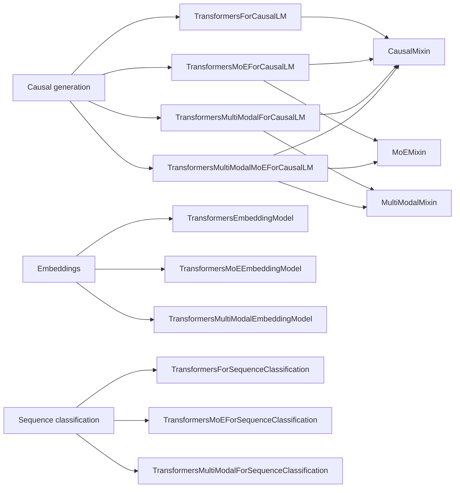
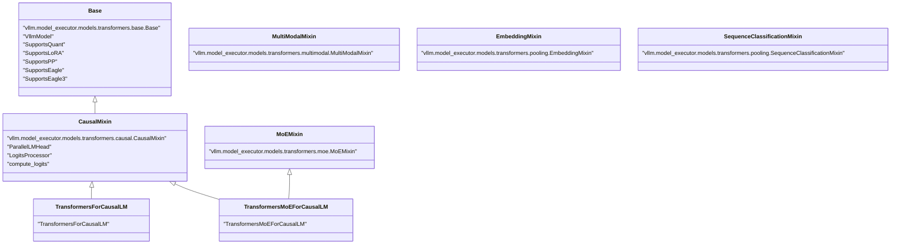
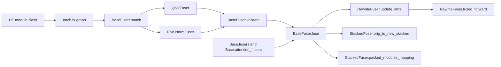
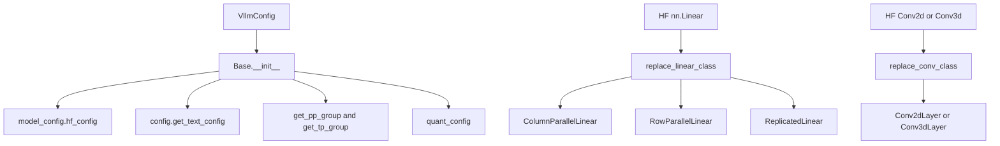
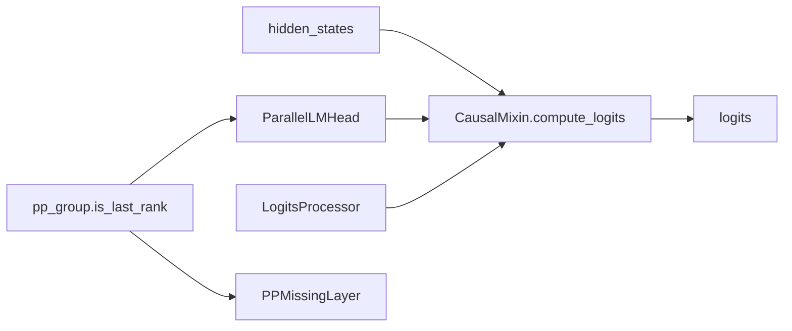
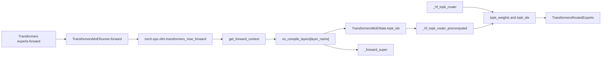
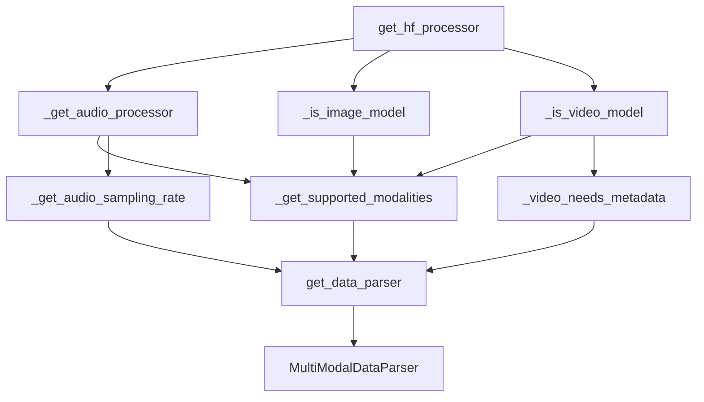

<!-- source: DeepWiki mcp.deepwiki.com · repo vllm-project/vllm · page 5.3 Transformers Modeling Backend · fetched 2026-10-28 -->

# Transformers Modeling Backend

Relevant source files

The following files were used as context for generating this wiki page:

- [tests/models/transformers/fusers/test_linear.py](tests/models/transformers/fusers/test_linear.py)
- [tests/models/transformers/fusers/test_mla.py](tests/models/transformers/fusers/test_mla.py)
- [tests/models/transformers/fusers/test_moe.py](tests/models/transformers/fusers/test_moe.py)
- [tests/models/transformers/fusers/test_rms_norm.py](tests/models/transformers/fusers/test_rms_norm.py)
- [tests/models/transformers/test_backend.py](tests/models/transformers/test_backend.py)
- [tests/models/transformers/test_dynamic_rope.py](tests/models/transformers/test_dynamic_rope.py)
- [vllm/model_executor/models/transformers/__init__.py](vllm/model_executor/models/transformers/__init__.py)
- [vllm/model_executor/models/transformers/base.py](vllm/model_executor/models/transformers/base.py)
- [vllm/model_executor/models/transformers/causal.py](vllm/model_executor/models/transformers/causal.py)
- [vllm/model_executor/models/transformers/fuser.py](vllm/model_executor/models/transformers/fuser.py)
- [vllm/model_executor/models/transformers/fusers/__init__.py](vllm/model_executor/models/transformers/fusers/__init__.py)
- [vllm/model_executor/models/transformers/fusers/attention.py](vllm/model_executor/models/transformers/fusers/attention.py)
- [vllm/model_executor/models/transformers/fusers/base.py](vllm/model_executor/models/transformers/fusers/base.py)
- [vllm/model_executor/models/transformers/fusers/glu.py](vllm/model_executor/models/transformers/fusers/glu.py)
- [vllm/model_executor/models/transformers/fusers/merged_column.py](vllm/model_executor/models/transformers/fusers/merged_column.py)
- [vllm/model_executor/models/transformers/fusers/mla.py](vllm/model_executor/models/transformers/fusers/mla.py)
- [vllm/model_executor/models/transformers/fusers/moe.py](vllm/model_executor/models/transformers/fusers/moe.py)
- [vllm/model_executor/models/transformers/fusers/packed_qkv.py](vllm/model_executor/models/transformers/fusers/packed_qkv.py)
- [vllm/model_executor/models/transformers/fusers/qkv.py](vllm/model_executor/models/transformers/fusers/qkv.py)
- [vllm/model_executor/models/transformers/fusers/rms_norm.py](vllm/model_executor/models/transformers/fusers/rms_norm.py)
- [vllm/model_executor/models/transformers/fx_utils.py](vllm/model_executor/models/transformers/fx_utils.py)
- [vllm/model_executor/models/transformers/moe.py](vllm/model_executor/models/transformers/moe.py)
- [vllm/model_executor/models/transformers/multimodal.py](vllm/model_executor/models/transformers/multimodal.py)
- [vllm/model_executor/models/transformers/utils.py](vllm/model_executor/models/transformers/utils.py)

## Purpose and Scope

Section 5.3 describes the Transformers modeling backend: a wrapper around Hugging Face models that vLLM can use when the model does not have a dedicated native vLLM implementation. The backend is composed from task-specific mixins for causal generation, MoE, multimodal inputs, embeddings, and sequence classification. It also adapts model layers and attention interfaces for vLLM execution, and applies structural fusers where supported. [vllm/model_executor/models/transformers/base.py:17-18](), [vllm/model_executor/models/transformers/__init__.py:128-185]()

Sources: [vllm/model_executor/models/transformers/base.py:17-18](), [vllm/model_executor/models/transformers/__init__.py:128-185]()

---

## Activation and Backend Resolution

The backend’s model classes are defined in `vllm/model_executor/models/transformers/__init__.py`. That file supplies distinct classes for text-only causal models, MoE causal models, multimodal causal models, embedding models, and sequence-classification models. The provided code shows class definitions and multimodal processor registrations; it does not show model-implementation selection or registry dispatch behavior. [vllm/model_executor/models/transformers/__init__.py:128-185]()

| Model class | Composition | Task family |
|---|---|---|
| `TransformersForCausalLM` | `CausalMixin` | Text-only causal generation |
| `TransformersMoEForCausalLM` | `MoEMixin`, `CausalMixin` | Text-only MoE causal generation |
| `TransformersMultiModalForCausalLM` | `MultiModalMixin`, `CausalMixin` | Multimodal causal generation |
| `TransformersMultiModalMoEForCausalLM` | `MoEMixin`, `MultiModalMixin`, `CausalMixin` | Multimodal MoE causal generation |
| `TransformersEmbeddingModel` | `EmbeddingMixin`, `LegacyMixin` | Embeddings |
| `TransformersMoEEmbeddingModel` | `EmbeddingMixin`, `MoEMixin` | MoE embeddings |
| `TransformersMultiModalEmbeddingModel` | `EmbeddingMixin`, `MultiModalMixin` | Multimodal embeddings |
| `TransformersForSequenceClassification` | `SequenceClassificationMixin`, `LegacyMixin` | Sequence classification |
| `TransformersMoEForSequenceClassification` | `SequenceClassificationMixin`, `MoEMixin` | MoE sequence classification |
| `TransformersMultiModalForSequenceClassification` | `SequenceClassificationMixin`, `MultiModalMixin` | Multimodal sequence classification |

[vllm/model_executor/models/transformers/__init__.py:128-185]()

Sources: [vllm/model_executor/models/transformers/__init__.py:128-185]()

### Model Families Mapped to Code Entities

This diagram connects task names to the concrete Transformers backend classes and their mixins. It describes the class composition in the provided module; it does not imply a model registry or selection path. [vllm/model_executor/models/transformers/__init__.py:128-185]()

**Diagram: Task families and concrete backend classes**

Sources: [vllm/model_executor/models/transformers/__init__.py:128-185]()

---

## Class Hierarchy and Mixins

`Base` is an `nn.Module` implementing `VllmModel` and several vLLM capability interfaces: quantization, LoRA, pipeline parallelism, and Eagle/Eagle3 support. Its constructor stores configuration objects from `VllmConfig`, retrieves the HF configuration and text configuration, and obtains tensor- and pipeline-parallel groups. It also initializes bookkeeping for weight loading, fusers, attention fusers, and auxiliary hidden states. [vllm/model_executor/models/transformers/base.py:102-160]()

Task behavior is composed through mixins. `CausalMixin` adds the language-model head and logits path; the module also defines MoE, multimodal, embedding, and sequence-classification compositions. Multimodal model classes are registered with `MULTIMODAL_REGISTRY` using `MultiModalProcessor`, `MultiModalProcessingInfo`, and `MultiModalDummyInputsBuilder`. [vllm/model_executor/models/transformers/causal.py:38-66](), [vllm/model_executor/models/transformers/__init__.py:128-185]()

**Diagram: Backend class relationships**

Sources: [vllm/model_executor/models/transformers/base.py:102-160](), [vllm/model_executor/models/transformers/causal.py:38-66](), [vllm/model_executor/models/transformers/__init__.py:128-185]()

---

## The Fusers System

A fuser describes a detected transformation and how to apply it. `BaseFuser.match` analyzes a traced module graph and may return a fuser; `validate` checks whether the transformation applies to a particular module and configuration; and `fuse` performs the transformation. `RewriteFuser` updates a module’s attributes and binds a rewritten forward method. `StackedFuser` specializes this approach to merge sibling projections and exposes mapping information for checkpoint weights and packed-module configuration. [vllm/model_executor/models/transformers/fusers/base.py:27-69](), [vllm/model_executor/models/transformers/fusers/base.py:89-170]()

The base backend keeps fuser bookkeeping in `self.fusers` and tracks attention fusers by layer index in `self.attention_fusers`. The shown code establishes these fields and their intended use during replacement and attention-instance creation, but does not include the implementations of those methods. [vllm/model_executor/models/transformers/base.py:139-153]()

The shown fuser implementations illustrate two kinds of structural optimization:

- `QKVFuser` matches three same-input linear projections, identifies their Q/K/V roles, validates compatible dimensions, and rewrites the forward to use a merged projection and split its output. [vllm/model_executor/models/transformers/fusers/qkv.py:36-98](), [vllm/model_executor/models/transformers/fusers/qkv.py:100-165]()
- `RMSNormFuser` recognizes RMSNorm-shaped computation, including a native `rms_norm` operation and explicit mean-square/reciprocal-square-root forms. Its matching logic rejects some patterns, such as graphs with trailing computation after the normalization operation. [vllm/model_executor/models/transformers/fusers/rms_norm.py:143-182]()

**Diagram: Fuser lifecycle and code entities**

Sources: [vllm/model_executor/models/transformers/fusers/base.py:27-69](), [vllm/model_executor/models/transformers/fusers/base.py:89-170](), [vllm/model_executor/models/transformers/fusers/qkv.py:36-98](), [vllm/model_executor/models/transformers/fusers/rms_norm.py:143-182](), [vllm/model_executor/models/transformers/base.py:139-153]()

### QKV Projection Fusion

`QKVFuser.match` searches the traced graph for exactly three linear calls that share an input placeholder. Where projection widths differ, it identifies the uniquely larger projection as Q and the equal-width pair as K and V. It also checks whether a returned output projection is compatible. [vllm/model_executor/models/transformers/fusers/qkv.py:51-98]()

Before rewriting, `QKVFuser.update_forward` checks that the three projection calls use the same input and that another linear does not consume that same input. It then inserts a merged call in a block that dominates the three projection calls and compiles the rewritten forward. `validate` checks input sizes, bias compatibility, K/V width equality, and divisibility of Q and K widths by the attention head size. [vllm/model_executor/models/transformers/fusers/qkv.py:100-165]()

`StackedFuser` supplies the shared mapping behavior: it maps original projection names to shards of the merged module and exposes the packed-module mapping used by quantization machinery. [vllm/model_executor/models/transformers/fusers/base.py:128-170]()

Sources: [vllm/model_executor/models/transformers/fusers/qkv.py:51-165](), [vllm/model_executor/models/transformers/fusers/base.py:128-170]()

### RMSNorm Fusion

`RMSNormFuser.match` uses FX graph structure rather than relying only on the source class name. The shown matcher handles a native `rms_norm` operation and begins matching an explicit RMSNorm pattern based on squared input, mean, epsilon addition, and inverse square root. It records whether the normalization uses Gemma-style zero-centered weights and can report the replacement as a vLLM custom operation. [vllm/model_executor/models/transformers/fusers/rms_norm.py:143-182]()

`TPAwareNormMixin` handles a tensor-parallel-sharded input when the normalization weight describes a wider dimension: it gathers the input, normalizes the reconstructed tensor, splits the result, and returns the slice for the current TP rank. [vllm/model_executor/models/transformers/fusers/rms_norm.py:107-140]()

Sources: [vllm/model_executor/models/transformers/fusers/rms_norm.py:107-182]()

---

## `Base` Class Internals

`Base.__init__` initializes the backend from a `VllmConfig`, stores model, cache, compilation, device, parallelism, and quantization configuration, and obtains the TP and PP groups. It initializes fuser and weight-loading state, rejects the shown unsupported MXFP4 quantization names, patches the HF configuration, and decorates the model for `torch.compile`. Model construction begins inside a context that marks model components and initializes without allocating normal device buffers; the supplied excerpt ends before the rest of the construction sequence. [vllm/model_executor/models/transformers/base.py:122-179]()

The code provided also shows utility functions that support adapting HF modules to vLLM layers. `replace_linear_class` maps a selected parallel style to `ColumnParallelLinear`, `RowParallelLinear`, or `ReplicatedLinear`, forwarding dimensions, bias presence, quantization configuration, and prefix. `replace_conv_class` replaces supported zero-padding `Conv2d` and `Conv3d` modules with vLLM convolution layers and leaves unsupported cases unchanged. [vllm/model_executor/models/transformers/utils.py:109-147](), [vllm/model_executor/models/transformers/utils.py:150-188]()

**Diagram: Configuration and layer-adaptation path**

Sources: [vllm/model_executor/models/transformers/base.py:122-179](), [vllm/model_executor/models/transformers/utils.py:109-188]()

---

## Causal Language Modeling Sub-backend

`CausalMixin` combines `VllmModelForTextGeneration` with `Base`. It constructs `ParallelLMHead` on the last pipeline-parallel rank, optionally ties it to a `VocabParallelEmbedding`, and creates a `LogitsProcessor` using the text configuration’s vocabulary size, logit scale, and optional final-logit soft cap. Other PP ranks use `PPMissingLayer` for the LM head. [vllm/model_executor/models/transformers/causal.py:38-66]()

`CausalMixin.load_weights` wraps `Base.load_weights` to handle an `lm_head.bias` checkpoint entry: on the last PP rank it registers the bias under the configured load device and invokes the bias weight loader. `compute_logits` applies the `LogitsProcessor` to the LM head and hidden states. [vllm/model_executor/models/transformers/causal.py:68-89]()

**Diagram: Causal output path**

Sources: [vllm/model_executor/models/transformers/causal.py:38-89]()

---

## Attention Integration

The Transformers package registers `vllm_attention_forward` and `vllm_mla_attention_forward` in Transformers’ `ALL_ATTENTION_FUNCTIONS` registry under the names `"vllm"` and `"vllm_mla"`. Both functions retrieve the vLLM attention instance from the module’s `attn` attribute and call `check_sinks` before forwarding. [vllm/model_executor/models/transformers/__init__.py:46-65](), [vllm/model_executor/models/transformers/__init__.py:67-125]()

For standard attention, `vllm_attention_forward` transposes and reshapes query, key, and value tensors for the vLLM attention call. When the value head dimension is smaller than the query/key head dimension, it pads the value before the call and trims the output afterward. The MLA wrapper reshapes query, compressed key/value, and positional key tensors and supplies the output shape to the vLLM attention instance. [vllm/model_executor/models/transformers/__init__.py:67-121]()

The `check_sinks` guard raises an error if the HF attention module supplies `s_aux` but the vLLM attention instance does not report `has_sink`; the code explains that otherwise the attention sink would be dropped. [vllm/model_executor/models/transformers/__init__.py:46-64]()

Sources: [vllm/model_executor/models/transformers/__init__.py:46-125]()

---

## Mixture of Experts (MoE) Support

The MoE mixin module defines `TransformersMoERunner`, a `MoERunner` subclass registered as the pluggable layer `"transformers_fused_moe"`. Its `forward` accepts the Transformers expert-call signature, converts `topk_ids` and `topk_weights` to the expected dtypes, and invokes the registered `transformers_moe_forward` custom operator. [vllm/model_executor/models/transformers/moe.py:54-89]()

The custom operator uses the active `ForwardContext` to locate the layer in `no_compile_layers`, stores the routing IDs in that layer’s `TransformersMoEState`, and invokes the runner’s underlying forward path. The fake implementation returns an empty tensor shaped like the hidden states. [vllm/model_executor/models/transformers/moe.py:99-127]()

Routing can use IDs already computed by the HF block (`_hf_topk_router_precomputed`) or call a Transformers gate to obtain weights and IDs (`_hf_topk_router`). In the precomputed path, if the number of routing IDs differs from the local hidden-state count, the code gathers IDs across the expert-parallel or data-parallel group, depending on sequence-parallel mode. [vllm/model_executor/models/transformers/moe.py:130-165]()

`TransformersRoutedExperts.get_expert_mapping` extends the base expert mapping with both common projection names and Mixtral-style `w1`, `w2`, and `w3` names. [vllm/model_executor/models/transformers/moe.py:167-185]()

**Diagram: Transformers MoE routing handoff**

Sources: [vllm/model_executor/models/transformers/moe.py:54-89](), [vllm/model_executor/models/transformers/moe.py:99-185]()

---

## Multimodal Sub-backend

`MultiModalMixin` is the Transformers backend mixin for multimodal models. Its module imports vLLM multimodal data, parsing, processing, registry, and interface types; the concrete multimodal classes are registered with `MULTIMODAL_REGISTRY` using `MultiModalProcessor`, `MultiModalProcessingInfo`, and `MultiModalDummyInputsBuilder`. [vllm/model_executor/models/transformers/multimodal.py:17-56](), [vllm/model_executor/models/transformers/__init__.py:135-164]()

`MultiModalProcessingInfo` detects whether the HF processor exposes audio, image, or video processing. Video support additionally checks the Transformers version and whether the processor can count video tokens. If no supported processor is found, it raises an error. For audio, it obtains the target sampling rate from the processor when available and otherwise uses 16 kHz; `get_data_parser` constructs a `MultiModalDataParser` with the applicable sampling rate, video metadata setting, and expected hidden size. [vllm/model_executor/models/transformers/multimodal.py:96-173]()

The provided excerpt does not include the full multimodal processor or model-forward implementation, so this page does not infer the detailed transformation from processed fields to model embeddings.

**Diagram: Multimodal capability detection and parser setup**

Sources: [vllm/model_executor/models/transformers/multimodal.py:96-173]()

---

## Pooling and Sequence-Classification Sub-backends

The Transformers package defines embedding and sequence-classification model classes by composing `EmbeddingMixin` or `SequenceClassificationMixin` with other backend mixins. The shown compositions include standard, MoE, and multimodal variants. [vllm/model_executor/models/transformers/__init__.py:152-185]()

The implementation details of the pooling and classification mixins are not present in the supplied file excerpts; this section therefore documents the concrete class compositions rather than asserting their internal pooling or classifier behavior.

Sources: [vllm/model_executor/models/transformers/__init__.py:152-185]()

---

## Backend Tests

The backend tests verify that selected models are using the Transformers backend and compare greedy-generation log probabilities against a reference runner. The test helper also checks expected counts of fused linear modules and vLLM `Attention` instances. Test cases shown include a Llama causal model, custom-code model, and OLMoE MoE model. [tests/models/transformers/test_backend.py:59-134]()

Additional shown tests exercise hybrid attention, attention sinks, and MLA. The sink test checks that sink tensors discovered through `attention_fusers` match the reference model’s attention sinks. The MLA test configures a Transformers backend run for a DeepSeek V2 model. [tests/models/transformers/test_backend.py:137-194]()

The fuser tests include coverage for linear-pattern matching and RMSNorm-pattern matching; the supplied excerpts show representative test module definitions and test input patterns, not the complete assertions. [tests/models/transformers/fusers/test_linear.py:1-124](), [tests/models/transformers/fusers/test_rms_norm.py:1-201]()

Sources: [tests/models/transformers/test_backend.py:59-194](), [tests/models/transformers/fusers/test_linear.py:1-124](), [tests/models/transformers/fusers/test_rms_norm.py:1-201]()

---

## Summary

The provided implementation establishes a Transformers backend built from a shared `Base` and task-specific mixins. The concrete model classes cover causal generation, MoE, multimodal input, embeddings, and sequence classification. The causal path supplies a parallel LM head and logits processor; the MoE path bridges HF routing into vLLM’s MoE runner using a custom operator; and the multimodal path detects processor-supported modalities and prepares a vLLM multimodal parser. [vllm/model_executor/models/transformers/base.py:102-179](), [vllm/model_executor/models/transformers/causal.py:38-89](), [vllm/model_executor/models/transformers/moe.py:54-165](), [vllm/model_executor/models/transformers/multimodal.py:96-173](), [vllm/model_executor/models/transformers/__init__.py:128-185]()

The fusers system provides a match/validate/fuse contract and supports graph-structural transformations such as QKV projection fusion and RMSNorm replacement. The attention wrappers connect HF attention interfaces to vLLM `Attention` and `MLAAttention` instances. [vllm/model_executor/models/transformers/fusers/base.py:27-69](), [vllm/model_executor/models/transformers/fusers/qkv.py:36-165](), [vllm/model_executor/models/transformers/fusers/rms_norm.py:143-182](), [vllm/model_executor/models/transformers/__init__.py:46-125]()

Sources: [vllm/model_executor/models/transformers/base.py:102-179](), [vllm/model_executor/models/transformers/causal.py:38-89](), [vllm/model_executor/models/transformers/moe.py:54-165](), [vllm/model_executor/models/transformers/multimodal.py:96-173](), [vllm/model_executor/models/transformers/__init__.py:46-185](), [vllm/model_executor/models/transformers/fusers/base.py:27-170](), [vllm/model_executor/models/transformers/fusers/qkv.py:36-165](), [vllm/model_executor/models/transformers/fusers/rms_norm.py:107-182]()

---

