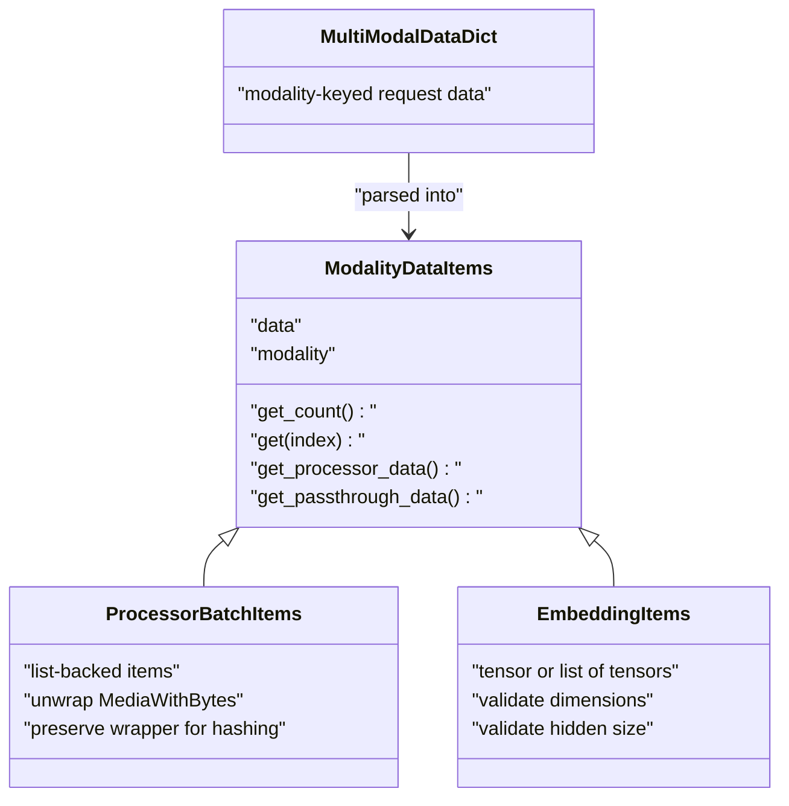

<!-- source: DeepWiki mcp.deepwiki.com · repo vllm-project/vllm · page 5.5 Multimodal Data Processing · fetched 2026-10-28 -->

# Multimodal Data Processing

<details>
<summary>Relevant source files</summary>

The following files were used as context for generating this wiki page:

- [docs/features/multimodal_inputs.md](docs/features/multimodal_inputs.md)
- [docs/usage/security.md](docs/usage/security.md)
- [examples/generate/multimodal/openai_chat_completion_client_for_multimodal.py](examples/generate/multimodal/openai_chat_completion_client_for_multimodal.py)
- [examples/tool_calling/openai_responses_client_with_mcp_tools.py](examples/tool_calling/openai_responses_client_with_mcp_tools.py)
- [examples/tool_calling/openai_responses_client_with_tools.py](examples/tool_calling/openai_responses_client_with_tools.py)
- [tests/config/test_multimodal_config.py](tests/config/test_multimodal_config.py)
- [tests/entrypoints/speech_to_text/transcription/test_transcription_validation_whisper.py](tests/entrypoints/speech_to_text/transcription/test_transcription_validation_whisper.py)
- [tests/kernels/quant_utils.py](tests/kernels/quant_utils.py)
- [tests/models/fixtures/ministral_3b_chat.json](tests/models/fixtures/ministral_3b_chat.json)
- [tests/models/multimodal/generation/test_pixtral.py](tests/models/multimodal/generation/test_pixtral.py)
- [tests/models/multimodal/generation/test_voxtral.py](tests/models/multimodal/generation/test_voxtral.py)
- [tests/models/multimodal/generation/test_voxtral_realtime.py](tests/models/multimodal/generation/test_voxtral_realtime.py)
- [tests/models/multimodal/processing/test_common.py](tests/models/multimodal/processing/test_common.py)
- [tests/models/multimodal/processing/test_glm4_1v.py](tests/models/multimodal/processing/test_glm4_1v.py)
- [tests/models/multimodal/processing/test_mllama4.py](tests/models/multimodal/processing/test_mllama4.py)
- [tests/models/multimodal/processing/test_moss_audio.py](tests/models/multimodal/processing/test_moss_audio.py)
- [tests/models/utils.py](tests/models/utils.py)
- [tests/multimodal/media/test_audio.py](tests/multimodal/media/test_audio.py)
- [tests/multimodal/media/test_connector.py](tests/multimodal/media/test_connector.py)
- [tests/multimodal/media/test_unprocessable_entity_error.py](tests/multimodal/media/test_unprocessable_entity_error.py)
- [tests/multimodal/media/test_video.py](tests/multimodal/media/test_video.py)
- [tests/multimodal/test_audio.py](tests/multimodal/test_audio.py)
- [tests/multimodal/test_cache.py](tests/multimodal/test_cache.py)
- [tests/multimodal/test_gpu_ipc_memory.py](tests/multimodal/test_gpu_ipc_memory.py)
- [tests/multimodal/test_hasher.py](tests/multimodal/test_hasher.py)
- [tests/multimodal/test_inputs.py](tests/multimodal/test_inputs.py)
- [tests/multimodal/test_parse.py](tests/multimodal/test_parse.py)
- [tests/multimodal/test_processing.py](tests/multimodal/test_processing.py)
- [tests/multimodal/test_utils.py](tests/multimodal/test_utils.py)
- [tests/multimodal/test_video.py](tests/multimodal/test_video.py)
- [tests/multimodal/utils.py](tests/multimodal/utils.py)
- [tests/test_audio_media_size_precheck.py](tests/test_audio_media_size_precheck.py)
- [tests/test_connections.py](tests/test_connections.py)
- [tests/transformers_utils/processors/__init__.py](tests/transformers_utils/processors/__init__.py)
- [tests/transformers_utils/processors/test_pixtral.py](tests/transformers_utils/processors/test_pixtral.py)
- [tests/transformers_utils/processors/test_voxtral.py](tests/transformers_utils/processors/test_voxtral.py)
- [tests/transformers_utils/test_processor.py](tests/transformers_utils/test_processor.py)
- [tests/v1/core/test_encoder_cache_manager.py](tests/v1/core/test_encoder_cache_manager.py)
- [tests/v1/core/test_output.py](tests/v1/core/test_output.py)
- [tests/v1/worker/test_gpu_model_runner_mm_gather.py](tests/v1/worker/test_gpu_model_runner_mm_gather.py)
- [vllm/config/ec_manager_config.py](vllm/config/ec_manager_config.py)
- [vllm/config/multimodal.py](vllm/config/multimodal.py)
- [vllm/connections.py](vllm/connections.py)
- [vllm/entrypoints/speech_to_text/realtime/connection.py](vllm/entrypoints/speech_to_text/realtime/connection.py)
- [vllm/model_executor/layers/attention/cross_attention.py](vllm/model_executor/layers/attention/cross_attention.py)
- [vllm/model_executor/models/pixtral.py](vllm/model_executor/models/pixtral.py)
- [vllm/model_executor/models/voxtral.py](vllm/model_executor/models/voxtral.py)
- [vllm/model_executor/models/voxtral_realtime.py](vllm/model_executor/models/voxtral_realtime.py)
- [vllm/model_executor/models/whisper_causal.py](vllm/model_executor/models/whisper_causal.py)
- [vllm/models/minimax_m3/common/mm_preprocess.py](vllm/models/minimax_m3/common/mm_preprocess.py)
- [vllm/multimodal/audio.py](vllm/multimodal/audio.py)
- [vllm/multimodal/gpu_ipc_memory.py](vllm/multimodal/gpu_ipc_memory.py)
- [vllm/multimodal/hasher.py](vllm/multimodal/hasher.py)
- [vllm/multimodal/inputs.py](vllm/multimodal/inputs.py)
- [vllm/multimodal/media/audio.py](vllm/multimodal/media/audio.py)
- [vllm/multimodal/media/base.py](vllm/multimodal/media/base.py)
- [vllm/multimodal/media/connector.py](vllm/multimodal/media/connector.py)
- [vllm/multimodal/media/video.py](vllm/multimodal/media/video.py)
- [vllm/multimodal/parse.py](vllm/multimodal/parse.py)
- [vllm/multimodal/processing/context.py](vllm/multimodal/processing/context.py)
- [vllm/multimodal/processing/dummy_inputs.py](vllm/multimodal/processing/dummy_inputs.py)
- [vllm/multimodal/processing/inputs.py](vllm/multimodal/processing/inputs.py)
- [vllm/multimodal/processing/processor.py](vllm/multimodal/processing/processor.py)
- [vllm/multimodal/utils.py](vllm/multimodal/utils.py)
- [vllm/multimodal/video.py](vllm/multimodal/video.py)
- [vllm/multimodal/video_decoders/__init__.py](vllm/multimodal/video_decoders/__init__.py)
- [vllm/multimodal/video_decoders/base.py](vllm/multimodal/video_decoders/base.py)
- [vllm/multimodal/video_decoders/deepstream.py](vllm/multimodal/video_decoders/deepstream.py)
- [vllm/multimodal/video_decoders/opencv.py](vllm/multimodal/video_decoders/opencv.py)
- [vllm/multimodal/video_decoders/pynvvideocodec.py](vllm/multimodal/video_decoders/pynvvideocodec.py)
- [vllm/multimodal/video_decoders/torchcodec.py](vllm/multimodal/video_decoders/torchcodec.py)
- [vllm/transformers_utils/processor.py](vllm/transformers_utils/processor.py)
- [vllm/transformers_utils/processors/pixtral.py](vllm/transformers_utils/processors/pixtral.py)
- [vllm/transformers_utils/processors/voxtral.py](vllm/transformers_utils/processors/voxtral.py)
- [vllm/v1/core/encoder_cache_manager.py](vllm/v1/core/encoder_cache_manager.py)
- [vllm/v1/core/sched/output.py](vllm/v1/core/sched/output.py)

</details>


## Purpose and Scope

This page follows multimodal request data from its public input representation through parsing and model-specific processing, media decoding, and encoder execution. It covers `MultiModalDataDict`, modality item abstractions, the multimodal processor framework, video-loader registration and audio decoding, processor and encoder caching concepts, prompt updates, and chat-message input formats. [docs/features/multimodal_inputs.md:16-22]() [vllm/multimodal/parse.py:22-39]() [vllm/multimodal/processing/processor.py:34-55]()

**Sources:** [docs/features/multimodal_inputs.md:16-22]() [vllm/multimodal/parse.py:22-39]() [vllm/multimodal/processing/processor.py:34-55]()

---

## Chat Message Multimodal Integration and Parsing

The public input path supports multimodal data in two related forms: a prompt paired with `multi_modal_data`, and chat messages whose content includes text and media items. The offline-input documentation describes `multi_modal_data` as a dictionary following the `MultiModalDataDict` schema. Its chat examples show content parts for image URLs, PIL images, precomputed image embeddings, and text; video can also be represented in chat as a sequence of image-frame content parts. [docs/features/multimodal_inputs.md:16-22]() [docs/features/multimodal_inputs.md:106-152]() [docs/features/multimodal_inputs.md:154-186]()

In the processing layer, `MultiModalDataParser` converts modality data into typed modality-item collections. `ModalityDataItems` provides a common interface for counting and retrieving items, plus separate methods for data passed to a Hugging Face processor and data passed directly to the model. [vllm/multimodal/parse.py:60-112]()

### Supported Content Forms

| Chat or request content | Role in the input |
|---|---|
| `image_url` | Supplies an image by URL. |
| `image_pil` | Supplies an image as a PIL object. |
| `image_embeds` | Supplies precomputed image embeddings. |
| `text` | Supplies ordinary text alongside multimodal content. |
| Video frames represented as `image_url` items | Represents a video as a sequence of frame images in the documented chat example. |
| `multi_modal_data` | Carries modality-keyed data alongside a prompt. |

The supported chat examples and offline prompt form are documented in the multimodal-input guide. [docs/features/multimodal_inputs.md:16-22]() [docs/features/multimodal_inputs.md:106-152]() [docs/features/multimodal_inputs.md:154-186]()

### Natural Language Space to Code Entity Space: Chat Inputs

The diagram connects documented message shapes and prompt inputs to the code-level multimodal data types and parser abstractions. The supplied source excerpts establish the input schema name and parser types; they do not include the chat parser implementation, so no parser function is inferred here. [docs/features/multimodal_inputs.md:16-22]() [docs/features/multimodal_inputs.md:106-152]() [vllm/multimodal/parse.py:22-39]() [vllm/multimodal/parse.py:60-112]()

**Diagram: Chat content to modality-item parsing**

```mermaid
flowchart LR
    subgraph "Natural Language Space"
        "Chat message content: text, image_url, image_pil, image_embeds"
        "Prompt plus multi_modal_data"
        "Video frames represented as image_url parts"
    end
    subgraph "Code Entity Space"
        "MultiModalDataDict"
        "MultiModalDataParser"
        "MultiModalDataItems"
        "ModalityDataItems"
    end
    "Chat message content: text, image_url, image_pil, image_embeds" --> "MultiModalDataDict"
    "Prompt plus multi_modal_data" --> "MultiModalDataDict"
    "Video frames represented as image_url parts" --> "MultiModalDataDict"
    "MultiModalDataDict" --> "MultiModalDataParser"
    "MultiModalDataParser" --> "MultiModalDataItems"
    "MultiModalDataItems" --> "ModalityDataItems"
```

**Sources:** [docs/features/multimodal_inputs.md:16-22]() [docs/features/multimodal_inputs.md:106-152]() [docs/features/multimodal_inputs.md:154-186]() [vllm/multimodal/parse.py:22-39]() [vllm/multimodal/parse.py:60-112]()

---

## `MultiModalDataDict` and Multimodal Input Types

`MultiModalDataDict` is the modality-keyed request-data type imported by the parser from `vllm.inputs`. The parser module also defines `ModalityDataItems`, a generic abstraction that stores data and its modality name, exposes `get_count`, `get`, `get_all`, and separates processor input data from model passthrough data. [vllm/multimodal/parse.py:22-39]() [vllm/multimodal/parse.py:60-112]()

`ProcessorBatchItems` is the list-backed implementation: it unwraps `MediaWithBytes` when retrieving an item, but preserves the original wrapper for hashing. Its processor data is returned under a pluralized modality key, while its passthrough data is empty. [vllm/multimodal/parse.py:115-137]()

`EmbeddingItems` accepts either a batched tensor or a list of tensors. It validates that a single embedding has two or three dimensions, and that each embedding in a list is two-dimensional; it can also validate the expected hidden size. [vllm/multimodal/parse.py:139-203]()

| Abstraction | Responsibility |
|---|---|
| `MultiModalDataDict` | Modality-keyed input dictionary accepted by the multimodal input schema. |
| `ModalityDataItems` | Common indexed interface for parsed items; separates processor data from passthrough data. |
| `ProcessorBatchItems` | Represents sequence-backed items and preserves wrapped data for hashing. |
| `EmbeddingItems` | Represents embedding tensors and validates embedding dimensionality. |

**Sources:** [vllm/multimodal/parse.py:22-39]() [vllm/multimodal/parse.py:60-112]() [vllm/multimodal/parse.py:115-137]() [vllm/multimodal/parse.py:139-203]()

### Modality Item Relationships

**Diagram: Data dictionary and parser abstractions**



**Sources:** [vllm/multimodal/parse.py:22-39]() [vllm/multimodal/parse.py:60-112]() [vllm/multimodal/parse.py:115-137]() [vllm/multimodal/parse.py:139-203]()

---

## Registry, Processor Factories, and Processing Info

The multimodal processing framework is organized around `BaseMultiModalProcessor`, `BaseProcessingInfo`, processor inputs, and modality-specific parsing. The processor module imports the parsed multimodal item types and defines prompt-update structures used to align processed multimodal content with prompt token positions. [vllm/multimodal/processing/processor.py:34-55]() [vllm/multimodal/processing/processor.py:91-103]() [vllm/multimodal/processing/processor.py:158-228]()

A model-specific processor can provide information about the tokenizer, media processor, and data parser. For example, `VoxtralProcessingInfo` obtains its Mistral tokenizer and feature extractor, creates a `MultiModalDataParser` with the target sample rate and channel count, and declares an audio-item limit. `VoxtralMultiModalProcessor` derives from `BaseMultiModalProcessor` and builds dummy inputs through the processor framework. [vllm/model_executor/models/voxtral.py:83-129]() [vllm/model_executor/models/voxtral.py:132-175]()

`cached_encode` applies an LRU cache to repeated tokenizer calls, keyed by tokenizer, text, and relevant encoding options. [vllm/multimodal/processing/processor.py:58-71]()

### Processor Inputs and Prompt Updates

`PromptIndex` describes how to locate a position in a tokenized or decoded prompt. `PromptIndexTargets` supplies start, prefix, and end targets. `PromptUpdateDetails` carries the full token sequence for an update and can optionally identify which token positions receive embeddings. These structures support matching multimodal placeholders to the prompt representation. [vllm/multimodal/processing/processor.py:74-155]() [vllm/multimodal/processing/processor.py:174-228]()

**Diagram: Processor concepts from request data to model-specific input**

```mermaid
flowchart LR
    "MultiModalDataDict" --> "MultiModalDataParser"
    "MultiModalDataParser" --> "ModalityDataItems"
    "ModalityDataItems" --> "BaseMultiModalProcessor"
    "BaseProcessingInfo" --> "BaseMultiModalProcessor"
    "BaseMultiModalProcessor" --> "ProcessorInputs"
    "BaseMultiModalProcessor" --> "PromptUpdate"
    "PromptUpdate" --> "PromptIndex"
    "PromptUpdate" --> "PromptUpdateDetails"
    "VoxtralProcessingInfo" --> "VoxtralMultiModalProcessor"
    "VoxtralMultiModalProcessor" --> "ProcessorInputs"
```

**Sources:** [vllm/multimodal/parse.py:60-112]() [vllm/multimodal/processing/processor.py:34-55]() [vllm/multimodal/processing/processor.py:74-155]() [vllm/multimodal/processing/processor.py:174-228]() [vllm/model_executor/models/voxtral.py:83-175]()

### Processor Configuration

`mm_processor_kwargs` supports shared flat options and modality-specific Hugging Face processor scopes: `text_kwargs`, `images_kwargs`, `videos_kwargs`, and `audio_kwargs`. `_merge_mm_processor_kwargs` recursively merges nested mappings; for scoped values, the documented precedence is configured flat, configured scoped, inference flat, then inference scoped. [vllm/config/multimodal.py:30-39]() [vllm/config/multimodal.py:42-60]() [vllm/config/multimodal.py:63-94]() [vllm/config/multimodal.py:97-143]()

**Sources:** [vllm/config/multimodal.py:30-39]() [vllm/config/multimodal.py:42-60]() [vllm/config/multimodal.py:63-94]() [vllm/config/multimodal.py:97-143]()

---

## Image, Audio, and Video Decoding, and Caching

### Image and Audio Parsing

`vllm.multimodal.parse` imports image normalization and conversion helpers, audio normalization and resampling helpers, and modality-specific item types. The parser therefore forms the boundary between public modality data and the structured inputs used by processors. [vllm/multimodal/parse.py:22-39]()

The supplied audio implementation identifies `soundfile`, PyAV, and torchcodec as available decoding backends, with `"auto"` attempting torchcodec, then soundfile, then PyAV. `load_audio_pyav` opens the audio container, checks for an audio stream, and can reject a file based on duration metadata before decoding. Its decoding loop tracks samples and decoded bytes, with options for duration and byte limits. [vllm/multimodal/media/audio.py:30-76]() [vllm/multimodal/media/audio.py:82-112]() [vllm/multimodal/media/audio.py:113-174]()

### Video Loader Registry and Decoding

`VideoLoaderRegistry` maps loader names to loader classes and can associate video processor class names with backend names. It separately tracks whether a backend requires a GPU. `get_video_loader_backend_for_processor` exposes the processor-to-backend lookup. [vllm/multimodal/video.py:36-98]()

`VideoLoader.load_bytes` is the abstract interface for loading video bytes into decoded frames and metadata. Its return type permits either a host NumPy array or a device tensor, depending on the selected codec. `VideoBackend` is registered as the `"opencv"` loader, and its documented sampling policy is uniform sampling, with the decoder codec selected independently through the `backend` keyword argument. [vllm/multimodal/video.py:131-178]() [vllm/multimodal/video.py:197-210]()

The frame helpers resize frames through OpenCV and can sample a requested number of frames at evenly spaced indices. `VideoLoader.create_hf_metadata` produces metadata fields including total frames, FPS, duration, backend, sampled indices, and whether all frames were selected. [vllm/multimodal/video.py:100-128]() [vllm/multimodal/video.py:180-195]()

### Video Backend Selection

**Diagram: Video processor registration and decoder selection**

```mermaid
flowchart LR
    "video_processor class name" --> "get_video_loader_backend_for_processor()"
    "VideoLoaderRegistry.processor2backend" --> "get_video_loader_backend_for_processor()"
    "VideoLoaderRegistry.name2class" --> "VideoLoader.load_bytes()"
    "VideoBackend" --> "VIDEO_LOADER_REGISTRY.register(opencv)"
    "VideoLoader.load_bytes()" --> "decode_video()"
    "decode_video()" --> "opencv"
    "decode_video()" --> "torchcodec"
    "decode_video()" --> "pynvvideocodec"
    "decode_video()" --> "deepstream"
    "VideoLoader.create_hf_metadata()" --> "video metadata"
```

The decoder module and its lazy-import behavior are exercised by tests: selecting a decoder backend imports only that backend module. [tests/multimodal/test_video.py:122-179]()

**Sources:** [vllm/multimodal/video.py:36-98]() [vllm/multimodal/video.py:131-210]() [vllm/multimodal/video.py:180-198]() [tests/multimodal/test_video.py:122-179]()

### Caching and Resource Limits

The parser’s `ProcessorBatchItems.get_item_for_hash` preserves `MediaWithBytes` wrappers when data is used for hashing, retaining access to original bytes where present. `cached_encode` separately caches repeated tokenizer encoding calls. [vllm/multimodal/parse.py:115-133]() [vllm/multimodal/processing/processor.py:58-71]()

Media fetching and decoding are resource-sensitive. The security guidance recommends restricting media URL domains and describes configurable limits for remote download size, aggregate request download size, decoded image pixels, aggregate decoded request bytes, audio file size and duration, audio decode bytes, and embedding densification. [docs/usage/security.md:63-107]()

The supplied materials identify `MultiModalProcessorOnlyCache` in multimodal tests and `EncoderRunner`/encoder cache in the prior page content, but do not include those implementation files. Accordingly, implementation details of those caches are not expanded here. [tests/models/multimodal/processing/test_common.py:26-30]() [vllm/v1/worker/gpu/mm/encoder_runner.py:34-60]()

**Sources:** [vllm/multimodal/parse.py:115-133]() [vllm/multimodal/processing/processor.py:58-71]() [docs/usage/security.md:63-107]() [tests/models/multimodal/processing/test_common.py:26-30]() [vllm/v1/worker/gpu/mm/encoder_runner.py:34-60]()

---

## Encoder Runner and Multimodal Execution

`EncoderRunner` is the GPU-side component identified by the existing page content as coordinating multimodal encoder work. The supplied file listing does not include its implementation, so exact method behavior and internal call sequences cannot be verified from the available source excerpts. The following diagram therefore shows only the high-level relationship between processor-produced inputs, encoder execution, and encoder cache identified by the existing page content. [vllm/v1/worker/gpu/mm/encoder_runner.py:34-172]() [vllm/multimodal/processing/processor.py:34-55]()

### Encoder Flow: Processor Inputs to Encoder Cache

**Diagram: High-level multimodal encoder path**

```mermaid
flowchart LR
    "ProcessorInputs" --> "EncoderRunner"
    "EncoderRunner" --> "model.embed_multimodal()"
    "EncoderRunner" --> "EncoderCache"
    "EncoderCache" --> "multimodal feature reuse"
```

**Sources:** [vllm/multimodal/processing/processor.py:34-55]() [vllm/v1/worker/gpu/mm/encoder_runner.py:34-172]()

---

## Input Management: Placeholder Ranges and Prefix Caching

Prompt processing must associate multimodal content with prompt positions. The processor framework defines `PromptIndex` and prompt-update types for locating and replacing prompt regions; `PromptUpdateDetails` can mark which tokens correspond to embeddings. [vllm/multimodal/processing/processor.py:91-103]() [vllm/multimodal/processing/processor.py:158-228]()

The multimodal input module defines `PlaceholderRange`, which the existing page identifies as carrying offset, length, and optional embedding-mask information. The implementation file is listed among the supplied additional files, but its contents are not shown here; details beyond that existing description are therefore not expanded. [vllm/multimodal/inputs.py:121-206]()

**Sources:** [vllm/multimodal/processing/processor.py:91-103]() [vllm/multimodal/processing/processor.py:158-228]() [vllm/multimodal/inputs.py:121-206]()

---

## Security Considerations for Media Inputs

Multimodal requests that reference remote media can cause the server to make outbound requests. The security guidance recommends setting `--allowed-media-domains` and considering `VLLM_MEDIA_URL_ALLOW_REDIRECTS=0` to prevent redirects from bypassing domain restrictions. [docs/usage/security.md:63-86]()

The same guidance documents limits intended to constrain oversized downloads and decoded media allocations, including `VLLM_MAX_MEDIA_DOWNLOAD_SIZE_MB`, `VLLM_MAX_MEDIA_REQUEST_DOWNLOAD_SIZE_MB`, `VLLM_MAX_IMAGE_PIXELS`, `VLLM_MAX_MEDIA_REQUEST_DECODE_BYTES`, `VLLM_MAX_AUDIO_CLIP_FILESIZE_MB`, `VLLM_MAX_AUDIO_DECODE_DURATION_S`, `VLLM_MAX_AUDIO_DECODE_BYTES`, and `VLLM_MAX_EMBED_DECODE_BYTES`. Setting these limits to zero disables the corresponding protection; the documentation advises against doing so for deployments exposed to untrusted users. [docs/usage/security.md:88-107]()

**Sources:** [docs/usage/security.md:63-86]() [docs/usage/security.md:88-107]()

---

## Summary

`MultiModalDataDict` is the request-level modality mapping. `MultiModalDataParser` and `ModalityDataItems` provide structured item access and distinguish processor data from model passthrough data. Model-specific processors build on `BaseMultiModalProcessor` and processing-info objects; prompt-update structures connect multimodal features to prompt token positions. Media decoding is backend-specific: audio supports soundfile, PyAV, and torchcodec choices, while video uses a loader registry and selectable decoder backends. Processor encoding and media limits address repeated work and resource use; details of `EncoderRunner` internals are limited to the references available in the supplied material. [vllm/multimodal/parse.py:22-39]() [vllm/multimodal/parse.py:60-137]() [vllm/multimodal/processing/processor.py:34-55]() [vllm/multimodal/processing/processor.py:174-228]() [vllm/multimodal/media/audio.py:62-76]() [vllm/multimodal/video.py:36-98]() [docs/usage/security.md:88-107]()

**Sources:** [vllm/multimodal/parse.py:22-39]() [vllm/multimodal/parse.py:60-137]() [vllm/multimodal/processing/processor.py:34-55]() [vllm/multimodal/processing/processor.py:174-228]() [vllm/multimodal/media/audio.py:62-76]() [vllm/multimodal/video.py:36-98]() [docs/usage/security.md:88-107]()

---

## Natural Language Space to Code Entity Space

This summary diagram associates user-visible multimodal input forms with the code entities that represent and process them. Chat input shapes are drawn from the usage documentation; parser, processor, and video-loader entities are named as they appear in the code. [docs/features/multimodal_inputs.md:16-22]() [docs/features/multimodal_inputs.md:106-186]() [vllm/multimodal/parse.py:22-39]() [vllm/multimodal/processing/processor.py:34-55]() [vllm/multimodal/video.py:36-98]()

**Diagram: User inputs mapped to code entities**

```mermaid
flowchart LR
    subgraph "Natural Language Space"
        "image_url"
        "image_pil"
        "image_embeds"
        "audio input"
        "video frame sequence"
        "text prompt"
    end
    subgraph "Code Entity Space"
        "MultiModalDataDict"
        "MultiModalDataParser"
        "ModalityDataItems"
        "BaseMultiModalProcessor"
        "VIDEO_LOADER_REGISTRY"
        "VideoLoader.load_bytes()"
        "load_audio_pyav()"
        "PromptUpdateDetails"
        "EncoderRunner"
    end
    "image_url" --> "MultiModalDataDict"
    "image_pil" --> "MultiModalDataDict"
    "image_embeds" --> "MultiModalDataDict"
    "audio input" --> "MultiModalDataDict"
    "video frame sequence" --> "MultiModalDataDict"
    "text prompt" --> "PromptUpdateDetails"
    "MultiModalDataDict" --> "MultiModalDataParser"
    "MultiModalDataParser" --> "ModalityDataItems"
    "ModalityDataItems" --> "BaseMultiModalProcessor"
    "BaseMultiModalProcessor" --> "VideoLoader.load_bytes()"
    "BaseMultiModalProcessor" --> "load_audio_pyav()"
    "VideoLoader.load_bytes()" --> "VIDEO_LOADER_REGISTRY"
    "BaseMultiModalProcessor" --> "PromptUpdateDetails"
    "BaseMultiModalProcessor" --> "EncoderRunner"
```

**Sources:** [docs/features/multimodal_inputs.md:16-22]() [docs/features/multimodal_inputs.md:106-186]() [vllm/multimodal/parse.py:22-39]() [vllm/multimodal/parse.py:60-112]() [vllm/multimodal/processing/processor.py:34-55]() [vllm/multimodal/processing/processor.py:174-228]() [vllm/multimodal/video.py:36-98]() [vllm/multimodal/video.py:131-178]() [vllm/multimodal/media/audio.py:82-112]() [vllm/v1/worker/gpu/mm/encoder_runner.py:34-172]()

---

