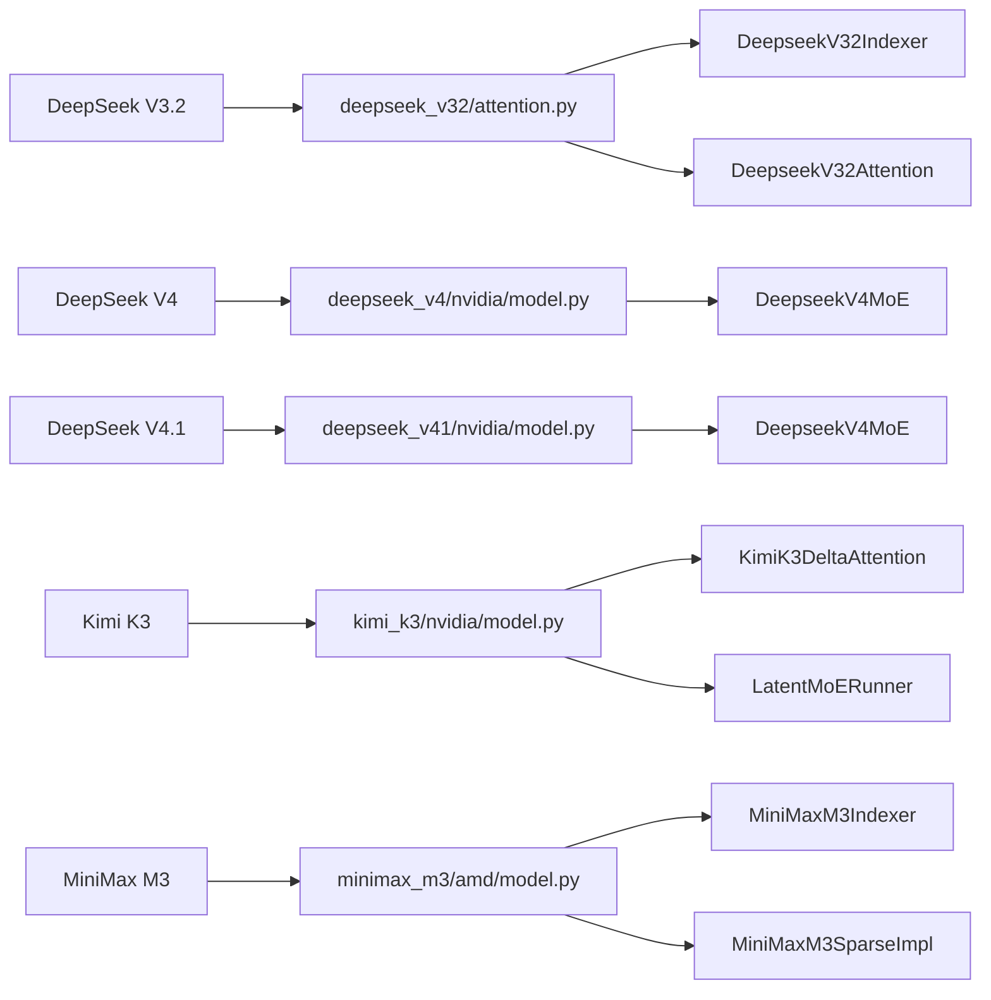
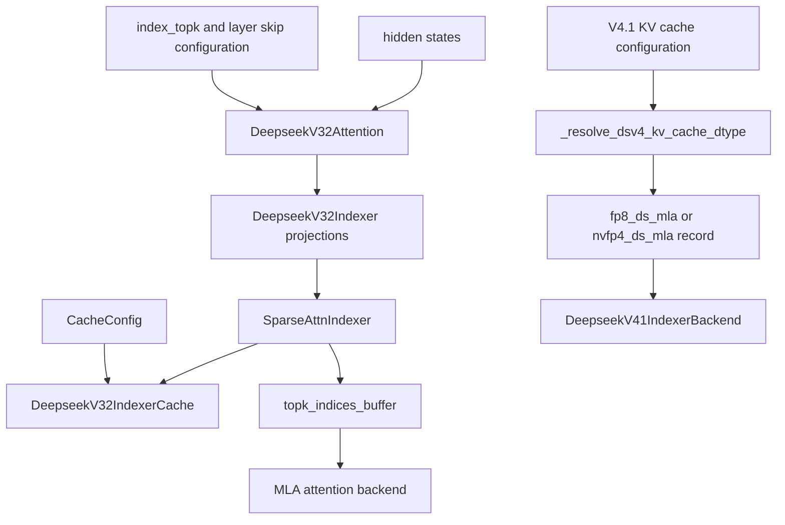
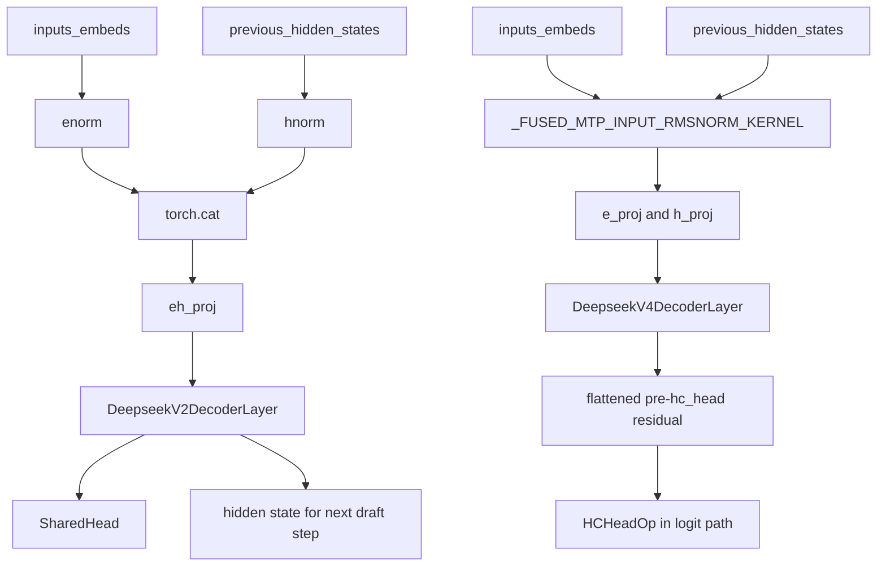
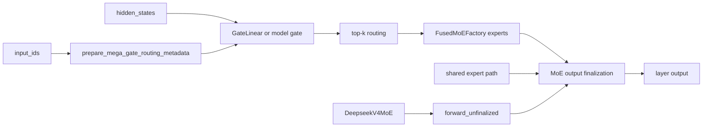
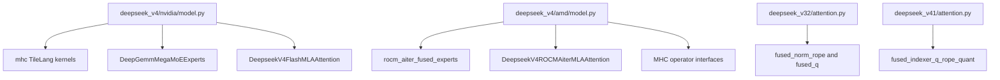

<!-- source: DeepWiki mcp.deepwiki.com · repo vllm-project/vllm · page 5.6 Vendor Model Implementations (vllm/models) · fetched 2026-10-28 -->

# Vendor Model Implementations (vllm/models)

Relevant source files

The following files were used as context for generating this wiki page:

- [cmake/external_projects/fmha_sm100.cmake](cmake/external_projects/fmha_sm100.cmake)
- [docs/design/plugin_system.md](docs/design/plugin_system.md)
- [docs/features/index_cache.md](docs/features/index_cache.md)
- [tests/distributed/test_engram_dp_shard.py](tests/distributed/test_engram_dp_shard.py)
- [tests/distributed/test_minimax_m3_indexer_cp_tp.py](tests/distributed/test_minimax_m3_indexer_cp_tp.py)
- [tests/kernels/attention/test_minimax_m3.py](tests/kernels/attention/test_minimax_m3.py)
- [tests/kernels/attention/test_minimax_m3_fp8_triton_indexer.py](tests/kernels/attention/test_minimax_m3_fp8_triton_indexer.py)
- [tests/kernels/attention/test_minimax_m3_indexer_cp.py](tests/kernels/attention/test_minimax_m3_indexer_cp.py)
- [tests/kernels/attention/test_minimax_m3_msa_cutlass_sparse_decode.py](tests/kernels/attention/test_minimax_m3_msa_cutlass_sparse_decode.py)
- [tests/kernels/test_engram.py](tests/kernels/test_engram.py)
- [tests/kernels/test_fused_deepseek_v32_norm_rope.py](tests/kernels/test_fused_deepseek_v32_norm_rope.py)
- [tests/kernels/test_fused_minimax_m3_qknorm_rope_kv_insert.py](tests/kernels/test_fused_minimax_m3_qknorm_rope_kv_insert.py)
- [tests/kernels/test_minimax_m3_sparse_attn_fp8_scale.py](tests/kernels/test_minimax_m3_sparse_attn_fp8_scale.py)
- [tests/model_executor/layers/test_mla_short_prefill_indexer.py](tests/model_executor/layers/test_mla_short_prefill_indexer.py)
- [tests/model_executor/model_loader/test_filter_duplicate_safetensors.py](tests/model_executor/model_loader/test_filter_duplicate_safetensors.py)
- [tests/model_executor/test_routed_experts_capture.py](tests/model_executor/test_routed_experts_capture.py)
- [tests/models/deepseek_v32/test_sequence_parallel.py](tests/models/deepseek_v32/test_sequence_parallel.py)
- [tests/models/kimi_k3/test_sequence_parallel.py](tests/models/kimi_k3/test_sequence_parallel.py)
- [tests/models/minimax_m3/amd_specialized_decode/_xcd_stress.py](tests/models/minimax_m3/amd_specialized_decode/_xcd_stress.py)
- [tests/models/minimax_m3/amd_specialized_decode/test_model.py](tests/models/minimax_m3/amd_specialized_decode/test_model.py)
- [tests/models/minimax_m3/amd_specialized_decode/test_ops.py](tests/models/minimax_m3/amd_specialized_decode/test_ops.py)
- [tests/models/minimax_m3/amd_specialized_decode/test_runtime.py](tests/models/minimax_m3/amd_specialized_decode/test_runtime.py)
- [tests/models/test_deepseek_v41_decoder_replay_layers.py](tests/models/test_deepseek_v41_decoder_replay_layers.py)
- [tests/models/test_deepseek_v41_replay_batch.py](tests/models/test_deepseek_v41_replay_batch.py)
- [tests/models/test_deepseek_v41_replay_start.py](tests/models/test_deepseek_v41_replay_start.py)
- [tests/models/test_deepseek_v4_dspark_rocm.py](tests/models/test_deepseek_v4_dspark_rocm.py)
- [tests/models/test_deepseek_v4_mega_moe.py](tests/models/test_deepseek_v4_mega_moe.py)
- [tests/models/test_deepseek_v4_vl_rocm.py](tests/models/test_deepseek_v4_vl_rocm.py)
- [tests/v1/cudagraph/test_cudagraph_dispatch.py](tests/v1/cudagraph/test_cudagraph_dispatch.py)
- [tests/v1/cudagraph/test_cudagraph_mode.py](tests/v1/cudagraph/test_cudagraph_mode.py)
- [tests/v1/spec_decode/test_dsv4_mtp_local_argmax.py](tests/v1/spec_decode/test_dsv4_mtp_local_argmax.py)
- [vllm/config/engram.py](vllm/config/engram.py)
- [vllm/cute_utils/mbarrier.py](vllm/cute_utils/mbarrier.py)
- [vllm/forward_context.py](vllm/forward_context.py)
- [vllm/model_executor/kernels/attention/dsa/sparse_mqa_logits.py](vllm/model_executor/kernels/attention/dsa/sparse_mqa_logits.py)
- [vllm/model_executor/kernels/mhc/__init__.py](vllm/model_executor/kernels/mhc/__init__.py)
- [vllm/model_executor/kernels/mhc/aiter.py](vllm/model_executor/kernels/mhc/aiter.py)
- [vllm/model_executor/kernels/mhc/torch.py](vllm/model_executor/kernels/mhc/torch.py)
- [vllm/model_executor/kernels/mhc/triton.py](vllm/model_executor/kernels/mhc/triton.py)
- [vllm/model_executor/layers/fused_moe/routed_experts_capturer.py](vllm/model_executor/layers/fused_moe/routed_experts_capturer.py)
- [vllm/model_executor/layers/mhc.py](vllm/model_executor/layers/mhc.py)
- [vllm/model_executor/layers/mla.py](vllm/model_executor/layers/mla.py)
- [vllm/model_executor/models/deepseek_mtp.py](vllm/model_executor/models/deepseek_mtp.py)
- [vllm/model_executor/models/deepseek_v2.py](vllm/model_executor/models/deepseek_v2.py)
- [vllm/models/common/ops/__init__.py](vllm/models/common/ops/__init__.py)
- [vllm/models/common/ops/fused_allreduce_rms_norm.py](vllm/models/common/ops/fused_allreduce_rms_norm.py)
- [vllm/models/deepseek_v32/__init__.py](vllm/models/deepseek_v32/__init__.py)
- [vllm/models/deepseek_v32/amd/__init__.py](vllm/models/deepseek_v32/amd/__init__.py)
- [vllm/models/deepseek_v32/amd/model.py](vllm/models/deepseek_v32/amd/model.py)
- [vllm/models/deepseek_v32/amd/mtp.py](vllm/models/deepseek_v32/amd/mtp.py)
- [vllm/models/deepseek_v32/amd/rocm.py](vllm/models/deepseek_v32/amd/rocm.py)
- [vllm/models/deepseek_v32/attention.py](vllm/models/deepseek_v32/attention.py)
- [vllm/models/deepseek_v32/common/__init__.py](vllm/models/deepseek_v32/common/__init__.py)
- [vllm/models/deepseek_v32/common/kernels.py](vllm/models/deepseek_v32/common/kernels.py)
- [vllm/models/deepseek_v32/nvidia/model.py](vllm/models/deepseek_v32/nvidia/model.py)
- [vllm/models/deepseek_v32/nvidia/mtp.py](vllm/models/deepseek_v32/nvidia/mtp.py)
- [vllm/models/deepseek_v4/__init__.py](vllm/models/deepseek_v4/__init__.py)
- [vllm/models/deepseek_v4/amd/dspark.py](vllm/models/deepseek_v4/amd/dspark.py)
- [vllm/models/deepseek_v4/amd/model.py](vllm/models/deepseek_v4/amd/model.py)
- [vllm/models/deepseek_v4/amd/mtp.py](vllm/models/deepseek_v4/amd/mtp.py)
- [vllm/models/deepseek_v4/nvidia/dspark.py](vllm/models/deepseek_v4/nvidia/dspark.py)
- [vllm/models/deepseek_v4/nvidia/model.py](vllm/models/deepseek_v4/nvidia/model.py)
- [vllm/models/deepseek_v4/nvidia/mtp.py](vllm/models/deepseek_v4/nvidia/mtp.py)
- [vllm/models/deepseek_v4/quant_config.py](vllm/models/deepseek_v4/quant_config.py)
- [vllm/models/deepseek_v4/xpu/dspark.py](vllm/models/deepseek_v4/xpu/dspark.py)
- [vllm/models/deepseek_v4/xpu/model.py](vllm/models/deepseek_v4/xpu/model.py)
- [vllm/models/deepseek_v4/xpu/mtp.py](vllm/models/deepseek_v4/xpu/mtp.py)
- [vllm/models/deepseek_v41/amd/model.py](vllm/models/deepseek_v41/amd/model.py)
- [vllm/models/deepseek_v41/attention.py](vllm/models/deepseek_v41/attention.py)
- [vllm/models/deepseek_v41/common/engram.py](vllm/models/deepseek_v41/common/engram.py)
- [vllm/models/deepseek_v41/common/ops/query_quant.py](vllm/models/deepseek_v41/common/ops/query_quant.py)
- [vllm/models/deepseek_v41/decoder_replay_layers.py](vllm/models/deepseek_v41/decoder_replay_layers.py)
- [vllm/models/deepseek_v41/nvidia/decoder_replay_cudagraph.py](vllm/models/deepseek_v41/nvidia/decoder_replay_cudagraph.py)
- [vllm/models/deepseek_v41/nvidia/dspark.py](vllm/models/deepseek_v41/nvidia/dspark.py)
- [vllm/models/deepseek_v41/nvidia/model.py](vllm/models/deepseek_v41/nvidia/model.py)
- [vllm/models/deepseek_v41/nvidia/model_state.py](vllm/models/deepseek_v41/nvidia/model_state.py)
- [vllm/models/deepseek_v41/nvidia/ops/engram_peer.py](vllm/models/deepseek_v41/nvidia/ops/engram_peer.py)
- [vllm/models/kimi_k3/nvidia/dspark_mla.py](vllm/models/kimi_k3/nvidia/dspark_mla.py)
- [vllm/models/kimi_k3/nvidia/model.py](vllm/models/kimi_k3/nvidia/model.py)
- [vllm/models/kimi_k3/nvidia/mtp.py](vllm/models/kimi_k3/nvidia/mtp.py)
- [vllm/models/minimax_m3/amd/indexer_aiter.py](vllm/models/minimax_m3/amd/indexer_aiter.py)
- [vllm/models/minimax_m3/amd/indexer_context_parallel.py](vllm/models/minimax_m3/amd/indexer_context_parallel.py)
- [vllm/models/minimax_m3/amd/model.py](vllm/models/minimax_m3/amd/model.py)
- [vllm/models/minimax_m3/amd/model_state.py](vllm/models/minimax_m3/amd/model_state.py)
- [vllm/models/minimax_m3/amd/ops/index_topk.py](vllm/models/minimax_m3/amd/ops/index_topk.py)
- [vllm/models/minimax_m3/amd/ops/indexer_context_parallel.py](vllm/models/minimax_m3/amd/ops/indexer_context_parallel.py)
- [vllm/models/minimax_m3/amd/ops/indexer_cp_exchange.py](vllm/models/minimax_m3/amd/ops/indexer_cp_exchange.py)
- [vllm/models/minimax_m3/amd/ops/sparse_attn.py](vllm/models/minimax_m3/amd/ops/sparse_attn.py)
- [vllm/models/minimax_m3/amd/ops/sparse_pa.py](vllm/models/minimax_m3/amd/ops/sparse_pa.py)
- [vllm/models/minimax_m3/amd/sparse_attention_msa.py](vllm/models/minimax_m3/amd/sparse_attention_msa.py)
- [vllm/models/minimax_m3/amd/specialized_decode/README.md](vllm/models/minimax_m3/amd/specialized_decode/README.md)
- [vllm/models/minimax_m3/amd/specialized_decode/__init__.py](vllm/models/minimax_m3/amd/specialized_decode/__init__.py)
- [vllm/models/minimax_m3/common/indexer.py](vllm/models/minimax_m3/common/indexer.py)
- [vllm/models/minimax_m3/common/ops/index_topk.py](vllm/models/minimax_m3/common/ops/index_topk.py)
- [vllm/models/minimax_m3/common/ops/sparse_attn.py](vllm/models/minimax_m3/common/ops/sparse_attn.py)
- [vllm/models/minimax_m3/common/sparse_attention.py](vllm/models/minimax_m3/common/sparse_attention.py)
- [vllm/models/minimax_m3/nvidia/model.py](vllm/models/minimax_m3/nvidia/model.py)
- [vllm/models/minimax_m3/nvidia/msa_cutlass_sparse_decode.py](vllm/models/minimax_m3/nvidia/msa_cutlass_sparse_decode.py)
- [vllm/models/minimax_m3/nvidia/sparse_attention_msa.py](vllm/models/minimax_m3/nvidia/sparse_attention_msa.py)
- [vllm/v1/cudagraph_dispatcher.py](vllm/v1/cudagraph_dispatcher.py)

## Purpose and Scope

This page describes vendor- and hardware-specialized model implementation patterns in `vllm/models/`, focusing on the supplied DeepSeek V3.2, DeepSeek V4/V4.1, Kimi K3, and MiniMax M3 implementation excerpts. The requested family scope also includes `qwen4_exp`, `glm5next`, `inkling`, `hy_v4`, `dots3_note`, and `step5`; their implementation details are not established by the supplied file excerpts, so this page does not infer their internals.

These implementations compose model-specific layers with shared vLLM facilities for attention, MoE, quantization, distributed execution, weight loading, and speculative decoding. Hardware-specific modules can select different kernels or layouts while preserving the model-family computation. [vllm/models/deepseek_v32/attention.py:14-41](), [vllm/models/deepseek_v4/nvidia/model.py:21-88](), [vllm/models/deepseek_v4/amd/model.py:14-89](), [vllm/models/kimi_k3/nvidia/model.py:21-124](), [vllm/models/minimax_m3/amd/model.py:27-140]()

Sources: [vllm/models/deepseek_v32/attention.py:14-41](), [vllm/models/deepseek_v4/nvidia/model.py:21-88](), [vllm/models/deepseek_v4/amd/model.py:14-89](), [vllm/models/kimi_k3/nvidia/model.py:21-124](), [vllm/models/minimax_m3/amd/model.py:27-140]()

---

## 1. Directory Structure and Vendor Model Layout

The supplied implementation files show a family-oriented layout, with platform-specific subpackages where needed. DeepSeek V4 has NVIDIA and AMD implementations in the excerpts, and the provided file list also identifies an XPU model module. DeepSeek V3.2 has attention and model modules under NVIDIA and AMD paths in the supplied file list. Kimi K3’s shown model is NVIDIA-specific; MiniMax M3 has NVIDIA and AMD model paths. These paths indicate implementation organization, not a guarantee that every family supports every backend. [vllm/models/deepseek_v4/nvidia/model.py:77-88](), [vllm/models/deepseek_v4/amd/model.py:79-89](), [vllm/models/deepseek_v32/attention.py:29-41](), [vllm/models/kimi_k3/nvidia/model.py:100-124](), [vllm/models/minimax_m3/amd/model.py:91-140]()

### Family and backend map

| Family | Evidence in supplied files | Implementation themes evidenced here |
|---|---|---|
| `deepseek_v32` | Attention module; NVIDIA and AMD model paths listed | MLA, sparse indexer cache, top-K token selection, MTP integration |
| `deepseek_v4` | NVIDIA, AMD, and XPU model paths listed | MLA attention, MoE, MegaMoE-related paths, MTP implementation |
| `deepseek_v41` | NVIDIA and AMD model paths listed | V4-derived attention and MoE, sparse cache formats, Engram and decoder replay components |
| `kimi_k3` | NVIDIA model module | Multimodal components, gated-delta attention, MLA, latent MoE |
| `minimax_m3` | NVIDIA and AMD model modules; AMD implementation shown | Sparse indexer/attention paths, multimodal model components, ROCm-specific ops |
| `qwen4_exp`, `glm5next`, `inkling`, `hy_v4`, `dots3_note`, `step5` | Named in the requested scope, but no corresponding source excerpts are provided | Not described here |

Sources: [vllm/models/deepseek_v32/attention.py:29-41](), [vllm/models/deepseek_v4/nvidia/model.py:77-88](), [vllm/models/deepseek_v4/amd/model.py:79-89](), [vllm/models/deepseek_v41/attention.py:63-84](), [vllm/models/deepseek_v41/nvidia/model.py:78-100](), [vllm/models/kimi_k3/nvidia/model.py:100-124](), [vllm/models/minimax_m3/amd/model.py:91-140]()

### Model implementation responsibilities

A model module typically assembles shared layers rather than implementing every primitive itself. The excerpts show model code importing shared linear layers, normalization, attention, MoE factories, quantization interfaces, distributed groups, and weight-loading helpers. Family-specific code supplies architecture-specific wiring, routing metadata, cache formats, and kernel choices. [vllm/model_executor/models/deepseek_v2.py:35-113](), [vllm/models/deepseek_v4/nvidia/model.py:21-88](), [vllm/models/kimi_k3/nvidia/model.py:21-124]()

**Diagram 1: Vendor family names mapped to implementation entities**

Sources: [vllm/models/deepseek_v32/attention.py:50](), [vllm/models/deepseek_v4/nvidia/model.py:77-88](), [vllm/models/deepseek_v41/nvidia/model.py:78-100](), [vllm/models/kimi_k3/nvidia/model.py:100-108](), [vllm/models/minimax_m3/amd/model.py:91-140]()

---

## 2. Sparse Multi-Latent Attention and Indexing

### DeepSeek V3.2 sparse MLA

`DeepseekV32Attention` subclasses the shared `MLAAttention` layer and declares an indexer class, `DeepseekV32Indexer`. The indexer records model-configured top-K and index-head dimensions, builds projections and normalization, and allocates a quantized indexer key cache. It then constructs `SparseAttnIndexer` with the cache, quantization settings, sequence limits, and top-K output buffer. [vllm/models/deepseek_v32/attention.py:50-119]()

The attention constructor derives local head dimensions from tensor-parallel size, handles rotary configuration, and applies per-layer top-K skip policy using `index_topk_freq`, `index_topk_pattern`, and `index_skip_topk_offset`. This supports model-configured sparse-index computation rather than requiring every layer to calculate a fresh selection. [vllm/models/deepseek_v32/attention.py:121-176]()

### DeepSeek V4.1 sparse attention and cache formats

The V4.1 attention module includes indexer backends, sparse-SWA cache support, and helpers for selecting cache record sizes and formats. `_indexer_k_cache_head_dim` distinguishes an FP4-packed indexer cache from the FP8-style record. `_resolve_dsv4_kv_cache_dtype` resolves packed MLA cache formats and updates the cache configuration to the selected format. [vllm/models/deepseek_v41/attention.py:72-84](), [vllm/models/deepseek_v41/attention.py:101-110](), [vllm/models/deepseek_v41/attention.py:131-170]()

On device capability family 100, `_use_v41_mxfp8_kv_record` selects the V4.1-specific packed record path; the module documents the distinction between that format and the record used on other architectures. These are cache-layout decisions in the attention implementation, not just model-weight quantization choices. [vllm/models/deepseek_v41/attention.py:131-139]()

### MiniMax M3 sparse indexer

The AMD MiniMax M3 model derives sparse-attention layer IDs from `sparse_attention_config` and maps those IDs to ordinals. Its `_should_skip_index_topk` logic supports cross-layer index sharing when enabled by configuration: selected sparse layers may reuse a previously produced top-K selection rather than recomputing it. [vllm/models/minimax_m3/amd/model.py:148-185]()

**Diagram 2: Sparse-attention data flow across model and code entities**

Sources: [vllm/models/deepseek_v32/attention.py:50-119](), [vllm/models/deepseek_v32/attention.py:121-176](), [vllm/models/deepseek_v41/attention.py:72-84](), [vllm/models/deepseek_v41/attention.py:101-110](), [vllm/models/deepseek_v41/attention.py:131-170]()

Sources: [vllm/models/deepseek_v32/attention.py:50-119](), [vllm/models/deepseek_v41/attention.py:101-170]()

---

## 3. Multi-Token Prediction Heads

The shared DeepSeek MTP implementation defines `SharedHead`, `DeepSeekMultiTokenPredictorLayer`, and `DeepSeekMultiTokenPredictor`. A predictor layer normalizes input embeddings and the previous hidden state, concatenates them, projects through `eh_proj`, and feeds a DeepSeek V2 decoder layer. It returns the pre-final-norm hidden state and a normalized form for reuse in subsequent draft steps. For V3.2-style configurations, the layer can allocate a shared top-K index buffer for sparse attention. [vllm/model_executor/models/deepseek_mtp.py:51-74](), [vllm/model_executor/models/deepseek_mtp.py:76-144]()

DeepSeek V4 uses a distinct MTP layer. `DeepSeekV4MultiTokenPredictorLayer` has separate `e_proj` and `h_proj` projections, a V4 decoder block, and an `HCHeadOp` for the hypercompressed vocabulary head. The forward path applies a fused input normalization operation, runs the V4 decoder block, and returns a flattened hidden state; the `hc_head` operation is deferred to logit computation. [vllm/models/deepseek_v4/amd/mtp.py:3-11](), [vllm/models/deepseek_v4/amd/mtp.py:62-130](), [vllm/models/deepseek_v4/amd/mtp.py:132-170]()

**Diagram 3: Shared DeepSeek MTP and V4-specific MTP paths**

Sources: [vllm/model_executor/models/deepseek_mtp.py:76-144](), [vllm/models/deepseek_v4/amd/mtp.py:62-130](), [vllm/models/deepseek_v4/amd/mtp.py:132-170]()

Sources: [vllm/model_executor/models/deepseek_mtp.py:51-144](), [vllm/models/deepseek_v4/amd/mtp.py:62-170]()

---

## 4. Mixture of Experts and Specialized Routing

### DeepSeek V4 and V4.1

The NVIDIA DeepSeek V4 implementation imports `FusedMoEFactory`, expert parameter mapping utilities, MegaMoE expert implementations, and routing helpers. `prepare_mega_gate_routing_metadata` packages optional token IDs and image-token masks for MegaGate routing. When image sentinels are present, it identifies the image-token range and can replace those token IDs in the hash-routing input while producing masks for image and hash routing. [vllm/models/deepseek_v4/nvidia/model.py:29-41](), [vllm/models/deepseek_v4/nvidia/model.py:95-123]()

The V4.1 `DeepseekV4MoE` extends the V4 base MoE. It can use a separate expert count and top-K for layers beyond the main hidden-layer range, which covers the model’s draft-layer configuration. Its `forward_unfinalized` path leaves routed top-K reduction and all-reduce open for compatible modular TRTLLM MXFP4 experts, allowing a later fused operation to finalize them. [vllm/models/deepseek_v41/nvidia/model.py:126-153](), [vllm/models/deepseek_v41/nvidia/model.py:155-195]()

### Kimi K3

The Kimi K3 module imports `LatentMoERunner`, `GateLinear`, grouped top-K routing, and MegaMoE-related expert components. Its module-level token threshold documents when router-gate and routed-expert down-projection work may overlap on separate CUDA streams: the intended overlap is for smaller token counts, with sequential execution preferred above the threshold. The model also contains Kimi-specific gated-delta attention and MLA components. [vllm/models/kimi_k3/nvidia/model.py:21-32](), [vllm/models/kimi_k3/nvidia/model.py:100-108](), [vllm/models/kimi_k3/nvidia/model.py:133-138]()

### Shared MoE and MLP building blocks

The DeepSeek V4 `DeepseekV4MLP` uses a merged gate/up projection, a SiLU-and-multiply activation (optionally clamped), and a row-parallel down projection. It supports sequence-parallel mode, where the weights are replicated and the relevant linears disable tensor parallelism, and standard tensor parallel mode, where results are reduced. [vllm/models/deepseek_v4/nvidia/model.py:126-183]()

**Diagram 4: MoE routing and execution entities**

Sources: [vllm/models/deepseek_v4/nvidia/model.py:29-41](), [vllm/models/deepseek_v4/nvidia/model.py:95-123](), [vllm/models/deepseek_v4/nvidia/model.py:126-183](), [vllm/models/deepseek_v41/nvidia/model.py:126-195](), [vllm/models/kimi_k3/nvidia/model.py:21-32]()

Sources: [vllm/models/deepseek_v4/nvidia/model.py:95-123](), [vllm/models/deepseek_v41/nvidia/model.py:126-195](), [vllm/models/kimi_k3/nvidia/model.py:21-138]()

---

## 5. Cross-Platform Sub-Backends

The implementation split lets a family provide platform-specific attention, expert, normalization, or weight-layout paths. The excerpts establish particular NVIDIA and AMD mechanisms; they do not establish that every listed family has NVIDIA, AMD, and XPU support.

| Family / backend | Evidence in supplied excerpts |
|---|---|
| DeepSeek V4 NVIDIA | FlashInfer sparse attention, FlashMLA attention, MegaMoE, and TileLang MHC imports |
| DeepSeek V4 AMD | AITER-backed expert and MLA paths; AITER-dependent gate/up weight preparation |
| DeepSeek V4 XPU | An XPU model path is listed, but its implementation is not shown |
| DeepSeek V4.1 NVIDIA | FlashMLA, FlashInfer sparse attention, Mega attention, and TRTLLM MXFP4 expert integration |
| DeepSeek V3.2 | Sparse MLA/indexer logic is shown; NVIDIA and AMD model paths are listed |
| Kimi K3 NVIDIA | Kimi delta attention, MLA, latent MoE, and low-latency GEMM support |
| MiniMax M3 AMD | AITER indexer and sparse paged-attention paths, ROCm ops, and Gemma-style RMSNorm operations |

Sources: [vllm/models/deepseek_v4/nvidia/model.py:21-88](), [vllm/models/deepseek_v4/amd/model.py:14-89](), [vllm/models/deepseek_v41/nvidia/model.py:78-100](), [vllm/models/kimi_k3/nvidia/model.py:100-108](), [vllm/models/minimax_m3/amd/model.py:91-140]()

### AMD gate/up weight preparation in DeepSeek V4

The AMD `DeepseekV4MLP` enables its AITER path when `rocm_aiter_ops` is available. `prepare_gateup_preshuffle` skips unsupported or unsuitable cases, including the documented gfx1250 restriction, and can replace the gate/up weight with an AITER-shuffled layout. During forward, a prepared weight and scale enable the block-scaled FP8 AITER GEMM path; otherwise the module can use its standard projection path. [vllm/models/deepseek_v4/amd/model.py:96-143](), [vllm/models/deepseek_v4/amd/model.py:145-176](), [vllm/models/deepseek_v4/amd/model.py:178-185]()

### MiniMax M3 AMD path

The AMD MiniMax M3 module describes the ROCm implementation as a platform-specific text-backbone path. It uses a native RMSNorm implementation rather than CUDA-only FlashInfer Gemma RMSNorm kernels, and imports AITER indexer and sparse paged-attention components. It also provides sparse-layer selection and top-K reuse helpers. [vllm/models/minimax_m3/amd/model.py:3-17](), [vllm/models/minimax_m3/amd/model.py:91-140](), [vllm/models/minimax_m3/amd/model.py:148-185]()

Sources: [vllm/models/deepseek_v4/amd/model.py:96-185](), [vllm/models/minimax_m3/amd/model.py:3-17](), [vllm/models/minimax_m3/amd/model.py:91-185]()

---

## 6. Custom Kernels and Fused Operations

The model implementations call into shared custom-kernel and fused-operation layers rather than embedding all low-level kernels in their model classes. The DeepSeek V4 NVIDIA module imports TileLang MHC kernels, MegaMoE expert support, and platform-specific attention implementations. Its AMD counterpart imports AITER MoE operations and MHC operator interfaces. [vllm/models/deepseek_v4/nvidia/model.py:21-41](), [vllm/models/deepseek_v4/amd/model.py:31-53]()

DeepSeek V3.2’s common-kernel module is used by the attention implementation for fused normalization/RoPE and query-related operations. DeepSeek V4.1 also uses common fused indexer operations and defines attention-side cache and indexer handling. [vllm/models/deepseek_v32/attention.py:29-41](), [vllm/models/deepseek_v41/attention.py:35-39]()

**Diagram 5: Model-level calls into platform kernel components**

Sources: [vllm/models/deepseek_v4/nvidia/model.py:21-41](), [vllm/models/deepseek_v4/nvidia/model.py:77-84](), [vllm/models/deepseek_v4/amd/model.py:31-53](), [vllm/models/deepseek_v4/amd/model.py:79-89](), [vllm/models/deepseek_v32/attention.py:29-41](), [vllm/models/deepseek_v41/attention.py:35-39]()

---

## 7. Correctness Tests and Behavioral Contracts

The supplied MiniMax M3 attention tests exercise sparse-attention kernels on CUDA or ROCm, construct cache views using the configured KV layout, and test AMD decode score launch policy across request counts, dimensions, dtypes, and gfx950 conditions. These tests establish that the sparse attention implementation has backend-sensitive behavior that is checked independently of full-model generation. [tests/kernels/attention/test_minimax_m3.py:3-43](), [tests/kernels/attention/test_minimax_m3.py:46-90](), [tests/kernels/attention/test_minimax_m3.py:102-145]()

The DeepSeek V4 MegaMoE tests check routing behavior for main and draft layers, including expert count/top-K selection and image-token routing metadata. The tests also exercise CUDA graph and token-threshold configurations for the relevant test cases. [tests/models/test_deepseek_v4_mega_moe.py:82-128](), [tests/models/test_deepseek_v4_mega_moe.py:130-180]()

Sources: [tests/kernels/attention/test_minimax_m3.py:3-43](), [tests/kernels/attention/test_minimax_m3.py:46-90](), [tests/kernels/attention/test_minimax_m3.py:102-145](), [tests/models/test_deepseek_v4_mega_moe.py:82-180]()

---

## Summary

The supplied vendor-model sources show a layered implementation approach: family-specific modules assemble shared vLLM layers and model interfaces, while sparse attention, routing, cache representations, MTP structure, and hardware-specific kernel paths remain architecture-aware. DeepSeek V3.2 and V4.1 expose sparse MLA/indexer behavior; DeepSeek V4 and V4.1 expose specialized MoE and MTP paths; Kimi K3 combines multimodal, delta-attention, MLA, and latent-MoE components; and MiniMax M3 provides sparse attention and AMD-specific paths. [vllm/models/deepseek_v32/attention.py:50-176](), [vllm/models/deepseek_v4/nvidia/model.py:95-183](), [vllm/models/deepseek_v41/nvidia/model.py:126-195](), [vllm/models/kimi_k3/nvidia/model.py:43-124](), [vllm/models/minimax_m3/amd/model.py:91-185]()

Sources: [vllm/models/deepseek_v32/attention.py:50-176](), [vllm/models/deepseek_v4/nvidia/model.py:95-183](), [vllm/models/deepseek_v41/nvidia/model.py:126-195](), [vllm/models/kimi_k3/nvidia/model.py:43-124](), [vllm/models/minimax_m3/amd/model.py:91-185]()

---

