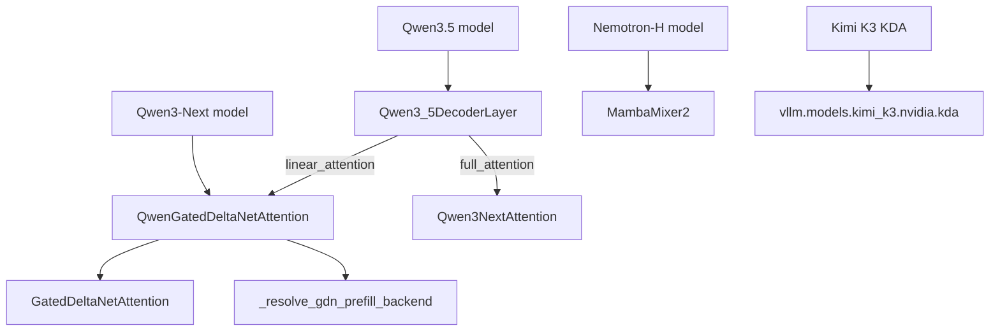
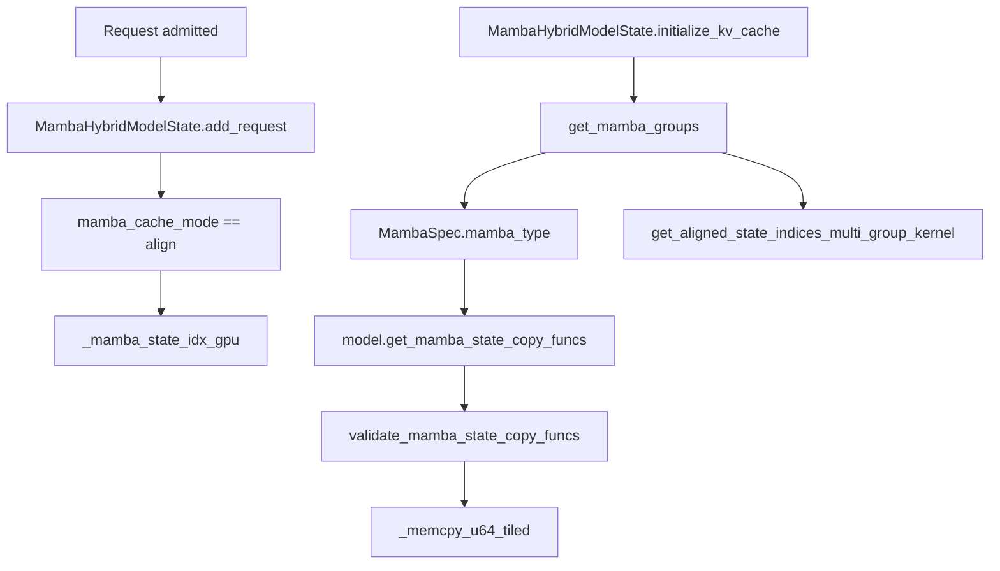
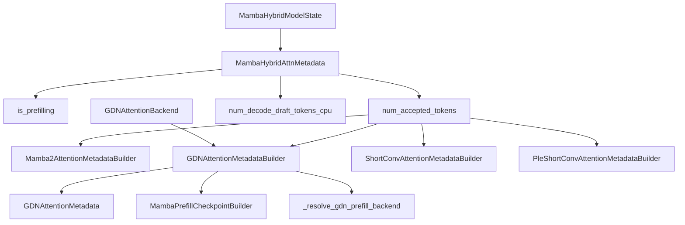

<!-- source: DeepWiki mcp.deepwiki.com · repo vllm-project/vllm · page 5.7 Hybrid and Linear-Attention Models · fetched 2026-10-28 -->

# Hybrid and Linear-Attention Models

Relevant source files

The following files were used as context for generating this wiki page:

- [csrc/rocm/skinny_gemms.cu](csrc/rocm/skinny_gemms.cu)
- [tests/evals/gsm8k/configs/Nemotron-3-Super-120B-A12B-BF16.yaml](tests/evals/gsm8k/configs/Nemotron-3-Super-120B-A12B-BF16.yaml)
- [tests/evals/gsm8k/configs/Nemotron-3-Super-120B-A12B-NVFP4.yaml](tests/evals/gsm8k/configs/Nemotron-3-Super-120B-A12B-NVFP4.yaml)
- [tests/kernels/mamba/test_causal_conv1d.py](tests/kernels/mamba/test_causal_conv1d.py)
- [tests/kernels/mamba/test_checkpoint_exporter.py](tests/kernels/mamba/test_checkpoint_exporter.py)
- [tests/kernels/mamba/test_gdn_fused_mtp.py](tests/kernels/mamba/test_gdn_fused_mtp.py)
- [tests/kernels/mamba/test_gdn_prefill_flashinfer.py](tests/kernels/mamba/test_gdn_prefill_flashinfer.py)
- [tests/kernels/mamba/test_gdn_rocm_layout_dispatch.py](tests/kernels/mamba/test_gdn_rocm_layout_dispatch.py)
- [tests/kernels/mamba/test_mamba_ssm.py](tests/kernels/mamba/test_mamba_ssm.py)
- [tests/kernels/mamba/test_mamba_ssm_ssd.py](tests/kernels/mamba/test_mamba_ssm_ssd.py)
- [tests/kernels/mamba/test_memcpy_u64_tiled.py](tests/kernels/mamba/test_memcpy_u64_tiled.py)
- [tests/kernels/mamba/test_precopy_mamba_align.py](tests/kernels/mamba/test_precopy_mamba_align.py)
- [tests/kernels/mamba/test_ssu_dispatch.py](tests/kernels/mamba/test_ssu_dispatch.py)
- [tests/kernels/moe/test_block_int8.py](tests/kernels/moe/test_block_int8.py)
- [tests/kernels/moe/test_triton_moe_ptpc_fp8.py](tests/kernels/moe/test_triton_moe_ptpc_fp8.py)
- [tests/kernels/quantization/test_rocm_skinny_gemms.py](tests/kernels/quantization/test_rocm_skinny_gemms.py)
- [tests/kernels/test_fused_qk_norm_rope_gate.py](tests/kernels/test_fused_qk_norm_rope_gate.py)
- [tests/model_executor/layers/test_rocm_unquantized_gemm.py](tests/model_executor/layers/test_rocm_unquantized_gemm.py)
- [tests/model_executor/test_replayssm_warmup.py](tests/model_executor/test_replayssm_warmup.py)
- [tests/models/kimi_k3/test_kda.py](tests/models/kimi_k3/test_kda.py)
- [tests/models/kimi_k3/test_kda_metadata.py](tests/models/kimi_k3/test_kda_metadata.py)
- [tests/models/qwen4_exp/test_config.py](tests/models/qwen4_exp/test_config.py)
- [tests/models/qwen4_exp/test_ple.py](tests/models/qwen4_exp/test_ple.py)
- [tests/models/qwen4_exp/test_qsa_reference.py](tests/models/qwen4_exp/test_qsa_reference.py)
- [tests/models/qwen4_exp/test_tpsp.py](tests/models/qwen4_exp/test_tpsp.py)
- [tests/v1/attention/test_gdn_aiter_flydsl.py](tests/v1/attention/test_gdn_aiter_flydsl.py)
- [tests/v1/attention/test_gdn_metadata_builder.py](tests/v1/attention/test_gdn_metadata_builder.py)
- [tests/v1/attention/test_replayssm_metadata_builder.py](tests/v1/attention/test_replayssm_metadata_builder.py)
- [tests/v1/e2e/general/test_mamba_prefix_cache.py](tests/v1/e2e/general/test_mamba_prefix_cache.py)
- [tests/v1/e2e/test_replayssm_decode.py](tests/v1/e2e/test_replayssm_decode.py)
- [tests/v1/kv_connector/unit/test_nixl_rocm_gpu_mem_diag.py](tests/v1/kv_connector/unit/test_nixl_rocm_gpu_mem_diag.py)
- [tests/v1/metrics/test_engine_logger_apis.py](tests/v1/metrics/test_engine_logger_apis.py)
- [tests/v1/worker/test_mamba_hybrid_model_state.py](tests/v1/worker/test_mamba_hybrid_model_state.py)
- [tests/v1/worker/test_mamba_utils.py](tests/v1/worker/test_mamba_utils.py)
- [vllm/config/mamba.py](vllm/config/mamba.py)
- [vllm/model_executor/layers/fused_qk_norm_rope.py](vllm/model_executor/layers/fused_qk_norm_rope.py)
- [vllm/model_executor/layers/linear.py](vllm/model_executor/layers/linear.py)
- [vllm/model_executor/layers/mamba/abstract.py](vllm/model_executor/layers/mamba/abstract.py)
- [vllm/model_executor/layers/mamba/checkpoint.py](vllm/model_executor/layers/mamba/checkpoint.py)
- [vllm/model_executor/layers/mamba/gdn/kimi_gdn_linear_attn.py](vllm/model_executor/layers/mamba/gdn/kimi_gdn_linear_attn.py)
- [vllm/model_executor/layers/mamba/gdn/olmo_gdn_linear_attn.py](vllm/model_executor/layers/mamba/gdn/olmo_gdn_linear_attn.py)
- [vllm/model_executor/layers/mamba/gdn/qwen_gdn_linear_attn.py](vllm/model_executor/layers/mamba/gdn/qwen_gdn_linear_attn.py)
- [vllm/model_executor/layers/mamba/kda_checkpoint.py](vllm/model_executor/layers/mamba/kda_checkpoint.py)
- [vllm/model_executor/layers/mamba/linear/bailing_linear_attn.py](vllm/model_executor/layers/mamba/linear/bailing_linear_attn.py)
- [vllm/model_executor/layers/mamba/linear/minimax_linear_attn.py](vllm/model_executor/layers/mamba/linear/minimax_linear_attn.py)
- [vllm/model_executor/layers/mamba/mamba_mixer.py](vllm/model_executor/layers/mamba/mamba_mixer.py)
- [vllm/model_executor/layers/mamba/mamba_mixer2.py](vllm/model_executor/layers/mamba/mamba_mixer2.py)
- [vllm/model_executor/layers/mamba/mamba_utils.py](vllm/model_executor/layers/mamba/mamba_utils.py)
- [vllm/model_executor/layers/mamba/ops/mamba_ssm.py](vllm/model_executor/layers/mamba/ops/mamba_ssm.py)
- [vllm/model_executor/layers/mamba/ops/ssu_dispatch.py](vllm/model_executor/layers/mamba/ops/ssu_dispatch.py)
- [vllm/model_executor/layers/mamba/short_conv.py](vllm/model_executor/layers/mamba/short_conv.py)
- [vllm/model_executor/layers/utils.py](vllm/model_executor/layers/utils.py)
- [vllm/model_executor/models/bailing_moe_linear.py](vllm/model_executor/models/bailing_moe_linear.py)
- [vllm/model_executor/models/interns2_mobius.py](vllm/model_executor/models/interns2_mobius.py)
- [vllm/model_executor/models/nemotron_h.py](vllm/model_executor/models/nemotron_h.py)
- [vllm/model_executor/models/nemotron_h_mtp.py](vllm/model_executor/models/nemotron_h_mtp.py)
- [vllm/model_executor/models/olmo_hybrid.py](vllm/model_executor/models/olmo_hybrid.py)
- [vllm/model_executor/models/qwen3_5.py](vllm/model_executor/models/qwen3_5.py)
- [vllm/model_executor/models/qwen3_5_mtp.py](vllm/model_executor/models/qwen3_5_mtp.py)
- [vllm/model_executor/models/qwen3_next.py](vllm/model_executor/models/qwen3_next.py)
- [vllm/model_executor/models/qwen3_next_mtp.py](vllm/model_executor/models/qwen3_next_mtp.py)
- [vllm/model_executor/warmup/qwen4_exp_qsa_warmup.py](vllm/model_executor/warmup/qwen4_exp_qsa_warmup.py)
- [vllm/models/kimi_k3/amd/ops/third_party/kda/__init__.py](vllm/models/kimi_k3/amd/ops/third_party/kda/__init__.py)
- [vllm/models/kimi_k3/amd/ops/third_party/kda/fused_recurrent.py](vllm/models/kimi_k3/amd/ops/third_party/kda/fused_recurrent.py)
- [vllm/models/kimi_k3/nvidia/kda.py](vllm/models/kimi_k3/nvidia/kda.py)
- [vllm/models/kimi_k3/nvidia/kda_metadata.py](vllm/models/kimi_k3/nvidia/kda_metadata.py)
- [vllm/models/kimi_k3/nvidia/ops/recoverssm.py](vllm/models/kimi_k3/nvidia/ops/recoverssm.py)
- [vllm/models/qwen4_exp/amd/hyperconnection.py](vllm/models/qwen4_exp/amd/hyperconnection.py)
- [vllm/models/qwen4_exp/amd/model.py](vllm/models/qwen4_exp/amd/model.py)
- [vllm/models/qwen4_exp/amd/mtp.py](vllm/models/qwen4_exp/amd/mtp.py)
- [vllm/models/qwen4_exp/amd/ple_layer.py](vllm/models/qwen4_exp/amd/ple_layer.py)
- [vllm/models/qwen4_exp/common/ngram_embedding.py](vllm/models/qwen4_exp/common/ngram_embedding.py)
- [vllm/models/qwen4_exp/common/ops/ple.py](vllm/models/qwen4_exp/common/ops/ple.py)
- [vllm/models/qwen4_exp/common/ple.py](vllm/models/qwen4_exp/common/ple.py)
- [vllm/models/qwen4_exp/common/qsa_cache.py](vllm/models/qwen4_exp/common/qsa_cache.py)
- [vllm/models/qwen4_exp/nvidia/hyperconnection.py](vllm/models/qwen4_exp/nvidia/hyperconnection.py)
- [vllm/models/qwen4_exp/nvidia/indexer_qsa.py](vllm/models/qwen4_exp/nvidia/indexer_qsa.py)
- [vllm/models/qwen4_exp/nvidia/model.py](vllm/models/qwen4_exp/nvidia/model.py)
- [vllm/models/qwen4_exp/nvidia/mtp.py](vllm/models/qwen4_exp/nvidia/mtp.py)
- [vllm/models/qwen4_exp/nvidia/ngram_embedding.py](vllm/models/qwen4_exp/nvidia/ngram_embedding.py)
- [vllm/models/qwen4_exp/nvidia/ops/hc.py](vllm/models/qwen4_exp/nvidia/ops/hc.py)
- [vllm/models/qwen4_exp/nvidia/ops/qsa.py](vllm/models/qwen4_exp/nvidia/ops/qsa.py)
- [vllm/models/qwen4_exp/nvidia/ops/qsa_indexer.py](vllm/models/qwen4_exp/nvidia/ops/qsa_indexer.py)
- [vllm/models/qwen4_exp/nvidia/ple_layer.py](vllm/models/qwen4_exp/nvidia/ple_layer.py)
- [vllm/models/qwen4_exp/nvidia/qsa.py](vllm/models/qwen4_exp/nvidia/qsa.py)
- [vllm/v1/attention/backends/gdn_attn.py](vllm/v1/attention/backends/gdn_attn.py)
- [vllm/v1/attention/backends/mamba1_attn.py](vllm/v1/attention/backends/mamba1_attn.py)
- [vllm/v1/attention/backends/mamba2_attn.py](vllm/v1/attention/backends/mamba2_attn.py)
- [vllm/v1/attention/backends/mamba_attn.py](vllm/v1/attention/backends/mamba_attn.py)
- [vllm/v1/attention/backends/short_conv_attn.py](vllm/v1/attention/backends/short_conv_attn.py)
- [vllm/v1/worker/gpu/model_states/mamba_hybrid.py](vllm/v1/worker/gpu/model_states/mamba_hybrid.py)
- [vllm/v1/worker/gpu/model_states/recoverssm.py](vllm/v1/worker/gpu/model_states/recoverssm.py)
- [vllm/v1/worker/mamba_utils.py](vllm/v1/worker/mamba_utils.py)

## Purpose and Scope

This page documents vLLM’s hybrid State Space Model (SSM) and linear-attention implementation: model-layer integration, Gated DeltaNet (GDN), Mamba and Mamba2 components, short-convolution operations, recurrent-state cache management, and attention metadata builders. The available code excerpts show these components connecting model definitions such as Qwen3.5 and Nemotron-H to the Mamba/GDN layer implementations and V1 attention and worker-state code. [vllm/model_executor/models/qwen3_5.py:125-168]() [vllm/model_executor/models/nemotron_h.py:56-62]() [vllm/model_executor/layers/mamba/gdn/qwen_gdn_linear_attn.py:36-48]() [vllm/v1/attention/backends/gdn_attn.py:74-85]() [vllm/v1/worker/gpu/model_states/mamba_hybrid.py:74-84]()

Sources: `vllm/model_executor/models/qwen3_5.py`, `vllm/model_executor/models/nemotron_h.py`, `vllm/model_executor/layers/mamba/gdn/qwen_gdn_linear_attn.py`, `vllm/v1/attention/backends/gdn_attn.py`, `vllm/v1/worker/gpu/model_states/mamba_hybrid.py`

---

## 1. Model Families and Layer Implementations

Hybrid models combine layer types that need different execution and cache behavior. In the shown Qwen3.5 implementation, each decoder layer receives a `layer_type` and constructs either `QwenGatedDeltaNetAttention` for `"linear_attention"` or `Qwen3NextAttention` for `"full_attention"`. The layer then selects a dense MLP or sparse MoE block based on the text configuration’s `model_type`. [vllm/model_executor/models/qwen3_5.py:125-168]() [vllm/model_executor/models/qwen3_5.py:170-186]()

Nemotron-H imports and uses `MambaMixer2`, identifying Mamba2 as one of its layer implementations. Qwen3-Next imports `QwenGatedDeltaNetAttention` and the Mamba state shape, dtype, and copy calculators; Qwen3.5 inherits Qwen3-Next decoder-layer structure and uses the same GDN implementation for linear-attention layers. [vllm/model_executor/models/nemotron_h.py:56-62]() [vllm/model_executor/models/qwen3_next.py:40-48]() [vllm/model_executor/models/qwen3_5.py:51-59]() [vllm/model_executor/models/qwen3_5.py:81-87]()

### Key Model Families and Layer Entities

| Family or role | Code entity | What the provided code establishes |
|---|---|---|
| Qwen3-Next linear attention | `QwenGatedDeltaNetAttention` | Imported by Qwen3-Next and passed configuration and a layer prefix by the Qwen3.5 decoder layer. [vllm/model_executor/models/qwen3_next.py:40-48]() [vllm/model_executor/models/qwen3_5.py:149-156]() |
| Qwen3.5 hybrid decoder | `Qwen3_5DecoderLayer` | Chooses between `"linear_attention"` and `"full_attention"` branches. [vllm/model_executor/models/qwen3_5.py:125-168]() |
| Mamba2 | `MambaMixer2` | Imported by the Nemotron-H implementation. [vllm/model_executor/models/nemotron_h.py:56-62]() |
| GDN model layer | `GatedDeltaNetAttention` | Base class imported by the Qwen GDN layer implementation. [vllm/model_executor/layers/mamba/gdn/qwen_gdn_linear_attn.py:36-48]() |
| Kimi K3 KDA | `vllm.models.kimi_k3.nvidia.kda` | Defines KDA-related model code, including an architecture- and dtype-conditional fused decode support check. [vllm/models/kimi_k3/nvidia/kda.py:161-188]() |
| Short-convolution metadata | `ShortConvAttentionMetadataBuilder`, `PleShortConvAttentionMetadataBuilder` | Builders are accepted by hybrid model-state metadata plumbing. [vllm/v1/worker/gpu/model_states/mamba_hybrid.py:51-71]() |

Sources: `vllm/model_executor/models/qwen3_next.py`, `vllm/model_executor/models/qwen3_5.py`, `vllm/model_executor/models/nemotron_h.py`, `vllm/model_executor/layers/mamba/gdn/qwen_gdn_linear_attn.py`, `vllm/models/kimi_k3/nvidia/kda.py`, `vllm/v1/worker/gpu/model_states/mamba_hybrid.py`

### Layer Construction and Backend Resolution

`Qwen3_5DecoderLayer` uses the configured layer type to choose its attention implementation. For linear attention, it constructs `QwenGatedDeltaNetAttention` with the text config, `VllmConfig`, a layer-specific prefix, and `gqa_interleaved_layout=False`. For full attention, it constructs `Qwen3NextAttention` with model, cache, quantization, prefix, and MRoPE-related configuration. Invalid layer types raise `ValueError`. [vllm/model_executor/models/qwen3_5.py:125-168]()

The GDN layer module imports causal-convolution operations, Flash Linear Attention operations, Mamba state utilities, and GDN backend metadata. Its `_resolve_gdn_prefill_backend` function resolves among `"triton"`, `"flashinfer"`, `"cutedsl"`, `"aiter_flydsl"`, and `"sycl"` backends. The module documents backend-specific platform and model constraints; for example, the XPU SYCL path requires the XPU platform and an available `_xpu_C::gdn_attention` operation. [vllm/model_executor/layers/mamba/gdn/qwen_gdn_linear_attn.py:36-48]() [vllm/model_executor/layers/mamba/gdn/qwen_gdn_linear_attn.py:62-83]() [vllm/model_executor/layers/mamba/gdn/qwen_gdn_linear_attn.py:109-175]()

### Diagram 1: Model Names Mapped to Layer Implementations

Sources: `vllm/model_executor/models/qwen3_5.py:125-168`, `vllm/model_executor/models/qwen3_next.py:40-48`, `vllm/model_executor/models/nemotron_h.py:56-62`, `vllm/model_executor/layers/mamba/gdn/qwen_gdn_linear_attn.py:36-48`, `vllm/model_executor/layers/mamba/gdn/qwen_gdn_linear_attn.py:109-175`, `vllm/models/kimi_k3/nvidia/kda.py:23-26`

---

## 2. Mamba Cache Utilities and Recurrent State Management

Hybrid SSM execution needs state-management support in addition to ordinary attention metadata. The shown code uses `MambaSpec` for cache-group specifications and imports state-shape, state-dtype, and state-copy utilities into model implementations. The V1 worker utilities consume state-copy specifications and Mamba cache groups to prepare and move state. [vllm/model_executor/models/qwen3_next.py:43-48]() [vllm/model_executor/models/nemotron_h.py:57-62]() [vllm/v1/worker/mamba_utils.py:12-29]()

`MambaHybridModelState` extends `DefaultModelState`. It initializes a per-request GPU buffer for accepted-token counts and, when `mamba_cache_mode` is `"align"`, maintains GPU-resident state indices and source-column/offset buffers for state alignment. It can also create `RecoverSSMState` when configured. [vllm/v1/worker/gpu/model_states/mamba_hybrid.py:74-110]()

On request admission, `add_request` resets the request’s accepted-token count. In align mode it seeds the request’s Mamba state index from `num_computed_tokens` and the configured Mamba block size. Cache initialization obtains Mamba groups, asks the model for state-copy functions for the Mamba types present, and validates those functions against the groups. [vllm/v1/worker/gpu/model_states/mamba_hybrid.py:112-141]() [vllm/v1/worker/gpu/model_states/mamba_hybrid.py:143-154]()

The worker utility excerpt also contains `get_aligned_state_indices_multi_group_kernel`, which reads sequence lengths and block tables for multiple groups and writes state indices, and `_memcpy_u64_tiled`, which implements a tiled copy with aligned 64-bit body transfers and a byte-copy fallback for mismatched sub-8-byte alignment. [vllm/v1/worker/mamba_utils.py:38-100]() [vllm/v1/worker/mamba_utils.py:102-180]()

### Diagram 2: Natural-Language Cache State Flow to Worker Entities

Sources: `vllm/v1/worker/gpu/model_states/mamba_hybrid.py:112-154`, `vllm/v1/worker/mamba_utils.py:38-100`, `vllm/v1/worker/mamba_utils.py:102-180`

### Cache Layout, Copies, and Alignment

The model-state implementation gets the Mamba groups from the KV cache configuration and checks that the groups share block size, speculative-block count, and cache mode before using them together. In align mode, the model supplies copy functions by Mamba type; `validate_mamba_state_copy_funcs` checks those functions against the cache groups. [vllm/v1/worker/gpu/model_states/mamba_hybrid.py:127-154]()

The worker utility module imports `get_conv_copy_spec`, `get_temporal_copy_spec`, and `is_conv_state_dim_first` to support state-copy behavior. Its tiled-copy kernel has a fast path when source and destination share sub-8-byte alignment and a byte-wide path otherwise. [vllm/v1/worker/mamba_utils.py:12-20]() [vllm/v1/worker/mamba_utils.py:102-180]()

Sources: `vllm/v1/worker/gpu/model_states/mamba_hybrid.py:127-154`, `vllm/v1/worker/mamba_utils.py:12-20`, `vllm/v1/worker/mamba_utils.py:102-180`

---

## 3. Hybrid Attention Backends and Metadata Builders

Hybrid attention backends provide metadata builders for the different stateful layer families. The shown `MambaHybridAttnMetadata` exposes prefill status as common attention metadata and passes speculative-acceptance and draft-token fields to recognized Mamba2, GDN, and short-convolution metadata builders. [vllm/v1/worker/gpu/model_states/mamba_hybrid.py:40-71]()

The `GDNAttentionBackend` identifies itself as `"GDN_ATTN"`, supplies `GDNAttentionMetadataBuilder`, and reports that it is an SSM backend. Its metadata type tracks prefill and decode counts, speculative-decode information, checkpoint data, initial-state flags, state-index tensors, and precomputed chunk metadata. [vllm/v1/attention/backends/gdn_attn.py:74-85]() [vllm/v1/attention/backends/gdn_attn.py:88-131]()

`GDNAttentionMetadataBuilder` is associated with a `MambaSpec`, supports uniform-batch CUDA graphs, creates a `MambaPrefillCheckpointBuilder`, and resolves the GDN prefill backend. It may enable FlashInfer checkpoint planning when the selected backend and checkpoint alignment meet the builder’s conditions. [vllm/v1/attention/backends/gdn_attn.py:134-169]() The FlashInfer checkpoint plan uses a shared checkpoint stride, cumulative per-sequence checkpoint counts, and row indices to represent states emitted by the prefill kernel. [vllm/v1/attention/backends/gdn_attn.py:32-62]()

### Diagram 3: Metadata Builder and Backend Data Flow

Sources: `vllm/v1/worker/gpu/model_states/mamba_hybrid.py:40-71`, `vllm/v1/attention/backends/gdn_attn.py:74-85`, `vllm/v1/attention/backends/gdn_attn.py:88-131`, `vllm/v1/attention/backends/gdn_attn.py:134-169`

### Backend Behavior and Selection

| Backend or component | Responsibility visible in the provided code |
|---|---|
| `GDNAttentionBackend` | Registers the `"GDN_ATTN"` name, returns `GDNAttentionMetadataBuilder`, and identifies the backend as SSM. [vllm/v1/attention/backends/gdn_attn.py:74-85]() |
| `GDNAttentionMetadataBuilder` | Builds GDN metadata using `MambaSpec`, checkpoint machinery, speculative-decode settings, and the resolved prefill backend. [vllm/v1/attention/backends/gdn_attn.py:134-177]() |
| `_resolve_gdn_prefill_backend` | Resolves GDN prefill among Triton, FlashInfer, CuteDSL, AITER FlyDSL, and SYCL options. [vllm/model_executor/layers/mamba/gdn/qwen_gdn_linear_attn.py:131-175]() |
| `MambaHybridAttnMetadata` | Supplies shared prefill status and builder-specific accepted-token and draft-token fields. [vllm/v1/worker/gpu/model_states/mamba_hybrid.py:40-71]() |
| Mamba2 and short-conv builders | Are recognized by hybrid model-state metadata plumbing. [vllm/v1/worker/gpu/model_states/mamba_hybrid.py:51-71]() |

Sources: `vllm/v1/attention/backends/gdn_attn.py:74-85`, `vllm/v1/attention/backends/gdn_attn.py:134-177`, `vllm/model_executor/layers/mamba/gdn/qwen_gdn_linear_attn.py:131-175`, `vllm/v1/worker/gpu/model_states/mamba_hybrid.py:40-71`

---

## Summary

The provided implementations connect hybrid model layers to state-aware V1 execution. Qwen3.5 chooses between full attention and GDN linear attention at the decoder-layer level, while Nemotron-H imports `MambaMixer2`. The GDN path has a dedicated backend and metadata builder that coordinate prefill/decode metadata, checkpoints, and backend selection. [vllm/model_executor/models/qwen3_5.py:125-168]() [vllm/model_executor/models/nemotron_h.py:56-62]() [vllm/v1/attention/backends/gdn_attn.py:74-85]() [vllm/v1/attention/backends/gdn_attn.py:134-169]()

Mamba cache support is integrated through `MambaSpec`, state-copy functions, and `MambaHybridModelState`. The worker utilities provide GPU kernels for aligned state-index generation and tiled state copying, while the model-state layer coordinates cache initialization and per-request state bookkeeping. [vllm/v1/worker/gpu/model_states/mamba_hybrid.py:74-154]() [vllm/v1/worker/mamba_utils.py:38-100]() [vllm/v1/worker/mamba_utils.py:102-180]()

Sources: `vllm/model_executor/models/qwen3_5.py:125-168`, `vllm/model_executor/models/nemotron_h.py:56-62`, `vllm/v1/attention/backends/gdn_attn.py:74-85`, `vllm/v1/attention/backends/gdn_attn.py:134-169`, `vllm/v1/worker/gpu/model_states/mamba_hybrid.py:74-154`, `vllm/v1/worker/mamba_utils.py:38-100`

---

## References and Code Pointers

| Concept | Code pointer |
|---|---|
| Qwen3.5 hybrid decoder and layer-type selection | `Qwen3_5DecoderLayer` [vllm/model_executor/models/qwen3_5.py:125-168]() |
| Qwen3-Next GDN and Mamba state utility imports | [vllm/model_executor/models/qwen3_next.py:40-48]() |
| Nemotron-H Mamba2 integration | `MambaMixer2` import [vllm/model_executor/models/nemotron_h.py:56-62]() |
| GDN prefill backend resolution | `_resolve_gdn_prefill_backend` [vllm/model_executor/layers/mamba/gdn/qwen_gdn_linear_attn.py:131-175]() |
| GDN attention backend and metadata | `GDNAttentionBackend`, `GDNAttentionMetadata` [vllm/v1/attention/backends/gdn_attn.py:74-131]() |
| GDN metadata builder | `GDNAttentionMetadataBuilder` [vllm/v1/attention/backends/gdn_attn.py:134-177]() |
| Hybrid model-state metadata plumbing | `MambaHybridAttnMetadata` [vllm/v1/worker/gpu/model_states/mamba_hybrid.py:40-71]() |
| Hybrid cache state lifecycle | `MambaHybridModelState` [vllm/v1/worker/gpu/model_states/mamba_hybrid.py:74-154]() |
| Aligned state-index kernel | `get_aligned_state_indices_multi_group_kernel` [vllm/v1/worker/mamba_utils.py:38-100]() |
| Tiled state-copy kernel | `_memcpy_u64_tiled` [vllm/v1/worker/mamba_utils.py:102-180]() |
| Kimi K3 KDA decode support check | `is_fused_kda_decode_supported` [vllm/models/kimi_k3/nvidia/kda.py:161-188]() |

Sources: `vllm/model_executor/models/qwen3_5.py`, `vllm/model_executor/models/qwen3_next.py`, `vllm/model_executor/models/nemotron_h.py`, `vllm/model_executor/layers/mamba/gdn/qwen_gdn_linear_attn.py`, `vllm/v1/attention/backends/gdn_attn.py`, `vllm/v1/worker/gpu/model_states/mamba_hybrid.py`, `vllm/v1/worker/mamba_utils.py`, `vllm/models/kimi_k3/nvidia/kda.py`

---

