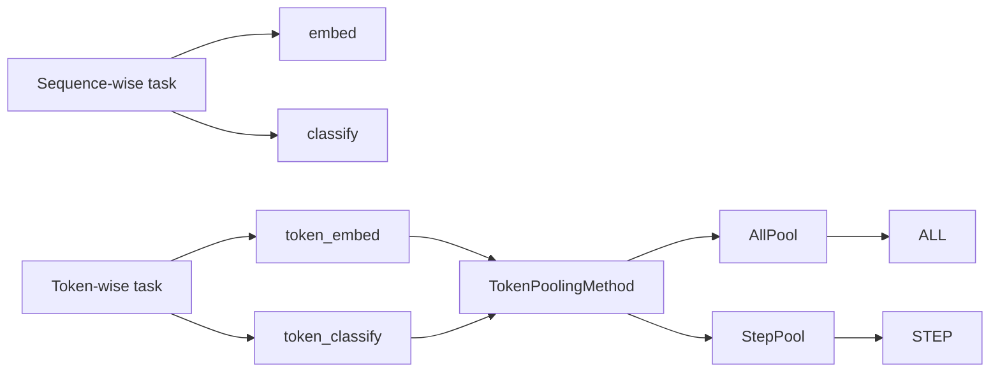
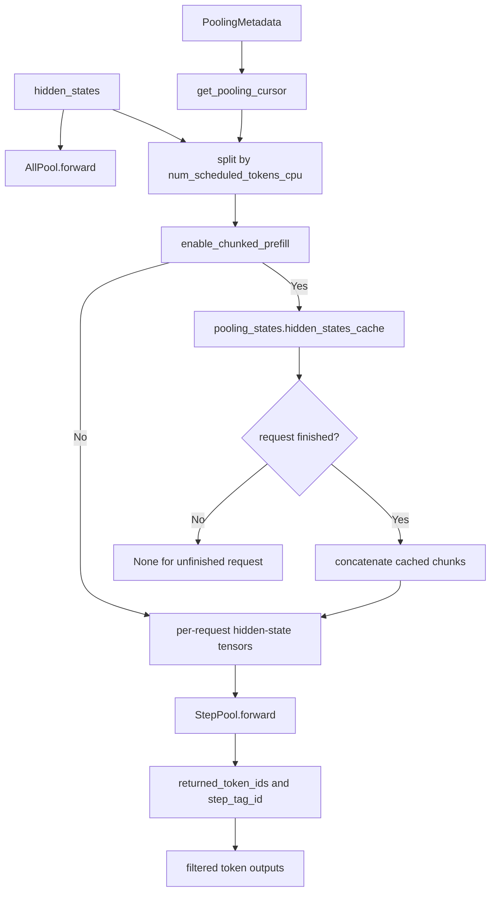
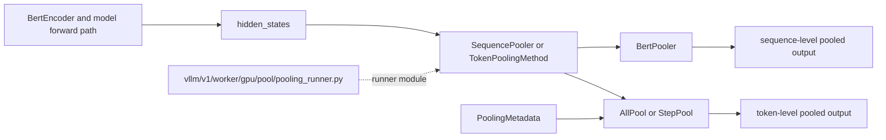
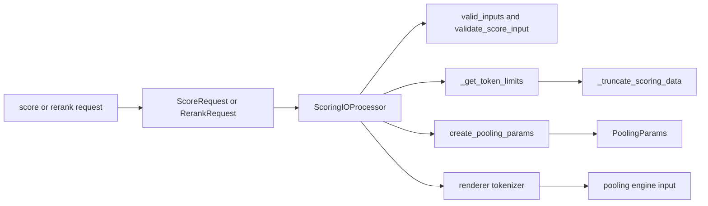
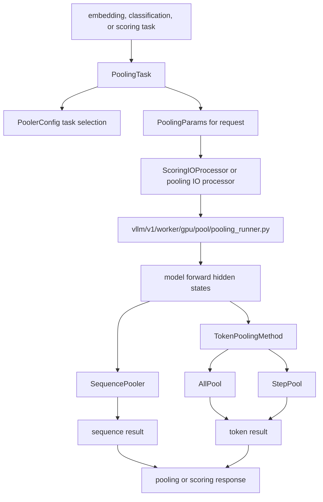

<!-- source: DeepWiki mcp.deepwiki.com · repo vllm-project/vllm · page 5.8 Pooling, Embedding and Classification Models · fetched 2026-10-28 -->

# Pooling, Embedding and Classification Models

Relevant source files

The following files were used as context for generating this wiki page:

- [.buildkite/scripts/hardware_ci/run-xpu-batch-invariance.sh](.buildkite/scripts/hardware_ci/run-xpu-batch-invariance.sh)
- [docs/features/lora.md](docs/features/lora.md)
- [docs/models/pooling_models/README.md](docs/models/pooling_models/README.md)
- [docs/models/pooling_models/reward.md](docs/models/pooling_models/reward.md)
- [docs/models/pooling_models/scoring.md](docs/models/pooling_models/scoring.md)
- [docs/models/pooling_models/specific_models.md](docs/models/pooling_models/specific_models.md)
- [docs/models/pooling_models/token_classify.md](docs/models/pooling_models/token_classify.md)
- [docs/models/pooling_models/token_embed.md](docs/models/pooling_models/token_embed.md)
- [examples/pooling/token_embed/jina_reranker_v3_online.py](examples/pooling/token_embed/jina_reranker_v3_online.py)
- [tests/entrypoints/pooling/scoring/test_bi_encoder_online.py](tests/entrypoints/pooling/scoring/test_bi_encoder_online.py)
- [tests/entrypoints/pooling/scoring/test_cross_encoder_offline.py](tests/entrypoints/pooling/scoring/test_cross_encoder_offline.py)
- [tests/entrypoints/pooling/scoring/test_cross_encoder_online.py](tests/entrypoints/pooling/scoring/test_cross_encoder_online.py)
- [tests/entrypoints/pooling/scoring/test_cross_encoder_online_vision.py](tests/entrypoints/pooling/scoring/test_cross_encoder_online_vision.py)
- [tests/entrypoints/pooling/scoring/test_io_processor_unit.py](tests/entrypoints/pooling/scoring/test_io_processor_unit.py)
- [tests/entrypoints/pooling/scoring/test_jina_ranking_io_processor_unit.py](tests/entrypoints/pooling/scoring/test_jina_ranking_io_processor_unit.py)
- [tests/entrypoints/pooling/scoring/test_late_interaction_online_vision.py](tests/entrypoints/pooling/scoring/test_late_interaction_online_vision.py)
- [tests/entrypoints/pooling/scoring/test_utils.py](tests/entrypoints/pooling/scoring/test_utils.py)
- [tests/lora/test_lora_manager.py](tests/lora/test_lora_manager.py)
- [tests/lora/test_lora_utils.py](tests/lora/test_lora_utils.py)
- [tests/models/language/pooling/test_all_pooling_plus_chunked_prefill.py](tests/models/language/pooling/test_all_pooling_plus_chunked_prefill.py)
- [tests/models/language/pooling/test_classification.py](tests/models/language/pooling/test_classification.py)
- [tests/models/language/pooling/test_embedding.py](tests/models/language/pooling/test_embedding.py)
- [tests/models/language/pooling/test_jina_reranker_v3.py](tests/models/language/pooling/test_jina_reranker_v3.py)
- [tests/models/language/pooling/test_reward.py](tests/models/language/pooling/test_reward.py)
- [tests/models/language/pooling/test_splade_sparse_pooler.py](tests/models/language/pooling/test_splade_sparse_pooler.py)
- [tests/models/language/pooling/test_token_classification.py](tests/models/language/pooling/test_token_classification.py)
- [tests/models/language/pooling_mteb_test/test_nemotron.py](tests/models/language/pooling_mteb_test/test_nemotron.py)
- [tests/models/multimodal/generation/test_memory_leak.py](tests/models/multimodal/generation/test_memory_leak.py)
- [tests/models/multimodal/pooling/test_colultravbert.py](tests/models/multimodal/pooling/test_colultravbert.py)
- [tests/utils_/test_mem_utils.py](tests/utils_/test_mem_utils.py)
- [tests/v1/core/test_kv_sharing.py](tests/v1/core/test_kv_sharing.py)
- [tests/v1/determinism/test_xpu_batch_invariant_ut.py](tests/v1/determinism/test_xpu_batch_invariant_ut.py)
- [tests/v1/worker/test_xpu_model_runner.py](tests/v1/worker/test_xpu_model_runner.py)
- [tools/pre_commit/check_torch_cuda.py](tools/pre_commit/check_torch_cuda.py)
- [vllm/compilation/passes/fx_utils.py](vllm/compilation/passes/fx_utils.py)
- [vllm/config/lora.py](vllm/config/lora.py)
- [vllm/distributed/device_communicators/cpu_communicator.py](vllm/distributed/device_communicators/cpu_communicator.py)
- [vllm/distributed/device_communicators/xpu_communicator.py](vllm/distributed/device_communicators/xpu_communicator.py)
- [vllm/distributed/kv_transfer/kv_connector/v1/lmcache_integration/utils.py](vllm/distributed/kv_transfer/kv_connector/v1/lmcache_integration/utils.py)
- [vllm/entrypoints/pooling/offline.py](vllm/entrypoints/pooling/offline.py)
- [vllm/entrypoints/pooling/scoring/io_processor.py](vllm/entrypoints/pooling/scoring/io_processor.py)
- [vllm/entrypoints/pooling/scoring/protocol.py](vllm/entrypoints/pooling/scoring/protocol.py)
- [vllm/entrypoints/pooling/scoring/utils.py](vllm/entrypoints/pooling/scoring/utils.py)
- [vllm/lora/layers/__init__.py](vllm/lora/layers/__init__.py)
- [vllm/lora/layers/classifier.py](vllm/lora/layers/classifier.py)
- [vllm/lora/layers/custom_layer.py](vllm/lora/layers/custom_layer.py)
- [vllm/lora/model_manager.py](vllm/lora/model_manager.py)
- [vllm/lora/utils.py](vllm/lora/utils.py)
- [vllm/lora/worker_manager.py](vllm/lora/worker_manager.py)
- [vllm/model_executor/layers/pooler/tokwise/methods.py](vllm/model_executor/layers/pooler/tokwise/methods.py)
- [vllm/model_executor/models/bert.py](vllm/model_executor/models/bert.py)
- [vllm/model_executor/models/colultravbert.py](vllm/model_executor/models/colultravbert.py)
- [vllm/model_executor/models/roberta.py](vllm/model_executor/models/roberta.py)
- [vllm/model_executor/models/transformers/legacy.py](vllm/model_executor/models/transformers/legacy.py)
- [vllm/models/step5/nvidia/model.py](vllm/models/step5/nvidia/model.py)
- [vllm/models/step5/nvidia/vl.py](vllm/models/step5/nvidia/vl.py)
- [vllm/transformers_utils/configs/colultravbert.py](vllm/transformers_utils/configs/colultravbert.py)
- [vllm/utils/hpc.py](vllm/utils/hpc.py)
- [vllm/utils/mem_constants.py](vllm/utils/mem_constants.py)
- [vllm/utils/mem_utils.py](vllm/utils/mem_utils.py)
- [vllm/v1/worker/gpu/pool/pooling_runner.py](vllm/v1/worker/gpu/pool/pooling_runner.py)
- [vllm/v1/worker/xpu_model_runner.py](vllm/v1/worker/xpu_model_runner.py)
- [vllm/v1/worker/xpu_worker.py](vllm/v1/worker/xpu_worker.py)

## Purpose and Scope

This page documents vLLM’s pooling-model support: sequence-wise and token-wise tasks, pooler behavior, model and request configuration concepts, scoring and reranking inputs, execution flow, and correctness testing. Pooling models produce representations or class outputs rather than requiring generated text. The supported task names include `embed`, `classify`, `token_embed`, and `token_classify`. [docs/models/pooling_models/README.md:8-18]()[docs/models/pooling_models/README.md:41-61]()

Sources: `docs/models/pooling_models/README.md`

---

## 1. Pooling Tasks and Configuration Concepts

Pooling tasks differ primarily in their output granularity: sequence-wise tasks produce one result per input sequence, while token-wise tasks produce results per token. A model may support more than one task; when its default task is not the desired one, `PoolerConfig(task=...)` can select a task offline or through `--pooler-config.task` online. [docs/models/pooling_models/README.md:41-52]()

| Task | Granularity | Typical output |
|---|---|---|
| `classify` | Sequence-wise | Class probability vector per sequence |
| `embed` | Sequence-wise | Vector representation per sequence |
| `token_classify` | Token-wise | Class probability vector per token |
| `token_embed` | Token-wise | Vector representation per token |

[docs/models/pooling_models/README.md:54-61]()

### Pooling methods

The documented sequence-wise pooling types are `CLS`, `LAST`, and `MEAN`. `CLS` selects the first-token hidden state, `LAST` selects the last-token hidden state, and `MEAN` averages hidden states across input tokens. Token-wise pooling includes `ALL`, which returns hidden states for all tokens, and `STEP`, which selects hidden states according to returned-token metadata. [docs/models/pooling_models/README.md:67-77]()

The token-wise method implementation exposes `TokenPoolingMethod`, whose default supported tasks are `token_embed` and `token_classify`. `get_tok_pooling_method()` maps `ALL` to `AllPool` and `STEP` to `StepPool`; unknown types raise `NotImplementedError`. [vllm/model_executor/layers/pooler/tokwise/methods.py:20-33]()[vllm/model_executor/layers/pooler/tokwise/methods.py:152-158]()

### `PoolerConfig` and `PoolingParams`

`PoolerConfig` represents the model-level task and pooling defaults, while `PoolingParams` carries parameters for a particular request. The pooling-model documentation describes selecting a task through `PoolerConfig`; scoring request conversion is implemented by `ScoringIOProcessor.create_pooling_params()`, which calls `request.to_pooling_params(self.pooling_task)`. [docs/models/pooling_models/README.md:47-52]()[vllm/entrypoints/pooling/scoring/io_processor.py:98-111]()

The configuration file paths are `vllm/config/pooler.py` and `vllm/pooling_params.py`; detailed field definitions are not included in the supplied file excerpts. This page therefore limits configuration details to the task-selection and request-conversion behavior visible in the provided sources. [docs/models/pooling_models/README.md:47-52]()[vllm/entrypoints/pooling/scoring/io_processor.py:98-111]()

Sources: `docs/models/pooling_models/README.md`; `vllm/model_executor/layers/pooler/tokwise/methods.py`; `vllm/entrypoints/pooling/scoring/io_processor.py`

### Task and method mapping

**Diagram: Task granularity mapped to pooling code entities**

Sources: `docs/models/pooling_models/README.md:41-61`; `vllm/model_executor/layers/pooler/tokwise/methods.py:20-33`; `vllm/model_executor/layers/pooler/tokwise/methods.py:113-158`

---

## 2. Pooler Layers and Methods

Pooling layers consume hidden states produced by the model and return task-specific outputs. BERT’s implementation illustrates how sequence-wise pooling is incorporated: `BertPooler` reads `model_config.pooler_config`, requires `seq_pooling_type`, selects the method through `get_seq_pooling_method()`, and supplies an `EmbeddingPoolerHead`. Its projector applies a dense layer and `tanh`. [vllm/model_executor/models/bert.py:24-37]()[vllm/model_executor/models/bert.py:97-124]()

### Sequence-wise pooling

For BERT, `BertPooler` is a `SequencePooler`. It initializes the sequence pooling method from the configured sequence pooling type, then applies its embedding head. The model code also imports `SequencePoolerOutput`, indicating a dedicated output type for this sequence-pooling path. [vllm/model_executor/models/bert.py:29-34]()[vllm/model_executor/models/bert.py:97-124]()

The available task documentation describes `CLS`, `LAST`, and `MEAN` pooling as common sequence-level choices. Their suitability depends on model and task conventions; the documented defaults associate `CLS` with BERT-like bidirectional models and `LAST` with GPT-like causal models. [docs/models/pooling_models/README.md:71-75]()

### Token-wise pooling

`AllPool.forward()` splits the flattened hidden-state tensor into per-request portions using scheduled-token counts from `PoolingMetadata`. If configured with an output-width function, it trims each portion to that request’s logical output width. With chunked prefill enabled, it retains hidden-state chunks in each request’s `hidden_states_cache`; once a request is finished, the chunks are concatenated and the pooling state is cleaned. [vllm/model_executor/layers/pooler/tokwise/methods.py:36-48]()[vllm/model_executor/layers/pooler/tokwise/methods.py:56-110]()

`AllPool` also considers asynchronous scheduling: when enabled, it clones outputs so a later step cannot overwrite the hidden-state storage before output copying completes. With chunked prefill disabled, it returns the per-request tensors directly unless cloning is required. [vllm/model_executor/layers/pooler/tokwise/methods.py:45-48]()[vllm/model_executor/layers/pooler/tokwise/methods.py:76-79]()

`StepPool` extends `AllPool`. It declares that pooling requires token IDs, then can select returned token positions and filter positions whose prompt token ID matches `step_tag_id`. It uses CPU-side prompt token IDs to identify indices before transferring the selected indices to the hidden-state device. [vllm/model_executor/layers/pooler/tokwise/methods.py:113-126]()[vllm/model_executor/layers/pooler/tokwise/methods.py:128-149]()

**Diagram: Token-wise pooling data path and chunk handling**

Sources: `vllm/model_executor/layers/pooler/tokwise/methods.py:56-110`; `vllm/model_executor/layers/pooler/tokwise/methods.py:113-149`

Sources: `vllm/model_executor/models/bert.py`; `docs/models/pooling_models/README.md`; `vllm/model_executor/layers/pooler/tokwise/methods.py`

---

## 3. Pooling Runner and Model Execution

The V1 GPU pooling runner is located at `vllm/v1/worker/gpu/pool/pooling_runner.py`. Its detailed implementation was not included in the supplied excerpts, so this section describes the visible model and method boundaries rather than asserting runner internals. The `BertPooler` and token-wise pooling methods show the model-side operations that consume hidden states and produce pooled outputs. [vllm/model_executor/models/bert.py:97-124]()[vllm/model_executor/layers/pooler/tokwise/methods.py:20-33]()

`PoolingMetadata` is passed to token pooling methods alongside hidden states. `AllPool` obtains a pooling cursor from that metadata and uses its CPU scheduled-token counts to split hidden states into request-aligned outputs. `StepPool` additionally reads CPU prompt token IDs and per-request pooling parameters. [vllm/model_executor/layers/pooler/tokwise/methods.py:56-67]()[vllm/model_executor/layers/pooler/tokwise/methods.py:117-149]()

**Diagram: Model hidden states to pooling method code entities**

Sources: `vllm/model_executor/models/bert.py:24-37`; `vllm/model_executor/models/bert.py:97-124`; `vllm/model_executor/layers/pooler/tokwise/methods.py:20-33`; `vllm/model_executor/layers/pooler/tokwise/methods.py:56-67`; `vllm/v1/worker/gpu/pool/pooling_runner.py`

Sources: `vllm/model_executor/models/bert.py`; `vllm/model_executor/layers/pooler/tokwise/methods.py`; `vllm/v1/worker/gpu/pool/pooling_runner.py`

---

## 4. Scoring, Reward Models, and IO Processing

### Scoring and reranking

Scoring compares two inputs and supports three documented score types: `cross-encoder`, `late-interaction`, and `bi-encoder`. The corresponding pooling tasks and scoring functions are `classify` with a linear classifier, `token_embed` with late-interaction MaxSim, and `embed` with cosine similarity. A classification model is eligible for the scoring API only when it outputs one label. [docs/models/pooling_models/scoring.md:3-26]()

Cross-encoders are classification models that accept two prompts and produce one score. The scoring documentation lists text-only and multimodal sequence-classification architectures, including BERT, Gemma, Qwen, RoBERTa, XLM-RoBERTa, and multimodal JinaVL and Llama Nemotron VL variants. [docs/models/pooling_models/scoring.md:34-55]()[docs/models/pooling_models/scoring.md:98-106]()

### `ScoringIOProcessor`

`ScoringIOProcessor` extends `PoolingIOProcessor`. During initialization it obtains the tokenizer from the renderer and records the configured architecture, multimodal-model flag, and pad-token ID. Its `create_pooling_params()` converts a scoring request into task-specific `PoolingParams`. [vllm/entrypoints/pooling/scoring/io_processor.py:98-111]()

The processor validates optional query and document token limits against the model’s maximum sequence length. It can truncate text inputs to the specified per-query and per-document token limits, while leaving non-string inputs unchanged. Its `valid_inputs()` delegates structural and model-type validation to `validate_score_input()`. [vllm/entrypoints/pooling/scoring/io_processor.py:113-169]()[vllm/entrypoints/pooling/scoring/io_processor.py:171-182]()

For cross-encoder token-type IDs, `_apply_post_tokenization_to_token_type_ids()` applies truncation before padding, keeping the IDs aligned with the prompt tokens and query/document boundary. [vllm/entrypoints/pooling/scoring/io_processor.py:59-95]()

### Reward and process-reward models

The pooling task set documented in the supplied files includes classification and token-level tasks. `StepPool` provides token selection using `step_tag_id` and `returned_token_ids`, mechanisms relevant to specialized token outputs. The supplied excerpts do not include the reward-model implementation, so reward-model architecture details are not specified here. [docs/models/pooling_models/README.md:54-61]()[vllm/model_executor/layers/pooler/tokwise/methods.py:113-149]()

**Diagram: Scoring request processing mapped to code entities**

Sources: `docs/models/pooling_models/scoring.md:3-26`; `vllm/entrypoints/pooling/scoring/io_processor.py:98-111`; `vllm/entrypoints/pooling/scoring/io_processor.py:113-182`

Sources: `docs/models/pooling_models/scoring.md`; `vllm/entrypoints/pooling/scoring/io_processor.py`

---

## 5. Token Classification and Correctness Testing

The token-classification tests compare vLLM outputs with Hugging Face reference models. The tests exercise `token_classify()` on BERT-style NER, ModernBERT, XLM-RoBERTa, and the OpenAI privacy-filter model. They use `AutoModelForTokenClassification` for the reference path and compare softmaxed Hugging Face logits with vLLM outputs using `torch.testing.assert_close()`. [tests/models/language/pooling/test_token_classification.py:24-70]()[tests/models/language/pooling/test_token_classification.py:73-147]()[tests/models/language/pooling/test_token_classification.py:165-192]()

The BERT test explicitly enables the V2 model runner and asserts that the configuration reflects this setting before calling `token_classify()`. The ModernBERT test allows reruns because its randomly initialized weights can produce numerical-precision variance. [tests/models/language/pooling/test_token_classification.py:34-48]()[tests/models/language/pooling/test_token_classification.py:73-94]()

Sources: `tests/models/language/pooling/test_token_classification.py`

---

## 6. LoRA Support for Pooling Classification Heads

The LoRA manager detects whether the model is a pooling model and resolves a pooling task from the model’s supported tasks. For `classify` and `token_classify`, it marks `score` and `classifier` as supported modules to save. If a classification-head LoRA module is found in a pooling model, the manager expects exactly one such head. [vllm/lora/model_manager.py:124-143]()[vllm/lora/model_manager.py:169-184]()

`from_layer_classification()` selects `ClassificationHeadWithLoRA` for sequence-level classification or `TokenClassificationHeadWithLoRA` when `is_token_level=True`, then creates the LoRA weights for that wrapper. [vllm/lora/utils.py:152-167]()

Sources: `vllm/lora/model_manager.py`; `vllm/lora/utils.py`

---

## 7. Architecture Summary

**Diagram: Pooling system overview, from user task to code entities**

Sources: `docs/models/pooling_models/README.md:41-61`; `vllm/entrypoints/pooling/scoring/io_processor.py:98-111`; `vllm/model_executor/models/bert.py:24-37`; `vllm/model_executor/layers/pooler/tokwise/methods.py:20-33`; `vllm/model_executor/layers/pooler/tokwise/methods.py:113-158`

---

## References

- `docs/models/pooling_models/README.md` — Pooling tasks, granularity, and pooling types.
- `docs/models/pooling_models/scoring.md` — Scoring tasks, score types, and supported cross-encoder architectures.
- `vllm/model_executor/layers/pooler/tokwise/methods.py` — Token-wise pooling methods `TokenPoolingMethod`, `AllPool`, and `StepPool`.
- `vllm/model_executor/models/bert.py` — BERT embedding and sequence-pooling implementation, including `BertPooler`.
- `vllm/entrypoints/pooling/scoring/io_processor.py` — Scoring input validation, token limits, truncation, and request-to-parameter conversion.
- `vllm/v1/worker/gpu/pool/pooling_runner.py` — V1 GPU pooling-runner module.
- `tests/models/language/pooling/test_token_classification.py` — Token-classification correctness tests.
- `vllm/lora/model_manager.py` and `vllm/lora/utils.py` — LoRA integration for pooling classification heads.

Sources: `docs/models/pooling_models/README.md`; `docs/models/pooling_models/scoring.md`; `vllm/model_executor/layers/pooler/tokwise/methods.py`; `vllm/model_executor/models/bert.py`; `vllm/entrypoints/pooling/scoring/io_processor.py`; `tests/models/language/pooling/test_token_classification.py`; `vllm/lora/model_manager.py`; `vllm/lora/utils.py`

---

