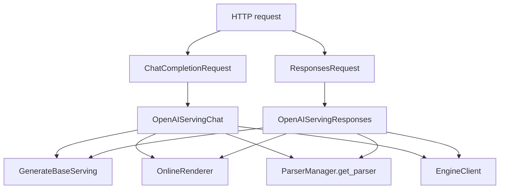
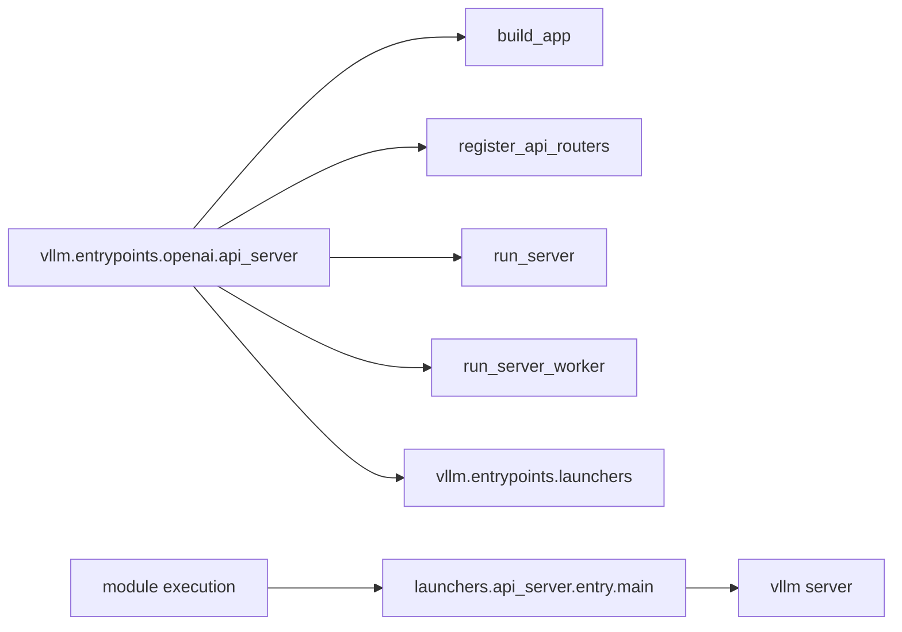
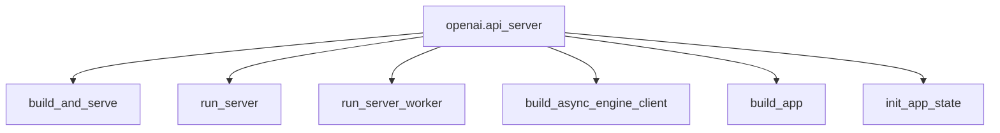
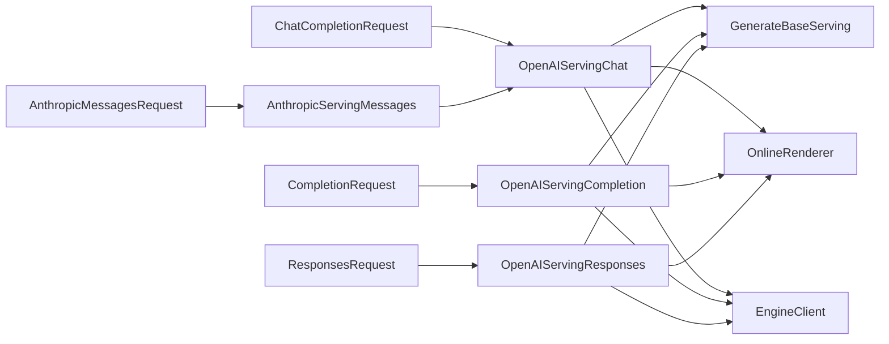
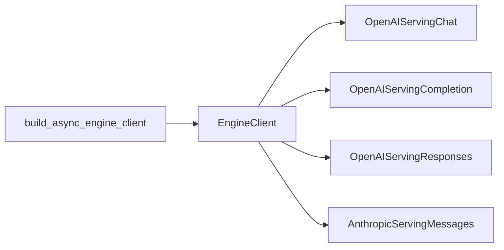

<!-- source: DeepWiki mcp.deepwiki.com · repo vllm-project/vllm · page 6.1 OpenAI-Compatible API Server · fetched 2026-10-28 -->

# OpenAI-Compatible API Server

Relevant source files

The following files were used as context for generating this wiki page:

- [docs/design/endpoint_plugins.md](docs/design/endpoint_plugins.md)
- [docs/features/custom_arguments.md](docs/features/custom_arguments.md)
- [docs/mkdocs/gen_files/generate_argparse.py](docs/mkdocs/gen_files/generate_argparse.py)
- [examples/features/openai_batch/README.md](examples/features/openai_batch/README.md)
- [tests/entrypoints/anthropic/test_anthropic_messages_conversion.py](tests/entrypoints/anthropic/test_anthropic_messages_conversion.py)
- [tests/entrypoints/anthropic/test_messages.py](tests/entrypoints/anthropic/test_messages.py)
- [tests/entrypoints/cohere/test_registry_and_args.py](tests/entrypoints/cohere/test_registry_and_args.py)
- [tests/entrypoints/launchers/render/__init__.py](tests/entrypoints/launchers/render/__init__.py)
- [tests/entrypoints/launchers/render/test_app_state.py](tests/entrypoints/launchers/render/test_app_state.py)
- [tests/entrypoints/launchers/test_balanced_accepts.py](tests/entrypoints/launchers/test_balanced_accepts.py)
- [tests/entrypoints/launchers/test_run_batch.py](tests/entrypoints/launchers/test_run_batch.py)
- [tests/entrypoints/openai/chat_completion/test_batched_chat_completions.py](tests/entrypoints/openai/chat_completion/test_batched_chat_completions.py)
- [tests/entrypoints/openai/chat_completion/test_chat_error.py](tests/entrypoints/openai/chat_completion/test_chat_error.py)
- [tests/entrypoints/openai/chat_completion/test_serving_chat.py](tests/entrypoints/openai/chat_completion/test_serving_chat.py)
- [tests/entrypoints/openai/completion/test_completion_error.py](tests/entrypoints/openai/completion/test_completion_error.py)
- [tests/entrypoints/openai/completion/test_completion_text_offset.py](tests/entrypoints/openai/completion/test_completion_text_offset.py)
- [tests/entrypoints/openai/completion/test_lora_resolvers.py](tests/entrypoints/openai/completion/test_lora_resolvers.py)
- [tests/entrypoints/openai/parser/test_harmony_render_parity.py](tests/entrypoints/openai/parser/test_harmony_render_parity.py)
- [tests/entrypoints/openai/parser/test_harmony_utils.py](tests/entrypoints/openai/parser/test_harmony_utils.py)
- [tests/entrypoints/openai/responses/conftest.py](tests/entrypoints/openai/responses/conftest.py)
- [tests/entrypoints/openai/responses/test_function_call.py](tests/entrypoints/openai/responses/test_function_call.py)
- [tests/entrypoints/openai/responses/test_function_call_parsing.py](tests/entrypoints/openai/responses/test_function_call_parsing.py)
- [tests/entrypoints/openai/responses/test_harmony.py](tests/entrypoints/openai/responses/test_harmony.py)
- [tests/entrypoints/openai/responses/test_harmony_utils.py](tests/entrypoints/openai/responses/test_harmony_utils.py)
- [tests/entrypoints/openai/responses/test_mcp_tools.py](tests/entrypoints/openai/responses/test_mcp_tools.py)
- [tests/entrypoints/openai/responses/test_parsable_context.py](tests/entrypoints/openai/responses/test_parsable_context.py)
- [tests/entrypoints/openai/responses/test_parsable_context_unit.py](tests/entrypoints/openai/responses/test_parsable_context_unit.py)
- [tests/entrypoints/openai/responses/test_response_input_to_harmony.py](tests/entrypoints/openai/responses/test_response_input_to_harmony.py)
- [tests/entrypoints/openai/responses/test_responses_utils.py](tests/entrypoints/openai/responses/test_responses_utils.py)
- [tests/entrypoints/openai/responses/test_serving_responses.py](tests/entrypoints/openai/responses/test_serving_responses.py)
- [tests/entrypoints/openai/responses/test_simple.py](tests/entrypoints/openai/responses/test_simple.py)
- [tests/entrypoints/openai/responses/test_streaming_events.py](tests/entrypoints/openai/responses/test_streaming_events.py)
- [tests/entrypoints/openai/test_render_parity.py](tests/entrypoints/openai/test_render_parity.py)
- [tests/entrypoints/openai/utils.py](tests/entrypoints/openai/utils.py)
- [tests/entrypoints/serve/exception_handling/__init__.py](tests/entrypoints/serve/exception_handling/__init__.py)
- [tests/entrypoints/serve/exception_handling/test_error_sanitization.py](tests/entrypoints/serve/exception_handling/test_error_sanitization.py)
- [tests/entrypoints/serve/exception_handling/test_validation_exception_handler.py](tests/entrypoints/serve/exception_handling/test_validation_exception_handler.py)
- [tests/entrypoints/serve/lora/test_serving_models.py](tests/entrypoints/serve/lora/test_serving_models.py)
- [tests/entrypoints/serve/utils/test_request_logger.py](tests/entrypoints/serve/utils/test_request_logger.py)
- [tests/entrypoints/unit_tests/test_context.py](tests/entrypoints/unit_tests/test_context.py)
- [tests/parser/engine/test_glm47_moe.py](tests/parser/engine/test_glm47_moe.py)
- [tests/parser/test_response_template.py](tests/parser/test_response_template.py)
- [tests/plugins/vllm_add_dummy_endpoint_plugin/setup.py](tests/plugins/vllm_add_dummy_endpoint_plugin/setup.py)
- [tests/plugins/vllm_add_dummy_endpoint_plugin/vllm_add_dummy_endpoint_plugin/__init__.py](tests/plugins/vllm_add_dummy_endpoint_plugin/vllm_add_dummy_endpoint_plugin/__init__.py)
- [tests/plugins_tests/test_endpoint_plugins.py](tests/plugins_tests/test_endpoint_plugins.py)
- [tests/reasoning/test_glm4_moe_reasoning_parser.py](tests/reasoning/test_glm4_moe_reasoning_parser.py)
- [tests/tool_use/test_responses_request_validations.py](tests/tool_use/test_responses_request_validations.py)
- [vllm/entrypoints/anthropic/api_router.py](vllm/entrypoints/anthropic/api_router.py)
- [vllm/entrypoints/anthropic/protocol.py](vllm/entrypoints/anthropic/protocol.py)
- [vllm/entrypoints/anthropic/serving.py](vllm/entrypoints/anthropic/serving.py)
- [vllm/entrypoints/cli/benchmark/main.py](vllm/entrypoints/cli/benchmark/main.py)
- [vllm/entrypoints/cli/launch.py](vllm/entrypoints/cli/launch.py)
- [vllm/entrypoints/cli/main.py](vllm/entrypoints/cli/main.py)
- [vllm/entrypoints/cli/run_batch.py](vllm/entrypoints/cli/run_batch.py)
- [vllm/entrypoints/generate/api_router.py](vllm/entrypoints/generate/api_router.py)
- [vllm/entrypoints/generate/base/serving.py](vllm/entrypoints/generate/base/serving.py)
- [vllm/entrypoints/launchers/api_server/app_state.py](vllm/entrypoints/launchers/api_server/app_state.py)
- [vllm/entrypoints/launchers/api_server/entry.py](vllm/entrypoints/launchers/api_server/entry.py)
- [vllm/entrypoints/launchers/app.py](vllm/entrypoints/launchers/app.py)
- [vllm/entrypoints/launchers/launcher.py](vllm/entrypoints/launchers/launcher.py)
- [vllm/entrypoints/launchers/render/app_state.py](vllm/entrypoints/launchers/render/app_state.py)
- [vllm/entrypoints/launchers/render/entry.py](vllm/entrypoints/launchers/render/entry.py)
- [vllm/entrypoints/launchers/run_batch.py](vllm/entrypoints/launchers/run_batch.py)
- [vllm/entrypoints/mcp/tool.py](vllm/entrypoints/mcp/tool.py)
- [vllm/entrypoints/mcp/tool_server.py](vllm/entrypoints/mcp/tool_server.py)
- [vllm/entrypoints/openai/api_server.py](vllm/entrypoints/openai/api_server.py)
- [vllm/entrypoints/openai/chat_completion/batch_serving.py](vllm/entrypoints/openai/chat_completion/batch_serving.py)
- [vllm/entrypoints/openai/chat_completion/protocol.py](vllm/entrypoints/openai/chat_completion/protocol.py)
- [vllm/entrypoints/openai/chat_completion/serving.py](vllm/entrypoints/openai/chat_completion/serving.py)
- [vllm/entrypoints/openai/completion/protocol.py](vllm/entrypoints/openai/completion/protocol.py)
- [vllm/entrypoints/openai/completion/serving.py](vllm/entrypoints/openai/completion/serving.py)
- [vllm/entrypoints/openai/models/serving.py](vllm/entrypoints/openai/models/serving.py)
- [vllm/entrypoints/openai/parser/harmony_utils.py](vllm/entrypoints/openai/parser/harmony_utils.py)
- [vllm/entrypoints/openai/responses/context.py](vllm/entrypoints/openai/responses/context.py)
- [vllm/entrypoints/openai/responses/harmony.py](vllm/entrypoints/openai/responses/harmony.py)
- [vllm/entrypoints/openai/responses/protocol.py](vllm/entrypoints/openai/responses/protocol.py)
- [vllm/entrypoints/openai/responses/serving.py](vllm/entrypoints/openai/responses/serving.py)
- [vllm/entrypoints/openai/responses/streaming_events.py](vllm/entrypoints/openai/responses/streaming_events.py)
- [vllm/entrypoints/openai/responses/utils.py](vllm/entrypoints/openai/responses/utils.py)
- [vllm/entrypoints/serve/engine/serving.py](vllm/entrypoints/serve/engine/serving.py)
- [vllm/entrypoints/serve/exception_handling/error_response.py](vllm/entrypoints/serve/exception_handling/error_response.py)
- [vllm/entrypoints/serve/exception_handling/handlers/validation.py](vllm/entrypoints/serve/exception_handling/handlers/validation.py)
- [vllm/entrypoints/serve/exception_handling/utils.py](vllm/entrypoints/serve/exception_handling/utils.py)
- [vllm/entrypoints/serve/utils/request_logger.py](vllm/entrypoints/serve/utils/request_logger.py)
- [vllm/entrypoints/serve/utils/tool_calls_utils.py](vllm/entrypoints/serve/utils/tool_calls_utils.py)
- [vllm/exceptions.py](vllm/exceptions.py)
- [vllm/parser/glm47_moe.py](vllm/parser/glm47_moe.py)
- [vllm/plugins/__init__.py](vllm/plugins/__init__.py)
- [vllm/plugins/endpoint_plugins/__init__.py](vllm/plugins/endpoint_plugins/__init__.py)
- [vllm/plugins/endpoint_plugins/interface.py](vllm/plugins/endpoint_plugins/interface.py)
- [vllm/reasoning/glm47_moe_reasoning_parser.py](vllm/reasoning/glm47_moe_reasoning_parser.py)
- [vllm/renderers/online_renderer.py](vllm/renderers/online_renderer.py)
- [vllm/v1/engine/exceptions.py](vllm/v1/engine/exceptions.py)

## Purpose and Scope

This page describes the Python HTTP serving layer: how request and response protocol models relate to serving handlers, how handlers connect to the engine and renderer, and what the provided source establishes about server entry points. It also maps the endpoint families in scope. The supplied excerpts do not include the FastAPI app builder, route-registration implementation, or server lifecycle implementation, so this page does not infer their middleware order, route conditions, or startup and shutdown behavior.

Sources: [vllm/entrypoints/openai/api_server.py:5-30]() [vllm/entrypoints/openai/chat_completion/serving.py:124-175]() [vllm/entrypoints/openai/responses/serving.py:104-173]()

---

## Architecture Overview

### High-Level Request Flow and Code Entity Mapping

The serving handlers shown here accept an `EngineClient` and use an `OnlineRenderer` to prepare requests for inference. Chat and Responses handlers share `GenerateBaseServing`; the chat handler also resolves its parser through `ParserManager`. The excerpts establish these components and relationships, but do not show the HTTP route call sites that connect FastAPI requests to the handlers.

**Diagram: Request handling concepts mapped to serving entities**

Sources: [vllm/entrypoints/openai/chat_completion/protocol.py:70-88]() [vllm/entrypoints/openai/chat_completion/serving.py:124-175]() [vllm/entrypoints/openai/responses/protocol.py:92-112]() [vllm/entrypoints/openai/responses/serving.py:104-149]()

### Serving Components

| Concern | Code entity | Role established by the supplied source |
|---|---|---|
| Shared generation-serving behavior | `GenerateBaseServing` | Base class of the chat, completion, and Responses handlers. |
| Chat protocol | `ChatCompletionRequest`, `ChatCompletionResponse`, `ChatCompletionStreamResponse` | Pydantic protocol types for chat request, non-streaming response, and streaming chunks. |
| Chat handler | `OpenAIServingChat` | Stores renderer and chat configuration, constructs a parser, and accepts an `EngineClient`. |
| Text completion protocol | `CompletionRequest` | Defines the legacy completion request fields, including prompt, sampling options, streaming, and structured output options. |
| Completion handler | `OpenAIServingCompletion` | Renders completion requests through `OnlineRenderer` and prepares them for engine generation. |
| Responses handler | `OpenAIServingResponses` | Stores renderer and tool/parser configuration and supports optional in-memory response storage controlled by an environment setting. |
| Anthropic handler | `AnthropicServingMessages` | Subclasses `OpenAIServingChat`, reusing the chat serving implementation for the Anthropic Messages API. |

Sources: [vllm/entrypoints/openai/chat_completion/serving.py:124-175]() [vllm/entrypoints/openai/chat_completion/protocol.py:70-88]() [vllm/entrypoints/openai/completion/protocol.py:49-75]() [vllm/entrypoints/openai/completion/serving.py:57-113]() [vllm/entrypoints/openai/responses/serving.py:104-173]() [vllm/entrypoints/anthropic/serving.py:146-184]()

---

## CLI Entry Points

`vllm.entrypoints.openai.api_server` is a compatibility module that re-exports server and renderer launcher functions from `vllm.entrypoints.launchers`. Importing the module emits a `DeprecationWarning` directing users to the launcher package. When run as a module, it emits a further warning that the old command may be removed and directs users to `vllm server`; it then imports and invokes `main` from the launcher API server entry module.

The supplied source does not show the CLI subcommand implementation or its deployment-mode dispatch, so this section does not enumerate single-process, multi-process, or headless modes.

**Diagram: Compatibility module and launcher symbols**

Sources: [vllm/entrypoints/openai/api_server.py:5-30]() [vllm/entrypoints/openai/api_server.py:33-59]()

---

## Server Startup Sequence

The compatibility module exposes names such as `build_app`, `init_app_state`, `build_async_engine_client`, `run_server`, and `run_server_worker` by importing them from `vllm.entrypoints.launchers`. Those imports establish the public re-export relationship, not the internal call order or lifecycle semantics. The supplied excerpts do not include the implementations of these functions, socket setup, Uvicorn invocation, or engine shutdown.

**Diagram: Exposed launcher entry points**

Sources: [vllm/entrypoints/openai/api_server.py:5-23]() [vllm/entrypoints/openai/api_server.py:33-48]()

---

## FastAPI Application Construction (`build_app`)

The compatibility module re-exports `build_app` and `register_api_routers`, but the provided source does not include either implementation. Consequently, the actual FastAPI construction, middleware stack, route-registration conditions, and exception-handler registration cannot be documented from the supplied excerpts.

### Route Registration and Endpoint Families

The endpoint families below are in scope for this page. The provided excerpts substantiate several protocol and handler classes, but do not show route decorators or router attachment. Endpoint paths are therefore not asserted here.

| Endpoint family | Evidence available in the supplied source |
|---|---|
| Chat completions | `ChatCompletionRequest` and response protocol types; `OpenAIServingChat`. |
| Text completions | `CompletionRequest`; `OpenAIServingCompletion`. |
| Responses | Responses protocol types; `OpenAIServingResponses`; conversation context classes. |
| Batch | A batch-serving file is listed among additional cluster files, but its contents are not provided. |
| Anthropic | `AnthropicServingMessages` subclasses `OpenAIServingChat`; Anthropic protocol models are provided. |
| Cohere | The chat protocol source notes that response message subclasses can carry Cohere-specific fields such as citations; the Cohere serving implementation is not provided. |
| Speech-to-text | No serving or protocol implementation excerpt is provided. |
| Pooling and embeddings | No serving or protocol implementation excerpt is provided. |
| Serve sub-routers | The compatibility module re-exports `register_api_routers`, but the router registration implementation is not provided. |

Sources: [vllm/entrypoints/openai/chat_completion/protocol.py:107-175]() [vllm/entrypoints/openai/chat_completion/serving.py:124-175]() [vllm/entrypoints/openai/completion/protocol.py:49-75]() [vllm/entrypoints/openai/completion/serving.py:57-113]() [vllm/entrypoints/openai/responses/protocol.py:92-112]() [vllm/entrypoints/openai/responses/serving.py:104-149]() [vllm/entrypoints/anthropic/serving.py:146-184]()

### Middleware Stack

The supplied source does not show middleware registration or ordering. No middleware names, conditional activation rules, or request-processing order can be verified from the available excerpts.

Sources: [vllm/entrypoints/openai/api_server.py:5-23]()

---

## Serving Logic and Protocol Families

The serving classes are protocol adapters between API request models and shared generation infrastructure. The excerpts show the chat and Responses handlers’ dependencies and initialization, and the completion handler’s rendering path. They do not expose every request-generation or streaming method in those files.

### Chat Completion API (`OpenAIServingChat`)

`OpenAIServingChat` extends `GenerateBaseServing`. Its constructor receives an `EngineClient`, `OpenAIServingModels`, response role, and `OnlineRenderer`. It also accepts chat-template settings, tool and reasoning parser configuration, request logging, usage-detail controls, and output logging options. During initialization it calls the base constructor, retains renderer and template settings, and obtains a parser using `ParserManager.get_parser`, passing tool/reasoning parser choices, model information, Harmony detection, and the renderer tokenizer. [vllm/entrypoints/openai/chat_completion/serving.py:124-180]()

The protocol defines `ChatMessage` fields for role, content, refusal, audio, function calls, and tool calls, with `reasoning` as a vLLM-specific field. Chat response choices include a message, finish and stop reasons, optional logprobs, token IDs, routed-expert data, and weight-version spans. Streaming choices carry a delta and may include token IDs and weight-version spans. [vllm/entrypoints/openai/chat_completion/protocol.py:70-88]() [vllm/entrypoints/openai/chat_completion/protocol.py:107-175]()

The handler also defines helpers for multimodal placeholder token counts and optional prompt/completion token details. `_get_mm_token_counts` sums placeholder lengths by modality; `_make_prompt_tokens_details` returns details only when enabled and at least one relevant count is present; `_make_completion_tokens_details` packages reasoning-token counts. [vllm/entrypoints/openai/chat_completion/serving.py:79-121]()

### Completion API (`OpenAIServingCompletion`)

`CompletionRequest` accepts string or token-ID prompts and includes standard completion controls such as `max_tokens`, `n`, `stop`, `stream`, temperature, and top-p. It also defines vLLM-specific sampling and request fields, including beam search, top-k, prompt logprobs, structured output settings, priority, request ID, and session ID. [vllm/entrypoints/openai/completion/protocol.py:49-75]() [vllm/entrypoints/openai/completion/protocol.py:76-161]()

`OpenAIServingCompletion` extends `GenerateBaseServing` and stores its `OnlineRenderer` and feature flags. `render_completion_request` checks the requested model, performs a preflight check, and delegates request rendering to `OnlineRenderer.render_completion`. `_create_completion` rejects streaming with beam search, renders the request, and begins preparing engine inputs and request metadata. [vllm/entrypoints/openai/completion/serving.py:57-113]() [vllm/entrypoints/openai/completion/serving.py:115-180]()

### Responses API (`OpenAIServingResponses`)

The Responses protocol defines token-usage detail models, including cached and cache-write input counts, per-turn counts, reasoning tokens, and tool-output tokens. Its input/output message and item types accommodate chat messages, raw message/token pairs, and OpenAI Responses API item types. [vllm/entrypoints/openai/responses/protocol.py:92-142]()

`OpenAIServingResponses` extends `GenerateBaseServing` and accepts an engine client, model registry, renderer, parser and tool configuration, request logger, and usage/logging flags. It resolves a parser through `ParserManager.get_parser` using model and tokenizer information. Response storage is controlled by `VLLM_ENABLE_RESPONSES_API_STORE`; the source notes that enabled storage retains responses in memory and warns that the store does not remove responses. [vllm/entrypoints/openai/responses/serving.py:104-173]()

The context layer defines `ConversationContext` as an abstract interface for appending model and tool output, deciding whether a built-in tool call is needed, rendering for completion, initializing tool sessions, and cleanup. `SimpleContext` is one concrete context and maintains accumulated streaming output and token counts. [vllm/entrypoints/openai/responses/context.py:108-148]() [vllm/entrypoints/openai/responses/context.py:171-204]()

### Anthropic API Compatibility (`AnthropicServingMessages`)

`AnthropicServingMessages` subclasses `OpenAIServingChat` and initializes that base with the engine client, model registry, renderer, chat-template settings, parser configuration, and logging/usage options. This allows it to reuse the chat serving layer while implementing Anthropic-specific request and response handling. [vllm/entrypoints/anthropic/serving.py:146-184]()

The Anthropic protocol defines message content blocks for text, images, tool use/results, thinking, redacted thinking, and tool changes. Validators restrict tool-change blocks to system messages and require the appropriate tool-change payload. The protocol also defines tool choices, output configuration, and thinking configuration variants. [vllm/entrypoints/anthropic/protocol.py:40-105]() [vllm/entrypoints/anthropic/protocol.py:108-159]() [vllm/entrypoints/anthropic/protocol.py:175-212]()

`_build_anthropic_usage` maps vLLM `UsageInfo` into Anthropic usage: it subtracts cached and cache-creation tokens from total prompt tokens when those details are present and uses completion-token counts for output usage. `_to_anthropic_stop_reason` maps supported finish reasons and tool-call state into Anthropic stop reasons. [vllm/entrypoints/anthropic/serving.py:63-131]()

Sources: [vllm/entrypoints/openai/chat_completion/serving.py:79-180]() [vllm/entrypoints/openai/chat_completion/protocol.py:70-175]() [vllm/entrypoints/openai/completion/protocol.py:49-161]() [vllm/entrypoints/openai/completion/serving.py:57-180]() [vllm/entrypoints/openai/responses/protocol.py:92-142]() [vllm/entrypoints/openai/responses/serving.py:104-173]() [vllm/entrypoints/openai/responses/context.py:108-204]() [vllm/entrypoints/anthropic/serving.py:63-184]() [vllm/entrypoints/anthropic/protocol.py:40-212]()

### Endpoint Families and Shared Data Flow

The chat and completion handlers use `OnlineRenderer` to render API inputs into engine-facing inputs. The completion handler’s shown path explicitly checks the model, performs preflight validation, and delegates rendering before preparing engine request metadata. Chat and Responses initialize with the same broad shared components—an `EngineClient`, model serving object, renderer, and `GenerateBaseServing` base—but the excerpts do not establish a single shared route-level flow for every protocol. [vllm/entrypoints/openai/completion/serving.py:94-113]() [vllm/entrypoints/openai/completion/serving.py:141-160]() [vllm/entrypoints/openai/chat_completion/serving.py:124-175]() [vllm/entrypoints/openai/responses/serving.py:104-149]()

**Diagram: API protocols mapped to handlers and shared dependencies**

Sources: [vllm/entrypoints/openai/chat_completion/protocol.py:70-88]() [vllm/entrypoints/openai/chat_completion/serving.py:124-175]() [vllm/entrypoints/openai/completion/protocol.py:49-75]() [vllm/entrypoints/openai/completion/serving.py:57-113]() [vllm/entrypoints/openai/responses/protocol.py:130-142]() [vllm/entrypoints/openai/responses/serving.py:104-149]() [vllm/entrypoints/anthropic/protocol.py:215-222]() [vllm/entrypoints/anthropic/serving.py:146-184]()

Sources: [vllm/entrypoints/openai/chat_completion/serving.py:124-175]() [vllm/entrypoints/openai/completion/serving.py:57-113]() [vllm/entrypoints/openai/responses/serving.py:104-149]() [vllm/entrypoints/anthropic/serving.py:146-184]()

---

## Engine Client Lifecycle

The serving-handler constructors accept an `EngineClient`, establishing the engine-client abstraction at the API-serving boundary. The available `api_server.py` excerpt re-exports `build_async_engine_client` and related launcher functions, but does not show how the client is constructed, yielded, shut down, or connected to an engine core. Lifecycle details cannot be verified from the supplied source.

**Diagram: Engine-client boundary visible in the supplied excerpts**

Sources: [vllm/entrypoints/openai/api_server.py:5-12]() [vllm/entrypoints/openai/chat_completion/serving.py:124-131]() [vllm/entrypoints/openai/completion/serving.py:57-65]() [vllm/entrypoints/openai/responses/serving.py:104-111]() [vllm/entrypoints/anthropic/serving.py:146-159]()

---

## Error Handling

The shown serving code uses typed `ErrorResponse` values in its completion request path: `render_completion_request` can return either rendered engine inputs or an error, and `_create_completion` returns that error without proceeding to engine-input preparation. The excerpts do not include the FastAPI exception-handler registration or enough implementation to document a general HTTP error mapping policy. [vllm/entrypoints/openai/completion/serving.py:94-113]() [vllm/entrypoints/openai/completion/serving.py:131-145]()

Anthropic-specific conversion tests import validation-error handling utilities, but test imports alone do not establish how those handlers are registered in the application. [tests/entrypoints/anthropic/test_anthropic_messages_conversion.py:48-58]()

Sources: [vllm/entrypoints/openai/completion/serving.py:94-145]() [tests/entrypoints/anthropic/test_anthropic_messages_conversion.py:48-58]()

---

# Summary

The supplied source shows a Python serving layer built around protocol models, `GenerateBaseServing` handlers, `OnlineRenderer`, and an `EngineClient`. Chat, completion, Responses, and Anthropic handlers are represented directly; the compatibility API-server module re-exports launcher functions and is deprecated in favor of the launcher entry points and `vllm server`. The route-registration, middleware, startup/shutdown, batch, Cohere, speech-to-text, pooling, and serve-sub-router implementations are not included in the supplied excerpts, so their detailed behavior is intentionally left unspecified.

Sources: [vllm/entrypoints/openai/api_server.py:5-30]() [vllm/entrypoints/openai/chat_completion/serving.py:124-175]() [vllm/entrypoints/openai/completion/serving.py:57-180]() [vllm/entrypoints/openai/responses/serving.py:104-173]() [vllm/entrypoints/anthropic/serving.py:146-184]()

# End of Section 6.1

---

