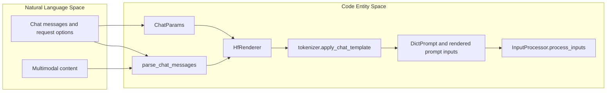
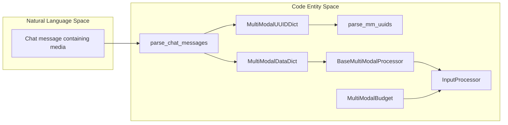
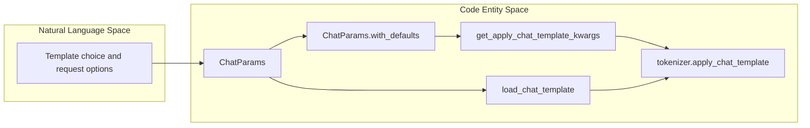
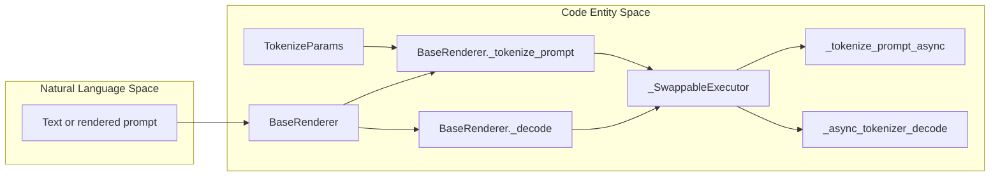
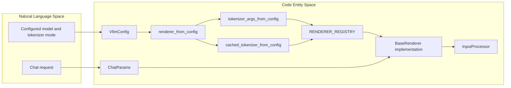
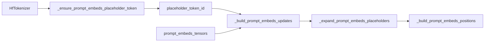

<!-- source: DeepWiki mcp.deepwiki.com · repo vllm-project/vllm · page 6.2 Chat Utilities and Message Processing · fetched 2026-10-28 -->

# Chat Utilities and Message Processing

Relevant source files

The following files were used as context for generating this wiki page:

- [rust/src/chat/src/renderer/deepseek_v32/tests.rs](rust/src/chat/src/renderer/deepseek_v32/tests.rs)
- [rust/src/chat/src/renderer/deepseek_v4/tests.rs](rust/src/chat/src/renderer/deepseek_v4/tests.rs)
- [rust/src/chat/src/renderer/selection.rs](rust/src/chat/src/renderer/selection.rs)
- [rust/src/chat/src/renderer/test_utils.rs](rust/src/chat/src/renderer/test_utils.rs)
- [tests/distributed/test_pipeline_parallel.py](tests/distributed/test_pipeline_parallel.py)
- [tests/entrypoints/openai/test_render_token_offsets.py](tests/entrypoints/openai/test_render_token_offsets.py)
- [tests/models/multimodal/generation/vlm_utils/core.py](tests/models/multimodal/generation/vlm_utils/core.py)
- [tests/models/test_initialization.py](tests/models/test_initialization.py)
- [tests/models/test_qwen3_5_mtp_config.py](tests/models/test_qwen3_5_mtp_config.py)
- [tests/models/test_registry.py](tests/models/test_registry.py)
- [tests/multimodal/test_registry.py](tests/multimodal/test_registry.py)
- [tests/renderers/test_completions.py](tests/renderers/test_completions.py)
- [tests/renderers/test_hf.py](tests/renderers/test_hf.py)
- [tests/renderers/test_mistral.py](tests/renderers/test_mistral.py)
- [tests/renderers/test_multimodal_hashes.py](tests/renderers/test_multimodal_hashes.py)
- [tests/renderers/test_process_multi_modal_uuids.py](tests/renderers/test_process_multi_modal_uuids.py)
- [tests/renderers/test_token_offsets.py](tests/renderers/test_token_offsets.py)
- [tests/renderers/test_warmup.py](tests/renderers/test_warmup.py)
- [tests/test_request_input_bounds.py](tests/test_request_input_bounds.py)
- [tests/tokenizers_/fixtures/deepseek_v4/test_input_5.json](tests/tokenizers_/fixtures/deepseek_v4/test_input_5.json)
- [tests/tokenizers_/fixtures/deepseek_v4/test_output_1.txt](tests/tokenizers_/fixtures/deepseek_v4/test_output_1.txt)
- [tests/tokenizers_/fixtures/deepseek_v4/test_output_5.txt](tests/tokenizers_/fixtures/deepseek_v4/test_output_5.txt)
- [tests/tokenizers_/test_deepseek_v4.py](tests/tokenizers_/test_deepseek_v4.py)
- [tests/tokenizers_/test_hf.py](tests/tokenizers_/test_hf.py)
- [vllm/inputs/engine.py](vllm/inputs/engine.py)
- [vllm/inputs/llm.py](vllm/inputs/llm.py)
- [vllm/multimodal/registry.py](vllm/multimodal/registry.py)
- [vllm/renderers/base.py](vllm/renderers/base.py)
- [vllm/renderers/deepseek_v32.py](vllm/renderers/deepseek_v32.py)
- [vllm/renderers/deepseek_v4.py](vllm/renderers/deepseek_v4.py)
- [vllm/renderers/hf.py](vllm/renderers/hf.py)
- [vllm/renderers/mistral.py](vllm/renderers/mistral.py)
- [vllm/renderers/params.py](vllm/renderers/params.py)
- [vllm/renderers/registry.py](vllm/renderers/registry.py)
- [vllm/renderers/terratorch.py](vllm/renderers/terratorch.py)
- [vllm/tokenizers/deepseek_v32.py](vllm/tokenizers/deepseek_v32.py)
- [vllm/tokenizers/deepseek_v32_encoding.py](vllm/tokenizers/deepseek_v32_encoding.py)
- [vllm/tokenizers/deepseek_v4.py](vllm/tokenizers/deepseek_v4.py)
- [vllm/tokenizers/deepseek_v4_encoding.py](vllm/tokenizers/deepseek_v4_encoding.py)
- [vllm/tokenizers/hf.py](vllm/tokenizers/hf.py)
- [vllm/v1/engine/input_processor.py](vllm/v1/engine/input_processor.py)

## Purpose and scope

This page describes the chat-message and prompt-rendering path: the `parse_chat_messages` interface, chat-template configuration, tokenizer selection, multimodal processing, and the `BaseRenderer` system. The available source excerpt shows where chat parsing is imported and used, but does not include the parser’s implementation; parser internals not visible in the excerpt are therefore not specified here. [vllm/renderers/hf.py:42-48]()

Sources: `vllm/renderers/hf.py`

---

## Overview of message processing flow

The rendering path connects chat-message parameters to model-ready prompt inputs. `InputProcessor` owns a renderer, creates one with `renderer_from_config` when none is passed in, and dispatches blocking input processing to the renderer’s executor for async callers. [vllm/v1/engine/input_processor.py:41-84]()

`HfRenderer` imports `parse_chat_messages` and `parse_chat_messages_async` from `vllm.renderers.chat_utils`; this establishes the parser’s integration point but the supplied excerpt does not show the parser definitions or their detailed parsing behavior. [vllm/renderers/hf.py:42-48]()

### Chat request path: names in the code and concepts in the request flow

Sources: `vllm/renderers/hf.py:42-48`; `vllm/renderers/params.py:79-141`; `vllm/v1/engine/input_processor.py:41-84`

---

## Multimodal content handling

`BaseRenderer` imports the multimodal input types and processing components it uses, including `MultiModalDataDict`, `MultiModalUUIDDict`, `BaseMultiModalProcessor`, `MultiModalDataItems`, `parse_mm_uuids`, and the multimodal registry. The supplied excerpt establishes these dependencies, but does not include the renderer methods that transform parsed message content into processor inputs. [vllm/renderers/base.py:18-49]()

`InputProcessor` determines whether the model configuration supports multimodal inputs. For supported models, it constructs a `MultiModalBudget` and records its encoder-cache size and processor’s `skip_prompt_length_check` setting. [vllm/v1/engine/input_processor.py:68-78]()

### Multimodal dependencies and input preparation

| Code entity | Role visible in the supplied source |
|---|---|
| `MultiModalDataDict` | A multimodal input type imported by `BaseRenderer`. [vllm/renderers/base.py:18-25]() |
| `MultiModalUUIDDict` | A multimodal identifier type imported by `BaseRenderer`. [vllm/renderers/base.py:18-26]() |
| `parse_mm_uuids` | A multimodal parsing utility imported by `BaseRenderer`. [vllm/renderers/base.py:42-46]() |
| `BaseMultiModalProcessor` | The processor type held by `BaseRenderer` and imported from multimodal processing. [vllm/renderers/base.py:47-49] [vllm/renderers/base.py:161-161]() |
| `MultiModalBudget` | Used by `InputProcessor` to obtain multimodal encoder-cache sizing and prompt-length-check behavior. [vllm/v1/engine/input_processor.py:68-78]() |

Sources: `vllm/renderers/base.py:18-49`; `vllm/renderers/base.py:161-161`; `vllm/v1/engine/input_processor.py:68-78`

### Multimodal and renderer flow

Sources: `vllm/renderers/hf.py:42-48`; `vllm/renderers/base.py:18-49`; `vllm/renderers/base.py:161-161`; `vllm/v1/engine/input_processor.py:68-84`

---

## Chat template processing

`ChatParams` is an immutable dataclass for chat parsing and rendering options. Its fields include `chat_template`, `chat_template_content_format`, `chat_template_kwargs`, per-modality `media_io_kwargs`, `mm_processor_kwargs`, `tool_choice`, and `response_format`. [vllm/renderers/params.py:79-102]()

`ChatParams.with_defaults` combines request-level values with defaults. It uses `merge_kwargs` for template kwargs, `merge_media_io_kwargs` for media I/O kwargs, and `recursively_merge_kwargs` for multimodal-processor kwargs. The template-kwargs merge ignores unset values of `None` and `"auto"` by default. [vllm/renderers/params.py:36-76] [vllm/renderers/params.py:104-134]()

`get_apply_chat_template_kwargs` prepares the keyword arguments for `tokenizer.apply_chat_template`; it merges configured template kwargs with the selected `chat_template` and `return_dict=False`. [vllm/renderers/params.py:136-141]()

The Hugging Face renderer imports `load_chat_template`, `parse_chat_messages`, and `parse_chat_messages_async`. It also imports Jinja2 and chat-template fallback support. The supplied excerpt does not show how template resolution or application is implemented, so details beyond these interfaces are not inferred here. [vllm/renderers/hf.py:15-20] [vllm/renderers/hf.py:42-50]()

### Template configuration path

Sources: `vllm/renderers/params.py:79-141`; `vllm/renderers/hf.py:42-50`

---

## Tokenizers and prompt tokenization

`BaseRenderer` is generic over a `TokenizerLike` tokenizer and receives a tokenizer, which may be `None`, in its constructor. It stores the tokenizer and creates a thread-pool executor for blocking tokenizer operations. The pool size is read from `model_config.renderer_num_workers`. [vllm/renderers/base.py:78-79] [vllm/renderers/base.py:106-119] [vllm/renderers/base.py:140-145]()

The renderer wraps `_tokenize_prompt` and `_decode` with async helpers that use the tokenizer executor. It also uses a separate single-worker executor for multimodal processing, so tokenization does not queue behind multimodal preprocessing. [vllm/renderers/base.py:140-159]()

`TokenizeParams` configures prompt tokenization and token limits. Its visible fields include total and output-token limits, padding and truncation settings, truncation direction, lowercase normalization, special-token behavior, character-offset requests, and whether the original text needs to be preserved for detokenization. [vllm/renderers/params.py:144-200]()

### Tokenization execution and async helpers

Sources: `vllm/renderers/base.py:78-104`; `vllm/renderers/base.py:140-159`; `vllm/renderers/params.py:144-200`

---

## `parse_chat_messages` integration

The supplied code shows `parse_chat_messages` and `parse_chat_messages_async` imported into `vllm.renderers.hf` from `vllm.renderers.chat_utils`. It also shows chat-message types imported for type checking. The parser definitions themselves are not included in the provided file excerpts, so exact validation rules, supported content variants, return values, and synchronous-versus-asynchronous implementation details cannot be established from this material. [vllm/renderers/hf.py:42-48] [vllm/renderers/hf.py:57-72]()

The renderer’s imports place these parsing functions alongside `load_chat_template`, while `ChatParams` defines request-level template, multimodal, tool-choice, and response-format settings. [vllm/renderers/hf.py:42-48] [vllm/renderers/params.py:79-102]()

### Parser interface visible in the renderer

| Symbol | What the supplied source establishes |
|---|---|
| `parse_chat_messages` | Imported by `HfRenderer` from `vllm.renderers.chat_utils`. [vllm/renderers/hf.py:42-48]() |
| `parse_chat_messages_async` | Async counterpart imported from the same module. [vllm/renderers/hf.py:42-48]() |
| `ChatCompletionMessageParam` | Chat message parameter type imported under `TYPE_CHECKING`. [vllm/renderers/hf.py:67-72]() |
| `ConversationMessage` | Conversation message type imported under `TYPE_CHECKING`. [vllm/renderers/hf.py:67-72]() |

Sources: `vllm/renderers/hf.py:42-48`; `vllm/renderers/hf.py:57-72`

---

## Renderer architecture

`BaseRenderer` is an abstract generic renderer constructed with `VllmConfig` and an optional tokenizer. It stores the model configuration and API-process rank, and registers resource cleanup with an `ExitStack` and weak-reference finalizer. [vllm/renderers/base.py:106-119]()

`RendererRegistry` maps renderer-mode names to module and class names, loads the selected class, and instantiates it with the configuration and tokenizer. The built-in mapping shown includes `hf`, `mistral`, `deepseek_v32`, `deepseek_v4`, `deepseek_v41`, `cohere`, `kimi_k3`, `terratorch`, and `inkling`; `kimi_audio` maps to `HfRenderer`. [vllm/renderers/registry.py:22-33] [vllm/renderers/registry.py:36-71]()

`renderer_from_config` obtains a cached tokenizer from the model configuration, resolves the tokenizer arguments, and uses the resulting renderer mode to load the renderer instance. `InputProcessor` uses this factory when a renderer is not supplied explicitly. [vllm/renderers/registry.py:83-90] [vllm/v1/engine/input_processor.py:41-67]()

### Request options and renderer selection: names in the code and concepts in the system

Sources: `vllm/renderers/registry.py:8-12`; `vllm/renderers/registry.py:22-33`; `vllm/renderers/registry.py:36-90`; `vllm/renderers/base.py:106-119`; `vllm/v1/engine/input_processor.py:41-67`; `vllm/renderers/params.py:79-102`

---

## Prompt embeddings handling

The Hugging Face renderer defines helpers for representing prompt embeddings in a rendered prompt. `_ensure_prompt_embeds_placeholder_token` registers `PROMPT_EMBEDS_PLACEHOLDER_TOKEN` as a special token, checks that it encodes to exactly one token ID, and caches that ID in a weak-key dictionary keyed by the tokenizer. [vllm/renderers/hf.py:80-128]()

`_build_prompt_embeds_updates` creates `PromptReplacement` entries that expand each single-token placeholder into a span whose length is the corresponding tensor’s first dimension. `_expand_prompt_embeds_placeholders` applies those updates to token IDs, and `_build_prompt_embeds_positions` finds the resulting spans and verifies that the number of spans matches the number of embedding tensors. [vllm/renderers/hf.py:131-187]()

### Placeholder expansion sequence

Sources: `vllm/renderers/hf.py:80-128`; `vllm/renderers/hf.py:131-187`

---

## Summary of chat and renderer interfaces

| Symbol | Role in the supplied source |
|---|---|
| `parse_chat_messages` | Synchronous chat parser imported by `HfRenderer`; implementation is not included in the supplied excerpt. [vllm/renderers/hf.py:42-48]() |
| `parse_chat_messages_async` | Async chat parser imported by `HfRenderer`; implementation is not included in the supplied excerpt. [vllm/renderers/hf.py:42-48]() |
| `ChatParams` | Immutable configuration for chat templates, template kwargs, media and processor kwargs, tool choice, and response format. [vllm/renderers/params.py:79-102]() |
| `TokenizeParams` | Immutable configuration for prompt tokenization and token limits. [vllm/renderers/params.py:144-200]() |
| `BaseRenderer` | Abstract renderer base that stores configuration and tokenizer and manages execution resources. [vllm/renderers/base.py:106-159]() |
| `RendererRegistry` | Maps renderer modes to renderer classes and constructs instances. [vllm/renderers/registry.py:36-71]() |
| `renderer_from_config` | Resolves the tokenizer and renderer mode from configuration and loads the renderer. [vllm/renderers/registry.py:83-89]() |
| `InputProcessor` | Owns or constructs the renderer and exposes synchronous and async input-processing entry points. [vllm/v1/engine/input_processor.py:41-84]() |

Sources: `vllm/renderers/hf.py:42-48`; `vllm/renderers/params.py:79-200`; `vllm/renderers/base.py:106-159`; `vllm/renderers/registry.py:36-90`; `vllm/v1/engine/input_processor.py:41-84`

---

## References

- `vllm/renderers/base.py` — renderer base, tokenizer executors, and multimodal dependencies. [vllm/renderers/base.py:18-49] [vllm/renderers/base.py:106-172]()
- `vllm/renderers/hf.py` — chat parser imports, template dependencies, and prompt-embedding placeholder helpers. [vllm/renderers/hf.py:42-50] [vllm/renderers/hf.py:80-187]()
- `vllm/renderers/params.py` — `ChatParams`, merge helpers, and `TokenizeParams`. [vllm/renderers/params.py:36-76] [vllm/renderers/params.py:79-200]()
- `vllm/renderers/registry.py` — renderer-mode registry and configuration-based renderer construction. [vllm/renderers/registry.py:22-89]()
- `vllm/v1/engine/input_processor.py` — renderer ownership and multimodal-budget setup. [vllm/v1/engine/input_processor.py:41-84]()

---

