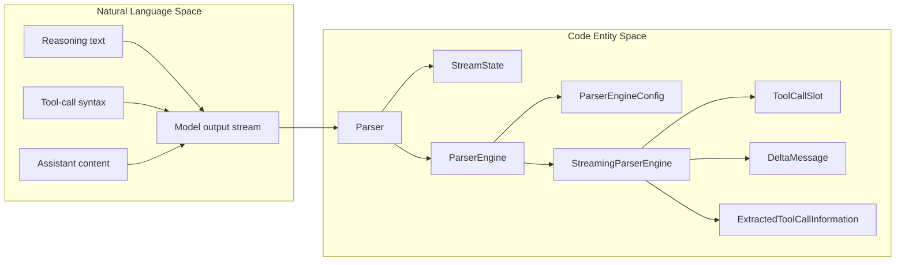
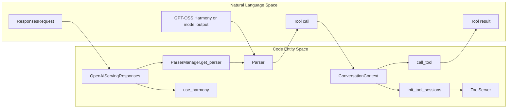
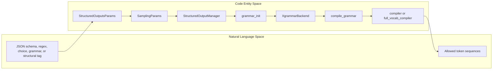

<!-- source: DeepWiki mcp.deepwiki.com · repo vllm-project/vllm · page 6.3 Tool Calling, Reasoning Parsers and Structured Output · fetched 2026-10-28 -->

# Tool Calling, Reasoning Parsers and Structured Output

Relevant source files

The following files were used as context for generating this wiki page:

- [docs/features/speculative_decoding/adaptive_verification.md](docs/features/speculative_decoding/adaptive_verification.md)
- [docs/features/tool_calling.md](docs/features/tool_calling.md)
- [rust/src/chat/src/renderer/inkling/tests.rs](rust/src/chat/src/renderer/inkling/tests.rs)
- [rust/src/engine-core-client/src/protocol/structured_outputs.rs](rust/src/engine-core-client/src/protocol/structured_outputs.rs)
- [rust/src/engine-core-client/src/protocol/structured_outputs/nesting.rs](rust/src/engine-core-client/src/protocol/structured_outputs/nesting.rs)
- [rust/src/engine-core-client/src/protocol/structured_outputs/xgrammar.rs](rust/src/engine-core-client/src/protocol/structured_outputs/xgrammar.rs)
- [rust/src/parser/src/unified/inkling.rs](rust/src/parser/src/unified/inkling.rs)
- [rust/src/server/src/routes/openai/utils/structured_outputs.rs](rust/src/server/src/routes/openai/utils/structured_outputs.rs)
- [rust/src/tokenizer/src/tekken.rs](rust/src/tokenizer/src/tekken.rs)
- [tests/entrypoints/openai/parser/test_harmony_render_parity.py](tests/entrypoints/openai/parser/test_harmony_render_parity.py)
- [tests/entrypoints/openai/parser/test_harmony_utils.py](tests/entrypoints/openai/parser/test_harmony_utils.py)
- [tests/entrypoints/openai/responses/conftest.py](tests/entrypoints/openai/responses/conftest.py)
- [tests/entrypoints/openai/responses/test_function_call.py](tests/entrypoints/openai/responses/test_function_call.py)
- [tests/entrypoints/openai/responses/test_function_call_parsing.py](tests/entrypoints/openai/responses/test_function_call_parsing.py)
- [tests/entrypoints/openai/responses/test_harmony.py](tests/entrypoints/openai/responses/test_harmony.py)
- [tests/entrypoints/openai/responses/test_harmony_utils.py](tests/entrypoints/openai/responses/test_harmony_utils.py)
- [tests/entrypoints/openai/responses/test_mcp_tools.py](tests/entrypoints/openai/responses/test_mcp_tools.py)
- [tests/entrypoints/openai/responses/test_parsable_context.py](tests/entrypoints/openai/responses/test_parsable_context.py)
- [tests/entrypoints/openai/responses/test_parsable_context_unit.py](tests/entrypoints/openai/responses/test_parsable_context_unit.py)
- [tests/entrypoints/openai/responses/test_response_input_to_harmony.py](tests/entrypoints/openai/responses/test_response_input_to_harmony.py)
- [tests/entrypoints/openai/responses/test_responses_utils.py](tests/entrypoints/openai/responses/test_responses_utils.py)
- [tests/entrypoints/openai/responses/test_serving_responses.py](tests/entrypoints/openai/responses/test_serving_responses.py)
- [tests/entrypoints/openai/responses/test_simple.py](tests/entrypoints/openai/responses/test_simple.py)
- [tests/entrypoints/openai/responses/test_streaming_events.py](tests/entrypoints/openai/responses/test_streaming_events.py)
- [tests/entrypoints/openai/utils.py](tests/entrypoints/openai/utils.py)
- [tests/entrypoints/unit_tests/test_context.py](tests/entrypoints/unit_tests/test_context.py)
- [tests/parser/engine/replay_harness.py](tests/parser/engine/replay_harness.py)
- [tests/parser/engine/test_delegating_replay.py](tests/parser/engine/test_delegating_replay.py)
- [tests/parser/engine/test_engine.py](tests/parser/engine/test_engine.py)
- [tests/parser/engine/test_inkling.py](tests/parser/engine/test_inkling.py)
- [tests/parser/engine/test_parser_engine.py](tests/parser/engine/test_parser_engine.py)
- [tests/parser/engine/test_replay.py](tests/parser/engine/test_replay.py)
- [tests/parser/engine/test_token_id_scanner.py](tests/parser/engine/test_token_id_scanner.py)
- [tests/parser/engine/trace_builder.py](tests/parser/engine/trace_builder.py)
- [tests/tool_parsers/test_structural_tag_registry.py](tests/tool_parsers/test_structural_tag_registry.py)
- [tests/v1/engine/test_logprobs_processor.py](tests/v1/engine/test_logprobs_processor.py)
- [tests/v1/sample/test_logprobs.py](tests/v1/sample/test_logprobs.py)
- [tests/v1/spec_decode/test_adaptive_verification.py](tests/v1/spec_decode/test_adaptive_verification.py)
- [tests/v1/spec_decode/test_mtp_structured_output.py](tests/v1/spec_decode/test_mtp_structured_output.py)
- [tests/v1/structured_output/test_backend_guidance.py](tests/v1/structured_output/test_backend_guidance.py)
- [tests/v1/structured_output/test_backend_outlines.py](tests/v1/structured_output/test_backend_outlines.py)
- [tests/v1/structured_output/test_backend_xgrammar.py](tests/v1/structured_output/test_backend_xgrammar.py)
- [tests/v1/structured_output/test_backend_xgrammar_stop_tokens.py](tests/v1/structured_output/test_backend_xgrammar_stop_tokens.py)
- [tests/v1/structured_output/test_request.py](tests/v1/structured_output/test_request.py)
- [tests/v1/structured_output/test_structured_output_manager.py](tests/v1/structured_output/test_structured_output_manager.py)
- [tests/v1/structured_output/test_validation.py](tests/v1/structured_output/test_validation.py)
- [tests/v1/worker/test_gpu_batch_shard.py](tests/v1/worker/test_gpu_batch_shard.py)
- [vllm/entrypoints/mcp/tool.py](vllm/entrypoints/mcp/tool.py)
- [vllm/entrypoints/mcp/tool_server.py](vllm/entrypoints/mcp/tool_server.py)
- [vllm/entrypoints/openai/parser/harmony_utils.py](vllm/entrypoints/openai/parser/harmony_utils.py)
- [vllm/entrypoints/openai/responses/context.py](vllm/entrypoints/openai/responses/context.py)
- [vllm/entrypoints/openai/responses/harmony.py](vllm/entrypoints/openai/responses/harmony.py)
- [vllm/entrypoints/openai/responses/serving.py](vllm/entrypoints/openai/responses/serving.py)
- [vllm/entrypoints/openai/responses/streaming_events.py](vllm/entrypoints/openai/responses/streaming_events.py)
- [vllm/entrypoints/openai/responses/utils.py](vllm/entrypoints/openai/responses/utils.py)
- [vllm/entrypoints/serve/utils/tool_calls_utils.py](vllm/entrypoints/serve/utils/tool_calls_utils.py)
- [vllm/parser/abstract_parser.py](vllm/parser/abstract_parser.py)
- [vllm/parser/engine/adapters.py](vllm/parser/engine/adapters.py)
- [vllm/parser/engine/events.py](vllm/parser/engine/events.py)
- [vllm/parser/engine/incremental_lexer.py](vllm/parser/engine/incremental_lexer.py)
- [vllm/parser/engine/parser_engine.py](vllm/parser/engine/parser_engine.py)
- [vllm/parser/engine/parser_engine_config.py](vllm/parser/engine/parser_engine_config.py)
- [vllm/parser/engine/registered_adapters.py](vllm/parser/engine/registered_adapters.py)
- [vllm/parser/engine/streaming_parser_engine.py](vllm/parser/engine/streaming_parser_engine.py)
- [vllm/parser/engine/token_id_scanner.py](vllm/parser/engine/token_id_scanner.py)
- [vllm/parser/inkling.py](vllm/parser/inkling.py)
- [vllm/reasoning/__init__.py](vllm/reasoning/__init__.py)
- [vllm/reasoning/abs_reasoning_parsers.py](vllm/reasoning/abs_reasoning_parsers.py)
- [vllm/reasoning/basic_parsers.py](vllm/reasoning/basic_parsers.py)
- [vllm/sampling_params.py](vllm/sampling_params.py)
- [vllm/tool_parsers/__init__.py](vllm/tool_parsers/__init__.py)
- [vllm/tool_parsers/abstract_tool_parser.py](vllm/tool_parsers/abstract_tool_parser.py)
- [vllm/tool_parsers/structural_tag_registry.py](vllm/tool_parsers/structural_tag_registry.py)
- [vllm/v1/engine/logprobs.py](vllm/v1/engine/logprobs.py)
- [vllm/v1/structured_output/__init__.py](vllm/v1/structured_output/__init__.py)
- [vllm/v1/structured_output/backend_guidance.py](vllm/v1/structured_output/backend_guidance.py)
- [vllm/v1/structured_output/backend_lm_format_enforcer.py](vllm/v1/structured_output/backend_lm_format_enforcer.py)
- [vllm/v1/structured_output/backend_outlines.py](vllm/v1/structured_output/backend_outlines.py)
- [vllm/v1/structured_output/backend_types.py](vllm/v1/structured_output/backend_types.py)
- [vllm/v1/structured_output/backend_xgrammar.py](vllm/v1/structured_output/backend_xgrammar.py)
- [vllm/v1/structured_output/request.py](vllm/v1/structured_output/request.py)
- [vllm/v1/structured_output/utils.py](vllm/v1/structured_output/utils.py)
- [vllm/v1/worker/gpu/sample/batch_shard.py](vllm/v1/worker/gpu/sample/batch_shard.py)
- [vllm/v1/worker/gpu/sample/logprob.py](vllm/v1/worker/gpu/sample/logprob.py)
- [vllm/v1/worker/gpu/sample/prompt_logprob.py](vllm/v1/worker/gpu/sample/prompt_logprob.py)
- [vllm/v1/worker/gpu/spec_decode/adaptive_verification.py](vllm/v1/worker/gpu/spec_decode/adaptive_verification.py)
- [vllm/v1/worker/gpu/structured_outputs.py](vllm/v1/worker/gpu/structured_outputs.py)

## Purpose and Scope

This page explains how vLLM parses model output into content, reasoning, and tool calls; how tool and reasoning parsers are registered and composed; how Responses serving handles Harmony and MCP tool flows; and how V1 structured-output requests are compiled into grammar constraints used during decoding. [vllm/parser/abstract_parser.py:66-115](), [vllm/parser/engine/parser_engine.py:111-169](), [vllm/entrypoints/openai/responses/serving.py:104-149](), [vllm/v1/structured_output/__init__.py:49-74]()

Sources: [vllm/parser/abstract_parser.py:66-115](), [vllm/parser/engine/parser_engine.py:111-169](), [vllm/entrypoints/openai/responses/serving.py:104-149](), [vllm/v1/structured_output/__init__.py:49-74]()

---

## Unified Parser Engine (`vllm/parser/`) and Streaming/Replay Adapters

The serving-facing `Parser` interface represents output parsing for reasoning, content, and tool calls. Its documented implementations include `ParserEngine`, which uses a declarative engine, and `DelegatingParser`, which composes a legacy `ReasoningParser` and `ToolParser` pair. [vllm/parser/abstract_parser.py:108-115]() `ParserEngine` builds a `StreamingParserEngine` from a `ParserEngineConfig`, tokenizer, and vocabulary, then tracks reasoning and tool-call state as output arrives. [vllm/parser/engine/parser_engine.py:111-169]()

### StreamState: Mutable Stream Tracking

`StreamState` is mutable state for `Parser.parse_delta()` and is intended to be held per stream. [vllm/parser/abstract_parser.py:66-80]() It tracks whether reasoning has ended, whether tool-call text has started, prior text and token IDs, prior tool-call counts, tool-call ID conventions, and whether parsing is engine-based. [vllm/parser/abstract_parser.py:66-80]()

`advance(delta_text, delta_token_ids)` returns the incoming delta unchanged for engine-based parsing; otherwise it combines the delta with the stored text and token IDs. [vllm/parser/abstract_parser.py:83-93]() `commit(current_text, current_token_ids)` clears the saved buffers for engine-based parsing and stores the current buffers for legacy parsing. [vllm/parser/abstract_parser.py:95-105]()

Sources: [vllm/parser/abstract_parser.py:66-105]()

### Parser and ParserEngine

`Parser.__init__` creates configured reasoning and tool parser instances from the class-level `reasoning_parser_cls` and `tool_parser_cls`. Engine-based tool adapters receive the construction arguments used for reasoning parsers, while legacy `ToolParser` classes receive the tokenizer and tools. [vllm/parser/abstract_parser.py:117-155]() The parser determines whether both configured components support engine-based streaming and initializes its `StreamState` accordingly. [vllm/parser/abstract_parser.py:152-174]()

When no reasoning parser is configured but an engine-based tool parser exposes `skip_reasoning_parsing`, `Parser` sets that flag so reasoning markup is treated as content where the tool grammar allows it. [vllm/parser/abstract_parser.py:156-166]()

`ParserEngine` receives a `ParserEngineConfig`, constructs `StreamingParserEngine`, and derives whether the format includes reasoning from configured terminals and initial state. [vllm/parser/engine/parser_engine.py:111-152]() Its `ToolCallSlot` holds a tool-call ID and name, argument fragments, streamed JSON fragments, and incremental name/argument state. [vllm/parser/engine/parser_engine.py:59-109]() The engine configuration also supplies argument conversion and extension behavior, structural characters, delta-streaming behavior, and whitespace handling settings. [vllm/parser/engine/parser_engine.py:154-172]()

Sources: [vllm/parser/abstract_parser.py:117-174](), [vllm/parser/engine/parser_engine.py:59-109](), [vllm/parser/engine/parser_engine.py:111-192]()

### Unified Parsing Architecture: Natural Language to Code Entities

The diagram maps model-output concepts to the parser types and state objects that implement them. `Parser` is the serving-facing abstraction; `ParserEngine` configures `StreamingParserEngine`; and the engine produces protocol-level deltas and tool-call information. [vllm/parser/abstract_parser.py:108-115](), [vllm/parser/engine/parser_engine.py:16-32]()

**Diagram: Model output through the unified parser**

Sources: [vllm/parser/abstract_parser.py:66-115](), [vllm/parser/engine/parser_engine.py:16-32](), [vllm/parser/engine/parser_engine.py:59-169]()

### Streaming and Replay Adapters

The parser state explicitly distinguishes engine-based streaming from legacy accumulation: `StreamState.advance` and `commit` use different buffer behavior depending on `engine_based`. [vllm/parser/abstract_parser.py:83-105]() The parser engine module defines its unified engine around `StreamingParserEngine`, and its stream state includes deferred content and reasoning buffers as well as tool-call slots. [vllm/parser/engine/parser_engine.py:32-32](), [vllm/parser/engine/parser_engine.py:139-169]()

The supplied file excerpts do not show the replay adapter implementation or its call path. The parser engine’s streaming role and state are visible in the cited definitions, but replay-specific behavior should be verified in the relevant adapter and replay implementation files. [vllm/parser/engine/parser_engine.py:111-169]()

Sources: [vllm/parser/abstract_parser.py:66-105](), [vllm/parser/engine/parser_engine.py:111-169]()

---

## Tool Parsers and Tool Registry

Tool parsers provide model-specific handling for tool-call formats. The `Parser` abstraction can hold a `ToolParser`, and tool-parsing types are imported by the parser interface alongside tool-call protocol objects. [vllm/parser/abstract_parser.py:24-54](), [vllm/parser/abstract_parser.py:126-150]()

### Tool Parser Registration and Lookup

`vllm.tool_parsers` exports `ToolParser` and `ToolParserManager`. [vllm/tool_parsers/__init__.py:4-9]() Its registration mapping associates parser names with module and class names; examples include `deepseek_v3`, `deepseek_v4`, `hermes`, `mistral`, `openai`, `qwen3_coder`, and `gemma4`. [vllm/tool_parsers/__init__.py:24-40](), [vllm/tool_parsers/__init__.py:85-91](), [vllm/tool_parsers/__init__.py:169-219](), [vllm/tool_parsers/__init__.py:249-260]()

`register_lazy_tool_parsers()` iterates over that mapping and registers the corresponding module path and class name with the manager. [vllm/tool_parsers/__init__.py:264-265]()

| Registry name | Registered implementation | Source |
|---|---|---|
| `deepseek_v3` | `DeepSeekV3ToolParser` | [vllm/tool_parsers/__init__.py:29-32]() |
| `deepseek_v4` | `DeepSeekV4EngineToolParser` | [vllm/tool_parsers/__init__.py:41-44]() |
| `hermes` | `Hermes2ProToolParser` | [vllm/tool_parsers/__init__.py:85-88]() |
| `openai` | `GptOssToolParser` | [vllm/tool_parsers/__init__.py:194-197]() |
| `qwen3_coder` | `Qwen3EngineToolParser` | [vllm/tool_parsers/__init__.py:206-209]() |
| `gemma4` | `Gemma4EngineToolParser` | [vllm/tool_parsers/__init__.py:253-256]() |

Sources: [vllm/tool_parsers/__init__.py:4-9](), [vllm/tool_parsers/__init__.py:24-44](), [vllm/tool_parsers/__init__.py:85-91](), [vllm/tool_parsers/__init__.py:194-219](), [vllm/tool_parsers/__init__.py:249-265]()

---

## Reasoning Parsers and Reasoning Registry

`vllm.reasoning` exports `ReasoningParser` and `ReasoningParserManager`. [vllm/reasoning/__init__.py:4-9]() The lazy-registration mapping associates names with reasoning parser modules and classes, including `deepseek_r1`, `openai_gptoss`, `mistral`, `qwen3`, and `kimi_k3`. [vllm/reasoning/__init__.py:22-37](), [vllm/reasoning/__init__.py:107-113](), [vllm/reasoning/__init__.py:139-141](), [vllm/reasoning/__init__.py:168-170]()

`register_lazy_reasoning_parsers()` constructs module paths under `vllm.reasoning` and registers each mapping with `ReasoningParserManager`. [vllm/reasoning/__init__.py:195-201]()

### Structured-Output Reasoning Parser Selection

`StructuredOutputManager` can load a configured reasoning parser class from `ReasoningParserManager`. [vllm/v1/structured_output/__init__.py:100-112]() It stores the class at manager scope, then lazily creates a parser instance for a request using that request’s `reasoning_parser_kwargs`. [vllm/v1/structured_output/__init__.py:59-63](), [vllm/v1/structured_output/__init__.py:118-131]()

Sources: [vllm/reasoning/__init__.py:4-9](), [vllm/reasoning/__init__.py:22-37](), [vllm/reasoning/__init__.py:107-113](), [vllm/reasoning/__init__.py:139-170](), [vllm/reasoning/__init__.py:195-201](), [vllm/v1/structured_output/__init__.py:59-63](), [vllm/v1/structured_output/__init__.py:100-131]()

---

## Harmony, GPT-OSS Parsing, and Model Context Protocol (MCP) Tools

The Responses serving implementation imports `Parser` and `ParserManager`, and its initializer obtains a parser using tool-parser and reasoning-parser names, auto-tool settings, strictness, model name, Harmony detection, and the renderer tokenizer. [vllm/entrypoints/openai/responses/serving.py:86-97](), [vllm/entrypoints/openai/responses/serving.py:139-149]() It detects GPT-OSS Harmony mode by checking whether the model type is `gpt_oss`. [vllm/entrypoints/openai/responses/serving.py:175-178]()

The Responses context module uses Harmony message types and defines context abstractions for appending model and tool output, deciding whether a built-in tool call is needed, rendering a completion, and initializing and cleaning up tool sessions. [vllm/entrypoints/openai/responses/context.py:13-45](), [vllm/entrypoints/openai/responses/context.py:108-148]()

### MCP Tool Context and Routing

`ConversationContext` defines the lifecycle interface for tool-capable conversation contexts, including `call_tool`, `need_builtin_tool_call`, and `init_tool_sessions`. [vllm/entrypoints/openai/responses/context.py:108-148]() `SimpleContext` is documented as a context that cannot handle MCP tool calls. [vllm/entrypoints/openai/responses/context.py:171-192]()

The context module defines the `MCP_PREFIX` constant and a mapping from built-in tool names such as `browser`, `python`, and `container` to tool types such as `web_search_preview`, `code_interpreter`, and `container`. [vllm/entrypoints/openai/responses/context.py:55-73]() The `OpenAIServingResponses` constructor accepts an optional `ToolServer`, while the context API accepts a tool server and MCP tool mapping when initializing sessions. [vllm/entrypoints/openai/responses/serving.py:104-125](), [vllm/entrypoints/openai/responses/context.py:137-144]()

The provided excerpts establish the parser/context interfaces and name mapping, but do not include the full Harmony parsing implementation or MCP session invocation logic. [vllm/entrypoints/openai/responses/context.py:55-73](), [vllm/entrypoints/openai/responses/context.py:108-148]()

Sources: [vllm/entrypoints/openai/responses/serving.py:86-97](), [vllm/entrypoints/openai/responses/serving.py:104-149](), [vllm/entrypoints/openai/responses/serving.py:175-178](), [vllm/entrypoints/openai/responses/context.py:13-45](), [vllm/entrypoints/openai/responses/context.py:55-73](), [vllm/entrypoints/openai/responses/context.py:108-148](), [vllm/entrypoints/openai/responses/context.py:171-192]()

### Responses Parser and Tool-Call Flow: Natural Language to Code Entities

`OpenAIServingResponses` constructs the unified parser and gives it the configured parser names and Harmony mode. [vllm/entrypoints/openai/responses/serving.py:139-149]() The context interfaces represent the conversation and tool-session side of that serving flow. [vllm/entrypoints/openai/responses/context.py:108-148]()

**Diagram: Responses parser setup and tool context**

Sources: [vllm/entrypoints/openai/responses/serving.py:104-149](), [vllm/entrypoints/openai/responses/serving.py:175-178](), [vllm/entrypoints/openai/responses/context.py:108-148]()

---

## Grammar-Backed Structured Output Backends (`vllm/v1/structured_output/`)

`StructuredOutputsParams` represents one structured-output constraint at a time. Supported fields include JSON schema, regex, choice, grammar, JSON-object mode, and structural tags; initialization rejects requests that specify zero or multiple constraint types. [vllm/sampling_params.py:101-141]()

The V1 `StructuredOutputManager` manages engine-level structured-output requests and stores a backend instance and backend name. [vllm/v1/structured_output/__init__.py:49-63]() It resolves configured reasoning-parser plugins and parser names when tokenizer initialization is enabled. [vllm/v1/structured_output/__init__.py:89-112]()

### StructuredOutputManager

`grammar_init(request)` returns immediately when the request has no structured-output request. Otherwise it reads the backend selected in the request’s sampling parameters and rejects a backend that differs from the backend already selected for the engine. [vllm/v1/structured_output/__init__.py:133-150]() The manager initializes its backend on first use; the excerpt shows the vocabulary-size lookup and the beginning of the `xgrammar` backend branch. [vllm/v1/structured_output/__init__.py:152-159]()

The manager allows asynchronous grammar compilation except when the distributed executor backend is `external_launcher`; the code comments explain that differing grammar-wait transitions across tensor-parallel ranks would violate that mode’s determinism assumption. [vllm/v1/structured_output/__init__.py:65-74]() It also configures thread pools for grammar-related work and tokenizer initialization. [vllm/v1/structured_output/__init__.py:79-99]()

### XgrammarBackend

`XgrammarBackend` initializes tokenizer information and compilers for grammar processing. [vllm/v1/structured_output/backend_xgrammar.py:37-38]() For ordinary tokenizers, it creates tokenizer information for structural tags using the full vocabulary and filters special tokens for JSON; the code maintains a full-vocabulary compiler for cases where structural tags may accept special tokens. [vllm/v1/structured_output/backend_xgrammar.py:72-112]()

`compile_grammar` dispatches by structured-output request type. For JSON schema and JSON-object requests, it invokes JSON-schema compilation; for grammar requests, it chooses Lark compilation when the grammar appears to be Lark, otherwise it invokes grammar compilation. [vllm/v1/structured_output/backend_xgrammar.py:120-161]()

### Request Validation and Grammar Constraints

The structured-output parameter definitions enforce mutual exclusivity among constraint types and define options such as whitespace behavior and structural tags. [vllm/sampling_params.py:101-141]() JSON schema and structural-tag nesting are bounded by constants documented in `sampling_params.py`. [vllm/sampling_params.py:39-46]() The validation tests exercise request-time rejection for invalid constraints, including unsupported diffusion-model structured output, degenerate inputs, NUL-containing regexes, and excessive nesting. [tests/v1/structured_output/test_validation.py:58-139](), [tests/v1/structured_output/test_validation.py:142-186]()

The supplied excerpts establish grammar compilation and manager initialization; they do not include the complete sampling-time bitmask application path. [vllm/v1/structured_output/__init__.py:133-159](), [vllm/v1/structured_output/backend_xgrammar.py:120-161]()

Sources: [vllm/sampling_params.py:39-46](), [vllm/sampling_params.py:101-168](), [vllm/v1/structured_output/__init__.py:49-112](), [vllm/v1/structured_output/__init__.py:118-159](), [vllm/v1/structured_output/backend_xgrammar.py:37-112](), [vllm/v1/structured_output/backend_xgrammar.py:120-161](), [tests/v1/structured_output/test_validation.py:58-139](), [tests/v1/structured_output/test_validation.py:142-186]()

### Structured Output Data Flow: Natural Language to Code Entities

A request’s constraint is represented in `StructuredOutputsParams`; the engine manager resolves and initializes a backend; and `XgrammarBackend.compile_grammar` converts supported constraint forms into backend compilation calls. [vllm/sampling_params.py:101-141](), [vllm/v1/structured_output/__init__.py:133-159](), [vllm/v1/structured_output/backend_xgrammar.py:120-161]()

**Diagram: Constraint request to grammar compilation**

Sources: [vllm/sampling_params.py:101-141](), [vllm/v1/structured_output/__init__.py:49-63](), [vllm/v1/structured_output/__init__.py:133-159](), [vllm/v1/structured_output/backend_xgrammar.py:37-112](), [vllm/v1/structured_output/backend_xgrammar.py:120-161]()

---

## Summary

The parser layer provides a serving-facing `Parser` abstraction, per-stream state, and a declarative `ParserEngine` backed by `StreamingParserEngine`; tool and reasoning parser registries map names to lazily registered implementations. [vllm/parser/abstract_parser.py:66-115](), [vllm/parser/engine/parser_engine.py:111-169](), [vllm/tool_parsers/__init__.py:24-44](), [vllm/reasoning/__init__.py:22-37]() Responses serving configures this parser and identifies GPT-OSS Harmony mode, while its context interfaces expose tool-call and MCP session lifecycle operations. [vllm/entrypoints/openai/responses/serving.py:139-149](), [vllm/entrypoints/openai/responses/serving.py:175-178](), [vllm/entrypoints/openai/responses/context.py:108-148]() V1 structured output represents constraints in `StructuredOutputsParams`, selects an engine backend through `StructuredOutputManager`, and compiles grammars through backends such as `XgrammarBackend`. [vllm/sampling_params.py:101-141](), [vllm/v1/structured_output/__init__.py:133-159](), [vllm/v1/structured_output/backend_xgrammar.py:120-161]()

Sources: [vllm/parser/abstract_parser.py:66-115](), [vllm/parser/engine/parser_engine.py:111-169](), [vllm/tool_parsers/__init__.py:24-44](), [vllm/reasoning/__init__.py:22-37](), [vllm/entrypoints/openai/responses/serving.py:139-149](), [vllm/entrypoints/openai/responses/serving.py:175-178](), [vllm/entrypoints/openai/responses/context.py:108-148](), [vllm/sampling_params.py:101-141](), [vllm/v1/structured_output/__init__.py:133-159](), [vllm/v1/structured_output/backend_xgrammar.py:120-161]()

---

