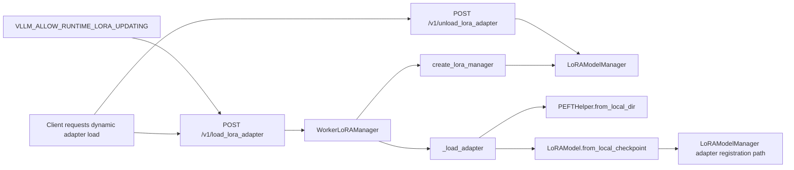
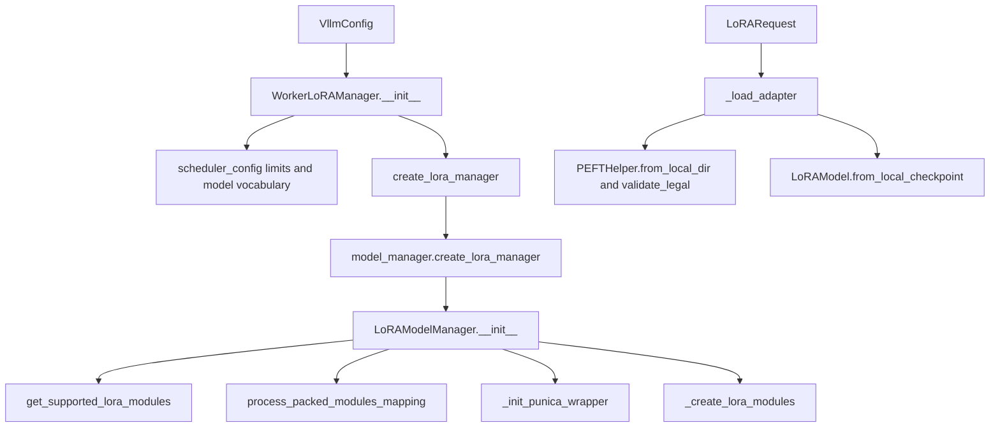
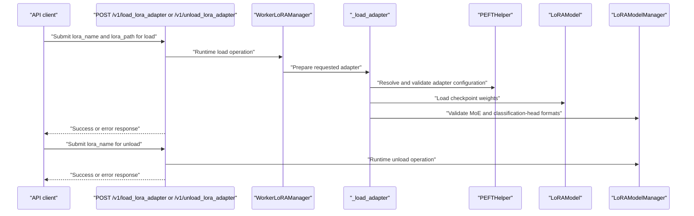
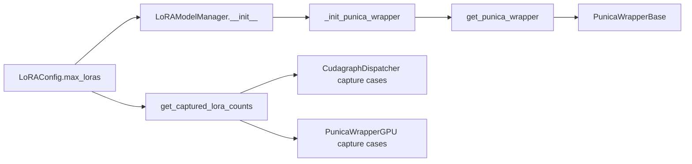

<!-- source: DeepWiki mcp.deepwiki.com · repo vllm-project/vllm · page 6.4 LoRA Adapter Management · fetched 2026-10-28 -->

# LoRA Adapter Management

Relevant source files

The following files were used as context for generating this wiki page:

- [docs/features/lora.md](docs/features/lora.md)
- [docs/models/pooling_models/token_classify.md](docs/models/pooling_models/token_classify.md)
- [tests/lora/test_lora_manager.py](tests/lora/test_lora_manager.py)
- [tests/lora/test_lora_utils.py](tests/lora/test_lora_utils.py)
- [vllm/config/lora.py](vllm/config/lora.py)
- [vllm/lora/layers/__init__.py](vllm/lora/layers/__init__.py)
- [vllm/lora/layers/classifier.py](vllm/lora/layers/classifier.py)
- [vllm/lora/layers/custom_layer.py](vllm/lora/layers/custom_layer.py)
- [vllm/lora/model_manager.py](vllm/lora/model_manager.py)
- [vllm/lora/utils.py](vllm/lora/utils.py)
- [vllm/lora/worker_manager.py](vllm/lora/worker_manager.py)
- [vllm/model_executor/layers/pooler/tokwise/methods.py](vllm/model_executor/layers/pooler/tokwise/methods.py)
- [vllm/model_executor/models/bert.py](vllm/model_executor/models/bert.py)
- [vllm/model_executor/models/roberta.py](vllm/model_executor/models/roberta.py)
- [vllm/model_executor/models/transformers/legacy.py](vllm/model_executor/models/transformers/legacy.py)
- [vllm/models/step5/nvidia/model.py](vllm/models/step5/nvidia/model.py)
- [vllm/models/step5/nvidia/vl.py](vllm/models/step5/nvidia/vl.py)

## Purpose and scope

This page describes vLLM’s LoRA adapter configuration and runtime management: how the documented serving API exposes loading and unloading, how `WorkerLoRAManager` prepares adapters for a `LoRAModelManager`, how supported model layers are selected for LoRA wrapping, and how Punica and fused MoE LoRA fit into the execution path. The API endpoint behavior described here is documented in the LoRA feature guide; the implementation details are limited to the supplied source ranges. [docs/features/lora.md:105-155](), [vllm/lora/worker_manager.py:27-104](), [vllm/lora/model_manager.py:76-167]()

Sources: [docs/features/lora.md:105-155](), [vllm/lora/worker_manager.py:27-104](), [vllm/lora/model_manager.py:76-167]()

## 1. Overview and core concepts

LoRA lets a supported base model serve requests with adapter-specific weights. Model support is gated by the `SupportsLoRA` interface, and `LoRAConfig` determines such constraints as maximum rank, adapter counts, dtype, target modules, and optional MoE layouts. [docs/features/lora.md:3-7](), [vllm/config/lora.py:29-88](), [vllm/config/lora.py:137-148]()

The principal implementation roles are:

| Entity | Responsibility |
|---|---|
| `LoRAConfig` | Configures adapter capacity and structural choices, including `max_loras`, `max_cpu_loras`, `target_modules`, and MoE format options. [vllm/config/lora.py:29-88]() |
| `WorkerLoRAManager` | Holds worker-side LoRA configuration and lazily creates an adapter manager for the loaded model. [vllm/lora/worker_manager.py:27-104]() |
| `LoRAModelManager` | Tracks supported modules, initializes adapter caches, chooses MoE-related settings, initializes a Punica wrapper, and creates LoRA model modules. [vllm/lora/model_manager.py:76-167]() |
| `LoRAModel` | Represents adapter weights loaded by the worker from a local checkpoint. [vllm/lora/worker_manager.py:106-156]() |
| Punica wrapper | The manager obtains a wrapper through `get_punica_wrapper`; the supplied source shows its initialization point, not the kernel implementations. [vllm/lora/model_manager.py:30-30](), [vllm/lora/model_manager.py:163-167]() |

Sources: [docs/features/lora.md:3-7](), [vllm/config/lora.py:29-88](), [vllm/config/lora.py:137-148](), [vllm/lora/worker_manager.py:27-156](), [vllm/lora/model_manager.py:30-30](), [vllm/lora/model_manager.py:76-167]()

### Natural-language concepts mapped to code entities

This diagram maps user-visible serving actions to entities named in the supplied docs and source. The API guide describes the endpoints and the worker source shows the manager’s adapter-loading path; the available files do not include the endpoint handler call sites. [docs/features/lora.md:105-155](), [vllm/lora/worker_manager.py:86-156]()

**Diagram: Runtime adapter management concepts and implementation entities**

Sources: [docs/features/lora.md:105-155](), [vllm/lora/worker_manager.py:86-156](), [vllm/lora/model_manager.py:76-167]()

## 2. LoRA request identity and configuration

The serving guide documents startup-loaded adapters as named model choices and dynamic loading as requests carrying an adapter name and path. The implementation excerpt shows `_load_adapter` consuming a `LoRARequest`, using its `lora_path` and `lora_int_id` when preparing the adapter model. [docs/features/lora.md:52-103](), [docs/features/lora.md:119-155](), [vllm/lora/worker_manager.py:106-150]()

`LoRAConfig` exposes important capacity and layout controls:

| Setting | Meaning in the supplied configuration |
|---|---|
| `max_lora_rank` | Maximum adapter rank. [vllm/config/lora.py:33-34]() |
| `max_loras` | Maximum number of LoRAs in a batch. [vllm/config/lora.py:35-36]() |
| `max_cpu_loras` | Maximum adapters stored in CPU memory; validation defaults it to `max_loras` and rejects a smaller value. [vllm/config/lora.py:42-44](), [vllm/config/lora.py:118-126]() |
| `lora_dtype` | Adapter dtype, defaulting to the model dtype when configured as `auto`. [vllm/config/lora.py:45-46](), [vllm/config/lora.py:137-148]() |
| `target_modules` | Optional restriction to supported module suffixes. [vllm/config/lora.py:47-50]() |
| `enable_mixed_moe_lora_format` | Selects the universal 2D MoE wrapper for mixed 2D/3D adapter deployments. [vllm/config/lora.py:73-78]() |
| `enable_moe_shared_loras` | Enables the documented shared-outer MoE adapter layout. [vllm/config/lora.py:79-85]() |

`LoRAConfig.verify_with_model_config` rejects models that do not declare LoRA support and resolves the automatic dtype from the model configuration. [vllm/config/lora.py:137-148]()

Sources: [docs/features/lora.md:52-103](), [docs/features/lora.md:119-155](), [vllm/lora/worker_manager.py:106-150](), [vllm/config/lora.py:33-50](), [vllm/config/lora.py:73-85](), [vllm/config/lora.py:118-148]()

## 3. `LoRAModelManager` and `WorkerLoRAManager` lifecycle

`WorkerLoRAManager` is initialized with `VllmConfig`, device, and embedding-module metadata. It reads scheduler batch limits and model vocabulary size, requires `lora_config`, obtains the text configuration for multimodal models, and chooses the appropriate position limit for encoder-decoder versus other models. It stores the adapter manager for lazy initialization. [vllm/lora/worker_manager.py:27-72]()

When `create_lora_manager` is called, the worker forwards the model, scheduler limits, vocabulary size, LoRA config, device, manager class, and engine config to the module-level factory; it stores the result and returns the manager’s model. [vllm/lora/worker_manager.py:86-104]()

At construction, `LoRAModelManager` discovers supported LoRA modules and asserts that at least one exists. It initializes registered-adapter and active-adapter LRU caches, normalizes the batched-token limit to a multiple of eight, prepares module and mapping state, selects MoE-related flags and packed-module mappings, initializes the Punica wrapper, and calls `_create_lora_modules`. [vllm/lora/model_manager.py:103-167]()

The shown `AdapterLRUCache._on_remove` calls its configured deactivation callback when an entry is removed. The manager constructs separate caches for registered adapters and active slots, with capacities derived from its `capacity` and `lora_slots` properties. [vllm/lora/model_manager.py:65-73](), [vllm/lora/model_manager.py:113-119]()

**Diagram: Worker initialization and adapter preparation**

Sources: [vllm/lora/worker_manager.py:27-104](), [vllm/lora/worker_manager.py:106-156](), [vllm/lora/model_manager.py:103-167]()

### Adapter checkpoint loading and validation

`_load_adapter` builds the expected module-name set from the manager’s supported modules and packed-module mapping. It resolves the adapter path, builds a `PEFTHelper` from the local directory, and validates the adapter configuration against `LoRAConfig` before loading weights. [vllm/lora/worker_manager.py:106-127]()

For models that expose `hf_to_vllm_mapper`, the worker obtains its rename mapper; it also reads optional `lora_skip_prefixes`. It then loads the checkpoint to CPU using the request’s integer ID, configured dtype, model vocabulary size, mapper, skip prefixes, and the manager’s MoE load specification. Finally, it stamps the request’s 3D-weight declaration onto the loaded model and asks the manager to validate MoE format and classification-head weights. [vllm/lora/worker_manager.py:129-159]()

Sources: [vllm/lora/worker_manager.py:106-159]()

## 4. Dynamic loading and unloading through the serving API

The LoRA feature guide documents runtime adapter updates as opt-in: set `VLLM_ALLOW_RUNTIME_LORA_UPDATING=True`, then use `POST /v1/load_lora_adapter` with `lora_name` and `lora_path`, or `POST /v1/unload_lora_adapter` with the adapter name. The guide states successful requests return HTTP 200 and a success message; errors return an appropriate error message. [docs/features/lora.md:105-155]()

The guide warns that runtime adapter updates carry security risks and should only be used in an isolated, fully trusted environment. [docs/features/lora.md:107-117]()

The available source excerpt covers worker-side loading and model-manager setup, but does not include the API route implementation or the worker-side unload call site. Accordingly, the endpoint-to-worker connection below is a conceptual mapping from the documented API to the supplied manager entities, not a claim about an exact handler invocation. [docs/features/lora.md:119-155](), [vllm/lora/worker_manager.py:86-156]()

**Diagram: Documented API operations mapped to available code entities**

Sources: [docs/features/lora.md:105-155](), [vllm/lora/worker_manager.py:106-159]()

## 5. LoRA layer replacement and routing

The layer factory `from_layer` walks `_all_lora_classes` in a deliberate order, calls each candidate’s `can_replace_layer`, and, on a match, constructs the wrapper and creates its LoRA weights. More-specific wrappers precede generic merged and column-parallel wrappers. [vllm/lora/utils.py:81-102](), [vllm/lora/utils.py:113-131]()

The exported layer families include parallel linear layers, merged QKV and column-parallel layers, vocabulary-parallel embeddings, logits processing, classification heads, custom Step5 layers, and fused MoE wrappers. [vllm/lora/layers/__init__.py:3-32]()

| Layer family | Example wrapper entities |
|---|---|
| Column/merged-column projections | `ColumnParallelLinearWithLoRA`, `MergedColumnParallelLinearWithLoRA`, and sharded variants. [vllm/lora/layers/__init__.py:9-19]() |
| QKV projections | `QKVParallelLinearWithLoRA`, `MergedQKVParallelLinearWithLoRA`, and sharded variants. [vllm/lora/layers/__init__.py:9-19]() |
| Row and replicated projections | `RowParallelLinearWithLoRA`, `RowParallelLinearWithShardedLoRA`, `ReplicatedLinearWithLoRA`. [vllm/lora/layers/__init__.py:26-30]() |
| Embeddings and logits | `VocabParallelEmbeddingWithLoRA`, `LogitsProcessorWithLoRA`. [vllm/lora/layers/__init__.py:20-32]() |
| Pooling classification | `ClassificationHeadWithLoRA`, `TokenClassificationHeadWithLoRA`. [vllm/lora/layers/__init__.py:4-8]() |
| MoE | `FusedMoEWithLoRA`, `FusedMoE3DWithLoRA`. [vllm/lora/layers/__init__.py:20-25]() |

Sources: [vllm/lora/utils.py:81-131](), [vllm/lora/layers/__init__.py:3-32]()

### Classification and token-classification heads

`BaseClassificationHeadWithLoRA` extends the replicated-linear wrapper and allocates full-module weight and bias storage per LoRA slot. It tracks whether a slot has a full replacement head and the unpadded label count; `set_module_to_save` copies a provided weight and optional bias into the slot. [vllm/lora/layers/classifier.py:14-68]()

`ClassificationHeadWithLoRA` applies the base head, then uses `apply_lora_full_linear` for full-module replacements and the prompt-based `add_lora_logits` path for ordinary LoRA output adjustment. If adapters in a batch have differing label counts, it returns per-row outputs sliced to each request’s label count. [vllm/lora/layers/classifier.py:71-129]()

`TokenClassificationHeadWithLoRA` uses token LoRA indices to select full-module outputs and combines the adapter result with the stored full-head bias, retaining the base output for tokens without a replacement head. [vllm/lora/layers/classifier.py:132-174]()

Sources: [vllm/lora/layers/classifier.py:14-68](), [vllm/lora/layers/classifier.py:71-129](), [vllm/lora/layers/classifier.py:132-174]()

## 6. Punica wrapper and LoRA execution

`LoRAModelManager` imports `PunicaWrapperBase` and `get_punica_wrapper`, then initializes the wrapper through `_init_punica_wrapper` during manager construction. The supplied manager excerpt establishes this integration point, but does not show the wrapper implementation, the Triton kernel bodies, or the exact shrink/expand operations. [vllm/lora/model_manager.py:30-30](), [vllm/lora/model_manager.py:163-167]()

The utility `get_captured_lora_counts` provides active-LoRA count values for CUDA graph capture. With specialization disabled it returns the single `max_loras + 1` case; with specialization enabled it returns powers of two up to the maximum plus the terminal case. Its docstring identifies the helper as shared by `CudagraphDispatcher` and `PunicaWrapperGPU`. [vllm/lora/utils.py:55-69]()

**Diagram: LoRA manager integration with Punica and graph capture**

Sources: [vllm/lora/model_manager.py:30-30](), [vllm/lora/model_manager.py:163-167](), [vllm/lora/utils.py:55-69]()

## 7. Fused MoE LoRA and adapter layouts

`is_moe_model` detects whether the model contains a `MoERunner`; when detected it logs that the fused MoE LoRA implementation will be used. `LoRAModelManager` records whether the model is MoE, then derives flags for mixed-format LoRA, shared LoRA, and the 3D MoE wrapper. It builds the packed-module mapping with those layout choices. [vllm/lora/utils.py:105-110](), [vllm/lora/model_manager.py:136-167]()

`LoRAConfig` describes two relevant options: `enable_mixed_moe_lora_format` forces the universal `FusedMoEWithLoRA` wrapper to support coexisting 2D- and 3D-format adapters; `enable_moe_shared_loras` selects a shared-outer layout for expert adapter factors. [vllm/config/lora.py:73-85]()

The worker passes the manager’s `moe_ep_load_spec` to checkpoint loading and validates the checkpoint’s declared 3D layout before registration. Tests demonstrate supported cases including native 3D, mixed-format, per-expert, and attention-only adapter weights, and verify that invalid fused-MoE format combinations fail before the adapter is registered. [vllm/lora/worker_manager.py:140-159](), [tests/lora/test_lora_manager.py:54-114]()

Sources: [vllm/lora/utils.py:105-110](), [vllm/lora/model_manager.py:136-167](), [vllm/config/lora.py:73-85](), [vllm/lora/worker_manager.py:140-159](), [tests/lora/test_lora_manager.py:54-114]()

## 8. Tests and validation

The supplied LoRA manager tests cover MoE format validation and text-only adapter binding to the language-model portion of a multimodal model. The latter checks that an exact module-name match takes precedence and that a text-only adapter does not silently bind to an unrelated visual module. [tests/lora/test_lora_manager.py:54-114](), [tests/lora/test_lora_manager.py:143-181]()

The same test file checks conversion of safetensors into `LoRAModel` weights, including rank, alpha, A/B tensors, and device placement. [tests/lora/test_lora_manager.py:116-141]()

Sources: [tests/lora/test_lora_manager.py:54-114](), [tests/lora/test_lora_manager.py:116-141](), [tests/lora/test_lora_manager.py:143-181]()

## 9. Operational notes

- Dynamic API updates are explicitly documented as security-sensitive. Enable `VLLM_ALLOW_RUNTIME_LORA_UPDATING` only in a trusted, isolated environment. [docs/features/lora.md:105-117]()
- Runtime capacity is governed by `max_loras` and `max_cpu_loras`; the configuration validator requires CPU capacity to be at least the batch LoRA limit. [vllm/config/lora.py:35-44](), [vllm/config/lora.py:118-126]()
- A model must support LoRA through the `SupportsLoRA` interface; configuration verification rejects unsupported model configurations. [docs/features/lora.md:3-7](), [vllm/config/lora.py:137-144]()
- Checkpoint loading validates the PEFT configuration before reading the adapter checkpoint, then validates MoE layout and classification-head weights. [vllm/lora/worker_manager.py:121-127](), [vllm/lora/worker_manager.py:140-159]()

Sources: [docs/features/lora.md:3-7](), [docs/features/lora.md:105-117](), [vllm/config/lora.py:35-44](), [vllm/config/lora.py:118-144](), [vllm/lora/worker_manager.py:121-159]()

## Summary

`WorkerLoRAManager` provides the worker-side setup and checkpoint-loading path, while `LoRAModelManager` selects supported modules, prepares caches and mappings, initializes a Punica wrapper, and creates LoRA-enabled model modules. [vllm/lora/worker_manager.py:27-104](), [vllm/lora/worker_manager.py:106-159](), [vllm/lora/model_manager.py:103-167]()

The serving guide documents runtime load and unload endpoints behind `VLLM_ALLOW_RUNTIME_LORA_UPDATING`; the supplied source excerpts do not include their API handlers. Layer factories select wrappers by layer compatibility, and MoE-specific configuration controls 2D/3D and shared adapter layouts. [docs/features/lora.md:105-155](), [vllm/lora/utils.py:81-131](), [vllm/lora/model_manager.py:136-167](), [vllm/config/lora.py:73-85]()

Sources: [docs/features/lora.md:105-155](), [vllm/lora/worker_manager.py:27-159](), [vllm/lora/model_manager.py:103-167](), [vllm/lora/utils.py:81-131](), [vllm/config/lora.py:73-85]()

---

