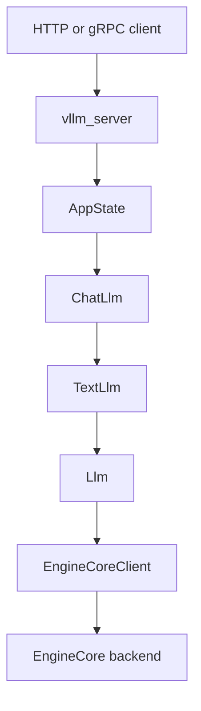
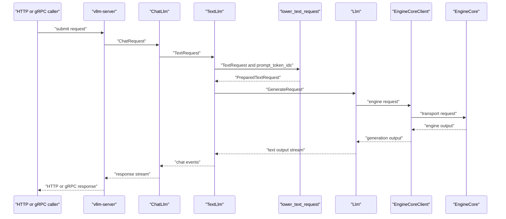
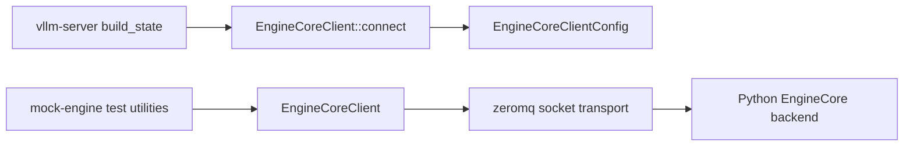

<!-- source: DeepWiki mcp.deepwiki.com · repo vllm-project/vllm · page 6.5 Rust Frontend (vllm-frontend-rs) · fetched 2026-10-28 -->

# Rust Frontend (vllm-frontend-rs)

Relevant source files

The following files were used as context for generating this wiki page:

- [rust/Cargo.lock](rust/Cargo.lock)
- [rust/Cargo.toml](rust/Cargo.toml)
- [rust/proto/control.proto](rust/proto/control.proto)
- [rust/proto/inference.proto](rust/proto/inference.proto)
- [rust/src/bench/src/mm_processor.rs](rust/src/bench/src/mm_processor.rs)
- [rust/src/chat/Cargo.toml](rust/src/chat/Cargo.toml)
- [rust/src/chat/examples/external_engine_chat_qwen.rs](rust/src/chat/examples/external_engine_chat_qwen.rs)
- [rust/src/chat/src/backend/hf.rs](rust/src/chat/src/backend/hf.rs)
- [rust/src/chat/src/backend/mod.rs](rust/src/chat/src/backend/mod.rs)
- [rust/src/chat/src/error.rs](rust/src/chat/src/error.rs)
- [rust/src/chat/src/lib.rs](rust/src/chat/src/lib.rs)
- [rust/src/chat/src/multimodal.rs](rust/src/chat/src/multimodal.rs)
- [rust/src/chat/src/multimodal/audio.rs](rust/src/chat/src/multimodal/audio.rs)
- [rust/src/chat/src/multimodal/expand.rs](rust/src/chat/src/multimodal/expand.rs)
- [rust/src/chat/src/multimodal/image.rs](rust/src/chat/src/multimodal/image.rs)
- [rust/src/chat/src/multimodal/item.rs](rust/src/chat/src/multimodal/item.rs)
- [rust/src/chat/src/multimodal/tensor.rs](rust/src/chat/src/multimodal/tensor.rs)
- [rust/src/chat/src/multimodal/timing.rs](rust/src/chat/src/multimodal/timing.rs)
- [rust/src/chat/src/multimodal/video.rs](rust/src/chat/src/multimodal/video.rs)
- [rust/src/chat/src/parser/mod.rs](rust/src/chat/src/parser/mod.rs)
- [rust/src/chat/src/parser/reasoning/mod.rs](rust/src/chat/src/parser/reasoning/mod.rs)
- [rust/src/chat/src/parser/reasoning/tests.rs](rust/src/chat/src/parser/reasoning/tests.rs)
- [rust/src/chat/src/parser/tool/mod.rs](rust/src/chat/src/parser/tool/mod.rs)
- [rust/src/chat/src/parser/tool/tests.rs](rust/src/chat/src/parser/tool/tests.rs)
- [rust/src/chat/src/renderer/hf/error.rs](rust/src/chat/src/renderer/hf/error.rs)
- [rust/src/chat/src/renderer/hf/generation.rs](rust/src/chat/src/renderer/hf/generation.rs)
- [rust/src/chat/src/renderer/hf/mod.rs](rust/src/chat/src/renderer/hf/mod.rs)
- [rust/src/chat/src/renderer/hf/template.rs](rust/src/chat/src/renderer/hf/template.rs)
- [rust/src/chat/src/request.rs](rust/src/chat/src/request.rs)
- [rust/src/chat/tests/roundtrip.rs](rust/src/chat/tests/roundtrip.rs)
- [rust/src/cmd/src/cli.rs](rust/src/cmd/src/cli.rs)
- [rust/src/cmd/src/cli/tests.rs](rust/src/cmd/src/cli/tests.rs)
- [rust/src/cmd/src/cli/unsupported.rs](rust/src/cmd/src/cli/unsupported.rs)
- [rust/src/engine-core-client/examples/external_engine_utility_call.rs](rust/src/engine-core-client/examples/external_engine_utility_call.rs)
- [rust/src/engine-core-client/src/client.rs](rust/src/engine-core-client/src/client.rs)
- [rust/src/engine-core-client/src/client/imp.rs](rust/src/engine-core-client/src/client/imp.rs)
- [rust/src/engine-core-client/src/client/state.rs](rust/src/engine-core-client/src/client/state.rs)
- [rust/src/engine-core-client/src/coordinator/bootstrap.rs](rust/src/engine-core-client/src/coordinator/bootstrap.rs)
- [rust/src/engine-core-client/src/coordinator/external.rs](rust/src/engine-core-client/src/coordinator/external.rs)
- [rust/src/engine-core-client/src/coordinator/handle.rs](rust/src/engine-core-client/src/coordinator/handle.rs)
- [rust/src/engine-core-client/src/coordinator/inproc.rs](rust/src/engine-core-client/src/coordinator/inproc.rs)
- [rust/src/engine-core-client/src/error.rs](rust/src/engine-core-client/src/error.rs)
- [rust/src/engine-core-client/src/mock_engine.rs](rust/src/engine-core-client/src/mock_engine.rs)
- [rust/src/engine-core-client/src/protocol/dtype.rs](rust/src/engine-core-client/src/protocol/dtype.rs)
- [rust/src/engine-core-client/src/protocol/handshake.rs](rust/src/engine-core-client/src/protocol/handshake.rs)
- [rust/src/engine-core-client/src/protocol/logprobs.rs](rust/src/engine-core-client/src/protocol/logprobs.rs)
- [rust/src/engine-core-client/src/protocol/logprobs/array.rs](rust/src/engine-core-client/src/protocol/logprobs/array.rs)
- [rust/src/engine-core-client/src/protocol/logprobs/tests.rs](rust/src/engine-core-client/src/protocol/logprobs/tests.rs)
- [rust/src/engine-core-client/src/protocol/logprobs/wire.rs](rust/src/engine-core-client/src/protocol/logprobs/wire.rs)
- [rust/src/engine-core-client/src/protocol/multimodal.rs](rust/src/engine-core-client/src/protocol/multimodal.rs)
- [rust/src/engine-core-client/src/protocol/output.rs](rust/src/engine-core-client/src/protocol/output.rs)
- [rust/src/engine-core-client/src/protocol/request.rs](rust/src/engine-core-client/src/protocol/request.rs)
- [rust/src/engine-core-client/src/protocol/tensor.rs](rust/src/engine-core-client/src/protocol/tensor.rs)
- [rust/src/engine-core-client/src/tests/client.rs](rust/src/engine-core-client/src/tests/client.rs)
- [rust/src/engine-core-client/src/tests/python_compat.py](rust/src/engine-core-client/src/tests/python_compat.py)
- [rust/src/engine-core-client/src/transport.rs](rust/src/engine-core-client/src/transport.rs)
- [rust/src/llm/src/output.rs](rust/src/llm/src/output.rs)
- [rust/src/llm/tests/generate.rs](rust/src/llm/tests/generate.rs)
- [rust/src/managed-engine/src/cli.rs](rust/src/managed-engine/src/cli.rs)
- [rust/src/mock-engine/src/engine.rs](rust/src/mock-engine/src/engine.rs)
- [rust/src/mock-engine/src/tests.rs](rust/src/mock-engine/src/tests.rs)
- [rust/src/parser/src/reasoning/mod.rs](rust/src/parser/src/reasoning/mod.rs)
- [rust/src/parser/src/tool/mod.rs](rust/src/parser/src/tool/mod.rs)
- [rust/src/server/Cargo.toml](rust/src/server/Cargo.toml)
- [rust/src/server/examples/external_engine_openai_qwen.rs](rust/src/server/examples/external_engine_openai_qwen.rs)
- [rust/src/server/src/config.rs](rust/src/server/src/config.rs)
- [rust/src/server/src/error.rs](rust/src/server/src/error.rs)
- [rust/src/server/src/grpc/control.rs](rust/src/server/src/grpc/control.rs)
- [rust/src/server/src/grpc/convert.rs](rust/src/server/src/grpc/convert.rs)
- [rust/src/server/src/grpc/health.rs](rust/src/server/src/grpc/health.rs)
- [rust/src/server/src/grpc/inference.rs](rust/src/server/src/grpc/inference.rs)
- [rust/src/server/src/grpc/mod.rs](rust/src/server/src/grpc/mod.rs)
- [rust/src/server/src/grpc/tests.rs](rust/src/server/src/grpc/tests.rs)
- [rust/src/server/src/lib.rs](rust/src/server/src/lib.rs)
- [rust/src/server/src/render.rs](rust/src/server/src/render.rs)
- [rust/src/server/src/routes.rs](rust/src/server/src/routes.rs)
- [rust/src/server/src/routes/inference/generate.rs](rust/src/server/src/routes/inference/generate.rs)
- [rust/src/server/src/routes/inference/generate/convert.rs](rust/src/server/src/routes/inference/generate/convert.rs)
- [rust/src/server/src/routes/inference/generate/types.rs](rust/src/server/src/routes/inference/generate/types.rs)
- [rust/src/server/src/routes/inference/generate/validate.rs](rust/src/server/src/routes/inference/generate/validate.rs)
- [rust/src/server/src/routes/openai/chat_completions.rs](rust/src/server/src/routes/openai/chat_completions.rs)
- [rust/src/server/src/routes/openai/chat_completions/convert.rs](rust/src/server/src/routes/openai/chat_completions/convert.rs)
- [rust/src/server/src/routes/openai/chat_completions/types.rs](rust/src/server/src/routes/openai/chat_completions/types.rs)
- [rust/src/server/src/routes/openai/chat_completions/validate.rs](rust/src/server/src/routes/openai/chat_completions/validate.rs)
- [rust/src/server/src/routes/openai/completions.rs](rust/src/server/src/routes/openai/completions.rs)
- [rust/src/server/src/routes/openai/completions/convert.rs](rust/src/server/src/routes/openai/completions/convert.rs)
- [rust/src/server/src/routes/openai/completions/types.rs](rust/src/server/src/routes/openai/completions/types.rs)
- [rust/src/server/src/routes/openai/completions/validate.rs](rust/src/server/src/routes/openai/completions/validate.rs)
- [rust/src/server/src/routes/openai/utils/logprobs.rs](rust/src/server/src/routes/openai/utils/logprobs.rs)
- [rust/src/server/src/routes/openai/utils/types.rs](rust/src/server/src/routes/openai/utils/types.rs)
- [rust/src/server/src/routes/render.rs](rust/src/server/src/routes/render.rs)
- [rust/src/server/src/routes/tests.rs](rust/src/server/src/routes/tests.rs)
- [rust/src/server/src/state.rs](rust/src/server/src/state.rs)
- [rust/src/text/src/error.rs](rust/src/text/src/error.rs)
- [rust/src/text/src/lib.rs](rust/src/text/src/lib.rs)
- [rust/src/text/src/lower.rs](rust/src/text/src/lower.rs)
- [rust/src/text/src/request.rs](rust/src/text/src/request.rs)
- [rust/src/text/src/truncation.rs](rust/src/text/src/truncation.rs)
- [rust/src/tracing/src/timing.rs](rust/src/tracing/src/timing.rs)
- [tests/test_envs.py](tests/test_envs.py)
- [vllm/distributed/elastic_ep/external_elastic_ep.py](vllm/distributed/elastic_ep/external_elastic_ep.py)

## Purpose and scope

Section 6.5 documents the Rust frontend’s HTTP and gRPC serving layers, the crates that make up its request path, and how that path connects to an engine through `EngineCoreClient`. The workspace includes separate crates for serving, chat, text, LLM access, tokenization, parsing, engine-core transport, mock-engine support, and metrics. [rust/Cargo.toml:1-18]()

Sources: [rust/Cargo.toml:1-18]()

---

## Layered crate architecture

The Rust workspace separates the frontend into crates with explicit dependencies between the serving and request-processing layers. `vllm-server` builds the serving runtime around `vllm-chat`, `vllm-text`, `vllm-llm`, and `vllm-engine-core-client`; the workspace also includes `vllm-tokenizer`, `vllm-parser`, `vllm-mock-engine`, and `vllm-metrics`. [rust/Cargo.toml:1-18]()

| Crate or layer | Responsibility and code entity | Source |
|---|---|---|
| `vllm-server` | HTTP and gRPC server modules, shared application state, listeners, routes, and runtime. [rust/src/server/src/lib.rs:4-20]() | [rust/src/server/src/lib.rs:4-20]() |
| `vllm-chat` | Chat facade, chat request processing, renderers, output processors, and parser selections. [rust/src/chat/src/lib.rs:4-59]() | [rust/src/chat/src/lib.rs:4-59]() |
| `vllm-text` | Text request processing and lowering from `TextRequest` to `GenerateRequest`. [rust/src/text/src/lower.rs:23-41]() | [rust/src/text/src/lower.rs:23-41]() |
| `vllm-llm` | Generation interface used by the server to construct `Llm` and `TextLlm`. [rust/src/server/src/lib.rs:127-132]() | [rust/src/server/src/lib.rs:127-132]() |
| `vllm-tokenizer` | Tokenizer abstraction used by text lowering, and included as a workspace crate. [rust/src/text/src/lower.rs:16-18](), [rust/Cargo.toml:14-18]() | [rust/src/text/src/lower.rs:16-18](), [rust/Cargo.toml:14-18]() |
| `vllm-parser` | Parser crate in the workspace; chat exposes reasoning and tool parser interfaces and parser selection. [rust/Cargo.toml:12-18](), [rust/src/chat/src/lib.rs:31-35]() | [rust/Cargo.toml:12-18](), [rust/src/chat/src/lib.rs:31-35]() |
| `vllm-engine-core-client` | Engine connection and protocol types used to connect the serving stack to an engine. [rust/src/server/src/lib.rs:50-51](), [rust/src/server/src/lib.rs:117-125]() | [rust/src/server/src/lib.rs:50-51](), [rust/src/server/src/lib.rs:117-125]() |
| `vllm-mock-engine` | Workspace crate for mock-engine support used by tests. [rust/Cargo.toml:10-18]() | [rust/Cargo.toml:10-18]() |
| `vllm-metrics` | Workspace crate for metrics. The provided server setup uses the model name for frontend metrics labeling. [rust/Cargo.toml:10-18](), [rust/src/server/src/lib.rs:76-84]() | [rust/Cargo.toml:10-18](), [rust/src/server/src/lib.rs:76-84]() |

The chat crate describes its boundary as messages rendered to prompts, tokenized prompts passed toward the engine, and streamed structured assistant events returned to callers. [rust/src/chat/src/lib.rs:4-11]() The server assembles this stack by wrapping an `EngineCoreClient` in `Llm`, then `TextLlm`, then `ChatLlm`, and placing the chat interface in `AppState`. [rust/src/server/src/lib.rs:117-145]()

Sources: [rust/Cargo.toml:1-18](), [rust/src/chat/src/lib.rs:4-11](), [rust/src/server/src/lib.rs:117-145]()

---

## Serving concepts mapped to code entities

This diagram maps the serving stack’s conceptual layers to identifiers that can be searched in the Rust code. `build_state` constructs the objects and connections shown. [rust/src/server/src/lib.rs:76-152]()

**Diagram: Serving layers and Rust code entities**

Sources: [rust/src/server/src/lib.rs:76-152]()

The frontend’s request-processing concepts also map to concrete types. Chat requests are prepared by `ChatRequestProcessor`; text requests are lowered into `PreparedTextRequest`, which holds both the original `TextRequest` and the `GenerateRequest` sent to the `llm` layer. [rust/src/chat/src/lib.rs:69-88](), [rust/src/text/src/lower.rs:23-41]()

**Diagram: Request concepts and concrete types**

```mermaid
graph LR
    ChatInput["ChatRequest"] --> Processor["ChatRequestProcessor"]
    Processor --> Rendered["RenderedPrompt"]
    Rendered --> Prompt["Prompt"]
    Prompt --> TextInput["TextRequest"]
    TextInput --> Lower["lower_text_request"]
    Lower --> Prepared["PreparedTextRequest"]
    Prepared --> Generate["GenerateRequest"]
    Generate --> Llm["vllm_llm"]
```

Sources: [rust/src/chat/src/lib.rs:69-88](), [rust/src/chat/src/lib.rs:143-165](), [rust/src/text/src/lower.rs:23-41](), [rust/src/text/src/lower.rs:75-79]()

---

## HTTP and gRPC serving

`vllm-server` declares distinct modules for `routes` and `grpc`, alongside middleware, listeners, shared state, TLS, rendering, and runtime support. [rust/src/server/src/lib.rs:4-20]() Its public `serve` function is documented as running the OpenAI-compatible HTTP server until shutdown, and the implementation imports both Hyper and Tonic server types. [rust/src/server/src/lib.rs:34-45](), [rust/src/server/src/lib.rs:173-178]()

The server’s configuration includes listener modes for TCP, Unix sockets, and inherited file descriptors. It also exposes API behavior options such as request logging, prompt-token usage details, per-request metrics, request-ID headers, scale-out route registration, and tokenizer-info route registration. [rust/src/server/src/config.rs:27-37](), [rust/src/server/src/config.rs:52-70]()

The gRPC conversion layer translates protobuf `GenerateRequest` values to internal `TextRequest` values. It checks a supplied model name against the configured served names, accepts either text or token-ID prompts, generates a request ID if absent, carries KV hints and reasoning-gate options, and builds sampling and decode settings. [rust/src/server/src/grpc/convert.rs:52-89](), [rust/src/server/src/grpc/convert.rs:91-154]()

The gRPC API’s omitted-temperature default is explicitly `0.0`, described in the conversion code as greedy generation. [rust/src/server/src/grpc/convert.rs:157-172]() This is distinct from the OpenAI-style sampling defaults documented by text lowering, which resolve an omitted temperature to `1.0` when neither the request nor model hints provide a value. [rust/src/text/src/lower.rs:157-168]()

Sources: [rust/src/server/src/lib.rs:4-20](), [rust/src/server/src/lib.rs:34-45](), [rust/src/server/src/lib.rs:173-178](), [rust/src/server/src/config.rs:27-37](), [rust/src/server/src/config.rs:52-70](), [rust/src/server/src/grpc/convert.rs:52-89](), [rust/src/server/src/grpc/convert.rs:91-172](), [rust/src/text/src/lower.rs:157-168]()

---

## Request and response flow

At startup, `build_state` loads the model’s chat and text backends, resolves a coordinator mode, connects an `EngineCoreClient`, and constructs the `Llm`, `TextLlm`, and `ChatLlm` layers. It then creates shared `AppState` with served model names and server options. [rust/src/server/src/lib.rs:76-145]()

For text generation, `lower_text_request` validates prompt token IDs and creates a `GenerateRequest`. It transfers multimodal features into the engine request, lowers sampling parameters, and carries request metadata such as request ID, priority, cache salt, data-parallel rank, session ID, KV hints, reasoning-parser arguments, LoRA request, and arrival time. [rust/src/text/src/lower.rs:33-79]()

The lowering step also validates logprob settings, repetition-detection settings, routed-expert prompt positions, and structured output constraints. It resolves sampling defaults and checks that `min_tokens` does not exceed `max_tokens`. [rust/src/text/src/lower.rs:133-155](), [rust/src/text/src/lower.rs:157-182]()

**Diagram: Request path from server setup through engine boundary**

The types and layering in the diagram are grounded in the server’s construction path, the chat crate’s documented boundary, and the text lowering function. The diagram’s transport and response arrows express the architectural path; the supplied code excerpt does not show all calls for those individual transitions. [rust/src/server/src/lib.rs:117-145](), [rust/src/chat/src/lib.rs:4-11](), [rust/src/text/src/lower.rs:23-41]()

Sources: [rust/src/server/src/lib.rs:76-145](), [rust/src/chat/src/lib.rs:4-11](), [rust/src/text/src/lower.rs:33-79](), [rust/src/text/src/lower.rs:133-182]()

---

## ZMQ transport and engine integration

The Rust workspace includes `vllm-engine-core-client` and pins a `zeromq` dependency with Tokio runtime and transport features. [rust/Cargo.toml:8-18](), [rust/Cargo.toml:158-161]() Server startup calls `EngineCoreClient::connect` with transport mode, coordinator mode, model name, client index, and engine-statistics configuration. [rust/src/server/src/lib.rs:117-125]()

The provided test code shows ZeroMQ socket types used in engine-client tests, including `DealerSocket`, `PushSocket`, `SubSocket`, and `XPubSocket`. It also exercises mock-engine setup and bootstrapping utilities. [rust/src/engine-core-client/src/tests/client.rs:20-23](), [rust/src/engine-core-client/src/tests/client.rs:40-47]() Server route tests use `DealerSocket` and `PushSocket` with MessagePack-related protocol values and a mock engine. [rust/src/server/src/routes/tests.rs:17-30](), [rust/src/server/src/routes/tests.rs:43-55]()

The available excerpts establish that the engine client is a separate transport boundary and that ZMQ sockets and mock-engine fixtures are used in tests. They do not expose enough of the production client implementation to specify a complete message framing, handshake, heartbeat, or socket-ownership protocol here. [rust/src/server/src/lib.rs:117-125](), [rust/src/engine-core-client/src/tests/client.rs:20-47](), [rust/src/server/src/routes/tests.rs:43-55]()

**Diagram: Frontend-to-engine transport boundary**

The connection setup and transport dependency are shown by the server connection call and workspace dependency. The mock-engine relationship represents test support rather than a production deployment path. [rust/src/server/src/lib.rs:117-125](), [rust/Cargo.toml:158-161](), [rust/src/engine-core-client/src/tests/client.rs:40-47]()

Sources: [rust/Cargo.toml:8-18](), [rust/Cargo.toml:158-161](), [rust/src/server/src/lib.rs:117-125](), [rust/src/engine-core-client/src/tests/client.rs:20-47](), [rust/src/server/src/routes/tests.rs:17-30]()

---

## Chat, text, tokenizer, and parser layers

`vllm-chat` is a facade over `vllm-text`. Its public API exports chat requests, renderers, output processors, tool and reasoning parser interfaces, and parser selection types. [rust/src/chat/src/lib.rs:4-18](), [rust/src/chat/src/lib.rs:27-50]() `ChatRequestProcessor` stores the chat backend and parser configuration; its prompt-finalization path handles model dtype and multimodal information when available, while render-only mode accepts text-only rendered prompts and rejects unsupported multimodal requests. [rust/src/chat/src/lib.rs:69-88](), [rust/src/chat/src/lib.rs:143-165]()

`vllm-text` uses the `Tokenizer` trait while lowering text requests. The lowering implementation’s `PreparedTextRequest` separates the high-level request fields needed for response-side metadata from the lower-level `GenerateRequest` ready for the `llm` crate. [rust/src/text/src/lower.rs:16-18](), [rust/src/text/src/lower.rs:23-41]()

The workspace contains both `vllm-parser` and `vllm-tokenizer` crates. The chat public surface exposes parser interfaces, while the text lowering surface imports the tokenizer abstraction. [rust/Cargo.toml:12-18](), [rust/src/chat/src/lib.rs:31-35](), [rust/src/text/src/lower.rs:16-18]()

Sources: [rust/Cargo.toml:12-18](), [rust/src/chat/src/lib.rs:4-18](), [rust/src/chat/src/lib.rs:27-50](), [rust/src/chat/src/lib.rs:69-88](), [rust/src/chat/src/lib.rs:143-165](), [rust/src/text/src/lower.rs:16-41]()

---

## CLI and configuration

The `vllm-rs` CLI is defined in `rust/src/cmd/src/cli.rs`. Its `Cli` parser dispatches subcommands including `Frontend`, `Serve`, `Bench`, and `Render`. The CLI documentation describes `Frontend` as running the Rust OpenAI frontend as a Python-supervised worker, and `Serve` as launching a managed Python headless engine before running the frontend. [rust/src/cmd/src/cli.rs:43-53](), [rust/src/cmd/src/cli.rs:89-102]()

`ServeArgs` and `RenderArgs` are converted to server configuration types. Render options include host and port, served model names, parser and renderer selections, chat-template behavior, model-length and logprob limits, and TLS arguments. [rust/src/cmd/src/cli.rs:111-174]() The CLI tests verify that serve arguments can forward Python flags after `--`, and that render arguments build configuration with model, host, port, renderer, and TLS values. [rust/src/cmd/src/cli/tests.rs:34-70](), [rust/src/cmd/src/cli/tests.rs:153-167]()

`Config` includes transport and coordinator configuration, and `ApiServerOptions` holds route-layer behavior switches. TLS settings are validated for certificate presence and for a CA bundle when client certificate verification is enabled. [rust/src/server/src/config.rs:20-21](), [rust/src/server/src/config.rs:52-70](), [rust/src/server/src/config.rs:145-170]()

Sources: [rust/src/cmd/src/cli.rs:43-53](), [rust/src/cmd/src/cli.rs:89-102](), [rust/src/cmd/src/cli.rs:111-174](), [rust/src/cmd/src/cli/tests.rs:34-70](), [rust/src/cmd/src/cli/tests.rs:153-167](), [rust/src/server/src/config.rs:20-21](), [rust/src/server/src/config.rs:52-70](), [rust/src/server/src/config.rs:145-170]()

---

## Testing and mock-engine support

The server route tests use `spawn_mock_engine_task` and related mock-engine utilities to exercise route behavior without requiring a live engine. [rust/src/server/src/routes/tests.rs:43-47]() The gRPC tests likewise import mock-engine configuration, connection, readiness, and task-spawning helpers. [rust/src/server/src/grpc/tests.rs:34-52]()

The route tests explicitly use `Service::call` rather than `ServiceExt::oneshot` for streaming cases because consuming the router with `oneshot` can drop `AppState` before the body has been drained, closing the mock-engine connection too early. [rust/src/server/src/routes/tests.rs:4-7]() This makes application-state lifetime part of the test’s streaming correctness assumptions. [rust/src/server/src/routes/tests.rs:4-7]()

Sources: [rust/src/server/src/routes/tests.rs:4-7](), [rust/src/server/src/routes/tests.rs:43-47](), [rust/src/server/src/grpc/tests.rs:34-52]()

---

## Summary

The Rust frontend is structured as a layered workspace: `vllm-server` owns HTTP/gRPC serving and shared application state; `vllm-chat` handles chat-level processing; `vllm-text` lowers requests; `vllm-llm` provides the generation layer; and `vllm-engine-core-client` connects that stack to the engine. The workspace also separates tokenizer, parser, mock-engine, and metrics crates. [rust/Cargo.toml:1-18](), [rust/src/server/src/lib.rs:117-145](), [rust/src/chat/src/lib.rs:4-11](), [rust/src/text/src/lower.rs:23-41]()

The server constructs the generation stack from an `EngineCoreClient`, then exposes it through `AppState`. Text lowering validates and maps request parameters into a `GenerateRequest`; gRPC request conversion maps protobuf inputs into `TextRequest`. ZMQ is part of the engine-client dependency and test setup, but the provided excerpts do not specify the full production wire protocol. [rust/src/server/src/lib.rs:117-145](), [rust/src/text/src/lower.rs:33-79](), [rust/src/server/src/grpc/convert.rs:52-61](), [rust/Cargo.toml:158-161]()

Sources: [rust/Cargo.toml:1-18](), [rust/Cargo.toml:158-161](), [rust/src/server/src/lib.rs:117-145](), [rust/src/chat/src/lib.rs:4-11](), [rust/src/text/src/lower.rs:23-79](), [rust/src/server/src/grpc/convert.rs:52-61]()

---

