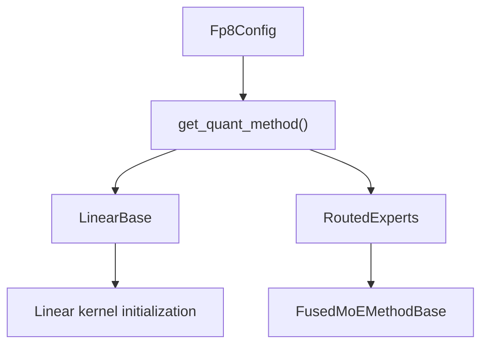
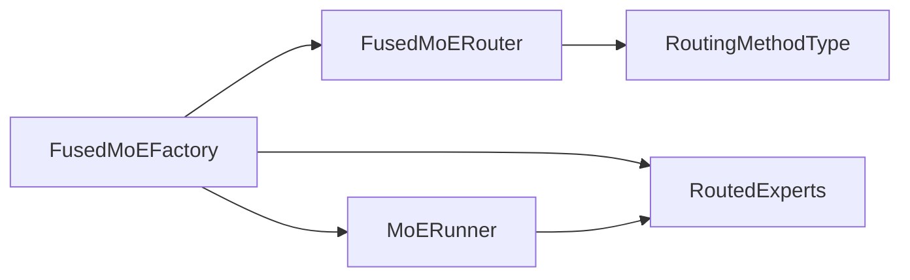
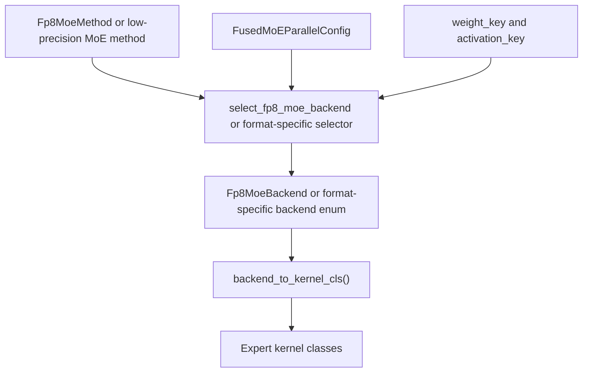
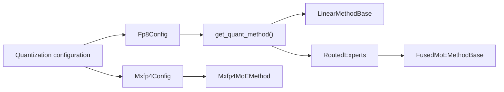

<!-- source: DeepWiki mcp.deepwiki.com · repo vllm-project/vllm · page 7 Quantization and MoE Optimizations · fetched 2026-10-28 -->

# Quantization and MoE Optimizations

Relevant source files

The following files were used as context for generating this wiki page:

- [cmake/external_projects/triton_kernels.cmake](cmake/external_projects/triton_kernels.cmake)
- [tests/kernels/moe/test_gpt_oss_triton_kernels.py](tests/kernels/moe/test_gpt_oss_triton_kernels.py)
- [tests/kernels/moe/test_ocp_mx_moe.py](tests/kernels/moe/test_ocp_mx_moe.py)
- [tests/kernels/quantization/test_mxfp4_triton_ep.py](tests/kernels/quantization/test_mxfp4_triton_ep.py)
- [tests/models/quantization/test_gpt_oss.py](tests/models/quantization/test_gpt_oss.py)
- [tests/models/quantization/test_mimo_v2_w4a16_routing.py](tests/models/quantization/test_mimo_v2_w4a16_routing.py)
- [tests/quantization/test_gfx950_moe.py](tests/quantization/test_gfx950_moe.py)
- [tests/quantization/test_modelopt.py](tests/quantization/test_modelopt.py)
- [vllm/model_executor/layers/fused_moe/config.py](vllm/model_executor/layers/fused_moe/config.py)
- [vllm/model_executor/layers/fused_moe/experts/aiter_mxfp4_w4a16_moe.py](vllm/model_executor/layers/fused_moe/experts/aiter_mxfp4_w4a16_moe.py)
- [vllm/model_executor/layers/fused_moe/experts/aiter_mxfp4_w4a8_moe.py](vllm/model_executor/layers/fused_moe/experts/aiter_mxfp4_w4a8_moe.py)
- [vllm/model_executor/layers/fused_moe/experts/gpt_oss_triton_kernels_moe.py](vllm/model_executor/layers/fused_moe/experts/gpt_oss_triton_kernels_moe.py)
- [vllm/model_executor/layers/fused_moe/experts/rocm_aiter_moe.py](vllm/model_executor/layers/fused_moe/experts/rocm_aiter_moe.py)
- [vllm/model_executor/layers/fused_moe/experts/xpu_moe.py](vllm/model_executor/layers/fused_moe/experts/xpu_moe.py)
- [vllm/model_executor/layers/fused_moe/layer.py](vllm/model_executor/layers/fused_moe/layer.py)
- [vllm/model_executor/layers/fused_moe/oracle/fp8.py](vllm/model_executor/layers/fused_moe/oracle/fp8.py)
- [vllm/model_executor/layers/fused_moe/oracle/mxfp4.py](vllm/model_executor/layers/fused_moe/oracle/mxfp4.py)
- [vllm/model_executor/layers/fused_moe/oracle/nvfp4.py](vllm/model_executor/layers/fused_moe/oracle/nvfp4.py)
- [vllm/model_executor/layers/fused_moe/topk_weight_and_reduce.py](vllm/model_executor/layers/fused_moe/topk_weight_and_reduce.py)
- [vllm/model_executor/layers/quantization/fp8.py](vllm/model_executor/layers/quantization/fp8.py)
- [vllm/model_executor/layers/quantization/modelopt.py](vllm/model_executor/layers/quantization/modelopt.py)
- [vllm/model_executor/layers/quantization/mxfp4.py](vllm/model_executor/layers/quantization/mxfp4.py)
- [vllm/model_executor/layers/quantization/quark/quark_moe.py](vllm/model_executor/layers/quantization/quark/quark_moe.py)
- [vllm/model_executor/layers/quantization/utils/mxfp4_utils.py](vllm/model_executor/layers/quantization/utils/mxfp4_utils.py)

## Purpose and scope

This page outlines how vLLM connects quantization configurations to layer methods and kernel selection, and how its `FusedMoE` pipeline combines routing with expert execution. It is a parent-page overview; implementation details belong in the linked child pages.

Sources: [vllm/model_executor/layers/quantization/fp8.py:92-105](), [vllm/model_executor/layers/fused_moe/layer.py:92-159]()

For details, see:

- [Quantization Methods Overview](#7.1) — Quantization formats, configuration, and the linear kernel selection layer.
- [FP8 and Low-Precision Quantization](#7.2) — FP8, block quantization, MXFP4, NVFP4, and related kernel backends.
- [FusedMoE Layer Architecture](#7.3) — MoE routing, expert execution, and modular pipeline components.
- [MoE Quantization and Backend Selection](#7.4) — MoE quantization methods, backend selection, and parallelism considerations.
- [Custom Kernels and C++/CUDA Extensions](#7.5) — Native extensions, custom-op wrappers, kernel libraries, and warmup.

Sources: [vllm/model_executor/layers/quantization/fp8.py:11-14](), [vllm/model_executor/layers/fused_moe/layer.py:18-39](), [vllm/model_executor/layers/quantization/quark/quark_moe.py:8-10]()

---

## Quantization Methods Overview

Quantization configurations describe how methods apply to model layers. For example, `Fp8Config` records checkpoint serialization, activation scheme, ignored layers, and optional weight block size; its `get_quant_method()` selects a method based on layer type. Quantization methods can also connect to kernel initialization, as shown by the FP8 linear implementation importing the `model_executor.kernels.linear` selection functions. For details, see [Quantization Methods Overview](#7.1). [vllm/model_executor/layers/quantization/fp8.py:11-14](), [vllm/model_executor/layers/quantization/fp8.py:92-135](), [vllm/model_executor/layers/quantization/fp8.py:177-187]()

The codebase also has methods for ModelOpt and Quark formats, alongside MXFP4 support. Their MoE paths integrate with `FusedMoE` method and backend abstractions rather than treating quantization as a standalone format choice. For details, see [FP8 and Low-Precision Quantization](#7.2) and [MoE Quantization and Backend Selection](#7.4). [vllm/model_executor/layers/quantization/modelopt.py:16-36](), [vllm/model_executor/layers/quantization/modelopt.py:141-158](), [vllm/model_executor/layers/quantization/quark/quark_moe.py:13-18](), [vllm/model_executor/layers/quantization/mxfp4.py:86-113]()

**Quantization configuration to layer method**

Sources: [vllm/model_executor/layers/quantization/fp8.py:11-14](), [vllm/model_executor/layers/quantization/fp8.py:92-105](), [vllm/model_executor/layers/quantization/fp8.py:177-187](), [vllm/model_executor/layers/quantization/mxfp4.py:86-113]()

---

## FP8 and Low-Precision Quantization

`Fp8Config` supports static or dynamic activation schemes and optional block-shaped weight quantization; its configuration validates the activation scheme and block-size requirements. MXFP4 has a dedicated `Mxfp4Config`, whose method selection assigns a MoE method to `RoutedExperts` while leaving unsupported linear and attention cases unquantized. For details, see [FP8 and Low-Precision Quantization](#7.2). [vllm/model_executor/layers/quantization/fp8.py:92-135](), [vllm/model_executor/layers/quantization/mxfp4.py:55-113]()

MoE low-precision support connects quantization formats to backend oracles. The FP8 oracle defines backend choices including FlashInfer, DeepGEMM, Triton, AITER, and CPU variants; the MXFP4 and NVFP4 oracles likewise define backend families. These choices are part of the MoE execution path, rather than a single universal kernel. For details, see [MoE Quantization and Backend Selection](#7.4). [vllm/model_executor/layers/fused_moe/oracle/fp8.py:50-76](), [vllm/model_executor/layers/fused_moe/oracle/mxfp4.py:130-172](), [vllm/model_executor/layers/fused_moe/oracle/nvfp4.py:43-55]()

Sources: [vllm/model_executor/layers/quantization/fp8.py:92-135](), [vllm/model_executor/layers/quantization/mxfp4.py:55-113](), [vllm/model_executor/layers/fused_moe/oracle/fp8.py:50-76](), [vllm/model_executor/layers/fused_moe/oracle/mxfp4.py:130-172](), [vllm/model_executor/layers/fused_moe/oracle/nvfp4.py:43-55]()

---

## FusedMoE Layer Architecture

`FusedMoEFactory` assembles a MoE execution pipeline from a router, `RoutedExperts`, and a `MoERunner`; it also accepts parallelism, quantization, routing, and expert-related configuration. `make_parallel_config()` derives the MoE parallel configuration from tensor-, data-, and context-parallel inputs. For details, see [FusedMoE Layer Architecture](#7.3). [vllm/model_executor/layers/fused_moe/layer.py:47-73](), [vllm/model_executor/layers/fused_moe/layer.py:92-159]()

This separation gives the layer a clear flow: routing produces expert assignments, expert kernels perform the routed work, and the runner coordinates execution. Quantization and backend selection plug into the expert path; routing method types are represented separately in `RoutingMethodType`. For details, see [FusedMoE Layer Architecture](#7.3) and [MoE Quantization and Backend Selection](#7.4). [vllm/model_executor/layers/fused_moe/layer.py:30-39](), [vllm/model_executor/layers/fused_moe/config.py:103-131]()

**FusedMoE concepts mapped to code entities**

Sources: [vllm/model_executor/layers/fused_moe/layer.py:30-39](), [vllm/model_executor/layers/fused_moe/layer.py:92-159](), [vllm/model_executor/layers/fused_moe/config.py:103-131]()

---

## MoE Quantization and Backend Selection

MoE quantization configuration represents activation and weight quantization separately. `FusedMoEQuantDesc` describes data type and quantization group shape, while quantization-specific oracles provide backend selection and map backend choices to expert-kernel classes. For details, see [MoE Quantization and Backend Selection](#7.4). [vllm/model_executor/layers/fused_moe/config.py:174-193](), [vllm/model_executor/layers/fused_moe/oracle/nvfp4.py:74-160]()

Backend availability and preference can depend on the platform, quantization keys, and MoE parallel configuration. For example, the FP8 oracle adjusts backend priority for selected CUDA capabilities, expert-parallel configurations, XPU, and CPU. The NVFP4 oracle maps configured backend names to its backend enum. These mechanisms connect quantization formats to platform-specific expert kernels. [vllm/model_executor/layers/fused_moe/oracle/fp8.py:79-145](), [vllm/model_executor/layers/fused_moe/oracle/nvfp4.py:163-182]()

**MoE quantization and backend selection in code**

Sources: [vllm/model_executor/layers/fused_moe/oracle/fp8.py:79-104](), [vllm/model_executor/layers/fused_moe/oracle/fp8.py:148-178](), [vllm/model_executor/layers/fused_moe/oracle/nvfp4.py:74-100]()

---

## Custom Kernels and C++/CUDA Extensions

Custom kernels and extension infrastructure form a neighboring optimization layer: Python quantization and MoE methods can use custom operations, as illustrated by Quark MoE importing `vllm._custom_ops`. The extension layout, build process, kernel libraries, and warmup are covered in [Custom Kernels and C++/CUDA Extensions](#7.5); this parent page does not detail those implementations. [vllm/model_executor/layers/quantization/quark/quark_moe.py:8-10]()

Sources: [vllm/model_executor/layers/quantization/quark/quark_moe.py:8-10]()

---

## Natural-language concepts mapped to code entities

**Quantization configuration and dispatch**

Sources: [vllm/model_executor/layers/quantization/fp8.py:92-105](), [vllm/model_executor/layers/quantization/fp8.py:177-187](), [vllm/model_executor/layers/quantization/mxfp4.py:86-113](), [vllm/model_executor/layers/fused_moe/layer.py:30-39]()

**Routing, execution, and backend selection**

```mermaid
flowchart LR
    Factory["FusedMoEFactory"] --> RouterFactory["create_fused_moe_router"]
    RouterFactory --> Router["FusedMoERouter"]
    Router --> Runner["MoERunner"]
    Runner --> Routed["RoutedExperts"]
    Routed --> Oracle["select_fp8_moe_backend"]
    Oracle --> Backend["Fp8MoeBackend"]
    Backend --> Kernel["backend_to_kernel_cls()"]
```

Sources: [vllm/model_executor/layers/fused_moe/layer.py:30-39](), [vllm/model_executor/layers/fused_moe/layer.py:92-159](), [vllm/model_executor/layers/fused_moe/oracle/fp8.py:50-76](), [vllm/model_executor/layers/fused_moe/oracle/fp8.py:148-178]()

For implementation details, follow the child pages:

- [Quantization Methods Overview](#7.1)
- [FP8 and Low-Precision Quantization](#7.2)
- [FusedMoE Layer Architecture](#7.3)
- [MoE Quantization and Backend Selection](#7.4)
- [Custom Kernels and C++/CUDA Extensions](#7.5)

---

