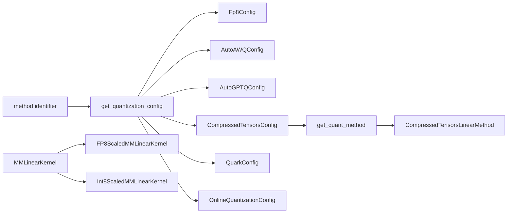
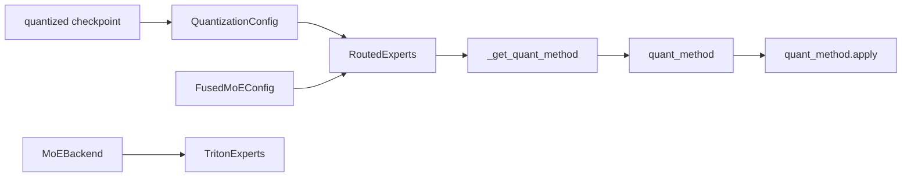
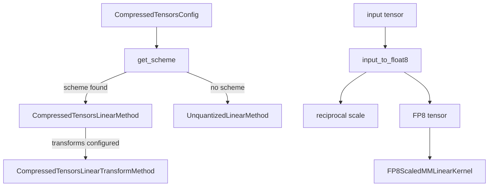
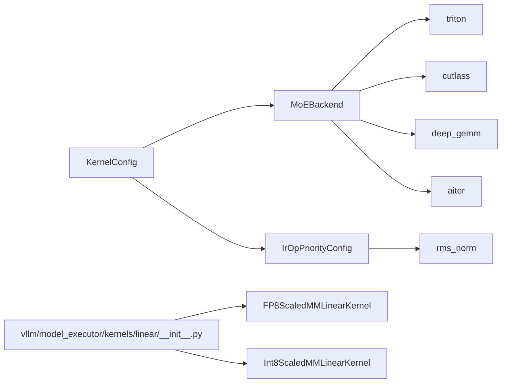

<!-- source: DeepWiki mcp.deepwiki.com · repo vllm-project/vllm · page 7.1 Quantization Methods Overview · fetched 2026-10-28 -->

# Quantization Methods Overview

Relevant source files

The following files were used as context for generating this wiki page:

- [docs/features/quantization/online.md](docs/features/quantization/online.md)
- [tests/kernels/attention/test_xpu_mla_sparse.py](tests/kernels/attention/test_xpu_mla_sparse.py)
- [tests/kernels/moe/test_moe_weight_loading_padded.py](tests/kernels/moe/test_moe_weight_loading_padded.py)
- [tests/kernels/moe/test_trtllm_bf16_moe.py](tests/kernels/moe/test_trtllm_bf16_moe.py)
- [tests/kernels/moe/test_zen_cpu_int8_moe.py](tests/kernels/moe/test_zen_cpu_int8_moe.py)
- [tests/kernels/quantization/test_cpu_fp8_scaled_mm.py](tests/kernels/quantization/test_cpu_fp8_scaled_mm.py)
- [tests/kernels/quantization/test_fp8_quant_group.py](tests/kernels/quantization/test_fp8_quant_group.py)
- [tests/kernels/quantization/test_rdna3_compile_guards.py](tests/kernels/quantization/test_rdna3_compile_guards.py)
- [tests/kernels/quantization/test_scaled_mm_kernel_selection.py](tests/kernels/quantization/test_scaled_mm_kernel_selection.py)
- [tests/models/kimi_k3/test_gfx942_int4.py](tests/models/kimi_k3/test_gfx942_int4.py)
- [tests/models/quantization/test_nvfp4.py](tests/models/quantization/test_nvfp4.py)
- [tests/quantization/test_auto_gptq.py](tests/quantization/test_auto_gptq.py)
- [tests/quantization/test_compressed_tensors.py](tests/quantization/test_compressed_tensors.py)
- [tests/quantization/test_config_utils.py](tests/quantization/test_config_utils.py)
- [tests/quantization/test_fp8.py](tests/quantization/test_fp8.py)
- [tests/quantization/test_moe_wna16.py](tests/quantization/test_moe_wna16.py)
- [tests/quantization/test_online.py](tests/quantization/test_online.py)
- [tests/quantization/test_online_shared_expert_fusion.py](tests/quantization/test_online_shared_expert_fusion.py)
- [tests/quantization/test_quantization_config_args.py](tests/quantization/test_quantization_config_args.py)
- [tests/quantization/test_quark.py](tests/quantization/test_quark.py)
- [tests/transformers_utils/test_config.py](tests/transformers_utils/test_config.py)
- [vllm/config/kernel.py](vllm/config/kernel.py)
- [vllm/config/quantization.py](vllm/config/quantization.py)
- [vllm/model_executor/kernels/linear/__init__.py](vllm/model_executor/kernels/linear/__init__.py)
- [vllm/model_executor/kernels/linear/nvfp4/pytorch.py](vllm/model_executor/kernels/linear/nvfp4/pytorch.py)
- [vllm/model_executor/kernels/linear/scaled_mm/__init__.py](vllm/model_executor/kernels/linear/scaled_mm/__init__.py)
- [vllm/model_executor/kernels/linear/scaled_mm/aiter.py](vllm/model_executor/kernels/linear/scaled_mm/aiter.py)
- [vllm/model_executor/kernels/linear/scaled_mm/cpu.py](vllm/model_executor/kernels/linear/scaled_mm/cpu.py)
- [vllm/model_executor/kernels/linear/scaled_mm/pytorch.py](vllm/model_executor/kernels/linear/scaled_mm/pytorch.py)
- [vllm/model_executor/kernels/linear/scaled_mm/triton.py](vllm/model_executor/kernels/linear/scaled_mm/triton.py)
- [vllm/model_executor/kernels/linear/scaled_mm/xpu.py](vllm/model_executor/kernels/linear/scaled_mm/xpu.py)
- [vllm/model_executor/layers/fused_moe/experts/cpu_moe.py](vllm/model_executor/layers/fused_moe/experts/cpu_moe.py)
- [vllm/model_executor/layers/fused_moe/experts/ocp_mx_emulation_moe.py](vllm/model_executor/layers/fused_moe/experts/ocp_mx_emulation_moe.py)
- [vllm/model_executor/layers/fused_moe/experts/triton_moe.py](vllm/model_executor/layers/fused_moe/experts/triton_moe.py)
- [vllm/model_executor/layers/fused_moe/oracle/int8.py](vllm/model_executor/layers/fused_moe/oracle/int8.py)
- [vllm/model_executor/layers/fused_moe/oracle/int_wna16.py](vllm/model_executor/layers/fused_moe/oracle/int_wna16.py)
- [vllm/model_executor/layers/fused_moe/prepare_finalize/batched.py](vllm/model_executor/layers/fused_moe/prepare_finalize/batched.py)
- [vllm/model_executor/layers/fused_moe/routed_experts.py](vllm/model_executor/layers/fused_moe/routed_experts.py)
- [vllm/model_executor/layers/quantization/__init__.py](vllm/model_executor/layers/quantization/__init__.py)
- [vllm/model_executor/layers/quantization/auto_awq.py](vllm/model_executor/layers/quantization/auto_awq.py)
- [vllm/model_executor/layers/quantization/auto_gptq.py](vllm/model_executor/layers/quantization/auto_gptq.py)
- [vllm/model_executor/layers/quantization/compressed_tensors/compressed_tensors.py](vllm/model_executor/layers/quantization/compressed_tensors/compressed_tensors.py)
- [vllm/model_executor/layers/quantization/compressed_tensors/compressed_tensors_moe/compressed_tensors_moe.py](vllm/model_executor/layers/quantization/compressed_tensors/compressed_tensors_moe/compressed_tensors_moe.py)
- [vllm/model_executor/layers/quantization/compressed_tensors/compressed_tensors_moe/compressed_tensors_moe_w4a4_mxfp4.py](vllm/model_executor/layers/quantization/compressed_tensors/compressed_tensors_moe/compressed_tensors_moe_w4a4_mxfp4.py)
- [vllm/model_executor/layers/quantization/compressed_tensors/compressed_tensors_moe/compressed_tensors_moe_w4a4_nvfp4.py](vllm/model_executor/layers/quantization/compressed_tensors/compressed_tensors_moe/compressed_tensors_moe_w4a4_nvfp4.py)
- [vllm/model_executor/layers/quantization/compressed_tensors/compressed_tensors_moe/compressed_tensors_moe_w8a8_fp8.py](vllm/model_executor/layers/quantization/compressed_tensors/compressed_tensors_moe/compressed_tensors_moe_w8a8_fp8.py)
- [vllm/model_executor/layers/quantization/compressed_tensors/compressed_tensors_moe/compressed_tensors_moe_w8a8_int8.py](vllm/model_executor/layers/quantization/compressed_tensors/compressed_tensors_moe/compressed_tensors_moe_w8a8_int8.py)
- [vllm/model_executor/layers/quantization/compressed_tensors/compressed_tensors_moe/compressed_tensors_moe_w8a8_mxfp8.py](vllm/model_executor/layers/quantization/compressed_tensors/compressed_tensors_moe/compressed_tensors_moe_w8a8_mxfp8.py)
- [vllm/model_executor/layers/quantization/compressed_tensors/compressed_tensors_moe/compressed_tensors_moe_wna16.py](vllm/model_executor/layers/quantization/compressed_tensors/compressed_tensors_moe/compressed_tensors_moe_wna16.py)
- [vllm/model_executor/layers/quantization/compressed_tensors/schemes/__init__.py](vllm/model_executor/layers/quantization/compressed_tensors/schemes/__init__.py)
- [vllm/model_executor/layers/quantization/compressed_tensors/schemes/compressed_tensors_w8a8_fp8.py](vllm/model_executor/layers/quantization/compressed_tensors/schemes/compressed_tensors_w8a8_fp8.py)
- [vllm/model_executor/layers/quantization/compressed_tensors/utils.py](vllm/model_executor/layers/quantization/compressed_tensors/utils.py)
- [vllm/model_executor/layers/quantization/fbgemm_fp8.py](vllm/model_executor/layers/quantization/fbgemm_fp8.py)
- [vllm/model_executor/layers/quantization/inc/schemes/inc_mxfp4_moe.py](vllm/model_executor/layers/quantization/inc/schemes/inc_mxfp4_moe.py)
- [vllm/model_executor/layers/quantization/input_quant_fp8.py](vllm/model_executor/layers/quantization/input_quant_fp8.py)
- [vllm/model_executor/layers/quantization/moe_wna16.py](vllm/model_executor/layers/quantization/moe_wna16.py)
- [vllm/model_executor/layers/quantization/online/base.py](vllm/model_executor/layers/quantization/online/base.py)
- [vllm/model_executor/layers/quantization/online/fp8.py](vllm/model_executor/layers/quantization/online/fp8.py)
- [vllm/model_executor/layers/quantization/online/int8.py](vllm/model_executor/layers/quantization/online/int8.py)
- [vllm/model_executor/layers/quantization/online/moe_base.py](vllm/model_executor/layers/quantization/online/moe_base.py)
- [vllm/model_executor/layers/quantization/online/mxfp4.py](vllm/model_executor/layers/quantization/online/mxfp4.py)
- [vllm/model_executor/layers/quantization/online/mxfp8.py](vllm/model_executor/layers/quantization/online/mxfp8.py)
- [vllm/model_executor/layers/quantization/online/nvfp4.py](vllm/model_executor/layers/quantization/online/nvfp4.py)
- [vllm/model_executor/layers/quantization/quark/quark.py](vllm/model_executor/layers/quantization/quark/quark.py)
- [vllm/model_executor/layers/quantization/quark/schemes/__init__.py](vllm/model_executor/layers/quantization/quark/schemes/__init__.py)
- [vllm/model_executor/layers/quantization/quark/schemes/quark_nvfp4.py](vllm/model_executor/layers/quantization/quark/schemes/quark_nvfp4.py)
- [vllm/model_executor/layers/quantization/quark/schemes/quark_ocp_mx.py](vllm/model_executor/layers/quantization/quark/schemes/quark_ocp_mx.py)
- [vllm/model_executor/layers/quantization/quark/schemes/quark_w4a16_int4.py](vllm/model_executor/layers/quantization/quark/schemes/quark_w4a16_int4.py)
- [vllm/model_executor/layers/quantization/quark/schemes/quark_w4a8_mxfp4_fp8.py](vllm/model_executor/layers/quantization/quark/schemes/quark_w4a8_mxfp4_fp8.py)
- [vllm/model_executor/layers/quantization/quark/schemes/quark_w8a8_fp8.py](vllm/model_executor/layers/quantization/quark/schemes/quark_w8a8_fp8.py)
- [vllm/model_executor/layers/quantization/quark/utils.py](vllm/model_executor/layers/quantization/quark/utils.py)
- [vllm/model_executor/layers/quantization/utils/fp8_utils.py](vllm/model_executor/layers/quantization/utils/fp8_utils.py)
- [vllm/model_executor/layers/quantization/utils/gptq_utils.py](vllm/model_executor/layers/quantization/utils/gptq_utils.py)
- [vllm/model_executor/layers/quantization/utils/ocp_mx_utils.py](vllm/model_executor/layers/quantization/utils/ocp_mx_utils.py)
- [vllm/model_executor/layers/quantization/utils/quant_utils.py](vllm/model_executor/layers/quantization/utils/quant_utils.py)
- [vllm/model_executor/model_loader/base_loader.py](vllm/model_executor/model_loader/base_loader.py)
- [vllm/models/deepseek_v4/xpu/__init__.py](vllm/models/deepseek_v4/xpu/__init__.py)
- [vllm/models/deepseek_v4/xpu/xpu_qnorm_rope_kv_fp8_insert.py](vllm/models/deepseek_v4/xpu/xpu_qnorm_rope_kv_fp8_insert.py)
- [vllm/models/deepseek_v4/xpu/xpu_sparse.py](vllm/models/deepseek_v4/xpu/xpu_sparse.py)
- [vllm/models/deepseek_v4/xpu/xpu_sparse_decode_fp8.py](vllm/models/deepseek_v4/xpu/xpu_sparse_decode_fp8.py)
- [vllm/triton_utils/__init__.py](vllm/triton_utils/__init__.py)
- [vllm/triton_utils/tensor_descriptor.py](vllm/triton_utils/tensor_descriptor.py)
- [vllm/v1/attention/ops/xpu_mla_sparse.py](vllm/v1/attention/ops/xpu_mla_sparse.py)

## Purpose and Scope

This page introduces vLLM’s quantization concepts and implementation entry points. It covers the quantization-method registry, FP8 and INT8 quantization descriptors and kernels, GPTQ and AWQ method identifiers, compressed-tensors and Quark configuration, online quantization entry points, and the linear-kernel import layer under `vllm/model_executor/kernels/linear`. It also describes how routed MoE experts receive quantization configuration and how the kernel configuration exposes MoE backend choices. [vllm/model_executor/layers/quantization/__init__.py:15-49](), [vllm/model_executor/kernels/linear/__init__.py:4-12](), [vllm/model_executor/layers/fused_moe/routed_experts.py:65-80](), [vllm/config/kernel.py:122-147]()

Quantization is not one kernel or one format: method names resolve to configuration classes, those configurations select per-layer quantization methods, and kernel implementations provide execution paths for particular formats and platforms. [vllm/model_executor/layers/quantization/__init__.py:112-192](), [vllm/model_executor/layers/quantization/compressed_tensors/compressed_tensors.py:159-184](), [vllm/model_executor/kernels/linear/__init__.py:21-37, 172-196]()

Sources: [vllm/model_executor/layers/quantization/__init__.py:15-49, 112-192](), [vllm/model_executor/kernels/linear/__init__.py:4-12, 21-37, 172-196](), [vllm/model_executor/layers/fused_moe/routed_experts.py:65-80](), [vllm/config/kernel.py:122-147]()

---

## Quantization Concepts

Quantization describes values using a lower-precision representation and associated scale metadata. In vLLM’s quantization utilities, FP8 input conversion computes a tensor-wide absolute maximum, derives a scale from the FP8 range, clamps the scaled values, converts them to the requested FP8 dtype, and returns the reciprocal scale alongside the quantized tensor. [vllm/model_executor/layers/quantization/utils/fp8_utils.py:68-79]()

Quantization granularity is reflected in the method and scale descriptors. The codebase uses names and keys for per-tensor, per-channel, per-token, and block schemes; the Triton MoE implementation, for example, explicitly enumerates static and dynamic FP8 and INT8 combinations and supports certain block-FP8 weight configurations. [vllm/model_executor/layers/fused_moe/experts/triton_moe.py:41-59, 146-178]()

A useful distinction is between checkpoint quantization and online quantization. Checkpoint formats describe how weights are stored and interpreted; online methods include quantization configuration names such as `fp8_per_tensor`, `fp8_per_block`, and `int8_per_channel_weight_only`. The quantization registry maps those shorthand names to `OnlineQuantizationConfig`. [vllm/model_executor/layers/quantization/__init__.py:40-49, 187-192]()

Sources: [vllm/model_executor/layers/quantization/utils/fp8_utils.py:68-79](), [vllm/model_executor/layers/fused_moe/experts/triton_moe.py:41-59, 146-178](), [vllm/model_executor/layers/quantization/__init__.py:40-49, 187-192]()

---

## Supported Quantization Methods and Registry

The `QuantizationMethods` literal lists recognized method identifiers, including `fp8`, `auto_awq`, `auto_gptq`, `gptq`, `gptq_marlin`, `awq`, `awq_marlin`, `compressed-tensors`, `quark`, `online`, and several model-specific or format-specific names. It also includes online shorthand names such as `fp8_per_tensor`, `fp8_per_block`, and `mxfp8`. [vllm/model_executor/layers/quantization/__init__.py:15-49]()

`get_quantization_config()` maps identifiers to their configuration classes. Examples include `fp8` → `Fp8Config`, AWQ aliases → `AutoAWQConfig`, GPTQ aliases → `AutoGPTQConfig`, `compressed-tensors` → `CompressedTensorsConfig`, `quark` → `QuarkConfig`, and `online` → `OnlineQuantizationConfig`. Online shorthand names are added to the mapping as online configuration methods unless an existing checkpoint-format mapping takes precedence. [vllm/model_executor/layers/quantization/__init__.py:112-192]()

| Method identifier(s) | Configuration class | What the supplied code establishes |
|---|---|---|
| `fp8` | `Fp8Config` | FP8 is registered as a quantization method. [vllm/model_executor/layers/quantization/__init__.py:156-161]() |
| `awq`, `auto_awq`, `awq_marlin` | `AutoAWQConfig` | These identifiers resolve to the AWQ configuration class. [vllm/model_executor/layers/quantization/__init__.py:156-160]() |
| `gptq`, `auto_gptq`, `gptq_marlin` | `AutoGPTQConfig` | These identifiers resolve to the GPTQ configuration class. [vllm/model_executor/layers/quantization/__init__.py:167-169]() |
| `compressed-tensors` | `CompressedTensorsConfig` | The config stores target-to-scheme data, ignored targets, format, optional KV-cache scheme, and optional transform configuration. [vllm/model_executor/layers/quantization/compressed_tensors/compressed_tensors.py:89-117]() |
| `quark` | `QuarkConfig` | The config stores quantization configuration, optional KV-cache data, and a packing-method setting. [vllm/model_executor/layers/quantization/quark/quark.py:96-121]() |
| `online`, `fp8_per_tensor`, `fp8_per_block`, `fp8_per_channel`, and other shorthand names | `OnlineQuantizationConfig` | The online config and shorthand identifiers are registered through the method mapping. [vllm/model_executor/layers/quantization/__init__.py:40-49, 180-192]() |

The registry also exposes `register_quantization_config()` for adding a customized configuration class. The decorator checks that the class subclasses `QuantizationConfig`, records the class by method name, and adds a newly registered identifier to the method list and current platform’s supported-quantization list when available. [vllm/model_executor/layers/quantization/__init__.py:57-109]()

Sources: [vllm/model_executor/layers/quantization/__init__.py:15-49, 57-109, 112-192](), [vllm/model_executor/layers/quantization/compressed_tensors/compressed_tensors.py:89-117](), [vllm/model_executor/layers/quantization/quark/quark.py:96-121]()

---

## Configuration Assembly and Method Resolution

The method registry provides the mapping from method strings to configuration classes. A config class can then provide a layer-specific method. In `CompressedTensorsConfig.get_quant_method()`, linear layers are matched to a scheme; a matching scheme attaches `CompressedTensorsLinearMethod`, while a layer without a quantization scheme uses `UnquantizedLinearMethod`. If applicable transforms are configured, the method is wrapped by `CompressedTensorsLinearTransformMethod`. [vllm/model_executor/layers/quantization/__init__.py:112-192](), [vllm/model_executor/layers/quantization/compressed_tensors/compressed_tensors.py:159-184]()

`QuarkConfig.get_quant_method()` obtains weight and activation quantization keys and a method class for the layer prefix and layer type. The class is also responsible for adapting quantization-config layer names using `apply_vllm_mapper()`, which maps paths from the checkpoint’s assumed model structure to vLLM’s model structure. [vllm/model_executor/layers/quantization/quark/quark.py:133-161, 177-191]()

### Configuration Dispatch: Natural Language to Code Entities

The diagram connects the concepts “method identifier,” “per-layer configuration,” and “linear kernel interface” to identifiers present in the code. The diagram shows the registry and representative config-to-kernel relationships; it does not imply that every config selects every listed kernel. [vllm/model_executor/layers/quantization/__init__.py:112-192](), [vllm/model_executor/layers/quantization/compressed_tensors/compressed_tensors.py:159-184](), [vllm/model_executor/kernels/linear/__init__.py:21-37, 172-196]()

**Diagram: Quantization Method Identifier to Code Entity**

Sources: [vllm/model_executor/layers/quantization/__init__.py:112-192](), [vllm/model_executor/layers/quantization/compressed_tensors/compressed_tensors.py:159-184](), [vllm/model_executor/kernels/linear/__init__.py:21-37, 172-196]()

### Layer Selection and Routed MoE Experts

`RoutedExperts` owns routed-expert parameters and execution logic. Its constructor receives a `QuantizationConfig` and `FusedMoEConfig`, then obtains a quantization method through `_get_quant_method()`. The selected method is stored as `quant_method`; the class documentation identifies weight loading and `quant_method.apply()` execution as responsibilities of the container. [vllm/model_executor/layers/fused_moe/routed_experts.py:65-80, 85-92, 162-169]()

The MoE kernel configuration defines a `MoEBackend` literal with choices including `auto`, `triton`, `deep_gemm`, `cutlass`, FlashInfer variants, `marlin`, `humming`, `aiter`, and `emulation`. Those names describe backend choices; the literal itself does not state which backend will be selected for a particular model or device. [vllm/config/kernel.py:122-147]()

**Diagram: Layer Configuration to MoE Execution Entities**

Sources: [vllm/model_executor/layers/fused_moe/routed_experts.py:65-80, 85-92, 162-169](), [vllm/config/kernel.py:122-147](), [vllm/model_executor/layers/fused_moe/experts/triton_moe.py:65-75]()

---

## Kernel Selection and Dispatch Layer (`model_executor/kernels`)

The linear-kernel package re-exports implementations through `vllm/model_executor/kernels/linear/__init__.py`. Its module documentation describes this as a stable import interface during internal reorganization, and instructs contributors adding a kernel implementation or selector to add it to that `__init__.py`. The stated direction is to organize kernels by provider rather than precision type. [vllm/model_executor/kernels/linear/__init__.py:4-12]()

The exported linear-kernel interfaces include `MMLinearKernel`, `MMLinearLayerConfig`, `MPLinearKernel`, and `MPLinearLayerConfig`. The same module re-exports implementation families for mixed precision, MXFP4, MXFP6, MXFP8, NVFP4, and scaled matrix multiplication. [vllm/model_executor/kernels/linear/__init__.py:21-27, 69-72, 97-108, 138-178]()

### Kernel Families Visible at the Import Boundary

| Kernel family | Example exported entities | Citation |
|---|---|---|
| FP8 and INT8 scaled matrix multiplication | `FP8ScaledMMLinearKernel`, `Fp8BlockScaledMMLinearKernel`, `Int8ScaledMMLinearKernel` | [vllm/model_executor/kernels/linear/__init__.py:172-179]() |
| Provider-specific scaled matrix multiplication | `AiterFp8BlockScaledMMKernel`, `B12xFp8BlockScaledMMKernel` | [vllm/model_executor/kernels/linear/__init__.py:180-190]() |
| Weight-only or mixed-precision linear kernels | `MarlinLinearKernel`, `MacheteLinearKernel`, `TritonW4A16LinearKernel`, `CPUWNA16LinearKernel` | [vllm/model_executor/kernels/linear/__init__.py:25-64]() |
| MXFP4 linear kernels | `MxFp4LinearKernel`, `AiterMxfp4LinearKernel`, `FlashInferMxFp4LinearKernel`, `MarlinMxFp4LinearKernel` | [vllm/model_executor/kernels/linear/__init__.py:69-93]() |
| MXFP8 linear kernels | `Mxfp8LinearKernel`, `DeepGemmMxfp8BmmLinearKernel`, `FlashInferCutlassMxfp8LinearKernel` | [vllm/model_executor/kernels/linear/__init__.py:105-124]() |
| NVFP4 linear kernels | `NvFp4LinearKernel`, `CutlassNvFp4LinearKernel`, `FlashInferCutlassNvFp4LinearKernel` | [vllm/model_executor/kernels/linear/__init__.py:138-161]() |

The re-export list is an import interface, not a complete description of runtime selection rules. The supplied code shows the available exported classes and, separately, the supported MoE backend-name set; it does not provide a general linear-kernel oracle or a complete platform-selection algorithm. [vllm/model_executor/kernels/linear/__init__.py:4-12, 172-196](), [vllm/config/kernel.py:122-147]()

Sources: [vllm/model_executor/kernels/linear/__init__.py:4-12, 21-27, 25-64, 69-93, 97-124, 138-179, 180-196](), [vllm/config/kernel.py:122-147]()

---

## FP8 and INT8

### FP8

The FP8 utility `input_to_float8()` performs tensor-wise quantization. It uses `current_platform.fp8_dtype()` when no dtype is supplied, obtains the value range with `aminmax()`, computes an absolute maximum with a small lower bound, derives a scale from the selected format’s maximum, clamps the scaled tensor to the FP8 representable range, and returns the FP8 tensor with the reciprocal scale. [vllm/model_executor/layers/quantization/utils/fp8_utils.py:68-79]()

The linear-kernel import layer exposes FP8 scaled-MM interfaces and platform/provider implementations, including `FP8ScaledMMLinearKernel`, `Fp8BlockScaledMMLinearKernel`, AITER variants, and CPU variants. The MXFP8 family includes DeepGEMM, FlashInfer, Marlin, PyTorch, ROCm-native, and XPU exports. [vllm/model_executor/kernels/linear/__init__.py:105-136, 172-196]()

In routed MoE, `TritonExperts._supports_quant_scheme()` enumerates supported FP8 weight/activation combinations when the current platform supports FP8. The listed combinations include static block, channel, and tensor weight descriptors alongside dynamic or static activation descriptors; an additional branch accepts a block-quantized FP8 weight key with specified scale properties. [vllm/model_executor/layers/fused_moe/experts/triton_moe.py:157-178]()

Sources: [vllm/model_executor/layers/quantization/utils/fp8_utils.py:68-79](), [vllm/model_executor/kernels/linear/__init__.py:105-136, 172-196](), [vllm/model_executor/layers/fused_moe/experts/triton_moe.py:157-178]()

### INT8

The linear-kernel package exports `Int8ScaledMMLinearKernel` and provider-specific INT8 implementations, including AITER, CPU, and XPU variants. [vllm/model_executor/kernels/linear/__init__.py:172-196]()

For MoE, `TritonExperts._supports_quant_scheme()` gates INT8 support on CUDA device capability 7.5 or higher, ROCm, or XPU. When that condition holds, it accepts dynamic-activation combinations with per-channel or per-tensor static INT8 weights. The implementation comments specify that activation values are quantized dynamically inside the kernel for these paths. [vllm/model_executor/layers/fused_moe/experts/triton_moe.py:126-155]()

Sources: [vllm/model_executor/kernels/linear/__init__.py:172-196](), [vllm/model_executor/layers/fused_moe/experts/triton_moe.py:126-155]()

---

## GPTQ, AWQ, and Weight-Only INT4/INT8

The quantization registry maps `gptq`, `auto_gptq`, and `gptq_marlin` to `AutoGPTQConfig`; it maps `awq`, `auto_awq`, and `awq_marlin` to `AutoAWQConfig`. These names identify supported configuration routes; the shown registry does not specify checkpoint layout details or model-by-model compatibility. [vllm/model_executor/layers/quantization/__init__.py:156-169]()

The linear-kernel import layer exports weight-only and mixed-precision implementations such as `MarlinLinearKernel`, `MacheteLinearKernel`, `ExllamaLinearKernel`, `TritonW4A16LinearKernel`, and CPU/XPU WNA16 variants. [vllm/model_executor/kernels/linear/__init__.py:25-64]()

The MoE WNA16 oracle defines backend identifiers including `MARLIN`, `BATCHED_MARLIN`, `HUMMING`, `CPU`, `ZEN_CPU`, `FLASHINFER_TRTLLM`, `TRITON`, `XPU`, `EMULATION`, and `RDNA3`. Its `backend_to_kernel_cls()` function maps those identifiers to expert implementation classes. The priority helper selects CPU-specific or XPU-specific lists for those platforms, and otherwise constructs a GPU-oriented priority list. [vllm/model_executor/layers/fused_moe/oracle/int_wna16.py:55-65, 68-123, 126-143]()

That oracle also rejects some backend/configuration combinations. For example, the shown checks reject FlashInfer TRT-LLM when zero points or bias may be present; the RDNA3 path requires compressed-tensors arguments, symmetric quantization, no expert bias, and group-wise scales. [vllm/model_executor/layers/fused_moe/oracle/int_wna16.py:146-167]()

Sources: [vllm/model_executor/layers/quantization/__init__.py:156-169](), [vllm/model_executor/kernels/linear/__init__.py:25-64](), [vllm/model_executor/layers/fused_moe/oracle/int_wna16.py:55-65, 68-123, 126-143, 146-167]()

---

## Compressed-Tensors Quantization

`CompressedTensorsConfig` stores an `ignore` list, a quantization format, a target-to-scheme map, an optional KV-cache scheme, optional configuration data, and optional transform configuration. When transform configuration is present, it is validated as a `TransformConfig`. The config reports the method name `compressed-tensors` and a minimum capability value of 70. [vllm/model_executor/layers/quantization/compressed_tensors/compressed_tensors.py:89-127]()

`apply_vllm_mapper()` adapts target names to vLLM layer names. It maps layer paths containing a dot, except targets beginning with `re:`, while preserving module class names and regex targets. It applies this mapping to target schemes and ignore entries, and to the KV-cache scheme when one is present. [vllm/model_executor/layers/quantization/compressed_tensors/compressed_tensors.py:129-157]()

For a `LinearBase` layer, `get_quant_method()` obtains the matching scheme and any configured input/output transforms. A matching scheme assigns `CompressedTensorsLinearMethod`; without a scheme it uses `UnquantizedLinearMethod`. If transforms are present, the method is wrapped in `CompressedTensorsLinearTransformMethod`. [vllm/model_executor/layers/quantization/compressed_tensors/compressed_tensors.py:159-184]()

The module imports scheme implementations covering combinations such as W8A8 FP8, W8A8 INT8, W8A8 MXFP8, W4A8 FP8, W4A8 INT, W4A4 FP4, and W4A4 MXFP4. These imports show the scheme families available through this integration; exact compatibility depends on the selected scheme and execution path. [vllm/model_executor/layers/quantization/compressed_tensors/compressed_tensors.py:41-56]()

Sources: [vllm/model_executor/layers/quantization/compressed_tensors/compressed_tensors.py:41-56, 89-127, 129-157, 159-184]()

---

## Quark Quantization

`QuarkConfig` stores the checkpoint quantization dictionary, optional KV-cache group and configuration, and `pack_method` (defaulting to `"reorder"`). It reports the method name `quark` and a minimum capability value of 70. [vllm/model_executor/layers/quantization/quark/quark.py:96-131]()

`apply_vllm_mapper()` adapts configuration entries to vLLM layer names, mapping string lists, dictionaries, and string values while preserving other values. `get_quant_method()` obtains weight and activation quantization keys and the selected method class for a layer prefix and layer type. [vllm/model_executor/layers/quantization/quark/quark.py:133-161, 177-191]()

The Quark implementation imports scheme classes for NVFP4, OCP MX, W4A16 INT4, W8A8 FP8, block FP8, and W8A8 INT8. Its companion tests construct quantization cases for FP8, INT8, MXFP4/MXFP6, and NVFP4, and exercise linear and MoE method classes. [vllm/model_executor/layers/quantization/quark/quark.py:29-38](), [tests/quantization/test_quark.py:49-73, 140-148]()

Sources: [vllm/model_executor/layers/quantization/quark/quark.py:29-38, 96-131, 133-161, 177-191](), [tests/quantization/test_quark.py:49-73, 140-148]()

---

## Online Quantization

Online quantization is registered under the `online` method name, with CLI-oriented shorthand identifiers including `fp8_per_tensor`, `fp8_per_block`, `fp8_per_channel`, `int8_per_channel_weight_only`, `nvfp4_per_token`, and `mxfp8`. `get_quantization_config()` maps online method names to `OnlineQuantizationConfig`, while preserving an existing checkpoint-format mapping when a shorthand name is also a checkpoint identifier. [vllm/model_executor/layers/quantization/__init__.py:40-49, 187-192]()

The online quantization tests import method implementations for FP8 per-block, per-tensor, and per-channel paths, as well as INT8, MXFP4, MXFP8, and NVFP4 online methods. They also import `resolve_quantization_config()` and `OnlineQuantizationConfig`, illustrating that shorthand resolution and the per-format implementations are separate code entities. [tests/quantization/test_online.py:28-32, 72-99]()

The tests document a compatibility behavior for the legacy `"fp8"` online CLI shorthand: it resolves as `fp8_per_tensor` and emits a deprecation message recommending the explicit name. [tests/quantization/test_online.py:164-190]()

Sources: [vllm/model_executor/layers/quantization/__init__.py:40-49, 187-192](), [tests/quantization/test_online.py:28-32, 72-99, 164-190]()

---

## Quantization Execution and Data Flow

The available code shows two complementary flows. For compressed-tensors, configuration is matched to a layer and yields a quantization method, optionally wrapped with transforms. For routed MoE, the `RoutedExperts` container receives quantization configuration and obtains a method that is used for expert execution. [vllm/model_executor/layers/quantization/compressed_tensors/compressed_tensors.py:159-184](), [vllm/model_executor/layers/fused_moe/routed_experts.py:65-80, 85-92, 162-169]()

The FP8 utility provides a concrete example of quantization math: derive a scale from the tensor’s maximum magnitude, scale and clamp values, convert to FP8, and return the inverse scale for downstream use. [vllm/model_executor/layers/quantization/utils/fp8_utils.py:68-79]()

**Diagram: Configuration, Layer Method, and Quantized Execution**

Sources: [vllm/model_executor/layers/quantization/compressed_tensors/compressed_tensors.py:159-184](), [vllm/model_executor/layers/quantization/utils/fp8_utils.py:68-79](), [vllm/model_executor/kernels/linear/__init__.py:172-179]()

---

## Kernel Configuration and Backend Names

`vllm.config.kernel` defines `MoEBackend` as a literal of accepted backend strings. The list includes automatic selection and explicit backend names spanning Triton, DeepGEMM, CUTLASS, FlashInfer, Marlin, Humming, AITER, emulation, and RDNA3 options. [vllm/config/kernel.py:122-147]()

The same configuration module defines `IrOpPriorityConfig`, which holds priority lists for IR operations such as `rms_norm`, `fused_add_rms_norm`, and `gelu_and_mul_sparse`. Its `set_default()` and `set_priority()` methods apply those priorities to registered IR operations after platform implementations are imported. This is a separate kernel-priority mechanism from quantized linear-kernel exports and MoE backend names. [vllm/config/kernel.py:20-38, 75-106]()

**Diagram: Kernel Configuration Names to Kernel Code Entities**

Sources: [vllm/config/kernel.py:20-38, 75-106, 122-147](), [vllm/model_executor/kernels/linear/__init__.py:172-179]()

---

## Practical Reading Guide

When tracing a quantized model through the code, start with the method identifier and its registry mapping in `get_quantization_config()`. For compressed-tensors or Quark, inspect the relevant config class and its `get_quant_method()` implementation to see how checkpoint targets and layer prefixes resolve to per-layer methods. [vllm/model_executor/layers/quantization/__init__.py:112-192](), [vllm/model_executor/layers/quantization/compressed_tensors/compressed_tensors.py:129-184](), [vllm/model_executor/layers/quantization/quark/quark.py:133-191]()

For linear execution interfaces, use `vllm/model_executor/kernels/linear/__init__.py` as the stable import boundary and follow the specific implementation module named there. For MoE, follow `RoutedExperts.quant_method` and inspect the relevant expert implementation or oracle; the shown Triton and WNA16 code demonstrates explicit support checks and backend-to-class mapping. [vllm/model_executor/kernels/linear/__init__.py:4-12, 172-196](), [vllm/model_executor/layers/fused_moe/routed_experts.py:162-169](), [vllm/model_executor/layers/fused_moe/experts/triton_moe.py:65-91, 126-178](), [vllm/model_executor/layers/fused_moe/oracle/int_wna16.py:68-143]()

Sources: [vllm/model_executor/layers/quantization/__init__.py:112-192](), [vllm/model_executor/layers/quantization/compressed_tensors/compressed_tensors.py:129-184](), [vllm/model_executor/layers/quantization/quark/quark.py:133-191](), [vllm/model_executor/kernels/linear/__init__.py:4-12, 172-196](), [vllm/model_executor/layers/fused_moe/routed_experts.py:162-169](), [vllm/model_executor/layers/fused_moe/experts/triton_moe.py:65-91, 126-178](), [vllm/model_executor/layers/fused_moe/oracle/int_wna16.py:68-143]()

---

