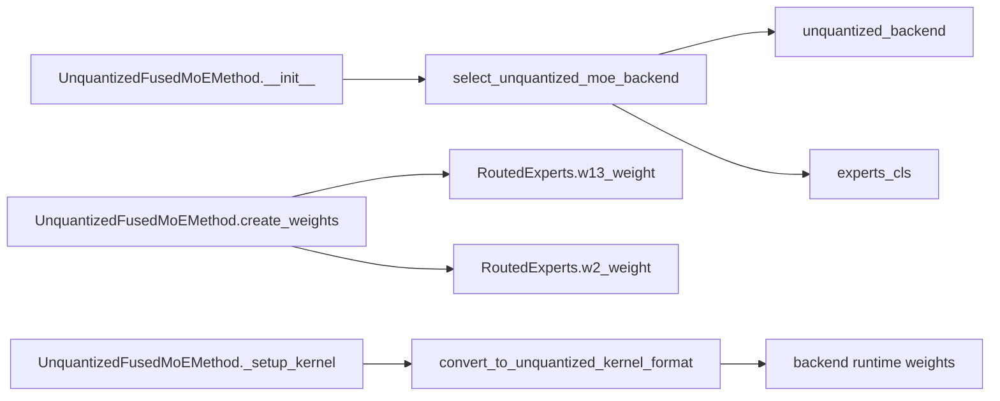
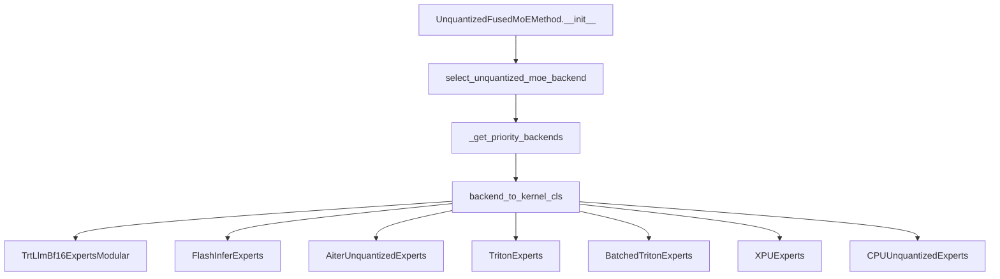
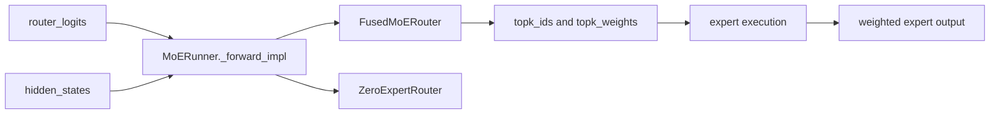
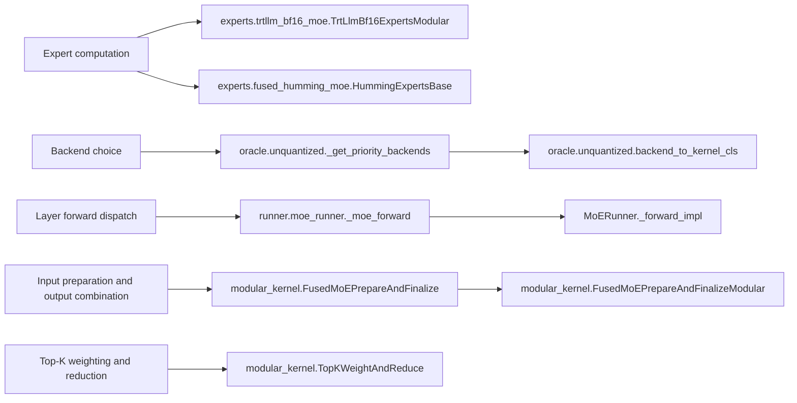

<!-- source: DeepWiki mcp.deepwiki.com · repo vllm-project/vllm · page 7.3 FusedMoE Layer Architecture · fetched 2026-10-28 -->

# FusedMoE Layer Architecture

Relevant source files

The following files were used as context for generating this wiki page:

- [.buildkite/test_areas/quantization.yaml](.buildkite/test_areas/quantization.yaml)
- [benchmarks/kernels/benchmark_rdna_hybrid_w4a16_gemm.py](benchmarks/kernels/benchmark_rdna_hybrid_w4a16_gemm.py)
- [csrc/quantization/w8a8/cutlass/moe/moe_data.cu](csrc/quantization/w8a8/cutlass/moe/moe_data.cu)
- [csrc/quantization/w8a8/cutlass/scaled_mm_entry.cu](csrc/quantization/w8a8/cutlass/scaled_mm_entry.cu)
- [csrc/rocm/ops.h](csrc/rocm/ops.h)
- [csrc/rocm/skinny_gemms_int4.cu](csrc/rocm/skinny_gemms_int4.cu)
- [csrc/rocm/torch_bindings.cpp](csrc/rocm/torch_bindings.cpp)
- [tests/evals/gsm8k/configs/moe-refactor/Nemotron-Nano-30B-NvFp4-ModelOpt-vllm-cutlass.yaml](tests/evals/gsm8k/configs/moe-refactor/Nemotron-Nano-30B-NvFp4-ModelOpt-vllm-cutlass.yaml)
- [tests/kernels/moe/test_batched_moe.py](tests/kernels/moe/test_batched_moe.py)
- [tests/kernels/moe/test_flashinfer_moe.py](tests/kernels/moe/test_flashinfer_moe.py)
- [tests/kernels/moe/test_moe.py](tests/kernels/moe/test_moe.py)
- [tests/kernels/moe/test_routed_experts_capture_monolithic.py](tests/kernels/moe/test_routed_experts_capture_monolithic.py)
- [tests/kernels/moe/test_routing_simulator.py](tests/kernels/moe/test_routing_simulator.py)
- [tests/kernels/moe/test_situ_mul_fp8_quant.py](tests/kernels/moe/test_situ_mul_fp8_quant.py)
- [tests/kernels/moe/test_unquantized_backend_selection.py](tests/kernels/moe/test_unquantized_backend_selection.py)
- [tests/kernels/quantization/test_cutlass_scaled_mm.py](tests/kernels/quantization/test_cutlass_scaled_mm.py)
- [tests/kernels/quantization/test_rdna3_moe_w4a16.py](tests/kernels/quantization/test_rdna3_moe_w4a16.py)
- [tests/kernels/quantization/test_rdna_hybrid_w4a16.py](tests/kernels/quantization/test_rdna_hybrid_w4a16.py)
- [tests/kernels/quantization/test_rocm_compressed_tensors_w4a16.py](tests/kernels/quantization/test_rocm_compressed_tensors_w4a16.py)
- [tests/kernels/quantization/test_triton_w4a16.py](tests/kernels/quantization/test_triton_w4a16.py)
- [tests/kernels/quantization/test_w4a16_kernel_selection.py](tests/kernels/quantization/test_w4a16_kernel_selection.py)
- [tests/lora/test_trtllm_mxfp4_lora_moe.py](tests/lora/test_trtllm_mxfp4_lora_moe.py)
- [tests/model_executor/test_utils.py](tests/model_executor/test_utils.py)
- [tests/quantization/test_blackwell_moe.py](tests/quantization/test_blackwell_moe.py)
- [tests/quantization/test_humming_compile.py](tests/quantization/test_humming_compile.py)
- [tests/quantization/test_keep_param_objects.py](tests/quantization/test_keep_param_objects.py)
- [vllm/model_executor/kernels/linear/mixed_precision/MPLinearKernel.py](vllm/model_executor/kernels/linear/mixed_precision/MPLinearKernel.py)
- [vllm/model_executor/kernels/linear/mixed_precision/__init__.py](vllm/model_executor/kernels/linear/mixed_precision/__init__.py)
- [vllm/model_executor/kernels/linear/mixed_precision/humming.py](vllm/model_executor/kernels/linear/mixed_precision/humming.py)
- [vllm/model_executor/kernels/linear/mixed_precision/rdna_hybrid_w4a16.py](vllm/model_executor/kernels/linear/mixed_precision/rdna_hybrid_w4a16.py)
- [vllm/model_executor/kernels/linear/mixed_precision/triton_w4a16.py](vllm/model_executor/kernels/linear/mixed_precision/triton_w4a16.py)
- [vllm/model_executor/kernels/linear/mxfp4/humming.py](vllm/model_executor/kernels/linear/mxfp4/humming.py)
- [vllm/model_executor/kernels/linear/mxfp6/humming.py](vllm/model_executor/kernels/linear/mxfp6/humming.py)
- [vllm/model_executor/kernels/linear/mxfp8/humming.py](vllm/model_executor/kernels/linear/mxfp8/humming.py)
- [vllm/model_executor/kernels/linear/nvfp4/humming.py](vllm/model_executor/kernels/linear/nvfp4/humming.py)
- [vllm/model_executor/kernels/linear/scaled_mm/cutlass.py](vllm/model_executor/kernels/linear/scaled_mm/cutlass.py)
- [vllm/model_executor/kernels/linear/scaled_mm/humming.py](vllm/model_executor/kernels/linear/scaled_mm/humming.py)
- [vllm/model_executor/layers/fused_moe/activation.py](vllm/model_executor/layers/fused_moe/activation.py)
- [vllm/model_executor/layers/fused_moe/b12x.py](vllm/model_executor/layers/fused_moe/b12x.py)
- [vllm/model_executor/layers/fused_moe/experts/flashinfer_cutlass_moe.py](vllm/model_executor/layers/fused_moe/experts/flashinfer_cutlass_moe.py)
- [vllm/model_executor/layers/fused_moe/experts/flashinfer_moe_ep.py](vllm/model_executor/layers/fused_moe/experts/flashinfer_moe_ep.py)
- [vllm/model_executor/layers/fused_moe/experts/fused_batched_moe.py](vllm/model_executor/layers/fused_moe/experts/fused_batched_moe.py)
- [vllm/model_executor/layers/fused_moe/experts/fused_humming_moe.py](vllm/model_executor/layers/fused_moe/experts/fused_humming_moe.py)
- [vllm/model_executor/layers/fused_moe/experts/marlin_moe.py](vllm/model_executor/layers/fused_moe/experts/marlin_moe.py)
- [vllm/model_executor/layers/fused_moe/experts/trtllm_bf16_moe.py](vllm/model_executor/layers/fused_moe/experts/trtllm_bf16_moe.py)
- [vllm/model_executor/layers/fused_moe/experts/trtllm_fp8_moe.py](vllm/model_executor/layers/fused_moe/experts/trtllm_fp8_moe.py)
- [vllm/model_executor/layers/fused_moe/experts/trtllm_lora_moe.py](vllm/model_executor/layers/fused_moe/experts/trtllm_lora_moe.py)
- [vllm/model_executor/layers/fused_moe/experts/trtllm_mxfp4_moe.py](vllm/model_executor/layers/fused_moe/experts/trtllm_mxfp4_moe.py)
- [vllm/model_executor/layers/fused_moe/experts/trtllm_mxint4_moe.py](vllm/model_executor/layers/fused_moe/experts/trtllm_mxint4_moe.py)
- [vllm/model_executor/layers/fused_moe/experts/trtllm_nvfp4_moe.py](vllm/model_executor/layers/fused_moe/experts/trtllm_nvfp4_moe.py)
- [vllm/model_executor/layers/fused_moe/fused_moe.py](vllm/model_executor/layers/fused_moe/fused_moe.py)
- [vllm/model_executor/layers/fused_moe/modular_kernel.py](vllm/model_executor/layers/fused_moe/modular_kernel.py)
- [vllm/model_executor/layers/fused_moe/moe_output.py](vllm/model_executor/layers/fused_moe/moe_output.py)
- [vllm/model_executor/layers/fused_moe/oracle/unquantized.py](vllm/model_executor/layers/fused_moe/oracle/unquantized.py)
- [vllm/model_executor/layers/fused_moe/router/fused_moe_router.py](vllm/model_executor/layers/fused_moe/router/fused_moe_router.py)
- [vllm/model_executor/layers/fused_moe/router/router_factory.py](vllm/model_executor/layers/fused_moe/router/router_factory.py)
- [vllm/model_executor/layers/fused_moe/router/routing_simulator_router.py](vllm/model_executor/layers/fused_moe/router/routing_simulator_router.py)
- [vllm/model_executor/layers/fused_moe/runner/moe_runner.py](vllm/model_executor/layers/fused_moe/runner/moe_runner.py)
- [vllm/model_executor/layers/fused_moe/runner/shared_experts.py](vllm/model_executor/layers/fused_moe/runner/shared_experts.py)
- [vllm/model_executor/layers/fused_moe/unquantized_fused_moe_method.py](vllm/model_executor/layers/fused_moe/unquantized_fused_moe_method.py)
- [vllm/model_executor/layers/fused_moe/utils.py](vllm/model_executor/layers/fused_moe/utils.py)
- [vllm/model_executor/layers/quantization/compressed_tensors/schemes/compressed_tensors_w8a16_fp8.py](vllm/model_executor/layers/quantization/compressed_tensors/schemes/compressed_tensors_w8a16_fp8.py)
- [vllm/model_executor/layers/quantization/humming.py](vllm/model_executor/layers/quantization/humming.py)
- [vllm/model_executor/layers/quantization/online/lm_head.py](vllm/model_executor/layers/quantization/online/lm_head.py)
- [vllm/model_executor/layers/quantization/utils/flashinfer_mxint4_moe.py](vllm/model_executor/layers/quantization/utils/flashinfer_mxint4_moe.py)
- [vllm/model_executor/layers/quantization/utils/humming/linear.py](vllm/model_executor/layers/quantization/utils/humming/linear.py)
- [vllm/model_executor/layers/quantization/utils/humming/moe.py](vllm/model_executor/layers/quantization/utils/humming/moe.py)
- [vllm/model_executor/utils.py](vllm/model_executor/utils.py)
- [vllm/utils/humming.py](vllm/utils/humming.py)

## Purpose and Scope

This page describes vLLM’s fused Mixture-of-Experts execution architecture: the modular kernel interfaces, expert computation, backend selection, routing, and the roles of the `experts/`, `oracle/`, `runner/`, and prepare/finalize components. It focuses on code entities visible in the provided source excerpts; backend-specific behavior is described only where those excerpts show it. [vllm/model_executor/layers/fused_moe/modular_kernel.py:51-85]()

Sources: [vllm/model_executor/layers/fused_moe/modular_kernel.py:51-85]()

---

## Core FusedMoE Class and Initialization

`RoutedExperts` is the expert-weight container used by the MoE method, but its definition was not included in the supplied source excerpts. The visible `UnquantizedFusedMoEMethod` implementation shows how an unquantized method creates the fused first-projection weights and second-projection weights on a `RoutedExperts` layer: `w13_weight` has an expert dimension and a fused projection dimension, while `w2_weight` stores the down-projection weights. The method registers both as non-trainable parameters and attaches weight-loader metadata. [vllm/model_executor/layers/fused_moe/unquantized_fused_moe_method.py:45-50]()[vllm/model_executor/layers/fused_moe/unquantized_fused_moe_method.py:68-129]()

On initialization, `UnquantizedFusedMoEMethod` calls `select_unquantized_moe_backend`, stores the resulting backend and expert-kernel class, and reports support for EPLB. Its weight setup later converts loaded weights to the selected backend’s runtime format through `convert_to_unquantized_kernel_format`. [vllm/model_executor/layers/fused_moe/unquantized_fused_moe_method.py:52-66]()[vllm/model_executor/layers/fused_moe/unquantized_fused_moe_method.py:166-181]()

### Diagram: From Method Setup to Backend Kernel

Sources: [vllm/model_executor/layers/fused_moe/unquantized_fused_moe_method.py:52-66](), [vllm/model_executor/layers/fused_moe/unquantized_fused_moe_method.py:68-129](), [vllm/model_executor/layers/fused_moe/unquantized_fused_moe_method.py:166-181]()

### Weight Layout and Dimensions

| Parameter | Role shown in the supplied implementation |
|---|---|
| `w13_weight` | Per-expert fused first projection. Its output dimension is doubled for gated activation-and-multiply configurations. [vllm/model_executor/layers/fused_moe/unquantized_fused_moe_method.py:77-98]() |
| `w2_weight` | Per-expert down projection, registered with shape based on expert count, hidden size, and intermediate size. [vllm/model_executor/layers/fused_moe/unquantized_fused_moe_method.py:107-120]() |
| `w13_bias`, `w2_bias` | Created and registered when the MoE configuration has bias. [vllm/model_executor/layers/fused_moe/unquantized_fused_moe_method.py:99-106]()[vllm/model_executor/layers/fused_moe/unquantized_fused_moe_method.py:122-129]() |

Sources: [vllm/model_executor/layers/fused_moe/unquantized_fused_moe_method.py:77-129]()

---

## Modular Kernel Architecture

The modular design separates expert routing, input preparation and dispatch, expert computation, and output combination. The design goal stated in `modular_kernel.py` is to let communication mechanisms be combined with fused MoE kernels without requiring a separate implementation for every combination. The file describes the high-level pipeline as Router → Quantize-Dispatch → Permute-Experts-Unpermute → Combine. [vllm/model_executor/layers/fused_moe/modular_kernel.py:51-85]()

`FusedMoEPrepareAndFinalize` provides the abstract prepare/finalize interface. Its modular variant operates on top-K IDs and weights, while the monolithic variant operates on router logits. `FusedMoEExpertsModular` represents the main expert operation—matrix multiplication, activation/multiplication, and optionally quantization and a second matrix multiplication. `FusedMoEModularKernel` combines a prepare/finalize implementation with an expert implementation. [vllm/model_executor/layers/fused_moe/modular_kernel.py:65-85]()[vllm/model_executor/layers/fused_moe/modular_kernel.py:186-193]()

The `TopKWeightAndReduce` interface lets the expert implementation determine how routing weights are applied and how expert outputs are reduced. Its `apply` method receives an optional output buffer, fused expert output, top-K weights and IDs, and a flag indicating whether router weights are applied on the input. [vllm/model_executor/layers/fused_moe/modular_kernel.py:126-142]()

### Pipeline Architecture

Sources: [vllm/model_executor/layers/fused_moe/modular_kernel.py:51-85](), [vllm/model_executor/layers/fused_moe/modular_kernel.py:126-142](), [vllm/model_executor/layers/fused_moe/modular_kernel.py:186-193]()

### Modular Kernel Interfaces

| Interface | Responsibility |
|---|---|
| `FusedMoEPrepareAndFinalize` | Abstract base for the prepare and finalize phases. The modular interface works with top-K IDs and weights; the monolithic interface works with router logits. [vllm/model_executor/layers/fused_moe/modular_kernel.py:186-193]() |
| `FusedMoEExpertsModular` | Abstract expert-computation interface for the fused MoE operation, including the projection/activation/projection sequence. [vllm/model_executor/layers/fused_moe/modular_kernel.py:65-75]() |
| `FusedMoEModularKernel` | Combines a prepare/finalize implementation and an expert implementation into the standard modular kernel interface. [vllm/model_executor/layers/fused_moe/modular_kernel.py:76-85]() |
| `TopKWeightAndReduce` | Defines how top-K routing weights are applied and expert outputs reduced. [vllm/model_executor/layers/fused_moe/modular_kernel.py:126-142]() |
| `ExpertTokensMetadata` | Carries per-expert token counts, with optional CPU and GPU count tensors, per-rank receive counts, and a rank expert offset. [vllm/model_executor/layers/fused_moe/modular_kernel.py:99-108]() |

`PrepareResultType` makes the modular prepare boundary explicit: it can return prepared activations, optional activation scales, optional expert-token metadata, optional dispatched top-K IDs, and optional dispatched top-K weights. [vllm/model_executor/layers/fused_moe/modular_kernel.py:145-163]()

Sources: [vllm/model_executor/layers/fused_moe/modular_kernel.py:65-85](), [vllm/model_executor/layers/fused_moe/modular_kernel.py:99-108](), [vllm/model_executor/layers/fused_moe/modular_kernel.py:126-163](), [vllm/model_executor/layers/fused_moe/modular_kernel.py:186-193]()

---

## Expert Execution Backends and Oracle Selection

The unquantized oracle defines `UnquantizedMoeBackend` values for FlashInfer TRTLLM, FlashInfer CUTLASS, AITER, Triton, batched Triton, MoonEP, CPU, XPU, TPU, and out-of-tree kernels. `_get_priority_backends` chooses a platform-dependent candidate order and adjusts that order for conditions such as CUDA device family, data-parallel size, and activation. [vllm/model_executor/layers/fused_moe/oracle/unquantized.py:37-48]()[vllm/model_executor/layers/fused_moe/oracle/unquantized.py:50-106]()

`backend_to_kernel_cls` maps backend enum values to expert-kernel classes. For example, the FlashInfer TRTLLM entry yields monolithic and modular BF16 expert classes; the Triton entry yields `TritonExperts`; and the CPU entry orders architecture-specific classes before the portable CPU class. [vllm/model_executor/layers/fused_moe/oracle/unquantized.py:109-177]() `UnquantizedFusedMoEMethod.__init__` calls `select_unquantized_moe_backend` and stores the selected backend and expert class. [vllm/model_executor/layers/fused_moe/unquantized_fused_moe_method.py:52-56]()

### Backend Selection Diagram

Sources: [vllm/model_executor/layers/fused_moe/oracle/unquantized.py:50-106](), [vllm/model_executor/layers/fused_moe/oracle/unquantized.py:109-177](), [vllm/model_executor/layers/fused_moe/unquantized_fused_moe_method.py:52-56]()

### Backend and Kernel Examples

- **Triton:** `backend_to_kernel_cls` maps `UnquantizedMoeBackend.TRITON` to `TritonExperts`; the supplied excerpt of `fused_moe.py` also shows a Triton expert kernel that groups token rows by expert and uses sorted token IDs and expert IDs to select the corresponding expert weights. [vllm/model_executor/layers/fused_moe/oracle/unquantized.py:134-139]()[vllm/model_executor/layers/fused_moe/fused_moe.py:113-136]()
- **FlashInfer TRTLLM BF16:** `TrtLlmBf16ExpertsBase` checks device and package support, supports BF16 unquantized inputs, and constrains expert count to 2048 in its support check. Its modular implementation requires a particular all-to-all configuration and disallows several parallel features in that check. [vllm/model_executor/layers/fused_moe/experts/trtllm_bf16_moe.py:43-68]()[vllm/model_executor/layers/fused_moe/experts/trtllm_bf16_moe.py:94-120]()[vllm/model_executor/layers/fused_moe/experts/trtllm_bf16_moe.py:134-146]()
- **FlashInfer TRTLLM FP8:** `TrtLlmFp8ExpertsBase` validates compatibility with the base expert support check and further constrains SwiGLU parameter combinations and expert count. Its device check requires CUDA, device capability family 100, and FlashInfer TRTLLM fused-MoE support. [vllm/model_executor/layers/fused_moe/experts/trtllm_fp8_moe.py:64-112]()[vllm/model_executor/layers/fused_moe/experts/trtllm_fp8_moe.py:160-172]()
- **FlashInfer TRTLLM NVFP4:** `TrtLlmNvFp4ExpertsBase` stores routing and quantization configuration, handles per-token activation quantization policy, and constructs per-expert activation parameters when applicable. [vllm/model_executor/layers/fused_moe/experts/trtllm_nvfp4_moe.py:42-70]()[vllm/model_executor/layers/fused_moe/experts/trtllm_nvfp4_moe.py:72-103]()
- **Humming:** `HummingExpertsBase` initializes Humming GEMM configurations for `w13` and `w2`, selects tuning configurations, and derives an indexed or grouped-contiguous GEMM type from the environment setting and expert-parallel configuration. [vllm/model_executor/layers/fused_moe/experts/fused_humming_moe.py:112-126]()[vllm/model_executor/layers/fused_moe/experts/fused_humming_moe.py:129-182]()

Sources: [vllm/model_executor/layers/fused_moe/oracle/unquantized.py:37-48](), [vllm/model_executor/layers/fused_moe/oracle/unquantized.py:50-177](), [vllm/model_executor/layers/fused_moe/unquantized_fused_moe_method.py:52-56](), [vllm/model_executor/layers/fused_moe/experts/trtllm_bf16_moe.py:43-146](), [vllm/model_executor/layers/fused_moe/experts/trtllm_fp8_moe.py:64-172](), [vllm/model_executor/layers/fused_moe/experts/trtllm_nvfp4_moe.py:42-103](), [vllm/model_executor/layers/fused_moe/experts/fused_humming_moe.py:112-182]()

---

## Router Implementations

`MoERunner` imports `FusedMoERouter` and `ZeroExpertRouter`, and its forward-op path passes hidden states, router logits, optional shared-expert input, and optional input IDs into the runner’s `_forward_impl`. The supplied excerpts do not include the router implementations’ definitions or their top-K scoring algorithms, so this page does not characterize those algorithms. [vllm/model_executor/layers/fused_moe/runner/moe_runner.py:32-40]()[vllm/model_executor/layers/fused_moe/runner/moe_runner.py:112-134]()

The unquantized reference test illustrates a standard routing calculation: it applies softmax to gating logits, selects top-K weights and expert IDs, optionally renormalizes the selected weights, and then executes the selected expert contributions. This is test-reference behavior, not a claim that every router uses this policy. [tests/kernels/moe/test_moe.py:112-166]()

### Router-to-Execution Data Flow

Sources: [vllm/model_executor/layers/fused_moe/runner/moe_runner.py:32-40](), [vllm/model_executor/layers/fused_moe/runner/moe_runner.py:112-134](), [tests/kernels/moe/test_moe.py:139-166]()

---

## Sub-modules: Experts, Oracle, Runner, and Prepare/Finalize

The supplied files show these responsibilities as distinct code areas:

| Area | Role visible in the supplied code |
|---|---|
| `experts/` | Implements expert kernels. Examples include TRTLLM BF16, FP8, and NVFP4 classes, plus Humming expert implementations. [vllm/model_executor/layers/fused_moe/experts/trtllm_bf16_moe.py:43-46]()[vllm/model_executor/layers/fused_moe/experts/trtllm_fp8_moe.py:64-67]()[vllm/model_executor/layers/fused_moe/experts/trtllm_nvfp4_moe.py:42-44]()[vllm/model_executor/layers/fused_moe/experts/fused_humming_moe.py:129-138]() |
| `oracle/` | Chooses unquantized backend priorities and maps backend values to expert-kernel classes. [vllm/model_executor/layers/fused_moe/oracle/unquantized.py:50-106]()[vllm/model_executor/layers/fused_moe/oracle/unquantized.py:109-177]() |
| `runner/` | `MoERunner` bridges the layer forward call to `_forward_impl`; the runner file also registers layers for the MoE forward op and resolves a layer from the forward context. [vllm/model_executor/layers/fused_moe/runner/moe_runner.py:59-88]()[vllm/model_executor/layers/fused_moe/runner/moe_runner.py:112-134]() |
| Prepare/finalize | The abstract `FusedMoEPrepareAndFinalize` interface groups input preparation and output finalization; the modular design uses it to keep communication-related work consistent across those phases. [vllm/model_executor/layers/fused_moe/modular_kernel.py:65-85]()[vllm/model_executor/layers/fused_moe/modular_kernel.py:186-193]() |
| Shared experts | The runner imports `SharedExperts` and `SharedExpertsOrder`; utility functions can resolve whether AITER fused shared-expert execution is enabled and quantization-compatible. [vllm/model_executor/layers/fused_moe/runner/moe_runner.py:44-47]()[vllm/model_executor/layers/fused_moe/utils.py:55-89]() |
| Routing capture | `modular_kernel.py` imports `RoutedExpertsSink`; the supplied excerpt does not show its implementation or capture lifecycle. [vllm/model_executor/layers/fused_moe/modular_kernel.py:25-28]() |

Sources: [vllm/model_executor/layers/fused_moe/experts/trtllm_bf16_moe.py:43-46](), [vllm/model_executor/layers/fused_moe/experts/trtllm_fp8_moe.py:64-67](), [vllm/model_executor/layers/fused_moe/experts/trtllm_nvfp4_moe.py:42-44](), [vllm/model_executor/layers/fused_moe/experts/fused_humming_moe.py:129-138](), [vllm/model_executor/layers/fused_moe/oracle/unquantized.py:50-177](), [vllm/model_executor/layers/fused_moe/runner/moe_runner.py:44-47]()[vllm/model_executor/layers/fused_moe/runner/moe_runner.py:59-88]()[vllm/model_executor/layers/fused_moe/runner/moe_runner.py:112-134](), [vllm/model_executor/layers/fused_moe/modular_kernel.py:25-28]()[vllm/model_executor/layers/fused_moe/modular_kernel.py:65-85]()[vllm/model_executor/layers/fused_moe/modular_kernel.py:186-193](), [vllm/model_executor/layers/fused_moe/utils.py:55-89]()

### Diagram: Natural Language Responsibilities to Code Entities

Sources: [vllm/model_executor/layers/fused_moe/experts/trtllm_bf16_moe.py:134-146](), [vllm/model_executor/layers/fused_moe/experts/fused_humming_moe.py:129-182](), [vllm/model_executor/layers/fused_moe/oracle/unquantized.py:50-177](), [vllm/model_executor/layers/fused_moe/runner/moe_runner.py:112-134](), [vllm/model_executor/layers/fused_moe/modular_kernel.py:65-85]()[vllm/model_executor/layers/fused_moe/modular_kernel.py:126-142]()

---

## Summary

The modular MoE design separates preparation/finalization, expert computation, and top-K weight application/reduction, allowing those interfaces to be combined without encoding every communication and kernel pairing as a separate implementation. [vllm/model_executor/layers/fused_moe/modular_kernel.py:51-85]()[vllm/model_executor/layers/fused_moe/modular_kernel.py:126-142]()

For unquantized execution, the oracle establishes a platform- and configuration-dependent candidate order and maps backend choices to expert-kernel classes; `UnquantizedFusedMoEMethod` uses the selector when it is initialized. [vllm/model_executor/layers/fused_moe/oracle/unquantized.py:50-106]()[vllm/model_executor/layers/fused_moe/oracle/unquantized.py:109-177]()[vllm/model_executor/layers/fused_moe/unquantized_fused_moe_method.py:52-56]()

The runner’s forward-op entry point resolves the layer and delegates to `_forward_impl`, while the modular interface describes the boundaries for preparation, expert work, and final combination. [vllm/model_executor/layers/fused_moe/runner/moe_runner.py:72-88]()[vllm/model_executor/layers/fused_moe/runner/moe_runner.py:112-134]()[vllm/model_executor/layers/fused_moe/modular_kernel.py:65-85]()

Sources: [vllm/model_executor/layers/fused_moe/modular_kernel.py:51-85]()[vllm/model_executor/layers/fused_moe/modular_kernel.py:126-142](), [vllm/model_executor/layers/fused_moe/oracle/unquantized.py:50-177](), [vllm/model_executor/layers/fused_moe/unquantized_fused_moe_method.py:52-56](), [vllm/model_executor/layers/fused_moe/runner/moe_runner.py:72-88]()[vllm/model_executor/layers/fused_moe/runner/moe_runner.py:112-134]()

---

