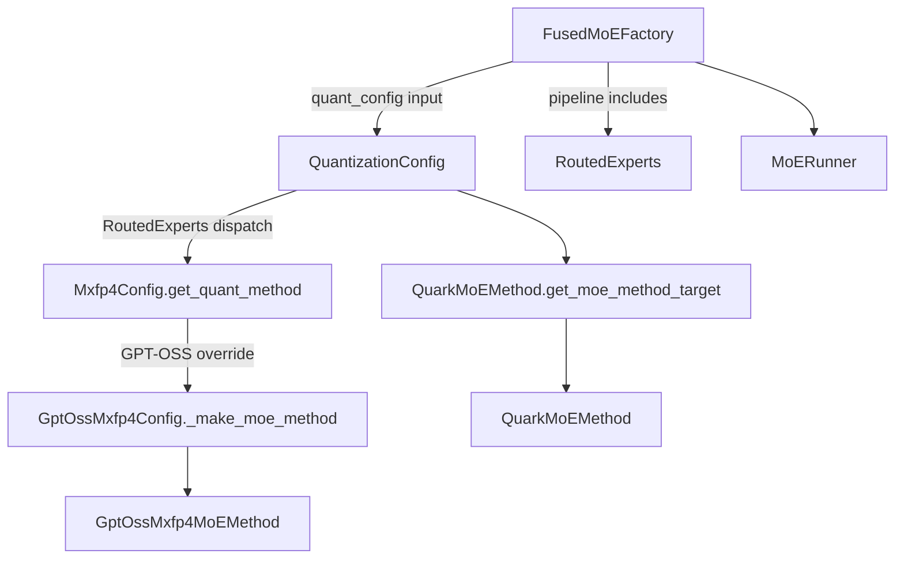
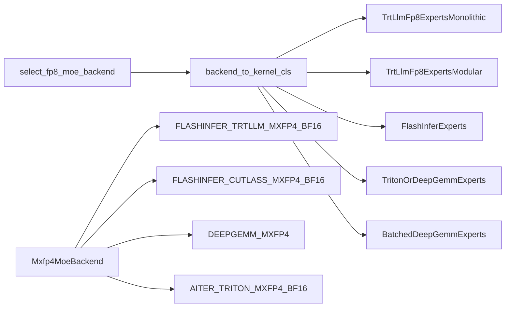
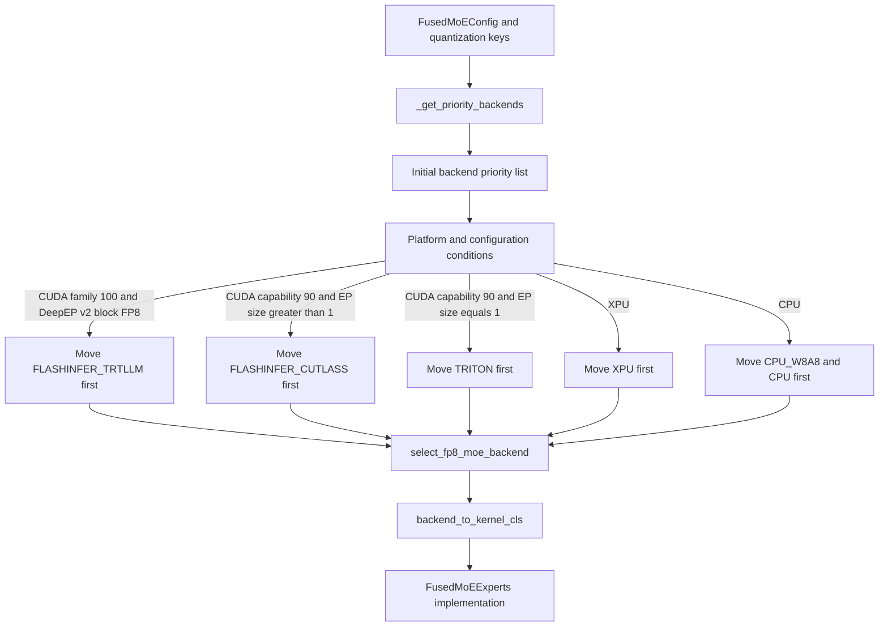
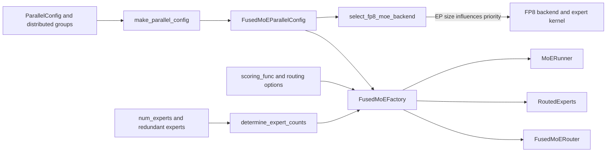

<!-- source: DeepWiki mcp.deepwiki.com · repo vllm-project/vllm · page 7.4 MoE Quantization and Backend Selection · fetched 2026-10-28 -->

# MoE Quantization and Backend Selection

Relevant source files

The following files were used as context for generating this wiki page:

- [cmake/external_projects/triton_kernels.cmake](cmake/external_projects/triton_kernels.cmake)
- [csrc/nvfp4_kv_cache_kernels.cu](csrc/nvfp4_kv_cache_kernels.cu)
- [docker/Dockerfile.rocm_72_base](docker/Dockerfile.rocm_72_base)
- [docker/Dockerfile.rocm_base](docker/Dockerfile.rocm_base)
- [docs/design/moe_kernel_features.md](docs/design/moe_kernel_features.md)
- [tests/compile/correctness_e2e/test_attn_quant.py](tests/compile/correctness_e2e/test_attn_quant.py)
- [tests/distributed/test_eplb_quant_scale_consistency.py](tests/distributed/test_eplb_quant_scale_consistency.py)
- [tests/distributed/test_pynccl.py](tests/distributed/test_pynccl.py)
- [tests/distributed/test_quick_all_reduce.py](tests/distributed/test_quick_all_reduce.py)
- [tests/distributed/test_rocm_quick_reduce.py](tests/distributed/test_rocm_quick_reduce.py)
- [tests/distributed/test_weight_transfer_nccl_uid.py](tests/distributed/test_weight_transfer_nccl_uid.py)
- [tests/entrypoints/multimodal/openai/chat_completion/test_chat_completion_with_mixed_image_embeds.py](tests/entrypoints/multimodal/openai/chat_completion/test_chat_completion_with_mixed_image_embeds.py)
- [tests/entrypoints/multimodal/openai/chat_completion/test_default_mm_loras.py](tests/entrypoints/multimodal/openai/chat_completion/test_default_mm_loras.py)
- [tests/entrypoints/serve/sagemaker/conftest.py](tests/entrypoints/serve/sagemaker/conftest.py)
- [tests/kernels/attention/test_cache.py](tests/kernels/attention/test_cache.py)
- [tests/kernels/attention/test_flashinfer_trtllm_attention.py](tests/kernels/attention/test_flashinfer_trtllm_attention.py)
- [tests/kernels/attention/test_use_trtllm_attention.py](tests/kernels/attention/test_use_trtllm_attention.py)
- [tests/kernels/moe/modular_kernel_tools/common.py](tests/kernels/moe/modular_kernel_tools/common.py)
- [tests/kernels/moe/modular_kernel_tools/mk_objects.py](tests/kernels/moe/modular_kernel_tools/mk_objects.py)
- [tests/kernels/moe/modular_kernel_tools/parallel_utils.py](tests/kernels/moe/modular_kernel_tools/parallel_utils.py)
- [tests/kernels/moe/test_cutedsl_moe.py](tests/kernels/moe/test_cutedsl_moe.py)
- [tests/kernels/moe/test_flashinfer.py](tests/kernels/moe/test_flashinfer.py)
- [tests/kernels/moe/test_flashinfer_cutedsl_nvfp4_moe.py](tests/kernels/moe/test_flashinfer_cutedsl_nvfp4_moe.py)
- [tests/kernels/moe/test_gpt_oss_triton_kernels.py](tests/kernels/moe/test_gpt_oss_triton_kernels.py)
- [tests/kernels/moe/test_modular_kernel_combinations.py](tests/kernels/moe/test_modular_kernel_combinations.py)
- [tests/kernels/moe/test_modular_oai_triton_moe.py](tests/kernels/moe/test_modular_oai_triton_moe.py)
- [tests/kernels/moe/test_moe_layer.py](tests/kernels/moe/test_moe_layer.py)
- [tests/kernels/moe/test_mori_moe.py](tests/kernels/moe/test_mori_moe.py)
- [tests/kernels/moe/test_mori_prepare_finalize.py](tests/kernels/moe/test_mori_prepare_finalize.py)
- [tests/kernels/moe/test_ocp_mx_moe.py](tests/kernels/moe/test_ocp_mx_moe.py)
- [tests/kernels/moe/test_rocm_aiter_moe.py](tests/kernels/moe/test_rocm_aiter_moe.py)
- [tests/kernels/moe/test_trtllm_nvfp4_moe.py](tests/kernels/moe/test_trtllm_nvfp4_moe.py)
- [tests/kernels/moe/utils.py](tests/kernels/moe/utils.py)
- [tests/kernels/quantization/nvfp4_utils.py](tests/kernels/quantization/nvfp4_utils.py)
- [tests/kernels/quantization/test_mxfp4_triton_ep.py](tests/kernels/quantization/test_mxfp4_triton_ep.py)
- [tests/model_executor/test_flashinfer_autotune_warmup.py](tests/model_executor/test_flashinfer_autotune_warmup.py)
- [tests/models/quantization/test_gpt_oss.py](tests/models/quantization/test_gpt_oss.py)
- [tests/models/quantization/test_mimo_v2_w4a16_routing.py](tests/models/quantization/test_mimo_v2_w4a16_routing.py)
- [tests/quantization/test_gfx950_moe.py](tests/quantization/test_gfx950_moe.py)
- [tests/quantization/test_modelopt.py](tests/quantization/test_modelopt.py)
- [tests/quantization/test_trtllm_nvfp4_hidden_dim_padding.py](tests/quantization/test_trtllm_nvfp4_hidden_dim_padding.py)
- [tests/v1/attention/test_flashinfer_dcp_spec_reorder.py](tests/v1/attention/test_flashinfer_dcp_spec_reorder.py)
- [tests/v1/attention/test_trtllm_attention_integration.py](tests/v1/attention/test_trtllm_attention_integration.py)
- [tests/v1/spec_decode/test_eagle_step_kernel.py](tests/v1/spec_decode/test_eagle_step_kernel.py)
- [tests/v1/spec_decode/test_max_len.py](tests/v1/spec_decode/test_max_len.py)
- [tests/v1/worker/test_eagle3_aux_hidden_states_pp.py](tests/v1/worker/test_eagle3_aux_hidden_states_pp.py)
- [tests/v1/worker/test_gpu_extract_hidden_states_speculator.py](tests/v1/worker/test_gpu_extract_hidden_states_speculator.py)
- [vllm/distributed/device_communicators/pynccl.py](vllm/distributed/device_communicators/pynccl.py)
- [vllm/distributed/device_communicators/pynccl_wrapper.py](vllm/distributed/device_communicators/pynccl_wrapper.py)
- [vllm/distributed/device_communicators/quick_all_reduce.py](vllm/distributed/device_communicators/quick_all_reduce.py)
- [vllm/model_executor/layers/fused_moe/all2all_utils.py](vllm/model_executor/layers/fused_moe/all2all_utils.py)
- [vllm/model_executor/layers/fused_moe/config.py](vllm/model_executor/layers/fused_moe/config.py)
- [vllm/model_executor/layers/fused_moe/eep_reconfigure.py](vllm/model_executor/layers/fused_moe/eep_reconfigure.py)
- [vllm/model_executor/layers/fused_moe/experts/aiter_mxfp4_w4a16_moe.py](vllm/model_executor/layers/fused_moe/experts/aiter_mxfp4_w4a16_moe.py)
- [vllm/model_executor/layers/fused_moe/experts/aiter_mxfp4_w4a8_moe.py](vllm/model_executor/layers/fused_moe/experts/aiter_mxfp4_w4a8_moe.py)
- [vllm/model_executor/layers/fused_moe/experts/flashinfer_cutedsl_batched_moe.py](vllm/model_executor/layers/fused_moe/experts/flashinfer_cutedsl_batched_moe.py)
- [vllm/model_executor/layers/fused_moe/experts/flashinfer_cutedsl_moe.py](vllm/model_executor/layers/fused_moe/experts/flashinfer_cutedsl_moe.py)
- [vllm/model_executor/layers/fused_moe/experts/gpt_oss_triton_kernels_moe.py](vllm/model_executor/layers/fused_moe/experts/gpt_oss_triton_kernels_moe.py)
- [vllm/model_executor/layers/fused_moe/experts/rocm_aiter_moe.py](vllm/model_executor/layers/fused_moe/experts/rocm_aiter_moe.py)
- [vllm/model_executor/layers/fused_moe/experts/xpu_moe.py](vllm/model_executor/layers/fused_moe/experts/xpu_moe.py)
- [vllm/model_executor/layers/fused_moe/fused_moe_modular_method.py](vllm/model_executor/layers/fused_moe/fused_moe_modular_method.py)
- [vllm/model_executor/layers/fused_moe/layer.py](vllm/model_executor/layers/fused_moe/layer.py)
- [vllm/model_executor/layers/fused_moe/oracle/fp8.py](vllm/model_executor/layers/fused_moe/oracle/fp8.py)
- [vllm/model_executor/layers/fused_moe/oracle/mxfp4.py](vllm/model_executor/layers/fused_moe/oracle/mxfp4.py)
- [vllm/model_executor/layers/fused_moe/oracle/nvfp4.py](vllm/model_executor/layers/fused_moe/oracle/nvfp4.py)
- [vllm/model_executor/layers/fused_moe/prepare_finalize/mori.py](vllm/model_executor/layers/fused_moe/prepare_finalize/mori.py)
- [vllm/model_executor/layers/fused_moe/prepare_finalize/nixl_ep.py](vllm/model_executor/layers/fused_moe/prepare_finalize/nixl_ep.py)
- [vllm/model_executor/layers/fused_moe/topk_weight_and_reduce.py](vllm/model_executor/layers/fused_moe/topk_weight_and_reduce.py)
- [vllm/model_executor/layers/quantization/fp8.py](vllm/model_executor/layers/quantization/fp8.py)
- [vllm/model_executor/layers/quantization/modelopt.py](vllm/model_executor/layers/quantization/modelopt.py)
- [vllm/model_executor/layers/quantization/mxfp4.py](vllm/model_executor/layers/quantization/mxfp4.py)
- [vllm/model_executor/layers/quantization/quark/quark_moe.py](vllm/model_executor/layers/quantization/quark/quark_moe.py)
- [vllm/model_executor/layers/quantization/utils/flashinfer_fp4_moe.py](vllm/model_executor/layers/quantization/utils/flashinfer_fp4_moe.py)
- [vllm/model_executor/layers/quantization/utils/flashinfer_utils.py](vllm/model_executor/layers/quantization/utils/flashinfer_utils.py)
- [vllm/model_executor/layers/quantization/utils/mxfp4_utils.py](vllm/model_executor/layers/quantization/utils/mxfp4_utils.py)
- [vllm/model_executor/warmup/flashinfer_autotune_cache.py](vllm/model_executor/warmup/flashinfer_autotune_cache.py)
- [vllm/model_executor/warmup/flashinfer_sparse_mla_warmup.py](vllm/model_executor/warmup/flashinfer_sparse_mla_warmup.py)
- [vllm/model_executor/warmup/kernel_warmup.py](vllm/model_executor/warmup/kernel_warmup.py)
- [vllm/utils/flashinfer.py](vllm/utils/flashinfer.py)
- [vllm/utils/nccl.py](vllm/utils/nccl.py)
- [vllm/v1/worker/gpu/spec_decode/__init__.py](vllm/v1/worker/gpu/spec_decode/__init__.py)
- [vllm/v1/worker/gpu/spec_decode/eagle/eagle3_utils.py](vllm/v1/worker/gpu/spec_decode/eagle/eagle3_utils.py)

## Purpose and Scope

This page describes how MoE quantization methods connect to routed-expert execution, how the FP8 and MXFP4 backend oracles choose kernel families, and how backend choice interacts with expert parallelism (EP). It covers the code paths evidenced here for FP8, MXFP4, NVFP4, ModelOpt, and Quark, along with CUTLASS, DeepGemm, FlashInfer/TRTLLM, and ROCm AITER backend families. [vllm/model_executor/layers/fused_moe/layer.py:92-159](), [vllm/model_executor/layers/fused_moe/oracle/fp8.py:50-76](), [vllm/model_executor/layers/fused_moe/oracle/mxfp4.py:130-172](), [vllm/model_executor/layers/quantization/mxfp4.py:55-107](), [vllm/model_executor/layers/quantization/quark/quark_moe.py:128-198]()

For general quantization, low-precision formats, and FusedMoE architecture, see [7.1 Quantization Methods Overview](), [7.2 FP8 and Low-Precision Quantization](), and [7.3 FusedMoE Layer Architecture]().

Sources: [vllm/model_executor/layers/fused_moe/layer.py:92-159](), [vllm/model_executor/layers/fused_moe/oracle/fp8.py:50-76](), [vllm/model_executor/layers/fused_moe/oracle/mxfp4.py:130-172](), [vllm/model_executor/layers/quantization/mxfp4.py:55-107](), [vllm/model_executor/layers/quantization/quark/quark_moe.py:128-198]()

---

## 1. MoE Quantization Methods and Configuration

`FusedMoEFactory` is the entry point for creating the MoE execution pipeline. Its inputs include the quantization configuration, expert and routing parameters, parallel sizes, and optional routed-expert and runner classes. Its documented responsibility is to configure a router, `RoutedExperts`, and a `MoERunner`; the returned runner orchestrates the forward pass. [vllm/model_executor/layers/fused_moe/layer.py:92-159]()

Quantization configuration selects or constructs an MoE-specific method for routed experts. For example, `Mxfp4Config.get_quant_method` recognizes `RoutedExperts` and delegates to `_make_moe_method`; `GptOssMxfp4Config` overrides this factory to return `GptOssMxfp4MoEMethod`. [vllm/model_executor/layers/quantization/mxfp4.py:86-113](), [vllm/model_executor/layers/quantization/mxfp4.py:116-149]()

| Configuration or method | MoE-specific role evidenced in the implementation |
|---|---|
| `Fp8Config` | Stores serialized-checkpoint status, activation scheme, ignored layers, optional weight block size, and storage dtype. It rejects non-serialized FP8 checkpoints in this configuration. [vllm/model_executor/layers/quantization/fp8.py:92-135]() |
| `GptOssMxfp4MoEMethod` | Selects an MXFP4 backend and expert class during initialization. [vllm/model_executor/layers/quantization/mxfp4.py:152-168]() |
| `QuarkMoEMethod` | Validates activation and weight quantization keys against subclass-supported keys. `get_moe_method_target` parses the matched layer configuration and identifies supported routed-expert schemes. [vllm/model_executor/layers/quantization/quark/quark_moe.py:128-168](), [vllm/model_executor/layers/quantization/quark/quark_moe.py:170-198]() |
| `ModelOptQuantConfigBase` | Provides a base for ModelOpt quantization configuration and associates subclasses with a `FusedMoEMethodBase` default. The displayed excerpt also defines ModelOpt linear-algorithm metadata; it does not show the full ModelOpt MoE dispatch path. [vllm/model_executor/layers/quantization/modelopt.py:127-158](), [vllm/model_executor/layers/quantization/modelopt.py:173-187]() |

### Diagram: Quantization Configuration to MoE Code Entities

Sources: [vllm/model_executor/layers/fused_moe/layer.py:92-159](), [vllm/model_executor/layers/quantization/mxfp4.py:86-113](), [vllm/model_executor/layers/quantization/mxfp4.py:116-158](), [vllm/model_executor/layers/quantization/quark/quark_moe.py:128-198]()

---

## 2. MoE-Specific Quantization Details

### FP8 Quantization Descriptors and Backend Families

The FP8 oracle defines backend identifiers for FlashInfer TRTLLM, FlashInfer CUTLASS, DeepGemm, vLLM CUTLASS, Triton, Marlin, Humming, AITER, XPU, CPU, and other variants. It derives an initial priority order and adjusts it for platform and execution configuration. [vllm/model_executor/layers/fused_moe/oracle/fp8.py:50-76](), [vllm/model_executor/layers/fused_moe/oracle/fp8.py:79-105]()

The FP8 priority logic includes a special case for CUDA device-capability family 100 with DeepEP v2 kernels and a specific activation/weight quantization-key pair: it moves `FLASHINFER_TRTLLM` to the front. For CUDA capability 90 with block FP8 keys, it prefers FlashInfer CUTLASS when `ep_size > 1`, and Triton otherwise. [vllm/model_executor/layers/fused_moe/oracle/fp8.py:107-132]()

`Fp8Config` accepts `static` or `dynamic` activation schemes. If `weight_block_size` is set, it must have two dimensions and the activation scheme must be dynamic. [vllm/model_executor/layers/quantization/fp8.py:92-135]()

### MXFP4 and NVFP4

`Mxfp4Config` is the canonical base configuration for MXFP4. It dispatches `RoutedExperts` to an MoE method while its displayed implementation leaves linear layers unquantized and skips attention quantization. `GptOssMxfp4Config` normalizes GPT-OSS checkpoint identity and supplies `GptOssMxfp4MoEMethod`. [vllm/model_executor/layers/quantization/mxfp4.py:55-113](), [vllm/model_executor/layers/quantization/mxfp4.py:116-158]()

The MXFP4 oracle declares backend variants for DeepGemm, FlashInfer TRTLLM, FlashInfer CUTLASS, vLLM CUTLASS, AITER, Triton, XPU, CPU, emulation, and FlashInfer MoE-EP megakernels. The enum names distinguish activation/weight combinations for several backend families, such as MXFP4 with BF16, FP8, or MXFP4 activations. [vllm/model_executor/layers/fused_moe/oracle/mxfp4.py:130-172]()

The oracle includes layout preparation helpers: `_pack_deepgemm_mxfp4_scales` post-processes scale blocks for DeepGemm, while `_swizzle_cutlass_mxfp4_scales` converts scale tensors to the CUTLASS tiled layout. [vllm/model_executor/layers/fused_moe/oracle/mxfp4.py:84-127]()

NVFP4 backend selection and conversion functions are imported and used by the ModelOpt and Quark MoE quantization modules, but the provided excerpts do not include the NVFP4 oracle implementation itself. Therefore, this page does not assert its detailed eligibility rules or conversion layouts. [vllm/model_executor/layers/quantization/modelopt.py:41-48](), [vllm/model_executor/layers/quantization/quark/quark_moe.py:59-64]()

### Configuration Compatibility and Quantization Keys

`FusedMoEQuantDesc` in the MoE configuration model describes a quantized type and its grouping shape. Its documented shapes include per-tensor, per-row, per-column, block quantization, and per-token-per-group activation quantization. [vllm/model_executor/layers/fused_moe/config.py:174-193]()

`_quant_flags_to_group_shape` maps block-shape flags or per-token/per-output-channel flags into generic `GroupShape` values. The conversion asserts that block quantization is not combined with the per-activation-token or per-output-channel flags. [vllm/model_executor/layers/fused_moe/config.py:74-100]()

Sources: [vllm/model_executor/layers/fused_moe/oracle/fp8.py:50-76](), [vllm/model_executor/layers/fused_moe/oracle/fp8.py:79-145](), [vllm/model_executor/layers/fused_moe/oracle/mxfp4.py:84-172](), [vllm/model_executor/layers/quantization/fp8.py:92-135](), [vllm/model_executor/layers/quantization/mxfp4.py:55-158](), [vllm/model_executor/layers/quantization/modelopt.py:41-48](), [vllm/model_executor/layers/quantization/quark/quark_moe.py:59-64](), [vllm/model_executor/layers/fused_moe/config.py:74-100](), [vllm/model_executor/layers/fused_moe/config.py:174-193]()

---

## 3. Backend Implementations: CUTLASS, DeepGemm, FlashInfer, TRTLLM, and AITER

Backend enum values and the FP8 oracle’s `backend_to_kernel_cls` function connect selection names to expert implementations. For example, `FLASHINFER_TRTLLM` maps to `TrtLlmFp8ExpertsMonolithic` and `TrtLlmFp8ExpertsModular`; `FLASHINFER_CUTLASS` maps to `FlashInferExperts`; and `DEEPGEMM` maps to `TritonOrDeepGemmExperts`. [vllm/model_executor/layers/fused_moe/oracle/fp8.py:148-178]()

| Backend family | Code-level identifiers and role |
|---|---|
| FlashInfer TRTLLM | FP8 backend maps to the monolithic and modular TRTLLM expert classes. MXFP4 exposes separate TRTLLM variants and groups them in `TRTLLM_BACKENDS`. [vllm/model_executor/layers/fused_moe/oracle/fp8.py:148-157](), [vllm/model_executor/layers/fused_moe/oracle/mxfp4.py:175-179]() |
| FlashInfer CUTLASS | FP8 maps to `FlashInferExperts`; MXFP4 has separate CUTLASS enum values for MXFP4 with MXFP8 or BF16 activations. [vllm/model_executor/layers/fused_moe/oracle/fp8.py:159-164](), [vllm/model_executor/layers/fused_moe/oracle/mxfp4.py:140-142]() |
| DeepGemm | FP8 maps to `TritonOrDeepGemmExperts`; batched FP8 DeepGemm maps to `BatchedDeepGemmExperts`. MXFP4 has a `DEEPGEMM_MXFP4` backend identifier. [vllm/model_executor/layers/fused_moe/oracle/fp8.py:166-178](), [vllm/model_executor/layers/fused_moe/oracle/mxfp4.py:130-139]() |
| vLLM CUTLASS | FP8 priority entries include `VLLM_CUTLASS` and `BATCHED_VLLM_CUTLASS`; MXFP4 declares `CUTLASS_MXFP4_MXFP4`. [vllm/model_executor/layers/fused_moe/oracle/fp8.py:50-63](), [vllm/model_executor/layers/fused_moe/oracle/mxfp4.py:140-146]() |
| ROCm AITER | FP8 includes `AITER`; MXFP4 declares CK and Triton variants for W4A16, W4A8, and W4A4 use cases. The MXFP4 enum comments identify some architecture targets, including gfx942, gfx950, and gfx1250. [vllm/model_executor/layers/fused_moe/oracle/fp8.py:50-76](), [vllm/model_executor/layers/fused_moe/oracle/mxfp4.py:148-158]() |

FlashInfer availability is guarded by `has_flashinfer()`. The wrapper checks whether the Python package is present and, when cubins are unavailable, also checks for `nvcc` and `ninja` before reporting FlashInfer as available. This availability helper is a package/toolchain check, distinct from the MoE oracle’s choice among backend implementations. [vllm/utils/flashinfer.py:87-106]()

The ROCm base Docker configuration pins an AITER repository and branch and sets `AITER_ROCM_ARCH` to `gfx942;gfx950` for the build environment shown. This is build configuration evidence, not a complete statement of runtime AITER support. [docker/Dockerfile.rocm_base:8-12](), [docker/Dockerfile.rocm_base:25-27]()

### Diagram: Backend Names to Expert Implementations

Sources: [vllm/model_executor/layers/fused_moe/oracle/fp8.py:148-178](), [vllm/model_executor/layers/fused_moe/oracle/mxfp4.py:130-172](), [vllm/model_executor/layers/fused_moe/oracle/mxfp4.py:175-186](), [vllm/utils/flashinfer.py:87-106](), [docker/Dockerfile.rocm_base:8-12](), [docker/Dockerfile.rocm_base:25-27]()

---

## 4. Oracle-Based Backend Selection Logic

The FP8 oracle separates priority construction from backend-to-kernel mapping. `_get_priority_backends` starts from an ordered list, applies `prioritize_humming`, and then moves selected candidates to the front depending on platform and configuration. `backend_to_kernel_cls` translates a chosen enum value into one or more `FusedMoEExperts` classes. [vllm/model_executor/layers/fused_moe/oracle/fp8.py:79-105](), [vllm/model_executor/layers/fused_moe/oracle/fp8.py:107-145](), [vllm/model_executor/layers/fused_moe/oracle/fp8.py:148-178]()

The displayed FP8 priority conditions are:

- For CUDA device-capability family 100, DeepEP v2 kernels, dynamic 128-symmetric FP8 activations, and static 128-block-symmetric FP8 weights, move `FLASHINFER_TRTLLM` to the front. The code comment explains that TRTLLM’s tile-level skipping avoids wasted work on padded rows in this case. [vllm/model_executor/layers/fused_moe/oracle/fp8.py:110-120]()
- For CUDA capability 90 with the same block-FP8 quantization keys, choose FlashInfer CUTLASS first when `ep_size > 1`, and Triton first otherwise. [vllm/model_executor/layers/fused_moe/oracle/fp8.py:122-132]()
- On XPU, move the XPU backend to the front; on CPU, move CPU W8A8 and then CPU to the front, with the comment noting W8A8 can fall through when hardware or configuration is unsupported. [vllm/model_executor/layers/fused_moe/oracle/fp8.py:134-145]()

The MXFP4 method stores the selected backend and expert class returned by `select_mxfp4_moe_backend`. It also derives forward-padding behavior from the selected backend: the TRTLLM MXFP4/MXFP8 variant skips forward padding, and both TRTLLM MXFP4 variants are marked as producing unpadded output. [vllm/model_executor/layers/quantization/mxfp4.py:152-181]()

### Diagram: FP8 Oracle Decision Path

Sources: [vllm/model_executor/layers/fused_moe/oracle/fp8.py:79-105](), [vllm/model_executor/layers/fused_moe/oracle/fp8.py:107-145](), [vllm/model_executor/layers/fused_moe/oracle/fp8.py:148-178]()

---

## 5. Expert Parallelism, Routing, and Scaling Interactions

`make_parallel_config` builds a `FusedMoEParallelConfig` from explicit sizes when supplied, or from the current tensor-parallel, data-parallel, and PCP groups otherwise. Sequence-parallel size is set to tensor-parallel size when sequence parallelism is enabled, and to one otherwise. [vllm/model_executor/layers/fused_moe/layer.py:47-73]()

EP affects backend priority directly in the FP8 oracle: for the specified CUDA capability-90 block-FP8 case, `moe_config.moe_parallel_config.ep_size > 1` selects FlashInfer CUTLASS as the first-priority backend, while the non-EP case prioritizes Triton. [vllm/model_executor/layers/fused_moe/oracle/fp8.py:122-132]()

Routing types are represented by `RoutingMethodType`. `get_routing_method_type` maps scoring function, renormalization, expert grouping, and score-bias presence to values such as `DeepSeekV3`, `MiniMax2`, `SigmoidRenorm`, `Sigmoid`, `RenormalizeNaive`, and `Default`. It returns `Unspecified` for cases not represented by those mappings. [vllm/model_executor/layers/fused_moe/config.py:103-171]()

`FusedMoEFactory` accepts options for redundant experts, EPLB, shared experts, sequence parallelism, routing, and custom routed-expert classes. `determine_expert_counts` computes global expert count as logical experts plus redundant experts, and computes the fused shared-expert count when shared experts are configured to be fused. [vllm/model_executor/layers/fused_moe/layer.py:76-90](), [vllm/model_executor/layers/fused_moe/layer.py:92-146]()

### Diagram: Parallel Configuration and Routing Inputs to MoE Execution

Sources: [vllm/model_executor/layers/fused_moe/layer.py:47-73](), [vllm/model_executor/layers/fused_moe/layer.py:76-90](), [vllm/model_executor/layers/fused_moe/layer.py:92-159](), [vllm/model_executor/layers/fused_moe/config.py:103-171](), [vllm/model_executor/layers/fused_moe/oracle/fp8.py:122-132]()

---

## 6. Kernel Warmup and Runtime Readiness

`kernel_warmup` is intended to keep JIT compilation from occurring during model execution. When JIT warmup is enabled in `kernel_config`, it obtains the model runner’s JIT warmup registry and calls `registry.warmup()`, logging and re-raising failures. [vllm/model_executor/warmup/kernel_warmup.py:3-6](), [vllm/model_executor/warmup/kernel_warmup.py:164-193]()

The warmup module imports dedicated warmup functions for DeepGemm and CUTEDSL, among other kernel families. The available excerpt establishes that these warmup modules are part of the warmup subsystem; it does not show all conditions under which each function runs. [vllm/model_executor/warmup/kernel_warmup.py:18-27]()

Sources: [vllm/model_executor/warmup/kernel_warmup.py:3-6](), [vllm/model_executor/warmup/kernel_warmup.py:18-27](), [vllm/model_executor/warmup/kernel_warmup.py:164-193]()

---

