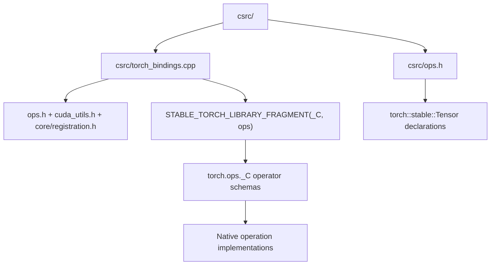
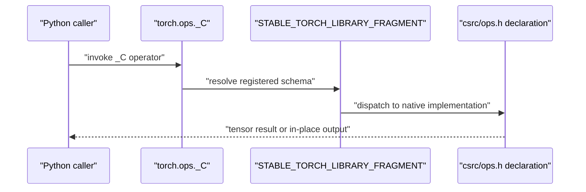
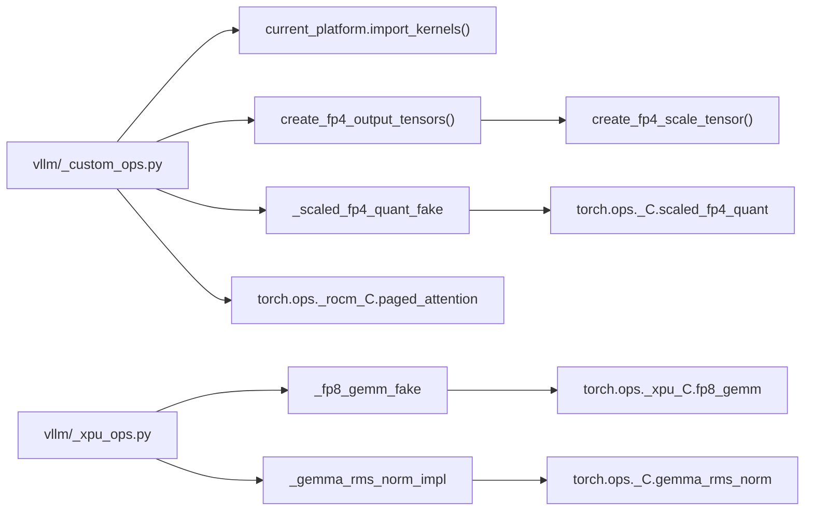
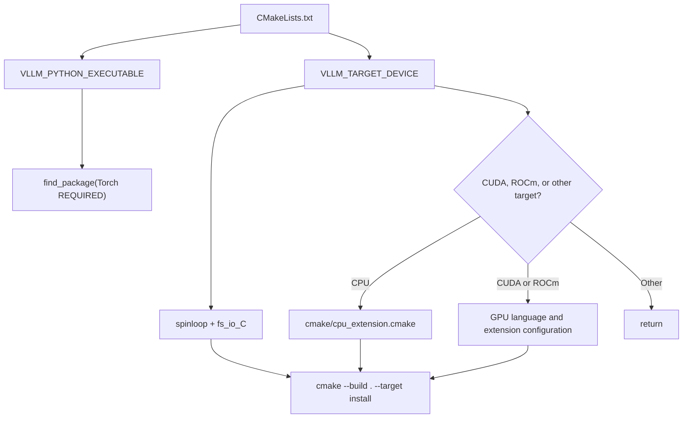
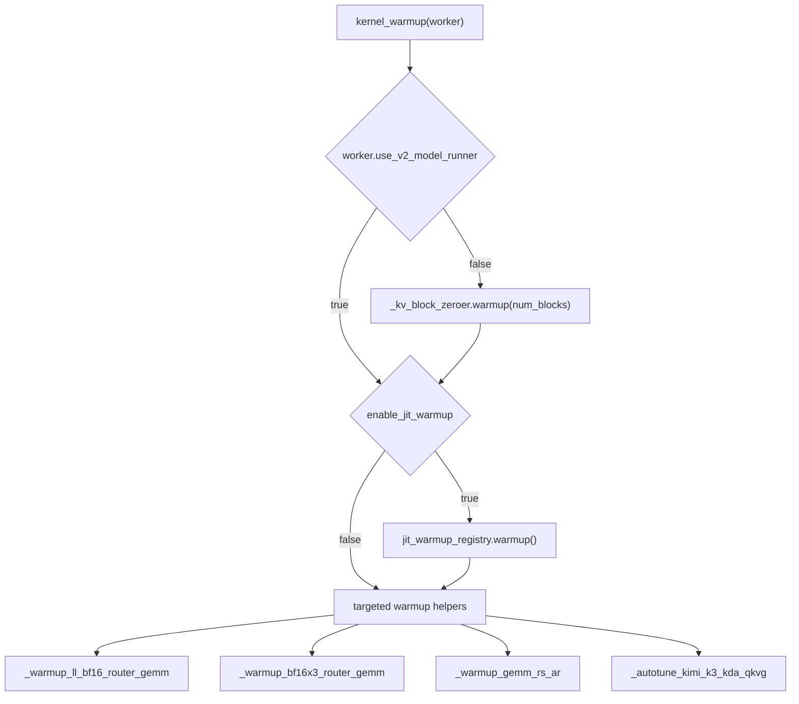

<!-- source: DeepWiki mcp.deepwiki.com · repo vllm-project/vllm · page 7.5 Custom Kernels and C++/CUDA Extensions · fetched 2026-10-28 -->

# Custom Kernels and C++/CUDA Extensions

Relevant source files

The following files were used as context for generating this wiki page:

- [.github/workflows/scripts/build.sh](.github/workflows/scripts/build.sh)
- [CMakeLists.txt](CMakeLists.txt)
- [cmake/external_projects/qutlass.cmake](cmake/external_projects/qutlass.cmake)
- [cmake/utils.cmake](cmake/utils.cmake)
- [csrc/activation_kernels.cu](csrc/activation_kernels.cu)
- [csrc/cpu/activation.cpp](csrc/cpu/activation.cpp)
- [csrc/cpu/activation_lut_bf16.cpp](csrc/cpu/activation_lut_bf16.cpp)
- [csrc/cpu/cpu_tanhf_neon.hpp](csrc/cpu/cpu_tanhf_neon.hpp)
- [csrc/moe/moe_ops.h](csrc/moe/moe_ops.h)
- [csrc/moe/torch_bindings.cpp](csrc/moe/torch_bindings.cpp)
- [csrc/nvfp4_kv_cache_kernels.cu](csrc/nvfp4_kv_cache_kernels.cu)
- [csrc/ops.h](csrc/ops.h)
- [csrc/torch_bindings.cpp](csrc/torch_bindings.cpp)
- [tests/compile/correctness_e2e/test_attn_quant.py](tests/compile/correctness_e2e/test_attn_quant.py)
- [tests/compile/passes/test_functionalization.py](tests/compile/passes/test_functionalization.py)
- [tests/compile/passes/test_scatter_split_replace.py](tests/compile/passes/test_scatter_split_replace.py)
- [tests/compile/test_rotary_embedding_compile.py](tests/compile/test_rotary_embedding_compile.py)
- [tests/distributed/test_eplb_quant_scale_consistency.py](tests/distributed/test_eplb_quant_scale_consistency.py)
- [tests/kernels/attention/test_cache.py](tests/kernels/attention/test_cache.py)
- [tests/kernels/attention/test_flashinfer_trtllm_attention.py](tests/kernels/attention/test_flashinfer_trtllm_attention.py)
- [tests/kernels/attention/test_use_trtllm_attention.py](tests/kernels/attention/test_use_trtllm_attention.py)
- [tests/kernels/core/test_activation.py](tests/kernels/core/test_activation.py)
- [tests/kernels/core/test_apply_rotary_emb.py](tests/kernels/core/test_apply_rotary_emb.py)
- [tests/kernels/core/test_cpu_activation.py](tests/kernels/core/test_cpu_activation.py)
- [tests/kernels/core/test_mrope.py](tests/kernels/core/test_mrope.py)
- [tests/kernels/mhc/test_mhc_kernels.py](tests/kernels/mhc/test_mhc_kernels.py)
- [tests/kernels/moe/test_cutedsl_moe.py](tests/kernels/moe/test_cutedsl_moe.py)
- [tests/kernels/moe/test_flashinfer.py](tests/kernels/moe/test_flashinfer.py)
- [tests/kernels/moe/test_flashinfer_cutedsl_nvfp4_moe.py](tests/kernels/moe/test_flashinfer_cutedsl_nvfp4_moe.py)
- [tests/kernels/quantization/nvfp4_utils.py](tests/kernels/quantization/nvfp4_utils.py)
- [tests/model_executor/layers/test_conv.py](tests/model_executor/layers/test_conv.py)
- [tests/model_executor/test_flashinfer_autotune_warmup.py](tests/model_executor/test_flashinfer_autotune_warmup.py)
- [tests/quantization/test_trtllm_nvfp4_hidden_dim_padding.py](tests/quantization/test_trtllm_nvfp4_hidden_dim_padding.py)
- [tests/test_cmake_utils.py](tests/test_cmake_utils.py)
- [tests/v1/attention/test_flashinfer_dcp_spec_reorder.py](tests/v1/attention/test_flashinfer_dcp_spec_reorder.py)
- [tests/v1/attention/test_trtllm_attention_integration.py](tests/v1/attention/test_trtllm_attention_integration.py)
- [tests/v1/spec_decode/test_eagle_step_kernel.py](tests/v1/spec_decode/test_eagle_step_kernel.py)
- [tests/v1/spec_decode/test_max_len.py](tests/v1/spec_decode/test_max_len.py)
- [tests/v1/worker/test_eagle3_aux_hidden_states_pp.py](tests/v1/worker/test_eagle3_aux_hidden_states_pp.py)
- [tests/v1/worker/test_gpu_extract_hidden_states_speculator.py](tests/v1/worker/test_gpu_extract_hidden_states_speculator.py)
- [vllm/_custom_ops.py](vllm/_custom_ops.py)
- [vllm/_xpu_ops.py](vllm/_xpu_ops.py)
- [vllm/compilation/passes/utility/scatter_split_replace.py](vllm/compilation/passes/utility/scatter_split_replace.py)
- [vllm/model_executor/layers/activation.py](vllm/model_executor/layers/activation.py)
- [vllm/model_executor/layers/fused_moe/eep_reconfigure.py](vllm/model_executor/layers/fused_moe/eep_reconfigure.py)
- [vllm/model_executor/layers/fused_moe/experts/flashinfer_cutedsl_batched_moe.py](vllm/model_executor/layers/fused_moe/experts/flashinfer_cutedsl_batched_moe.py)
- [vllm/model_executor/layers/fused_moe/experts/flashinfer_cutedsl_moe.py](vllm/model_executor/layers/fused_moe/experts/flashinfer_cutedsl_moe.py)
- [vllm/model_executor/layers/fused_moe/fused_moe_modular_method.py](vllm/model_executor/layers/fused_moe/fused_moe_modular_method.py)
- [vllm/model_executor/layers/fused_moe/prepare_finalize/nixl_ep.py](vllm/model_executor/layers/fused_moe/prepare_finalize/nixl_ep.py)
- [vllm/model_executor/layers/quantization/utils/flashinfer_fp4_moe.py](vllm/model_executor/layers/quantization/utils/flashinfer_fp4_moe.py)
- [vllm/model_executor/layers/quantization/utils/flashinfer_utils.py](vllm/model_executor/layers/quantization/utils/flashinfer_utils.py)
- [vllm/model_executor/layers/quantization/utils/int8_utils.py](vllm/model_executor/layers/quantization/utils/int8_utils.py)
- [vllm/model_executor/layers/rotary_embedding/__init__.py](vllm/model_executor/layers/rotary_embedding/__init__.py)
- [vllm/model_executor/layers/rotary_embedding/base.py](vllm/model_executor/layers/rotary_embedding/base.py)
- [vllm/model_executor/layers/rotary_embedding/common.py](vllm/model_executor/layers/rotary_embedding/common.py)
- [vllm/model_executor/layers/rotary_embedding/deepseek_scaling_rope.py](vllm/model_executor/layers/rotary_embedding/deepseek_scaling_rope.py)
- [vllm/model_executor/layers/rotary_embedding/mrope.py](vllm/model_executor/layers/rotary_embedding/mrope.py)
- [vllm/model_executor/layers/rotary_embedding/mrope_vit_setup.py](vllm/model_executor/layers/rotary_embedding/mrope_vit_setup.py)
- [vllm/model_executor/layers/rotary_embedding/packed_qk_rope.py](vllm/model_executor/layers/rotary_embedding/packed_qk_rope.py)
- [vllm/model_executor/layers/rotary_embedding/yarn_scaling_rope.py](vllm/model_executor/layers/rotary_embedding/yarn_scaling_rope.py)
- [vllm/model_executor/models/kanana_v.py](vllm/model_executor/models/kanana_v.py)
- [vllm/model_executor/models/kimi_k25.py](vllm/model_executor/models/kimi_k25.py)
- [vllm/model_executor/models/kimi_k25_vit.py](vllm/model_executor/models/kimi_k25_vit.py)
- [vllm/model_executor/models/kimi_vl.py](vllm/model_executor/models/kimi_vl.py)
- [vllm/model_executor/models/mimo_v2_omni.py](vllm/model_executor/models/mimo_v2_omni.py)
- [vllm/model_executor/warmup/flashinfer_autotune_cache.py](vllm/model_executor/warmup/flashinfer_autotune_cache.py)
- [vllm/model_executor/warmup/flashinfer_sparse_mla_warmup.py](vllm/model_executor/warmup/flashinfer_sparse_mla_warmup.py)
- [vllm/model_executor/warmup/kernel_warmup.py](vllm/model_executor/warmup/kernel_warmup.py)
- [vllm/models/minimax_m3/common/encoder_cudagraph.py](vllm/models/minimax_m3/common/encoder_cudagraph.py)
- [vllm/models/minimax_m3/common/vision_tower.py](vllm/models/minimax_m3/common/vision_tower.py)
- [vllm/utils/flashinfer.py](vllm/utils/flashinfer.py)
- [vllm/v1/worker/gpu/spec_decode/__init__.py](vllm/v1/worker/gpu/spec_decode/__init__.py)
- [vllm/v1/worker/gpu/spec_decode/eagle/eagle3_utils.py](vllm/v1/worker/gpu/spec_decode/eagle/eagle3_utils.py)

## Purpose and Scope

This page describes the native extension boundary in vLLM: the visible `csrc/` organization, PyTorch operator registration and stable ABI, Python-side operator wrappers, the CMake build entry point, external and JIT-oriented kernel libraries, and model-execution kernel warmup. The code paths shown here include CUDA/ROCm-oriented native ops and Intel XPU wrappers. [csrc/torch_bindings.cpp:1-10](), [csrc/ops.h:1-12](), [vllm/_custom_ops.py:8-21](), [vllm/_xpu_ops.py:7-16]()

Sources: `csrc/torch_bindings.cpp`, `csrc/ops.h`, `vllm/_custom_ops.py`, `vllm/_xpu_ops.py`

---

## 1. Codebase Layout and `csrc/` Organization

The supplied native-source entry points include `csrc/torch_bindings.cpp` for operator schemas and `csrc/ops.h` for stable tensor declarations and native function signatures. The binding file includes `ops.h`, `cuda_utils.h`, and `core/registration.h`; it registers operations using `STABLE_TORCH_LIBRARY_FRAGMENT`. [csrc/torch_bindings.cpp:1-10]()

`csrc/ops.h` declares operations using `torch::stable::Tensor` and standard C++ types. Its visible declarations cover quantization and, outside ROCm builds, CUTLASS scaled and grouped GEMM operations and FP4-related operations. [csrc/ops.h:25-44](), [csrc/ops.h:46-88](), [csrc/ops.h:104-147]()

The available file excerpts do not establish a complete inventory of `csrc/` subdirectories. In particular, this page does not assume separate `libtorch_stable/` source files: the stable-library registration shown here is in `csrc/torch_bindings.cpp`. [csrc/torch_bindings.cpp:1-10]()

**Diagram: Native Source Declarations and Registration**

Sources: `csrc/torch_bindings.cpp:1-10`, `csrc/ops.h:1-12`, `csrc/ops.h:25-44`

---

## 2. C++/CUDA Binding Architecture & Stable ABI

### Stable ABI bindings in `csrc/torch_bindings.cpp`

The binding source includes PyTorch’s stable library header and registers operators with `STABLE_TORCH_LIBRARY_FRAGMENT` in namespace `_C`. The namespace preserves the Python-side access pattern `torch.ops._C.<op_name>`. [csrc/torch_bindings.cpp:5-10]()

Operator schemas describe their argument and return contracts. For example, the file declares per-token-group FP8 quantization with mutable output tensors, packed-scale quantization, INT8 quantization, and `get_cuda_view_from_cpu_tensor`. [csrc/torch_bindings.cpp:11-30]()

Under `#ifndef USE_ROCM`, the registrations include Machete and Marlin GEMM/repack operations. Additional CUDA-only registrations include CUTLASS scaled GEMM, capability checks, grouped MoE GEMM, and helper operations that prepare MoE problem metadata. [csrc/torch_bindings.cpp:32-108](), [csrc/torch_bindings.cpp:110-159]()

### Native declarations in `csrc/ops.h`

`ops.h` provides the corresponding stable-ABI-facing C++ declarations. For example, `cutlass_scaled_mm` accepts stable tensors and an optional bias, while `cutlass_moe_mm` accepts tensor batches, expert offsets, problem sizes, strides, and quantization-mode flags. [csrc/ops.h:46-77](), [csrc/ops.h:58-68]()

The header also declares `weak_ref_tensor`, which checks that its input is on CUDA and constructs a stable tensor view from the original tensor’s data pointer, sizes, strides, device, and scalar type. [csrc/ops.h:13-23]()

**Diagram: Stable Operator Schema to Native Declaration**

Sources: `csrc/torch_bindings.cpp:5-30`, `csrc/ops.h:13-44`

---

## 3. Python Integration via `_custom_ops.py` and `_xpu_ops.py`

### `vllm/_custom_ops.py`

At module import, `_custom_ops.py` calls `current_platform.import_kernels()`, allowing the platform layer to load the relevant kernel extension before wrapper calls use the registered operations. The module also imports `register_fake` from `torch.library`, falling back to `impl_abstract` when needed. [vllm/_custom_ops.py:8-31]()

For scaled FP4 quantization, `create_fp4_scale_tensor` and `create_fp4_output_tensors` allocate output buffers with the expected shape and dtype. The swizzled-scale path rounds dimensions for the layout and packs scale values into `int32` storage; the ordinary path uses `uint8` scale storage. [vllm/_custom_ops.py:34-87]()

If `_C::scaled_fp4_quant` is available, `_scaled_fp4_quant_fake` registers a fake implementation that infers output tensor shapes and delegates allocation to `create_fp4_output_tensors`. This provides shape behavior for tracing or compilation without running the native kernel. [vllm/_custom_ops.py:90-101]()

The file also contains wrappers that call registered operations, including `paged_attention_rocm`, `mla_decode_kvcache_cpu`, and `merge_attn_states`. For example, `paged_attention_rocm` forwards its output buffers, query/cache tensors, sequence metadata, and configuration arguments to `torch.ops._rocm_C.paged_attention`. [vllm/_custom_ops.py:103-160](), [vllm/_custom_ops.py:188-209]()

### `vllm/_xpu_ops.py`

The XPU wrapper module imports XPU attention and rotary helpers from `vllm_xpu_kernels`, and imports utilities for platform behavior, Triton, and direct custom-op registration. It registers fake implementations conditionally when operations such as `_xpu_C::fp8_gemm` and `_xpu_C::int4_gemm_w4a8` are present; these fakes derive output shapes and dtypes from their input tensors. [vllm/_xpu_ops.py:7-16](), [vllm/_xpu_ops.py:29-43](), [vllm/_xpu_ops.py:79-96]()

Other XPU wrapper implementations call `torch.ops._C` operations for normalization, including `gemma_rms_norm`, `fused_add_gemma_rms_norm`, and layer-normalization variants. The `_gdn_attention_core_xpu_impl` wrapper obtains forward context and attention metadata before invoking its kernel path. [vllm/_xpu_ops.py:117-175](), [vllm/_xpu_ops.py:178-210]()

**Diagram: Python Wrapper Paths to Operator Entities**

Sources: `vllm/_custom_ops.py:21-31`, `vllm/_custom_ops.py:34-101`, `vllm/_custom_ops.py:103-160`, `vllm/_xpu_ops.py:29-43`, `vllm/_xpu_ops.py:117-145`

---

## 4. Build System and CMake Integration for Extensions

### CMake entry point and language requirements

The root `CMakeLists.txt` requires CMake 3.26 and configures C++20, CUDA 20, and HIP 20. It rejects GCC versions below 11.3 because the PyTorch C++20 headers require a sufficiently complete compiler implementation. [CMakeLists.txt:1-29]()

The target device defaults to `cuda` and can be overridden using `VLLM_TARGET_DEVICE`. CMake locates the selected Python executable, adds the PyTorch CMake prefix, and requires the Torch package. For CUDA builds, the configuration also checks for `nvcc`. [CMakeLists.txt:32-36](), [CMakeLists.txt:84-112]()

Supported Python versions are listed as 3.11 through 3.14. The CMake file also sets supported AMD GPU architectures and chooses supported NVIDIA architectures according to the detected CUDA compiler version. [CMakeLists.txt:46-52](), [CMakeLists.txt:114-132]()

### Extension targets and installation

The visible CMake configuration defines `spinloop` and `fs_io_C` as C++ extension targets installed into `vllm`, using the stable ABI version `3.11` and `WITH_SOABI`. `spinloop` uses `csrc/spinloop.cpp` and may receive `-mmwaitx` on x86-family processors; `fs_io_C` uses `csrc/fs_io.cpp`. [CMakeLists.txt:134-164]()

For non-CUDA/non-ROCm device builds, CMake includes the CPU extension script when `VLLM_TARGET_DEVICE` is `cpu`, then returns from the root configuration. Other non-CUDA/non-ROCm targets also return from this configuration path. [CMakeLists.txt:167-177]()

The file documents a direct CMake workflow: configure a build directory with `VLLM_PYTHON_EXECUTABLE` and an install prefix, then build the `install` target. It also documents building and installing an individual component. [CMakeLists.txt:3-13]()

**Diagram: CMake Configuration and Extension Target Flow**

Sources: `CMakeLists.txt:1-13`, `CMakeLists.txt:32-36`, `CMakeLists.txt:84-112`, `CMakeLists.txt:134-177`

---

## 5. Specialized Kernel Libraries: Triton, CuTeDSL, DeepGEMM, and FlashInfer

vLLM’s kernel paths include native registered operators as well as integrations with separately provided or JIT-oriented kernel libraries. The warmup module imports warmup routines for attention, DeepGEMM, FlashInfer sparse MLA, and several Triton/model-specific paths, including Mamba and Qwen. [vllm/model_executor/warmup/kernel_warmup.py:18-47]()

FlashInfer access is mediated in part by `vllm.utils.flashinfer`. `has_flashinfer()` checks whether the Python package exists and, when precompiled cubins are unavailable, checks for both an NVCC executable and `ninja` before considering FlashInfer available. The wrapper also provides `flashinfer_bf16_mm`, which forwards to FlashInfer’s `mm_bf16` API. [vllm/utils/flashinfer.py:31-47](), [vllm/utils/flashinfer.py:61-106]()

The NVFP4 FlashInfer MoE utility prepares weights for the FlashInfer CuteDSL wrapper path: it reorders gated weights when required, aligns runtime weight dimensions, interleaves gated rows, and swizzles block scales. [vllm/model_executor/layers/quantization/utils/flashinfer_fp4_moe.py:109-190]()

CuTeDSL and DeepGEMM also appear in the warmup code. For example, `_warmup_ll_bf16_router_gemm` checks availability of the `ll_bf16` GEMM kernel and warms it for BF16 `GateLinear` shapes found in the model. [vllm/model_executor/warmup/kernel_warmup.py:62-105]()

Sources: `vllm/model_executor/warmup/kernel_warmup.py:18-47`, `vllm/model_executor/warmup/kernel_warmup.py:62-105`, `vllm/utils/flashinfer.py:31-47`, `vllm/utils/flashinfer.py:61-106`, `vllm/model_executor/layers/quantization/utils/flashinfer_fp4_moe.py:109-190`

---

## 6. Kernel Warmup and JIT Autotuning

The `kernel_warmup` module exists to run selected warmups before model execution; its module documentation specifically identifies avoiding JIT compilation during execution as a goal. The entry point is `kernel_warmup(worker, process_local_only=False)`. [vllm/model_executor/warmup/kernel_warmup.py:3-6](), [vllm/model_executor/warmup/kernel_warmup.py:164-168]()

### Warmup execution flow

1. **Legacy KV-block zeroer:** When `worker.use_v2_model_runner` is false, `kernel_warmup` looks up `_kv_block_zeroer` on the model runner and, if present, warms it with the configured number of KV-cache blocks. [vllm/model_executor/warmup/kernel_warmup.py:170-175]()

2. **JIT warmup registry:** When `worker.vllm_config.kernel_config.enable_jit_warmup` is enabled, the function calls `worker.model_runner.jit_warmup_registry.warmup()`. It logs elapsed time and logs and re-raises exceptions if registry warmup fails. [vllm/model_executor/warmup/kernel_warmup.py:177-193]()

3. **Targeted kernel warmups:** The module defines targeted routines for particular kernel families. For example, BF16 router GEMM warmup discovers eligible `GateLinear` shapes and calls `ll_bf16_gemm_kernel.warmup`; BF16x3 router warmup finds an eligible gate and calls `warmup_bf16x3_router_gemm`. [vllm/model_executor/warmup/kernel_warmup.py:62-105](), [vllm/model_executor/warmup/kernel_warmup.py:107-142]()

4. **Conditional model-specific autotuning:** Some helpers avoid importing optional modules unless model construction has already loaded them. `_warmup_gemm_rs_ar` checks `sys.modules` for the GEMM-RS/AR module before invoking its warmup; `_autotune_kimi_k3_kda_qkvg` similarly checks for the Kimi-K3 low-latency GEMM module. [vllm/model_executor/warmup/kernel_warmup.py:145-162]()

The module imports additional warmup routines for attention, DeepGEMM, FlashInfer sparse MLA, Mamba Triton, Qwen Triton, and other model-specific kernels. Their presence identifies warmup coverage, but the available excerpt does not show the complete later call sequence inside `kernel_warmup`. [vllm/model_executor/warmup/kernel_warmup.py:18-47]()

**Diagram: Warmup Entry and Selected Kernel Paths**

Sources: `vllm/model_executor/warmup/kernel_warmup.py:62-105`, `vllm/model_executor/warmup/kernel_warmup.py:107-162`, `vllm/model_executor/warmup/kernel_warmup.py:164-193`

---

# Summary

The extension boundary combines stable PyTorch operator schemas in `csrc/torch_bindings.cpp`, stable tensor declarations in `csrc/ops.h`, and Python wrappers that load or call platform-specific operators. The root CMake configuration selects device-specific build paths and defines extension targets. Separately, kernel-library integrations and model-aware warmup routines prepare JIT and autotuned paths before execution. [csrc/torch_bindings.cpp:1-10](), [csrc/ops.h:13-44](), [vllm/_custom_ops.py:21-31](), [CMakeLists.txt:32-36](), [vllm/model_executor/warmup/kernel_warmup.py:164-193]()

Sources: `csrc/torch_bindings.cpp`, `csrc/ops.h`, `vllm/_custom_ops.py`, `CMakeLists.txt`, `vllm/model_executor/warmup/kernel_warmup.py`

# References

Files cited in this section:

- `csrc/torch_bindings.cpp` [lines 1-159]()
- `csrc/ops.h` [lines 1-147]()
- `vllm/_custom_ops.py` [lines 1-218]()
- `vllm/_xpu_ops.py` [lines 7-210]()
- `CMakeLists.txt` [lines 1-177]()
- `vllm/model_executor/warmup/kernel_warmup.py` [lines 3-193]()
- `vllm/utils/flashinfer.py` [lines 31-106]()
- `vllm/model_executor/layers/quantization/utils/flashinfer_fp4_moe.py` [lines 109-190]()

---

