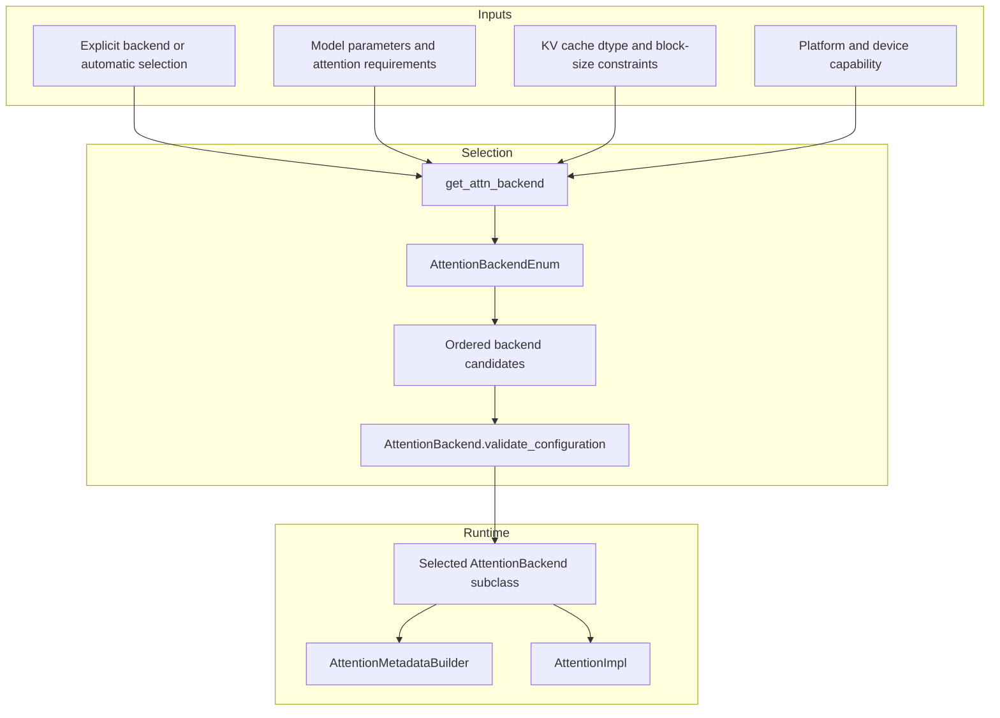
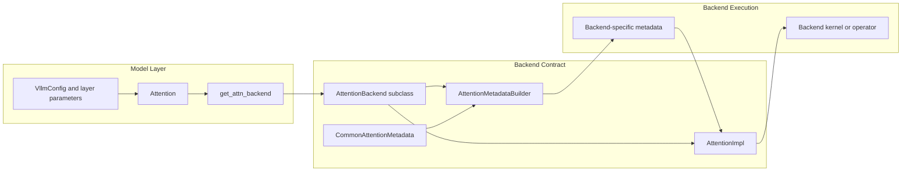
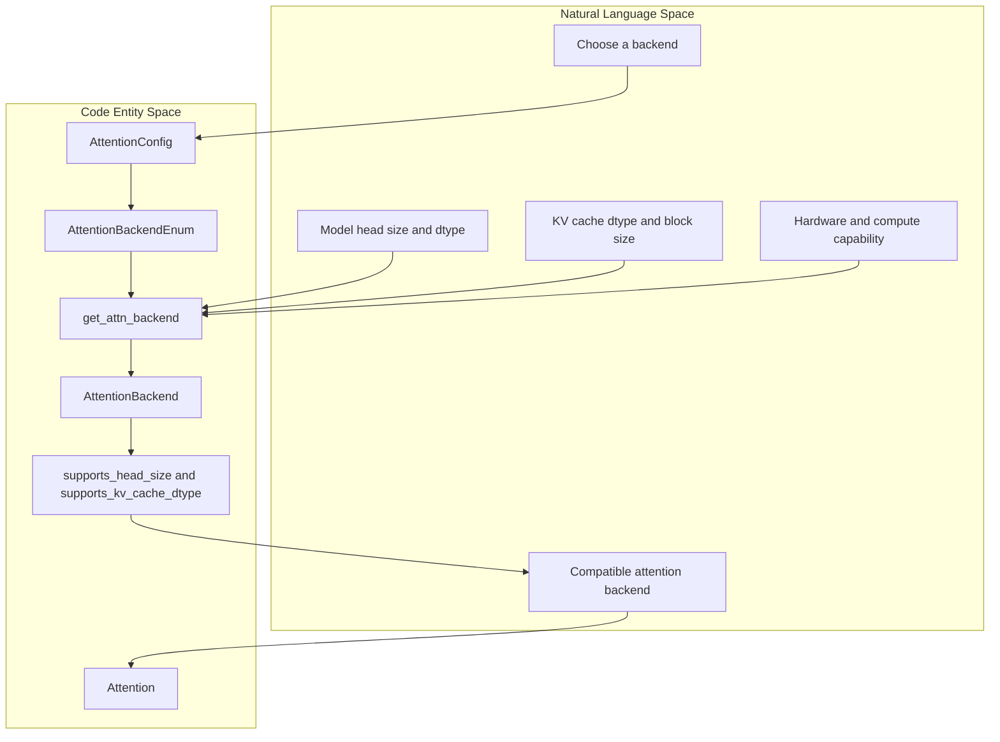
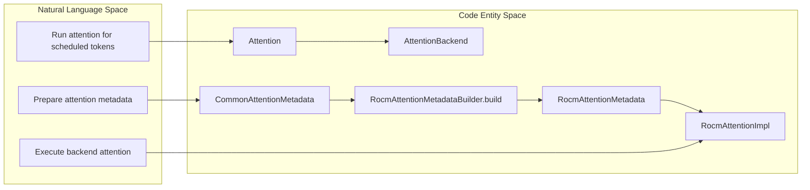

<!-- source: DeepWiki mcp.deepwiki.com · repo vllm-project/vllm · page 8.1 Attention Backend Selection · fetched 2026-10-28 -->

# Attention Backend Selection

Relevant source files

The following files were used as context for generating this wiki page:

- [cmake/external_projects/vllm_flash_attn.cmake](cmake/external_projects/vllm_flash_attn.cmake)
- [docs/design/attention_backends.md](docs/design/attention_backends.md)
- [tests/compile/fullgraph/test_full_cudagraph.py](tests/compile/fullgraph/test_full_cudagraph.py)
- [tests/compile/passes/test_rocm_aiter_qk_norm_rope_kvcache_fusion.py](tests/compile/passes/test_rocm_aiter_qk_norm_rope_kvcache_fusion.py)
- [tests/compile/passes/test_rope_kvcache_fusion.py](tests/compile/passes/test_rope_kvcache_fusion.py)
- [tests/entrypoints/pooling/embed/test_online_long_text.py](tests/entrypoints/pooling/embed/test_online_long_text.py)
- [tests/kernels/attention/test_attention_selector.py](tests/kernels/attention/test_attention_selector.py)
- [tests/kernels/attention/test_flashinfer.py](tests/kernels/attention/test_flashinfer.py)
- [tests/kernels/attention/test_rocm_aiter_fa.py](tests/kernels/attention/test_rocm_aiter_fa.py)
- [tests/kernels/attention/test_rocm_aiter_unified_attn.py](tests/kernels/attention/test_rocm_aiter_unified_attn.py)
- [tests/kernels/attention/test_triton_unified_attention.py](tests/kernels/attention/test_triton_unified_attention.py)
- [tests/kernels/conftest.py](tests/kernels/conftest.py)
- [tests/kernels/test_flex_attention.py](tests/kernels/test_flex_attention.py)
- [tests/models/quantization/test_per_token_kv_cache.py](tests/models/quantization/test_per_token_kv_cache.py)
- [tests/quantization/test_per_token_kv_cache.py](tests/quantization/test_per_token_kv_cache.py)
- [tests/v1/attention/test_attention_backends.py](tests/v1/attention/test_attention_backends.py)
- [tests/v1/attention/test_deepseek_v4_swa_visible.py](tests/v1/attention/test_deepseek_v4_swa_visible.py)
- [tests/v1/attention/test_rocm_attention_backends_selection.py](tests/v1/attention/test_rocm_attention_backends_selection.py)
- [tests/v1/attention/utils.py](tests/v1/attention/utils.py)
- [vllm/compilation/passes/fusion/qk_norm_rope_kvcache_fusion.py](vllm/compilation/passes/fusion/qk_norm_rope_kvcache_fusion.py)
- [vllm/compilation/passes/fusion/rope_kvcache_fusion.py](vllm/compilation/passes/fusion/rope_kvcache_fusion.py)
- [vllm/model_executor/layers/attention/attention.py](vllm/model_executor/layers/attention/attention.py)
- [vllm/model_executor/layers/attention/kv_transfer_utils.py](vllm/model_executor/layers/attention/kv_transfer_utils.py)
- [vllm/model_executor/layers/quantization/kv_cache.py](vllm/model_executor/layers/quantization/kv_cache.py)
- [vllm/model_executor/model_loader/reload/torchao_decorator.py](vllm/model_executor/model_loader/reload/torchao_decorator.py)
- [vllm/model_executor/models/unlimited_ocr.py](vllm/model_executor/models/unlimited_ocr.py)
- [vllm/v1/attention/backend.py](vllm/v1/attention/backend.py)
- [vllm/v1/attention/backends/fa_utils.py](vllm/v1/attention/backends/fa_utils.py)
- [vllm/v1/attention/backends/flash_attn.py](vllm/v1/attention/backends/flash_attn.py)
- [vllm/v1/attention/backends/flashinfer.py](vllm/v1/attention/backends/flashinfer.py)
- [vllm/v1/attention/backends/flex_attention.py](vllm/v1/attention/backends/flex_attention.py)
- [vllm/v1/attention/backends/registry.py](vllm/v1/attention/backends/registry.py)
- [vllm/v1/attention/backends/rocm_aiter_fa.py](vllm/v1/attention/backends/rocm_aiter_fa.py)
- [vllm/v1/attention/backends/rocm_aiter_unified_attn.py](vllm/v1/attention/backends/rocm_aiter_unified_attn.py)
- [vllm/v1/attention/backends/rocm_attn.py](vllm/v1/attention/backends/rocm_attn.py)
- [vllm/v1/attention/backends/triton_attn.py](vllm/v1/attention/backends/triton_attn.py)
- [vllm/v1/attention/backends/utils.py](vllm/v1/attention/backends/utils.py)
- [vllm/v1/attention/ops/triton_attention_helpers.py](vllm/v1/attention/ops/triton_attention_helpers.py)
- [vllm/v1/attention/ops/triton_reshape_and_cache_flash.py](vllm/v1/attention/ops/triton_reshape_and_cache_flash.py)
- [vllm/v1/attention/ops/triton_unified_attention.py](vllm/v1/attention/ops/triton_unified_attention.py)
- [vllm/v1/attention/selector.py](vllm/v1/attention/selector.py)
- [vllm/v1/worker/gpu/spec_decode/gemma4/speculator.py](vllm/v1/worker/gpu/spec_decode/gemma4/speculator.py)
- [vllm/v1/worker/gpu/spec_decode/mtp/speculator.py](vllm/v1/worker/gpu/spec_decode/mtp/speculator.py)
- [vllm/vllm_flash_attn/__init__.py](vllm/vllm_flash_attn/__init__.py)
- [vllm/vllm_flash_attn/flash_attn_interface.py](vllm/vllm_flash_attn/flash_attn_interface.py)

## Purpose and Scope

This page describes how vLLM represents and selects attention backends, how hardware and model properties constrain that choice, and how the `Attention` layer connects model execution to backend implementations. Backend-specific kernel details are out of scope here. [docs/design/attention_backends.md:1-6](), [vllm/model_executor/layers/attention/attention.py:41-47]()

Sources: [docs/design/attention_backends.md:1-6](), [vllm/model_executor/layers/attention/attention.py:41-47]()

---

## Overview and Selection Pipeline

vLLM supports multiple attention implementations. Selection considers the requested backend, the model and cache configuration, and hardware-dependent compatibility. When selection is automatic, candidates are tried in priority order and the first compatible backend is used; when a backend is explicitly requested, it is validated and an incompatibility produces an error. [docs/design/attention_backends.md:108-133]()

The selection policy is not simply “choose the fastest kernel.” A backend must support the relevant configuration, which can include model dtype, head size, compute capability, KV-cache dtype and layout, attention type, and other attention features. The backend interface exposes capability checks for several of these dimensions. [docs/design/attention_backends.md:110-124](), [vllm/v1/attention/backend.py:59-135](), [vllm/v1/attention/backend.py:162-211]()

### Attention Backend Selection Pipeline

The diagram connects the user-visible choice and configuration inputs to the selector, registry, backend compatibility checks, and the backend’s runtime implementation interfaces. The selection behavior and validation outcomes are described in the attention backend design document; `AttentionBackend` defines backend-level capabilities and implementation/builder accessors. [docs/design/attention_backends.md:108-133](), [vllm/v1/attention/backend.py:59-135]()

Sources: [docs/design/attention_backends.md:108-133](), [vllm/v1/attention/backend.py:59-135]()

### How users specify a backend

A backend can be specified through `--attention-backend` or through the structured `--attention-config.backend` setting; these command-line forms are mutually exclusive. In Python, the documented interface accepts an `AttentionConfig` whose `backend` is an `AttentionBackendEnum` member, or an `attention_backend` string argument. [docs/design/attention_backends.md:8-55]()

| Selection mode | Interface | Effect |
|---|---|---|
| Explicit command-line choice | `--attention-backend` or `--attention-config.backend` | Requests a named backend, which is checked against the active configuration. [docs/design/attention_backends.md:8-33]() |
| Explicit Python choice | `AttentionConfig(backend=...)` or `attention_backend=...` | Passes a backend choice through the Python API. [docs/design/attention_backends.md:35-55]() |
| Automatic | No backend specified | Tries candidates in priority order and selects the first compatible backend. [docs/design/attention_backends.md:125-133]() |

Sources: [docs/design/attention_backends.md:8-55](), [docs/design/attention_backends.md:125-133]()

---

## The `AttentionBackendEnum` Registry

`AttentionBackendEnum` is the named registry used by the documented Python configuration interface. Its members identify selectable backends—for example, `FLASH_ATTN`—and backend selection documentation uses the registry as the source for generated priority and feature-support tables. The registry’s detailed member definitions and loading mechanics are in `vllm/v1/attention/backends/registry.py`; those implementation details are not included in the supplied file excerpts. [docs/design/attention_backends.md:1-6](), [docs/design/attention_backends.md:35-55]()

The registry name is distinct from the backend class interface. `AttentionBackend` defines the class-level contract that a concrete backend supplies: a name, an implementation class, a metadata-builder class, and capability declarations. [vllm/v1/attention/backend.py:59-95]()

| Entity | Role |
|---|---|
| `AttentionBackendEnum` | Names selectable backends in configuration and in the registry from which documentation priority and feature tables are generated. [docs/design/attention_backends.md:1-6](), [docs/design/attention_backends.md:35-55]() |
| `AttentionBackend` | Abstract backend contract, including `get_name()`, `get_impl_cls()`, `get_builder_cls()`, and default capability checks. [vllm/v1/attention/backend.py:59-95](), [vllm/v1/attention/backend.py:98-135]() |
| `AttentionImpl` | Backend-specific implementation interface used by the layer to perform attention. [vllm/v1/attention/backend.py:79-91]() |
| `AttentionMetadataBuilder` | Backend-specific metadata construction interface associated with a backend. [vllm/v1/attention/backend.py:79-91]() |

Sources: [docs/design/attention_backends.md:1-6](), [docs/design/attention_backends.md:35-55](), [vllm/v1/attention/backend.py:59-135]()

---

## Per-Kind Backend Selection Logic

Attention requirements differ by kind. The backend base interface defines `AttentionType` values for decoder, encoder, encoder-only, and encoder-decoder attention. Backend compatibility can therefore depend on the attention type in addition to kernel and cache properties. [vllm/v1/attention/backend.py:36-48]()

Backend selection also has specialized paths for attention families and configurations. The design documentation distinguishes standard attention from MLA and documents separate priority tables for those families; it also calls out sparse MLA behavior and platform-specific selection logic. [docs/design/attention_backends.md:135-152]()

### Configuration dimensions

| Dimension | Backend interface or documented selection relevance |
|---|---|
| Model dtype | Backends declare `supported_dtypes` and expose `supports_dtype()`. Explicit selection is validated against model dtype. [vllm/v1/attention/backend.py:59-67](), [vllm/v1/attention/backend.py:106-108](), [docs/design/attention_backends.md:110-115]() |
| KV-cache dtype | Backends declare `supported_kv_cache_dtypes` and expose `supports_kv_cache_dtype()`. [vllm/v1/attention/backend.py:62-67](), [vllm/v1/attention/backend.py:110-116]() |
| Head size | `supports_head_size()` checks a backend’s supported head-size set; the design documentation identifies head size as a selection/validation property. [vllm/v1/attention/backend.py:98-104](), [docs/design/attention_backends.md:110-115]() |
| KV-cache block size | `supports_block_size()` checks the backend’s supported kernel block sizes, including `MultipleOf` constraints. [vllm/v1/attention/backend.py:72-76](), [vllm/v1/attention/backend.py:118-135]() |
| Attention type | `AttentionType` distinguishes decoder, encoder, encoder-only, and encoder-decoder attention. [vllm/v1/attention/backend.py:36-48]() |
| Optional features | Backend capability methods cover features such as sinks, multimodal prefixes, sparse attention, sliding windows, non-causal attention, and batch invariance. [vllm/v1/attention/backend.py:162-211]() |
| Hardware capability | The design documentation includes compute capability in explicit-backend validation and notes that ROCm and CPU use platform-specific selection logic. [docs/design/attention_backends.md:110-115](), [docs/design/attention_backends.md:146-152]() |

Sources: [vllm/v1/attention/backend.py:36-48](), [vllm/v1/attention/backend.py:59-135](), [vllm/v1/attention/backend.py:162-211](), [docs/design/attention_backends.md:110-115](), [docs/design/attention_backends.md:135-152]()

### Selection outcomes

For an explicit backend, vLLM validates the choice against the active configuration. If it is unsupported, selection raises an error with the incompatibility reason; otherwise, the requested backend is used. For automatic selection, vLLM walks backends in priority order, validates each one, and selects the first compatible candidate. If none are compatible, it reports the candidates and their incompatibility reasons. [docs/design/attention_backends.md:108-133]()

The priority order can vary with platform and attention family. The documented CUDA priorities are separated into standard attention and MLA, while ROCm and CPU have their own selection logic. [docs/design/attention_backends.md:135-152]()

### Examples of specialized selection

- On Hopper, `TRITON_FLASH_ATTN` is documented as preferred for compatible multimodal-prefix configurations. The composite routes bidirectional image attention to Triton and causal text prefill and decode to FlashAttention, subject to the documented causal-child constraints. [docs/design/attention_backends.md:59-69]()
- On Blackwell, `TRITON_FLASHINFER` is documented as preferred for compatible multimodal-prefix configurations. It routes batches requiring bidirectional image attention to Triton and causal text prefill and decode to FlashInfer. [docs/design/attention_backends.md:76-89]()
- Sparse MLA priorities vary with KV-cache dtype and hardware/query-head conditions, as described in the design document. [docs/design/attention_backends.md:146-152]()

Sources: [docs/design/attention_backends.md:59-69](), [docs/design/attention_backends.md:76-89](), [docs/design/attention_backends.md:135-152]()

---

## Attention Layer Abstraction (`Attention` and `AttentionImpl`)

The model-side `Attention` layer is the point where the runtime attention backend is obtained and integrated with the layer’s configuration. The module imports `get_attn_backend`, `AttentionBackendEnum`, `AttentionType`, and the backend interface, showing the connection between the model-layer abstraction and V1 backend selection. [vllm/model_executor/layers/attention/attention.py:41-52]()

The backend contract separates three responsibilities: the backend class identifies and exposes the implementation and metadata builder; the builder prepares backend-specific metadata; and the implementation performs backend-specific attention work. The abstract backend declares `get_name()`, `get_impl_cls()`, and `get_builder_cls()` as required accessors. [vllm/v1/attention/backend.py:59-95]()

### Data Flow and Key Components

`Attention` imports and uses the selector and backend types, while backend classes provide builder and implementation classes through the abstract contract. `CommonAttentionMetadata` is the shared input type used by backend metadata builders; for example, `RocmAttentionMetadataBuilder.build()` copies common token counts, sequence lengths, block-table data, and slot mapping into `RocmAttentionMetadata`. [vllm/model_executor/layers/attention/attention.py:41-52](), [vllm/v1/attention/backend.py:79-95](), [vllm/v1/attention/backends/rocm_attn.py:73-134]()

Sources: [vllm/model_executor/layers/attention/attention.py:41-52](), [vllm/v1/attention/backend.py:79-95](), [vllm/v1/attention/backends/rocm_attn.py:73-134]()

### Responsibilities

- **`Attention`**: Model-layer abstraction that imports the backend selector and V1 backend types, connecting layer configuration to backend selection. [vllm/model_executor/layers/attention/attention.py:41-52]()
- **`AttentionBackend`**: Abstract backend contract. It supplies default support declarations and requires backend name, implementation class, and metadata-builder class accessors. [vllm/v1/attention/backend.py:59-95]()
- **`AttentionMetadataBuilder`**: Backend-associated metadata builder. Concrete builders consume `CommonAttentionMetadata` and construct metadata for their backend. [vllm/v1/attention/backend.py:79-91](), [vllm/v1/attention/backends/rocm_attn.py:73-134]()
- **`CommonAttentionMetadata`**: Shared metadata supplied to builders. The ROCm builder example reads token counts, query offsets, sequence lengths, block table, and slot mapping from it. [vllm/v1/attention/backends/rocm_attn.py:109-134]()
- **`AttentionImpl`**: Backend-specific implementation class exposed by the backend contract. [vllm/v1/attention/backend.py:83-91]()

Sources: [vllm/model_executor/layers/attention/attention.py:41-52](), [vllm/v1/attention/backend.py:59-95](), [vllm/v1/attention/backends/rocm_attn.py:73-134]()

### Validation Hooks

`AttentionBackend` provides capability hooks that a backend can override. The defaults and checks include supported model dtypes, KV-cache dtypes, head sizes, block sizes, and feature flags. The backend design documentation states that explicit selection validates the requested backend against the configuration before using it. [vllm/v1/attention/backend.py:59-135](), [vllm/v1/attention/backend.py:162-211](), [docs/design/attention_backends.md:108-124]()

For block sizes, `supports_block_size()` accepts a block size if it is divisible by a supported fixed size or `MultipleOf` base. `get_preferred_block_size()` keeps the default when supported, otherwise chooses the smallest declared supported size. [vllm/v1/attention/backend.py:118-160]()

Sources: [vllm/v1/attention/backend.py:59-135](), [vllm/v1/attention/backend.py:162-211](), [docs/design/attention_backends.md:108-124]()

---

## Platform-Specific Backend Selection and Priority Resolution

The backend priority documentation describes ordered CUDA candidate lists for standard attention and MLA. It also states that ROCm and CPU use their own selection logic, so CUDA ordering should not be treated as a universal cross-platform policy. [docs/design/attention_backends.md:135-152]()

Backend implementations can encode platform-specific constraints through their capability declarations. For example, `RocmAttentionBackend` supports a declared set of dtypes and KV-cache dtypes, and advertises block sizes that are multiples of 16. `RocmAiterUnifiedAttentionBackend` specializes those declarations, including its own block-size, head-size, cache-layout, attention-type, and feature support. [vllm/v1/attention/backends/rocm_attn.py:137-172](), [vllm/v1/attention/backends/rocm_aiter_unified_attn.py:61-150]()

| Platform or family | Selection notes |
|---|---|
| CUDA | The design documentation provides separate priority tables for standard attention and MLA. It describes `TRITON_FLASH_ATTN` on Hopper and `TRITON_FLASHINFER` on Blackwell for compatible multimodal-prefix cases. [docs/design/attention_backends.md:59-99](), [docs/design/attention_backends.md:135-150]() |
| ROCm | The design documentation identifies ROCm selection as platform-specific. ROCm backend classes declare their supported dtypes, block-size constraints, and feature support. [docs/design/attention_backends.md:146-152](), [vllm/v1/attention/backends/rocm_attn.py:137-184](), [vllm/v1/attention/backends/rocm_aiter_unified_attn.py:61-150]() |
| CPU | The design documentation identifies CPU as having its own selection logic; details are outside the supplied implementation excerpts. [docs/design/attention_backends.md:146-152]() |

When a user explicitly selects a backend, platform and model compatibility are still validated; explicit selection does not bypass the compatibility checks. [docs/design/attention_backends.md:108-124]()

Sources: [docs/design/attention_backends.md:59-99](), [docs/design/attention_backends.md:108-124](), [docs/design/attention_backends.md:135-152](), [vllm/v1/attention/backends/rocm_attn.py:137-184](), [vllm/v1/attention/backends/rocm_aiter_unified_attn.py:61-150]()

---

## Selection: Natural-Language Concepts to Code Entities

This diagram maps the concepts an operator or developer reasons about—backend choice, hardware, model shape, and cache format—to the named code entities involved. The selector and registry paths are identified by the supplied documentation and imports; backend validation and layer integration are visible in the provided source excerpts. [docs/design/attention_backends.md:8-55](), [vllm/model_executor/layers/attention/attention.py:41-52](), [vllm/v1/attention/backend.py:59-135]()

Sources: [docs/design/attention_backends.md:8-55](), [vllm/model_executor/layers/attention/attention.py:41-52](), [vllm/v1/attention/backend.py:59-135]()

---

## Runtime: Natural-Language Concepts to Code Entities

This diagram maps the runtime path from “prepare attention metadata and execute attention” to the backend contract and a concrete builder/metadata example. The ROCm example shows how common metadata is transformed into backend-specific metadata. [vllm/v1/attention/backend.py:79-95](), [vllm/v1/attention/backends/rocm_attn.py:73-134]()

Sources: [vllm/v1/attention/backend.py:79-95](), [vllm/v1/attention/backends/rocm_attn.py:73-134]()

---

## Summary

Backend selection combines a named registry, ordered candidates, and compatibility validation. Explicit selection requests a backend and validates it; automatic selection tries candidates in priority order. Backend classes expose capability checks and provide implementation and metadata-builder classes, while the model-side `Attention` layer connects selection to runtime execution. [docs/design/attention_backends.md:108-133](), [vllm/v1/attention/backend.py:59-135](), [vllm/model_executor/layers/attention/attention.py:41-52]()

Sources: [docs/design/attention_backends.md:108-133](), [vllm/v1/attention/backend.py:59-135](), [vllm/model_executor/layers/attention/attention.py:41-52]()

---

