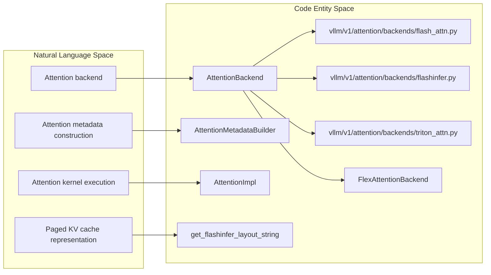
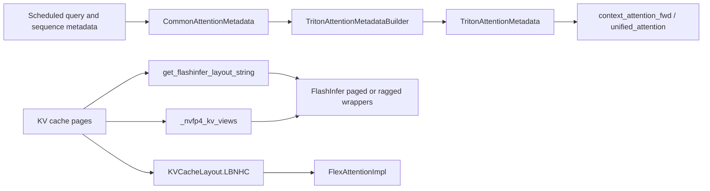
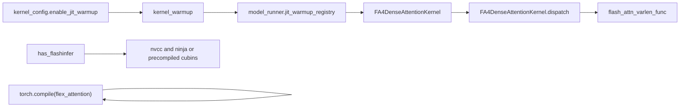

<!-- source: DeepWiki mcp.deepwiki.com · repo vllm-project/vllm · page 8.2 FlashAttention, FlashInfer and FlexAttention · fetched 2026-10-28 -->

# FlashAttention, FlashInfer and FlexAttention

Relevant source files

The following files were used as context for generating this wiki page:

- [cmake/external_projects/vllm_flash_attn.cmake](cmake/external_projects/vllm_flash_attn.cmake)
- [csrc/nvfp4_kv_cache_kernels.cu](csrc/nvfp4_kv_cache_kernels.cu)
- [tests/compile/correctness_e2e/test_attn_quant.py](tests/compile/correctness_e2e/test_attn_quant.py)
- [tests/compile/fullgraph/test_full_cudagraph.py](tests/compile/fullgraph/test_full_cudagraph.py)
- [tests/distributed/test_eplb_quant_scale_consistency.py](tests/distributed/test_eplb_quant_scale_consistency.py)
- [tests/entrypoints/pooling/embed/test_online_long_text.py](tests/entrypoints/pooling/embed/test_online_long_text.py)
- [tests/kernels/attention/test_attention_selector.py](tests/kernels/attention/test_attention_selector.py)
- [tests/kernels/attention/test_cache.py](tests/kernels/attention/test_cache.py)
- [tests/kernels/attention/test_flashinfer.py](tests/kernels/attention/test_flashinfer.py)
- [tests/kernels/attention/test_flashinfer_trtllm_attention.py](tests/kernels/attention/test_flashinfer_trtllm_attention.py)
- [tests/kernels/attention/test_triton_unified_attention.py](tests/kernels/attention/test_triton_unified_attention.py)
- [tests/kernels/attention/test_use_trtllm_attention.py](tests/kernels/attention/test_use_trtllm_attention.py)
- [tests/kernels/conftest.py](tests/kernels/conftest.py)
- [tests/kernels/moe/test_cutedsl_moe.py](tests/kernels/moe/test_cutedsl_moe.py)
- [tests/kernels/moe/test_flashinfer.py](tests/kernels/moe/test_flashinfer.py)
- [tests/kernels/moe/test_flashinfer_cutedsl_nvfp4_moe.py](tests/kernels/moe/test_flashinfer_cutedsl_nvfp4_moe.py)
- [tests/kernels/quantization/nvfp4_utils.py](tests/kernels/quantization/nvfp4_utils.py)
- [tests/kernels/test_flex_attention.py](tests/kernels/test_flex_attention.py)
- [tests/model_executor/test_flashinfer_autotune_warmup.py](tests/model_executor/test_flashinfer_autotune_warmup.py)
- [tests/models/quantization/test_per_token_kv_cache.py](tests/models/quantization/test_per_token_kv_cache.py)
- [tests/quantization/test_per_token_kv_cache.py](tests/quantization/test_per_token_kv_cache.py)
- [tests/quantization/test_trtllm_nvfp4_hidden_dim_padding.py](tests/quantization/test_trtllm_nvfp4_hidden_dim_padding.py)
- [tests/v1/attention/test_attention_backends.py](tests/v1/attention/test_attention_backends.py)
- [tests/v1/attention/test_deepseek_v4_swa_visible.py](tests/v1/attention/test_deepseek_v4_swa_visible.py)
- [tests/v1/attention/test_flashinfer_dcp_spec_reorder.py](tests/v1/attention/test_flashinfer_dcp_spec_reorder.py)
- [tests/v1/attention/test_trtllm_attention_integration.py](tests/v1/attention/test_trtllm_attention_integration.py)
- [tests/v1/attention/utils.py](tests/v1/attention/utils.py)
- [tests/v1/spec_decode/test_eagle_step_kernel.py](tests/v1/spec_decode/test_eagle_step_kernel.py)
- [tests/v1/spec_decode/test_max_len.py](tests/v1/spec_decode/test_max_len.py)
- [tests/v1/worker/test_eagle3_aux_hidden_states_pp.py](tests/v1/worker/test_eagle3_aux_hidden_states_pp.py)
- [tests/v1/worker/test_gpu_extract_hidden_states_speculator.py](tests/v1/worker/test_gpu_extract_hidden_states_speculator.py)
- [vllm/model_executor/layers/attention/attention.py](vllm/model_executor/layers/attention/attention.py)
- [vllm/model_executor/layers/fused_moe/eep_reconfigure.py](vllm/model_executor/layers/fused_moe/eep_reconfigure.py)
- [vllm/model_executor/layers/fused_moe/experts/flashinfer_cutedsl_batched_moe.py](vllm/model_executor/layers/fused_moe/experts/flashinfer_cutedsl_batched_moe.py)
- [vllm/model_executor/layers/fused_moe/experts/flashinfer_cutedsl_moe.py](vllm/model_executor/layers/fused_moe/experts/flashinfer_cutedsl_moe.py)
- [vllm/model_executor/layers/fused_moe/fused_moe_modular_method.py](vllm/model_executor/layers/fused_moe/fused_moe_modular_method.py)
- [vllm/model_executor/layers/fused_moe/prepare_finalize/nixl_ep.py](vllm/model_executor/layers/fused_moe/prepare_finalize/nixl_ep.py)
- [vllm/model_executor/layers/quantization/kv_cache.py](vllm/model_executor/layers/quantization/kv_cache.py)
- [vllm/model_executor/layers/quantization/utils/flashinfer_fp4_moe.py](vllm/model_executor/layers/quantization/utils/flashinfer_fp4_moe.py)
- [vllm/model_executor/layers/quantization/utils/flashinfer_utils.py](vllm/model_executor/layers/quantization/utils/flashinfer_utils.py)
- [vllm/model_executor/model_loader/reload/torchao_decorator.py](vllm/model_executor/model_loader/reload/torchao_decorator.py)
- [vllm/model_executor/models/unlimited_ocr.py](vllm/model_executor/models/unlimited_ocr.py)
- [vllm/model_executor/warmup/flashinfer_autotune_cache.py](vllm/model_executor/warmup/flashinfer_autotune_cache.py)
- [vllm/model_executor/warmup/flashinfer_sparse_mla_warmup.py](vllm/model_executor/warmup/flashinfer_sparse_mla_warmup.py)
- [vllm/model_executor/warmup/kernel_warmup.py](vllm/model_executor/warmup/kernel_warmup.py)
- [vllm/utils/flashinfer.py](vllm/utils/flashinfer.py)
- [vllm/v1/attention/backend.py](vllm/v1/attention/backend.py)
- [vllm/v1/attention/backends/fa_utils.py](vllm/v1/attention/backends/fa_utils.py)
- [vllm/v1/attention/backends/flash_attn.py](vllm/v1/attention/backends/flash_attn.py)
- [vllm/v1/attention/backends/flashinfer.py](vllm/v1/attention/backends/flashinfer.py)
- [vllm/v1/attention/backends/flex_attention.py](vllm/v1/attention/backends/flex_attention.py)
- [vllm/v1/attention/backends/triton_attn.py](vllm/v1/attention/backends/triton_attn.py)
- [vllm/v1/attention/backends/utils.py](vllm/v1/attention/backends/utils.py)
- [vllm/v1/attention/ops/triton_attention_helpers.py](vllm/v1/attention/ops/triton_attention_helpers.py)
- [vllm/v1/attention/ops/triton_reshape_and_cache_flash.py](vllm/v1/attention/ops/triton_reshape_and_cache_flash.py)
- [vllm/v1/attention/ops/triton_unified_attention.py](vllm/v1/attention/ops/triton_unified_attention.py)
- [vllm/v1/attention/selector.py](vllm/v1/attention/selector.py)
- [vllm/v1/worker/gpu/spec_decode/__init__.py](vllm/v1/worker/gpu/spec_decode/__init__.py)
- [vllm/v1/worker/gpu/spec_decode/eagle/eagle3_utils.py](vllm/v1/worker/gpu/spec_decode/eagle/eagle3_utils.py)
- [vllm/v1/worker/gpu/spec_decode/gemma4/speculator.py](vllm/v1/worker/gpu/spec_decode/gemma4/speculator.py)
- [vllm/v1/worker/gpu/spec_decode/mtp/speculator.py](vllm/v1/worker/gpu/spec_decode/mtp/speculator.py)
- [vllm/vllm_flash_attn/__init__.py](vllm/vllm_flash_attn/__init__.py)
- [vllm/vllm_flash_attn/flash_attn_interface.py](vllm/vllm_flash_attn/flash_attn_interface.py)

## Purpose and Scope

This page describes the FlashAttention, FlashInfer, Triton Attention, and FlexAttention implementations in vLLM. It focuses on their backend interfaces, metadata and KV-cache handling, kernel dispatch and compilation, and configuration points visible in the supplied code. It does not cover backend selection policy or specialized MLA implementations.

Sources: [vllm/v1/attention/backend.py:59-86](), [vllm/v1/attention/backends/flash_attn.py:1-54](), [vllm/v1/attention/backends/flashinfer.py:1-53](), [vllm/v1/attention/backends/flex_attention.py:1-58](), [vllm/v1/attention/backends/triton_attn.py:1-50]()

---

## Backend Comparison

| Backend | Code entities and role | Notable interface or constraint |
|---|---|---|
| FlashAttention | `vllm/v1/attention/backends/flash_attn.py` contains the backend implementation and `FA4DenseAttentionKernel`, a `VllmJitKernel` specialization that dispatches to `flash_attn_varlen_func` [vllm/v1/attention/backends/flash_attn.py:47-54](), [vllm/v1/attention/backends/flash_attn.py:97-143](). | FA4 warmup keys are conditional on device capability, cache specification, dtype, head size, page size, and attention parameters [vllm/v1/attention/backends/flash_attn.py:145-204](). |
| FlashInfer | `vllm/v1/attention/backends/flashinfer.py` imports FlashInfer paged and ragged prefill/decode wrappers, and contains the backend implementation [vllm/v1/attention/backends/flashinfer.py:10-23](). | Uses a vLLM compatibility layer for FlashInfer capability checks and TRT-LLM attention selection [vllm/v1/attention/backends/flashinfer.py:46-53](). |
| Triton Attention | `vllm/v1/attention/backends/triton_attn.py` imports Triton prefill attention, KV-cache reshape operations, and unified attention [vllm/v1/attention/backends/triton_attn.py:33-50](). | Its metadata builder configures decode scheduling fields, including a threshold influenced by CUDA Graph capture sizes [vllm/v1/attention/backends/triton_attn.py:95-149](). |
| FlexAttention | `FlexAttentionBackend` declares backend capabilities; `FlexAttentionImpl` and `FlexAttentionMetadataBuilder` are its implementation and metadata-builder classes [vllm/v1/attention/backends/flex_attention.py:90-147](). | Supports decoder and encoder-only attention, sliding-window attention, non-causal attention, batch invariance, and `LBNHC` cache layout [vllm/v1/attention/backends/flex_attention.py:108-154](). |

The abstract `AttentionBackend` interface supplies capability checks for such properties as dtype, KV-cache dtype, block size, and head size; concrete backends provide their name, implementation class, and metadata-builder class [vllm/v1/attention/backend.py:59-135]().

Sources: [vllm/v1/attention/backend.py:59-135](), [vllm/v1/attention/backends/flash_attn.py:47-54](), [vllm/v1/attention/backends/flash_attn.py:97-204](), [vllm/v1/attention/backends/flashinfer.py:10-23](), [vllm/v1/attention/backends/flashinfer.py:46-53](), [vllm/v1/attention/backends/triton_attn.py:33-50](), [vllm/v1/attention/backends/triton_attn.py:95-149](), [vllm/v1/attention/backends/flex_attention.py:90-154]()

---

## Class Architecture and Code Entity Mapping

The `AttentionBackend` contract separates backend capabilities from backend-specific implementation and metadata construction. The attention layer obtains a backend through `get_attn_backend`; the supplied code shows that lookup imported by `attention.py`, while the backend interface defines the implementation and builder hooks [vllm/model_executor/layers/attention/attention.py:41-47](), [vllm/v1/attention/backend.py:59-91]().

**Diagram: Backend concepts mapped to implementation entities**

Sources: [vllm/v1/attention/backend.py:59-91](), [vllm/v1/attention/backends/flash_attn.py:20-25](), [vllm/v1/attention/backends/flashinfer.py:64-73](), [vllm/v1/attention/backends/triton_attn.py:23-32](), [vllm/v1/attention/backends/flex_attention.py:90-147](), [vllm/v1/attention/backends/utils.py:176-191]()

### Attention Layer and Backend Contract

`AttentionBackend` is an abstract base class. A backend identifies itself with `get_name`, provides an implementation type with `get_impl_cls`, and provides a metadata-builder type with `get_builder_cls` [vllm/v1/attention/backend.py:59-91](). Capability methods provide common predicates for supported dtypes, cache dtypes, head sizes, and kernel block sizes [vllm/v1/attention/backend.py:62-135]().

`Attention` imports `get_attn_backend` and the `AttentionBackendEnum` registry, linking the model-executor attention layer to backend lookup [vllm/model_executor/layers/attention/attention.py:41-47](). The supplied excerpt does not include the selector’s selection rules, so this page does not prescribe which backend is chosen for a given model or device.

Sources: [vllm/v1/attention/backend.py:59-135](), [vllm/model_executor/layers/attention/attention.py:41-47]()

### Metadata, Cache Layout, and Execution Flow

The backend implementations consume common attention metadata and backend-specific metadata. In Triton, `TritonAttentionMetadata` includes token counts, query offsets, sequence lengths, block tables, slot mappings, and parallel-softmax scratch tensors [vllm/v1/attention/backends/triton_attn.py:61-92](). Its builder derives head counts, head dimension, block size, CUDA Graph decode settings, and a 2D-versus-3D sequence threshold from the KV-cache specification and configuration [vllm/v1/attention/backends/triton_attn.py:95-149]().

FlashInfer’s layout utility maps vLLM KV-cache layout names to FlashInfer’s `NHD` or `HND` convention [vllm/v1/attention/backends/utils.py:176-191](). For NVFP4 KV pages, `_nvfp4_kv_views` validates dense strides and exposes separate K/V data and scale views, returning the detected `HND` or `NHD` layout [vllm/v1/attention/backends/flashinfer.py:117-137]().

FlexAttention requires `KVCacheLayout.LBNHC`, because it flattens block and token axes into a token dimension for a zero-copy layer-cache view [vllm/v1/attention/backends/flex_attention.py:129-134](). Its `forward_includes_kv_cache_update` flag is false, unlike the base backend default of true [vllm/v1/attention/backends/flex_attention.py:102-103](), [vllm/v1/attention/backend.py:69-70]().

**Diagram: Metadata and cache flow to backend-specific execution**

Sources: [vllm/v1/attention/backends/triton_attn.py:61-92](), [vllm/v1/attention/backends/triton_attn.py:95-149](), [vllm/v1/attention/backends/triton_attn.py:33-45](), [vllm/v1/attention/backends/utils.py:176-191](), [vllm/v1/attention/backends/flashinfer.py:10-23](), [vllm/v1/attention/backends/flashinfer.py:117-137](), [vllm/v1/attention/backends/flex_attention.py:102-134]()

Sources: [vllm/v1/attention/backend.py:59-135](), [vllm/v1/attention/backends/triton_attn.py:61-149](), [vllm/v1/attention/backends/utils.py:176-191](), [vllm/v1/attention/backends/flashinfer.py:10-23](), [vllm/v1/attention/backends/flashinfer.py:117-137](), [vllm/v1/attention/backends/flex_attention.py:102-134]()

---

## FlexAttention and Triton Attention Backends

### FlexAttention Architecture

`FlexAttentionBackend` wraps PyTorch’s `torch.nn.attention.flex_attention` API. The module imports `create_block_mask`, `flex_attention`, and mask-composition helpers, and defines compiled versions of block-mask construction and attention [vllm/v1/attention/backends/flex_attention.py:14-23](), [vllm/v1/attention/backends/flex_attention.py:54-58]().

The backend declares support for float16, bfloat16, and float32 query dtypes, and for `auto`, float16, and bfloat16 KV-cache dtypes [vllm/v1/attention/backends/flex_attention.py:90-100](). It supports RSWA, sliding windows, non-causal decoder attention, decoder and encoder-only attention types, batch invariance, and multimodal prefix ranges [vllm/v1/attention/backends/flex_attention.py:108-138](). Its kernel block size requirement is `MultipleOf(16)` [vllm/v1/attention/backends/flex_attention.py:148-154]().

`physical_to_logical_mapping` constructs an inverse mapping from physical cache blocks to logical block indices. Its documented behavior handles unmapped blocks and duplicate mappings, and protects against unused block-table entries containing garbage values [vllm/v1/attention/backends/flex_attention.py:157-207]().

Sources: [vllm/v1/attention/backends/flex_attention.py:14-23](), [vllm/v1/attention/backends/flex_attention.py:54-58](), [vllm/v1/attention/backends/flex_attention.py:90-154](), [vllm/v1/attention/backends/flex_attention.py:157-207]()

### Triton Attention Architecture

The Triton backend connects attention operations to `context_attention_fwd`, `triton_reshape_and_cache_flash`, and `unified_attention` [vllm/v1/attention/backends/triton_attn.py:33-50](). `TritonAttentionMetadata` records batch and sequence information, cache addressing, causal state, optional scheduler metadata, multimodal-prefix ranges, and RSWA fields [vllm/v1/attention/backends/triton_attn.py:61-92]().

`TritonAttentionMetadataBuilder` declares CUDA Graph support as always available and supports draft-decode metadata updates [vllm/v1/attention/backends/triton_attn.py:95-99](). It computes a 3D-kernel sequence threshold from the KV-head count and minimum 2D launch-grid size; when decode CUDA Graphs are enabled, it adjusts the threshold to a configured capture size [vllm/v1/attention/backends/triton_attn.py:129-149](). The builder also configures parallel-softmax segmentation and handles speculative query-length bounds in the shown initialization [vllm/v1/attention/backends/triton_attn.py:150-174]().

Sources: [vllm/v1/attention/backends/triton_attn.py:33-50](), [vllm/v1/attention/backends/triton_attn.py:61-99](), [vllm/v1/attention/backends/triton_attn.py:129-174]()

---

## FlashAttention and FlashInfer Backends

### FlashAttention

The FlashAttention backend conditionally imports the variable-length FlashAttention interface and associated helpers when that function is available [vllm/v1/attention/backends/flash_attn.py:47-54](). `FA4DenseAttentionKernel` is a `VllmJitKernel` specialization whose kernel invokes `flash_attn_varlen_func` [vllm/v1/attention/backends/flash_attn.py:97-117]().

Its compile key captures query stage, dtype, query-to-KV head ratio, head dimension, page size, window presence, softcap, batch mode, and split count [vllm/v1/attention/backends/flash_attn.py:100-143](). `get_warmup_keys` returns no keys for configurations outside its supported warmup conditions; for supported cases it traces dispatch over selected query stages, batch modes, and split counts [vllm/v1/attention/backends/flash_attn.py:145-204]().

The CMake integration fetches the `vllm-flash-attn` source, either from `VLLM_FLASH_ATTN_SRC_DIR` or from the configured Git repository and revision. It installs the package under `vllm/vllm_flash_attn` and has a separate FA4 CuteDSL component [cmake/external_projects/vllm_flash_attn.cmake:12-47](), [cmake/external_projects/vllm_flash_attn.cmake:49-81](), [cmake/external_projects/vllm_flash_attn.cmake:83-116]().

Sources: [vllm/v1/attention/backends/flash_attn.py:47-54](), [vllm/v1/attention/backends/flash_attn.py:97-204](), [cmake/external_projects/vllm_flash_attn.cmake:12-47](), [cmake/external_projects/vllm_flash_attn.cmake:49-81](), [cmake/external_projects/vllm_flash_attn.cmake:83-116]()

### FlashInfer

The FlashInfer backend imports paged and ragged prefill wrappers, paged decode wrappers, attention-sink support, sequence-length helpers, and NVFP4 cache-append support [vllm/v1/attention/backends/flashinfer.py:10-23](). It also imports TRT-LLM decode and context-attention entry points [vllm/v1/attention/backends/flashinfer.py:20-21]().

The backend imports vLLM helpers such as `can_use_trtllm_attention`, `supports_trtllm_attention`, and `use_trtllm_attention` through `vllm.utils.flashinfer` [vllm/v1/attention/backends/flashinfer.py:46-53](). That utility module is the documented compatibility wrapper for FlashInfer APIs [vllm/utils/flashinfer.py:1-6](). Its `has_flashinfer` check avoids importing FlashInfer just to test package availability, and reports FlashInfer unavailable when neither precompiled cubins nor the required `nvcc` and `ninja` tools are present [vllm/utils/flashinfer.py:87-106]().

FlashInfer’s TRT-LLM workspace is created lazily as a CUDA `uint8` tensor using `VLLM_FLASHINFER_WORKSPACE_BUFFER_SIZE` [vllm/v1/attention/backends/flashinfer.py:140-146](). The helper `get_flashinfer_layout_string` translates supported vLLM cache layouts into the FlashInfer `NHD` or `HND` naming convention [vllm/v1/attention/backends/utils.py:176-191]().

Sources: [vllm/v1/attention/backends/flashinfer.py:10-23](), [vllm/v1/attention/backends/flashinfer.py:46-53](), [vllm/v1/attention/backends/flashinfer.py:140-146](), [vllm/v1/attention/backends/utils.py:176-191](), [vllm/utils/flashinfer.py:1-6](), [vllm/utils/flashinfer.py:87-106]()

---

## JIT Compilation and Kernel Warmup

The warmup subsystem exists to keep JIT compilation from occurring during model execution. `kernel_warmup` checks `worker.vllm_config.kernel_config.enable_jit_warmup`; when enabled, it invokes the model runner’s `jit_warmup_registry.warmup()` and logs and re-raises failures [vllm/model_executor/warmup/kernel_warmup.py:3-6](), [vllm/model_executor/warmup/kernel_warmup.py:164-193]().

**Diagram: Warmup and compilation entities**

`FA4DenseAttentionKernel.dispatch` builds compile keys from its runtime specialization arguments, and the warmup-key method enumerates eligible keys based on the model and cache configuration [vllm/v1/attention/backends/flash_attn.py:118-143](), [vllm/v1/attention/backends/flash_attn.py:145-204](). FlexAttention creates `torch.compile` wrappers for block-mask construction and attention at module initialization [vllm/v1/attention/backends/flex_attention.py:54-58](). FlashInfer availability checks account for either precompiled cubins or the local JIT toolchain [vllm/utils/flashinfer.py:87-106]().

Sources: [vllm/model_executor/warmup/kernel_warmup.py:3-6](), [vllm/model_executor/warmup/kernel_warmup.py:164-193](), [vllm/v1/attention/backends/flash_attn.py:118-204](), [vllm/v1/attention/backends/flex_attention.py:54-58](), [vllm/utils/flashinfer.py:87-106]()

### Compilation and Warmup Details

| Mechanism | Code behavior |
|---|---|
| FlashAttention FA4 | `FA4DenseAttentionKernel` dispatches to `flash_attn_varlen_func`; warmup keys specialize on the compile-key fields and are limited to eligible hardware and KV-cache configurations [vllm/v1/attention/backends/flash_attn.py:97-143](), [vllm/v1/attention/backends/flash_attn.py:145-204](). |
| FlashInfer | The availability helper checks for the package and either cubins or `nvcc` plus `ninja`; a separate warning helper reports missing or version-mismatched precompiled kernels in its covered CUDA cases [vllm/utils/flashinfer.py:87-106](), [vllm/utils/flashinfer.py:123-154](). |
| FlexAttention | `create_block_mask_compiled` uses `torch.compile` with `fullgraph=True` and `mode="reduce-overhead"`; `flex_attention_compiled` uses `torch.compile` with `fullgraph=True` [vllm/v1/attention/backends/flex_attention.py:54-58](). |
| Triton Attention | Its backend imports Triton operations for prefill, cache reshape, and unified attention; runtime metadata preparation selects scheduling parameters, including the 2D/3D threshold [vllm/v1/attention/backends/triton_attn.py:33-50](), [vllm/v1/attention/backends/triton_attn.py:129-174](). |

Sources: [vllm/v1/attention/backends/flash_attn.py:97-204](), [vllm/utils/flashinfer.py:87-154](), [vllm/v1/attention/backends/flex_attention.py:54-58](), [vllm/v1/attention/backends/triton_attn.py:33-50](), [vllm/v1/attention/backends/triton_attn.py:129-174]()

---

## Configuration and Environment Variables

| Variable or setting | Effect established by the supplied code |
|---|---|
| `VLLM_FLASHINFER_WORKSPACE_BUFFER_SIZE` | Sets the byte size used to allocate the lazily created CUDA workspace tensor for TRT-LLM attention [vllm/v1/attention/backends/flashinfer.py:140-146](). |
| `kernel_config.enable_jit_warmup` | Controls whether `kernel_warmup` invokes `jit_warmup_registry.warmup()` [vllm/model_executor/warmup/kernel_warmup.py:177-193](). |
| `VLLM_FLASH_ATTN_SRC_DIR` | Selects a local `vllm-flash-attn` source tree for the CMake fetch and installation flow; the environment variable takes precedence over the CMake value [cmake/external_projects/vllm_flash_attn.cmake:24-37](). |
| `FLASHINFER_CUBINS_REPOSITORY` | Selects the cubin repository setting, with a default defined in the FlashInfer utility module [vllm/utils/flashinfer.py:50-56](). |
| `CUDA_HOME` / `CUDA_PATH` and `PATH` | The FlashInfer utility checks for `nvcc` using these CUDA locations and checks `PATH` for `ninja` when no cubin package is available [vllm/utils/flashinfer.py:61-73](), [vllm/utils/flashinfer.py:95-105](). |

FlexAttention’s compilation settings are defined in the module itself: the block-mask function is compiled with `fullgraph=True` and `mode="reduce-overhead"`, and the attention function with `fullgraph=True` [vllm/v1/attention/backends/flex_attention.py:54-58](). The supplied excerpts do not establish an environment variable for selecting the FlashAttention version, so no such setting is documented here.

Sources: [vllm/v1/attention/backends/flashinfer.py:140-146](), [vllm/model_executor/warmup/kernel_warmup.py:177-193](), [cmake/external_projects/vllm_flash_attn.cmake:24-37](), [vllm/utils/flashinfer.py:50-73](), [vllm/utils/flashinfer.py:87-106](), [vllm/v1/attention/backends/flex_attention.py:54-58]()

---

