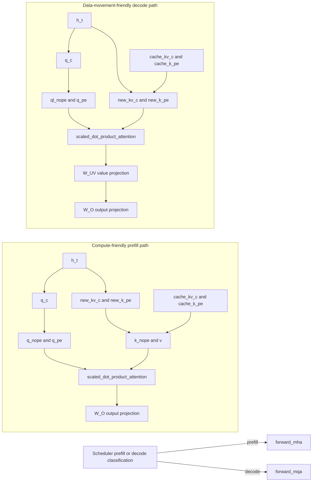
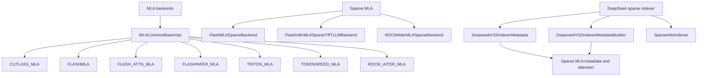
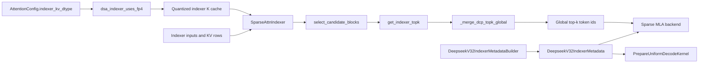
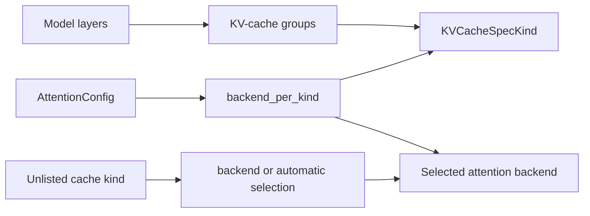

<!-- source: DeepWiki mcp.deepwiki.com · repo vllm-project/vllm · page 8.3 MLA and Specialized Attention · fetched 2026-10-28 -->

# MLA and Specialized Attention

Relevant source files

The following files were used as context for generating this wiki page:

- [cmake/external_projects/flashmla.cmake](cmake/external_projects/flashmla.cmake)
- [csrc/fused_deepseek_v4_qnorm_rope_kv_insert_kernel.cu](csrc/fused_deepseek_v4_qnorm_rope_kv_insert_kernel.cu)
- [tests/kernels/attention/test_deepgemm_attention.py](tests/kernels/attention/test_deepgemm_attention.py)
- [tests/kernels/attention/test_flashmla_sparse.py](tests/kernels/attention/test_flashmla_sparse.py)
- [tests/kernels/attention/test_kimi_k3_mla_fused_epilogue.py](tests/kernels/attention/test_kimi_k3_mla_fused_epilogue.py)
- [tests/kernels/attention/test_kimi_k3_mla_key_concat_kv_cache.py](tests/kernels/attention/test_kimi_k3_mla_key_concat_kv_cache.py)
- [tests/kernels/attention/test_rocm_triton_attn_dsv4.py](tests/kernels/attention/test_rocm_triton_attn_dsv4.py)
- [tests/kernels/attention/test_triton_decode_attention.py](tests/kernels/attention/test_triton_decode_attention.py)
- [tests/kernels/test_compressor_kv_cache.py](tests/kernels/test_compressor_kv_cache.py)
- [tests/kernels/test_fused_deepseek_v4_qnorm_rope_kv_insert.py](tests/kernels/test_fused_deepseek_v4_qnorm_rope_kv_insert.py)
- [tests/kernels/test_fused_indexer_q_rope_quant.py](tests/kernels/test_fused_indexer_q_rope_quant.py)
- [tests/models/kimi_k3/test_mla_prefill_context.py](tests/models/kimi_k3/test_mla_prefill_context.py)
- [tests/v1/attention/test_deepseek_v4_rocm_adaptive.py](tests/v1/attention/test_deepseek_v4_rocm_adaptive.py)
- [tests/v1/attention/test_flashmla_nope_sm90_backend_selection.py](tests/v1/attention/test_flashmla_nope_sm90_backend_selection.py)
- [tests/v1/attention/test_indexer_deepseek_v4_slot_mapping.py](tests/v1/attention/test_indexer_deepseek_v4_slot_mapping.py)
- [tests/v1/attention/test_indexer_native_next_n.py](tests/v1/attention/test_indexer_native_next_n.py)
- [tests/v1/attention/test_mla_backends.py](tests/v1/attention/test_mla_backends.py)
- [tests/v1/attention/test_rocm_aiter_triton_sparse_mla.py](tests/v1/attention/test_rocm_aiter_triton_sparse_mla.py)
- [tests/v1/attention/test_sparse_mla_backends.py](tests/v1/attention/test_sparse_mla_backends.py)
- [vllm/config/attention.py](vllm/config/attention.py)
- [vllm/model_executor/layers/attention/mla_attention.py](vllm/model_executor/layers/attention/mla_attention.py)
- [vllm/model_executor/layers/attention/sparse_mla_attention.py](vllm/model_executor/layers/attention/sparse_mla_attention.py)
- [vllm/model_executor/layers/sparse_attn_indexer.py](vllm/model_executor/layers/sparse_attn_indexer.py)
- [vllm/model_executor/layers/sparse_mqa_indexer.py](vllm/model_executor/layers/sparse_mqa_indexer.py)
- [vllm/models/deepseek_v4/amd/rocm.py](vllm/models/deepseek_v4/amd/rocm.py)
- [vllm/models/deepseek_v4/attention.py](vllm/models/deepseek_v4/attention.py)
- [vllm/models/deepseek_v4/common/ops/__init__.py](vllm/models/deepseek_v4/common/ops/__init__.py)
- [vllm/models/deepseek_v4/common/ops/cache_utils.py](vllm/models/deepseek_v4/common/ops/cache_utils.py)
- [vllm/models/deepseek_v4/common/ops/fused_compress_quant_cache.py](vllm/models/deepseek_v4/common/ops/fused_compress_quant_cache.py)
- [vllm/models/deepseek_v4/common/ops/fused_indexer_q.py](vllm/models/deepseek_v4/common/ops/fused_indexer_q.py)
- [vllm/models/deepseek_v4/common/ops/fused_mtp_input_rmsnorm.py](vllm/models/deepseek_v4/common/ops/fused_mtp_input_rmsnorm.py)
- [vllm/models/deepseek_v4/common/ops/save_partial_states.py](vllm/models/deepseek_v4/common/ops/save_partial_states.py)
- [vllm/models/deepseek_v4/compressor.py](vllm/models/deepseek_v4/compressor.py)
- [vllm/models/deepseek_v4/nvidia/flashinfer_sparse.py](vllm/models/deepseek_v4/nvidia/flashinfer_sparse.py)
- [vllm/models/deepseek_v4/nvidia/flashmla.py](vllm/models/deepseek_v4/nvidia/flashmla.py)
- [vllm/models/deepseek_v4/nvidia/ops/dequant_gather_k_cutedsl.py](vllm/models/deepseek_v4/nvidia/ops/dequant_gather_k_cutedsl.py)
- [vllm/models/deepseek_v4/nvidia/ops/fused_indexer_q_cutedsl.py](vllm/models/deepseek_v4/nvidia/ops/fused_indexer_q_cutedsl.py)
- [vllm/models/deepseek_v4/nvidia/ops/sparse_attn_compress_cutedsl.py](vllm/models/deepseek_v4/nvidia/ops/sparse_attn_compress_cutedsl.py)
- [vllm/models/deepseek_v4/sparse_mla.py](vllm/models/deepseek_v4/sparse_mla.py)
- [vllm/models/deepseek_v41/amd/rocm.py](vllm/models/deepseek_v41/amd/rocm.py)
- [vllm/models/deepseek_v41/common/ops/cache_utils.py](vllm/models/deepseek_v41/common/ops/cache_utils.py)
- [vllm/models/deepseek_v41/common/ops/fused_compress_quant_cache.py](vllm/models/deepseek_v41/common/ops/fused_compress_quant_cache.py)
- [vllm/models/hy_v4/nvidia/flashmla_sparse.py](vllm/models/hy_v4/nvidia/flashmla_sparse.py)
- [vllm/models/kimi_k3/nvidia/mla.py](vllm/models/kimi_k3/nvidia/mla.py)
- [vllm/models/kimi_k3/nvidia/ops/fused_mla_key_concat_kv_cache.py](vllm/models/kimi_k3/nvidia/ops/fused_mla_key_concat_kv_cache.py)
- [vllm/utils/deep_gemm.py](vllm/utils/deep_gemm.py)
- [vllm/v1/attention/backends/mla/cutlass_mla.py](vllm/v1/attention/backends/mla/cutlass_mla.py)
- [vllm/v1/attention/backends/mla/flashattn_mla.py](vllm/v1/attention/backends/mla/flashattn_mla.py)
- [vllm/v1/attention/backends/mla/flashattn_mla_sparse.py](vllm/v1/attention/backends/mla/flashattn_mla_sparse.py)
- [vllm/v1/attention/backends/mla/flashinfer_mla.py](vllm/v1/attention/backends/mla/flashinfer_mla.py)
- [vllm/v1/attention/backends/mla/flashinfer_mla_sparse.py](vllm/v1/attention/backends/mla/flashinfer_mla_sparse.py)
- [vllm/v1/attention/backends/mla/flashmla.py](vllm/v1/attention/backends/mla/flashmla.py)
- [vllm/v1/attention/backends/mla/flashmla_sparse.py](vllm/v1/attention/backends/mla/flashmla_sparse.py)
- [vllm/v1/attention/backends/mla/indexer.py](vllm/v1/attention/backends/mla/indexer.py)
- [vllm/v1/attention/backends/mla/sparse_indexer.py](vllm/v1/attention/backends/mla/sparse_indexer.py)
- [vllm/v1/attention/backends/mla/sparse_swa.py](vllm/v1/attention/backends/mla/sparse_swa.py)
- [vllm/v1/attention/backends/mla/tokenspeed_mla.py](vllm/v1/attention/backends/mla/tokenspeed_mla.py)
- [vllm/v1/attention/backends/mla/triton_mla.py](vllm/v1/attention/backends/mla/triton_mla.py)
- [vllm/v1/attention/ops/metadata.py](vllm/v1/attention/ops/metadata.py)
- [vllm/v1/attention/ops/rocm_aiter_mla_sparse.py](vllm/v1/attention/ops/rocm_aiter_mla_sparse.py)
- [vllm/v1/attention/ops/triton_decode_attention.py](vllm/v1/attention/ops/triton_decode_attention.py)

## Purpose and Scope

This page explains vLLM’s Multi-Latent Attention (MLA) computation paths, sparse MLA and DeepSeek V3.2/V4 indexer components, and the attention configuration boundary relevant to hybrid models. It focuses on the code entities and data flow visible in the provided source excerpts; those excerpts do not include Mamba-specific metadata-builder implementations. [vllm/model_executor/layers/attention/mla_attention.py:3-24](), [vllm/config/attention.py:36-55]()

Sources: [vllm/model_executor/layers/attention/mla_attention.py:3-24](), [vllm/config/attention.py:36-55]()

---

## Multi-Head Latent Attention (MLA) Architecture

MLA represents each KV-cache token with a compressed latent vector rather than storing fully expanded per-head keys and values. The common MLA implementation distinguishes a compute-friendly path for prefill from a data-movement-friendly path for decode. The scheduler’s prefill/decode classification currently drives this choice; the source notes that the threshold could be tuned further. [vllm/model_executor/layers/attention/mla_attention.py:12-28]()

The dimensions used to describe the computation include query and KV latent sizes (`Lq`, `Lkv`), attention head count (`N`), non-RoPE and RoPE key dimensions (`P`, `R`), and value dimension (`V`). The input hidden states have shape `[Sq, H]`; the compressed KV representation has shape `[Skv, Lkv]`. [vllm/model_executor/layers/attention/mla_attention.py:32-63]()

### Latent Space Projections and Dual Compute Paths

**Prefill / compute-friendly path.** The implementation projects hidden states into latent queries, expands query heads, and projects new latent KV rows into per-head keys and values. It combines the current KV rows with cached context and computes attention using expanded MHA-shaped keys and values. The source identifies the expansion of the full context into `k_nope` as a potential memory problem for long sequences. [vllm/model_executor/layers/attention/mla_attention.py:65-85](), [vllm/model_executor/layers/attention/mla_attention.py:120-131]()

**Decode / data-movement-friendly path.** Rather than expanding all cached latent KV rows into per-head keys and values, the implementation transforms the query into latent space and attends over the latent KV representation. It then projects the attention result through the value up-projection and output projection. This uses an MQA-shaped attention computation to reduce data movement, at the cost of performing computation with the larger latent dimension. [vllm/model_executor/layers/attention/mla_attention.py:93-118]()

| Path | Intended workload | Attention representation | Main trade-off |
|---|---|---|---|
| Compute-friendly (`forward_mha`) | Prefill, where `Sq / Skv` is relatively large | Expanded per-head keys and values | Compute-friendly, but expanding context can consume substantial workspace. |
| Data-movement-friendly (`forward_mqa`) | Decode, where `Sq / Skv` is relatively small | Latent KV rows shared in an MQA-shaped operation | Reduces data movement but operates over the larger latent dimension. |

Sources: [vllm/model_executor/layers/attention/mla_attention.py:12-28](), [vllm/model_executor/layers/attention/mla_attention.py:65-118]()

#### MLA Data Flow: Natural Language to Code Entities

This diagram maps the two MLA workload paths to the code-level terms used in the common MLA implementation. The `forward_mha` and `forward_mqa` names are described in the source as the compute-friendly and data-movement-friendly approaches, respectively. [vllm/model_executor/layers/attention/mla_attention.py:65-118]()

Sources: [vllm/model_executor/layers/attention/mla_attention.py:65-118]()

### Chunked Prefill for Long Contexts

Chunked prefill bounds context-related workspace by processing cached context in chunks. The source describes a workspace size `W` and a request-aware planning function, `plan_mla_context_chunks`: requests are packed in order, and a request may be split on an aligned boundary when needed to fill a chunk. Each chunk contains a contiguous run of prefills and only the tokens and context rows for those prefills. The stated goal is to avoid materializing an unbounded expanded context while preserving the work associated with each request. [vllm/model_executor/layers/attention/mla_attention.py:120-143]()

Only the first request in a chunk can be a continuation, which bounds accumulation to at most one request-slice merge and one bulk write per chunk. The provided excerpt ends before the full chunked-prefill procedure, so this page does not describe its remaining kernel or merge details. [vllm/model_executor/layers/attention/mla_attention.py:133-172]()

Sources: [vllm/model_executor/layers/attention/mla_attention.py:120-172]()

---

## MLA Backend and Sparse Attention Map

The common MLA layer is paired with backend implementations selected elsewhere in vLLM. The provided MLA backend tests enumerate the backends they exercise: `CUTLASS_MLA`, `FLASHMLA`, `FLASH_ATTN_MLA`, `FLASHINFER_MLA`, `TRITON_MLA`, and `TOKENSPEED_MLA`; on ROCm, the tests also add `ROCM_AITER_MLA`. This list is a test inventory, not a claim that every backend is available on every platform or configuration. [tests/v1/attention/test_mla_backends.py:63-75]()

Sparse MLA uses a separate set of backend and metadata components. The sparse backend tests import `FlashMLASparseBackend`, `FlashInferMLASparseTRTLLMBackend`, `DeepseekV32IndexerMetadataBuilder`, and related sparse metadata utilities. Their platform-specific test setup uses `ROCMAiterMLASparseBackend` on ROCm and FlashMLA/FlashInfer sparse backends otherwise. [tests/v1/attention/test_sparse_mla_backends.py:73-107](), [tests/v1/attention/test_sparse_mla_backends.py:124-137]()

### Backend and Indexer Entity Map: Natural Language to Code

The diagram connects the user-facing concepts—dense MLA, sparse MLA, and DeepSeek indexer metadata—to code identifiers appearing in the backend tests and implementation excerpts. [tests/v1/attention/test_mla_backends.py:63-75](), [tests/v1/attention/test_sparse_mla_backends.py:73-107](), [vllm/v1/attention/backends/mla/indexer.py:33-50]()

Sources: [tests/v1/attention/test_mla_backends.py:63-75](), [tests/v1/attention/test_sparse_mla_backends.py:73-107](), [tests/v1/attention/test_sparse_mla_backends.py:124-137](), [vllm/model_executor/layers/sparse_attn_indexer.py:26-61](), [vllm/v1/attention/backends/mla/indexer.py:33-50]()

---

## Specialized Attention Mechanisms and Sparse Indexers

Sparse MLA adds an index-selection stage to attention: the indexer scores candidate KV entries, selects top-k indices, and the attention path consumes selected rows rather than traversing the full context. The supplied code excerpts show the indexer’s configuration, quantized cache handling, and distributed top-k merge mechanisms; they do not include the complete end-to-end forward call chain. [vllm/config/attention.py:93-120](), [vllm/model_executor/layers/sparse_attn_indexer.py:95-145]()

### DeepSeek V3.2 and V4 Sparse Indexers

`vllm/v1/attention/backends/mla/indexer.py` defines `DSA_INDEXER_KV_DTYPES` as `("fp8", "mxfp4")` and provides `dsa_indexer_uses_fp4` to resolve and validate the configured indexer cache dtype. On ROCm, the shown checks restrict MXFP4 to DeepSeek V4.1, CDNA4, and enabled AITER; on non-ROCm, the shown check requires a Blackwell datacenter GPU capability family. [vllm/v1/attention/backends/mla/indexer.py:53-97]()

The indexer metadata module imports `AttentionBackend`, `AttentionMetadataBuilder`, `CommonAttentionMetadata`, and MLA KV-cache specifications, and also imports utilities for compressed slot mappings, sparse request-row bounds, decode/prefill splitting, and distributed context-parallel groups. This establishes the metadata and cache interfaces used by the indexer without implying behavior beyond the excerpt. [vllm/v1/attention/backends/mla/indexer.py:9-50]()

`SparseAttnIndexer` is the model-executor layer entry point shown in the supplied excerpt. Its dependencies include candidate-block selection and masking, indexer top-k selection, distributed groups, indexer metadata, and KV gather helpers. The same file implements `_merge_dcp_topk_global`: it packs each rank’s local `(score, global_id)` candidates, gathers those candidates across the DCP group, then applies a stable top-k selection. The source explains why exchanging each rank’s local top-k is sufficient to recover the global top-k and records the required CuteDSL/CUDA/dtype/top-k constraints. [vllm/model_executor/layers/sparse_attn_indexer.py:26-61](), [vllm/model_executor/layers/sparse_attn_indexer.py:69-145]()

The backend-side `PrepareUniformDecodeKernel` prepares per-token decode sequence lengths and expands block-table rows for uniform decode handling. It clamps sequence lengths for padded requests to avoid negative per-token lengths, copies the corresponding block-table row, and records a decode length of one for each expanded entry. [vllm/v1/attention/backends/mla/indexer.py:100-148]()

#### Sparse Indexer Data Flow: Natural Language to Code Entities

This diagram summarizes the exposed indexer and sparse-attention entities. It separates the model-layer indexer work from metadata preparation and the backend’s selected-row attention path. [vllm/model_executor/layers/sparse_attn_indexer.py:26-61](), [vllm/model_executor/layers/sparse_attn_indexer.py:95-145](), [vllm/v1/attention/backends/mla/indexer.py:33-50](), [vllm/v1/attention/backends/mla/indexer.py:100-148]()

Sources: [vllm/config/attention.py:93-120](), [vllm/model_executor/layers/sparse_attn_indexer.py:26-61](), [vllm/model_executor/layers/sparse_attn_indexer.py:95-145](), [vllm/v1/attention/backends/mla/indexer.py:33-50](), [vllm/v1/attention/backends/mla/indexer.py:100-148]()

### Sparse Indexer Cache Configuration

`AttentionConfig.indexer_kv_dtype` accepts `auto`, `bf16`, `fp8`, `mxfp4`, and `nvfp4`; its documentation describes FP8 as the DeepSeek sparse-indexer default and notes that quantized formats require backend kernel support. `indexer_sparse_logits` enables a DeepSeek V4.1 two-level path that scores candidate blocks rather than computing dense logits across the whole context; the documented path requires MXFP4 and specified hardware/software support, with a ROCm-specific AITER route. [vllm/config/attention.py:93-109]()

`indexer_tp_shard_min_rows` configures the minimum total prefill rows for splitting indexer work across tensor-parallel ranks. `minimax_m3_indexer_cp` is a separate MiniMax M3 setting for context-parallel decode index scoring and candidate merging; it is not a DeepSeek-specific option. [vllm/config/attention.py:111-120]()

### DeepSeek Sparse MLA KV-Cache Formats

The sparse FlashMLA implementation documents several cache representations. The V3.2 FP8 record uses quantized NoPE values, scale factors, and an unquantized BF16 RoPE portion. The V4 FP8 record uses a different NoPE/RoPE arrangement and UE8M0 scales. V4.1 stores quantized values and scales as interleaved per-token records. The source also describes `nvfp4_ds_mla` as a V3.2-geometry format with packed NVFP4 NoPE values and FP8 RoPE values. [vllm/v1/attention/backends/mla/flashmla_sparse.py:76-121]()

| Cache format | Source-described representation | Notes |
|---|---|---|
| `fp8_ds_mla` — V3.2 | FP8 NoPE values with FP32 scale values; BF16 RoPE values. | The documented V3.2 record is 656 bytes per token. |
| `fp8_ds_mla` — V4 | FP8 NoPE values, BF16 RoPE values, and UE8M0 scales. | The documented V4 record is 584 bytes per token; the page stores data rows and scale rows separately. |
| V4.1 FP8 | FP8 values with UE8M0 scales. | The documented V4.1 record is 528 bytes per token, with scales interleaved with each token’s data. |
| `nvfp4_ds_mla` | Packed NVFP4 NoPE values, FP8 RoPE values, and FP8 NoPE scale factors. | The documented format is for SM100 and V3.2 geometry. |

The FlashMLA sparse backend advertises support for `auto`, `bfloat16`, `fp8_ds_mla`, the `fp8` alias, and `nvfp4_ds_mla` in the shown class declaration. The sparse-attention configuration also exposes indexer cache dtype separately from the attention KV-cache dtype. [vllm/v1/attention/backends/mla/flashmla_sparse.py:125-165](), [vllm/config/attention.py:93-109]()

Sources: [vllm/v1/attention/backends/mla/flashmla_sparse.py:76-121](), [vllm/v1/attention/backends/mla/flashmla_sparse.py:125-165](), [vllm/config/attention.py:93-109]()

### ROCm Sparse MLA and AITER

The ROCm sparse MLA operation module conditionally imports architecture flags for gfx942 and gfx950, and provides an AITER OPUS sparse-prefill operation lookup that returns no operation when MLA is disabled or the relevant import is unavailable. The source documents a conservative query-count threshold for selecting OPUS on gfx950. [vllm/v1/attention/ops/rocm_aiter_mla_sparse.py:24-51]()

The module also includes a Triton top-k localization kernel that converts global indices to row-local indices while preserving negative padding values, and a helper that invokes AITER’s prefill top-k operation before localization. [vllm/v1/attention/ops/rocm_aiter_mla_sparse.py:54-108]()

On the DeepSeek V4 ROCm model path, `_aiter_sparse_mla_enabled` checks the relevant AITER sparse-MLA option and disables that route when a KV connector is active, warning that the kernel is not used in that case. The module imports ROCm sparse decode and prefill operations and the V4 sparse MLA metadata/backend components. [vllm/models/deepseek_v4/amd/rocm.py:18-44](), [vllm/models/deepseek_v4/amd/rocm.py:107-120]()

Sources: [vllm/v1/attention/ops/rocm_aiter_mla_sparse.py:24-51](), [vllm/v1/attention/ops/rocm_aiter_mla_sparse.py:54-108](), [vllm/models/deepseek_v4/amd/rocm.py:18-44](), [vllm/models/deepseek_v4/amd/rocm.py:107-120]()

---

## Mamba and Hybrid Metadata Builders

The supplied source excerpts do not show the Mamba or hybrid metadata-builder definitions, so this section does not claim specific builder class names, metadata fields, or execution steps for those implementations. The visible integration point is `AttentionConfig.backend_per_kind`: it allows backend overrides keyed by KV-cache-group kind, with unlisted kinds falling back to the general backend setting or automatic selection. The configuration documentation gives MLA and sliding-window MLA as examples of distinct kinds. [vllm/config/attention.py:36-55]()

This setting is relevant when a model’s attention layers are split across multiple KV-cache groups. It describes backend routing by cache kind; it does not, by itself, document Mamba state metadata or establish that Mamba layers use an MLA backend. [vllm/config/attention.py:46-55]()

### Hybrid Routing Boundary: Natural Language to Code Entities

This diagram maps the documented per-kind routing control to its configuration identifiers. It intentionally stops at the configuration boundary because the provided excerpts do not include Mamba-specific metadata builders. [vllm/config/attention.py:36-55]()

Sources: [vllm/config/attention.py:36-55]()

---

## Configuration and Validation Notes

`AttentionConfig` exposes controls for MLA prefill backend selection, prefill query quantization, TRTLLM ragged backend choice, sparse-indexer KV dtype, sparse logits, indexer tensor-parallel row sharding, MiniMax indexer context parallelism, and sparse-MLA path selection. These options represent distinct configuration concerns and should not be conflated: for example, `mla_prefill_backend` selects an MLA prefill backend, while `indexer_kv_dtype` controls the sparse indexer’s K-cache dtype. [vllm/config/attention.py:81-120]()

The `sparse_mla_force_mqa` option forces the MQA path for all requests, including prefill; when disabled, the configuration documentation says pure prefill batches use MHA when implemented. `sparse_mla_prefill_workspace_factor` configures sparse prefill workspace in multiples of `max_model_len`, with the documented effect of controlling how much context can be gathered per workspace and how many chunks are needed. [vllm/config/attention.py:128-141]()

Sources: [vllm/config/attention.py:81-120](), [vllm/config/attention.py:128-141]()

---

## Tests and Behavioral Coverage

The MLA backend test module lists the dense MLA backends it exercises and includes routing tests for masked MHA decisions based on backend name, tensor-parallel size, query length, sequence length, and context presence. It also checks that a key concatenation helper matches the equivalent Torch concatenation, including the zero-RoPE-dimension case. [tests/v1/attention/test_mla_backends.py:63-75](), [tests/v1/attention/test_mla_backends.py:91-190]()

The sparse MLA test module establishes platform-specific sparse backend inventories and includes ROCm-specific test selection. Its imports show coverage targets including sparse backend implementations, indexer metadata building, index groups, sparse prefill utilities, and HiSparse runtime components. [tests/v1/attention/test_sparse_mla_backends.py:73-137]()

Sources: [tests/v1/attention/test_mla_backends.py:63-75](), [tests/v1/attention/test_mla_backends.py:91-190](), [tests/v1/attention/test_sparse_mla_backends.py:73-137]()

---

