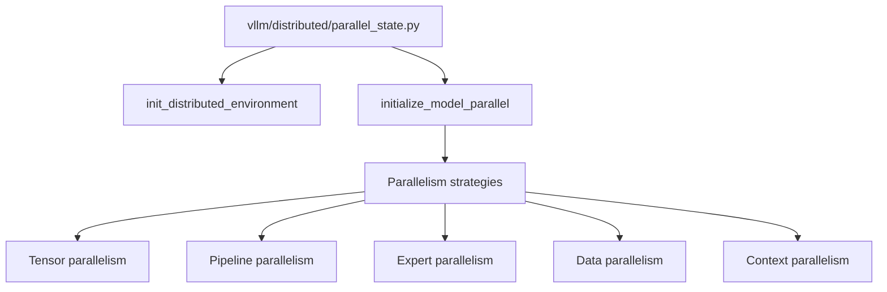
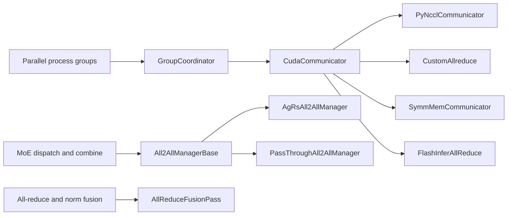
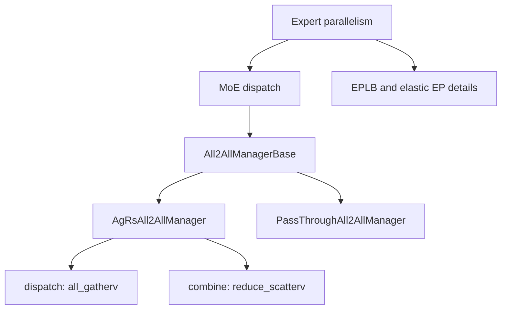
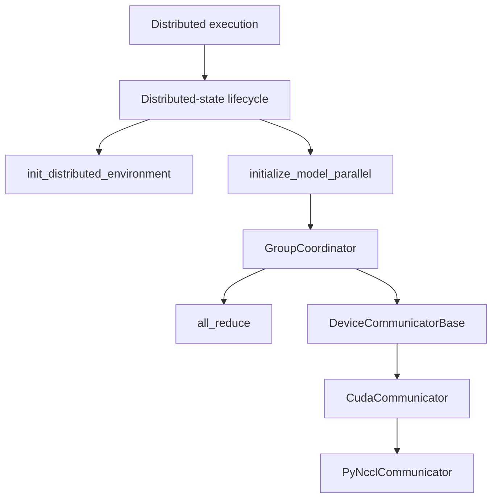
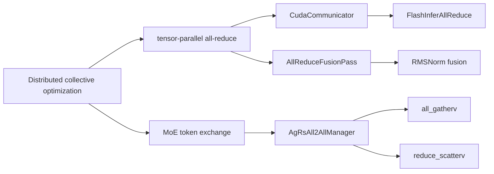

<!-- source: DeepWiki mcp.deepwiki.com · repo vllm-project/vllm · page 9 Distributed Execution · fetched 2026-10-28 -->

# Distributed Execution

Relevant source files

The following files were used as context for generating this wiki page:

- [benchmarks/kernels/benchmark_device_communicators.py](benchmarks/kernels/benchmark_device_communicators.py)
- [benchmarks/kernels/benchmark_fused_collective.py](benchmarks/kernels/benchmark_fused_collective.py)
- [tests/compile/passes/distributed/test_fusion_all_reduce.py](tests/compile/passes/distributed/test_fusion_all_reduce.py)
- [tests/distributed/test_comm_ops.py](tests/distributed/test_comm_ops.py)
- [tests/distributed/test_cpu_all_reduce.py](tests/distributed/test_cpu_all_reduce.py)
- [tests/distributed/test_mnnvl_alltoall.py](tests/distributed/test_mnnvl_alltoall.py)
- [tests/distributed/test_nccl_symm_mem.py](tests/distributed/test_nccl_symm_mem.py)
- [tests/distributed/test_rocm_aiter_custom_ar.py](tests/distributed/test_rocm_aiter_custom_ar.py)
- [tests/v1/determinism/conftest.py](tests/v1/determinism/conftest.py)
- [vllm/compilation/passes/fusion/allreduce_rms_fusion.py](vllm/compilation/passes/fusion/allreduce_rms_fusion.py)
- [vllm/distributed/device_communicators/aiter_custom_all_reduce.py](vllm/distributed/device_communicators/aiter_custom_all_reduce.py)
- [vllm/distributed/device_communicators/all2all.py](vllm/distributed/device_communicators/all2all.py)
- [vllm/distributed/device_communicators/all_reduce_utils.py](vllm/distributed/device_communicators/all_reduce_utils.py)
- [vllm/distributed/device_communicators/cuda_communicator.py](vllm/distributed/device_communicators/cuda_communicator.py)
- [vllm/distributed/device_communicators/flashinfer_all_reduce.py](vllm/distributed/device_communicators/flashinfer_all_reduce.py)
- [vllm/distributed/device_communicators/symm_mem.py](vllm/distributed/device_communicators/symm_mem.py)
- [vllm/distributed/elastic_ep/standby_state.py](vllm/distributed/elastic_ep/standby_state.py)
- [vllm/distributed/parallel_state.py](vllm/distributed/parallel_state.py)
- [vllm/distributed/stateless_coordinator.py](vllm/distributed/stateless_coordinator.py)
- [vllm/distributed/utils.py](vllm/distributed/utils.py)
- [vllm/model_executor/layers/fused_allreduce_gemma_rms_norm.py](vllm/model_executor/layers/fused_allreduce_gemma_rms_norm.py)

## Purpose and scope

This page introduces how vLLM organizes distributed execution: parallel process groups, device communication, and the adjacent subsystems for multi-process serving, cache movement, offloading, and weight updates. It is a parent-page overview; follow the child-page links for implementation details. In the distributed-state lifecycle, `init_distributed_environment` establishes the distributed environment, model-parallel groups are initialized separately when needed, and both can be torn down independently. [vllm/distributed/parallel_state.py:8-23]()

Sources: [vllm/distributed/parallel_state.py:8-23]()

## Parallelism Strategies Overview

vLLM’s parallel execution is organized around named groups and collective operations. The available code describes a model-parallel initialization lifecycle, while the child page covers the strategies—Tensor, Pipeline, Expert, Data, and Context Parallelism—and their configuration in detail. [vllm/distributed/parallel_state.py:8-23]()

For details, see [Parallelism Strategies](#9.1).

**Diagram: Parallelism concepts and distributed-state entities**

Sources: [vllm/distributed/parallel_state.py:8-23]()

## Distributed Communication Infrastructure

The distributed layer exposes group-based communication, with device communicators providing implementation-specific paths. For example, `CudaCommunicator` constructs a `PyNcclCommunicator` for multi-rank groups and may initialize additional all-reduce implementations depending on group and configuration. [vllm/distributed/device_communicators/cuda_communicator.py:35-68]()[vllm/distributed/device_communicators/cuda_communicator.py:106-166]()

Communication also supports fused operations: the compilation fusion pass integrates tensor-parallel all-reduce with RMSNorm-related work where applicable. The all-to-all layer provides another communication path used by MoE dispatch and combine. [vllm/compilation/passes/fusion/allreduce_rms_fusion.py:19-25]()[vllm/distributed/device_communicators/all2all.py:53-69]()

For details, see [Communication Infrastructure](#9.2).

**Diagram: Distributed communication concepts mapped to code entities**

Sources: [vllm/distributed/parallel_state.py:46-50]()[vllm/distributed/device_communicators/cuda_communicator.py:35]()[vllm/distributed/device_communicators/all2all.py:32-69]()[vllm/compilation/passes/fusion/allreduce_rms_fusion.py:19-25]()

## Multi-Process Engine Management

Multi-process engine management is the serving-side counterpart to distributed communication: it coordinates execution across workers and ranks. The detailed page covers process spawning, Ray integration, request-wave coordination, the DP coordinator, and data-parallel load balancing.

For details, see [Multi-Process Engine Management](#9.3).

Sources: [vllm/distributed/parallel_state.py:8-23]()

## KV Cache Transfer and Disaggregated Serving

KV cache transfer supports serving topologies in which cache production and consumption are separated. The child page documents the connector abstractions, connector implementations, and transfer metrics; this parent page does not describe their internal protocols.

For details, see [KV Cache Transfer and Disaggregated Serving](#9.4).

Sources: [vllm/distributed/parallel_state.py:8-23]()

## KV Offloading and Tiering

KV offloading and tiering address cache placement beyond the execution device. The child page covers the offloading connector and scheduler, tier backends, and eviction policies.

For details, see [KV Offloading and Tiering](#9.5).

Sources: [vllm/distributed/parallel_state.py:8-23]()

## Weight Transfer and RL Integration

Weight transfer connects distributed inference with workflows that update model weights at runtime. The child page covers transfer engines, layerwise reload, and RL/training integrations.

For details, see [Weight Transfer and RL Integration](#9.6).

Sources: [vllm/distributed/parallel_state.py:8-23]()

## Expert Parallelism (EP) and Load Balancing (EPLB)

Expert parallelism is one of the parallelism strategies covered by this section. The all-to-all communication layer includes managers for dispatch and combine, including `AgRsAll2AllManager`, which uses all-gather and reduce-scatter operations, and `PassThroughAll2AllManager`, which delegates those operations to the MoE backend. [vllm/distributed/device_communicators/all2all.py:53-69]()[vllm/distributed/device_communicators/all2all.py:99-126]()[vllm/distributed/device_communicators/all2all.py:163-173]()

EPLB and elastic expert parallelism are covered in detail on the child page; this overview does not specify their configuration or runtime behavior.

For details, see [Parallelism Strategies](#9.1).

**Diagram: Expert-parallel concepts mapped to all-to-all code entities**

Sources: [vllm/distributed/device_communicators/all2all.py:32-69]()[vllm/distributed/device_communicators/all2all.py:99-126]()[vllm/distributed/device_communicators/all2all.py:163-173]()

## Summary

vLLM’s distributed execution links parallel groups, communication implementations, and higher-level serving subsystems. The distributed-state API establishes and manages the environment and model-parallel groups; device communicators and collective operations provide communication paths used by parallel execution. [vllm/distributed/parallel_state.py:8-23]()[vllm/distributed/device_communicators/cuda_communicator.py:35-68]()

For subsystem details, see:

- [Parallelism Strategies](#9.1)
- [Communication Infrastructure](#9.2)
- [Multi-Process Engine Management](#9.3)
- [KV Cache Transfer and Disaggregated Serving](#9.4)
- [KV Offloading and Tiering](#9.5)
- [Weight Transfer and RL Integration](#9.6)

Sources: [vllm/distributed/parallel_state.py:8-23]()[vllm/distributed/device_communicators/cuda_communicator.py:35-68]()

## Additional Diagram: Distributed state and code entities

Sources: [vllm/distributed/parallel_state.py:8-23]()[vllm/distributed/parallel_state.py:46-50]()[vllm/distributed/parallel_state.py:199-203]()[vllm/distributed/device_communicators/cuda_communicator.py:35-68]()

## Additional Diagram: Collective optimization code entities

Sources: [vllm/distributed/device_communicators/cuda_communicator.py:35]()[vllm/distributed/device_communicators/cuda_communicator.py:106-166]()[vllm/compilation/passes/fusion/allreduce_rms_fusion.py:19-25]()[vllm/distributed/device_communicators/all2all.py:67-69]()[vllm/distributed/device_communicators/all2all.py:99-126]()[vllm/distributed/device_communicators/all2all.py:163-173]()

---

