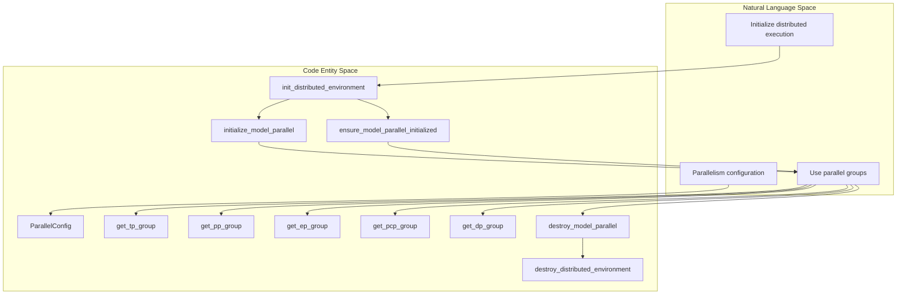
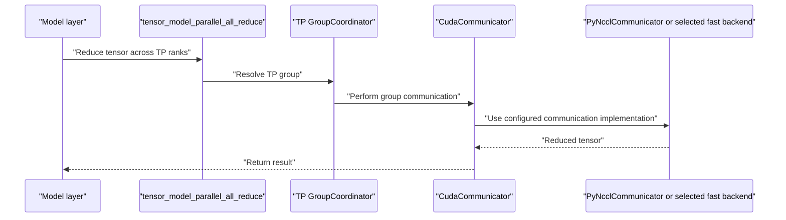
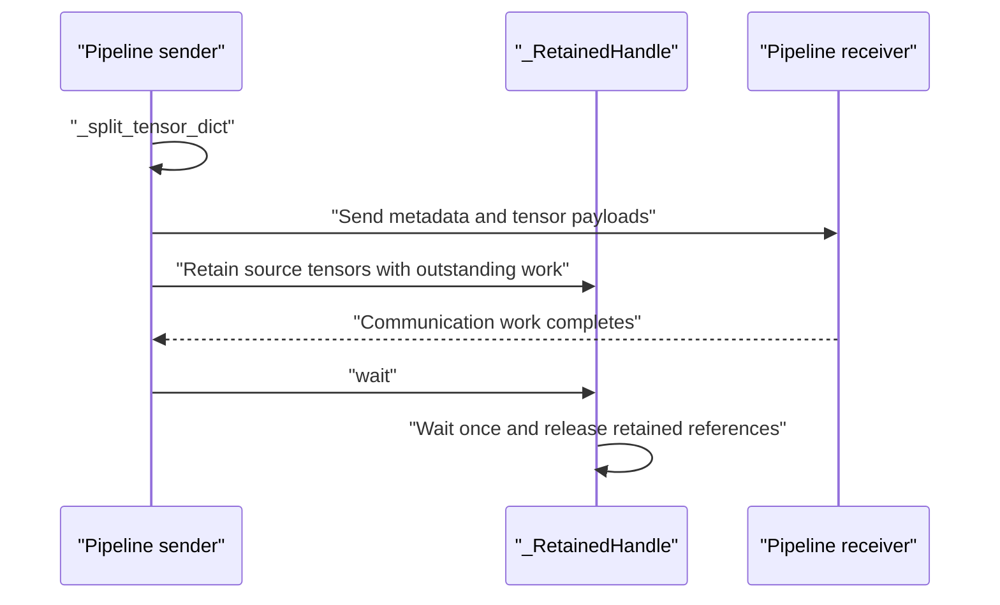
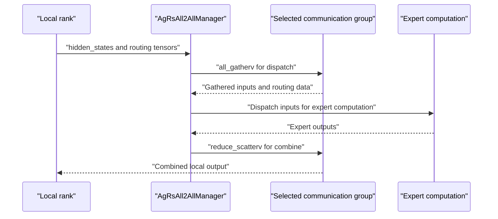
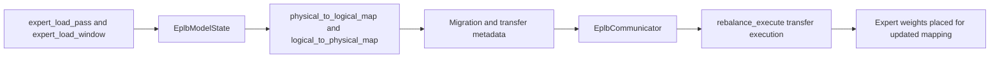
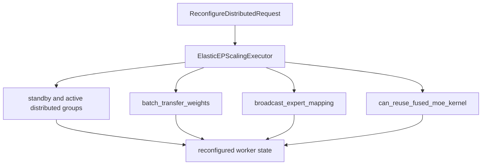
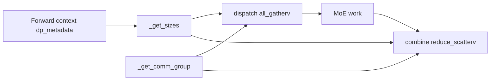
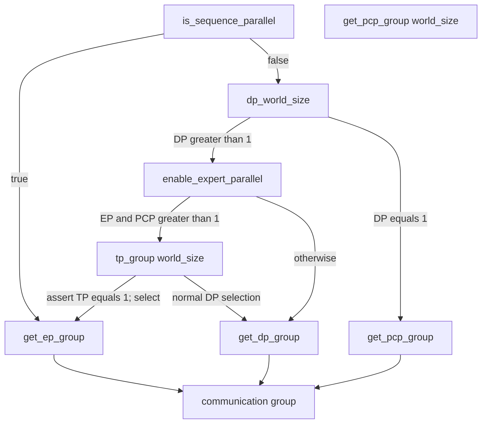

<!-- source: DeepWiki mcp.deepwiki.com · repo vllm-project/vllm · page 9.1 Parallelism Strategies · fetched 2026-10-28 -->

# Parallelism Strategies

Relevant source files

The following files were used as context for generating this wiki page:

- [benchmarks/kernels/benchmark_device_communicators.py](benchmarks/kernels/benchmark_device_communicators.py)
- [benchmarks/kernels/benchmark_fused_collective.py](benchmarks/kernels/benchmark_fused_collective.py)
- [tests/compile/passes/distributed/test_fusion_all_reduce.py](tests/compile/passes/distributed/test_fusion_all_reduce.py)
- [tests/distributed/eplb_utils.py](tests/distributed/eplb_utils.py)
- [tests/distributed/test_comm_ops.py](tests/distributed/test_comm_ops.py)
- [tests/distributed/test_cpu_all_reduce.py](tests/distributed/test_cpu_all_reduce.py)
- [tests/distributed/test_elastic_ep.py](tests/distributed/test_elastic_ep.py)
- [tests/distributed/test_eplb_algo.py](tests/distributed/test_eplb_algo.py)
- [tests/distributed/test_eplb_events.py](tests/distributed/test_eplb_events.py)
- [tests/distributed/test_eplb_execute.py](tests/distributed/test_eplb_execute.py)
- [tests/distributed/test_eplb_fused_moe_layer.py](tests/distributed/test_eplb_fused_moe_layer.py)
- [tests/distributed/test_eplb_fused_moe_layer_dep_nvfp4.py](tests/distributed/test_eplb_fused_moe_layer_dep_nvfp4.py)
- [tests/distributed/test_mnnvl_alltoall.py](tests/distributed/test_mnnvl_alltoall.py)
- [tests/distributed/test_nccl_symm_mem.py](tests/distributed/test_nccl_symm_mem.py)
- [tests/distributed/test_rocm_aiter_custom_ar.py](tests/distributed/test_rocm_aiter_custom_ar.py)
- [tests/kernels/moe/test_routing.py](tests/kernels/moe/test_routing.py)
- [tests/v1/determinism/conftest.py](tests/v1/determinism/conftest.py)
- [vllm/compilation/passes/fusion/allreduce_rms_fusion.py](vllm/compilation/passes/fusion/allreduce_rms_fusion.py)
- [vllm/distributed/device_communicators/aiter_custom_all_reduce.py](vllm/distributed/device_communicators/aiter_custom_all_reduce.py)
- [vllm/distributed/device_communicators/all2all.py](vllm/distributed/device_communicators/all2all.py)
- [vllm/distributed/device_communicators/all_reduce_utils.py](vllm/distributed/device_communicators/all_reduce_utils.py)
- [vllm/distributed/device_communicators/cuda_communicator.py](vllm/distributed/device_communicators/cuda_communicator.py)
- [vllm/distributed/device_communicators/flashinfer_all_reduce.py](vllm/distributed/device_communicators/flashinfer_all_reduce.py)
- [vllm/distributed/device_communicators/symm_mem.py](vllm/distributed/device_communicators/symm_mem.py)
- [vllm/distributed/elastic_ep/elastic_execute.py](vllm/distributed/elastic_ep/elastic_execute.py)
- [vllm/distributed/elastic_ep/elastic_state.py](vllm/distributed/elastic_ep/elastic_state.py)
- [vllm/distributed/elastic_ep/standby_state.py](vllm/distributed/elastic_ep/standby_state.py)
- [vllm/distributed/eplb/async_worker.py](vllm/distributed/eplb/async_worker.py)
- [vllm/distributed/eplb/eplb_communicator.py](vllm/distributed/eplb/eplb_communicator.py)
- [vllm/distributed/eplb/eplb_state.py](vllm/distributed/eplb/eplb_state.py)
- [vllm/distributed/eplb/eplb_utils.py](vllm/distributed/eplb/eplb_utils.py)
- [vllm/distributed/eplb/rebalance_execute.py](vllm/distributed/eplb/rebalance_execute.py)
- [vllm/distributed/parallel_state.py](vllm/distributed/parallel_state.py)
- [vllm/distributed/stateless_coordinator.py](vllm/distributed/stateless_coordinator.py)
- [vllm/distributed/utils.py](vllm/distributed/utils.py)
- [vllm/model_executor/layers/fused_allreduce_gemma_rms_norm.py](vllm/model_executor/layers/fused_allreduce_gemma_rms_norm.py)
- [vllm/model_executor/layers/fused_moe/router/base_router.py](vllm/model_executor/layers/fused_moe/router/base_router.py)

## Purpose and scope

This page describes how vLLM represents distributed process groups and uses them for Tensor Parallelism (TP), Pipeline Parallelism (PP), Expert Parallelism (EP), Data Parallelism (DP), and Context Parallelism (CP). It also covers Expert Parallel Load Balancing (EPLB) and Elastic EP, which rebalance or reconfigure expert placement. [vllm/distributed/parallel_state.py:8-23](), [vllm/distributed/eplb/eplb_state.py:3-25](), [vllm/distributed/elastic_ep/elastic_execute.py:152-161]()

## Overview and Configuration System

`ParallelConfig` describes the parallelism dimensions and is referenced by the distributed implementation. The configuration fields and CLI arguments below are documented in the existing configuration references. [vllm/config/parallel.py:136-170]()

| Strategy | Role | Configuration field | CLI argument |
|---|---|---|---|
| Tensor Parallelism (TP) | Splits tensor computation across ranks in a TP group. | `tensor_parallel_size` [vllm/config/parallel.py:141]() | `--tensor-parallel-size` |
| Pipeline Parallelism (PP) | Divides model execution into pipeline stages. | `pipeline_parallel_size` [vllm/config/parallel.py:139]() | `--pipeline-parallel-size` |
| Data Parallelism (DP) | Runs data-parallel ranks for independent or distributed batches. | `data_parallel_size` [vllm/config/parallel.py:146]() | `--data-parallel-size` |
| Context Parallelism (CP) | Configures prefill context parallelism. | `prefill_context_parallel_size` [vllm/config/parallel.py:143]() | `--prefill-context-parallel-size` |
| Expert Parallelism (EP) | Enables expert parallelism for MoE models. | `enable_expert_parallel` [vllm/config/parallel.py:74]() | `--enable-expert-parallel` |

The distributed-state module documents a lifecycle: initialize the distributed environment, initialize model-parallel groups if needed, perform distributed work, then destroy the groups and environment. A process that needs distributed execution without model or pipeline parallelism can omit model-parallel initialization. [vllm/distributed/parallel_state.py:8-23]()

**Diagram: Distributed initialization mapped to code entities**

Sources: [vllm/distributed/parallel_state.py:8-23](), [vllm/config/parallel.py:136-170]()

---

## Tensor Parallelism (TP)

TP distributes tensor computation across ranks in a tensor-parallel group. The distributed API exposes tensor-parallel collectives, including all-reduce, all-gather, and reduce-scatter; tests exercise these operations and validate their results across ranks. [tests/distributed/test_comm_ops.py:17-27](), [tests/distributed/test_comm_ops.py:36-60](), [tests/distributed/test_comm_ops.py:63-91](), [tests/distributed/test_comm_ops.py:94-125]()

### Groups, collectives, and communicator selection

`parallel_state.py` owns distributed state and registers group coordinators. Its `all_reduce(tensor, group_name)` entry point resolves a registered group by name and rejects missing or destroyed groups. [vllm/distributed/parallel_state.py:160-165](), [vllm/distributed/parallel_state.py:199-203]()

On CUDA, `CudaCommunicator` constructs the device communicator for a process group. It creates a `PyNcclCommunicator` when the group has more than one rank and can register symmetric-memory operations when symmetric memory is enabled. [vllm/distributed/device_communicators/cuda_communicator.py:35-55](), [vllm/distributed/device_communicators/cuda_communicator.py:106-113]()

Fast all-reduce options are selected specifically for the group whose name begins with `tp`. For other groups, the constructor disables TP-only custom-allreduce, symmetric-memory, and FlashInfer all-reduce options. For the TP group, it configures eligible backends based on environment settings and batch-invariance constraints. [vllm/distributed/device_communicators/cuda_communicator.py:56-88]()

The communicator can initialize symmetric-memory, FlashInfer, AITER, or custom all-reduce implementations when their respective conditions are met. [vllm/distributed/device_communicators/cuda_communicator.py:90-104](), [vllm/distributed/device_communicators/cuda_communicator.py:127-166]()

`FlashInferAllReduce` resolves its backend from `VLLM_FLASHINFER_ALLREDUCE_BACKEND`. In `auto` mode, it chooses MNNVL for supported topologies and may allow a TRTLLM fallback on a single node; unsupported multi-node configurations return no backend. [vllm/distributed/device_communicators/flashinfer_all_reduce.py:143-178]()

### Fused collective and normalization

The compilation fusion pass imports the TP all-reduce API and can match RMS normalization operations for fusion. [vllm/compilation/passes/fusion/allreduce_rms_fusion.py:19-25](), [vllm/compilation/passes/fusion/allreduce_rms_fusion.py:49-50]()

**Diagram: TP all-reduce code path**

Sources: [tests/distributed/test_comm_ops.py:17-27](), [vllm/distributed/parallel_state.py:160-165](), [vllm/distributed/device_communicators/cuda_communicator.py:35-55](), [vllm/distributed/device_communicators/cuda_communicator.py:106-166]()

---

## Pipeline Parallelism (PP)

PP is represented in distributed state by a pipeline-parallel group. The supplied code shows pipeline-group access in EPLB communication code and tests, but does not include the pipeline-stage scheduling implementation. [vllm/distributed/eplb/eplb_communicator.py:26-31](), [tests/distributed/test_comm_ops.py:17-27]()

### Point-to-point tensor transport

The distributed-state module defines `_RetainedHandle`, which keeps source tensors alive while asynchronous communication is outstanding. Its `wait()` method waits on each underlying work once, then releases retained references; the guard makes repeated calls safe. [vllm/distributed/parallel_state.py:85-114]()

The module also defines `TensorMetadata` and `_split_tensor_dict`. The split represents tensor values by metadata—device type, dtype, and shape—while returning the actual tensors separately. This supports transferring structured data without serializing tensor contents into the metadata payload. [vllm/distributed/parallel_state.py:69-74](), [vllm/distributed/parallel_state.py:116-139]()

**Diagram: P2P lifetime and tensor metadata**

Sources: [vllm/distributed/parallel_state.py:69-74](), [vllm/distributed/parallel_state.py:85-139]()

---

## Expert Parallelism (EP), EPLB, and Elastic EP

EP is used for MoE expert distribution. In the all-to-all implementation, group selection depends on whether communication is sequence-parallel, whether DP has multiple ranks, and whether EP and PCP are active together. [vllm/distributed/device_communicators/all2all.py:67-86]()

### Expert dispatch and combine

`AgRsAll2AllManager` implements dispatch using all-gather and combine using reduce-scatter. It gathers hidden states and routing tensors across the selected communication group, using per-rank sizes from DP metadata when DP is active. [vllm/distributed/device_communicators/all2all.py:67-97](), [vllm/distributed/device_communicators/all2all.py:99-126](), [vllm/distributed/device_communicators/all2all.py:128-173]()

`PassThroughAll2AllManager` is for backends that perform dispatch and combine inside the MoE backend; it therefore does not provide an all-to-all handle. [vllm/distributed/device_communicators/all2all.py:53-65]()

**Diagram: EP dispatch and combine**

Sources: [vllm/distributed/device_communicators/all2all.py:67-97](), [vllm/distributed/device_communicators/all2all.py:99-126](), [vllm/distributed/device_communicators/all2all.py:128-173]()

### Expert Parallel Load Balancer (EPLB)

EPLB tracks the relationship between logical experts and physical expert instances. A logical expert is part of the model’s logical structure; a physical expert is a particular instantiated copy, potentially placed on a device as a redundant replica. [vllm/distributed/eplb/eplb_state.py:5-25]()

`EplbModelState` stores physical-to-logical and logical-to-physical maps, replica counts, per-pass expert load, a sliding load window, and model and transfer state. The load window is recorded for physical experts so statistics can be consistent across dispatch methods. [vllm/distributed/eplb/eplb_state.py:101-120](), [vllm/distributed/eplb/eplb_state.py:121-185](), [vllm/distributed/eplb/eplb_state.py:186-204]()

EPLB moves expert weights between ranks. `EplbCommunicator` defines `add_send`, `add_recv`, and `execute`; its contract states that after `execute` completes, transferred data is available in the destination buffers. The Torch-distributed NCCL implementation queues point-to-point send and receive operations and waits for them during execution. [vllm/distributed/eplb/eplb_communicator.py:46-89](), [vllm/distributed/eplb/eplb_communicator.py:99-154]()

`rebalance_execute.py` defines transfer metadata and migration helpers for the rearrangement process. In particular, `TransferMetadata` describes unchanged experts, locally received experts, received primary experts, and destination rows. [vllm/distributed/eplb/rebalance_execute.py:27-43]()

**Diagram: EPLB state to expert weight transfer**

Sources: [vllm/distributed/eplb/eplb_state.py:101-204](), [vllm/distributed/eplb/eplb_communicator.py:46-89](), [vllm/distributed/eplb/eplb_communicator.py:99-154](), [vllm/distributed/eplb/rebalance_execute.py:27-43]()

### Elastic Expert Parallelism

`ElasticEPScalingExecutor` owns the worker reference and manages asynchronous work with a single-thread executor. It also tracks staged MoE quantization methods and EPLB communicator preparation. [vllm/distributed/elastic_ep/elastic_execute.py:152-169]()

`batch_transfer_weights` uses a DP group’s device communicator to send or receive model parameters in batches. It excludes `expert_map` and shared-expert parameters from the transferred set, makes transfer tensors contiguous, and issues batched P2P operations. [vllm/distributed/elastic_ep/elastic_execute.py:79-121]()

`broadcast_expert_mapping` broadcasts the mapping shape through the TCP store group and then broadcasts the mapping tensor through the DP group. [vllm/distributed/elastic_ep/elastic_execute.py:123-149]()

Fused MoE kernels can be reused across EP rank changes when `all2all_backend` is `nixl_ep`. The predicate is implemented by `can_reuse_fused_moe_kernel`. [vllm/distributed/elastic_ep/elastic_execute.py:70-76]()

**Diagram: Elastic EP reconfiguration flow**

Sources: [vllm/distributed/elastic_ep/elastic_execute.py:18-40](), [vllm/distributed/elastic_ep/elastic_execute.py:70-76](), [vllm/distributed/elastic_ep/elastic_execute.py:79-149](), [vllm/distributed/elastic_ep/elastic_execute.py:152-169]()

---

## Data Parallelism (DP)

DP configuration includes data-parallel size and rank, as well as local-size and coordination fields. [vllm/config/parallel.py:146-168]()

In the all-to-all manager, DP affects communication-group selection and input-size calculation. When DP is active, `_get_sizes` reads chunk sizes from the forward context’s DP metadata; dispatch uses those sizes for variable-length all-gather, and combine uses variable-length reduce-scatter. [vllm/distributed/device_communicators/all2all.py:76-97](), [vllm/distributed/device_communicators/all2all.py:109-122](), [vllm/distributed/device_communicators/all2all.py:163-173]()

The distributed tests also show a setup with `tp=1`, `pp=1`, and a configured DP size, where each process is a DP rank and the local rank within its trivial TP×PP group is zero. [tests/distributed/test_mnnvl_alltoall.py:113-149]()

**Diagram: DP metadata drives variable-sized dispatch**

Sources: [vllm/distributed/device_communicators/all2all.py:76-97](), [vllm/distributed/device_communicators/all2all.py:109-122](), [vllm/distributed/device_communicators/all2all.py:163-173](), [tests/distributed/test_mnnvl_alltoall.py:113-149]()

---

## Context Parallelism (CP)

The supplied implementation refers to the context-parallel group as the PCP group. `AgRsAll2AllManager` selects that group when sequence-parallel communication is not requested and DP size is one. For sequence-parallel inputs, it selects the EP group; when DP and PCP are both active with EP, it also selects the EP group, subject to an assertion that TP size is one. [vllm/distributed/device_communicators/all2all.py:76-86]()

This group-selection behavior makes the communication boundary for MoE dispatch depend on the combination of DP, PCP, EP, and sequence-parallel inputs. The supplied files do not show the broader context-parallel attention or prefill execution implementation. [vllm/distributed/device_communicators/all2all.py:76-86]()

**Diagram: All-to-all group selection**

Sources: [vllm/distributed/device_communicators/all2all.py:76-86]()

---

## Summary of Key Code Entities

| Strategy or concern | Key code entities | Source |
|---|---|---|
| Distributed state | `init_distributed_environment`, `initialize_model_parallel`, `ensure_model_parallel_initialized`, `destroy_model_parallel` | [vllm/distributed/parallel_state.py:8-23]() |
| Tensor Parallelism | `CudaCommunicator`, `PyNcclCommunicator`, TP-group backend selection | [vllm/distributed/device_communicators/cuda_communicator.py:35-166]() |
| Pipeline P2P support | `_RetainedHandle`, `TensorMetadata`, `_split_tensor_dict` | [vllm/distributed/parallel_state.py:69-139]() |
| Expert dispatch and combine | `AgRsAll2AllManager`, `PassThroughAll2AllManager` | [vllm/distributed/device_communicators/all2all.py:53-173]() |
| EPLB state | `EplbStats`, `EplbModelState` | [vllm/distributed/eplb/eplb_state.py:74-204]() |
| EPLB transfers | `EplbCommunicator`, `TorchDistNcclEplbCommunicator`, `TransferMetadata` | [vllm/distributed/eplb/eplb_communicator.py:46-154](), [vllm/distributed/eplb/rebalance_execute.py:27-43]() |
| Elastic EP | `ElasticEPScalingExecutor`, `batch_transfer_weights`, `broadcast_expert_mapping` | [vllm/distributed/elastic_ep/elastic_execute.py:70-169]() |
| DP and PCP group selection | `AgRsAll2AllManager._get_comm_group`, `_get_sizes` | [vllm/distributed/device_communicators/all2all.py:76-97]() |

Sources: [vllm/distributed/parallel_state.py:8-23](), [vllm/distributed/device_communicators/cuda_communicator.py:35-166](), [vllm/distributed/device_communicators/all2all.py:53-173](), [vllm/distributed/eplb/eplb_state.py:74-204](), [vllm/distributed/eplb/eplb_communicator.py:46-154](), [vllm/distributed/eplb/rebalance_execute.py:27-43](), [vllm/distributed/elastic_ep/elastic_execute.py:70-169]()

---

