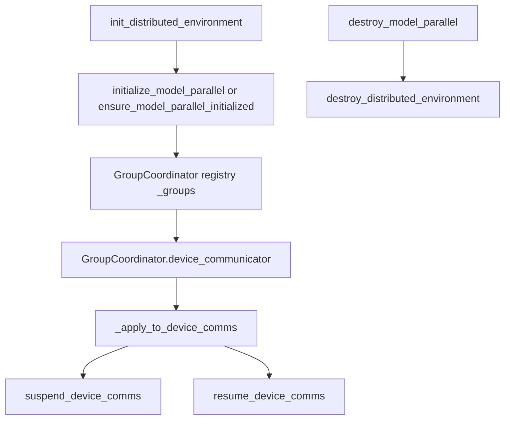
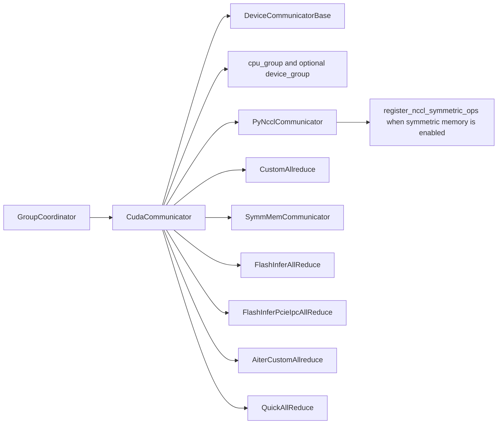
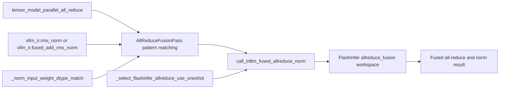
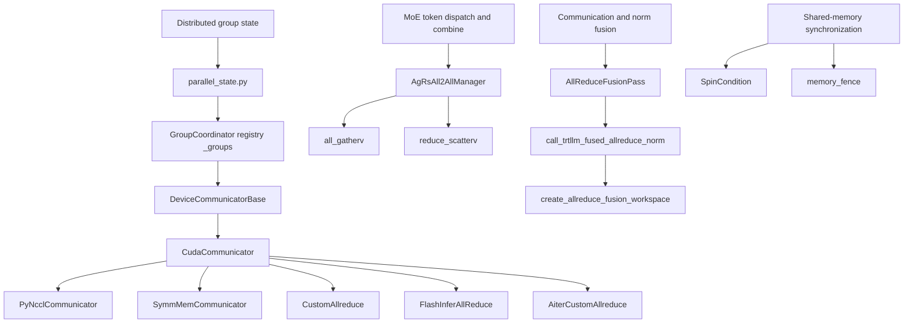

<!-- source: DeepWiki mcp.deepwiki.com · repo vllm-project/vllm · page 9.2 Communication Infrastructure · fetched 2026-10-28 -->

# Communication Infrastructure

Relevant source files

The following files were used as context for generating this wiki page:

- [benchmarks/kernels/benchmark_device_communicators.py](benchmarks/kernels/benchmark_device_communicators.py)
- [benchmarks/kernels/benchmark_fused_collective.py](benchmarks/kernels/benchmark_fused_collective.py)
- [examples/rl/rlhf_http_ipc_no_vllm.py](examples/rl/rlhf_http_ipc_no_vllm.py)
- [examples/rl/rlhf_http_nccl_no_vllm.py](examples/rl/rlhf_http_nccl_no_vllm.py)
- [tests/compile/passes/distributed/test_fusion_all_reduce.py](tests/compile/passes/distributed/test_fusion_all_reduce.py)
- [tests/distributed/test_comm_ops.py](tests/distributed/test_comm_ops.py)
- [tests/distributed/test_cpu_all_reduce.py](tests/distributed/test_cpu_all_reduce.py)
- [tests/distributed/test_mnnvl_alltoall.py](tests/distributed/test_mnnvl_alltoall.py)
- [tests/distributed/test_nccl_symm_mem.py](tests/distributed/test_nccl_symm_mem.py)
- [tests/distributed/test_rocm_aiter_custom_ar.py](tests/distributed/test_rocm_aiter_custom_ar.py)
- [tests/distributed/test_shm_broadcast.py](tests/distributed/test_shm_broadcast.py)
- [tests/kernels/core/test_uva.py](tests/kernels/core/test_uva.py)
- [tests/utils_/test_torch_utils.py](tests/utils_/test_torch_utils.py)
- [tests/v1/determinism/conftest.py](tests/v1/determinism/conftest.py)
- [tests/v1/executor/test_multiproc_executor_timeout.py](tests/v1/executor/test_multiproc_executor_timeout.py)
- [tests/v1/worker/test_gpu_block_table.py](tests/v1/worker/test_gpu_block_table.py)
- [tests/v1/worker/test_gpu_warmup_blocks.py](tests/v1/worker/test_gpu_warmup_blocks.py)
- [tests/v1/worker/test_mixed_warmup_gate.py](tests/v1/worker/test_mixed_warmup_gate.py)
- [tools/pre_commit/check_forbidden_imports.py](tools/pre_commit/check_forbidden_imports.py)
- [vllm/compilation/passes/fusion/allreduce_rms_fusion.py](vllm/compilation/passes/fusion/allreduce_rms_fusion.py)
- [vllm/distributed/device_communicators/aiter_custom_all_reduce.py](vllm/distributed/device_communicators/aiter_custom_all_reduce.py)
- [vllm/distributed/device_communicators/all2all.py](vllm/distributed/device_communicators/all2all.py)
- [vllm/distributed/device_communicators/all_reduce_utils.py](vllm/distributed/device_communicators/all_reduce_utils.py)
- [vllm/distributed/device_communicators/cuda_communicator.py](vllm/distributed/device_communicators/cuda_communicator.py)
- [vllm/distributed/device_communicators/flashinfer_all_reduce.py](vllm/distributed/device_communicators/flashinfer_all_reduce.py)
- [vllm/distributed/device_communicators/shm_broadcast.py](vllm/distributed/device_communicators/shm_broadcast.py)
- [vllm/distributed/device_communicators/shm_tensor_arena.py](vllm/distributed/device_communicators/shm_tensor_arena.py)
- [vllm/distributed/device_communicators/symm_mem.py](vllm/distributed/device_communicators/symm_mem.py)
- [vllm/distributed/elastic_ep/standby_state.py](vllm/distributed/elastic_ep/standby_state.py)
- [vllm/distributed/parallel_state.py](vllm/distributed/parallel_state.py)
- [vllm/distributed/stateless_coordinator.py](vllm/distributed/stateless_coordinator.py)
- [vllm/distributed/utils.py](vllm/distributed/utils.py)
- [vllm/model_executor/layers/fused_allreduce_gemma_rms_norm.py](vllm/model_executor/layers/fused_allreduce_gemma_rms_norm.py)
- [vllm/utils/torch_utils.py](vllm/utils/torch_utils.py)
- [vllm/v1/worker/cpu/__init__.py](vllm/v1/worker/cpu/__init__.py)
- [vllm/v1/worker/cpu/buffer_utils.py](vllm/v1/worker/cpu/buffer_utils.py)
- [vllm/v1/worker/cpu/model_runner.py](vllm/v1/worker/cpu/model_runner.py)
- [vllm/v1/worker/gpu/block_table.py](vllm/v1/worker/gpu/block_table.py)
- [vllm/v1/worker/gpu/buffer_utils.py](vllm/v1/worker/gpu/buffer_utils.py)
- [vllm/v1/worker/gpu/warmup.py](vllm/v1/worker/gpu/warmup.py)

## Purpose and Scope

This page describes the communication mechanisms represented in the supplied vLLM source: distributed group state, CUDA device communication, MoE all2all dispatch and combine, symmetric-memory integration, shared-memory broadcast, and all-reduce/RMSNorm fusion. The available source excerpts establish some CUDA and PyTorch-distributed behavior, but do not expose enough implementation to document XCCL and Gloo communicator classes or every all2all backend in detail. [vllm/distributed/parallel_state.py:8-23]()

Sources: [vllm/distributed/parallel_state.py:8-23]()

---

## Distributed State and Process Groups

`parallel_state.py` describes a lifecycle in which `init_distributed_environment` initializes the distributed environment, `initialize_model_parallel` or `ensure_model_parallel_initialized` establishes model-parallel groups, and corresponding destroy functions clean them up. A process that needs distributed communication without model or pipeline parallelism can omit model-parallel initialization and destruction. [vllm/distributed/parallel_state.py:8-23]()

The module imports PyTorch `Backend`, `ProcessGroup`, and `Store`, and imports `DeviceCommunicatorBase` as the device-communication abstraction. It also maintains a registry of groups, keyed by each coordinator’s unique name. `_apply_to_device_comms` traverses that registry, skips destroyed groups and groups without a device communicator, and applies an action to the remaining communicators. `suspend_device_comms` and `resume_device_comms` use this mechanism to release and restore device-communicator memory collectively. [vllm/distributed/parallel_state.py:40-67] [vllm/distributed/parallel_state.py:142-196]()

### Group and communicator lifecycle

**Diagram: Distributed group state and device communicator lifecycle**

Sources: [vllm/distributed/parallel_state.py:8-23] [vllm/distributed/parallel_state.py:142-196]()

### Tensor-dictionary metadata

`_split_tensor_dict` separates a dictionary into metadata and tensor payloads. For tensor values, it records device *type* (not device index), dtype, and shape in `TensorMetadata`, and places the tensor itself in a separate list. The receiving side can therefore supply its own device index when reconstructing tensor placement. [vllm/distributed/parallel_state.py:74-74] [vllm/distributed/parallel_state.py:116-139]()

Sources: [vllm/distributed/parallel_state.py:74-74] [vllm/distributed/parallel_state.py:116-139]()

---

## Backend and Device-Communicator Boundaries

The supplied sources show PyTorch distributed process-group types and a CUDA communicator implementation. They do not show the backend-selection code or the implementation of XCCL- or Gloo-specific device communicators. Accordingly, the platform labels below indicate the scope of this page, not a claim that the excerpt establishes vLLM’s backend defaults or selection policy. [vllm/distributed/parallel_state.py:40-45] [vllm/distributed/device_communicators/cuda_communicator.py:35-55]()

| Communication layer | What the supplied code establishes |
|---|---|
| PyTorch distributed | `parallel_state.py` imports `Backend`, `ProcessGroup`, and `Store`; this excerpt does not show backend selection. [vllm/distributed/parallel_state.py:40-45]() |
| CUDA communicator | `CudaCommunicator` derives from `DeviceCommunicatorBase` and is initialized with CPU and optional device process groups. [vllm/distributed/device_communicators/cuda_communicator.py:24-55]() |
| NCCL-related CUDA communication | `CudaCommunicator` constructs `PyNcclCommunicator` for groups with world size greater than one. [vllm/distributed/device_communicators/cuda_communicator.py:100-113]() |
| XCCL and Gloo | Their communicator implementations and selection paths are not present in the supplied excerpts. |

Sources: [vllm/distributed/parallel_state.py:40-45] [vllm/distributed/device_communicators/cuda_communicator.py:24-55] [vllm/distributed/device_communicators/cuda_communicator.py:100-113]()

### CUDA communicator setup and eligibility

`CudaCommunicator` initializes its base with the CPU group, optional device and device group, group identity, rank information, and the `use_all2all` flag. The constructor enables several specialized all-reduce options only when the group name has the `tp` prefix; other groups explicitly disable those TP-oriented options. FlashInfer and AITER all-reduce options are also gated by batch-invariance settings in the shown selection logic. [vllm/distributed/device_communicators/cuda_communicator.py:35-88]()

For a multi-rank group, the communicator creates `PyNcclCommunicator`; when symmetric memory is enabled, it registers NCCL symmetric operations for that communicator. The constructor also initializes communicator slots for custom all-reduce, QuickAllReduce, symmetric memory, FlashInfer, and AITER implementations. [vllm/distributed/device_communicators/cuda_communicator.py:90-121]()

**Diagram: CUDA group setup mapped to implementation entities**

Sources: [vllm/distributed/parallel_state.py:48-50] [vllm/distributed/device_communicators/cuda_communicator.py:35-55] [vllm/distributed/device_communicators/cuda_communicator.py:90-120]()

Sources: [vllm/distributed/device_communicators/cuda_communicator.py:35-55] [vllm/distributed/device_communicators/cuda_communicator.py:90-120]()

---

## Custom All-Reduce and Symmetric Memory

### Custom all-reduce options

`CudaCommunicator` imports `CustomAllreduce`, `QuickAllReduce`, and `AiterCustomAllreduce` alongside the NCCL and FlashInfer communication implementations. The visible constructor creates `AiterCustomAllreduce` when the AITER path is enabled; otherwise, when custom all-reduce is enabled for a multi-rank group, it creates `CustomAllreduce`. The custom implementation receives whether the symmetric-memory communicator is active and whether graph buffers should be registered. [vllm/distributed/device_communicators/cuda_communicator.py:90-104] [vllm/distributed/device_communicators/cuda_communicator.py:150-166]()

The constructor computes whether graph-buffer registration is allowed from the current vLLM configuration: registration is disabled when `use_cumem_cudagraph_pool` is active. The excerpt comments that cuMem graph buffers cannot be IPC-registered and are copied during capture instead. [vllm/distributed/device_communicators/cuda_communicator.py:123-126]()

### Symmetric-memory integration

The CUDA communicator reads `VLLM_ALLREDUCE_USE_SYMM_MEM` for tensor-parallel groups and constructs `SymmMemCommunicator` only when that option is enabled and the current platform is CUDA. It registers NCCL symmetric operations on `PyNcclCommunicator` when `is_symmetric_memory_enabled()` is true. [vllm/distributed/device_communicators/cuda_communicator.py:56-68] [vllm/distributed/device_communicators/cuda_communicator.py:106-132]()

`parallel_state.py` imports PyTorch’s `torch.distributed._symmetric_memory` facility, but the supplied excerpt does not expose the allocation or collective implementation in `symm_mem.py`; details beyond the integration points above are therefore not asserted here. [vllm/distributed/parallel_state.py:40-45]()

Sources: [vllm/distributed/device_communicators/cuda_communicator.py:56-68] [vllm/distributed/device_communicators/cuda_communicator.py:90-104] [vllm/distributed/device_communicators/cuda_communicator.py:106-132] [vllm/distributed/device_communicators/cuda_communicator.py:150-166] [vllm/distributed/parallel_state.py:40-45]()

---

## MoE All2All Communication

`all2all.py` defines `PassThroughAll2AllManager` and `AgRsAll2AllManager` in the supplied excerpt. The pass-through manager is a placeholder for `all2all_backend="passthrough"`: its documentation states that the MoE backend performs dispatch and combine itself, so the manager has no all2all handle. [vllm/distributed/device_communicators/all2all.py:32-64]()

`AgRsAll2AllManager` implements communication using all-gather for dispatch and reduce-scatter for combine. It selects a communication group according to sequence-parallel mode and available DP, EP, PCP, and TP group sizes. For variable token counts, `_get_sizes` reads per-DP-rank chunk sizes from the forward context’s DP metadata. [vllm/distributed/device_communicators/all2all.py:67-97]()

The dispatch methods gather hidden states and routing data along dimension zero. `dispatch_router_logits` gathers hidden states and router logits, with optional extra tensors; `dispatch` gathers hidden states, top-k weights, and top-k IDs, also supporting optional extra tensors. `combine` reduce-scatters the resulting hidden states along dimension zero using the selected sizes. [vllm/distributed/device_communicators/all2all.py:99-126] [vllm/distributed/device_communicators/all2all.py:128-173]()

**Diagram: AgRs dispatch and combine data flow**

Sources: [vllm/distributed/device_communicators/all2all.py:67-97] [vllm/distributed/device_communicators/all2all.py:99-126] [vllm/distributed/device_communicators/all2all.py:128-173]()

### Communication-group selection

| Condition | Group selected by `_get_comm_group` |
|---|---|
| Sequence-parallel inputs | EP group. [vllm/distributed/device_communicators/all2all.py:76-78]() |
| DP world size greater than one, with EP enabled and PCP world size greater than one | EP group; the code requires TP world size to be one. [vllm/distributed/device_communicators/all2all.py:79-85]() |
| DP world size greater than one, outside the preceding condition | DP group. [vllm/distributed/device_communicators/all2all.py:79-85]() |
| Otherwise | PCP group. [vllm/distributed/device_communicators/all2all.py:76-86]() |

Sources: [vllm/distributed/device_communicators/all2all.py:76-86]()

The file imports optional FlashInfer, DeepEP, and Mori capability checks and defines additional all2all code beyond the supplied excerpt. Their concrete manager classes, selection behavior, and dispatch data flow are not described here because those implementation lines were not provided. [vllm/distributed/device_communicators/all2all.py:19-48]()

Sources: [vllm/distributed/device_communicators/all2all.py:19-48]()

---

## Communication and RMSNorm Fusion

`allreduce_rms_fusion.py` defines an Inductor fusion-pass implementation that imports the tensor-parallel all-reduce operation and identifies vLLM IR RMSNorm and fused-add-RMSNorm operations. The module conditionally imports FlashInfer communication support and defines helpers for selecting one-shot behavior based on backend, device capability, world size, and tensor size. [vllm/compilation/passes/fusion/allreduce_rms_fusion.py:8-50] [vllm/compilation/passes/fusion/allreduce_rms_fusion.py:87-99] [vllm/compilation/passes/fusion/allreduce_rms_fusion.py:158-176]()

The shown code includes `call_trtllm_fused_allreduce_norm`, which accepts all-reduce input, residual, RMSNorm weight and epsilon, world size, launch and accumulation settings, and optional normalization or quantization outputs. It also reshapes inputs with more than two dimensions into a two-dimensional token-by-hidden representation before proceeding. [vllm/compilation/passes/fusion/allreduce_rms_fusion.py:188-212]()

The fusion logic checks that the norm input and weight dtypes match for RMSNorm and fused-add-RMSNorm patterns; a mismatch prevents the relevant fusion. This protects cases where the model’s norm weight has a different dtype from the activation. [vllm/compilation/passes/fusion/allreduce_rms_fusion.py:67-79]()

FlashInfer workspace creation is implemented in `flashinfer_all_reduce.py`. `_create_workspace` constructs a `TorchDistBackend`, calls `create_allreduce_fusion_workspace` with group and tensor-shape parameters, and handles workspace creation failures. `_resolve_fi_ar_backend` consults `VLLM_FLASHINFER_ALLREDUCE_BACKEND`; in `auto` mode, the shown logic selects MNNVL for the described single-node or Blackwell multi-node cases, and declines automatic selection for other multi-node configurations. [vllm/distributed/device_communicators/flashinfer_all_reduce.py:73-140] [vllm/distributed/device_communicators/flashinfer_all_reduce.py:143-178]()

**Diagram: Fusion pass to fused collective implementation**

Sources: [vllm/compilation/passes/fusion/allreduce_rms_fusion.py:21-25] [vllm/compilation/passes/fusion/allreduce_rms_fusion.py:49-50] [vllm/compilation/passes/fusion/allreduce_rms_fusion.py:67-79] [vllm/compilation/passes/fusion/allreduce_rms_fusion.py:158-176] [vllm/compilation/passes/fusion/allreduce_rms_fusion.py:188-212] [vllm/distributed/device_communicators/flashinfer_all_reduce.py:73-100]()

The supplied source identifies all-reduce/RMSNorm fusion and its optional quantization-related helpers, but does not show a comm/GEMM/RMSNorm fusion implementation. The test excerpt demonstrates a model sequence with tensor-parallel all-reduce, RMSNorm, matrix multiplication, and subsequent collectives; it does not establish that GEMM is fused into the communication kernel. [vllm/compilation/passes/fusion/allreduce_rms_fusion.py:14-21] [tests/compile/passes/distributed/test_fusion_all_reduce.py:126-162]()

Sources: [vllm/compilation/passes/fusion/allreduce_rms_fusion.py:14-21] [tests/compile/passes/distributed/test_fusion_all_reduce.py:126-162]()

---

## Shared-Memory Broadcast

`shm_broadcast.py` provides shared-memory synchronization support. Its `SpinCondition` uses ZeroMQ notifications to wake readers while allowing frequent reads to proceed without polling the socket each time; the reader can enter an idle wait and also has a process-local cancellation path. [vllm/distributed/device_communicators/shm_broadcast.py:117-131] [vllm/distributed/device_communicators/shm_broadcast.py:133-169]()

The module’s `memory_fence` uses a lock acquire/release as a memory barrier for producer-consumer synchronization over shared memory. [vllm/distributed/device_communicators/shm_broadcast.py:78-101]()

Sources: [vllm/distributed/device_communicators/shm_broadcast.py:78-101] [vllm/distributed/device_communicators/shm_broadcast.py:117-169]()

---

## Code-Entity Map

The following diagram connects communication concepts to identifiers present in the supplied source. It does not imply that unshown backends or manager implementations share the same selection path. [vllm/distributed/parallel_state.py:40-50] [vllm/distributed/device_communicators/cuda_communicator.py:35-55] [vllm/distributed/device_communicators/all2all.py:53-86] [vllm/compilation/passes/fusion/allreduce_rms_fusion.py:49-50]()

**Diagram: Communication concepts mapped to code entities**

Sources: [vllm/distributed/parallel_state.py:142-196] [vllm/distributed/device_communicators/cuda_communicator.py:35-55] [vllm/distributed/device_communicators/cuda_communicator.py:90-120] [vllm/distributed/device_communicators/all2all.py:53-86] [vllm/distributed/device_communicators/all2all.py:99-173] [vllm/compilation/passes/fusion/allreduce_rms_fusion.py:188-212] [vllm/distributed/device_communicators/flashinfer_all_reduce.py:73-100] [vllm/distributed/device_communicators/shm_broadcast.py:78-101] [vllm/distributed/device_communicators/shm_broadcast.py:117-169]()

---

## Summary Table

| Concern | Code entities shown | Established behavior |
|---|---|---|
| Distributed state | `init_distributed_environment`, `initialize_model_parallel`, `GroupCoordinator` registry | Initializes distributed and model-parallel groups; registered device communicators can be suspended and resumed. [vllm/distributed/parallel_state.py:8-23] [vllm/distributed/parallel_state.py:142-196]() |
| CUDA collectives | `CudaCommunicator`, `PyNcclCommunicator` | Creates a PyNccl communicator for multi-rank groups and initializes optional specialized communication objects. [vllm/distributed/device_communicators/cuda_communicator.py:90-120]() |
| Symmetric memory | `SymmMemCommunicator`, `register_nccl_symmetric_ops` | Integrates symmetric-memory enablement with CUDA communicator construction and NCCL symmetric-op registration. [vllm/distributed/device_communicators/cuda_communicator.py:106-132]() |
| MoE all2all | `AgRsAll2AllManager` | Dispatches with variable-size all-gather and combines with variable-size reduce-scatter. [vllm/distributed/device_communicators/all2all.py:67-97] [vllm/distributed/device_communicators/all2all.py:99-173]() |
| Fusion | `AllReduceFusionPass`, `call_trtllm_fused_allreduce_norm` | Provides an all-reduce/RMSNorm fusion path with FlashInfer-related workspace and selection helpers. [vllm/compilation/passes/fusion/allreduce_rms_fusion.py:158-176] [vllm/compilation/passes/fusion/allreduce_rms_fusion.py:188-212]() |
| Shared-memory synchronization | `SpinCondition`, `memory_fence` | Uses ZeroMQ notifications for reader wakeup and a lock-based memory barrier. [vllm/distributed/device_communicators/shm_broadcast.py:78-101] [vllm/distributed/device_communicators/shm_broadcast.py:117-169]() |

Sources: [vllm/distributed/parallel_state.py:8-23] [vllm/distributed/parallel_state.py:142-196] [vllm/distributed/device_communicators/cuda_communicator.py:90-132] [vllm/distributed/device_communicators/all2all.py:67-97] [vllm/distributed/device_communicators/all2all.py:99-173] [vllm/compilation/passes/fusion/allreduce_rms_fusion.py:158-176] [vllm/compilation/passes/fusion/allreduce_rms_fusion.py:188-212] [vllm/distributed/device_communicators/shm_broadcast.py:78-101] [vllm/distributed/device_communicators/shm_broadcast.py:117-169]()

---

